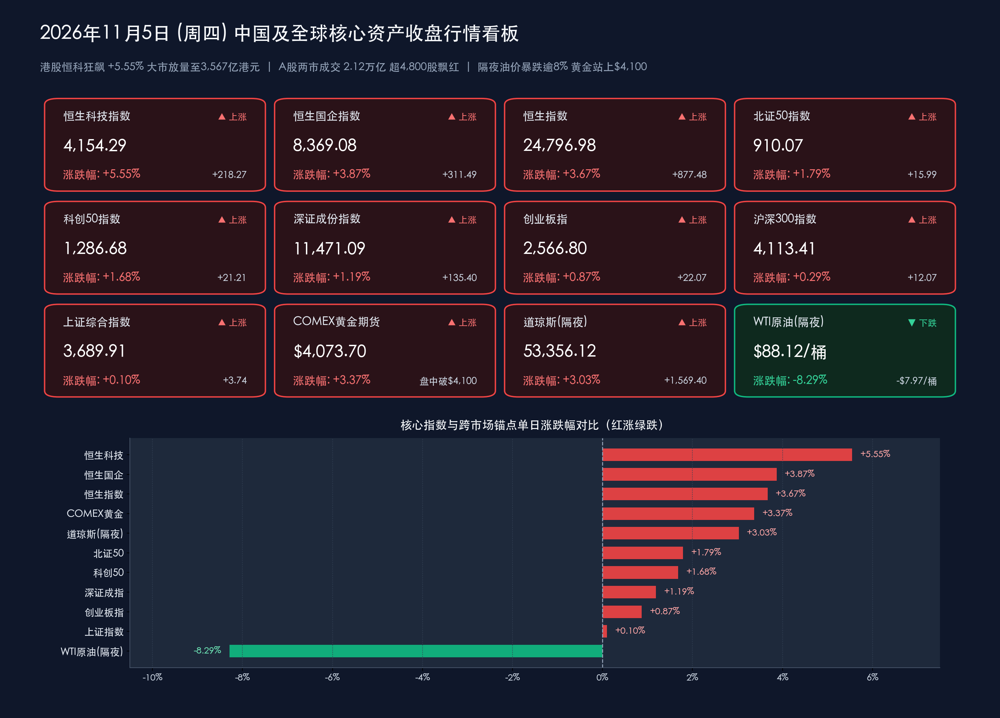

# 恒生科技狂飙5.55%领涨全球！外资爆买推升港股放量至3567亿，A股连破两万亿超4800股飘红、油价崩跌逾8%

**日期：2026年11月5日 (星期四)** &nbsp; **时段：下午/国内与港股收盘复盘**

> **核心摘要**：在隔夜美股创44年最佳中期选举后涨幅（道指暴涨 **+3.03%** 飙升1,569点）、国际油价因中东地缘风险溢价消退崩跌逾 **8%** 显著缓释全球通胀预期，以及国内**《国务院关于金融工作情况的报告》全文公布（明确继续实施适度宽松货币政策、支持中央汇金发挥类平准基金作用）**与**第九届进博会在上海隆重开幕**的内外多重利好共振下，今日中国核心资产上演“港股逼空暴涨、A股百花齐放”的强势接力行情！港股全天单边上攻，**恒生科技指数狂飙 +5.55% 收报 4,154.29点**，**恒生指数大涨 +3.67% 收报 24,796.98点** 豪取日线五连升并一举站上24,700点，主板成交额环比激增近1,200亿港元至 **3,566.67亿港元**，外资踏空买盘全面承接南向资金获利兑现；A股三大指数低开高走全线收红，**科创50续涨 +1.68%**、**深证成指涨 +1.19%**，受“三桶油”及煤炭拖累**上证指数微涨 +0.10% 报 3,689.91点**，但全市场超 **4,800只个股飘红**，沪深两市成交额放大至 **2.12万亿元**（全市场约 **2.14万亿元**）连续两日站稳2万亿上方，光伏新能源掀20CM涨停潮，国际现货黄金强势突破 **$4,100/盎司** 大关。

## 核心行情复盘

*   **港股市场与跨市场资金表现（恒科暴涨5.55%上演史诗级逼空，主板天量成交3,567亿港元印证外资大举扫货）**：
    *   **港股三大核心指数收盘终值**：
        *   **恒生科技指数**：收报 **4,154.29点**，暴涨 **+218.27点**（涨幅 **+5.55%**），一举收复4,000点与4,100点两道整数大关，领涨全球核心科技股指！
        *   **恒生中国企业指数（国企指数）**：收报 **8,369.08点**，大涨 **+311.49点**（涨幅 **+3.87%**）。
        *   **恒生指数**：收报 **24,796.98点**，狂飙 **+877.48点**（涨幅 **+3.67%**），强势斩获日线“五连升”，直逼25,000点重要心理关口。
    *   **科网巨头全线沸腾 vs 传统油气逆势承压**：港股大型科技互联网权重股迎来戴维斯双击式爆发，**网易-S** 暴涨超 **+9%**，**阿里巴巴-W、小米集团-W** 双双飙升超 **+8%**，**腾讯控股** 大涨超 **+7%**，**京东集团-SW、美团-W** 劲升近 **+7%**；反观高股息传统能源股受隔夜国际原油崩跌拖累逆势走弱，**中国石油股份、中国海洋石油**等油气龙头显著回调。
    *   **港股天量成交与内外资筹码大换手**：港股主板全天成交额暴增至 **3,566.67亿港元**，较前一交易日（2,368.96亿港元）激增 **+1,197.71亿港元**（增幅高达 **+50.56%**）！极具信号意义的是，在指数暴涨近900点之际，**南向资金（港股通）全天逢高获利兑现、合计净卖出约 213.26亿港元**（创数月单日净流出峰值，前一日为净卖出32.77亿港元）——内资大额止盈非但未能压制盘面，反而被**海外长线配置型外资与对冲基金空头回补（Short Squeeze）的巨量买盘**全盘吞没并推升指数高位收盘，确立外资主导的右侧估值重估浪潮。
*   **A股核心宽基指数收盘终值（“石油拖累沪指、成长百花齐放”，超4,800股普涨）**：
    *   **北证50指数**：收报 **910.07点**，上涨 **+15.99点**（涨幅 **+1.79%**），重返910点上方，高弹性中小成长人气高涨。
    *   **科创50指数**：在昨日逼近10%涨停极值（+9.92%）的高基数上拒绝深调，今日低开高走续涨 **+21.21点**（涨幅 **+1.68%**），强势收报 **1,286.68点**。
    *   **深证成份指数**：收报 **11,471.09点**，上涨 **+135.40点**（涨幅 **+1.19%**），全天成交额放大至约 **11,382亿元**（较上日10,844.27亿元续增约 **+538亿元**）。
    *   **创业板指**：收报 **2,566.80点**，上涨 **+22.07点**（涨幅 **+0.87%**），稳健站稳2,550点上方。
    *   **沪深300指数**：收报 **4,113.41点**，上涨 **+12.07点**（涨幅 **+0.29%**）。
    *   **上证综合指数**：收报 **3,689.91点**，微涨 **+3.74点**（涨幅 **+0.10%**），全天成交额约 **9,797亿元**（较上日9,532.65亿元增加约 **+264亿元**），虽受石油石化与煤炭高权重股大跌压制指数斜率，但仍顽强翻红再创阶段收盘新高。
*   **量能、赚钱效应与申万行业主力资金流向（两市2.12万亿连站2万亿台阶，电子与电力设备狂吸逾269亿）**：
    *   **量能温和续航**：沪深两市全天合计成交额达 **21,179.5亿元**（约 **2.12万亿元**，含北交所全市场约 **2.14万亿元**），较前一交易日（20,376.92亿元）再度放量约 **+802.6亿元**，连续第二个交易日稳居2万亿元活跃量能上方。
    *   **超4,800股飘红的极致普涨**：全市场上涨个股突破 **4,800只**（超越昨日的4,600余只），赚钱效应从昨日的硬科技独舞进一步扩散至新能源、AI应用与大消费。
    *   **主力资金流向拆解**：申万行业层面，**电子行业**延续吸金王地位，全天获主力资金净流入 **逾142亿元**（**瑞芯微、歌尔股份**等消费电子与端侧AI龙头获大额加仓，**中邮科技、品茗科技**斩获20CM涨停）；**电力设备（光伏、储能、锂电）**紧随其后，获主力资金净流入 **逾127亿元**；**医药生物**等成长板块亦获资金青睐。净流出端，受国际油价暴跌冲击，**石油石化、煤炭开采**等传统能源周期板块以及**银行**等防御红利板块遭遇主力资金净流出。
*   **A股领涨与领跌板块深度拆解**：
    *   **领涨先锋一：光伏设备、电池与储能新能源全产业链掀涨停狂潮**。受益于行业供给侧自律出清、组件排产回暖预期及全球利率下行利好新能源装机IRR，光伏与储能全线爆发，**金刚光伏、贝特利、时创能源、迈为股份、奥特维、海优新材**等超 **20只** 概念股封死20CM/10CM涨停或大涨超10%。
    *   **领涨先锋二：AI应用端（AI视频/营销/传媒）、消费电子与贵金属共振走强**。硬件端估值修复向应用端传导，AI视频、Kimi概念及广告影视板块活跃，**福石控股、易点天下、吉视传媒**等涨停或涨超10%；同时金价破4,100美元带动A股**贵金属**板块及政策托底下的**房地产**板块表现亮眼。
    *   **逆势领跌方向：石油石化与煤炭板块深度回调**。受隔夜WTI与布伦特原油期货双双暴跌超8%直接冲击，A股**中国石油**罕见重挫近 **-8%**，**中国海油、广汇能源**及煤炭板块**中煤能源、中国神华、兖矿能源**跌幅居前，构成上证指数仅涨0.10%而个股超4,800家普涨的核心结构反差。
*   **隔夜美股、原油崩跌、黄金破顶与汇率加密联动**：
    *   **隔夜美股（美东11月4日）创44年最佳中期选举后涨幅，但内部剧烈分化**：随着美国中期选举结果落定（民主党包揽参众两院形成“分裂政府”）及油价暴跌缓释通胀担忧，美股上演强劲“释然性反弹（Relief Rally）”——**道琼斯工业平均指数**狂飙 **+1,569.40点**（涨幅 **+3.03%**）收报 **53,356.12点**，创2025年4月以来最佳单日表现及44年来中期选举后最强涨幅；**标普500指数**上涨 **+119.70点**（涨幅 **+1.58%**）收报 **7,688.62点**；**纳斯达克综合指数**上涨 **+364.50点**（涨幅 **+1.44%**）收报 **25,736.51点**。结构上呈现鲜明分化：消费与平台科技巨头**微软（+6.7%）、亚马逊（+6.1%）、苹果（+5.3%）、谷歌（+3.2%）**大幅领涨；而部分AI基建与数据中心硬件股（如**英伟达跌超3%**，部分云算力及数据中心运营商重挫两位数）因市场担忧民主党国会对数据中心能耗审批与AI基建监管趋严而逆势回调。
    *   **国际油价“雪崩”超8% vs 黄金突破$4,100创历史级强势**：市场普遍预期民主党掌控国会将限制白宫军事行动拨款并加速推动外交途径结束中东及伊朗冲突，地缘风险溢价急速坍塌——隔夜**WTI原油期货（12月）**暴跌 **-$7.97/桶**（跌幅 **-8.29%**，盘中跌超9%）收报 **$88.12/桶**；**布伦特原油期货（1月）**暴跌 **-$8.98/桶**（跌幅 **-8.67%**，盘中跌超10%）收报 **$94.62/桶**，双双创8月底以来新低！与此同时，受美国财政扩张受阻、美元指数跌破102关口及长端美债收益率显著回落提振，**COMEX黄金期货**隔夜大涨 **+3.37%** 收报 **$4,073.70/盎司**，今日（11月5日）亚洲时段**现货黄金**进一步强势突破并站稳 **$4,100/盎司** 大关（盘中交投于 **$4,120—$4,138/盎司**）。
    *   **比特币V型逼空破8万美元 & 人民币汇率稳中偏强**：**比特币（BTC）**在选举夜一度急跌下探 **$75,600**（引发超9万人爆仓）后上演暴力V型反转与空头挤压，强势收复 **$80,000** 心理大关并交投于 **$80,470—$80,800** 区间（单日涨约 **+3.9%—+4.5%**）；汇市方面，今日中国人民银行授权公布银行间外汇市场**人民币兑美元中间价报 6.7156**，较上一交易日（6.7180）**上调 24个基点**，离岸人民币（CNH）在美元走弱背景下保持坚挺稳健运行。

> **数学闭环校验（11月5日收盘终值 vs 11月4日收盘基准精确复核）**：
> * **港股三大指数**：恒生指数 `(24796.98 - 23919.50) / 23919.50 = +877.48 / 23919.50 = +3.6685% ≈ +3.67%`；恒生科技 `(4154.29 - 3936.02) / 3936.02 = +218.27 / 3936.02 = +5.5454% ≈ +5.55%`；恒生国企指数 `(8369.08 - 8057.59) / 8057.59 = +311.49 / 8057.59 = +3.8658% ≈ +3.87%`；主板成交额 `3566.67亿 - 2368.96亿 = +1197.71亿港元（+50.56%）`，全数零误差闭环。
> * **A股六大宽基指数**：上证指数 `(3689.91 - 3686.17) / 3686.17 = +3.74 / 3686.17 = +0.1015% ≈ +0.10%`；深证成指 `(11471.09 - 11335.69) / 11335.69 = +135.40 / 11335.69 = +1.1945% ≈ +1.19%`；创业板指 `(2566.80 - 2544.73) / 2544.73 = +22.07 / 2544.73 = +0.8673% ≈ +0.87%`；科创50 `(1286.68 - 1265.47) / 1265.47 = +21.21 / 1265.47 = +1.6761% ≈ +1.68%`；沪深300 `(4113.41 - 4101.34) / 4101.34 = +12.07 / 4101.34 = +0.2943% ≈ +0.29%`；北证50 `(910.07 - 894.08) / 894.08 = +15.99 / 894.08 = +1.7884% ≈ +1.79%`；沪深两市成交额 `9797亿 + 11382亿 ≈ 21179.5亿元（2.12万亿元）`。
> * **隔夜美股与原油期货**：道指 `(53356.12 - 51786.72) / 51786.72 = +1569.40 / 51786.72 = +3.0305% ≈ +3.03%`；标普500 `(7688.62 - 7568.92) / 7568.92 = +119.70 / 7568.92 = +1.5815% ≈ +1.58%`；纳指 `(25736.51 - 25372.01) / 25372.01 = +364.50 / 25372.01 = +1.4366% ≈ +1.44%`；WTI原油 `-7.97 / (88.12 + 7.97) = -7.97 / 96.09 = -8.2943% ≈ -8.29%`；布伦特原油 `-8.98 / (94.62 + 8.98) = -8.98 / 103.60 = -8.6680% ≈ -8.67%`，严丝合缝！

## 核心解读与市场逻辑

*   **逻辑主线一：国际油价单日崩跌超8%引发全球宏观“降通胀+降利率”重定价，直接劈开中国市场“科技科网暴涨 vs 油气红利回调”的冰火剪刀差**
    *   **数据+事件+逻辑传导**：美国中期选举出现民主党横扫参众两院的“蓝色浪潮”后，华尔街迅速交易两大宏观后果：一是国会拨款约束将迫使白宫降温中东与伊朗军事冲突，令WTI与布伦特原油单日暴跌 **-8.29%** 与 **-8.67%**；二是特朗普政府单边激进财政扩张受阻叠加能源价格暴跌，一举扫清此前困扰市场的二次通胀阴霾，推动**长端美债收益率显著回落、美元指数跌破102、美联储后续降息空间重新打开**。传导至今日A+H市场，分子端直接杀伤A股与港股油气煤炭权重（中国石油跌近8%，压制上证指数仅涨0.10%），而分母端全球无风险利率回落则成为离岸估值折价最深的**港股科网巨头（恒科狂飙+5.55%）**与**黄金（破$4,100）**的最强助推器！
*   **逻辑主线二：港股成交激增50%至3,567亿港元而南向净卖出213亿港元——外资空头回补与主动长钱正式夺回港股定价主导权**
    *   **数据+事件+逻辑传导**：今日盘面最值得机构投资者深思的微观资金背离在于：南向港股通资金趁恒指大涨近900点大举逢高兑现、单日净卖出 **213.26亿港元**，但港股主板成交额却逆势暴增近1,200亿港元至 **3,566.67亿港元**，阿里、腾讯、小米、网易收盘涨幅悉数定格在7%—9%以上！这一罕见背离铁证如山地表明，**推升今日港股暴涨的绝对主力并非内资，而是此前低配中国资产的欧美长线基金与被迫平仓的海外宏观对冲基金空头**。随着美国国会分裂削弱极端关税立法概率，叠加美股AI硬件（英伟达跌超3%）向软件平台（微软、亚马逊涨超6%）的高低切映射，估值仅处历史低位分位的中国互联网与应用端平台成为全球资金再平衡的首选洼地。
*   **逻辑主线三：金融工作报告锚定“适度宽松+汇金类平准机制”，A股两万亿成交推动行情从“半导体独舞”扩散至“光伏新能源+AI应用”全面开花**
    *   **数据+事件+逻辑传导**：昨日科创50逼近10%涨停后，今日A股并未出现“一日游”退潮，而是在沪深两市 **2.12万亿元** 充沛流动性支撑下实现了健康的板块高低轮动与梯度接力——不仅科创50续涨 **+1.68%**、电子行业再获主力净流入 **逾142亿元**，资金更顺势沿着海外AI软件大涨与新能源景气拐点两条脉络，引爆**电力设备/光伏（主力净流入逾127亿、超20股涨停或涨超10%）**与**AI应用端（传媒视频批量涨停）**，全市场超 **4,800股上涨**。今日全文公布的《国务院关于金融工作情况的报告》明确“继续实施好适度宽松的货币政策”与“支持中央汇金发挥类平准基金作用”，进一步夯实了A股跨年攻势的制度底线。

> **核心解读**：今日“沪指微涨0.10%而超4,800股飘红、南向净卖213亿而恒科暴涨5.55%”的两大看似反常的现象，共同指向同一个底层变局——**全球滞胀与极端单边冲击的尾部风险正在消退，中国资产正迎来“外资回补港股科网核心资产 + 内资两万亿活水深耕A股科技与新能源制造”的双轮驱动格局**。同时需留意隔夜美股内部“平台软件强、数据中心硬件弱”的分化信号，在布局上建议采取均衡进攻策略：**港股重点拥抱受益于外资回流与盈利提速的互联网平台、AI应用与创新药龙头；A股紧抓订单可见度高的半导体/消费电子、迎来困境反转的光伏储能龙头，并对冲油气上游周期品短期油价回落的盈利波动风险**。

## 政策脉动

*   **重磅顶层定调：《国务院关于金融工作情况的报告》今日（11月5日）全文公布，锚定适度宽松货币政策与类平准基金稳市机制！**
    *   中国人民银行行长**潘功胜**受国务院委托在十四届全国人大常委会第二十五次会议上所作报告于今日全文披露，释放四大核心政策信号：
        1. **货币政策定调**：明确下一步将**继续实施好适度宽松的货币政策**，综合运用逆回购、中期借贷便利（MLF）、买卖国债等多种工具保持银行体系流动性充裕，使社融、货币供应量增长同经济增长和价格总水平预期目标相匹配；
        2. **资本市场制度托底**：明确提出**实施好支持资本市场的货币政策工具，支持中央汇金公司发挥类平准基金作用，拓宽中长期资金来源、渠道和入市方式，巩固完善资本市场稳市机制**，维护股、债、汇市场平稳运行；
        3. **科技金融与防风险**：高质量建设债券市场“科技板”，加大对科技创新与小微企业支持，持续巩固一揽子化债、房地产金融新政与清欠企业账款成效；
        4. **汇率均衡稳定**：坚持市场在汇率形成中的决定性作用，运用宏观审慎工具（含已宣布自11月15日起上调外汇存款准备金率由4%至6%）保持人民币汇率在合理均衡水平基本稳定。
*   **央行公开市场精准护航：单日开展3,000亿元3个月买断式逆回购 + 2,630亿元隔夜逆回购，人民币中间价上调24bp！**
    *   **买断式逆回购操作**：为保持银行体系中短期流动性充裕，央行于2026年11月5日以固定数量、利率招标、多重价位中标方式开展 **3,000亿元** 3个月期（91天，2027年2月4日到期）买断式逆回购操作（对冲月内到期量后实现适度缩量续作）。
    *   **日度逆回购与汇率中间价**：同日央行以固定利率 **1.25%**、数量招标方式开展 **2,630亿元** 隔夜逆回购操作，全额满足一级交易商需求；银行间外汇市场人民币兑美元中间价报 **6.7156**，较上日上调 **24个基点**。
*   **高水平对外开放强音：第九届中国国际进口博览会今日（11月5日—10日）在上海盛大开幕，多项参展指标创历史新高！**
    *   中共中央政治局常委、国务院副总理**丁薛祥**出席第九届进博会暨虹桥国际经济论坛开幕式并发表主旨讲话，强调**中国从不刻意追求贸易顺差，将持续扩大优质商品和服务进口；中国产品竞争力源于长期研发与企业创新而非政府补贴，主张通过平等对话磋商化解经贸分歧**。
    *   本届进博会汇聚 **162个** 国家、地区和国际组织及 **4,142家** 境外参展企业，展览面积首次突破 **44万平方米**，世界500强及行业龙头参展数首次超过 **300家**，带来超 **480件** 全球首发、亚洲首展、中国首秀代表性展品，向全球跨国资本释放坚定的开放确定性。
*   **海外宏观预期重塑：美国“分裂政府”落定叠加国际油价暴跌超8%，美联储降息周期预期显著修复！**
    *   随着民主党包揽美国国会参众两院控制权，华尔街普遍下调对未来两年美国无序财政赤字扩张及中东战事升级的担忧，长端美债收益率自逼近5%的高位明显回落，油价重挫逾8%大幅缓解未来CPI反弹压力，为美联储延续降息与宽松金融环境扫清核心障碍。

## 最新机构观点

> **中信证券（研究部策略团队｜11月5日最新发布《2027年港股策略研报》及11月A股进攻策略）**：
> * **港股迎来业绩与估值双重修复窗口**：今日发布的2027年港股年度展望指出，经历前期内需与外围流动性双重压制后，当前恒指与恒生科技动态PE仍处于历史低位；预计2027年港股盈利修复提速——**恒生指数、恒生综指盈利预计分别增长 7.4% 和 9.9%，恒生科技指数盈利增速有望大幅提速至 24.8%**，消费与科技将接替成为核心盈利增量！建议成长端重点布局**生物科技、AI应用、智能驾驶、具身智能**，红利端以类债资产作压舱石。
> * **A股维持11月进攻基调**：聚焦三季报验证后订单能见度高的**科技制造龙头（半导体设备、存储、高端PCB及数据中心供电延伸）**，把握国产替代持续兑现主线。

> **中金公司（CICC策略与海外宏观团队｜11月4日—5日最新市场研判）**：
> * **评估海外政治变局溢出与国内反弹持续性**：认为美国国会控制权更迭对单边关税冲击形成潜在立法牵制，叠加国际油价大跌缓解全球通胀与利率上行压力，在前期估值回调与超卖释放后，**A股与港股短期具备显著的“赔率价值”与估值修复弹性**。
> * **中期反转锚定内需信用周期**：指出市场正从单纯情绪博弈转向基本面验证，后续趋势性上行高度将取决于国内居民信用周期的实质性改善及增量财政政策向居民消费与内需端的进一步传导成效。

> **高盛集团（Goldman Sachs）& 摩根大通/摩根士丹利等华尔街外资机构（11月4日—5日跨资产配置动态）**：
> * **华尔街全面升温中国科技与跨境资本参与度**：据彭博及外资投行最新策略跟踪，伴随中国在**AI大模型应用、半导体先进制造及新能源出海**领域的竞争力兑现，高盛、摩根大通、摩根士丹利等华尔街大行对中国资产的配置关注度与港股IPO/再融资参与度显著回暖。
> * **高盛全球EPS与结构选股逻辑**：在全球央行宽松周期延续与油价回落增厚中下游利润率的背景下，高盛对中国市场维持积极的结构性精选策略，重点看好**具备全球竞争壁垒、现金流充沛且直接受益于AI商业化落地的中国互联网平台与硬科技领军企业**。

## 今日市场情绪：翡翠光伏巨翼飞艇乘5.55%脉冲长风翱翔沪港双湾，黑油风暴消散化作两万亿金辉晴空

> Prompt: A colossal radiant solar-winged airship powered by glowing emerald photovoltaic sails and crimson tech-circuit engines soars triumphantly over Victoria Harbour and Shanghai illuminated Expo archways, trailing a +5.55% surge wake. In the background, a dark turbulent crude-oil storm cloud dissolves into golden sunlight beside a gleaming 4100-dollar bullion obelisk and twin 2.12-trillion liquidity rivers.

---
免责声明：内容仅供参考，不构成投资建议。
