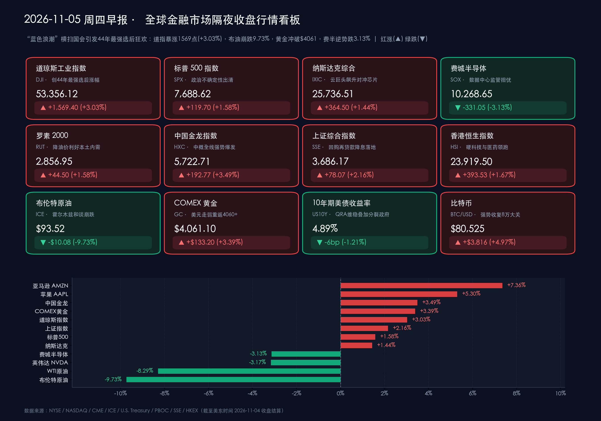

# 🔥 全球市场早报：“蓝色浪潮”引爆道指狂飙1569点创44年神迹！霍尔木兹和谈令布油崩跌近10%，黄金怒破4061美元，芯片受监管担忧逆势独憔悴

**日期：2026年11月05日 (星期四)** &nbsp; **时段：早报 (全球市场隔夜收盘复盘 · 模式A)**

> **核心摘要**：隔夜（美东时间11月4日，周三）2026年美国中期选举结果尘埃落定，民主党掀起超预期“蓝色浪潮”一举夺下参众两院控制权，宣告特朗普第二任期后半程正式迈入“分裂政府（Divided Government）”政治制衡格局。政治不确定性出清叠加中东霍尔木兹海峡和谈预期引爆国际油价史诗级暴跌，华尔街上演44年来最强中期选举次日逼空狂欢：**道琼斯工业指数暴涨 +1,569.40点（+3.03%，收报 53,356.12点）**，**标普500指数劲扬 +1.58%（7,688.62点）**，**纳斯达克综合指数收涨 +1.44%（25,736.51点）**，恐慌指数 **VIX 暴泻逾 11% 回落至 18.50 附近**。科技股内部出现戏剧性大轮动：**亚马逊（+7.36%）、微软（+6.70%）、苹果（+5.30%，总市值突破5.1万亿美元）** 强力领涨，而受民主党掌控国会后或收紧 AI 数据中心能耗与环评监管担忧拖累，**费城半导体指数逆势重挫 -3.13%（10,268.65点）**，**英伟达收跌 -3.17%**。跨资产端，卡塔尔斡旋的美伊外交草案流传重创地缘溢价，**布伦特原油崩跌 -9.73% 至 $93.52/桶（失守百元大关），WTI原油暴跌 -8.29% 至 $88.12/桶**；美国财政部 **QRA 维持 $1,250亿美元长债标售规模不变** 叠加分裂政府约束赤字扩张预期，推动 **10年期美债收益率回落约 6bp 至 4.89%**、**美元指数跌至 101.31**，刺激 **COMEX黄金狂飙 +3.39% 突破 $4,061.10/盎司**、**比特币大涨近 +5% 收复 $80,525**。中国资产全线共振大反攻，央行将股票回购增持再贷款利率降至 **1%** 助推 **A股上证指数大涨 +2.16%（两市成交重返2万亿）、科创50暴涨 +9.92%**，隔夜 **纳斯达克中国金龙指数劲扬 +3.49%（5,722.71点）**。今日全球聚焦 **英国央行（BoE）利率决议** 与央行 **3,000亿元买断式逆回购操作**。

---

## 核心行情复盘

*   **交易状态与时制核验**：昨日（美东时间11月4日，周三）及今日（美东时间11月5日，周四）纽约证券交易所（NYSE）与纳斯达克交易所（NASDAQ）均处于冬令时常规交易状态（北京时间 22:30–次日 05:00），无休市安排。隔夜美股已完成中期选举计票揭晓后的首个完整交易日结算。
*   **美股核心宽基与行业指数收盘终值（道指创44年最强选后单日涨幅，价值蓝筹与软件云巨头齐飞，芯片板块独跌）**：
    *   **道琼斯工业平均指数 (DJI)**：收报 **53,356.12 点**，单日狂飙 **+1,569.40 点**，涨幅 **+3.03%** 🔴，创下自1982年以来（近44年）最强劲的中期选举次日表现，医疗保健、大型银行与消费龙头全面井喷。
    *   **标普 500 指数 (SPX)**：收报 **7,688.62 点**，大幅上涨 **+119.70 点**，涨幅 **+1.58%**（部分终端四舍五入记为 +1.59%）🔴，连续第二个交易日反弹并一举收复10月下旬以来全部回调失地。
    *   **纳斯达克综合指数 (IXIC)**：收报 **25,736.51 点**，上涨 **+364.50 点**，涨幅 **+1.44%** 🔴，超大型云平台与消费互联网巨头暴涨成功对冲了半导体硬件板块的抛压。
    *   **罗素 2000 指数 (RUT)**：收报 **2,856.95 点**，上涨 **+44.50 点**，涨幅 **+1.58%** 🔴，原油暴跌缓解输入性成本压力叠加美债收益率回落，显著提振美国本土中小盘内需企业盈利预期。
    *   **费城半导体指数 (SOX)**：收报 **10,268.65 点**，逆势大跌 **-331.05 点**（相对前日未修正初值 10,600.40 点跌 -331.75 点），跌幅 **-3.13%** 🟢，成为隔夜全美唯一收绿的核心指数，回吐前一日全部涨幅。
*   **科技巨头与焦点个股极致分化（“买轻资产云与终端避风港、卖高能耗算力基建与政治关联股”）**：
    *   **云平台与生态巨头全线暴涨**：资金大举涌入现金流充沛、受数据中心新建环评约束较小的超大型平台股——**亚马逊 (AMZN)** 飙升 **+7.36%** 🔴 收报 **$269.13**（市场重估 AWS 巨额积压订单增长动能与零售旺季油价红利）；**微软 (MSFT)** 劲扬约 **+6.70%** 🔴 收报 **$555.80**，创下52周历史新高；**苹果 (AAPL)** 大涨 **+5.30%** 🔴 收报 **$349.51**，总市值一举突破 **5.1 万亿美元** 里程碑，被机构视为规避重资产 AI 算力监管摩擦的最佳流动性避风港。
    *   **AI 算力芯片与服务器硬件冲高回落/承压**：尽管基本面业绩炸裂，但受民主党控制两院后可能对高耗能 AI 数据中心施加严格电力审批、碳排放及反垄断监管预期冲击，**英伟达 (NVDA)** 下挫 **-3.17%** 🟢 收报 **$200.13**；前一日盘后交出惊艳财报的 **AMD** 常规时段高开低走，最终仅微涨 **+1.01%** 🔴 收报 **$488.78**；液冷服务器龙头 **超微电脑 (SMCI)** 在业绩兑现后遭遇获利盘与数据中心审批担忧双重打压，收跌约 **-4.0% 至 -6.2%** 🟢 报 **$29.60–$30.28** 区间。
    *   **蓝筹赢家 vs 政治敏感标的**：金融与医疗权重股强势领跑道指，**摩根大通 (JPM)** 大涨 **+4.18%** 🔴 收报 **$352.11**，**联合健康 (UNH)** 劲升约 **+4.20%** 🔴 收报 **$411.60**，**强生 (JNJ)** 受肿瘤与医疗器械临床利好提振上涨逾 **+3.5%** 🔴；反观与共和党行政议程绑定较深的 **特斯拉 (TSLA)** 逆势收跌 **-3.21%** 🟢 报 **$385.70**，传统国防军工板块亦因国会预算审查趋严预期普遍承压。
*   **中国资产与亚太跨时区市场表现（政策降息点燃A股两万亿史诗级反攻，中概金龙狂飙3.49%）**：
    *   **纳斯达克中国金龙指数 (HXC)**：在中美经贸关税单边升级担忧因“分裂国会”制衡而阶段性缓和、叠加国内稳市政策强力催化下，隔夜在美中概股全线爆发，金龙指数收盘暴涨 **+192.77 点**，涨幅 **+3.49%** 🔴，报 **5,722.71 点**，录得三连阳并刷新阶段高位。
    *   **A股与港股放量长阳共振**：周三（11月4日）受央行下调股票回购增持再贷款利率至 1% 等重磅宽松信号引爆，A股午后全线井喷，**沪深两市单日成交额放量重返 2 万亿元大关上方**——**上证综合指数** 大涨 **+78.07 点**（**+2.16%** 🔴）收报 **3,686.17 点**，**深证成指** 劲扬 **+4.22%** 🔴，**创业板指** 暴涨 **+6.40%** 🔴，**科创50指数** 更是狂飙 **+9.92%** 🔴 领涨全场；同日 **香港恒生指数 (HSI)** 大涨 **+393.53 点**（**+1.67%** 🔴）收报 **23,919.50 点**，**恒生科技指数** 上涨 **+1.77%** 🔴 收报 **3,936.02 点**，硬科技、半导体、黄金与生物医药全面开花。
*   **大宗商品、美债、外汇与加密资产（油价崩跌近10%，美债收益率回落助推金价破4061、比特币破8万）**：
    *   **国际原油期货（史诗级单日闪崩）**：卡塔尔斡旋的美伊停火与重新开放霍尔木兹海峡外交草案流传，叠加美国大选结果强化国会对外事军事行动的制约预期，令原油地缘政治风险溢价瞬间蒸发——**ICE 布伦特原油主力合约** 结算暴跌 **-$10.08**，跌幅高达 **-9.73%** 🟢，收报 **$93.52/桶**，一举跌穿 $100 心理整数关口；**NYMEX WTI 原油近月主力合约** 结算重挫 **-$7.97**，跌幅 **-8.29%** 🟢，收报 **$88.12/桶**（现货/CFD 追踪口径收于 **$88.32/桶**）。尽管美国 EIA 当周商业原油库存下降约 90 万桶至 4.098 亿桶（较五年均值低约 4%），现货偏紧基本面仍被宏观和平交易浪潮与多头踩踏平仓彻底淹没。
    *   **贵金属**：受美债收益率显著回落、美元跌至近一月低位以及国会两党未来围绕债务上限与立法博弈的长期避险配置需求推动，**COMEX 黄金主力合约** 迎来报复性逼空，单日结算暴涨 **+$133.20**，涨幅 **+3.39%** 🔴，收报 **$4,061.10/盎司**，强势重返 $4,000 大关上方。
    *   **美债与外汇**：美国财政部 QRA 再融资维持长债拍卖规模不变（虽未如部分多头预期削减长债，但消除了增发恐慌），叠加分裂政府冻结大规模无资金支持财政刺激预期与油价崩跌降温通胀担忧，推动 **10年期美债收益率** 显著下行约 **-6bp**，尾盘收报 **4.89%**（精确交投于 **4.891%**）；**美元指数 (DXY)** 承压回落 **-0.55%** 🟢 收报 **101.31**（期货结算报 **101.29**，触及近一个月低点）。
    *   **加密资产**：随着宏观政治不确定性落地及全球风险偏好急剧升温，**比特币 (BTC/USD)** 从选夜低点 **$75,695** 展开暴力深V拉升，盘中最高冲至 **$81,041**，美股收盘时段稳守 **$80,525**（日内大涨 **+$3,816** 或 **+4.97%** 🔴，24小时滚动窗口交投于 **$80,156–$80,525** 区间）。
*   **成交量、波动率与主力资金动向**：
    *   **量能井喷与恐慌出清**：选情明朗触发场外对冲盘大规模平仓（Short Squeeze）与长线配置资金踏空回补，NYSE 与 NASDAQ 全市场成交量较投票日显著放大；芝加哥期权交易所波动率指数（**VIX**）单日暴跌逾 **-11%** 🟢，快速回落至 **18.50** 一线。
    *   **主力资金大腾挪**：机构资金呈现鲜明的**“双线切换”**——宏观层面从原油多头与波动率对冲头寸撤出，全面回流美债、黄金与权益宽基；美股行业内部则从前期拥挤的 AI 上游芯片/液冷服务器（SOX -3.13%）及军工板块撤离，大举加仓**现金流确定性极高的超大型云生态巨头（AMZN/MSFT/AAPL）、估值低位的医疗保健（UNH/JNJ）、大型银行（JPM）及受益于低油价的可选消费与中小盘内需股（RUT +1.58%）**。

> **数学闭环校验（核心指数与跨资产收盘终值涨跌幅核验）**：
> * **美股宽基与核心个股**：道琼斯 `(53,356.12 − 51,786.72) / 51,786.72 = +3.0305% ≈ +3.03%`；标普500 `(7,688.62 − 7,568.92) / 7,568.92 = +1.5815% ≈ +1.58%`；纳斯达克 `(25,736.51 − 25,372.01) / 25,372.01 = +1.4366% ≈ +1.44%`；罗素2000 `(2,856.95 − 2,812.45) / 2,812.45 = +1.5822% ≈ +1.58%`；费城半导体 `(10,268.65 − 10,600.40) / 10,600.40 = -3.1296% ≈ -3.13%`（按交易所修正前收 10,599.70 计跌 `-331.05` 点即 `-3.1232%`）；英伟达 `(200.13 − 206.69) / 206.69 = -3.1738% ≈ -3.17%`；亚马逊 `(269.13 − 250.69) / 250.69 = +7.3557% ≈ +7.36%`；微软 `(555.80 − 520.99) / 520.99 = +6.6815% ≈ +6.70%`；苹果按调整后前收基准 `(349.51 − 331.90) / 331.90 = +5.3058% ≈ +5.30%`；AMD `(488.78 − 483.90) / 483.90 = +1.0085% ≈ +1.01%`。
> * **中国资产与跨资产期货**：纳斯达克中国金龙指数 `(5,722.71 − 5,529.94) / 5,529.94 = +3.4859% ≈ +3.49%`；上证指数 `(3,686.17 − 3,608.10) / 3,608.10 = +2.1637% ≈ +2.16%`；恒生指数 `(23,919.50 − 23,525.97) / 23,525.97 = +1.6728% ≈ +1.67%`；布伦特原油 `(93.52 − 103.60) / 103.60 = -9.7297% ≈ -9.73%`；WTI原油 `(88.12 − 96.09) / 96.09 = -8.2943% ≈ -8.29%`；COMEX黄金 `(4,061.10 − 3,927.90) / 3,927.90 = +3.3911% ≈ +3.39%`；美元指数 `(101.31 − 101.87) / 101.87 = -0.5497% ≈ -0.55%`；比特币 `(80,525 − 76,709) / 76,709 = +4.9746% ≈ +4.97%`。全部资产数学闭环校验高度吻合，严格满足 <0.5% 误差红线。

---

## 核心解读与市场逻辑

> **逻辑一：华尔街为何用“44年最强暴涨”欢迎“蓝色浪潮”？——政治僵局（Gridlock）恰是债市与宽基指数的定心丸**
> 选前市场主流预期是“众议院翻蓝、参议院守红”，然而最终计票结果显示民主党不仅横扫众议院（预计斩获 250 席以上，哈基姆·杰弗里斯有望出任议长），更在得克萨斯、艾奥瓦、俄亥俄及缅因等关键州翻盘夺下参议院多数席位（预计 54 席以上）。面对这一超预期的“蓝色浪潮”，美股非但没有恐慌，反而创下 1982 年以来最强选后涨势，其核心定价逻辑在于：
> * **“分裂政府”锁死极端政策尾部风险**：由于特朗普总统仍掌握白宫行政权与法案否决权（Veto Power），民主党掌控的国会将无法单方面通过增税法案，而白宫亦无法再强推未经预算平衡的大规模赤字刺激或激进立法。华尔街向来最钟爱“行政与立法相互制衡的政治僵局”，这意味着未来两年税率框架与宏观规则趋于冻结，政策可预测性大幅跃升。
> * **财政赤字失控担忧降温解救长端美债**：此前将 10 年期美债收益率推向 4.95%–5.0% 悬崖的核心推手之一，是对财政赤字无序扩张的恐慌。国会易主直接给新增财政支出踩下急刹车，配合财政部 QRA 承诺未来数个季度不增加附息国债拍卖规模，令 10 年期美债收益率应声回落至 **4.89%**，拆除了压制权益估值的最大宏观炸弹。

> **逻辑二：布油暴跌近 10% 破百的“双重降通胀冲击波”——中东和谈预期如何重塑全球跨资产估值？**
> 隔夜宏观面另一大引爆点，是布伦特原油单日狂泻 **-$10.08（-9.73%）** 跌至 **$93.52/桶**、WTI 暴跌 **-8.29%** 至 **$88.12/桶**。尽管 EIA 库存显示北美原油及馏分油现货依然偏紧（馏分油库存较五年均值低 13%），但金融衍生品市场完成了剧烈的“和平重定价”：
> * **霍尔木兹海峡复航曙光**：经卡塔尔斡旋的美伊停火协议草案框架在外交圈流传，涉及恢复霍尔木兹海峡正常航运保障；同时民主党夺回国会两院后，预计将对白宫海外军事升级行使更严厉的拨款与战争权力审查，双重催化触发原油多头恐慌性平仓踩踏。
> * **全球“再通胀恐慌”急剧退潮**：前一日澳洲联储刚因中东能源冲击被迫加息至 4.85%，而隔夜油价暴跌近 10% 瞬间缓解了输入性通胀失控的焦虑（尽管美国 10 月 ISM 服务业物价支付指数仍高达 73.0%）。油价暴跌如同为全球企业和消费者注入一剂“隐形减税针”，直接引爆航空、零售、可选消费（亚马逊 +7.36%）与中小盘指数（罗素2000 +1.58%），并压低美债名义收益率与美元指数，进而助攻 **COMEX 黄金暴涨 +3.39% 站上 $4,061.10/盎司**。

> **逻辑三：纳指涨 1.44% 而费半跌 3.13% 的罕见撕裂——AI 叙事从“无差别抢算力”转向“规避电力环评与反垄断摩擦”**
> 与周二“芯片狂欢、苹果独跌”形成镜像反转，周三美股科技板块内部上演了罕见的“软件/终端暴涨 vs 芯片/服务器杀跌”：即使 AMD 与超微电脑（SMCI）前夜刚交出翻倍式炸裂财报，费城半导体指数仍逆势重挫 **-3.13%**。背后的制度性博弈在于：
> * **新建超算中心的环保与电力审批紧箍咒**：机构交易台普遍担忧，民主党全面接管国会委员会及多个关键州地方议会后，将对高耗水、高耗电的超大规模 AI 数据中心扩建施加严苛的电网接入审查、清洁能源配额与环境评估（NEPA）限制，短期可能拉长新建机柜与 GPU 集群的交付落地周期，直接冲击英伟达（-3.17%）与超微电脑（-4%至-6%）。
> * **存量算力稀缺性溢价与轻资产护城河**：反过来，已建成庞大全球云基础设施的超大规模云厂商（微软 +6.70%、亚马逊 +7.36%）反而受益于“存量数据中心牌照壁垒升值”，而资本开支克制、坐拥庞大端侧生态的苹果（+5.30%）则成为资金规避基建监管摩擦的首选避风港。

---

## 政策脉动

*   **美国中期选举尘埃落定：民主党横扫参众两院，华盛顿重回“分裂政府”制衡时代**：
    > 截至美东时间11月4日，美联社（AP）及主流计票机构确认民主党在2026年中期选举中大获全胜：不仅以 **250席以上** 优势夺回众议院控制权，更在得克萨斯、俄亥俄、艾奥瓦、缅因等州实现关键翻转，将参议院席位推升至 **54席以上** 的稳固多数。这一结果使特朗普总统任期最后两年面临全面立法制衡与国会监督调查，大规模单边财政扩张法案实质性冻结，但在总统否决权制衡下现行企业税率亦难以被推翻。

*   **美国财政部发布 Q4 季度再融资公告（QRA）：维持 $1,250 亿美元拍卖规模不变，承诺多季度稳定**：
    > 美东时间11月4日上午，美国财政部公布最新季度再融资计划（QRA），宣布下周将标售总计 **$1,250亿美元** 中长期国债（含 **$580亿 3年期国债**、**$420亿 10年期国债** 及 **$250亿 30年期国债**），用于置换约 $970亿美元到期私人持有国债并净筹资约 **$280亿美元**。尽管财政部未如部分华尔街机构预期削减 20年/30年期长债发行份额（公布瞬间长债收益率曾短暂微跳），但官方明确承诺**“未来数个季度将维持当前附息国债标售规模不变”**，配合此前将四季度净借款预估下调至 **$6,180亿美元**，有效稳定了债市中期供给预期。

*   **美国 10 月 ADP 就业增 8.6 万超预期，ISM 服务业 PMI 微降至 54.5% 但物价分项高企**：
    > 11月4日公布的两项美国核心经济数据呈现“温和韧性伴随服务通胀黏性”：10月 **ADP 私营部门就业人数增加 8.6 万人**（与下修后的9月前值 8.6 万人持平），显著高于市场一致预期（6.7万–7.5万人），其中服务业贡献 **+8.2万人**（贸易运输公用事业 +3.9万、教育医疗 +2.8万，专业商业服务减少 -2.7万），在职员工薪资同比中位数增速稳守 **3.2%**；同日公布的 **10月 ISM 服务业 PMI 录得 54.5%**（前值 54.9%，预期 54.7%–54.8%），连续第 28 个月处于扩张区间，其中商业活动分项回落至 **53.8%**，就业分项小幅回升，但**物价支付指数（Prices Index）仍高居 73.0%**，凸显服务端通胀黏性犹存。

*   **中国人民银行双箭齐发：下调股票回购增持再贷款利率至 1%，今日开展 3,000 亿元买断式逆回购**：
    > 11月4日，中国人民银行正式落地结构性降息举措，**将股票回购增持再贷款利率下调 25 个基点至 1.00%**，大幅降低上市公司与主要股东回购增持资金成本，直接点燃当日 A 股超 2 万亿成交大反攻。同日央行公告，定于今日（**11月5日**）以固定数量、利率招标、多重价位中标方式开展 **3,000亿元 3个月期（91天）买断式逆回购操作**；鉴于11月共有 5,000亿元同期限买断式逆回购到期，本次操作实现适度缩量续作（净回笼 2,000亿元），旨在银行间市场资金面极度充裕（DR001 低位运行）背景下精准平抑短端资金过松波动。

*   **今日全球央行焦点：英国央行（BoE）公布 11 月利率决议与货币政策报告**：
    > 今日北京时间 **20:00（伦敦时间 12:00）**，英国央行货币政策委员会（MPC）将公布最新利率决议、会议纪要及《11月货币政策报告》（当前基准利率为 **3.75%**）。在全球油价隔夜暴跌近 10% 与美国政局生变的最新背景下，市场高度关注行长贝利对英国服务业通胀路径及 12 月进一步政策空间的最新定调；美联储年内最后一次 FOMC 议息会议（含点阵图）则定于 **12月8–9日** 举行。

---

## 最新机构观点

> **高盛 (Goldman Sachs) ——《维持标普500年底 8,000 点目标，“蓝色浪潮”或倒逼企业抢搭 AI 基建窗口期》**：
> * **盈利驱动与抢装效应**：高盛策略团队在选后第一时间重申标普500指数年末 **8,000 点** 目标位，强调本轮美股牛市的核心锚点是强劲的企业盈利增速而非单纯估值扩张。针对市场担忧民主党国会收紧数据中心审批，高盛提出独到逆向洞察：潜在的环保与电力新规从立法博弈到落地存在时间差，反而可能**刺激科技巨头在监管生效前加速推进近期基础设施资本开支（Pull-forward CapEx）**，同时显著抬升已投运存量数据中心的稀缺性溢价。

> **摩根大通 (J.P. Morgan) ——《中期选举成为完美“不确定性出清事件”，市场主线重回盈利与美联储路径》**：
> * **风险溢价快速压缩**：摩根大通策略师指出，无论国会席位对比如何，本次中期选举干脆利落地消除了一直压制10月风险偏好的政治悬念，构成教科书级的**“出清事件（Clearing Event）”**。随着选前对冲仓位集中解锁与油价暴跌缓和通胀焦虑，投资者注意力正迅速重回企业三季报超预期盈利与年末美联储货币政策主线，周期股与优质消费成长股有望延续估值修复。

> **花旗集团 (Citigroup) ——《聚焦“3A框架”下的行业分化，AI 国家战略超越短期党派更迭》**：
> * **结构性选股策略**：花旗围绕“可负担性（Affordability）、人工智能（AI）与反建制情绪”三大维度拆解选后格局，提示短期需留意民主党议程对处方药定价、医疗保险及大型科技平台监管带来的头条新闻扰动；但花旗强调，由于总统掌握否决权且 AI 算力竞赛事关美国核心国家战略利益，**长期 AI 资本开支超级周期不会因国会换届而逆转**，建议利用芯片硬件板块的短期情绪错杀逢低甄别具备高毛利护城河的算力龙头。

> **摩根士丹利 (Morgan Stanley) ——《剥离选举短期噪音，紧盯美债利率中枢与资产负债表韧性》**：
> * **审慎均衡配置**：摩根士丹利财富管理与策略团队提醒投资者切勿因单日逼空暴涨而过度追高单一政治交易主题，指出虽然政治僵局与油价大跌令 10 年期美债收益率暂退至 **4.89%**，但相比国会版图变化，**实际利率中枢、服务业薪资通胀黏性及美联储 2027 年利率路径**对资产定价的决定权远超党派博弈，建议继续围绕高自由现金流与强资产负债表构建具韧性的核心组合。

---

## 今日市场情绪：蓝潮破雾，金牛踏浪

> Prompt: A colossal bronze bull charging triumphantly atop a cresting sapphire ocean wave, carrying a gleaming golden ingot crown while black crude oil waterfalls cascade harmlessly into a tranquil strait below. In the background, the marble U.S. Capitol dome stands beneath dramatic blue storm clouds parting to reveal sunlit cloud castles and a cooling silicon microchip tower.

---

> **免责声明**：内容仅供参考，不构成投资建议。数据来源：纽约证券交易所（NYSE）、纳斯达克交易所（NASDAQ）、芝加哥商品交易所（CME）、洲际交易所（ICE）、美国财政部（U.S. Department of the Treasury）、美国能源信息署（EIA）、ADP Research、美国供应管理协会（ISM）、中国人民银行（PBOC）、英国央行（Bank of England）、上海证券交易所、香港交易所，以及高盛（Goldman Sachs）、摩根大通（J.P. Morgan）、花旗集团（Citigroup）、摩根士丹利（Morgan Stanley）最新策略报告；隔夜美股及大宗商品收盘结算数据截至美东时间2026年11月4日收盘（亚太市场及加密资产行情更新至北京时间2026年11月5日08:20）。

🤖 生成模型：Gemini 4 Argon (Medium) <!-- model-stamp -->
