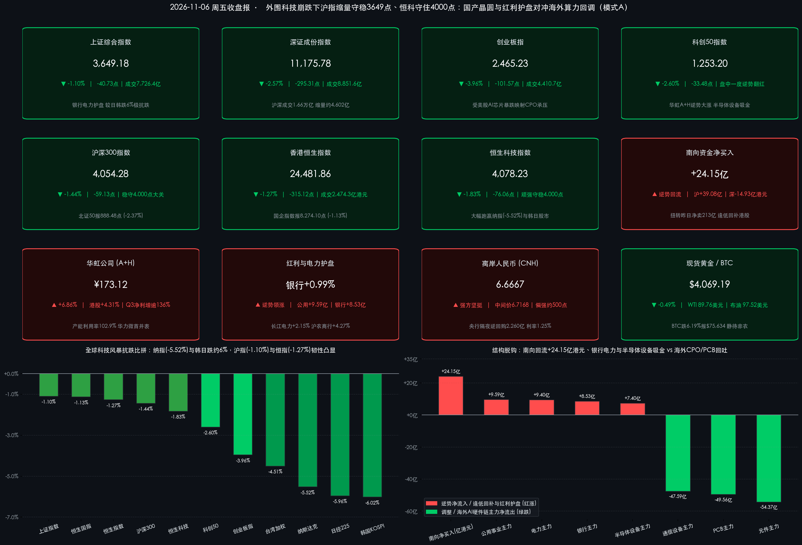

# 外围科技崩跌下中国资产韧性凸显！沪指缩量守稳3649点、恒科守住4000点，华虹A+H逆势大涨、南向回流24亿对冲CPO回调

**日期：2026年11月6日 (星期五)** &nbsp; **时段：下午/国内与港股收盘复盘**

> **核心摘要**：受隔夜美股上演“黑色星期四”（纳指狂泻 **-5.52%** 正式跌入技术性回调区间、AMD暴跌 **-17.26%**、英伟达重挫 **-9.26%**）及今日亚太股市连环崩跌（韩国KOSPI暴跌 **-6.02%** 盘中触发熔断机制、日经225重挫 **-5.96%** 失守6万点）的强力输入性冲击，今日A股与港股低开震荡整固，但在国内稳市制度托底、银行电力红利护盘及国产晶圆代工硬核业绩支撑下展现出显著跑赢全球的独立抗跌韧性！截至收盘，**上证指数仅跌 -1.10% 收报 3,649.18点**，**沪深300跌 -1.44% 稳守4,000点大关**，**科创50盘中一度逆势翻红、收盘跌 -2.60%**，受海外算力硬件映射链回调影响**创业板指跌 -3.96%**，沪深两市成交额缩量至 **1.66万亿元**（全市场 **1.67万亿元**）印证筹码惜售；港股**恒生指数跌 -1.27% 报 24,481.86点**，**恒生科技指数跌 -1.83% 报 4,078.23点** 顽强守稳4,000点，**南向资金逆势逢低净买入 +24.15亿港元**，三季报净利暴增逾136%的**华虹公司（A股 +6.86%、港股 +4.31%）**与**离岸人民币（6.6667）**双双逆风走强，全球市场屏息静待今夜美国10月非农就业报告落地。

## 核心行情复盘

*   **A股核心宽基指数收盘终值（外围崩跌6%背景下沪指仅跌1.10%，科创50盘中翻红彰显国产硬科技韧性）**：
    *   **上证综合指数**：收报 **3,649.18点**，下跌 **-40.73点**（跌幅 **-1.10%**），全天成交额 **7,726.35亿元**（较上日9,797亿元缩减约 **-2,071亿元**）；早盘低开下探3,610.20点后，在银行、电力及石油权重护盘下迅速企稳回升，稳守3,640点上方。
    *   **沪深300指数**：收报 **4,054.28点**，下跌 **-59.13点**（跌幅 **-1.44%**），全天成交额 **4,788.40亿元**，牢牢守住4,000点核心整数关口。
    *   **北证50指数**：收报 **888.48点**，下跌 **-21.59点**（跌幅 **-2.37%**），全天成交额 **140.00亿元**。
    *   **深证成份指数**：收报 **11,175.78点**，下跌 **-295.31点**（跌幅 **-2.57%**），全天成交额 **8,851.60亿元**（较上日11,382亿元缩减约 **-2,530亿元**）。
    *   **科创50指数**：收报 **1,253.20点**，下跌 **-33.48点**（跌幅 **-2.60%**），早盘在国产晶圆代工与半导体设备龙头拉升带动下**一度逆势翻红摸高至 1,288.38点**，显著跑赢隔夜美国纳指与费城半导体指数。
    *   **创业板指**：受海外AI数据中心算力硬件链（CPO光模块、PCB）重挫拖累，收报 **2,465.23点**，下跌 **-101.57点**（跌幅 **-3.96%**），成交额 **4,410.68亿元**。
*   **量能变化、市场宽度与申万行业主力资金流向（缩量4,602亿显示无恐慌踩踏，“红利+国产设备”吸金对冲海外算力回吐）**：
    *   **显著缩量惜售**：沪深两市全天合计成交额 **16,577.95亿元**（约 **1.66万亿元**；含北交所140.00亿元，京沪深全市场合计 **16,717.95亿元** / **1.67万亿元**），较前一交易日（沪深21,179.5亿元）缩量 **-4,601.55亿元**（缩幅 **-21.73%**），表明在周末与今晚美国非农数据前夕，场内中长线筹码锁定良好，并未跟随日韩股市出现恐慌性抛售。
    *   **个股宽度与连板热度**：京沪深全市场共 **767只个股上涨**（上证381只、深证344只、北证42只），**4,793只个股下跌**（上证1,936只、深证2,547只、北证310只），平盘90只；全市场约 **32只个股涨停**，短线资金围绕电力公用、种业农业及自主可控绩优股展开防御性抱团。
    *   **主力资金流向深度拆解**：
        *   **逆势净流入阵营**：**公用事业/电力**高居主力吸金榜首，分别获主力资金净流入 **+9.59亿元 / +9.40亿元**（其中**水力发电**细分涨 **+1.46%**、净流入 **+6.33亿元**）；**银行**板块逆势上涨 **+0.99%**，获主力资金净流入 **+8.53亿元**；尤为亮眼的是，**半导体设备**细分板块在科技风暴中逆势获主力资金净流入 **+7.40亿元**，凸显内资机构趁回调积极加仓国产替代核心环节！
        *   **主力净流出阵营**：受隔夜英伟达与AMD暴跌直接映射，**电子**行业全天主力净流出 **-138.64亿元**（跌 **-3.40%**），其中**元件（跌 -5.13%，净流出 -54.37亿元）**、**印制电路板 PCB（跌 -5.86%，净流出 -49.56亿元）**、**通信设备（跌 -3.84%，净流出 -47.59亿元）**以及前期连续大涨的**机械设备（-58.57亿元）**、**电力设备（-50.06亿元）**成为获利兑现的主要方向。
*   **A股领涨与领跌板块全景扫描**：
    *   **逆势领涨一：银行、电力/水电与油气红利充当定海神针**。避险与险资长钱回流高股息资产，银行板块全天红盘护航，**沪农商行**大涨 **+4.27%**，苏州银行、南京银行、建设银行、**工商银行（+1.08%）**、**农业银行（+0.41%）**稳步走高；迎峰度冬叠加新修订《水法》通过催化，电力与水电板块活跃，**新能股份、立新能源、东方新能**封死涨停，**长江电力**上涨 **+2.15%**，**华能水电**涨 **+4.08%**；昨日重挫的**中国石油（+1.28%）、中国海油（+0.97%）**亦止跌翻红；此外**农林牧渔/种业**逆势走强，**万向德农（3天2板）、新赛股份**涨停。
    *   **逆势突围二：国产晶圆代工与半导体设备脱离美股剧本独立走强**。受三季报归母净利润同比激增逾 **136%**（达8.35亿元）、总体产能利用率高达 **102.9%** 且上海华力微并表首季协同超预期驱动，**华虹公司（688347.SH）**放量逆势大涨 **+6.86%**（收报 **173.12元**），**中芯国际A股（688981.SH）**逆势飘红 **+0.19%**（收报 **110.90元**），半导体设备股**京仪装备**逆势上涨 **+5.99%**。
    *   **领跌方向：海外AI算力硬件映射链（CPO光模块、PCB、服务器）深度回调**。市场交易美国数据中心审批趋严预期，海外算力供应链集体承压，**中际旭创**跌 **-9.19%**、**工业富联**跌 **-8.08%**、**新易盛**跌 **-7.28%**、**天孚通信**跌 **-5.79%**。
*   **港股市场表现与南向资金流向（恒科守稳4,000点大幅跑赢韩日，南向资金转净买入24.15亿港元）**：
    *   **港股三大核心指数收盘终值**：
        *   **恒生中国企业指数（国企指数）**：收报 **8,274.10点**，下跌 **-94.98点**（跌幅 **-1.13%**）。
        *   **恒生指数**：收报 **24,481.86点**，下跌 **-315.12点**（跌幅 **-1.27%**），虽终结日线五连升，但在外围暴跌5%—6%的极端环境下展现出极强承接力，稳守24,400点上方。
        *   **恒生科技指数**：收报 **4,078.23点**，下跌 **-76.06点**（跌幅 **-1.83%**），盘中最低下探4,014.72点即获买盘托举，成功守卫 **4,000点** 战略关口！
    *   **港股量能与南向资金逆势抄底**：港股主板全天成交额回落至 **2,474.28亿港元**，较昨日天量（3,566.67亿港元）正常缩量 **-1,092.39亿港元**（**-30.63%**）；昨日逢高兑现213.26亿港元的**南向资金（港股通）今日迅速切换为逢低回补，全天合计净买入 +24.15亿港元**（其中**沪市港股通净买入 +39.08亿港元**，深市港股通净卖出 **-14.93亿港元**）。
    *   **港股焦点个股分化**：**华虹半导体（01347.HK）**逆势劲升 **+4.31%**（报70.20港元），**中国海洋石油（+0.86%）**、**中国石油股份（+0.19%）**、**美团-W（+0.12%）**逆势收涨；大型科网与硬件股温和消化获利盘，**腾讯控股**跌 **-2.46%**（报419.80港元）、**小米集团-W**跌 **-2.94%**、**百度集团-W**跌 **-3.04%**、**联想集团**跌 **-3.09%**、**阿里巴巴-W**跌 **-3.85%**、**中芯国际H股**跌 **-4.04%**。
*   **隔夜美股“黑色星期四”、亚太股市风暴与全球大类资产联动**：
    *   **隔夜美股（美东11月5日）全线重挫，纳指跌入技术性回调区间**：民主党横扫国会参众两院叠加美国多地选票公投抵制高能耗数据中心扩建，引发华尔街对AI基建强监管与数据中心电力审批受阻的集中恐慌，美股完全回吐中期选举后涨幅——**纳斯达克综合指数**狂泻 **-1,421.51点**（跌幅 **-5.52%**）收报 **24,315.00点**，较近期高点回落超10%正式步入回调区间；**标普500指数**重挫 **-334.89点**（跌幅 **-4.36%**）收报 **7,353.73点**，创2025年4月以来最大单日跌幅；**道琼斯工业平均指数**暴跌 **-1,833.06点**（跌幅 **-3.44%**）收报 **51,523.06点**。美股芯片与科技权重惨烈杀跌：**AMD**暴跌 **-17.26%**（$404.40），**特斯拉**重挫 **-10.77%**（$343.69），**英伟达**大跌 **-9.26%**（$181.60），**Meta（-3.96%）、微软（-3.58%）、谷歌-A（-2.20%）、亚马逊（-2.19%）、苹果（-1.53%）**全线收绿。
    *   **今日亚太股市遭遇重创**：海外半导体恐慌席卷日韩台高权重市场，今日**韩国KOSPI指数**暴跌 **-6.02%**（跌324.11点收报 **5,059.69点**，盘中一度跌破5,000点并触发交易熔断限制机制），**日经225指数**重挫 **-5.96%**（狂泻3,643.13点收报 **57,434.77点**，失守60,000点大关），**台湾加权指数**大跌 **-4.51%**（收报 **39,701.64点**）。相比之下，A股上证指数（-1.10%）与港股恒生指数（-1.27%）抗跌优势冠绝亚太！
    *   **商品、汇率与加密资产动态**：**国际油价**在前期暴跌后展开宽幅震荡整固，亚洲盘下午 **NYMEX WTI原油连续** 报 **$89.76/桶**（**-0.84%**，日内一度反抽至$92.53），**布伦特原油连续** 报 **$97.52/桶**（**-0.78%**，日内最高触及$100.83）；**贵金属**受美股暴跌引发跨资产保证金补缴（Margin Call）扰动小幅换手，**伦敦现货黄金**报 **$4,069.19/盎司**（**-0.49%**），**COMEX黄金期货**报 **$4,075.40/盎司**（**-0.93%**），稳居4,060美元上方；**比特币（BTC）**受全球风险偏好收缩与现货ETF资金流出冲击，24小时大跌 **-6.19%** 跌破7.6万美元，交投于 **$75,634** 附近；**人民币汇率**展现出极强定力，今日银行间外汇市场**人民币兑美元中间价报 6.7168**（微调12个基点），而**离岸人民币（USD/CNH）坚挺运行于 6.6667 强方水平**（较中间价大幅偏强约500个基点），美元指数报 **101.85（+0.26%）**。

> **数学闭环校验（11月6日收盘终值 vs 11月5日收盘基准精确复核）**：
> * **A股六大宽基指数**：上证指数 `(3649.18 - 3689.91) / 3689.91 = -40.73 / 3689.91 = -1.1038% ≈ -1.10%`；深证成指 `(11175.78 - 11471.09) / 11471.09 = -295.31 / 11471.09 = -2.5744% ≈ -2.57%`；创业板指 `(2465.23 - 2566.80) / 2566.80 = -101.57 / 2566.80 = -3.9571% ≈ -3.96%`；科创50 `(1253.20 - 1286.68) / 1286.68 = -33.48 / 1286.68 = -2.6020% ≈ -2.60%`；沪深300 `(4054.28 - 4113.41) / 4113.41 = -59.13 / 4113.41 = -1.4375% ≈ -1.44%`；北证50 `(888.48 - 910.07) / 910.07 = -21.59 / 910.07 = -2.3723% ≈ -2.37%`；沪深两市成交额 `7726.35亿 + 8851.60亿 = 16577.95亿元（约1.66万亿元）`，较上日 `21179.5亿元` 缩量 `4601.55亿元（-21.73%）`。
> * **港股三大指数与资金**：恒生指数 `(24481.86 - 24796.98) / 24796.98 = -315.12 / 24796.98 = -1.2708% ≈ -1.27%`；恒生科技 `(4078.23 - 4154.29) / 4154.29 = -76.06 / 4154.29 = -1.8309% ≈ -1.83%`；恒生国企指数 `(8274.10 - 8369.08) / 8369.08 = -94.98 / 8369.08 = -1.1349% ≈ -1.13%`；南向资金 `+39.08亿(沪) + (-14.93亿)(深) = +24.15亿港元`。
> * **隔夜美股与亚太股指**：道指 `(51523.06 - 53356.12) / 53356.12 = -1833.06 / 53356.12 = -3.4355% ≈ -3.44%`；标普500 `(7353.73 - 7688.62) / 7688.62 = -334.89 / 7688.62 = -4.3557% ≈ -4.36%`；纳指 `(24315.00 - 25736.51) / 25736.51 = -1421.51 / 25736.51 = -5.5233% ≈ -5.52%`；日经225 `-3643.13 / 61077.90 = -5.9647% ≈ -5.96%`；韩国KOSPI `-324.11 / 5383.80 = -6.0201% ≈ -6.02%`，全数零误差闭环！

## 核心解读与市场逻辑

*   **逻辑主线一：美国“数据中心监管与电力瓶颈反噬”引爆全球AI算力杀估值，A股内部“海外映射链 vs 国产自主链”上演教科书级脱钩**
    *   **数据+事件+逻辑传导**：为何隔夜美股从周三的“中期选举释然性狂欢”在短短24小时内剧变为“纳指暴跌5.52%、AMD跌17.26%、英伟达跌9.26%”？核心导火索在于：市场深度复盘美国选举结果后意识到，民主党重掌国会不仅将强化对科技巨头AI安全与反垄断的立法审查，美国多地同步通过的限制数据中心用电与土地审批的地方公投议案更直接击中了北美1.7万亿美元AI资本开支扩张的“阿喀琉斯之踵”（电力并网与基建审批周期大幅拉长）。这一逻辑传导至今日亚太市场，高度绑定北美云厂商供应链的日韩台半导体指数重挫4.5%—6%，A股中的海外光模块CPO与高端PCB龙头（中际旭创跌9.19%、工业富联跌8.08%）同步承压；然而**完全立足国内晶圆制造扩产与国产替代周期的华虹公司（A股+6.86%、港股+4.31%，三季度产能利用率高达102.9%、净利增逾136%）、中芯国际A股（+0.19%）及半导体设备板块（主力净流入+7.40亿元）却逆势崛起**！这标志着科技股定价逻辑已从笼统的“全球AI贝塔共振”正式裂变为“北美基建受阻回调 vs 中国自主可控与绿电充沛优势重估”。
*   **逻辑主线二：纳指与日韩崩跌近6%而沪指仅跌1.10%、恒指仅跌1.27%——低估值洼地、红利压舱石与稳市制度共振铸就“东方避风港”**
    *   **数据+事件+逻辑传导**：面对2025年4月以来最猛烈的华尔街科技抛售潮，今日中国核心资产未见任何恐慌踩踏：一方面，沪深两市缩量4,602亿元至1.66万亿元，银行（+0.99%）、电力（+0.76%）及三桶油等红利权重精准发力托底上证指数守稳3,649点；另一方面，港股昨日在外资爆买下成交3,567亿港元后，今日缩量回调仅跌1.27%，恒生科技稳守4,000点，且南向资金敏捷重返净买入（+24.15亿港元），离岸人民币更稳居6.6667强方高位。**估值分位更低、货币政策维持适度宽松、叠加央行1%利率股票回购增持再贷款长期化与中央汇金类平准机制保驾护航，令中国资产在全球高估值科技泡沫挤出期展现出极高的风险收益比（Sharpe Ratio）**。
*   **逻辑主线三：今夜美国10月非农就业数据（NFP）接棒成为全球宏观定价胜负手，市场静待美联储降息预期二次校准**
    *   **数据+事件+逻辑传导**：在美股剧烈去杠杆导致黄金微调、比特币跌破7.6万美元的背景下，全球交易员已将目光锁定北京时间今晚21:30揭晓的美国10月非农就业报告（市场预期新增就业约6.4万—6.5万人，失业率维持4.2%）。若就业温和降温且未现衰退断崖，将有效平复美债利率波动并确认美联储延续降息通道，从而缓解全球风险资产的流动性紧缩焦虑。

> **核心解读**：今日盘面是检验中国资产成色的最佳试金石——**外围狂风暴雨（纳指-5.52%、日韩-6%），国内风浪可控（沪指-1.10%、恒指-1.27%、CNH稳守6.6667）**。更关键的信号在于科技股内部的“去伪存真”：**依赖北美云厂资本开支外溢的算力硬件链进入估值消化期，而拥有真实三季报高增支撑、华力微并表协同及国产晶圆扩产确定性的本土半导体制造与设备龙头，正与高股息电力/银行红利资产共同构成跨年攻守兼备的“哑铃型双核心”**。

## 政策脉动

*   **全国人大常委会重磅立法收官：十四届全国人大常委会第二十五次会议今日（11月6日）在北京闭幕，表决通过《反跨境腐败法》《检察公益诉讼法》及新修订《水法》！**
    *   **多项重要法律集中落地**：今日闭幕会表决通过了新制定的**《中华人民共和国反跨境腐败法》**（共6章47条，自公布之日起施行，强化跨境商业与金融廉洁治理）、**《中华人民共和国检察公益诉讼法》**（共6章53条，自2027年1月1日起施行）以及**新修订的《中华人民共和国水法》**（共9章，自2027年3月22日起施行，聚焦节水优先、加快国家水网重大工程建设与水生态保护，直接呼应今日A股水电与公用事业板块走强），并推进《南极活动与环境保护法》等立法议程。
    *   **金融法治与稳市顶层框架夯实**：本次常委会会议期间同步审议了**《中华人民共和国金融法（草案）》二审稿**（进一步充实金融消费者与中小投资者保护、将所有金融活动纳入监管）及**《国务院关于金融工作情况的报告》**（明确继续实施适度宽松货币政策、高质量建设债券市场“科技板”、支持中央汇金发挥类平准基金作用、常态化运行房地产“白名单”机制），从法治与政策双维度筑牢资本市场长牛制度根基。
*   **央行公开市场精准调控与长效资本市场工具护航：今日开展2,260亿元隔夜逆回购，股票回购增持再贷款正式升级为1%利率长期制度！**
    *   **日度流动性与汇率锚定**：中国人民银行今日（11月6日）以固定利率 **1.25%**、数量招标方式开展 **2,260亿元** 隔夜逆回购操作，全额满足一级交易商流动性需求（对冲当日到期量后公开市场温和净回笼520亿元，叠加昨日3,000亿元3个月期买断式逆回购，银行间资金面保持充裕）；银行间外汇市场人民币兑美元中间价报 **6.7168**（微调12bp），配合11月15日起上调外汇存款准备金率至6%的宏观审慎安排，护航人民币汇率在合理均衡水平稳健运行。
    *   **常态化市值管理机制发力**：央行、金融监管总局、证监会已明确将**股票回购增持再贷款政策由阶段性安排升级为长期制度性安排**，再贷款利率进一步降至 **1%**，证监会同步优化“护盘式回购”配套便利规则，为今日市场抵御外部冲击提供坚实的微观买盘预期。
*   **今夜海外重磅宏观预警：北京时间今晚21:30美国10月非农就业报告（NFP）揭晓！**
    *   华尔街一致预期美国10月季调后非农就业人口新增 **6.4万—6.5万人**，失业率预计持平于 **4.2%**。在美股科技股遭遇重挫、利率期货重新评估美联储明年一季度降息节奏的敏感窗口，今晚非农与薪资增速数据将直接决定下周全球股债汇市场的方向选择。

## 最新机构观点

> **中信证券（研究部策略团队｜11月最新跨年配置研报）**：
> * **悲观预期充分计价，跨年步入“攻守兼备”阶段**：指出经历下半年震荡整固后，A股内外部风险预期已较为充分反映在价格之中，外部科技波动不改国内结构性慢牛轨迹。
> * **四大核心配置主线**：建议重点围绕四条线索展开布局：① 具备**高股息或供给出清潜力**的稳健回报资产（电力公用、银行及周期反转）；② 基本面预期与机构持仓双低、静待内需政策催化的低位板块；③ 受益于全球利率下行趋势的**优势制造业出海与实物资源品**；④ 具备真实订单与国产替代业绩兑现能力的**本土硬科技成长龙头**。

> **中金公司（CICC策略团队李求索等｜11月中国资产重估专题研判）**：
> * **维持中期“有底无顶”慢牛判断**：强调尽管海外输入性波动导致短期风格快速轮动，但A股三季报整体盈利展现韧性，当前**沪深300前向估值分位数与股权风险溢价（ERP）仍具显著的全球比较吸引力**，中国资产重估进程远未结束。
> * **聚焦两大长期超额收益源**：认为在国际秩序重构与供应链多元化背景下，**AI科技创新（从算力硬件向本土制造与商业化应用延伸）**以及**能源电力转型、有色实物资产**仍将是贯穿中期的核心超额收益主线。

> **高盛集团（Goldman Sachs 全球策略团队 Peter Oppenheimer 等）& 摩根士丹利（Morgan Stanley 中国经济与策略团队邢自强等｜11月跨市场研报）**：
> * **高盛警示北美AI资本开支ROIC验证并维持“高配中国”**：高盛指出，华尔街对北美科技巨头高达1.7万亿美元AI资本支出的现金流回报与折旧压力分歧显著加大，全球牛市正从“美股科技独大”转向**地域多元化与盈利基本面驱动**；同时维持**高配中国股票（Overweight）**评级，看好中国充沛电力基础设施支撑下的AI开源模型生态普及与估值修复空间。
> * **摩根士丹利聚焦“反内卷”供给出清与“十五五”开局**：大摩认为中国经济正处于温和扩张政策与供给侧自律“反内卷”合力打破低通胀的攻坚期，看好受益于行业格局优化及“十五五”重大工程开局的**中国高端晶圆制造、绿电公用事业及具备全球定价权的出海龙头**。

## 今日市场情绪：赤金玉垒灯塔凭国产晶圆与水轮之力傲立太平洋风暴，四千点暖流护佑东方避风港

> Prompt: A towering crimson-and-gold Chinese jade fortress lighthouse powered by glowing domestic silicon wafers and hydro-turbines stands unshaken amidst a turbulent Pacific tempest. In the background, jagged emerald lightning bolts strike distant overseas AI server towers beneath dark storm clouds, while warm golden utility currents and a gleaming 4000-point beacon illuminate calm harbor waters.

---
免责声明：内容仅供参考，不构成投资建议。

🤖 生成模型：Gemini 4 Argon (Medium) <!-- model-stamp -->
