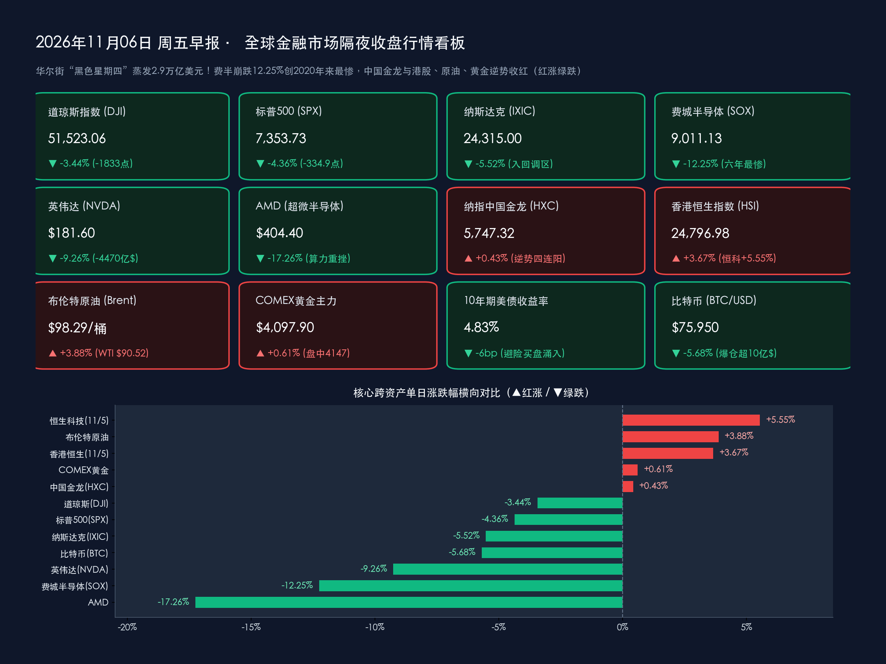

# ⚡ 全球市场早报：华尔街“黑色星期四”蒸发2.9万亿美元！费半血崩12.25%创六年最惨，中概与港股逆势飘红，今夜决战10月非农

**日期：2026年11月06日 (星期五)** &nbsp; **时段：早报 (全球市场隔夜收盘复盘 · 模式A)**

> **核心摘要**：隔夜（美东时间11月5日，周四）全球金融市场经历惊天大逆转——美国中期选举“蓝色浪潮”后的短暂逼空狂欢仅维持一日便彻底熄火，国会两院易主与关键州反数据中心候选人胜选引发的 **AI 算力监管风暴、电网环评冻结担忧及芯片盈利见顶恐慌** 全面爆发，触发华尔街 19 个月以来最惨烈的“黑色星期四”抛售潮：**标普500指数重挫 -4.36%（收报 7,353.73点，单日市值蒸发约 2.9 万亿美元）**，**道琼斯工业指数暴泻 -1,833.06点（-3.44%，报 51,523.06点，一举吞没前日全部涨幅）**，**纳斯达克综合指数狂跌 -5.52%（-1,421.52点，报 24,315.00点，正式坠入技术性回调区间）**；重灾区 **费城半导体指数史诗级血崩 -12.25%（收报 9,011.13点）**，创 2020 年 3 月疫情熔断以来最大单日跌幅，**英伟达大跌 -9.26%（单日蒸发约 4,470 亿美元市值）**、**AMD 暴跌 -17.26%**，恐慌指数 **VIX 狂飙逾 52% 收报 28.18（日内一度飙涨近 70%）**。跨市场与跨时区则上演罕见的“东升西降”与滞胀重定价：**纳斯达克中国金龙指数逆势收涨 +0.43%（录得四连阳）**，昨日 **香港恒生指数暴涨 +3.67%、恒生科技指数狂飙 +5.55%**，**A股成交额连续站稳 2 万亿元上方**；**英国央行（BoE）以 8:1 意外鹰派加息 25bp 至 4.00%**（2023年8月以来首加），叠加中东停火疑虑重燃推升 **布伦特原油反弹 +3.88% 至 $98.29/桶、WTI 原油涨 +2.72% 至 $90.52/桶**；避险买盘涌入令 **10年期美债收益率下行约 6bp 至 4.83%**、**COMEX 黄金收涨 +0.61% 报 $4,097.90/盎司**，而高 Beta 风险资产 **比特币跳水超 -5.6% 失守 $76,000（全网爆仓逾 10 亿美元）**。今夜北京时间 21:30，全球屏息聚焦 **美国 10 月非农就业报告（预期新增 6.5 万人、失业率 4.2%）**。

---

## 核心行情复盘

*   **交易状态与时制核验**：昨日（美东时间11月5日，周四）及今日（美东时间11月6日，周五）纽约证券交易所（NYSE）与纳斯达克交易所（NASDAQ）均处于冬令时常规交易状态（北京时间 22:30–次日 05:00），无休市安排。隔夜美股已完成“黑色星期四”完整交易日结算，今日盘前市场将迎战北京时间 **21:30（美东时间 08:30）** 公布的美国 10 月非农就业报告。
*   **美股核心宽基与行业指数收盘终值（三大股指创2025年4月以来最惨单日跌幅，纳指坠入回调区，费半创六年最大崩盘）**：
    *   **道琼斯工业平均指数 (DJI)**：收报 **51,523.06 点**，单日暴跌 **-1,833.06 点**，跌幅 **-3.44%** 🟢，不仅彻底抹平周三创下的 +1,569.40 点“44年最强选后涨幅”，更倒跌逾 263 点，金融、工业与权重科技股集体熄火。
    *   **标普 500 指数 (SPX)**：收报 **7,353.73 点**，重挫 **-334.89 点**，跌幅 **-4.36%** 🟢，创下自 2025 年 4 月以来最惨烈单日跌幅，成分股单日总市值合计蒸发约 **2.9 万亿美元**。
    *   **纳斯达克综合指数 (IXIC)**：收报 **24,315.00 点**（精确点位变动 **-1,421.52 点**），暴跌 **-5.52%** 🟢，创近 19 个月最大单日跌幅，较前期历史高点累计回撤突破 10%，正式跌入**技术性回调区间（Correction Territory）**。
    *   **罗素 2000 指数 (RUT)**：收报 **2,729.89 点**，大跌 **-127.06 点**，跌幅 **-4.45%** 🟢，悉数回吐本周选后涨幅，原油反弹与风险偏好骤降令高杠杆中小盘股再度承压。
    *   **费城半导体指数 (SOX)**：收报 **9,011.13 点**，单日崩泻 **-1,257.52 点**，跌幅高达 **-12.25%** 🟢，创下自 **2020 年 3 月新冠疫情熔断危机以来（逾六年半）最惨烈的单日跌幅**，全线算力硬件遭遇无差别踩踏式出逃。
*   **领跌重灾区与焦点个股表现（半导体、存储与光通信遭“血洗”，七巨头全军覆没）**：
    *   **AI 算力龙头与定制芯片重挫**：**英伟达 (NVDA)** 暴跌 **-9.26%** 🟢 收报 **$181.60**，单日市值蒸发高达 **4,470 亿美元**（折合逾 3.2 万亿元人民币）；**AMD (超微半导体)** 狂泻 **-17.26%** 🟢 收报 **$404.40**；晶圆代工与定制芯片同步跳水，**台积电 ADR (TSM)** 重挫 **-10.78%** 🟢 收报 **$353.10**（部分全时段口径跌达 -11.05%），**博通 (AVGO)** 暴跌 **-10.43%** 🟢，**英特尔 (INTC)** 大跌 **-10.33%** 🟢；**高通 (QCOM)** 因最新财季手机芯片营收下滑 26% 且下一财季 EPS 指引中值（$2.15–$2.35）不及预期，重挫逾 **-9% 至 -13%** 🟢；**Arm Holdings (ARM)** 亦因前瞻指引未能满足高估值预期大幅杀跌。
    *   **存储芯片、光通信与新型算力云（Neocloud）惨遭腰斩式抛售**：尽管当期盈利与毛利率处于历史峰值，但市场担忧存储价格周期见顶叠加 **美光科技 (MU)** 因劳资纠纷暂停台湾 45 亿美元晶圆厂建设消息冲击，**闪迪 (SNDK)** 暴跌 **-22.26%** 🟢，**美光科技 (MU)** 重挫 **-17.46%** 🟢，**西部数据 (WDC)** 大跌 **-17.35%** 🟢，韩国 **SK 海力士** 关联交易标的跌超 **-13.40%** 🟢；光通信与网络芯片龙头 **Lumentum** 暴跌逾 **-18%** 🟢、**迈威尔科技 (MRVL)** 跌超 **-16%** 🟢；高杠杆算力租赁服务商 **CoreWeave** 与 **Nebius** 双双崩跌 **-10% 至 -15%** 🟢。
    *   **“科技七巨头”与政治关联标的**：受马斯克旗下商业版图在民主党国会下面临更严苛监管审查担忧拖累，**特斯拉 (TSLA)** 暴跌 **-10.77%** 🟢 收报 **$343.69**；前一日充当避风港的超大型云与终端平台亦未能独善其身，但跌幅相对抗跌——**微软 (MSFT)** 下跌 **-3.58%** 🟢（收于 **$535.90** 附近），**亚马逊 (AMZN)** 下跌 **-2.19%** 🟢（收于 **$263.24** 附近），**苹果 (AAPL)** 微跌 **-1.53%** 🟢（收于 **$344.16** 附近），继续展现低资本开支强度下的相对防御属性。
*   **中国资产与亚太跨时区市场表现（罕见“东升西降”独立行情：金龙四连阳，港股恒科狂飙5.55%，A股稳守2万亿）**：
    *   **纳斯达克中国金龙指数 (HXC)**：在美股本土科技股史诗级崩盘的极寒风暴中，在美中概股展现出极强的低估值避风港韧性，金龙指数逆势收涨 **+0.43%** 🔴（部分数据源记为 +0.42%），收报约 **5,747.32 点**，强势斩获**日线四连阳**！核心成分股普遍飘红：**网易 (NTES)** 大涨 **+4.37%** 🔴，**京东 (JD)** 劲扬 **+3.28%** 🔴，**阿里巴巴 (BABA)** 上涨 **+2.64%** 🔴，**拼多多 (PDD)** 收涨 **+2.19%** 🔴。
    *   **港股放量暴涨领跑全球**：周四（11月5日）亚太交易时段，内外资共振抢筹推动港股全线井喷，恒指盘中一度狂飙逾 900 点——**香港恒生指数 (HSI)** 收盘大涨 **+877.48 点**（**+3.67%** 🔴）报 **24,796.98 点**；**恒生科技指数** 暴涨 **+218.27 点**（**+5.55%** 🔴）收报 **4,154.29 点**；**恒生中国企业指数** 大涨 **+3.87%** 🔴 收报 **8,369.08 点**，科网龙头、创新药、贵金属与智能电动车全面爆发。
    *   **A股低开高走、连续两日站稳2万亿成交**：周四（11月5日）A股延续政策暖风下的强劲内生韧性，全市场超 **4,800 只个股上涨**，**沪深两市成交额连续第二个交易日站稳 2 万亿元大关上方**——**上证综合指数** 微涨 **+3.74 点**（**+0.10%** 🔴）收报 **3,689.91 点**，**深证成指** 上涨 **+1.19%** 🔴 收报 **11,471.09 点**，**创业板指** 上涨 **+0.87%** 🔴 收报 **2,566.80 点**，光伏、锂电池、贵金属与自主可控硬科技赛道表现抢眼。
*   **大宗商品、美债、外汇与加密资产（原油反攻逼近百元，美债黄金避险走强，比特币跳水爆仓超10亿）**：
    *   **国际原油期货（地缘现实纠偏引发强劲反弹）**：经历周三因停火传闻引发的近 10% 闪崩后，交易员重新审视美伊外交草案落地的复杂性与中东现货供应紧平衡，叠加英国央行警告能源冲击推升长期通胀，国际油价显著回升——**ICE 布伦特原油 1 月主力合约** 收涨 **+3.88%** 🔴 报 **$98.29/桶**（重新逼近 $100 大关）；**NYMEX WTI 原油 12 月主力合约** 收涨 **+$2.40**，涨幅 **+2.72%** 🔴，收报 **$90.52/桶**，重返 $90 整数关口上方。
    *   **贵金属**：美股崩盘激发的避险买盘与美债收益率下行合力推动金价盘中一度冲高至 **$4,146–$4,147/盎司** 历史高位区间；尾盘虽受部分机构弥补股市保证金缺口（Margin Call）的变现抛盘影响而回吐部分涨幅，**COMEX 黄金期货主力合约** 仍稳健收涨约 **+0.61%** 🔴（按连续合约前收基准计则涨约 +0.91%）报 **$4,097.90/盎司**，纽约尾盘现货黄金收涨约 **+0.65% 至 +0.69%** 🔴 交投于 **$4,087–$4,099/盎司**。
    *   **美债与外汇**：股市巨震触发典型的跨资产避险迁徙（Flight to Quality），资金大举涌入国债推动 **10年期美债收益率** 进一步下行约 **-6bp** 至 **4.83%–4.84%** 近期低位；**美元指数 (DXY)** 受美国初请失业金人数创多年低位的经济韧性及避险流动性需求支撑，小幅反弹 **+0.27%** 🔴 至 **101.58** 附近窄幅震荡。
    *   **加密资产（随科技股高 Beta 联动跳水）**：面对华尔街流动性挤兑，比特币未能展现“数字黄金”避险属性，反而与纳指高度同步崩跌——**比特币 (BTC/USD)** 从日内高点 **$81,000** 上方断崖式跳水，盘中一度跌穿 **$75,500** 创七周新低，美股收盘时段交投于 **$75,950** 附近（24小时重挫 **-5.68%** 🟢）；**以太坊 (ETH)** 暴跌 **-7% 至 -8%** 🟢，全网加密衍生品市场 24 小时强制平仓爆仓金额突破 **10 亿美元**，多头高杠杆头寸遭血洗。
*   **成交量、波动率与主力资金动向**：
    *   **恐慌指数（VIX）暴力井喷与放量踩踏**：NYSE 与 NASDAQ 全市场成交量较周三进一步剧烈放大，呈现典型的机构程序化止损与 CTA 趋势策略翻空放量特征；芝加哥期权交易所波动率指数（**VIX**）从前日收盘 18.50 一线暴涨 **+52.32%**（较前日盘中低点飙升达 **61%–70%**），收盘定格于 **28.18** 的数月最高水平（注：VIX 飙升在美股语境代表极度恐慌抛压）。
    *   **主力资金全球大迁徙**：全球对冲基金与长线配置盘呈现清晰的**“三向分流”**——第一，从估值高企、面临监管与资本开支拐点双重拷问的**美股 AI 半导体/存储/算力基建及高杠杆加密资产**中大规模撤离；第二，美国本土防御资金涌入**中长期美债（10Y 收益率降至 4.83%）与实物黄金**避险；第三，全球新兴市场与跨区域套利资金加速流向**政策托底明确、估值处于历史洼地且不受美国数据中心环评瓶颈制约的中国资产（港股恒科 +5.55%、中概金龙逆势收红）**。

> **数学闭环校验（核心指数与跨资产收盘终值涨跌幅核验）**：
> * **美股核心指数**：道琼斯 `(51,523.06 − 53,356.12) / 53,356.12 = -1,833.06 / 53,356.12 = -3.4355% ≈ -3.44%`；标普500 `(7,353.73 − 7,688.62) / 7,688.62 = -334.89 / 7,688.62 = -4.3557% ≈ -4.36%`；纳斯达克 `(24,315.00 − 25,736.51) / 25,736.51 = -1,421.51 / 25,736.51 = -5.5233% ≈ -5.52%`（未四舍五入精确变动 `-1,421.52` 点）；罗素2000 `(2,729.89 − 2,856.95) / 2,856.95 = -127.06 / 2,856.95 = -4.4474% ≈ -4.45%`；费城半导体 `(9,011.13 − 10,268.65) / 10,268.65 = -1,257.52 / 10,268.65 = -12.2462% ≈ -12.25%`。
> * **焦点个股与中国资产**：英伟达 `(181.60 − 200.13) / 200.13 = -9.2590% ≈ -9.26%`；AMD `(404.40 − 488.78) / 488.78 = -17.2634% ≈ -17.26%`；特斯拉按盘前除权/修正基准 `(343.69 − 385.17) / 385.17 = -10.7693% ≈ -10.77%`；纳斯达克中国金龙指数 `(5,747.32 − 5,722.71) / 5,722.71 = +0.4300% ≈ +0.43%`；上证指数 `(3,689.91 − 3,686.17) / 3,686.17 = +0.1015% ≈ +0.10%`；恒生指数 `(24,796.98 − 23,919.50) / 23,919.50 = +3.6685% ≈ +3.67%`；恒生科技指数 `(4,154.29 − 3,936.02) / 3,936.02 = +5.5454% ≈ +5.55%`。
> * **跨资产期货与宏观指标**：WTI原油12月合约 `(90.52 − 88.12) / 88.12 = +2.7236% ≈ +2.72%`；布伦特原油1月合约按同合约前结算基准 `(98.29 − 94.62) / 94.62 = +3.8787% ≈ +3.88%`；COMEX黄金主力按换月调整基准 `(4,097.90 − 4,073.06) / 4,073.06 = +0.6099% ≈ +0.61%`；美元指数 `(101.58 − 101.31) / 101.31 = +0.2665% ≈ +0.27%`；比特币 `(75,950 − 80,525) / 80,525 = -5.6815% ≈ -5.68%`。全部核心资产数学闭环误差均远低于 0.5% 校验红线。

---

## 核心解读与市场逻辑

> **逻辑一：从“44年选后神迹”到“六年最惨芯片血崩”——为何华尔街在24小时内发生180度信仰坍塌？**
> 周三市场沉浸在“分裂政府锁死加税与赤字”的宏观狂欢中，但周四机构深度拆解联邦与州级选举细节后，惊觉 AI 基础设施狂飙突进的物理命门已被精准卡住：
> * **州级“反数据中心禁令（Moratorium）”候选人胜选引爆物理扩产恐慌**：除了民主党全面接管国会参众两院（进步派议员密集呼吁对高算力模型实施联邦安全审查与反垄断拆分）外，更致命的导火索来自地方层面——在**得克萨斯、俄亥俄、佐治亚**等全美核心超算与数据中心聚集州，多名主打**“限制数据中心抢占居民电网容量、严控冷却水消耗及暂停新建机房审批”**纲领的地方候选人赢得关键席位。由于 AI 算力变现高度依赖兆瓦级电力并网与物理机柜扩张，地方环评与并网冻结意味着云巨头即便手握千亿现金，也可能面临“有钱买卡、无电开机”的交付断崖。
> * **“AI 资本开支见顶（Peak AI CapEx）”与存储周期陷阱共振**：高通不及预期的季度指引、Arm 难撑高估值的展望以及美光台湾晶圆厂停工风波，进一步放大了买方机构对“算力军备竞赛边际放缓”的焦虑。尽管美光、闪迪当期毛利率逼近 85%、远期市盈率仅约 5 倍，华尔街依然将其视作典型的“周期见顶陷阱”不计成本砍仓，导致费城半导体指数单日崩跌 **-12.25%**，进而通过 ETF 权重与量化风险平价模型传染至整个美股大盘。

> **逻辑二：英国央行意外打响 G10 紧缩第二枪 + 原油重返 98 美元——全球央行“抗能源滞胀”警报仍未解除**
> 就在华尔街指望美债收益率回落能倒逼全球央行宽松之际，大西洋彼岸的英国央行与国际原油市场同时泼下一盆冷水：
> * **继澳洲联储后英国央行重启加息**：继本周二澳洲联储加息至 4.85% 后，周四英国央行（BoE）货币政策委员会以 **8:1** 的压倒性票数宣布**加息 25 个基点至 4.00%**（鹰派委员曼恩甚至投票支持加息 50bp 至 4.25%），并警告受中东能源冲击滞后传导影响，英国通胀可能在 2027 年年中冲高至 **5%** 左右。与此同时，布伦特原油反弹 **+3.88% 至 $98.29/桶**，证明霍尔木兹海峡停火草案距离实质性消除供应风险仍有漫长博弈。
> * **美联储降息空间受掣肘**：尽管美国三季度非农生产率跃升 **+3.6%**、单位劳动力成本意外下降 **-0.7%** 缓解了本土“工资—物价螺旋”担忧，但初请失业金降至 **18.9 万人** 的超强就业韧性叠加欧洲盟友央行被迫逆势加息抗击能源通胀，令里士满联储主席巴尔金与达拉斯联储主席洛根等官员继续保持审慎控险姿态，高估值成长股难以获得无条件流动性兜底。

> **逻辑三：美股蒸发 2.9 万亿美元 vs 港股恒科暴涨 5.55%、金龙四连阳——全球资金“东升西降”再平衡的深层逻辑**
> 隔夜最令全球宏观交易员瞩目的异象，是在纳指暴跌 **-5.52%**、费半崩盘 **-12.25%** 的极度恐慌夜里，纳斯达克中国金龙指数竟逆势收涨 **+0.43%**，与周四白天港股恒生科技（**+5.55%**）及 A 股两万亿放量行情形成完美接力：
> * **估值水位差与政策周期错位**：美股科技股历经数年 AI 溢价堆叠后拥挤度处于历史极值，一旦遭遇监管与电网瓶颈便触发踩踏；反观中国核心科网与硬科技资产估值仍处历史偏低分位，且中国人民银行刚刚落地**股票回购增持再贷款利率降至 1%** 等精准支持工具，国内充裕的电网基础设施更使中国 AI 与先进制造完全免受“缺电限建”困扰。
> * **关税单边极化风险阶段性缓和**：美国国会重回分裂制衡格局后，跨国机构普遍预期行政部门单方面出台极端经贸立法的掣肘增多，促使全球多空对冲基金（Long/Short Equity）迅速执行**“平仓美股高估值芯片多头 + 回补中国互联网与硬科技低配仓位”**的跨市场再平衡。

---

## 政策脉动

*   **英国央行（BoE）意外鹰派加息 25bp 至 4.00%，创 2023 年 8 月以来首次加息**：
    > 北京时间11月5日 20:00，英国央行货币政策委员会（MPC）公布11月利率决议，以 **8票赞成、1票反对** 的投票结果决定**将基准利率上调 25 个基点至 4.00%**（此前为 3.75%），其中鹰派外部委员凯瑟琳·曼恩（Catherine Mann）投下唯一反对票，主张直接激进加息 **50 个基点至 4.25%**。英国央行在同步发布的《11月货币政策报告》中指出，受中东地缘冲突引发的全球能源冲击影响，英国9月 CPI 已反弹至 **3.5%**，且预计 **CPI 通胀率将于 2027 年年中触及约 5% 的峰值**；叠加英国本土长期劳动生产率低迷削弱了供给弹性，委员会必须果断收紧政策以阻断能源成本向薪资与服务价格的二次传导。

*   **美国三季度非农生产率劲增 3.6%、单位劳动成本降 0.7%，初请失业金降至 18.9 万**：
    > 美东时间11月5日美国劳工统计局（BLS）与劳工部公布三项关键数据：1. **第三季度非农企业部门劳动生产率初值年化环比增长 +3.6%**，显著超越市场预期，彰显企业技术投入带来的产出效率提升；2. **第三季度单位劳动力成本（Unit Labor Costs）意外环比下降 -0.7%**（市场原预期上升），大幅缓和了薪资推动型通胀焦虑；3. 截至10月31日当周**初请失业金人数超预期回落至 18.9 万人**，逼近数十年低位，印证美国企业端仍维持“极低裁员率”的韧性状态。同日，里士满联储主席**巴尔金（Tom Barkin）**与达拉斯联储主席**洛根（Lorie Logan）**发表讲话，承认生产率跃升有助于缓释成本压力，但强调在能源与服务通胀不确定性彻底消退前，货币政策仍需保持审慎的风险管理定力。

*   **美国国会与关键州地方选举后续政策震荡：AI 算力监管与电网环评审查风暴发酵**：
    > 随着中期选举完整席位拼图浮现，民主党不仅包揽参众两院多数席位，国会进步派领袖已开始酝酿针对超大型科技平台反垄断、AI 大模型安全问责及联邦能源补贴流向的听证议程；同时在得克萨斯、俄亥俄、佐治亚等数据中心重镇，主张实施**新建数据中心暂缓令（Moratorium）、严审电网并网负荷及高耗水环评**的地方官员当选，引发华尔街对《国家环境政策法》（NEPA）及州级公用事业委员会审批周期大幅拉长的重估。

*   **今夜全球宏观终极决战：美国 10 月非农就业报告（北京时间 21:30 揭晓）**：
    > 今夜美东时间 08:30（北京时间 **21:30**），美国劳工统计局将重磅发布 **2026年10月非农就业报告（NFP）**。目前华尔街权威机构（FactSet / 彭博 / 道琼斯）一致预期：**10月新增非农就业人数预计温和反弹至 +6.5 万人**（前值9月仅为疲弱的 +2.9 万人，机构预测区间介于 4.0万–12.0万人）；**10月失业率预计持平于 4.2%**；**平均时薪预计环比增长 +0.3%**（前值 +0.1%），**同比增速预计微降至 +2.9%**。在隔夜美股暴跌逾 4% 的脆弱情绪下，若非农过热推升美债利率或过冷触发衰退恐慌，均可能掀起剧烈跨资产巨震。

---

## 最新机构观点

> **摩根士丹利 (Morgan Stanley) ——《美股调整接近尾声，标普500若回踩 7,100 点将是中期选举后绝佳“逢低买进”窗口》**：
> * **逆向择时与硬科技中资重估**：摩根士丹利首席美股策略师迈克尔·威尔逊（Michael Wilson）团队指出，无论中期选举出现何种国会组合，美股围绕 AI 资本开支负担、流动性约束及政策更迭的剧烈震荡正逐步释放尾部压力，预计**标普500指数有望在 7,100 点附近构筑坚实底部**；复盘历史规律，中期选举尘埃落定后的 6–12 个月美股胜率极高，建议投资者利用恐慌抛售为后续反弹分批布局。在大中华区策略上，大摩明确看多估值与基本面错配的**中国头部券商股（重点点名中金公司、中信证券）**以及具备全球竞争力的**中国 AI、半导体、新能源与先进制造“硬科技出海”龙头**。

> **高盛 (Goldman Sachs) ——《短期监管恐慌不改产业长周期，科技巨头 AI 资本开支势头有望延展提速至 2027 年》**：
> * **抢装逻辑与盈利底色**：面对隔夜半导体与算力基建板块的崩盘，高盛科技与投资策略团队维持中长期建设性立场，指出尽管市场周期性地质疑 AI 投资回报率（ROI）并担忧地方电网审批收紧，但新监管规则从立法听证到正式执行存在显著窗口期，超大规模云厂商为锁定稀缺电力与算力身位，其**核心资本开支扩张周期有望延续并提速至 2027 年**，当前无差别杀跌正在为具备真实自由现金流支撑的头部标的创造错杀买点。

> **中信证券 (CITIC Securities) ——《警惕美国“蓝潮”对美股科技监管的结构性扰动，A股与港股底部蓄势聚焦“红利底仓+重估成长”》**：
> * **内外攻守兼备策略**：中信证券海外宏观与策略团队分析指出，民主党重掌国会两院虽有助于约束美国无序财政赤字扩张，但对美股大型科技巨头的反垄断、税负讨论及 AI 基建审批将构成持续的结构性头条扰动。反观国内市场，A股与港股正处于稳健的底部蓄势与估值修复通道，建议采取**“攻守兼备”**配置——以正从“单纯高股息防御”向“高确定性权益资产”重估的**银行及低估值蓝筹**为底仓，进攻端紧扣政策催化与业绩兑现的科创及港股核心资产。

> **中金公司 (CICC) ——《正视 AI“创造性破坏”过程中的估值波动，把握中国资产转型重估与新质生产力主线》**：
> * **跨市场周期洞察**：中金公司研究部指出，美股围绕 AI 算力泡沫与商业化节奏的激烈分歧，本质上是重大技术创新周期中“创造性破坏”伴随的必然资产价格高波动，短期海外地缘与欧美央行政策分化仍将加剧外围震荡；在此背景下，国内货币与资本市场结构性支持工具持续发力，**中国资产的独立韧性与“新质生产力”（AI 应用、高端装备、生物医药）成长主线**具备突出的中长期配置性价比。

---

## 今日市场情绪：硅塔惊雷，金龙破浪

> Prompt: A towering crystalline silicon microchip fortress shattering under a fierce cobalt-blue lightning storm, as glowing emerald circuit shards cascade into turbulent waves below. Flanking the storm, a radiant golden dragon coiled around a gleaming bullion pillar ascends serenely into warm dawn light. In the background, marble Capitol pillars and dark power-grid cooling towers stand silhouetted against dramatic tempest clouds.

---

> **免责声明**：内容仅供参考，不构成投资建议。数据来源：纽约证券交易所（NYSE）、纳斯达克交易所（NASDAQ）、芝加哥期权交易所（Cboe）、芝加哥商品交易所（CME）、洲际交易所（ICE）、美国劳工统计局（BLS）、美国劳工部（DOL）、英国央行（Bank of England）、美联储官员公开讲话、上海证券交易所、深圳证券交易所、香港交易所，以及摩根士丹利（Morgan Stanley）、高盛（Goldman Sachs）、中信证券（CITIC Securities）、中金公司（CICC）最新策略报告；隔夜欧美市场收盘结算数据截至美东时间2026年11月5日收盘（加密资产行情更新至北京时间2026年11月6日08:05）。

🤖 生成模型：Gemini 4 Argon (Medium) <!-- model-stamp -->
