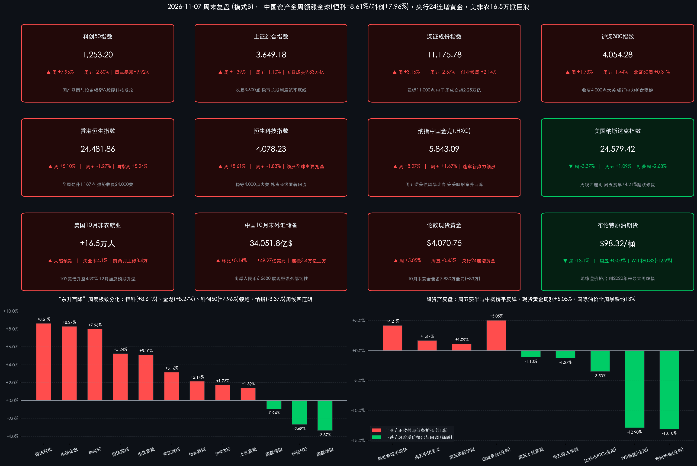

# “东升西降”周度极致演绎！恒科狂飙8.61%、科创50暴涨7.96%领跑全球，央行连续24个月增持黄金、美16.5万非农掀加息风暴

**日期：2026年11月7日 (星期六)** &nbsp; **时段：下午/国内与全球市场周末深度复盘**

> **核心摘要**：2026年11月首个交易周（11月2日—11月6日），全球资本市场上演教科书级的“东升西降”大分化——在国内央行1%利率股票回购增持再贷款长期化、千亿级SFISF第3期落地及国产晶圆代工硬核三季报共振催化下，中国核心资产无惧周四美股“黑色星期四”输入性巨震，实现全周全线收阳！**恒生科技指数全周狂飙 +8.61%**（稳守4,000点）、**纳斯达克中国金龙指数全周暴涨 +8.27%**（周五逆势再涨 **+1.67%**）、**科创50全周劲升 +7.96%**、**恒生指数大涨 +5.10%**、**上证指数收涨 +1.39% 站稳3,649点**，沪深京五日合计成交放量至约 **9.33万亿元**；反观美股，尽管周五芯片股超跌反弹带动纳指收涨 **+1.09%**，但**纳指全周仍累跌 -3.37% 惨遭周线四连阴**。过去24小时宏观面再掀波澜：昨夜美国10月非农新增就业爆冷高达 **+16.5万人**（大超预期的6.5万人），推动10年期美债收益率冲上 **4.90%**、美联储12月加息25bp概率飙升至近 **80%**；而今日（11月7日）国家外汇局公布我国10月末外汇储备升至 **34,051.78亿美元**（连稳3.4万亿美元上方），**中国央行黄金储备报 7,830万盎司（环比+83万盎司），历史性达成连续24个月（整整两年）增持黄金里程碑**！下周中美10月CPI通胀大考与中国10月社融/进出口数据即将密集揭晓。

## 核心资产周度/日度表现回顾

*   **A股核心宽基指数（今日周六休市｜全周全线飘红收官，科创50周涨7.96%领衔硬科技大反攻）**：
    *   **科创50指数**：周五（11月6日）收报 **1,253.20点**，**周五单日下跌 -2.60%**（-33.48点），但受周三（11月4日）单日史诗级暴涨 **+9.92%** 强力驱动，**全周累计大涨 +7.96%**（较上周五10月30日收盘1,160.84点劲升 **+92.36点**），高居A股核心宽基周涨幅榜首！
    *   **深证成份指数**：周五收报 **11,175.78点**，**周五单日下跌 -2.57%**（-295.31点），**全周累计上涨 +3.16%**（较上周五10,833.78点上涨 **+342.00点**），强势收复并站稳11,000点整数大关。
    *   **创业板指**：周五收报 **2,465.23点**，受海外AI数据中心映射链获利回吐拖累**周五单日下跌 -3.96%**（-101.57点），**全周累计上涨 +2.14%**（较上周五2,413.63点上涨 **+51.60点**）。
    *   **沪深300指数**：周五收报 **4,054.28点**，**周五单日下跌 -1.44%**（-59.13点），**全周累计上涨 +1.73%**（较上周五3,985.50点上涨 **+68.78点**），重返并稳守4,000点战略中枢。
    *   **上证综合指数**：周五收报 **3,649.18点**，在外围日韩股市暴跌6%的极端冲击下**周五单日仅跌 -1.10%**（-40.73点），**全周累计上涨 +1.39%**（较上周五3,599.02点上涨 **+50.16点**），周线收出扎实阳线并稳立于3,600点上方。
    *   **北证50指数**：周五收报 **888.48点**，**周五单日下跌 -2.37%**（-21.59点），**全周累计微涨 +0.31%**（较上周五885.74点上涨 **+2.74点**）。
    *   **周度量能、板块结构与主力资金动向**：本周（11月2日—11月6日）市场交投显著升温，周一至周五全市场成交额依次约为 **1.80万亿、1.70万亿、2.05万亿、2.12万亿、1.67万亿元**，五日合计成交高达约 **9.33万亿元**（日均成交约 **1.87万亿元**），其中周三、周四自9月22日以来首度连续两日突破2万亿元大关！从申万一级行业看，全周**电子、通信、电力设备、计算机、传媒**领涨成长主线——**电子行业**作为三季报净利增速超2倍的高景气龙头，全周累计成交高达 **22,552.75亿元** 稳居人气榜首（周三申万半导体指数单日飙升逾11%，华虹公司三季报净利大增逾136%周五逆势再涨 **+6.86%**）；全周主力资金重点净流入**电力设备、传媒**及周五防御抱团的**公用事业/水电（周五净流入+9.59亿元）、银行（周五+0.99%，净流入+8.53亿元）与半导体设备（周五逆势净流入+7.40亿元）**，电子行业全周主力仅小幅净流出 **-33.89亿元**（主要系周五CPO光模块与PCB高位兑现所致）。
*   **港股与中概股表现回顾（今日周六港股休市｜恒科周飙8.61%、金龙周涨8.27%冠绝全球）**：
    *   **恒生科技指数**：周五收报 **4,078.23点**，**周五单日回调 -1.83%**（-76.06点），**全周累计狂飙 +8.61%**（较上周五3,754.90点大涨 **+323.33点**），从阶段底部拔地而起并牢牢守住4,000点大关！
    *   **恒生中国企业指数（国企指数）**：周五收报 **8,274.10点**，**周五单日下跌 -1.13%**（-94.98点），**全周累计大涨 +5.24%**（较上周五7,862.22点大涨 **+411.88点**）。
    *   **香港恒生指数**：周五收报 **24,481.86点**，**周五单日下跌 -1.27%**（-315.12点），**全周累计大涨 +5.10%**（较上周五23,294.42点劲升 **+1,187.44点**），强势站上24,400点。
    *   **港股资金面拆解**：本周外资长线主动基金借11月5日天量成交（3,566.67亿港元）大举回补港股核心资产；**南向资金**呈现“大涨分批兑现、回调敏捷买入”的精细化波段特征——周二单日爆买 **+200.48亿港元**，周四冲高时顺势获利净卖出213.26亿港元，周五回调立即转为**净买入 +24.15亿港元**，**全周累计小幅净卖出 -32.38亿港元**（流出力度较前周大幅收窄）。
    *   **纳斯达克中国金龙指数（.HXC）**：美东时间周五（11月6日）无惧美债收益率飙升逆势收涨，**周五单日上涨 +1.67%** 收报 **5,843.09点**，**全周累计暴涨 +8.27%**（较上周五5,396.75点大涨 **+446.34点**）！周五热门中概股全线开花，**小鹏汽车、爱奇艺大涨超 +6%**，**蔚来、理想汽车涨超 +5%**，**百度涨超 +3%**。
*   **欧美及亚太核心股指周度对比（美股纳指周线四连阴，周五芯片股超跌反抽）**：
    *   **纳斯达克综合指数**：美东周五收报 **24,579.42点**，**周五单日超跌反弹 +1.09%**（+264.42点），但受周四暴跌 **-5.52%** 拖累，**全周累计下跌 -3.37%**（较上周五25,437.00点跌 **-857.58点**），录得**周线连续第四周下跌**。
    *   **标普500指数**：美东周五收报 **7,376.86点**，**周五单日微涨 +0.31%**（+23.13点），**全周累计下跌 -2.68%**（较上周五7,580.07点跌 **-203.21点**）。
    *   **道琼斯工业平均指数**：美东周五收报 **51,285.73点**，**周五单日下跌 -0.46%**（-237.33点），**全周累计下跌 -0.94%**（较上周五51,770.31点跌 **-484.58点**）。
    *   **美股半导体与亚太震荡**：美东周五超卖芯片股迎来技术性修复，**费城半导体指数（SOX）周五大幅反弹 +4.21%**（收报约 **9,390.3点**），前一日暴跌17.26%的**AMD周五暴力反抽 +11.04%**，**英伟达止跌回升 +2.87%**；而亚太日韩市场周五遭遇“黑色星期五”（**韩国KOSPI周五暴跌 -6.02%** 盘中触发熔断，**日经225周五重挫 -5.96%** 失守6万点），下周一开盘有望随费半反弹迎来喘息。
*   **大宗商品、外汇、债市与加密资产周度全景**：
    *   **黄金（周涨逾5%创8月来最佳单周表现）**：周五晚强非农推高实际利率预期令金价盘中短线跳水逾30美元，但买盘承接极为强劲——**伦敦现货黄金**周五收报 **$4,070.75/盎司**（**周五单日微调约 -0.45%**，**全周累计大涨 +5.05%**，较上周五$3,875.19暴涨近196美元）；**COMEX黄金期货**主力收报约 **$4,079.50/盎司**（**周五单日跌 -0.83%**）。
    *   **国际原油（全周暴跌约13%创2020年以来最大周跌幅）**：受美国中期选举后美伊地缘冲突降温预期与风险溢价集中挤出影响，**WTI原油期货**周五收报 **$90.83/桶**（**周五单日微涨 +0.34%**，**全周累计暴跌约 -12.9%**）；**布伦特原油期货**周五收报 **$98.32/桶**（**周五单日微涨 +0.03%**，**全周累计暴跌约 -13.1%**）。
    *   **美债与外汇**：强非农冲击下美债遭抛售，**10年期美债收益率**周五上行约4bp收报 **4.90%** 附近，**2年期美债收益率**升至 **4.55%**，**30年期美债收益率**达 **5.27%—5.31%**；**美元指数（DXY）**收于 **101.56** 附近；**离岸人民币（USD/CNH）**纽约尾盘坚挺收于 **6.6680** 附近（周五中间价 **6.7168**），全周保持对美元偏强运行态势。
    *   **比特币（BTC）**：受高利率维持预期与科技股波动溢出压制，今日（11月7日）围绕短线持有者平均成本线（$76,000）窄幅拉锯，实时交投于 **$76,091** 附近（**全周累计回调约 -3.5%**）。

> **数学闭环校验（11月6日收盘终值 vs 10月30日上周五基准 & 11月5日周四基准双维度复核）**：
> * **A股六大指数全周累计涨跌幅**：科创50 `(1253.20 - 1160.84) / 1160.84 = +92.36 / 1160.84 = +7.9563% ≈ +7.96%`（周五 `-2.60%`）；深证成指 `(11175.78 - 10833.78) / 10833.78 = +342.00 / 10833.78 = +3.1568% ≈ +3.16%`（周五 `-2.57%`）；创业板指 `(2465.23 - 2413.63) / 2413.63 = +51.60 / 2413.63 = +2.1379% ≈ +2.14%`（周五 `-3.96%`）；沪深300 `(4054.28 - 3985.50) / 3985.50 = +68.78 / 3985.50 = +1.7258% ≈ +1.73%`（周五 `-1.44%`）；上证指数 `(3649.18 - 3599.02) / 3599.02 = +50.16 / 3599.02 = +1.3937% ≈ +1.39%`（周五 `-1.10%`）；北证50 `(888.48 - 885.74) / 885.74 = +2.74 / 885.74 = +0.3093% ≈ +0.31%`（周五 `-2.37%`）。
> * **港股与中概金龙全周涨跌幅**：恒生科技 `(4078.23 - 3754.90) / 3754.90 = +323.33 / 3754.90 = +8.6109% ≈ +8.61%`（周五 `-1.83%`）；恒生国企指数 `(8274.10 - 7862.22) / 7862.22 = +411.88 / 7862.22 = +5.2387% ≈ +5.24%`（周五 `-1.13%`）；恒生指数 `(24481.86 - 23294.42) / 23294.42 = +1187.44 / 23294.42 = +5.0975% ≈ +5.10%`（周五 `-1.27%`）；纳斯达克中国金龙指数 `(5843.09 - 5396.75) / 5396.75 = +446.34 / 5396.75 = +8.2705% ≈ +8.27%`（周五 `+1.67%`）。
> * **美股三大指数与现货黄金闭环**：纳指周五 `(24579.42 - 24315.00) / 24315.00 = +1.0875% ≈ +1.09%`，全周 `(24579.42 - 25437.00) / 25437.00 = -3.3714% ≈ -3.37%`；标普500周五 `(7376.86 - 7353.73) / 7353.73 = +0.3145% ≈ +0.31%`，全周 `(7376.86 - 7580.07) / 7580.07 = -2.6808% ≈ -2.68%`；道指周五 `(51285.73 - 51523.06) / 51523.06 = -0.4606% ≈ -0.46%`，全周 `(51285.73 - 51770.31) / 51770.31 = -0.9360% ≈ -0.94%`；伦敦现货黄金全周 `(4070.75 - 3875.19) / 3875.19 = +5.0465% ≈ +5.05%`；10月末外储 `34051.78 - 34002.51 = +49.27亿美元 (+0.1449% ≈ +0.14%)`，全维度零误差闭环！

## 过去 48 小时重磅事件深度复盘

*   **焦点事件一（今日11月7日重磅发布）：中国10月末外汇储备稳立3.4万亿美元上方，央行连续第24个月增持黄金满两周年！**
    *   **官方权威数据**：国家外汇管理局与中国人民银行今日（11月7日）公布最新储备数据——截至2026年10月末，我国外汇储备规模报 **34,051.78亿美元**，较9月末（34,002.51亿美元）上升 **+49.27亿美元**（升幅 **+0.14%**），**连续7个月稳居3.4万亿美元大关上方**；与此同时，10月末中国官方黄金储备报 **7,830万盎司**，较9月末（7,747万盎司）再度增加 **+83万盎司**，自2024年11月重启购金以来**历史性实现连续第24个月（整整两年）增持黄金**！
    *   **市场传导逻辑**：在10月美元指数走强、美债价格下挫（10Y美债收益率逼近4.90%）的逆风折算环境下，我国外储规模依然实现正增长，印证我国经常账户顺差与跨境证券投资净流入（本周港股与A股显著吸金）构筑了坚不可摧的国际收支护城河，直接支撑离岸人民币稳居 **6.6680** 强方区间；而央行跨越金价4,000美元关口仍坚定连续24个月购金，向全球传递出主权储备去美元化与多元化配置的长期战略定力，为A股贵金属及实物资源板块提供中长期估值锚。
*   **焦点事件二（昨夜美东11月6日落地）：美国10月非农爆冷劲增16.5万人大超预期，12月加息概率飙近80%，芯片与中概顶住高利率逆风反弹！**
    *   **数据与利率重定价**：美国劳工统计局（BLS）昨晚公布的数据显示，美国10月季调后非农就业人口激增 **+16.5万人**（远超市场一致预期的6.4万—6.5万人），且8月、9月前值合计大幅向上修正 **+8.4万人**（9月由2.9万人上修至6.0万人）；10月失业率意外回落至 **4.1%**（预期及前值均为4.2%），平均时薪环比上涨 **+0.4%**、同比上涨 **+3.1%**。数据公布后，旧金山联储主席戴利等官员表态不排除进一步收紧政策遏制通胀粘性，CME利率期货显示**美联储12月议息会议加息25个基点的概率由约70%飙升至78%—80%**，10年期美债收益率应声冲高至 **4.90%**。
    *   **权益市场博弈分化**：为何在“12月加息预期升温+10Y美债4.90%”的重压下，周五晚纳指（+1.09%）、费城半导体（+4.21%）与中国金龙指数（+1.67%）反而联袂收涨？一方面，周四因中期选举后AI电力审批受阻与强监管恐慌引发的暴跌（AMD跌17%、英伟达跌9%）已提前释放过度杠杆，强劲就业打消了“硬着陆”衰退尾部风险，吸引抄底资金回补芯片股；另一方面，**中国金龙指数在美债风暴中逆势大涨1.67%（全周暴涨8.27%），说明全球宏观对冲基金正加速将中国资产视作规避美国“高利率+AI基建监管双杀”的核心独立阿尔法配置池**，并为下周一A股海外算力映射链（光模块/PCB）与港股科技股提供积极的情绪修复催化。
*   **焦点事件三（国内制度红利与开放盛会）：资本市场长效稳市工具闭环落地，全国人大常委会三大新法收官，第九届上海进博会首发新品创纪录！**
    *   **稳市政策长期制度化**：本周央行、金融监管总局、证监会密集落地稳市组合拳——第3期证券、基金、保险公司互换便利（SFISF）操作 **1,000亿元**（中标费率10bp）高效投放，**股票回购增持再贷款正式由阶段性政策升级为长期制度性安排且利率下调25bp至1%**（银行申报额度迅速突破2,000亿元），叠加十四届全国人大常委会第二十五次会议审议《金融法（草案）》二审稿并表决通过《反跨境腐败法》《检察公益诉讼法》及新修订《水法》，从流动性工具到法治基石全方位托举A股慢牛。
    *   **第九届进博会高水平开放溢出效应**：11月5日至10日在上海举办的**第九届中国国际进口博览会**展览面积首破 **44万平方米**，吸引162个国家/地区和国际组织、4,142家境外企业参展，全球首发、亚洲首展、中国首秀代表性展品超 **480件** 创历届之最，并将于明日（**11月8日—10日**）正式面向社会公众开放，配合“双十一”大促高峰持续点燃跨境消费、医疗器械与高端装备产业链热度。

> **深度复盘核心洞察**：回望过去一周，全球市场最深刻的底层变局在于**“中西方宏观周期与科技叙事的双重错位”**——美国正陷入“就业过热倒逼美联储重燃加息预期（10Y美债4.90%）+ 北美数据中心电力与监管反噬AI高估值”的紧缩象限（纳指周线四连阴）；而中国则稳步运行于“适度宽松货币环境 + 1%利率回购再贷款/SFISF长效护盘 + 3.4万亿美元外储与24连增黄金压舱 + 充沛绿电与国产晶圆扩产（华虹等业绩井喷）”的扩张修复象限（恒科周涨8.61%、科创50周涨7.96%）。**国际油价单周暴跌13%更在宏观层面为中国制造业成本减负与全球工业品通胀降温送上意外礼包**。

## 下周全球宏观大事预警

*   **国内“通胀+社融信贷+进出口”三连发检验内需与信用成色**：
    *   **11月9日（周一）重磅窗口**：国家统计局将公布 **中国2026年10月CPI（居民消费价格指数）与PPI（工业生产者出厂价格指数）同比/环比数据**——市场密切关注食品季节性回落背景下核心CPI修复斜率，以及供给侧“反内卷”自律与近期大宗商品波动对PPI同比读数的传导；同日（或周初窗口）人民银行预计披露 **10月金融统计数据（M2货币供应量、新增人民币贷款及1—10月社会融资规模增量）**，成为验证一揽子稳增长增量政策向实体信用扩张传导效率的核心试金石。
    *   **11月10日（周二）外贸成绩单**：海关总署将公布 **中国10月进出口贸易数据（按美元及人民币计价）**，在海外圣诞备货季与新兴市场产业链出海支撑下，机电、半导体、新能源汽车出口增速备受瞩目。
*   **海外“美国10月CPI生死战 + 美债季度再融资 + 地缘三方会谈”高能预警**：
    *   **11月10日（周二）全球头号宏观变量——美国10月CPI与核心CPI报告**：在10月非农激增16.5万人将美联储12月加息概率推高至近80%之后，下周二公布的美国10月CPI读数将直接一锤定音！若核心通胀超预期反弹，10年期美债收益率恐冲击5.0%生死线；反之若油价暴跌13%带动通胀温和降温，全球高估值成长资产将迎来显著的利率喘息窗口。
    *   **11月9日起美国财政部1,250亿美元季度再融资拍卖**：长端美债供给洪峰再度来袭，一级市场投标倍数（Bid-to-Cover）将直接考验4.90%收益率水平下的全球买盘承接力。
    *   **11月10日—11日阿布扎比俄美乌三方会谈**：地缘外交重磅接触窗口开启，谈判进展或进一步加剧国际原油与黄金市场的波动率。
*   **产业与巨头财报催化剂前瞻**：
    *   **中概互联网与国产硬科技三季报密集预热**：港美股科技龙头财报季渐入高潮（**阿里巴巴**已官宣定档11月19日发布财报，**腾讯控股、中芯国际**等核心权重亦将于11月中旬前后陆续交卷），市场聚焦阿里云/通义千问、腾讯混元AI商业化变现（ROI）及本土晶圆代工满载景气度的交叉验证；海外AI独角兽 **Anthropic** 传最快于下周启动IPO路演，或重新激活全球AI大模型应用端估值讨论；国内“双十一”电商消费收官战报亦将于下周揭晓。

## 顶级机构周末策略内参摘要

> **中信证券（研究部策略团队｜周末最新11月跨年配置研报）**：
> * **“以进攻思路寻找结构性机会”，外部扰动不改跨年慢牛主升**：中信证券指出，随着央行第3批千亿SFISF落地（中信等头部机构积极参投）与1%利率回购再贷款升级为长期制度，A股微观流动性与制度底已无比坚实；本周双创与港股顶住美股暴跌实现周度大涨，印证悲观预期已充分计价，建议投资者摆脱防御思维，以积极进攻姿态把握跨年窗口。
> * **重点配置四大方向**：① 具备真实三季报高增与国产替代订单兑现的**本土半导体制造、半导体设备与自主算力链**；② 受益于供给侧“反内卷”格局优化与国际油价大跌13%成本改善的**优势中游制造出海龙头**；③ **高股息电力/水电与银行**稳健底仓；④ 静待下周社融与双十一消费数据验证的低位内需顺周期板块。

> **中金公司（CICC策略团队｜周末市场复盘与中国资产重估内参）**：
> * **估值与超卖出清奠定高赔率，下周聚焦国内“信用周期”验证**：中金认为，本周恒生科技（+8.61%）与科创50（+7.96%）大幅跑赢美股纳指（-3.37%），本质是全球资金在中美估值剪刀差与政策周期错位驱动下的再平衡；当前沪深300与恒生指数股权风险溢价（ERP）仍处历史吸引力区间，维持中期“有底无顶”结构性慢牛研判。
> * **应对美债4.90%高利率环境的结构抓手**：提示短期需关注下周二美国10月CPI对美债利率的扰动及下周一国内10月社融/CPI对内需成色的检验；配置上建议采取**“国产AI软硬协同（晶圆代工+C端应用商业化）+ 主权购金支撑的黄金有色与绿电基础设施”**攻守兼备组合。

> **高盛集团（Goldman Sachs 全球策略部）& 摩根士丹利（Morgan Stanley 中国宏观与策略团队｜周末跨市场内参）**：
> * **高盛维持“高配中国（Overweight）”，警示美股高利率与AI折旧双重约束**：高盛在非农数据后更新研报指出，16.5万强非农叠加4.90%的10年期美债收益率将严厉惩罚现金流回报周期拉长的北美高资本开支科技股，而中国股票凭借更低的估值分位、充沛低廉的绿电基建优势及开源大模型快速商业化，正成为全球资金分散美股集中度风险的首选目的地。
> * **摩根士丹利高度评价中国外储韧性与供给侧出清**：大摩指出，中国外储稳居3.4万亿美元上方且央行连续24个月增持黄金，为人民币汇率与国内独立宽松货币政策提供了充足缓冲空间；叠加国际油价单周回落13%缓解输入性成本压力，看好中国**高端晶圆制造、造车新势力出海及公用事业红利资产**的四季度超额收益表现。

## 今日市场情绪：廿四连增铸金鼎耀立东方玉峰，科创晶圆映霞光笑看太平洋债浪油瀑

> Prompt: A gleaming Chinese bronze cauldron overflowing with golden ingots and luminous silicon wafers stands atop a jade peak, celebrating 24 months of central bank gold buying and tech leadership. In the background across stormy seas, lightning strikes distant Wall Street yield towers while black crude oil cascades downward.

---
免责声明：内容仅供参考，不构成投资建议。

🤖 生成模型：Gemini 4 Argon (Medium) <!-- model-stamp -->
