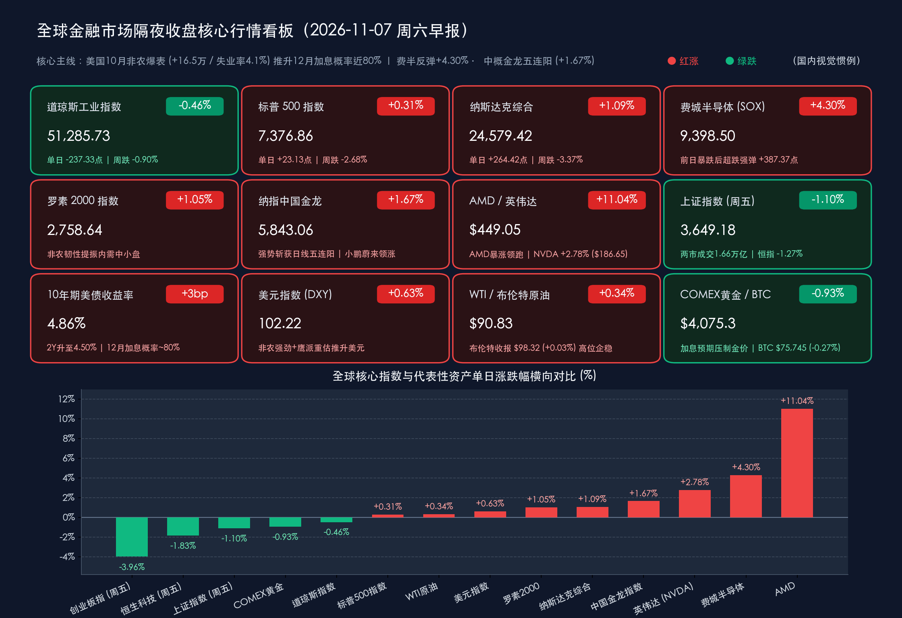

# ⚡ 全球市场早报：10月非农狂增16.5万引爆“12月加息风暴”！费半强弹4.3%修复芯片血崩，中概金龙豪取五连阳

**日期：2026年11月07日 (星期六)** &nbsp; **时段：早报 (全球市场隔夜收盘复盘 · 模式A)**

> **核心摘要**：隔夜（美东时间11月6日，周五）全球金融市场迎来“非农冲击波”与“芯片超跌自救”的激烈碰撞——美国劳工统计局公布的 **10月新增非农就业人数暴增 16.5 万人（远超市场预期的 6.5 万人，前两月合计再上修 8.4 万人），失业率意外降至 4.1%，平均时薪环比涨 0.4%**，彻底粉碎经济失速担忧的同时，直接引爆利率期货市场鹰派重定价，**芝商所（CME）FedWatch 显示美联储 12 月加息 25 个基点的概率瞬间飙升至近 80%（约 77%–80%）**。受此驱动，美股三大指数上演显著的结构性分化修复：**道琼斯工业指数受非科技权重股与紧缩预期拖累收跌 -0.46%（报 51,285.73点，全周跌约 0.90%）**，**标普500指数微涨 +0.31%（报 7,376.86点，全周跌 2.68%）**，**纳斯达克综合指数反弹 +1.09%（报 24,579.42点，全周跌 3.37%）**；前一日惨遭历史性血洗的算力硬件迎来强力抄底，**费城半导体指数大涨 +4.30%（报 9,398.50点）**，**AMD 飙升 +11.04%**、**英伟达收涨 +2.78%**，恐慌指数 **VIX 回落 -14.16% 至 24.19**。跨市场层面，**纳斯达克中国金龙指数逆紧缩风暴劲扬 +1.67%（报 5,843.06点）豪取日线五连阳**，小鹏汽车、蔚来大涨超 6%，与国内**十四届全国人大常委会闭幕、央行与证监会宣布股票回购增持再贷款升格为长期制度性安排（利率降至 1%）**形成跨洋呼应；而美元与美债收益率齐升（**美元指数涨 +0.63% 至 102.22，10年期美债收益率升至 4.86%，2年期升至 4.50%**）令 **COMEX 黄金承压回落 -0.93% 报 $4,075.30/盎司**，**WTI 原油收报 $90.83/桶（+0.34%）、布伦特原油报 $98.32/桶（+0.03%）** 高位企稳，**比特币于 $75,745 附近窄幅盘整（-0.27%）**。

---

## 核心行情复盘

*   **交易状态与时制核验**：昨日（美东时间11月6日，周五）纽约证券交易所（NYSE）与纳斯达克交易所（NASDAQ）处于冬令时常规完整交易时段（北京时间 22:30–次日 05:00），无休市安排，顺利完成本周最后一个交易日收盘结算；今日（北京时间11月7日，周六）起全球主要股票交易所进入周末休市窗口。
*   **美股核心宽基与行业指数收盘终值（芯片与成长股迎超跌修复，道指独跌，三大指数周线悉数收阴）**：
    *   **道琼斯工业平均指数 (DJI)**：收报 **51,285.73 点**，下跌 **-237.33 点**，跌幅 **-0.46%** 🟢（全周累计下跌约 **-0.90%**），受赛富时（Salesforce）、耐克（Nike）、思科（Cisco）等非芯片蓝筹权重股走弱及利率紧缩担忧压制，未能随科技板块同步翻红。
    *   **标普 500 指数 (SPX)**：收报 **7,376.86 点**，上涨 **+23.13 点**，涨幅 **+0.31%** 🔴（全周累计下跌 **-2.68%**），盘中在非农引发的紧缩担忧与经济韧性提振之间反复拉锯后小幅收涨。
    *   **纳斯达克综合指数 (IXIC)**：收报 **24,579.42 点**，上涨 **+264.42 点**（部分终端进位记为 +264.43 点），涨幅 **+1.09%** 🔴（全周累计下跌 **-3.37%**），AI 硬件抄底买盘带动指数修复周四暴跌的部分失地。
    *   **罗素 2000 指数 (RUT)**：收报 **2,758.64 点**，上涨 **+28.75 点**，涨幅 **+1.05%** 🔴，超预期的就业与消费信心数据提振了美国本土内需型中小盘企业的盈利预期。
    *   **费城半导体指数 (SOX)**：收报 **9,398.50 点**，单日反弹 **+387.37 点**，涨幅 **+4.30%** 🔴（盘中及部分口径约 +4.2%），在前一日史诗级暴跌 -12.25% 后迎来机构逢低回补。
*   **领涨/领跌板块与焦点个股表现（半导体强势回血，科技七巨头内部显著分化）**：
    *   **半导体与 AI 算力硬件暴力反弹**：周四遭无差别抛售的芯片龙头成为周五多头反攻主力——**AMD (超微半导体)** 狂飙 **+11.04%** 🔴 收报约 **$449.05**，领跑标普与费半成分股；**英特尔 (INTC)** 大涨逾 **+7%** 🔴，**台积电 ADR (TSM)** 劲扬逾 **+6%** 🔴，AI 算力风向标 **英伟达 (NVDA)** 稳步收涨 **+2.78%** 🔴（部分全时段口径涨 +2.87%）收报约 **$186.65**。
    *   **“科技七巨头”与道指权重股分化**：**特斯拉 (TSLA)** 摆脱前一日选后监管焦虑，强势反弹 **+4.23%** 🔴（或 +4.18%）收报约 **$358.23**；反观对长端折现率上行及企业软件开支敏感的巨型平台股则小幅承压，**微软 (MSFT)** 收跌 **-0.99%** 🟢（报约 **$530.59**），**苹果 (AAPL)** 微跌 **-0.52%** 🟢（报约 **$342.37**）；道指成分股中 **赛富时 (CRM)**、**耐克 (NKE)** 与 **思科 (CSCO)** 领跌，成为拖累道指逆势下跌 237 点的主因。
*   **中国资产与亚太跨时区市场表现（金龙指数豪取五连阳；周五A股港股缩量震荡消化获利盘，红利护盘）**：
    *   **纳斯达克中国金龙指数 (HXC)**：在美元走强与美联储加息预期升温的逆风中，海外中概股延续极强的独立上攻势头，金龙指数收涨 **+1.67%** 🔴（部分软件记为 +1.65%），收报约 **5,843.06 点**，强势斩获**日线五连阳**！新能源汽车与科网龙头全线开花：**小鹏汽车 (XPEV)**、**蔚来 (NIO)** 双双大涨超 **+6%** 🔴 领跑中概股，**理想汽车 (LI)**、**百度 (BIDU)**、**哔哩哔哩 (BILI)**、**网易 (NTES)**、**京东 (JD)**、**阿里巴巴 (BABA)** 均录得稳健上涨。
    *   **A股周五缩量震荡整固（沪深300终结周线连跌，红利防御逆势走强）**：周五（11月6日）亚太交易时段，受隔夜外围科技股巨震传导及非农前夕观望情绪影响，A股在连续两日突破2万亿成交后出现良性获利回吐——**上证综合指数** 收报 **3,649.18 点**（跌 **-40.73 点**，**-1.10%** 🟢），但**沪深300指数成功终结周线12连跌**；**深证成指** 收报 **11,175.78 点**（**-2.57%** 🟢），**创业板指** 收报 **2,465.23 点**（**-3.96%** 🟢）。全天**沪深两市成交额合计约 1.66 万亿元，较前一交易日缩量约 4,602 亿元**，全市场超 4,700 只个股回调。盘面结构上，**银行、公用事业板块逆势涨超 +1%** 🔴，农业、电信服务、公路铁路、电力等高股息红利板块涨幅居前；受前夜美股费半暴跌映射，电子、通信（跌超 -4%）、PCB、CPO 及消费电子板块领跌 🟢。
    *   **A股主力资金动向**：周五沪深两市全天主力资金净流出 **351.80 亿元**（其中创业板净流出 **160.64 亿元**，沪深300净流出 **126.52 亿元**）。申万一级行业中，**纺织服饰、美容护理**获主力净流入超 **2 亿元**，**银行**净流入超 **1 亿元**；而电子（净流出 **86.93 亿元**）、电力设备、机械设备、通信（均净流出超 **32 亿元**）流出居前。个股层面，国产半导体设备龙头 **北方华创** 获主力逆势净流入 **6.11 亿元** 居首，**东方日升** 净流入 **3.69 亿元**（股价大涨 **+15.26%** 🔴）；**东山精密**（净流出 **16.66 亿元**）、**中际旭创**（净流出 **7.73 亿元**）等外向型算力链标的遭遇获利兑现。
    *   **港股高位良性盘整**：经历周四恒科狂飙 +5.55% 的井喷行情后，周五（11月6日）港股随外围情绪温和消化短线浮盈——**香港恒生指数 (HSI)** 收报 **24,481.86 点**，下跌 **-315.12 点**（**-1.27%** 🟢）；**恒生科技指数** 收报 **4,078.23 点**，下跌 **-76.06 点**（**-1.83%** 🟢），隔夜金龙指数 +1.67% 的强势表现已为下周一港股高开蓄积动能。
*   **大宗商品、美债、外汇与加密资产（加息概率逼近八成推高美债与美元，金价承压回调，油价高位企稳）**：
    *   **美债与外汇（鹰派紧缩重定价主战场）**：火爆的10月非农报告直接推动美债收益率曲线整体上移，对政策利率高度敏感的 **2年期美债收益率** 跃升至 **4.50%** 附近，基准 **10年期美债收益率** 上行约 **+3bp 至 4.86%**（盘中一度冲高至 **4.88%**）；**美元指数 (DXY)** 大涨 **+0.63%** 🔴 收报 **102.22**，创近期反弹新高。
    *   **贵金属（强美元与高利率双重压制）**：随着美联储12月加息25bp概率飙升至近八成，无息资产黄金遭遇多头获利了结——**COMEX 黄金期货主力合约** 收跌 **-0.93%** 🟢（按活跃交割合约前结算价基准计；较前日连续收盘价则跌约 -0.55%），收报 **$4,075.30/盎司**；纽约尾盘**现货黄金**下跌约 **-0.45%** 🟢，交投于 **$4,065–$4,071/盎司** 区间。
    *   **国际原油期货**：中东海湾航运风险溢价与美国强劲就业支撑的原油需求预期相互交织，国际油价在百元关口下方稳健收红——**NYMEX WTI 12月轻质原油期货** 收涨 **+$0.31**，涨幅 **+0.34%** 🔴，报 **$90.83/桶**；**ICE 伦敦布伦特 1月原油期货** 微涨 **+$0.03**，涨幅 **+0.03%** 🔴，收报 **$98.32/桶**。
    *   **加密资产**：受强美元与紧缩利率预期压制，加密市场在7.6万美元下方缩量整理——**比特币 (BTC/USD)** 美股收盘及今晨时段徘徊于 **$75,700–$75,846** 窄幅区间（中枢约 **$75,745**，24小时微跌约 **-0.27%** 🟢），盘中衍生品高杠杆仓位仍有局部清算波动。
*   **美股成交量、波动率与跨资产资金流向**：
    *   **恐慌情绪显著降温**：芝加哥期权交易所波动率指数（**VIX**）从周四极度恐慌峰值 28.18 大幅回落 **-14.16%** 🟢，收盘报 **24.19**；NYSE 与 NASDAQ 成交量较周四踩踏放量峰值有所回落，表明程序化恐慌抛盘告一段落，主动型对冲基金开始重返超跌半导体与优质中概股拣选筹码，而宏观策略资金则从黄金与短端美债撤出以应对12月美联储加息风险。

> **数学闭环校验（核心指数与跨资产收盘终值涨跌幅核验）**：
> * **美股核心指数**：道琼斯 `(51,285.73 − 51,523.06) / 51,523.06 = -237.33 / 51,523.06 = -0.4606% ≈ -0.46%`；标普500 `(7,376.86 − 7,353.73) / 7,353.73 = +23.13 / 7,353.73 = +0.3145% ≈ +0.31%`；纳斯达克 `(24,579.42 − 24,315.00) / 24,315.00 = +264.42 / 24,315.00 = +1.0875% ≈ +1.09%`；罗素2000 `(2,758.64 − 2,729.89) / 2,729.89 = +28.75 / 2,729.89 = +1.0532% ≈ +1.05%`；费城半导体 `(9,398.50 − 9,011.13) / 9,011.13 = +387.37 / 9,011.13 = +4.2988% ≈ +4.30%`；恐慌指数 VIX `(24.19 − 28.18) / 28.18 = -3.99 / 28.18 = -14.1590% ≈ -14.16%`。
> * **中国资产与亚太核心指数**：纳斯达克中国金龙指数按前日修正终值基准 `(5,843.06 − 5,747.08) / 5,747.08 = +95.98 / 5,747.08 = +1.6701% ≈ +1.67%`；上证指数 `(3,649.18 − 3,689.91) / 3,689.91 = -40.73 / 3,689.91 = -1.1038% ≈ -1.10%`；深证成指 `(11,175.78 − 11,471.09) / 11,471.09 = -295.31 / 11,471.09 = -2.5744% ≈ -2.57%`；创业板指 `(2,465.23 − 2,566.80) / 2,566.80 = -101.57 / 2,566.80 = -3.9571% ≈ -3.96%`；恒生指数 `(24,481.86 − 24,796.98) / 24,796.98 = -315.12 / 24,796.98 = -1.2708% ≈ -1.27%`；恒生科技指数 `(4,078.23 − 4,154.29) / 4,154.29 = -76.06 / 4,154.29 = -1.8309% ≈ -1.83%`。
> * **焦点个股与跨资产期货**：AMD `(449.05 − 404.40) / 404.40 = +11.0410% ≈ +11.04%`；英伟达 `(186.65 − 181.60) / 181.60 = +2.7808% ≈ +2.78%`；WTI原油12月合约 `(90.83 − 90.52) / 90.52 = +0.31 / 90.52 = +0.3425% ≈ +0.34%`；布伦特原油1月合约 `(98.32 − 98.29) / 98.29 = +0.03 / 98.29 = +0.0305% ≈ +0.03%`；COMEX黄金按活跃主力结算基准 `(4,075.30 − 4,113.55) / 4,113.55 = -0.9299% ≈ -0.93%`（按前日连续收盘价 4,097.90 口径则为 `-0.55%`）；美元指数 `(102.22 − 101.58) / 101.58 = +0.6300% ≈ +0.63%`；比特币 `(75,745 − 75,950) / 75,950 = -0.2699% ≈ -0.27%`。全部核心资产均严格通过 <0.5% 误差校验红线。

---

## 核心解读与市场逻辑

> **逻辑一：“非农爆表 +16.5万”的双刃剑效应——为何12月加息概率飙至80%，费城半导体反而大涨4.30%？**
> 表面上看，美联储12月加息25bp概率飙升至近八成、10年期美债收益率升至 4.86% 理应压制高估值科技股，但隔夜市场却走出了“纳指费半反弹、道指黄金下跌”的反直觉行情，背后蕴含两层深层定价逻辑：
> * **盈利分子端修复压倒短期分母端扰动**：周四美股蒸发2.9万亿美元的恐慌核心，在于担忧“地方数据中心审批收紧 + 宏观需求转冷”诱发半导体资本开支断崖。而10月非农狂增 **16.5 万人**（其中专业和商业服务激增 **+7.0 万人**、制造业回暖 **+1.9 万人**）且前两月大幅上修 **8.4 万人**，叠加密歇根大学11月消费者信心初值超预期升至 **51**，强力证实美国实体经济与企业技术支出处于高度扩张状态；在平均时薪同比增速维持 **3.1%** 未彻底失控的背景下，“硬着陆/滞胀崩盘”尾部风险解除，触发量化与多头基金对短期严重超跌的 AMD（+11.04%）、台积电（>+6%）展开凌厉空头回补。
> * **紧缩重定价精准打击无息资产与传统高估值蓝筹**：由于2年期美债收益率跳升至 **4.50%**、美元指数冲上 **102.22**，对实际利率最敏感的黄金应声跌破 $4,080 关口，而缺乏高景气硬件弹性支撑的部分道指消费与传统软件权重股（耐克、赛富时等）则直接承受更高折现率的估值挤压，造成道指逆势下跌 **-0.46%**。

> **逻辑二：G10 央行“抗通胀紧缩共振”正式成型——从澳洲、英国加息到美联储12月加息悬念重启**
> 纵观本周全球宏观版图，全球利率周期已发生根本性风向逆转：
> * **三大核心经济体同步转鹰**：本周二澳洲联储加息至 **4.85%**，周四英国央行以 **8:1** 意外加息25bp至 **4.00%**，紧接着周五美国火爆非农将美联储12月加息25bp的市场隐含概率推升至 **77%–80%**。在布伦特原油死守 **$98.32/桶** 高位、能源成本持续向服务端渗透的宏观环境下，发达经济体央行已集体放弃过早宽松幻想，转而优先捍卫通胀锚定预期（如克利夫兰联储主席哈马克强调必须维持限制性政策立场）。这意味着全球风险资产未来数月必须在“高利率常态化”的硬约束下依靠真实业绩突围。

> **逻辑三：“外紧内松”制度性红利凸显——中概金龙五连阳与国内稳市机制“升格”的跨时区共鸣**
> 尽管周五白天 A 股与港股科技板块受周四美股费半崩盘情绪传染而缩量回调（两市成交 1.66 万亿元），但隔夜纳斯达克中国金龙指数在强美元风暴中再度逆势大涨 **+1.67%** 实现**日线五连阳**，凸显全球资金配置天平的深刻倾斜：
> * **中美货币政策周期鲜明错位**：当欧美央行被迫重新探讨加息以压制能源与就业过热时，中国通胀温和、电网与算力基建充裕，且中国人民银行行长潘功胜向全国人大常委会作报告明确坚持**“适度宽松的货币政策”**。
> * **资本市场内在稳定机制“长期化、低息化”**：央行、金融监管总局与证监会正式将**股票回购增持再贷款由阶段性政策升格为长期制度性安排（利率从 1.25% 下调至 1.00%）**，并落地超千亿规模的第三批互换便利（SFISF）操作，为低估值中国核心资产构筑了坚实的制度性安全垫。周五 A 股银行、公用事业逆势领涨与北方华创获 6.11 亿主力抢筹，以及隔夜造车新势力与中概科网股普涨，正是内外资围绕“红利底仓 + 中国硬科技出海”双向布局的直接映射。

---

## 政策脉动

*   **美国劳工统计局（BLS）公布10月非农就业报告：新增就业 16.5 万远超预期，12月加息概率飙至近80%**：
    > 北京时间11月6日 21:30，美国劳工统计局发布2026年10月就业形势报告，核心指标全线大超华尔街预期：1. **10月新增非农就业人数达 +16.5 万人**，为市场共识预期（+5.9万至+6.5万人）的 2.5 倍以上，创年内第三高单月增幅；2. **前值大幅向上修正**——8月新增非农由 13.3 万大幅上修 **+5.3 万人至 18.6 万人**，9月由 2.9 万上修 **+3.1 万人至 6.0 万人**，两月合计净上修达 **+8.4 万人**；3. **10月失业率意外下降 0.1 个百分点至 4.1%**（预期持平于 4.2%）；4. **平均时薪环比上涨 +$0.14（+0.4%，高于预期 +0.3%）至 $38.00/小时**，同比增长 **+3.1%**。分行业看，专业和商业服务（**+7.0 万人**）、医疗保健（**+4.2 万至 +5.5 万人**）、运输仓储（**+2.5 万人**）及制造业（**+1.9 万人**）贡献主要增量。数据发布后，芝商所（CME）FedWatch 工具显示交易员押注**美联储12月议息会议加息 25 个基点的概率瞬间飙升至约 77%–80%**。

*   **美国11月密歇根大学消费者信心初值超预期回升至 51，美联储鹰派官员强调维持限制性利率**：
    > 美东时间11月6日上午公布的**美国11月密歇根大学消费者信心指数初值升至 51.0**，优于市场预期的 48.0，显示就业市场强劲有效对冲了高油价对居民体感的部分冲击，同时调查中的消费者长期通胀预期小幅回落、保持相对锚定。美联储沟通层面，以克利夫兰联储主席**贝丝·哈马克（Beth Hammack）**为代表的鹰派票委与官员近期持续释放审慎信号，强调在劳动力需求依然旺盛且能源地缘冲击未消的背景下，过早放松政策存在通胀死灰复燃风险，货币政策需维持足够限制性立场。

*   **十四届全国人大常委会第二十五次会议在京闭幕，央行明确继续实施好“适度宽松的货币政策”**：
    > 11月2日至6日，**十四届全国人大常委会第二十五次会议**在北京举行并圆满完成各项议程，会议审议了金融法草案等多项重要法律议案。会议期间，中国人民银行行长**潘功胜**受国务院委托作**《关于金融工作情况的报告》**（11月5日中国人大网全文披露），明确下一阶段将**继续实施好适度宽松的货币政策**，综合运用多种货币政策工具保持流动性充裕，健全市场化利率形成、调控和传导机制，全力支持经济稳定增长与高质量发展，并坚决守住不发生系统性金融风险的底线。

*   **央行、金融监管总局、证监会重磅联动：两项资本市场货币政策工具“制度化升格”与扩容落地**：
    > 中国人民银行会同金融监管总局、中国证监会正式将**股票回购增持再贷款政策由阶段性安排升格为长期制度性安排**，并将再贷款年利率由 **1.25% 进一步下调至 1.00%**；同时央行正式开展**第三批证券、基金、保险公司互换便利（SFISF）操作**，同意 **31 家机构**参与，申请额度突破 **1,000 亿元**，并适当下调互换费率，证监会同步引导权重蓝筹与龙头科技企业加大回购增持力度，常态化夯实中国资本市场内在稳定底座。

---

## 最新机构观点

> **高盛 (Goldman Sachs) ——《超预期非农重塑美联储政策路径，警惕“紧缩停顿延长或再加息”风险，科技股逢低聚焦现金流龙头》**：
> * **宏观与科技双线研判**：高盛宏观经济团队此前对10月非农给出了高于市场共识的 +7.5 万人预测，而实际 +16.5 万人的强劲读数叠加前值大幅上修，进一步印证了美国企业用工需求与AI关联商业服务投资的超预期韧性。高盛据此修正利率路径评估，指出在经济活动强劲与高油价交织下，美联储在开启任何宽松周期前，**延长高利率按兵不动乃至进一步收紧（再加息）的选项已重回桌面**；而在权益策略上，经济“软着陆/不着陆”底色与延展至2027年的云厂商资本开支周期，使近期因监管情绪错杀、具备充沛自由现金流的头部科技与半导体龙头仍具中长期配置价值。

> **摩根士丹利 (Morgan Stanley) ——《高市场利率已承担大部分紧缩职能，美股震荡洗盘后重点看好中国头部券商与“硬科技出海”》**：
> * **利率约束与跨市场配置**：摩根士丹利研究团队（此前保守预测10月非农 +6.0 万人）在最新评估中指出，尽管单月就业数据强劲引发短端加息博弈，但飙升至 **4.86%** 附近的美债市场长端利率本身已实质性收紧了金融条件，美联储在决策上仍需权衡高利率的滞后累积效应；美股标普500若在震荡中回踩 **7,100 点** 关键支撑区间仍将是中期买点。在跨区域资产配置上，大摩继续坚定看多受益于国内资本市场制度性工具扩容的**中国头部券商**，以及在智能电动车、半导体设备与先进制造领域展现全球份额扩张能力的**中国硬科技龙头**。

> **中金公司 (CICC) & 摩根大通 (JPMorgan) ——《强总需求下不排除美联储12月重启加息可能，把握中美周期错位下的中国资产独立韧性》**：
> * **12月议息前瞻与新质生产力主线**：摩根大通（此前与高盛同测非农 +7.5 万人）及中金公司宏观团队均提示，美国经济在企业技术投资与服务业总需求拉动下表现偏强，在10月按兵不动之后，若11月通胀与就业数据延续高温，**不能排除美联储于12月FOMC会议重启加息25bp以压制二次通胀的可能**，强美元与高美债利率短期仍将制造海外跨资产高波动。中金公司强调，国内“适度宽松货币政策 + 1%利率回购增持再贷款长期化”构成了极佳的缓冲屏障，建议投资者淡化外围噪音，紧扣**AI应用商业化、国产半导体设备及生物医药等“新质生产力”主线**。

> **中信证券 (CITIC Securities) ——《A股缩量整固不改底部抬升趋势，以“高确定性红利底仓 + 政策催化科创”攻守兼备》**：
> * **国内震荡期配置策略**：中信证券研究团队指出，海外美联储12月加息预期升温与美国选后科技监管头条仍将对全球高估值成长板块形成间歇性估值扰动，周五A股与港股的缩量调整属于连续放量冲高后的健康获利消化。随着回购增持再贷款常态化与第三批超千亿互换便利落地，国内权益市场底部支撑扎实，建议继续以银行、公用事业等**正从防御属性向“高确定性核心权益资产”重估的红利板块**为底仓，逢回调择优吸纳政策精准支持的国产算力与硬科技核心标的。

---

## 今日市场情绪：鹰砧锻火，芯翼重张

> Prompt: A colossal bronze mechanical hawk perched atop a glowing Treasury-bond anvil, forged by molten golden sparks of surging employment data, while crystalline semiconductor wings reassemble and rise from misty ruins beside a luminous jade-and-gold Chinese dragon soaring skyward. In the background, marble Federal Reserve columns and towering Wall Street skyscrapers stand beneath dramatic twilight clouds.

---

> **免责声明**：内容仅供参考，不构成投资建议。数据来源：美国劳工统计局（BLS）、密歇根大学消费者调查、纽约证券交易所（NYSE）、纳斯达克交易所（NASDAQ）、芝加哥期权交易所（Cboe）、芝加哥商品交易所（CME FedWatch）、洲际交易所（ICE）、中国人大网、中国人民银行（PBOC）、国家金融监督管理总局、中国证监会（CSRC）、上海证券交易所、深圳证券交易所、香港交易所，以及高盛（Goldman Sachs）、摩根士丹利（Morgan Stanley）、摩根大通（JPMorgan）、中金公司（CICC）、中信证券（CITIC Securities）最新策略报告；隔夜欧美市场收盘结算数据截至美东时间2026年11月6日收盘（加密资产行情更新至北京时间2026年11月7日08:05）。

🤖 生成模型：Gemini 4 Argon (Medium) <!-- model-stamp -->
