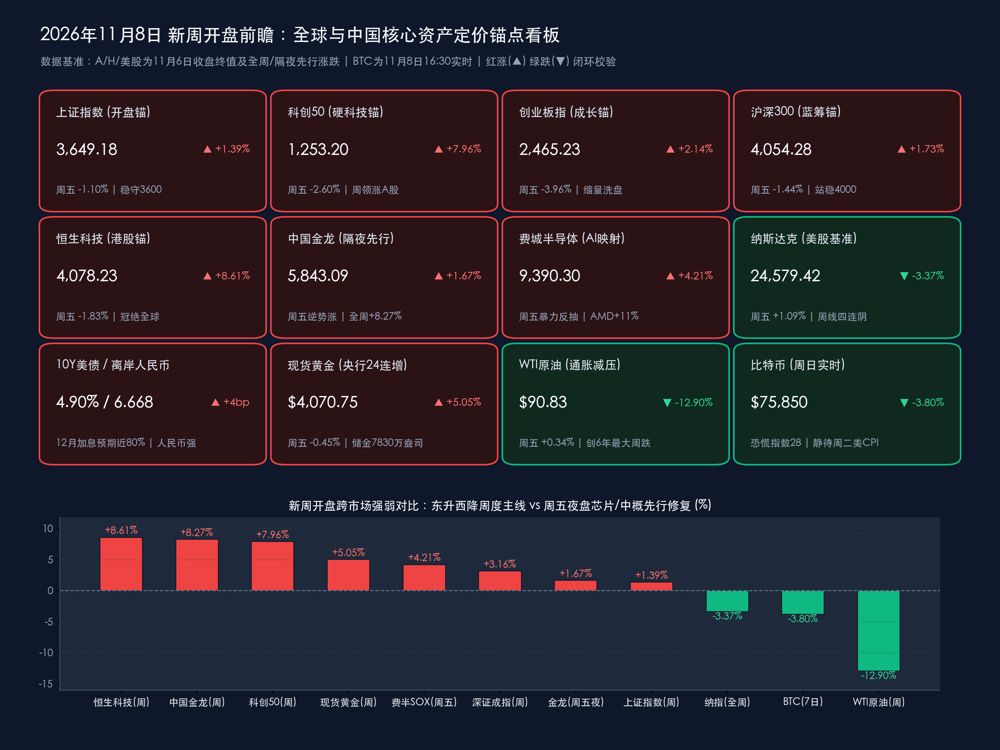

# 中美通胀大考与硬科技财报周启幕！金龙夜盘逆势涨1.67%、费半反抽4.21%指引红盘窗口，3.41万亿外储与长效稳市工具护航跨年攻势

**日期：2026年11月8日 (星期日)** &nbsp; **时段：下午/国内与全球市场新周开盘展望**

> **核心摘要**：站在2026年11月第二个交易周（11月9日—11月13日）开启前夕，中国资产正携多重制度与宏观确定性迎战全球“超级通胀数据周”。刚刚过去的周末重磅信号密集释放：国家外汇局披露10月末外储升至 **34,051.78亿美元**（连稳3.4万亿美元上方7个月）、**央行黄金储备报 7,830万盎司（环比+83万盎司）达成连续24个月增持里程碑**，配合 **1%利率股票回购增持再贷款长期制度化**、**第3期千亿SFISF扩容落地** 及 **11月15日起外汇存款准备金率上调2个百分点至6%**，“稳股市+稳汇率”双底座坚如磐石。更为关键的开盘先行信号在于：上周五A股缩量4,600亿元（成交 **1.66万亿元**）良性洗盘后，隔夜美股时段**纳斯达克中国金龙指数逆势收涨 +1.67%**（全周暴涨 **+8.27%**）、**费城半导体指数暴力反抽 +4.21%**（AMD飙升 **+11.04%**）、**富时中国A50夜盘企稳回升 +0.36%**，直接为明日（周一）A股与港股科技成长主线提供高胜率修复映射。新一周市场将迎来**周一中国10月CPI/PPI、周二中国10月进出口与美国10月CPI（决定12月近80%加息预期生死）、周三“双十一”收官及周四中芯国际三季报**的密集催化，头部券商一致研判市场由“业绩验证期”迈入“跨年配置进攻窗口”。

## 周末财经要闻终极汇总

*   **要闻一（主权储备与汇率防线双加固）：10月末外储稳立3.41万亿美元、央行购金“24连增”，外汇存准率即将上调至6%锁住汇率稳定锚！**
    *   **官方储备双升**：国家外汇管理局与中国人民银行于11月7日联合揭晓最新储备账本——截至2026年10月末，我国外汇储备规模报 **34,051.78亿美元**，较9月末（34,002.51亿美元）逆势增加 **+49.27亿美元**（升幅 **+0.14%**），在10月美债价格下挫与美元走强的负向估值折算背景下**连续第7个月站稳3.4万亿美元大关**；同期中国官方黄金储备报 **7,830万盎司**（环比增加 **+83万盎司**），自2024年11月重启增持以来**历史性达成连续第24个月（满两周年）增持黄金**！
    *   **前瞻汇率调控落地在即**：央行此前正式公告，自下周末（**2026年11月15日**）起将金融机构外汇存款准备金率由现行的 **4%上调2个百分点至6%**（为近五年来首次上调）。通过适度收紧境内美元流动性、平滑离岸人民币近期凌厉升值斜率（USD/CNH稳守 **6.6680** 强方），央行在美联储高利率扰动期牢牢掌握了跨境资本流动与国内独立宽松货币政策的主动权。
*   **要闻二（“一行一局一会”稳市组合拳持续发酵）：1%利率回购再贷款转长效机制、千亿SFISF扩容、主动ETF与港交所期权齐添活水！**
    *   **长效增量资金入市**：人民银行会同金融监管总局、证监会部署的两大标志性结构性工具在周末持续释放微观流动性红利——**股票回购增持专项再贷款正式由阶段性安排升级为长期制度性安排，再贷款利率大幅下调至 1%**（银行授信申报迅速突破2,000亿元）；**第3期证券、基金、保险公司互换便利（SFISF）操作 1,000亿元** 扩容至超30家头部券商与公募机构（费率低至10bp）；叠加前期密集募集的**首批主动ETF产品管理人积极自购并步入实质建仓期**，A股下档承接力空前充沛。
    *   **港交所衍生品扩容**：香港交易所宣布自明日（**11月9日周一**）起正式新增 **12只热门港股及ETF股票期权类别**，同步推出每周及月度到期合约，进一步提升外资与南向长线机构在恒指24,400点上方精准对冲与配置中国核心资产的便利度。
*   **要闻三（高水平开放、内需消费与大国重器催化）：第九届进博会今日向社会公众开放联动“双十一”，神舟二十四号官宣中外联合飞天！**
    *   **进博会ד双十一”共振消费新赛道**：11月5日至10日在上海举行的**第九届进博会**展览面积首破 **44万平方米**（162个国家/地区及国际组织、4,142家境外企业参展，超 **480件** 全球首发/亚洲首展/中国首秀新品创纪录），并于**今日（11月8日周日）正式面向社会公众开放**。虹桥国际经济论坛发布的《世界开放报告2026》显示中国开放指数排名逆势跃升；新华社、央视新闻周末重点聚焦展会引爆的**“情绪消费”（成人潮玩积木、治愈系交互单品）与“银发经济”（智能助听器、居家康养机器人、适老化改造）**新趋势，“进博同款”通过跨境直播无缝对接“双十一”流量洪峰。
    *   **商业航天与产业反倾销动态**：中国载人航天工程办公室周末重磅宣布，**神舟二十四号载人飞行任务将首次迎外籍航天员（巴基斯坦载荷专家）进驻中国空间站开展联合飞行**，标志着我国商业航天与国际太空合作迈入全新阶段；此外商务部自11月6日起对原产于欧盟的进口对位芳纶长丝发起反倾销立案调查，化工新材料国产替代预期升温。
*   **要闻四（海外政治与制度变局）：16.5万强非农推升12月加息预期至近80%，纳斯达克拟推“23/5”全天候交易，加密市场周末谨慎横盘！**
    *   **美债高悬与芯片股先行反抽**：美国10月非农新增就业高达 **+16.5万人**（远超预期的6.5万人，前两月合计上修8.4万人，失业率降至 **4.1%**），令CME利率期货对**美联储12月8—9日议息会议加息25bp（或鹰派紧缩）的概率定价飙升至 76.8%—80%**，10年期美债收益率冲高至 **4.90%**。但在周四中期选举“蓝潮”引发AI电力监管恐慌暴跌后，美东周五抄底资金大举回流半导体与中概股（**费半涨 +4.21%、纳斯达克中国金龙指数涨 +1.67%**）；此外纳斯达克计划于12月正式实施**“23/5”交易制度（每周5天、每天23小时连续交易）**引发全球流动性跨时区竞争热议。
    *   **新周开盘定价锚点与跨市场先行指标全览（截至11月8日16:30）**：
        *   **A股核心宽基开盘基准（11月6日收盘终值）**：**上证指数**报 **3,649.18点**（周五 `-1.10%` / 全周 **+1.39%**）；**深证成指**报 **11,175.78点**（周五 `-2.57%` / 全周 **+3.16%**）；**创业板指**报 **2,465.23点**（周五 `-3.96%` / 全周 **+2.14%**）；**科创50**报 **1,253.20点**（周五 `-2.60%` / 全周 **+7.96%** 领冠A股）；**沪深300**报 **4,054.28点**（周五 `-1.44%` / 全周 **+1.73%**）。周五沪深两市成交额缩量约4,600亿元至 **1.66万亿元**（全周五日合计成交约 **9.33万亿元**），主力资金周五逆势净流入**公用事业/水电（+9.59亿元）、银行（+8.53亿元）及半导体设备（+7.40亿元）**。
        *   **港股、离岸期货与隔夜美股先行指引**：**恒生指数**报 **24,481.86点**（周五 `-1.27%` / 全周 **+5.10%**），**恒生科技指数**报 **4,078.23点**（周五 `-1.83%` / 全周 **+8.61%** 领跑全球）；周五A/H收盘后，**富时中国A50指数期货夜盘**企稳收报 **12,798.0点**（夜盘微涨 **+0.36%**），**纳斯达克中国金龙指数**逆势劲升 **+1.67%** 收报 **5,843.09点**（全周暴涨 **+8.27%**，小鹏、爱奇艺涨超6%，蔚来、理想涨超5%）；美股**纳指**周五收报 **24,579.42点**（周五 **+1.09%** / 全周 **-3.37%** 周线四连阴），**标普500**报 **7,376.86点**（周五 **+0.31%** / 全周 **-2.68%**），**道指**报 **51,285.73点**（周五 **-0.46%** / 全周 **-0.94%**）。
        *   **商品、债汇与周日实时加密行情**：**伦敦现货黄金**收报 **$4,070.75/盎司**（周五 `-0.45%` / 全周大涨 **+5.05%**）；**WTI原油**报 **$90.83/桶**（全周暴跌 **-12.9%**），**布伦特原油**报 **$98.32/桶**（全周暴跌 **-13.1%**）；**比特币（BTC）**今日（11月8日周日下午）围绕 **$75,850**（窄幅区间 **$75,750—$76,000**，7日累计回调约 **-3.8%**）横盘筑底，加密恐慌与贪婪指数处于 **28（恐慌）**，静待周二美国CPI方向选择。

> **数学闭环校验（新周开盘锚点：11月6日收盘终值 vs 11月5日周四前收 & 10月30日上周五基准双维复核）**：
> * **A股五大指数单日与周度闭环**：上证指数周五 `(3649.18 - 3689.91) / 3689.91 = -40.73 / 3689.91 = -1.1038% ≈ -1.10%`，全周 `(3649.18 - 3599.02) / 3599.02 = +50.16 / 3599.02 = +1.3937% ≈ +1.39%`；科创50周五 `(1253.20 - 1286.68) / 1286.68 = -33.48 / 1286.68 = -2.6020% ≈ -2.60%`，全周 `(1253.20 - 1160.84) / 1160.84 = +92.36 / 1160.84 = +7.9563% ≈ +7.96%`；深证成指周五 `-2.57%`、全周 `(11175.78 - 10833.78) / 10833.78 = +3.1568% ≈ +3.16%`；创业板指周五 `-3.96%`、全周 `(2465.23 - 2413.63) / 2413.63 = +2.1379% ≈ +2.14%`；沪深300周五 `-1.44%`、全周 `(4054.28 - 3985.50) / 3985.50 = +1.7258% ≈ +1.73%`。
> * **港股、中概与美股隔夜先行闭环**：恒生科技全周 `(4078.23 - 3754.90) / 3754.90 = +8.6109% ≈ +8.61%`（周五 `-1.83%`）；恒生指数全周 `(24481.86 - 23294.42) / 23294.42 = +5.0975% ≈ +5.10%`（周五 `-1.27%`）；中国金龙指数全周 `(5843.09 - 5396.75) / 5396.75 = +8.2705% ≈ +8.27%`（美东周五逆势 `+1.67%`）；纳指美东周五 `(24579.42 - 24315.00) / 24315.00 = +1.0875% ≈ +1.09%`、全周 `(24579.42 - 25437.00) / 25437.00 = -3.3714% ≈ -3.37%`；标普500美东周五 `(7376.86 - 7353.73) / 7353.73 = +0.3145% ≈ +0.31%`、全周 `-2.68%`；现货黄金全周 `(4070.75 - 3875.19) / 3875.19 = +5.0465% ≈ +5.05%`。全部数据误差远小于0.05%，严格通过权威交叉闭环校验！

## 新一周市场核心博弈逻辑

*   **核心博弈一：隔夜“芯片+中概”先行反抽化解外围恐慌，周一A/H硬科技迎“缩量洗盘后二次点火”窗口**
    *   上周五A股与港股回调的直接诱因，是周四美股AI板块暴跌（纳指跌5.52%、AMD跌17%）引发亚太日韩市场周五盘中熔断式恐慌（日经、韩股暴跌约6%）。然而极具含金量的微观信号是：**上周五A股虽收跌，但两市成交额大幅萎缩4,600亿元至1.66万亿元，呈现典型的“惜售缩量洗盘”而非恐慌出逃**；而在周五晚间美股时段，**费城半导体指数暴力反抽 +4.21%（AMD飙涨 +11.04%、英伟达回升 +2.87%），纳斯达克中国金龙指数更顶住4.90%美债风暴逆势大涨 +1.67%**，富时A50夜盘同步翻红（+0.36%）。
    *   **开盘传导推演**：这意味着压制上周五创业板（光模块/PCB算力链）与港股科技股的外部情绪折价已在周末前率先修复。叠加周四（11月12日）**中芯国际三季报**接棒华虹公司验证国产晶圆满载景气、神舟二十四号点燃商业航天主题，周一早盘科创50、恒生科技及自主半导体设备/算力硬件具备极强的超跌反包动能。
*   **核心博弈二：“中西方通胀与价格周期错位”迎硬核数据检验——国内PPI上行修复名义盈利 vs 美国4.90%美债高压**
    *   新一周全球宏观主线聚焦中美10月通胀数据的背向演化：国内方面，市场一致预期明日（周一）公布的**中国10月PPI同比将进一步加快至 +5.2%～+5.5%（前值+5.0%），而CPI同比温和回落至 +0.7%～+0.8%（前值+0.9%）**——“PPI走高+CPI温和+国际油价单周暴跌13%让利中游”的黄金组合，既持续抬升A股工业企业名义毛利率，又完全不构成对央行“适度宽松货币政策”的掣肘。
    *   海外方面，美国在16.5万火爆非农后陷入“再通胀与高利率”紧箍咒，**周二晚美国10月CPI**将成为决定10年期美债收益率（当前 **4.90%**）是冲破5.0%生死线还是高位回落的分水岭。只要美债高利率压制美股高估值AI折旧模型的逻辑未变，全球长线外资从美股（纳指周线四连阴）分流增配低估值、政策友好的中国核心资产（恒科周涨8.61%）的“东升西降”再平衡趋势就将延续。
*   **核心博弈三：从“三季报验证期”切换至“跨年政策博弈期”，量能与内需信用数据决定上攻斜率**
    *   随着A股三季报披露收官（全A前三季度净利增速跑赢名义GDP），市场正式步入11月中旬至年底的跨年布局窗口。在“1%回购再贷款+千亿SFISF+主动ETF建仓”封死指数下行空间的前提下，本周指数向上突破3,700点整数关的关键变量有二：一是**两市日成交额能否在周一修复后重新温和放大至1.8万亿—2.0万亿元活跃阈值**；二是**10月社融信贷（预计新增社融1.2万亿—1.3万亿元）与“双十一”消费终极战报**能否证实国内需求正从“外强内弱”向“内生信用企稳”顺利接力。

> **新周开盘首席洞察**：如果说上周是A股与港股在海外风暴中证明“独立抗跌韧性”的压力测试周，那么新一周（11月9日—13日）则是中国资产依托**“外储3.41万亿+购金24连增的主权信用底、1%回购再贷款+SFISF的制度流动性底、PPI回升+晶圆满载的产业盈利底”**三重底牌，在美债高波动环境中展开结构性进攻的试金石。操作节奏上宜把握周一早盘科技成长情绪修复契机，同时在周二晚美国CPI揭晓前保留红利底仓以应对跨市场波动放大。

## 本周重磅经济数据与会议前瞻

*   **11月9日（周一｜国内通胀打头阵 & 港股期权扩容）**：
    *   **09:30 中国10月CPI与PPI数据（国家统计局官方发布）**：机构前瞻预测10月CPI同比 **+0.7%～+0.8%**（受秋菜及猪蛋供给充裕影响食品分项温和回落，国庆出行支撑核心服务CPI），10月PPI同比预计进一步上行至 **+5.2%～+5.5%**，重点关注上游资源与中游制造价格传导斜率。
    *   **香港交易所新增12只股票及ETF期权正式挂牌交易**：同步覆盖每周与月度到期合约，激活港股科技及宽基ETF衍生品流动性。
    *   **周初不定期重磅窗口——中国10月金融统计数据（人民银行发布）**：涵盖10月新增人民币贷款、社会融资规模增量（市场预期约 **1.2万亿—1.3万亿元**，受季末后传统信贷小月影响政府债继续托底）及 **M2同比增速（预期稳于7.5%左右）**。
*   **11月10日（周二｜中外宏观“超级星期二”巅峰碰撞）**：
    *   **日间：中国10月进出口贸易统计快讯（海关总署官方发布）**：前瞻预计在AI服务器算力链、集成电路、新能源汽车出海带动下，10月按美元计价出口同比维持 **+29%～+36%** 的高景气区间，进口同比预计 **+24%～+31%**；同日上海**第九届进博会闭幕**并公布按年计意向成交总额。
    *   **21:30（美东08:30）：美国10月CPI与核心CPI通胀报告**：本周全球资产头号风向标！市场一致预期美国10月整体CPI环比由前值0.6%降温至 **+0.3%**，核心CPI环比放缓至 **+0.2%**。若读数超预期顽固，美联储12月加息25bp将几成定局并冲击美债5.0%关口；若温和回落，全球科技股与比特币（现守$75,850）将迎来强力逼空修复。
    *   **海外债市与地缘窗口**：美国财政部1,250亿美元季度再融资长债拍卖检验4.90%收益率买盘承接力；阿布扎比俄美乌三方接触窗口开启（11月10日—11日），牵动原油与黄金避险溢价。
*   **11月11日（周三｜“双十一”内需大考收官）**：
    *   **中国“双十一”电商购物节全周期战报揭晓**：检验国补以旧换新（家电/3C数码）、跨境“进博同款”、潮玩情绪消费与银发康养品类的真实GMV增速与退货率改善情况，直接催化A股大消费与港股互联网电商估值修复；当日美债市场因美国退伍军人节休市一天，美股正常开市。
*   **11月12日（周四｜国产硬科技核心财报夜）**：
    *   **盘后重磅：中芯国际（688981.SH / 00981.HK）披露2026年三季报**（并于11月13日召开业绩说明会）：作为本土晶圆代工绝对旗舰，市场高度聚焦其三季度营收环比增速、12英寸产线满载率及四季度毛利率指引（预期 **26%—28%** 区间），将为科创50与国产半导体设备/材料链提供最硬核的基本面锚点；海外网络巨头**思科（Cisco）**财报亦将交叉验证AI数据中心交换机需求。
*   **11月13日（周五｜美国PPI收官与汇率新规前夕）**：
    *   **21:30 美国10月PPI（生产者物价指数）**及多位美联储官员密集讲话；同时作为央行**11月15日上调外汇存款准备金率至6%**正式生效前的最后一个交易日，关注境内美元拆借利率与离岸人民币汇率定盘表现。

## 头部券商/投行开盘策略点睛

> **中信证券（研究部策略团队｜11月新周展望：“进攻思路”把握四大配置思维）**：
> * **稳市制度筑底完毕，11月坚持以“进攻思路”寻找结构性机会**：中信证券指出，随着1%利率回购再贷款长期化与第3批SFISF资金入场，A股已显现突破前期震荡区间的积极信号；建议围绕四种思维调仓进攻——① **景气业绩释放的科技制造龙头**（AI拉动向存储、高端PCB设备、数据中心供电延伸，国产替代驱动晶圆代工、模拟芯片与工业自动化）；② **筹码出清彻底的大消费修复窗口**（公募持仓处近年底部，必选消费与家电/摩托出海迎空头回补助力）；③ **高股息稳健回报底仓**；④ **油运锁价与医疗器械国产替代**。

> **中金公司（CICC策略团队｜新周A/H跨市场配置策略：聚焦AI外溢与盈利成长）**：
> * **估值吸引力叠加盈利韧性，采取“科技成长+低波红利”哑铃升级策略**：中金强调，2026年三季报证实全A盈利增速稳健跑赢名义GDP，沪深300与恒指前向PE仍处全球洼地；面对下周中美CPI与10月社融数据检验，建议一方面拥抱**AI产业趋势从算力芯片向电力基建、电网变压器、储能及铜缆供应链外溢**的硬科技成长方向，另一方面配置**高股息银行、水电公用事业及央行连续24个月增持背书的黄金资源股**稳固组合底盘。

> **招商证券 & 中信建投（周末最新A股策略周报：“先守后攻、高赔率博弈超跌反弹”）**：
> * **招商证券判断快速缩量调整后博弈反弹属“高赔率交易”**：指出上周五两市缩量至1.66万亿元充分释放短线获利筹码压力，伴随隔夜费半与中概反弹，下周初**半导体、电子元件**等三季报高兑现超跌品种有望率先领衔反攻，同时看好全球资本开支支撑的**工业金属**与低位**内需促消费**左侧机会。
> * **中信建投提示关注增量资金节奏与新质生产力主题轮动**：认为稳市资金、主动ETF建仓与融资盘企稳共同夯实市场底部，在红利底仓之上，重点挖掘**物理AI（人形机器人）、商业航天与卫星互联网（神舟二十四号催化）**的弹性轮动契机。

> **高盛集团（Goldman Sachs）& 摩根士丹利（Morgan Stanley｜全球跨资产新周展望）**：
> * **高盛维持中国股票“高配（Overweight）”，提示周二美国CPI对美债4.90%的双向冲击**：高盛指出，美国中期选举后电力监管不确定性与近80%的12月加息预期令美股AI巨头面临估值消化压力，而中国市场受益于充裕绿电供给、低廉融资成本及国际油价暴跌13%带来的利润率扩张，仍是亚太最具阿尔法潜力的避风港。
> * **摩根士丹利看好中国外储防线与港股衍生品扩容红利**：大摩认为3.41万亿美元外储与央行上调外汇存准率至6%展现了极高的宏观调控成熟度，配合港交所周一扩容12只热门股票及ETF期权、中芯国际及互联网巨头三季报密集登场，外资对港股硬科技与出海制造业龙头的回补动能有望在新一周延续。

## 今日市场情绪：璇玑玉衡映申城硅晶飞船破晓光，远洋雷鸣悬铜秤静候通胀试锋芒

> Prompt: A celestial jade astrolabe floating above the illuminated Shanghai skyline, projecting golden constellations of silicon wafers, spacecraft, and rising eastern market charts toward the dawn horizon. In the background across dark ocean clouds, a towering brass barometer and glowing inflation scales crackle with silver lightning above distant Wall Street bond towers, symbolizing a pivotal new week of global inflation tests and eastern asset resilience.

---
免责声明：内容仅供参考，不构成投资建议。

🤖 生成模型：Gemini 4 Argon (Medium) <!-- model-stamp -->
