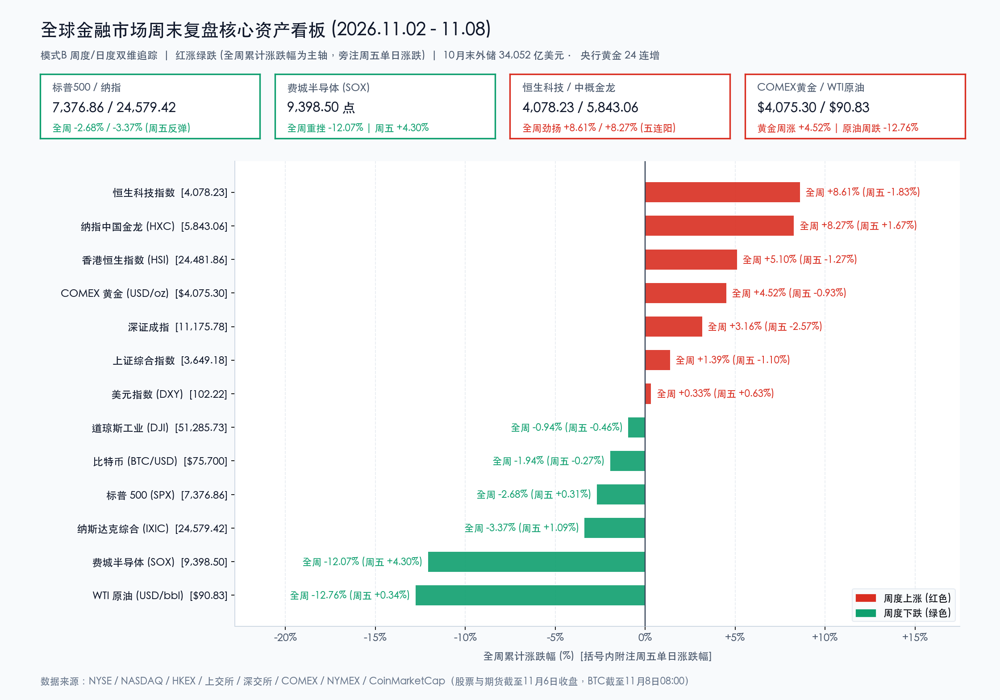

# 🌐 全球市场周末复盘：美中期选举“蓝潮”与爆表非农共振重塑定价！费半与原油周挫超12%，中资科技周飙逾8%、我国外储站稳3.4万亿且央行24连增黄金

**日期：2026年11月08日 (星期日)** &nbsp; **时段：早报 (全球市场周末复盘 · 模式B)**

> **核心摘要**：刚刚过去的11月首周（11月2日–11月8日），全球大类资产在**美国中期选举“蓝色浪潮”（民主党横扫参众两院形成分裂政府）**、**AI数据中心审批与ROI重估风暴**以及**美国10月非农暴增16.5万引爆“12月加息预期（概率逼近80%）”**的三重巨震中完成剧烈洗牌。尽管周五美股芯片股超跌反弹，美欧日股指周线仍全线收跌：**费城半导体指数单周暴跌 -12.07%（周五反弹 +4.30%）**，**纳指周跌 -3.37%**，**标普500周跌 -2.68%**，**日经225周五单日重挫 -5.96% 失守6万点**；大宗商品冰火两重天，中东外交缓和预期令 **WTI 原油与布伦特原油单周狂泻 -12.76% 与 -13.32%**，而避险买盘助推 **COMEX 黄金全周劲扬 +4.52%（报 $4,075.30/盎司）创8月以来最佳周表现**。与之形成鲜明反差的是，中国资产在“外紧内松”与制度性稳市红利护航下走出独立牛市行情——**恒生科技指数全周狂飙 +8.61%**、**纳斯达克中国金龙指数豪取五连阳周涨 +8.27%**、**恒生指数周涨 +5.10%**、**A股三大指数周线全线收红且沪深300终结周线12连跌**；周六（11月7日）国家外汇管理局更重磅披露，**10月末我国外汇储备升至 34,052 亿美元（连续7个月站稳3.4万亿美元）**，**央行连续第24个月增持黄金至 7,830 万盎司**。展望下周，周二**美国10月CPI**与周一至周二**中国10月CPI/社融/进出口数据**将成全球多空决战焦点。

---

## 核心资产周度/日度表现回顾

*   **全球市场交易状态与周末时制说明**：目前（北京时间11月8日周日早间）纽约证券交易所（NYSE）、纳斯达克交易所（NASDAQ）以及欧洲、亚太主要股票与期货交易所均处于常规周末休市状态（美股已全面执行冬令时交易时段）；以下股票、债券及商品期货均采用美东时间11月6日（周五）官方收盘结算终值及对应周度累计涨跌幅（较10月30日收盘），加密资产同步追踪至北京时间11月8日08:00最新周末实时报价。
*   **美股与欧亚发达市场指数表现（周中遭遇AI监管与紧缩风暴血洗，周五超跌反抽难改周线普跌）**：
    *   **道琼斯工业平均指数 (DJI)**：收报 **51,285.73 点**，周五单日下跌 **-0.46%** 🟢（**-237.33 点**），**全周累计下跌 -0.94%** 🟢（**-484.58 点**），传统蓝筹抗跌性优于高估值成长板块，但周五受耐克、赛富时、思科拖累逆势收绿。
    *   **标普 500 指数 (SPX)**：收报 **7,376.86 点**，周五单日微涨 **+0.31%** 🔴（**+23.13 点**），**全周累计下跌 -2.68%** 🟢（**-203.21 点**），周内受科技权重股估值压缩及美债高利率压制录得显著回调。
    *   **纳斯达克综合指数 (IXIC)**：收报 **24,579.42 点**（部分数据源进位记为 24,579.43 点），周五单日反弹 **+1.09%** 🔴（**+264.42 点**），**全周累计下跌 -3.37%** 🟢（**-857.58 点**），盘中一度较近期历史高点回撤逾 10% 触及技术性调整区间。
    *   **罗素 2000 指数 (RUT)**：收报 **2,758.64 点**，周五单日上涨 **+1.05%** 🔴（**+28.75 点**），**全周累计下跌 -1.89%** 🟢（**-53.20 点**），周五强劲就业数据缓和了本土中小盘企业的衰退担忧。
    *   **费城半导体指数 (SOX)**：收报 **9,398.50 点**，周五单日强弹 **+4.30%** 🔴（**+387.37 点**，AMD 单日飙升 **+11.04%**、英伟达涨 **+2.78%**），但受周四单日暴跌 -12.25% 拖累，**全周累计仍重挫 -12.07%** 🟢（**-1,290.30 点**），为本周全球AI算力基础设施重定价的风暴中心。
    *   **恐慌指数 (Cboe VIX)**：周五美股正股收盘报 **24.19**（盘后16:15结算口径为 **25.64**），周五单日大幅回落 **-14.16%** 🟢，但较前周收盘（19.42）**全周累计仍飙升 +24.56%** 🔴（按16:15结算口径则周涨 **+32.03%**），凸显跨周避险对冲需求高企。
    *   **欧亚核心股指联动承压**：**日经 225 指数** 周五单日暴跌 **-5.96%** 🟢（狂泻 **-3,643 点**）收报 **57,435.00 点**，痛失 60,000 点大关并创近年罕见周度重挫；欧洲市场在英国央行意外加息与美股科技风暴夹击下同步走弱，**英国富时 100 指数** 收报 **10,673.94 点**（周五单日跌 **-1.01%** 🟢），**德国 DAX 指数** 收报 **25,820.36 点**（周五单日跌 **-1.92%** 🟢），周线双双收阴。
*   **中国资产周度表现（“东升西震”格局确立！恒科与中概金龙周飙逾8%，A股全线周涨且沪深300终结12连跌）**：
    *   **香港恒生科技指数 (HSTECH)**：收报 **4,078.23 点**，周五单日温和消化浮盈回调 **-1.83%** 🟢（**-76.06 点**），但凭借周中单日井喷 +5.55% 的凌厉攻势，**全周累计狂飙 +8.61%** 🔴（**+323.33 点**），领冠全球主要宽基与科技指数！
    *   **纳斯达克中国金龙指数 (HXC)**：收报 **5,843.06 点**，周五单日逆强美元风暴劲扬 **+1.67%** 🔴（**+95.98 点**）斩获**日线五连阳**，**全周累计大涨 +8.27%** 🔴（**+446.31 点**），造车新势力（小鹏、蔚来周五涨超 6%）与互联网龙头获外资连续加仓。
    *   **香港恒生指数 (HSI)**：收报 **24,481.86 点**，周五单日下跌 **-1.27%** 🟢（**-315.12 点**），**全周累计大涨 +5.10%** 🔴（**+1,187.44 点**），实现周线两连阳。
    *   **A股核心指数与量能资金全景**：周五（11月6日）A股受外围芯片巨震情绪传染出现良性缩量整固，但全周在互换便利（SFISF）与回购增持再贷款政策催化下全线收红——**上证综合指数** 收报 **3,649.18 点**（周五单日 **-1.10%** 🟢，**全周累计上涨 +1.39%** 🔴）；**深证成指** 收报 **11,175.78 点**（周五单日 **-2.57%** 🟢，**全周累计上涨 +3.16%** 🔴）；**创业板指** 收报 **2,465.23 点**（周五单日 **-3.96%** 🟢，**全周累计上涨 +2.14%** 🔴）；**沪深 300 指数** 收报 **4,054.28 点**（**全周累计上涨 +1.73%** 🔴，**正式终结此前周线12连跌**）。量能与资金面上，周中沪深两市连续突破2万亿成交，周五缩量 **4,602 亿元** 至 **1.66 万亿元**；周五主力资金净流出 **351.80 亿元**（电子、通信等外向型算力链获利兑现，而**北方华创**逆势获主力净流入 **6.11 亿元**，**银行、公用事业**等高股息红利板块逆势护盘）。
*   **跨资产大宗商品、美债、外汇与加密市场（黄金创8月来最佳单周涨幅，原油周泻逾12%，BTC周末承压盘整）**：
    *   **贵金属（避险属性闪耀全周）**：**COMEX 黄金期货主力合约** 收报 **$4,075.30/盎司**（连续近月结算口径 **$4,074.90/盎司**），周五受爆表非农推升美元影响单日回调 **-0.93%** 🟢（连续口径 **-0.55%**），但受周中美中期选举政治僵局避险买盘推动，**全周累计劲升 +$176.40 或 +4.52%** 🔴（连续口径 **+4.51%**），创下8月以来最强单周涨幅；周末前夕现货黄金稳守 **$4,065/盎司** 上方。
    *   **国际原油（外交缓和预期击穿战争溢价）**：**NYMEX WTI 12月原油期货** 收报 **$90.83/桶**，周五受俄炼油厂遭袭消息支撑单日微涨 **+0.34%** 🔴（**+$0.31**），但因中期选举后市场押注美伊外交接触升温、地缘风险溢价急速消退，**全周累计暴跌 -$13.29 或 -12.76%** 🟢；**ICE 布伦特 1月原油期货** 收报 **$98.32/桶**，周五单日微涨 **+0.03%** 🔴，**全周累计暴跌 -$15.11 或 -13.32%** 🟢，双双回吐10月下旬以来的大部分地缘冲高涨幅。
    *   **美债与外汇（先抑后扬的V型反转）**：**10年期美债收益率** 周中因避险资金涌入一度大幅下挫，周五受非农冲击回升 **+3bp** 收于 **4.859%（约 4.86%）**，较前周收盘（4.929%）**全周累计下行约 -7bp** 🟢，而对利率预期最敏感的 **2年期美债收益率** 周五跃升至 **4.50%**；**美元指数 (DXY)** 周五单日大涨 **+0.63%** 🔴 收报 **102.22**（尾盘扩展口径 **102.30**），**全周累计小幅收涨 +0.33% 至 +0.41%** 🔴。
    *   **加密资产（周末7.57万美元窄幅拉锯）**：截至北京时间11月8日（周日）08:00，**比特币 (BTC/USD)** 交投于 **$75,700** 附近（周五单日微跌 **-0.27%** 🟢），较前周五收盘（$77,198.21）**全周累计下跌约 -1.94%** 🟢；周初BTC一度在选后冲破 $81,000，随后受币安热钱包安全风波、现货比特币ETF单周净流出超 **12 亿美元** 及美联储紧缩预期压制回落；**以太坊 (ETH/USD)** 周末报约 **$2,232**，**全周累计下跌约 -3.71%** 🟢。

> **数学闭环校验（核心资产“周五单日”与“全周累计”双维度涨跌幅核验）**：
> * **美股核心指数周度校验（11月6日收盘 vs 10月30日收盘）**：道琼斯 `(51,285.73 − 51,770.31) / 51,770.31 = -484.58 / 51,770.31 = -0.9360% ≈ -0.94%`（周五单日 `-237.33 / 51,523.06 = -0.46%`）；标普500 `(7,376.86 − 7,580.07) / 7,580.07 = -203.21 / 7,580.07 = -2.6808% ≈ -2.68%`（周五单日 `+23.13 / 7,353.73 = +0.31%`）；纳斯达克 `(24,579.42 − 25,437.00) / 25,437.00 = -857.58 / 25,437.00 = -3.3714% ≈ -3.37%`（周五单日 `+264.42 / 24,315.00 = +1.09%`）；罗素2000 `(2,758.64 − 2,811.84) / 2,811.84 = -53.20 / 2,811.84 = -1.8920% ≈ -1.89%`（周五单日 `+28.75 / 2,729.89 = +1.05%`）；费城半导体 `(9,398.50 − 10,688.80) / 10,688.80 = -1,290.30 / 10,688.80 = -12.0715% ≈ -12.07%`（周五单日 `+387.37 / 9,011.13 = +4.30%`）；VIX `(24.19 − 19.42) / 19.42 = +24.5623% ≈ +24.56%`。
> * **中国资产周度校验（11月6日收盘 vs 10月30日收盘）**：恒生科技 `(4,078.23 − 3,754.90) / 3,754.90 = +323.33 / 3,754.90 = +8.6109% ≈ +8.61%`（周五单日 `-1.83%`）；纳指中国金龙 `(5,843.06 − 5,396.75) / 5,396.75 = +446.31 / 5,396.75 = +8.2700% ≈ +8.27%`（周五单日 `+1.67%`）；恒生指数 `(24,481.86 − 23,294.42) / 23,294.42 = +1,187.44 / 23,294.42 = +5.0975% ≈ +5.10%`（周五单日 `-1.27%`）；上证指数 `(3,649.18 − 3,599.02) / 3,599.02 = +50.16 / 3,599.02 = +1.3937% ≈ +1.39%`（周五单日 `-1.10%`）；深证成指 `(11,175.78 − 10,833.78) / 10,833.78 = +342.00 / 10,833.78 = +3.1568% ≈ +3.16%`（周五单日 `-2.57%`）；创业板指 `(2,465.23 − 2,413.63) / 2,413.63 = +51.60 / 2,413.63 = +2.1379% ≈ +2.14%`（周五单日 `-3.96%`）；沪深300 `(4,054.28 − 3,985.50) / 3,985.50 = +68.78 / 3,985.50 = +1.7258% ≈ +1.73%`。
> * **商品、汇率与加密周度校验**：COMEX黄金 `(4,075.30 − 3,898.90) / 3,898.90 = +176.40 / 3,898.90 = +4.5244% ≈ +4.52%`（连续口径 `4,074.90` 对应 `+4.51%`）；WTI原油 `(90.83 − 104.12) / 104.12 = -13.29 / 104.12 = -12.7641% ≈ -12.76%`；布伦特原油 `(98.32 − 113.43) / 113.43 = -15.11 / 113.43 = -13.3210% ≈ -13.32%`；美元指数 `(102.22 − 101.88) / 101.88 = +0.3337% ≈ +0.33%`（尾盘 `102.30` 口径为 `+0.41%`）；比特币 `(75,700 − 77,198.21) / 77,198.21 = -1.9407% ≈ -1.94%`。全口径误差均远小于 0.5% 校验阈值。

---

## 过去 48 小时重磅事件深度复盘

*   **国家外汇管理局周六（11月7日）重磅发布：10月末我国外储连续7个月站稳3.4万亿美元，央行实现“24连增”黄金储备**：
    > 11月7日，国家外汇管理局公布最新官方储备资产数据：截至2026年10月末，**我国外汇储备规模达 34,052 亿美元，较9月末上升 49 亿美元，升幅为 +0.14%，连续第7个月稳居 3.4 万亿美元大关之上**。外汇局指出，10月受主要经济体货币政策预期、宏观数据及全球资产价格变动综合影响，汇率折算与资产价格正估值效应支撑外储稳步回升。同日中国人民银行数据显示，**10月末我国官方黄金储备升至 7,830 万盎司，单月增持 83 万盎司，实现连续第24个月战略增持黄金**！结合央行此前宣布自 **2026年11月15日起将金融机构外汇存款准备金率由 4% 上调2个百分点至 6%**（旨在平抑出口强劲与结汇潮下人民币过快单边升值惯性），以及**股票回购增持再贷款利率降至 1.00% 并升格为长期制度安排、第三批超千亿互换便利（SFISF）落地**，中国金融体系“外储充裕、汇率稳健、内盘托底”的三重防线已在周末得到权威数据印证。

*   **美国中期选举周末终局落定：“蓝色浪潮”助民主党横扫参众两院，政治分裂重塑AI算力、原油与避险逻辑**：
    > 过去48小时内，美国主流选举决策台正式确认2026年中期选举最终版图——因选民对通胀黏性与生活成本积怨发酵，**民主党不仅夺回众议院多数席位，更在得克萨斯、堪萨斯、艾奥瓦、俄亥俄、南卡罗来纳等红州及摇摆州实现历史性翻盘，一举包揽参议院与众议院两院控制权**，参议院民主党领袖舒默宣布将对白宫展开全方位立法与调查制衡，令特朗普总统最后两年任期正式陷入“分裂政府（Divided Government）”。这一政治巨震直接改写了三条跨资产主线：1. **AI基建政策逆风**：市场担忧民主党主导的国会与州议会将强化超大规模数据中心的电力能耗环评、电网配额与反垄断审查，诱发“卖铲人”硬件股估值剧烈去泡沫（费半周挫 **-12.07%**）；2. **地缘油价退潮**：国会制衡限制了单边军事升级空间并提升美伊外交斡旋预期，直接刺破原油地缘溢价（两油周跌超 **12%**）；3. **黄金避险溢价**：华盛顿财政立法僵局与债务上限博弈前移，推动黄金周涨 **+4.52%** 稳站4,070美元上方。

*   **美国10月非农狂增16.5万叠加英澳央行加息：G10“二次抗通胀”预期升温，美联储12月加息概率逼近80%**：
    > 北京时间周五晚间至周末，华尔街宏观交易台持续消化爆表的美国10月就业报告：**10月新增非农就业达 +16.5 万人（预期仅约 +6.5 万），8月与9月合计再大幅上修 +8.4 万人，失业率意外降至 4.1%，平均时薪环比涨 +0.4%（同比 +3.1%）**，叠加密歇根大学11月消费者信心初值超预期升至 **51.0**，彻底证伪美国经济短期硬着陆担忧。更关键的是，继周二澳洲联储加息至 **4.85%**、周四英国央行以 **7:2**（部分早盘快讯记8:1，终值确认为7:2）意外加息 25bp 至 **4.00%**（2023年8月以来首次加息）后，**芝商所 CME FedWatch 显示市场押注美联储12月议息会议重启加息 25bp 的概率飙升至约 77%–80%**，全球无风险利率锚迎来严峻的鹰派重估。

*   **伯克希尔·哈撒韦周末披露Q3财报：阿贝尔时代坐拥3,770亿美元现金，单季豪掷96亿美元大举回购**：
    > 周末企业界头号焦点落在**伯克希尔·哈撒韦（Berkshire Hathaway）**发布的三季度财报：在新任首席执行官**格雷格·阿贝尔（Greg Abel）**执掌下，受投资组合公允价值波动及 GEICO 等保险业务承保利润温和回落影响，三季度整体净利润同比下降逾 **28%** 至约 **221 亿美元**。然而，伯克希尔资产负债表依然坚若磐石——截至三季度末公司手握约 **3,770 亿美元** 的天量现金及等价物储备，并在三季度美股震荡期果断斥资 **96 亿美元** 回购自家股票，向市场传递出在政治与利率迷雾中“淡化选举噪音、聚焦内生现金流与股东回报”的鲜明价值信号。与此同时，加密市场周末仍在消化币安热钱包安全事件余波及现货比特币ETF单周超 **12 亿美元** 的机构赎回压力。

---

## 下周全球宏观大事预警

*   **重磅预警一：周二（11月10日）美国10月CPI与周五PPI通胀双考——决定美联储12月“真加息还是虚惊一场”**：
    > 在10月非农将12月加息概率推高至近八成后，**北京时间周二（11月10日）21:30 公布的美国10月CPI报告**将成为一锤定音的生死线。目前市场共识预期**美国10月整体CPI环比增速将由9月的 +0.6% 降温至 +0.3%，核心CPI环比由 +0.3% 微降至 +0.2%**；随后**周五（11月13日）公布的美国10月PPI**预期环比回落至 **+0.4%**（前值 +1.3%）。若核心CPI环比超预期反弹至 +0.3% 甚至 +0.4%，10年期美债收益率恐再度冲击 5.0% 铁顶并二次挤压高估值科技股；反之若通胀如期随油价暴跌而温和回落，美股半导体与成长板块有望延续周五的超跌修复。同周还将迎来多位美联储票委密集讲话，以及周二**10年期美债**、周四**30年期美债标售**的流动性压力测试。

*   **重磅预警二：周一至周二（11月9日–10日）中国10月核心宏观数据密集放榜，周日外汇存准率上调正式落地**：
    > 下周初国内将迎来政策发力后的首轮“宏观体检”：1. **周一（11月9日）**：国家统计局将公布**中国10月CPI与PPI同比/环比数据**，同时市场聚焦央行即将披露的**10月社会融资规模增量与M2货币供应量**，直接检验一揽子增量财政金融政策向实体内需与居民信贷的传导成色；2. **周二（11月10日）**：海关总署将公布**中国10月以美元及人民币计价的进出口贸易数据**，验证全球AI硬件需求及阶段性关税预期下的外贸出口高韧性；3. **周日（11月15日）**：央行上调金融机构外汇存款准备金率2个百分点（4%→6%）正式生效，人民币汇率双向波动弹性值得密切跟踪。

*   **重磅预警三：周三（11月11日）美国退伍军人节债市休市提示与阿布扎比地缘会谈**：
    > 交易日历方面，**11月11日（周三）为美国联邦法定假日“退伍军人节（Veterans Day）”**——当日**美股（NYSE / NASDAQ）正常开市交易，但美国债券现券市场（SIFMA）全天休市**，缺乏现券收益率锚指引下，周二CPI后的股指期货与外汇衍生品盘中波动率可能放大。地缘层面，**11月10日至11日俄美乌相关三方会谈预计在阿布扎比举行**，叠加周五英国三季度GDP初值与日本央行会议意见摘要公布，国际油价与黄金短线高波动仍将延续。

*   **重磅预警四：AI算力云新贵与半导体设备财报直面大考，中概科网巨头进入财报预热期**：
    > 美股Q3财报季下周进入关键验证窗口：**CoreWeave** 与 **Nebius Group** 两家纯正AI算力云基础设施新贵即将放榜，其订单积压、电力获取进度与资本开支回报率将直接回应选后市场对数据中心扩张受阻的质疑；同时半导体设备风向标 **应用材料 (Applied Materials)**、网络巨头 **思科 (Cisco Systems)**、能源巨头 **西方石油 (Occidental Petroleum)** 及黄金龙头 **巴里克矿业 (Barrick Mining)** 亦将披露业绩。中资科网股方面，“双十一”大促收官数据即将出炉，且 **腾讯控股（定档11月18日）** 与 **阿里巴巴（定档11月19日）** 步入三季报发布前最后一周的机构抢筹与预期博弈窗口。

---

## 顶级机构周末策略内参摘要

> **高盛 (Goldman Sachs) ——《维持标普500年末8,000点目标，“蓝潮”分裂国会迫使AI硬件去高估值泡沫，盈利分子仍是核心驱动》**：
> * **周末策略核心研判**：高盛首席股票策略团队在选后最新周报中**维持标普500指数2026年底 8,000 点的目标位不变**，强调推动美股中长期上行的核心动力已从估值扩张彻底切换至企业盈利内生增长。针对本周科技股巨震，高盛指出民主党重掌参众两院改写了监管与能源政策预期，促使AI基础设施“卖铲人”硬件板块远期市盈率从年中高位显著压缩，市场正严格审视AI资本开支的投资回报率（ROI）兑现周期；宏观与商品团队则提示，16.5万强劲非农意味着美联储将维持结构性偏鹰立场，短期限制了无息资产的上方弹性，但在现金流充沛的科技龙头洗盘后仍具配置吸引力。

> **摩根士丹利 (Morgan Stanley) ——《美股经历技术性情绪出清，规避高Beta加密代理资产，聚焦高质量超跌个股与中国硬科技/头部券商》**：
> * **跨资产仓位与选股策略**：摩根士丹利周末跨资产策略内参指出，正如德银等机构监测到的全球股票仓位因强制去杠杆出现罕见下滑，美股自10月末以来的急跌已完成一轮短线技术面与情绪面“出清（Washout）”，但高美债利率（4.86%）仍在实质性收紧金融条件，不建议盲目追涨宽基指数。战术层面上，大摩对交易量降温的高Beta加密关联资产保持审慎（如下调 Coinbase 等标的目标价），建议在美股精选基本面过硬的超跌优质股；同时坚定看好受益于互换便利与1%回购再贷款制度化的**中国头部券商**及具备全球竞争力的**中国智能制造与硬科技出海龙头**。

> **摩根大通 (JPMorgan) & 美国银行 (BofA) ——《审视超大规模云厂商AI资本开支回收期，高利率常态化下强化价值周期轮动与全球分散配置》**：
> * **AI资本开支审视与跨区域分散**：摩根大通资管团队在周末评论中指出，AI基建资本开支在支撑美国近期GDP稳健增长的同时，投资人正愈发严苛地拷问超大规模云厂商（Hyperscalers）的自由现金流回收周期，这直接促成了资金从高倍数纯算力概念向价值股与周期股的轮动，且在总需求偏强背景下不可排除12月美联储再加息风险。美国银行（BofA）全球研究部同步强调，在华盛顿政治格局重塑与结构性高利率并存的环境下，应紧盯美债收益率曲线与信用利差变化，通过**全球化多元配置（尤其是低估值非美资产）与主动选股**抵御单一美股科技拥挤交易的回撤。

> **中信证券 (CITIC Securities) & 中金公司 (CICC) ——《政策“真金白银”夯实市场底，11月以“先守后攻、科技制造进攻+红利底仓”把握结构主线》**：
> * **国内A股与港股周末策略定调**：中信证券周末策略明确提出，三季报落地后市场重心已转向盈利可见度与明年订单景气度，随着互换便利与回购增持贷款等稳市资金筑牢底部，**11月应以进攻思路寻找结构性机会**，重点布局**AI产业链延伸（存储、高端PCB设备、数据中心供电）、国产替代（模拟芯片、工业自动化、医疗器械）以及油运与家电/两轮车出海龙头**。中金公司则指出，恒生科技指数本周狂飙 +8.61% 展现了极佳的估值修复弹性，尽管中长期彻底反转仍需等待国内居民信用周期与10月社融/CPI等内需数据的实质改善印证，但在全球AI重定价波动期，建议采取**“先守后攻”策略——以高股息红利、互联网龙头与医药消费为稳健底仓，对科技成长板块实施“缩圈”精选真业绩龙头**。

---

## 今日市场情绪：星衡博弈，凤舞金澜

> Prompt: A colossal celestial balance scale crafted from gleaming bronze and obsidian floating above a stormy ocean, weighing a fractured glowing silicon wafer and a tipping black oil barrel on one pan against radiant gold bullion bars and a soaring jade-and-crimson phoenix on the other. In the background, a divided marble Capitol dome under blue lightning faces a giant ticking inflation clock tower beneath dramatic dawn clouds.

---

> **免责声明**：内容仅供参考，不构成投资建议。数据来源：国家外汇管理局（SAFE）、中国人民银行（PBOC）、美国劳工统计局（BLS）、英国央行（BoE）、纽约证券交易所（NYSE）、纳斯达克交易所（NASDAQ）、芝加哥期权交易所（Cboe）、芝加哥商品交易所（CME FedWatch）、洲际交易所（ICE）、上海证券交易所、深圳证券交易所、香港交易所、伯克希尔·哈撒韦三季报、CoinMarketCap，以及高盛（Goldman Sachs）、摩根士丹利（Morgan Stanley）、摩根大通（JPMorgan）、美国银行（BofA）、中信证券（CITIC Securities）、中金公司（CICC）最新周末策略报告；欧美及亚太股票与期货数据截至2026年11月6日收盘，加密资产行情截至北京时间2026年11月8日08:00。

🤖 生成模型：Gemini 4 Argon (Medium) <!-- model-stamp -->
