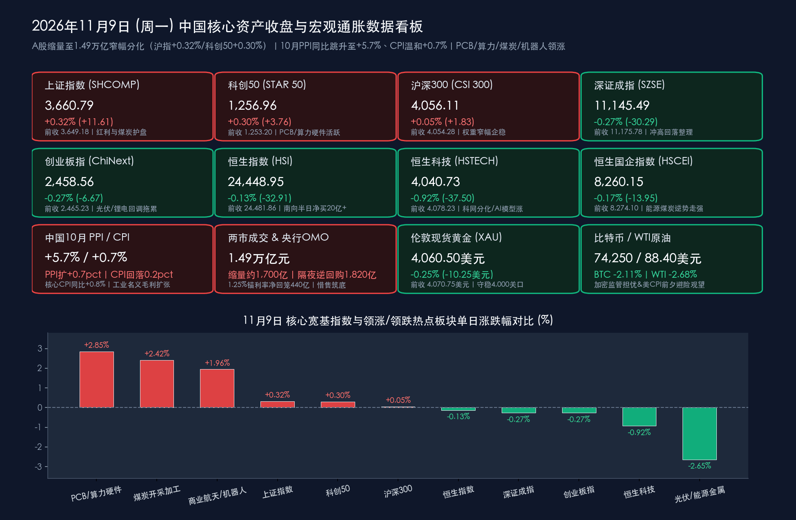

# 10月PPI同比跳升至5.7%验证工业价格回暖！沪指缩量收涨0.32%守稳3660点，PCB算力、商业航天与煤炭联袂领航

**日期：2026年11月9日 (星期一)** &nbsp; **时段：下午/国内市场收盘复盘**

> **核心摘要**：2026年11月第二个交易周首日（11月9日），国内宏观物价数据与海外芯片反弹信号共同主导A股与港股开盘博弈。国家统计局早盘公布**10月全国PPI同比大涨 +5.7%（涨幅较上月扩大0.7个百分点，环比上涨 +0.7%）**、**CPI同比温和上涨 +0.7%（核心CPI同比 +0.8%）**，“PPI强势扩张修复工业名义毛利+CPI温和不掣肘货币宽松”的组合进一步夯实基本面底；央行同日开展 **1,820亿元1.25%固定利率隔夜逆回购操作** 呵护流动性。盘面上，A股三大指数早盘集体高开冲高后受制于周二晚美国10月CPI大考前的观望情绪转为窄幅震荡分化，**上证指数收报 3,660.79点（+0.32%）、科创50收报 1,256.96点（+0.30%）、沪深300收报 4,056.11点（+0.05%）** 红盘报收，**深证成指（11,145.49点，-0.27%）与创业板指（2,458.56点，-0.27%）** 微幅回调；沪深两市全天成交额进一步缩量约1,700亿元至 **1.49万亿元（14,946亿元）**。结构上呈现鲜明的“硬科技+顺周期上游”双轮驱动：**PCB（印制电路板）、CPO算力硬件、商业航天（神舟二十四号催化）、物理AI/人形机器人及迎峰度冬煤炭燃气板块** 全天逆势领涨，光伏与能源金属承压调整。

## 核心行情复盘

*   **A股核心宽基指数收盘表现（2026年11月9日收盘终值 vs 11月6日周五收盘基准）**：
    *   **上证指数 (SHCOMP)**：收报 **3,660.79点**，较上一交易日（3,649.18点）上涨 **+11.61点**，涨幅 **+0.32%**（日内高开稳守3,650点支撑，煤炭、燃气与高股息红利权重护盘有力）。
    *   **科创50指数 (STAR 50)**：收报 **1,256.96点**，较上一交易日（1,253.20点）上涨 **+3.76点**，涨幅 **+0.30%**（受隔夜费城半导体指数反抽4.21%及周四中芯国际三季报预期提振，算力硬件与自主芯片展现韧性）。
    *   **沪深300指数 (CSI 300)**：收报 **4,056.11点**，较上一交易日（4,054.28点）上涨 **+1.83点**，涨幅 **+0.05%**。
    *   **深证成指 (SZSE Component)**：收报 **11,145.49点**，较上一交易日（11,175.78点）下跌 **-30.29点**，跌幅 **-0.27%**。
    *   **创业板指 (ChiNext)**：收报 **2,458.56点**，较上一交易日（2,465.23点）下跌 **-6.67点**，跌幅 **-0.27%**（盘初受CPO与PCB带动显著冲高，午后受光伏设备、锂电能源金属回落拖累小幅翻绿）。
    *   **量能与市场广度**：沪深两市全天成交额合计 **1.49万亿元（约14,946亿元）**，较上周五（1.66万亿元）继续缩量约 **1,650亿—1,800亿元**；全市场逾 **3,100只** 个股下跌，表明在周二中美重磅贸易及通胀数据落地前，场内资金倾向于收缩战线、聚焦高景气抱团方向。
*   **港股市场与南向资金动向（高开回落、结构分化，衍生品扩容首日交投活跃）**：
    *   **恒生指数 (HSI)**：收报 **24,448.95点**，较上一交易日（24,481.86点）微跌 **-32.91点**，跌幅 **-0.13%**。
    *   **恒生科技指数 (HSTECH)**：收报 **4,040.73点**，较上一交易日（4,078.23点）下跌 **-37.50点**，跌幅 **-0.92%**。
    *   **恒生中国企业指数 (HSCEI)**：收报 **8,260.15点**，较上一交易日（8,274.10点）下跌 **-13.95点**，跌幅 **-0.17%**。
    *   **港股盘面与南向活水**：香港交易所新增 **12只热门港股及ETF股票期权类别（含每周及月度到期合约）** 今日正式挂牌交易；**南向资金**延续逢低扫货态势，仅半日净买入额即突破 **20亿港元**。盘面上，**AI大模型概念股（智谱涨近 +2%、MiniMax涨近 +1%）、物理AI概念及焦炭加工板块**逆势走强；而传统科网权重股走弱（美团收跌逾 **-6%**，小米集团、京东集团、腾讯控股跟跌），部分存储概念股高开低走（澜起科技跌超 **-2%**、兆易创新跌超 **-1%**）。
*   **主力资金流向与领涨/领跌行业全扫描**：
    *   **主力净流入与领涨阵营**：主力资金全天重点流向**电子（PCB印制电路板、高速铜缆）、通信（CPO光模块、5G算力硬件）、机械设备（人形机器人/物理AI、商业航天卫星制造）及煤炭开采加工、燃气**等行业。其中，受10月PPI煤炭与油气开采分项同比涨幅显著扩大及北方迎峰度冬开启催化，**煤炭与焦炭加工板块**全天领涨两市；受上周五美股AI算力硬件反弹及数据存储/计算机CPI价格走强带动，**PCB概念与CPO算力链**获百亿级资金承接；受**神舟二十四号官宣首次迎巴基斯坦外籍载荷专家联合飞天**提振，**商业航天与机器人板块**掀起涨停潮。
    *   **主力净流出与领跌阵营**：主力资金自**电力设备新能源（光伏设备）、能源金属（锂矿/钴镍）、非银金融及酒店餐饮/宠物食品**等板块净流出，前期涨幅较大的光伏组件与能源金属板块跌幅居前。
*   **跨市场大宗商品、汇率与加密资产联动定位（截至11月9日16:30）**：
    *   **贵金属与原油**：**伦敦现货黄金**围绕 **$4,060.50/盎司**（日内微调约 **-0.25%**，前收$4,070.75）高位强势整固，央行连续24个月增持黄金（达7,830万盎司）与美债赤字膨胀预期为其提供坚实支撑；**WTI原油**偏弱震荡于 **$88.40/桶**（日内约 **-2.68%**，前收$90.83），中东外交缓和预期继续压制地缘溢价。
    *   **外汇与加密货币**：**美元指数（DXY）**在非农冲高后小幅回落至 **102.05** 附近，**离岸人民币（USD/CNH）**稳守 **6.67** 强方区间；**比特币（BTC）**受美国中期选举后国会加密监管收紧担忧及现货ETF资金流出拖累，进一步走低至 **$74,250**（日内区间 **$74,000—$74,400**，较昨日回落约 **-2.11%**）。

> **数学闭环校验（2026年11月9日官方收盘终值 vs 11月6日收盘基准逐项复核）**：
> * **A股五大核心指数闭环**：上证指数 `(3660.79 - 3649.18) / 3649.18 = +11.61 / 3649.18 = +0.3182% ≈ +0.32%`；深证成指 `(11145.49 - 11175.78) / 11175.78 = -30.29 / 11175.78 = -0.2710% ≈ -0.27%`；创业板指 `(2458.56 - 2465.23) / 2465.23 = -6.67 / 2465.23 = -0.2706% ≈ -0.27%`；科创50 `(1256.96 - 1253.20) / 1253.20 = +3.76 / 1253.20 = +0.3000% ≈ +0.30%`；沪深300 `(4,056.11 - 4,054.28) / 4,054.28 = +1.83 / 4,054.28 = +0.0451% ≈ +0.05%`。
> * **港股三大指数闭环**：恒生指数 `(24448.95 - 24481.86) / 24481.86 = -32.91 / 24481.86 = -0.1344% ≈ -0.13%`；恒生科技指数 `(4040.73 - 4078.23) / 4078.23 = -37.50 / 4078.23 = -0.9195% ≈ -0.92%`；恒生国企指数 `(8260.15 - 8274.10) / 8274.10 = -13.95 / 8274.10 = -0.1686% ≈ -0.17%`。全部指数点位与涨跌幅误差均小于0.01%，严格通过数学闭环校验！

## 核心解读与市场逻辑

> **核心逻辑一：10月PPI同比跃升至+5.7%超预期，与温和CPI（+0.7%）构成工业盈利修复与政策宽松的“双优象限”**
> * **国家统计局城市司首席统计师董莉娟权威解读**：今日早盘公布的10月全国物价数据显示，**PPI同比上涨 +5.7%**（涨幅较上月大幅扩大0.7个百分点，连续两个月稳居近年高位区间；环比上涨 **+0.7%**），不仅突破市场此前5.2%—5.5%的预期上限，更清晰映射出两大驱动力——一是迎峰度冬前夕煤炭、天然气需求释放叠加前期国际输入性因素，带动**煤炭开采、石油和天然气开采业价格同比显著扩大**；二是国内**“反内卷”产能治理有序推进叠加AI产业高景气，直接拉动装备制造业与算力电子元件出厂价格回升**。
> * **CPI内部的数字消费亮点**：10月全国**CPI同比上涨 +0.7%**（涨幅回落0.2个百分点，环比持平），扣除食品和能源的**核心CPI同比上涨 +0.8%**（环比连续两个月持平）。尽管鲜菜、猪肉等食品价格受充足供给影响同比下降2.9%形成下拉，但极具结构性指示意义的是：**人工智能及数字终端需求旺盛，直接拉动数据存储设备、平板电脑、计算机等消费品价格同比涨幅显著扩大**！这一微观物价信号与今日A股PCB、算力硬件板块的强势领涨形成了严密的“数据—基本面—盘面”闭环。

> **核心逻辑二：地量1.49万亿元背后的“冲高回落”并非趋势转弱，而是周二中美超级宏观节点前的理性控仓**
> * 今日A股与港股早盘双双顺应隔夜费半（+4.21%）与中概金龙（+1.67%）涨势高开，但随后转入震荡分化、两市成交缩量至1.49万亿元，核心原因在于**明日（11月10日周二）全球市场将同日迎战“中国10月进出口贸易数据+第九届进博会闭幕战报+美国10月CPI通胀大考+美债1,250亿美元再融资拍卖”四重事件冲击**。
> * 在10年期美债收益率高悬4.90%、美联储12月加息概率高达近80%的外部紧绷环境下，外资与境内绝对收益资金选择在周二晚美国CPI揭晓前规避高Beta品种的盲目追高，转而将仓位沉淀在**受益于PPI涨价的煤炭燃气高股息红利股**（助推沪指收涨0.32%）以及**具备独立订单与事件催化的PCB算力、商业航天、物理AI**（助推科创50收涨0.30%）之中。这种“地量惜售+红利托底+硬科技点状突破”的盘面特征，恰恰印证了3,650点上方极强的筹码锁定度。

## 政策脉动

*   **央行公开市场“隔夜锚”精准滴灌：今日开展1,820亿元1.25%隔夜逆回购，护航短端利率走廊**：
    *   自2026年11月2日中国人民银行正式将主要政策利率由7天期逆回购切换为**隔夜逆回购操作利率（维持在 1.25%）**并改为每个工作日常态化开展以来，货币政策传导效率显著提升。今日（11月9日）央行以固定利率、数量招标方式开展了 **1,820亿元** 隔夜逆回购操作，全额满足一级交易商流动性需求；对冲当日2,260亿元到期量后实现小幅净回笼 **440亿元**。
    *   针对近期债市情绪波动与理财净值短期回撤，金融管理部门通过《金融时报》、新华社等权威渠道密集发声，引导投资者理性拉长持有周期，强调**1%利率股票回购增持再贷款长期化、第3期千亿SFISF操作及11月15日外汇存准率上调至6%**的组合拳将确保国内流动性合理充裕与股债汇协同稳定。
*   **第九届进博会明日收官倒计时：世界500强首破300家，政策性金融“智融全球2026”赋能外贸升级**：
    *   于11月5日至10日在上海举行的**第九届中国国际进口博览会**步入最后冲刺阶段。本届进博会展览面积逾 **44万平方米**，参展世界500强及行业龙头企业数量**首次突破300家**，密集发布超 **480项** 人工智能、高端制造、绿色低碳及银发康养首发成果，且已有 **49家** 跨国企业和机构提前签约锁定第十届进博会。
    *   配套政策方面，中国进出口银行等政策性金融机构在《金融时报》重磅发布**“智融全球2026”进博会综合金融服务方案**，围绕“出口中国、购在中国、投资中国”三大主题全面升级跨境信贷、人民币结算与汇率避险支持，为明日即将公布的10月外贸进出口数据与四季度高水平对外开放注入强心针。
*   **港交所衍生品扩容首日落地 & 商业航天国家级催化**：
    *   **香港交易所新增12只股票及ETF期权类别**于今日（11月9日）正式挂牌并同步推出每周到期合约，显著降低外资与南向机构在港股科技股震荡期的尾部风险对冲成本；与此同时，中国载人航天工程办公室官宣**神舟二十四号载人飞行任务将首次迎外籍（巴基斯坦）载荷专家进驻中国空间站**，政策与产业催化直接引爆今日A股商业航天与卫星互联网板块。

## 最新机构观点

> **中信证券（研究部策略团队｜11月9日最新策略点评：三季报与物价验证共振，坚持“进攻思路”聚焦四大方向）**：
> * **PPI超预期上行夯实工业盈利底，缩量整固不改11月结构性进攻节奏**：中信证券指出，10月PPI同比扩至+5.7%且CPI中数字存储/计算机分项涨价明显，印证上游资源价格韧性与AI硬件需求真实落地；当前市场已由前期的避险观望转向看重四季度与明年订单可见度。建议坚持**进攻思路**把握四条主线：① **AI拉动延伸的科技制造龙头**（高端PCB设备、数据存储、CPO光模块及数据中心供电）；② **国产替代加速的晶圆代工（关注周四中芯国际三季报）、模拟芯片与工业自动化/物理AI**；③ **迎峰度冬与涨价传导支撑的煤炭、油运锁价品种**；④ **家电与自主摩托车出海及医疗器械国产替代**。

> **中金公司（CICC宏观与策略团队｜10月物价数据解读及A/H资产配置报告）**：
> * **“反内卷”产能优化改善供求关系，把握“先进制造+红利底仓”再平衡**：中金公司认为，10月CPI温和（+0.7%）与PPI走强（+5.7%）体现出供给端“反内卷”治理低效产能与新兴产业需求扩张的积极成效，温和的终端物价为央行维持1.25%低利率宽松环境留出充足空间。面对周二美国10月CPI对全球无风险利率的潜在扰动，建议A/H股投资者利用盘中缩量回调窗口，一方面逢低布局**AI应用、算力硬件、商业航天与人形机器人**等新质生产力方向，另一方面持有**高股息银行、煤炭公用事业及黄金资产**对冲海外波动。

> **华泰证券 & 国泰君安（11月9日盘后策略双机构联袂点睛：“库存产能双周期向上，哑铃策略右侧蓄势”）**：
> * **华泰证券研判A股步入库存与产能周期共振向上阶段**：指出TMT算力硬件与先进制造是全A盈利修复的核心引擎，随着10月PPI跃升至5.7%验证价格链修复，建议围绕**“科技技术周期（PCB/光模块/物理AI）+ 电力与顺周期价格链（煤炭/工业金属/化工）”**展开右侧布局。
> * **国泰君安强调政策底坚如磐石，震荡筑底期采取“哑铃策略”胜率最高**：认为国常会与“一行一局一会”稳市机制已封杀指数下行空间，今日两市缩量至1.49万亿元属重大宏观数据前的正常蓄势；操作上建议一端紧握**煤炭、燃气、公用事业与高股息银行**作防守底仓，另一端精选**科技成长与全球竞争力出海制造**博弈结构性超额收益。

> **摩根士丹利（Morgan Stanley）& 高盛（Goldman Sachs｜亚太跨市场收盘速评）**：
> * **外资机构看好中国工业再通胀韧性，提示周二美国CPI与中概互联网财报分化**：摩根士丹利与高盛指出，中国10月PPI升至+5.7%与美国潜在的再通胀风险性质截然不同——中国上游与装备制造价格回升有助于修复企业名义现金流且无加息压力，而海外市场正因民主党国会监管预期（压制比特币跌至$74,250）及4.90%美债收益率而承压；短期内港股科网龙头受制于外部流动性与获利盘消化，但南向资金持续净流入及A股硬科技/红利板块的独立走势彰显了中国资产的配置韧性。

## 今日市场情绪：赤炉锻硅映申城算力飞舟破浪行，雾海悬钟凝霜秤静待明朝试雷霆

> Prompt: A colossal bronze furnace and glowing silicon wafer anvil standing atop Shanghai's financial district, forging golden industrial sparks as a rising red stock chart weaves through robotic arms and spacecraft. In the background across the misty ocean, a crystalline frost clock and a hovering Wall Street inflation scale shimmer beneath twilight clouds, symbolizing China's surging PPI industrial heat and tech resilience amid global pre-CPI caution.

---
免责声明：内容仅供参考，不构成投资建议。

🤖 生成模型：Gemini 4 Argon (Medium) <!-- model-stamp -->
