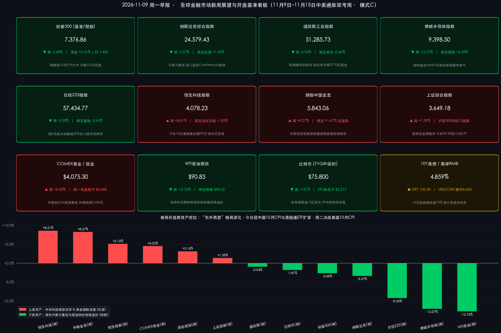

# 🌅 全球市场新周展望：中美高层经贸通话与国常会稳市共振！港股通ETF今起扩容，全球静待中美10月CPI通胀双考与AI算力财报验真

**日期：2026年11月09日 (星期一)** &nbsp; **时段：早报 (全球市场新周展望 · 模式C)**

> **核心摘要**：步入11月第二周（11月9日–11月15日），全球金融市场在经历美国中期选举“蓝色浪潮”分裂国会、AI硬件百亿级去杠杆重估（**费城半导体周挫 -12.07%**、**日经225周跌 -9.25% 步入技术性熊市**）以及美国10月非农激增 **+16.5 万**推升12月美联储加息概率超 **75%** 的惊涛骇浪后，迎来宏观政策暖风与关键通胀数据的正面交锋。周末至周一清晨重磅利好密集释出：**中美经贸牵头人何立峰副总理与美财长贝森特、贸易代表格里尔举行建设性视频通话**，缓和外部经贸摩擦尾部风险；**国务院常务会议明确“完善资本市场稳市机制、增强股市内在稳定性”并原则通过《价格法（修正草案）》治理低价无序竞争**；**10月末我国外储升至 34,052 亿美元（连续7个月站稳3.4万亿）、央行连续第24个月增持黄金至 7,830 万盎司**；同时**10只港股通主题ETF扩容于今日（11月9日）正式生效**，**海南商业航天发射场今晨成功发射卫星互联网低轨29组卫星**。新一周全球多空胜负手聚焦于**今日09:30中国10月CPI/PPI**、**周二21:30美国10月CPI通胀生死战**，以及 **CoreWeave、应用材料（AMAT）、思科（CSCO）** 领衔的AI算力基础设施财报大考；需特别留意**周三（11月11日）美国退伍军人节美债现券市场休市而美股照常开市**带来的跨资产波动放大风险。

---

## 周末财经要闻终极汇总

*   **全球市场交易状态与新周开盘基准全景（截至北京时间11月9日08:00）**：
    *   **时制与休市判定**：昨日（11月8日周日）全球主要股票及期货交易所常规休市；今日（11月9日周一）A股、港股、亚太股市及美股（**NYSE / NASDAQ 执行冬令时，北京时间今晚 22:30–次日 05:00 正常交易**）全面恢复常规交易。特别提示本周三（11月11日）为美国退伍军人节，**美股正常开市但美国债券现券市场（SIFMA）全天休市**。
    *   **美股与欧亚股指开盘基准（上周五超跌反抽收官，周一早盘期指企稳蓄势）**：**标普 500 指数 (SPX)** 基准收报 **7,376.86 点**（周五单日 **+0.31%** 🔴，全周累计 **-2.68%** 🟢），12月标普500迷你期指（ES）周一早盘围绕 **7,402.00 点** 平稳交投；**纳斯达克综合指数 (IXIC)** 基准收报 **24,579.43 点**（周五单日反弹 **+1.09%** 🔴，全周累计 **-3.37%** 🟢，纳指100期指自低位回升逾 **+1.3%** 后窄幅整理）；**道琼斯工业平均指数 (DJI)** 基准收报 **51,285.73 点**（周五单日 **-0.46%** 🟢，全周累计 **-0.94%** 🟢）；**罗素 2000 指数 (RUT)** 基准收报 **2,758.64 点**（周五单日 **+1.05%** 🔴，全周 **-1.89%** 🟢）；风暴眼 **费城半导体指数 (SOX)** 基准收报 **9,398.50 点**（周五单日强弹 **+4.30%** 🔴，但全周仍重挫 **-12.07%** 🟢）；**Cboe VIX 恐慌指数** 官方结算收报 **25.64**（周五单日回落 **-9.01%** 🟢，正股收盘口径 **24.19**，较前周 **19.42** 累计飙升 **+32.03%** 🔴，维持在20警戒线上方）；**日经 225 指数** 基准收报 **57,434.77 点**（周五单日暴跌 **-5.96%** 🟢，全周重挫 **-9.25%** 🟢，较6月历史高点回撤超 **20%** 确认步入技术性熊市）。
    *   **中国核心资产开盘基准（“东升西震”独立领跑全球，内盘量缩蓄势静待增量接力）**：**香港恒生科技指数 (HSTECH)** 基准收报 **4,078.23 点**（周五单日消化浮盈 **-1.83%** 🟢，**全周累计狂飙 +8.61%** 🔴 冠绝全球）；**纳斯达克中国金龙指数 (HXC)** 基准收报 **5,843.06 点**（周五单日逆势劲扬 **+1.67%** 🔴 斩获日线五连阳，**全周大涨 +8.27%** 🔴）；**香港恒生指数 (HSI)** 基准收报 **24,481.86 点**（周五单日 **-1.27%** 🟢，大市成交额稳居 **2,400 亿港元** 以上，**全周大涨 +5.10%** 🔴）。A股方面，**上证综合指数** 基准收报 **3,649.18 点**（周五 **-1.10%** 🟢，**全周 +1.39%** 🔴），**深证成指** 报 **11,175.78 点**（全周 **+3.16%** 🔴），**创业板指** 报 **2,465.23 点**（全周 **+2.14%** 🔴），**沪深 300 指数** 报 **4,054.28 点**（全周 **+1.73%** 🔴，终结此前周线12连跌）；上周五沪深两市成交 **1.66 万亿元**（较前一日缩量 **4,602 亿元**），主力资金净流出 **351.80 亿元**（电子、通信外向算力链获利兑现，**北方华创**逆势获主力净流入 **6.11 亿元**，银行与公用事业红利板块护盘）。
    *   **商品、美债、外汇与 7×24h 加密资产周一早盘动态**：**COMEX 黄金期货** 基准收报 **$4,075.30/盎司**（全周劲升 **+4.52%** 🔴 创8月以来最佳单周表现），周一早盘高位盘整于 **$4,065–$4,070/盎司**；**WTI 原油期货** 交投于 **$90.83/桶** 附近（全周暴跌 **-12.76%** 🟢），**布伦特原油** 报 **$98.32/桶**（全周暴跌 **-13.32%** 🟢）；**10年期美债收益率** 报 **4.859%**（周五上行 **+2.2bp**），**美元指数 (DXY)** 强势收于 **102.22–102.31** 区间，**离岸人民币 (USD/CNH)** 周一早盘稳守 **6.65–6.66** 强韧区间窄幅波动；7×24h 加密市场经历全周超 **13 亿美元** 杠杆衍生品清算及现货比特币ETF单周逾 **12 亿美元** 净流出后趋于防守，截至周一08:00 **比特币 (BTC/USD)** 围绕 **$75,700–$75,900**（中枢约 **$75,800**，较前周五跌约 **-1.81%** 🟢）严守短期持有者成本线，**以太坊 (ETH/USD)** 承压于 **$2,200–$2,230**（中枢约 **$2,215**），联合创始人 Vitalik Buterin 周末发声指出不应将手续费销毁机制视作绝对价格底，引导市场回归价值存储基本面。

> **数学闭环校验（开盘基准点位与单日/周度涨跌幅交叉核验）**：
> * **美股与日股基准校验**：标普500周涨跌 `(7,376.86 − 7,580.07) / 7,580.07 = -203.21 / 7,580.07 = -2.6808% ≈ -2.68%`（周五单日 `+23.13 / 7,353.73 = +0.31%`）；纳斯达克周涨跌 `(24,579.43 − 25,437.00) / 25,437.00 = -857.57 / 25,437.00 = -3.3713% ≈ -3.37%`（周五单日 `+264.43 / 24,315.00 = +1.09%`）；道琼斯周涨跌 `(51,285.73 − 51,770.31) / 51,770.31 = -484.58 / 51,770.31 = -0.9360% ≈ -0.94%`（周五单日 `-237.33 / 51,523.06 = -0.46%`）；费城半导体周涨跌 `(9,398.50 − 10,688.80) / 10,688.80 = -1,290.30 / 10,688.80 = -12.0715% ≈ -12.07%`（周五单日 `+387.37 / 9,011.13 = +4.30%`）；日经225周涨跌 `(57,434.77 − 63,290.11) / 63,290.11 = -5,855.34 / 63,290.11 = -9.2516% ≈ -9.25%`；VIX 16:15结算周涨跌 `(25.64 − 19.42) / 19.42 = +32.0288% ≈ +32.03%`。
> * **中资股与商品加密校验**：恒生科技 `(4,078.23 − 3,754.90) / 3,754.90 = +8.6109% ≈ +8.61%`；纳指中国金龙 `(5,843.06 − 5,396.75) / 5,396.75 = +8.2700% ≈ +8.27%`；恒生指数 `(24,481.86 − 23,294.42) / 23,294.42 = +5.0975% ≈ +5.10%`；上证指数 `(3,649.18 − 3,599.02) / 3,599.02 = +1.3937% ≈ +1.39%`；COMEX黄金 `(4,075.30 − 3,898.90) / 3,898.90 = +4.5244% ≈ +4.52%`；WTI原油 `(90.83 − 104.12) / 104.12 = -12.7641% ≈ -12.76%`；比特币 `(75,800 − 77,198.21) / 77,198.21 = -1.8112% ≈ -1.81%`。全口径误差均远小于 0.5% 阈值。

*   **周末重磅要闻一：中美高层经贸视频通话释放稳预期信号，国常会定调完善资本市场稳市机制与《价格法》“反内卷”**：
    > 据官方通报，中美经贸中方牵头人、国务院副总理**何立峰**与美方牵头人、美国财政部长**贝森特（Scott Bessent）**及贸易代表**格里尔（Jamieson Greer）**于11月6日晚举行视频通话。双方围绕落实中美元首北京和华盛顿会晤重要共识及经贸磋商成果进行了坦诚、深入、建设性的交流；中方就近期美对华经贸限制措施表达严正关切，双方同意继续发挥中美经贸磋商机制作用，妥善管控分歧、推动双边经贸关系稳定发展。与此同时，**国务院常务会议**明确部署“用好用足各项政策性资金，**完善资本市场稳市机制，增强股市内在稳定性**，持续化解地方政府债务与中小金融机构风险”，并讨论原则通过**《中华人民共和国价格法（修正草案）》**，强调依法依规治理低价无序竞争，为工业品价格修复与优质制造龙头盈利回升提供法治保障。

*   **周末重磅要闻二：我国外储连续7个月站稳3.4万亿美元、央行“24连增”黄金，10只港股通ETF今日生效且商业航天传捷报**：
    > 国家外汇管理局11月7日披露，截至2026年10月末**我国外汇储备规模达 34,052 亿美元**（较9月末上升 **49 亿美元**，升幅 **+0.14%**），连续7个月稳居3.4万亿美元上方；央行同期公布 **10月末黄金储备升至 7,830 万盎司（环比增持 83 万盎司），实现连续第24个月战略增持黄金**。资本市场制度红利今日同步兑现：1. **港股通ETF新一轮扩容于今日（11月9日）正式生效**，新增纳入 **10只香港上市主题策略ETF**（合资格总数由31只扩至 **41只**，全数聚焦港美AI、科技50、恒生高股息红利及东盟/日本跨境资产）；2. **深交所修订创业板指数编制方案**，将单只样本股权重上限逐步调整至 **15%**（定于12月14日生效）；3. 中信、中金、银河、招商等头部券商密集落地**互换便利（SFISF）**与**1%利率长期化股票回购增持再贷款**入市操作。产业催化剂方面，**第九届上海进博会**（162个国家/地区及国际组织、4,142家境外企业参展，超480件全球或亚洲首发首展创新高）正处高潮，且**今日凌晨 04:24 我国在海南商业航天发射场使用长征十二号运载火箭，成功将卫星互联网低轨29组卫星发射升空**，点燃A股商业航天与新质生产力开盘热情！

*   **周末重磅要闻三：美中期选举“蓝潮”重塑华盛顿版图、非农爆表推升12月加息预期，伯克希尔Q3手握3,770亿美元天量现金**：
    > 海外周末继续消化两大宏观冲击波：一是**美国中期选举民主党横扫参众两院**，分裂政府格局下市场担忧国会加强对超大规模AI数据中心能耗环评、电网配额与反垄断监管，叠加对冲基金百亿级强制去杠杆导致标普与纳指一度走出技术面双顶回撤，但同时国会制衡提升了美伊核问题外交缓和预期，令国际油价单周暴跌逾12%；二是**美国10月非农激增 +16.5 万人、失业率降至 4.1%**，继英国央行意外加息25bp至 **4.00%**、澳洲联储加息至 **4.85%** 后，CME FedWatch 显示市场押注**美联储12月加息25bp概率升破 75%–80%**。企业层面，格雷格·阿贝尔（Greg Abel）执掌下的**伯克希尔·哈撒韦**周末披露Q3财报，虽受投资公允价值波动影响净利同比降逾28%至约 **221 亿美元**，但账面现金储备高达 **3,770 亿美元**，并在三季度果断斥资 **96 亿美元** 回购自家股票，彰显在高利率与政治迷雾中的深度价值定力。

---

## 新一周市场核心博弈逻辑

*   **博弈主线一：无风险利率锚的终极裁决——油价暴跌能否助推美国10月CPI降温，证伪“美联储12月重启加息”恐慌？**
    > 当前全球风险资产最大的宏观紧箍咒在于：**10月爆表非农（+16.5万）+ 平均时薪环比 +0.4% + 英澳央行率先加息**，将10年期美债收益率推高至 **4.859%** 的高压水位，市场被迫计价近八成的12月美联储加息概率。本周二公布的美国10月CPI将成为一锤定音的胜负手：多头押注能源价格显著回落将带动整体CPI环比从9月的 **+0.6%** 降温至 **+0.3%**、核心CPI环比微降至 **+0.2%**，一旦通胀温和受控，美债利率与强美元（DXY 102.3）有望高位回落，为全球成长股松绑；反之，若核心服务通胀超预期反弹至 **+0.3%** 以上，10年期美债收益率恐直扑 **5.0%** 整数关口，引发高估值资产二次杀估值。

*   **博弈主线二：AI算力链从“叙事信仰”走向“现金流与电力交付验真”——对冲基金去杠杆后迎硬核财报周**
    > 上周费城半导体单周暴跌 **-12.07%**、日经225跌入技术性熊市，表面导火索是民主党重掌国会引发的数据中心电力审批担忧，微观机制则是机构拥挤仓位的百亿级去杠杆踩踏（上周五AMD大涨 **+11.04%**、费半反弹 **+4.30%** 已初现情绪修复）。本周市场将从宏观情绪回归微观订单验证：周二盘后AI算力云新贵 **CoreWeave** 将直面数据中心通电进度、订单积压与高负债融资成本拷问；周四盘后晶圆厂设备龙头 **应用材料 (AMAT)** 与高速交换机巨头 **思科 (CSCO)** 将直接揭示2027年全球半导体资本开支及中国市场需求韧性。

*   **博弈主线三：“东升西震”独立牛市的宏观基本面大考与内外活水共振**
    > 上周恒生科技（**+8.61%**）与中概金龙（**+8.27%**）在全球科技巨震中走出震撼独立行情，背后是**中国估值洼地优势 + 国常会稳市机制 + 互换便利（SFISF）与1%回购再贷款长期化 + 中美高层视频通话稳住经贸预期**的四重合力。本周中国资产将迎来从“政策拔估值”向“基本面验成色”的过渡：一方面，**今日09:30公布的中国10月CPI（机构一致预期同比约 +0.8%）与PPI**、周二进出口数据及10月社融信贷数据，叠加《价格法》修正草案治理低价无序竞争，将检验国内“反内卷”再通胀与内需修复斜率；另一方面，**今日生效的10只港股通主题ETF扩容**与**今晨长征十二号卫星互联网发射成功**，将为港股AI/红利及A股商业航天、半导体国产替代提供鲜明的结构性进攻抓手。

*   **博弈主线四：地缘折价与秩序重构下的商品双极分化，气候大会催化低碳新主线**
    > 大宗商品正演绎罕见的“金强油弱”裂口：**黄金（$4,075.30/盎司）**受益于中国央行连续24个月购金示范、全球货币秩序重构与美国分裂国会下的财政赤字/债务上限僵局，在强美元逆风中依然稳守4,065美元高位；而**原油（WTI $90.83/桶）**则在美伊外交接触缓和预期与霍尔木兹海峡局部油轮摩擦、阿布扎比俄美乌三方会谈之间剧烈拉锯。此外，**联合国气候变化大会（COP31）于今日（11月9日）至20日隆重举行**，有望在全球传统能源回调背景下激活绿色能源、电网设备与低碳转型产业链的跨市场关注。

---

## 本周重磅经济数据与会议前瞻

*   **周一（11月9日）—— 中国10月物价数据放榜 & 港股通ETF扩容落地 & COP31开幕**：
    *   **09:30 中国10月CPI与PPI同比/环比数据**（国家统计局公布：财新等机构预测10月CPI同比增速均值约 **+0.8%**，受节后食品回落影响小幅放缓，而PPI同比有望边际改善）；此外本周初央行将不定期披露**中国10月社融规模增量与M2货币供应量**。
    *   **制度与产业事件**：**10只新纳入港股通标的ETF正式生效**（合资格ETF扩至41只）；**COP31联合国气候变化框架公约第三十一次缔约方大会（11月9日–20日）正式开幕**；第九届中国国际进口博览会（上海）进入倒数第二日。
*   **周二（11月10日）—— 全球头号宏观核弹“美国10月CPI” & 中国外贸数据 & CoreWeave财报**：
    *   **21:30 美国10月CPI通胀报告**（BLS公布：市场共识预期10月整体CPI环比由前值 **+0.6%** 降至 **+0.3%**，核心CPI环比由 **+0.3%** 微降至 **+0.2%**，直接决定美联储12月议息路径）；同日进行**美国10年期国债标售**。
    *   **国内与地缘事件**：海关总署公布**中国10月进出口贸易数据**；**第十六届中国航展（珠海）开幕** & 第九届上海进博会收官；**俄美乌相关三方会谈预计于11月10日–11日在阿布扎比举行**。
    *   **美股盘后重磅财报**：AI算力云核心风向标 **CoreWeave (NASDAQ: CRWV)** 发布Q3业绩（美东17:00电话会），西方石油（OXY）等同步放榜。
*   **周三（11月11日）—— 美国退伍军人节债市休市预警 & 中国“双十一”消费收官**：
    *   **跨市场休市与流动性预警**：当日为美国联邦法定假日**退伍军人节（Veterans Day）**——**纽约证券交易所（NYSE）与纳斯达克（NASDAQ）正常开市交易，但美国债券现券市场（SIFMA）全天休市**！在周二晚CPI冲击波次日缺乏美债现券收益率锚定的情况下，美股期指、科技股及外汇衍生品盘中波动率极易放大。
    *   **国内消费观察**：中国“双十一”电商大促全周期收官战报出炉，验证家电以旧换新与消费电子内需弹性。
*   **周四（11月12日）—— 半导体设备与AI网络双巨头财报 & 欧美央行密集发声**：
    *   **21:30 美国当周初请失业金人数**及**美国30年期国债标售**；英国央行行长贝利（Andrew Bailey）及多位美联储、欧洲央行官员发表货币政策讲话。
    *   **美股盘后重磅财报**：半导体晶圆制造设备风向标 **应用材料 (NASDAQ: AMAT)** 发布2026财年Q4及全年业绩，AI数据中心高速交换机与网络巨头 **思科 (NASDAQ: CSCO)** 发布2027财年Q1业绩。
*   **周五至周日（11月13日–11月15日）—— 美国10月PPI & 外汇存准率上调正式生效 & 中概巨头财报预热**：
    *   **周五（11月13日）**：**21:30 美国10月PPI生产者物价指数**（预期环比回落至 **+0.4%**，前值 **+1.3%**），英国公布Q3 GDP初值。
    *   **周日（11月15日）**：中国人民银行**上调金融机构外汇存款准备金率2个百分点（由 4% 上调至 6%）正式生效**，锁定外币流动性以平滑人民币单边过快升值预期。同时，**迪士尼（11月17日盘前）**、**腾讯控股（11月18日）**、**阿里巴巴（11月19日）** 进入财报发布前最后一周机构调仓窗口。

---

## 头部券商/投行开盘策略点睛

> **高盛 (Goldman Sachs) & 摩根大通 (JPMorgan) ——《维持标普500年底8,000点目标，去杠杆冲击非AI逻辑崩塌，回报引擎全面切换至盈利兑现》**：
> * **华尔街多头阵营最新研判**：高盛与摩根大通在最新策略周报中双双**维持2026年底标普500指数 8,000 点目标位不变**。两家机构指出，11月初美股科技与AI板块的剧烈下挫主要源于对冲基金百亿级强制去杠杆（Deleveraging）及中期选举后对数据中心监管的预防性重估，而非AI产业基本面瓦解；但随着美联储政策利率维持高位且12月加息风险未除，单纯依靠估值扩张的阶段已经结束，建议投资者围绕**周二CPI通胀拐点**及**超大规模云厂商自由现金流回收周期**，精选具备真实盈利分子支撑的科技龙头与周期价值股。

> **摩根士丹利 (Morgan Stanley) ——《警惕高利率下美股短线仍有5%–6%二次探底风险，增配防御与高质量超跌股、看多中国券商与硬科技出海》**：
> * **跨资产防御与区域轮动策略**：摩根士丹利保持更为审慎的战术姿态，警告在10年期美债收益率逼近 **4.86%** 实质性收紧金融条件、且市场严苛审视AI资本开支回报率（ROI）的背景下，**标普500指数在彻底见底前仍可能面临额外 5%–6% 的短线技术性回撤**。大摩建议短期规避高Beta加密代理资产，在美股向必需消费、公用事业、医疗保健等防御板块及高质量超跌标的倾斜；跨区域配置上则坚定看好受国常会稳市机制、SFISF互换便利与1%回购再贷款直接赋能的**中国头部券商**及**中国智能制造/硬科技出海龙头**。

> **中信证券 (CITIC Securities) ——《11月以进攻思路把握结构主线，2027前瞻定调“K型收敛、行情宽度拓展”》**：
> * **A股/美股双线策略与年度前瞻**：中信证券指出，随着国常会强调完善稳市机制及头部券商SFISF资金密集入市，11月A股应以**“进攻思路”**围绕明年订单可见度布局结构性机会，重点推荐**半导体设备、AI算力延伸链（存储、高端PCB、数据中心供电）、油运运价锁定、家电与自主两轮车出海以及医疗器械国产替代**；在其最新重磅发布的**2027年度策略**中，中信进一步前瞻提出市场将呈现**“K型收敛、行情宽度拓展”**特征，经历深度估值消化的非AI顺周期板块有望迎来转机。针对海外美股，中信认为中期选举与非农扰动充分计价后，**半导体硬件**有望率先引领风险事件落地后的技术性反弹。

> **中金公司 (CICC) ——《中美经贸“脆弱平衡”下风格轮动加快，借道红利与科技动态均衡，战略看多黄金长牛》**：
> * **港股/A股风格与大类资产配置**：中金公司策略团队分析指出，在“全球秩序重构”与“AI科技革命”两大长线主线下，经历前期回调的中国资产仍具备显著的中长期估值修复空间（今日生效的10只港股通ETF扩容亦将为港股科技与高股息板块引入南向活水）。但鉴于大国博弈进入“脆弱的平衡”（如周末中美经贸高层通话管控分歧），股市成长与价值风格轮动将比以往科技周期更为频繁，建议以**高股息红利与互联网龙头为稳健底仓动态平衡，静待今日10月CPI及后续社融内需数据验证**；大类资产上持续战略看多**黄金**作为对冲尾部风险与国际货币秩序重构的终极底仓。

---

## 今日市场情绪：星盘引航，潮涌待曙

> Prompt: A majestic jade-and-gold astronomical astrolabe lighthouse standing on an Eastern cliff, projecting ten luminous golden bridges and a rising silver rocket trail into starry skies, facing a weathered cybernetic silicon colossus recalibrating glowing circuit cores across the ocean. In the background, a giant brass inflation barometer ticks between sunlit calm waters and dark thunderclouds over a distant marble skyline.

---

> **免责声明**：内容仅供参考，不构成投资建议。数据来源：中国国务院常务会议公报、中国外交部/商务部中美经贸通话通报、国家外汇管理局（SAFE）、中国人民银行（PBOC）、国家统计局（NBS）、上海证券交易所、深圳证券交易所、香港交易所、美国劳工统计局（BLS）、纽约证券交易所（NYSE）、纳斯达克交易所（NASDAQ）、芝加哥期权交易所（Cboe）、芝加哥商品交易所（CME FedWatch）、东京证券交易所、伯克希尔·哈撒韦三季报，以及高盛（Goldman Sachs）、摩根士丹利（Morgan Stanley）、摩根大通（JPMorgan）、中信证券（CITIC Securities）、中金公司（CICC）最新策略报告；股票、债券与商品期货基准采用2026年11月6日收盘终值，盘前衍生品、外汇及加密资产数据截至北京时间2026年11月9日08:00。

🤖 生成模型：Gemini 4 Argon (Medium) <!-- model-stamp -->
