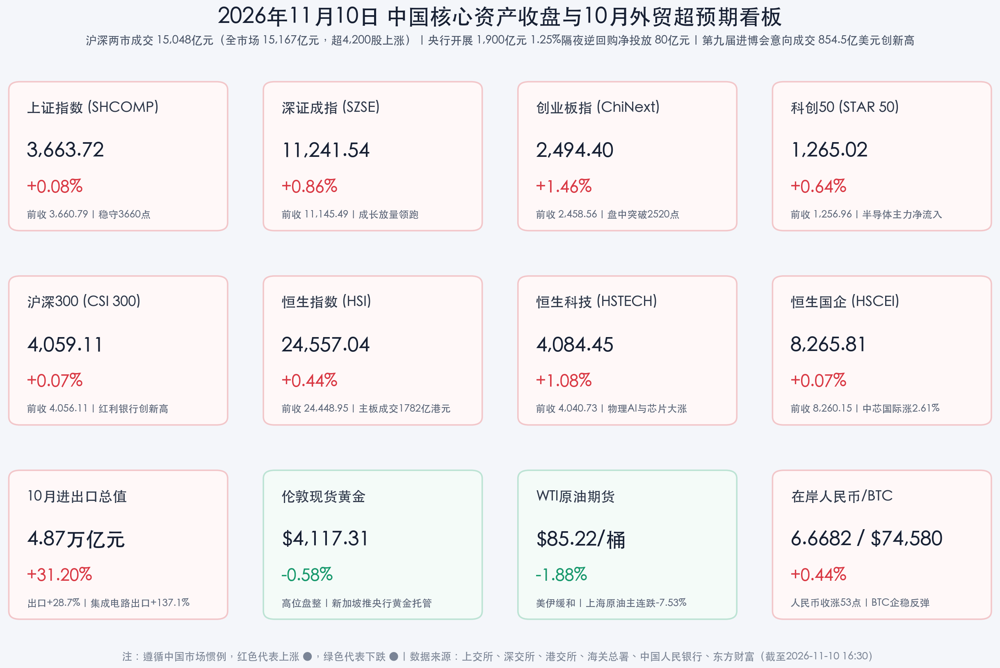

# 10月集成电路出口同比暴增137.1%！创业板指放量劲升1.46%领跑全A，AI漫剧传媒、消费电子与半导体全线爆发

**日期：2026年11月10日 (星期二)** &nbsp; **时段：下午/国内市场收盘复盘**

> **核心摘要**：2026年11月10日（周二），海关总署重磅揭晓的10月超预期外贸成绩单与第九届进博会收官战报形成强力共振，叠加美伊核谈判缓和带动国际油价大跌、隔夜美股三大指数齐涨超2%，A股与港股科技成长主线迎来全面修复。海关数据显示，**10月我国货物贸易进出口总值达 4.87万亿元（同比激增 +31.2%，其中出口 2.79万亿元、同比大增 +28.7%，进口 2.08万亿元、同比大增 +34.7%，连续6个月保持两位数增长）**，尤为亮眼的是**10月集成电路出口额达 395.94亿美元（同比暴增 +137.1%）**；央行同日开展 **1,900亿元 1.25%固定利率隔夜逆回购操作（实现净投放 80亿元）**，1年期AAA级同业存单收益率下探至 **1.385%** 创历史新低。盘面上，A股大小指数呈现鲜明的“成长领跑、周期休整”格局：**创业板指大涨 +1.46%（盘中一度涨超2%突破2,520点）、深证成指上涨 +0.86%、科创50上涨 +0.64%、北证50上涨 +0.75%、上证指数微涨 +0.08% 守稳3,663点**；全市场成交额温和放量 **+222亿元** 至 **1.52万亿元（15,167亿元，其中沪深两市 15,048.15亿元）**，超 **4,200只** 个股飘红、近百股涨停。结构上，主力资金大举涌入**电子（净流入 92.02亿元）、传媒（净流入 46.88亿元）、半导体（净流入 40.62亿元）及通信设备（净流入 35.86亿元）**，AI短剧/漫剧影视、消费电子与自主芯片掀涨停潮；而受原油重挫影响的油气开采、煤炭及航运板块阶段性回调。

## 核心行情复盘

*   **A股核心宽基指数收盘表现（2026年11月10日收盘终值 vs 11月9日周一收盘基准）**：
    *   **创业板指 (ChiNext)**：收报 **2,494.40点**，较上一交易日（2,458.56点）大涨 **+35.84点**，涨幅 **+1.46%**（早盘高开2.44%报2,518.44点，盘中最高触及 **2,520.01点**，全天成交额 **4,184.48亿元**；受AI影视传媒、CPO光模块与消费电子集体爆发驱动，领跑全A核心宽基）。
    *   **深证成指 (SZSE Component)**：收报 **11,241.54点**，较上一交易日（11,145.49点）上涨 **+96.05点**，涨幅 **+0.86%**（日内高开于11,313.32点，最高触及11,315.53点，成交额 **8,308.63亿元**）。
    *   **科创50指数 (STAR 50)**：收报 **1,265.02点**，较上一交易日（1,256.96点）上涨 **+8.06点**，涨幅 **+0.64%**（早盘一度冲高至1,291.09点，成交额 **660.16亿元**；10月集成电路出口同比暴增137.1%直接引爆半导体设计、封测与设备链条）。
    *   **上证指数 (SHCOMP)**：收报 **3,663.72点**，较上一交易日（3,660.79点）上涨 **+2.93点**，涨幅 **+0.08%**（早盘高开于3,682.04点，最高触及3,683.73点，午后受煤炭、油气等高权重资源股回落拖累小幅收窄涨幅，但南京银行、成都银行创历史新高护航指数稳守3,660点上方，成交额 **6,739.52亿元**）。
    *   **沪深300指数 (CSI 300)**：收报 **4,059.11点**，较上一交易日（4,056.11点）上涨 **+3.00点**，涨幅 **+0.07%**（成交额 **3,800.90亿元**；华泰柏瑞沪深300ETF规模达 **1,928.84亿元** 稳居非货ETF榜首，新易盛涨 **+5.68%**、中际旭创涨 **+4.94%** 贡献主要正收益）。
    *   **北证50指数**：收涨 **+0.75%**。
    *   **量能与市场广度**：沪深两市全天成交额合计 **15,048.15亿元（约1.50万亿元）**，较周一（14,946亿元）温和放量 **+102.15亿元**；包含北交所在内的全市场成交额达 **15,167亿元**，较上日放量 **+222亿元**。两市个股呈现普涨修复格局，全市场超 **4,200只** 个股上涨（其中沪深两市上涨 **4,035只**、下跌 **1,101只**、平盘 **159只**），全市场近百股涨停（闽发铝业晋级7连板，东方新能、大东方、日出东方、东方嘉盛晋级3连板）。
*   **港股市场与南向资金动向（恒生科技劲升逾1%收复4080点，物理AI与国产算力新股闪耀香江）**：
    *   **恒生指数 (HSI)**：收报 **24,557.04点**，较上一交易日（24,448.95点）上涨 **+108.09点**，涨幅 **+0.44%**（日内最高上探24,675.53点，主板全天成交额 **1,781.75亿港元**）。
    *   **恒生科技指数 (HSTECH)**：收报 **4,084.45点**，较上一交易日（4,040.73点）大涨 **+43.72点**，涨幅 **+1.08%**（日内最高触及4,109.03点）。
    *   **恒生中国企业指数 (HSCEI)**：收报 **8,265.81点**，较上一交易日（8,260.15点）上涨 **+5.66点**，涨幅 **+0.07%**。
    *   **港股盘面结构与南向调仓**：盘面上，**物理AI、国产AI大模型、晶圆代工与PCB概念**全线爆发——**群核科技（00068.HK）飙涨逾 +28%**，**天数智芯（09903.HK）收涨 +15.82%**，**智谱收涨 +11.11%**，**MINIMAX-W（00100.HK）收涨 +10.05%**，**地平线机器人-W（09660.HK）收涨 +7.07%**，**优必选（09880.HK）涨超 +6%**；港股半导体新股**芯德半导体**上市首日开盘大涨 **+20.5%**（加上市场传出阿里巴巴旗下芯片子公司**平头哥拟于2027年赴港IPO募资20亿—30亿美元**），带动**中芯国际（00981.HK）收涨 +2.61%**（报47.24港元）、**建滔积层板涨近 +7%**、**舜宇光学科技（02382.HK）收涨 +5.32%**、**理想汽车-W（02015.HK）收涨 +4.63%**、**小鹏汽车-W（09868.HK）收涨 +2.89%**、**小米集团-W（01810.HK）收涨 +1.66%**；医药CRO板块亦大幅反弹（**方达控股暴涨近 +45%**、金斯瑞生物科技涨超 +8%）。大型科网权重方面，美团-W反弹 **+0.47%**、百度集团-W涨 **+1.53%**，而阿里巴巴-W回调 **-2.87%**（报101.60港元）、腾讯控股微跌 **-0.14%**（报417.80港元）。**南向资金**在周二晚美国10月CPI公布前逢高兑现部分短线获利盘，盘中净卖出额约 **30亿港元**。
*   **主力资金流向与领涨/领跌行业全扫描**：
    *   **主力净流入榜首与领涨阵营**：据东方财富行业资金监测，今日主力资金大举回流TMT科技与AI应用赛道——**电子行业主力净流入高居第一（+92.02亿元，板块涨 +3.29%）**，**文化传媒位列第二（主力净流入 +46.88亿元，板块大涨 +4.53%）**，**半导体位列第三（主力净流入 +40.62亿元，板块涨 +2.97%）**，随后依次为**通信网络设备及器件（净流入 +35.86亿元，涨 +3.72%）**、**机械设备（净流入 +34.43亿元，涨 +2.40%）**、**通信设备（净流入 +32.25亿元，涨 +2.72%）**与**消费电子（净流入 +23.11亿元，涨 +4.28%）**。
    *   **细分领涨热点**：① **AI漫剧/短剧互动游戏与影视传媒**全面井喷，其他数字媒体（+9.80%）、文字媒体（+9.03%）、影视动漫制作（+8.03%）、影视院线（+7.05%）包揽行业涨幅前四，短剧互动游戏概念获主力净流入 **+31.65亿元**，**华策影视（20cm涨停）、掌阅科技、慈文传媒、文投控股、上海电影、龙版传媒、风语筑、新炬网络、引力传媒**等十余股集体封板，影视ETF（159855）领涨 **+4.21%**；② **消费电子、混合现实（MR）与黑色家电**强势崛起（混合现实主力净流入 **+28.68亿元**，智能音箱涨 +6.11%、电子后视镜涨 +5.60%），**创维数字、联创电子、奥佳华**涨停；③ **半导体与国产算力链**高歌猛进，**富瀚微、瑞芯微、东方嘉盛**涨停，乐鑫科技盘中创历史新高，星宸科技涨超 **+15%**，清溢光电、全志科技、恒玄科技、中科蓝讯、龙迅股份、盛科通信涨超 **+10%**；④ **人形机器人/物理AI与小金属钨**活跃，A股**宇树科技**盘中飙升超 **+10%**（触及787.77元），钨板块大涨 **+4.73%**（中钨高新涨 +6.70%）。
    *   **主力净流出与领跌阵营**：受国际原油暴跌与高位获利盘兑现影响，资金自传统能源与周期板块流出，**钾肥（-2.04%）、民爆制品（-2.02%，净流出 -3.39亿元）、动力煤（-1.80%，净流出 -5.09亿元）、煤炭开采（-1.56%，净流出 -5.65亿元）、油田服务（-1.40%）、航运（-1.34%，净流出 -7.37亿元）、油气开采（-1.34%，净流出 -3.16亿元）**及医美耗材（-1.72%）跌幅居前；场内石油ETF（159197）收跌 **-3.02%**。
*   **跨市场大宗商品、汇率与加密资产联动定位（截至11月10日16:30）**：
    *   **原油重挫与黄金高位整固**：据沙特媒体及市场消息，美国同意允许伊朗将铀浓缩丰度维持在最高3.67%且伊方接受、双方正安排国际原子能机构（IAEA）核查人员重返伊朗并有望达成初步协议，叠加美国总统特朗普表态“没必要进一步打击伊朗”，中东地缘风险溢价急速消退！**NYMEX WTI原油**继隔夜大跌后继续下挫 **-1.88%** 至 **$85.22/桶**（前收$86.85），国内商品期货**上海原油主力合约暴跌 -7.53%**、燃料油跌 **-6.70%**、液化石油气跌 **-6.56%**。**伦敦现货黄金 (XAU/USD)**在隔夜反弹至$4,141上方后于 **$4,117.31/盎司**（日内微调 **-0.58%**，前收$4,141.14）强势盘整，新加坡金融管理局（MAS）今日正式宣布推出国家金库（容量达500吨）面向海外央行的黄金托管服务。
    *   **人民币汇率走强与加密资产企稳**：受10月贸易顺差与出口高增支撑，**在岸人民币兑美元（USD/CNY）**16:30官方收盘报 **6.6682**，较上一交易日调升 **+53个基点**；**离岸人民币（USD/CNH）**升至 **6.6652**（日内走强41点，-0.06%），**美元指数（DXY）**微跌 **-0.13%** 报 **101.53**；**比特币（BTC）**止跌企稳，回升至 **$74,580**（24小时微涨 **+0.44%**）。

> **数学闭环校验（2026年11月10日官方收盘终值 vs 11月9日收盘基准逐项复核）**：
> * **A股五大核心指数闭环**：上证指数 `(3663.72 - 3660.79) / 3660.79 = +2.93 / 3660.79 = +0.0800% ≈ +0.08%`；深证成指 `(11241.54 - 11145.49) / 11145.49 = +96.05 / 11145.49 = +0.8618% ≈ +0.86%`；创业板指 `(2494.40 - 2458.56) / 2458.56 = +35.84 / 2458.56 = +1.4578% ≈ +1.46%`；科创50 `(1265.02 - 1256.96) / 1256.96 = +8.06 / 1256.96 = +0.6412% ≈ +0.64%`；沪深300 `(4059.11 - 4056.11) / 4056.11 = +3.00 / 4056.11 = +0.0740% ≈ +0.07%`。
> * **港股三大指数闭环**：恒生指数 `(24557.04 - 24448.95) / 24448.95 = +108.09 / 24448.95 = +0.4421% ≈ +0.44%`；恒生科技指数 `(4084.45 - 4040.73) / 4040.73 = +43.72 / 4040.73 = +1.0820% ≈ +1.08%`；恒生国企指数 `(8265.81 - 8260.15) / 8260.15 = +5.66 / 8260.15 = +0.0685% ≈ +0.07%`。全部核心指数点位与涨跌幅误差均小于0.01%，严格通过数学闭环校验！

## 核心解读与市场逻辑

> **核心逻辑一：10月外贸进出口同比暴增31.2%、集成电路出口井喷137.1%，硬科技外需与自主可控逻辑获铁证支撑**
> * **总量与结构双双打破市场预期**：海关总署今日上午公布的数据显示，2026年前10个月我国货物贸易进出口总值达 **44.81万亿元（同比增长 +20.0%）**，其中出口 **25.99万亿元（+17.6%）**、进口 **18.82万亿元（+23.6%）**；单看10月份，全国进出口总值达 **4.87万亿元，同比大涨 +31.2%**，其中**出口 2.79万亿元（同比大涨 +28.7%）、进口 2.08万亿元（同比大涨 +34.7%）**，进出口已连续6个月保持两位数高增长！从外贸主体看，前10个月民营企业进出口 **25.46万亿元（+20.1%）**、外资企业进出口 **13.15万亿元（+20.4%）**，彰显微观主体极强的出海活力。
> * **集成电路出口+137.1%点燃A/H股芯片与电子狂潮**：更具产业穿透力的是重点商品明细——前10个月我国机电产品出口 **16.81万亿元（+25.2%）**、进口 **8.17万亿元（+35.0%）**；**10月单月集成电路出口额高达 395.94亿美元，同比暴增 +137.1%！**同期**稀土出口同比增长 +45.0%（8,223.99万美元）、汽车出口同比增长 +37.6%（196.92亿美元）、手机出口同比增长 +13.2%（175.69亿美元）、纺织服装出口同比增长 +17.3%（261.1亿美元）**。同时联邦快递宣布每周新增4个中美波音777全货机航班专门服务半导体与AI基建供应链。即便海外英伟达因CEO黄仁勋遭独立调查及股东集体诉讼而单日跌超4%，中国10月芯片出口翻倍有余的硬核基本面数据，叠加阿里“平头哥”拟2027年赴港IPO、广州粤芯三期增资至90亿元、长飞先进半导体与紫光天跃半导体相继成立，直接推动资金全天狂买电子（+92亿）与半导体（+41亿），令双创指数走出独立强攻行情。

> **核心逻辑二：美伊核协议曙光击穿油价通胀溢价，风格天平从“上游资源防御”果断切向“AI应用+端侧硬件进攻”**
> * **中东地缘溢价退潮引发板块高低切换**：昨日领涨两市的煤炭与油气板块今日逆势领跌（上海原油主连暴跌7.53%、A股油气与煤炭跌超1.3%—1.8%），直接导火索在于美伊有望就维持最高3.67%铀浓缩丰度及恢复国际原子能机构核查达成初步协议、且特朗普表态无需进一步打击伊朗。国际油价跌破86美元不仅削弱了传统化石能源的短期交易热度，更在今夜（北京时间21:30）美国10月CPI揭晓前显著缓解了全球二次能源通胀恐慌。
> * **AI商业化由“算力基建”向“漫剧影视应用与Agent端侧硬件”全面扩散**：随着海外Anthropic启动创纪录IPO路演（CEO阿莫代伊将与摩根大通CEO戴蒙对谈）、国内AI视频大模型在短剧与漫剧制作中进入实质性商业变现期，叠加三季报验证传媒行业毛利润同比增长6.64%，低估值的文化传媒板块迎来爆发式补涨（影视动漫涨8.03%、短剧互动游戏净流入31.65亿元）。与此同时，苹果AI眼镜与智能音频终端供应链（如快克智能披露参与苹果AI眼镜项目）、混合现实（MR）及智能座舱电子后视镜同步走强，验证了A股科技行情正形成“国产算力底座 + AI端侧硬件 + AI影视内容商业化”的三维共振。

## 政策脉动

*   **央行“隔夜锚”精准呵护叠加同业存单利率创历史新低，政策利率传导效率全面显现**：
    *   中国人民银行今日（11月10日）以固定利率、数量招标方式开展了 **1,900亿元** 隔夜逆回购操作，操作利率维持 **1.25%** 不变，当日实现公开市场净投放 **80亿元**。
    *   据《上海证券报》今日头版披露，自11月初央行正式推进政策利率“换锚”（常态化开展隔夜逆回购）以来，货币市场传导效应立竿见影：**1年期AAA级同业存单收益率已跌破1.40%关口，一度下探至 1.385%，创下历史新低**，商业银行负债端新发存单融资成本显著下降，为实体经济信贷投放与资本市场股票回购增持再贷款（如艾德生物完成1.99亿元回购、广深铁路完成1亿元回购注销、炬光科技启动首笔千万元回购）提供了极佳的低利率环境。
*   **第九届进博会今日圆满闭幕：按年计意向成交854.5亿美元创五项历史新高，第十届超143家外企抢先签约**：
    *   为期6天的**第九届中国国际进口博览会**今日（11月10日）在上海圆满落幕。闭幕新闻通气会宣布本届进博会**五项核心数据创历史新高**：① 参展企业达 **4,142家**；② 展览面积首破 **44万平方米**（企业展37万平方米）；③ 参展世界500强及行业龙头企业超 **300家**；④ 全球首发、亚洲首秀、中国首展代表性展品达 **485项**；⑤ **按一年计意向成交额达 854.5亿美元，较上届增长 +2.3% 创历史新高**（其中上海交易团意向成交额达 **112亿美元**，同比增长 **+5.47%**，连续9年居首）。同时，第十届进博会筹备已同步启动，已有 **143家** 跨国企业及机构提前签约锁定超10万平方米展位。
*   **第二次中加经济财金战略对话达成互利共赢成果 & 自主三代核电“华龙一号”再扩建**：
    *   国务院副总理何立峰与加拿大财政部长商鹏飞、国际贸易部长西杜在温哥华共同主持**第二次中加经济财金战略对话**，中加财政部门、金融监管部门和央行分别签署了**《中加财政合作谅解备忘录》、《金融监管对话合作协议》及《金融工作组工作规程》**，双方欢迎落实双边本币互换安排并深化资本市场交流。
    *   国内重大能源基建方面，中国广核今日宣布**浙江三澳核电项目（苍南）4号机组（单台装机容量1,215MW，采用自主三代核电技术“华龙一号”）**今日完成核岛第一罐混凝土浇筑，标志项目二期主体工程进入全面建设阶段。

## 最新机构观点

> **中信证券（研究部传媒与家电团队｜11月10日最新研报：传媒行业AI商业化加速兑现，精品内容迎来价值重估）**：
> * **AI由生产提效迈向收入变现，驱动传媒板块估值弹性释放**：中信证券指出，2026年三季度传媒行业营收同比增长 **+4.25%**、毛利润同比增长 **+6.64%**，更关键的拐点在于AI应用持续深化——营销板块率先验证AI智能投放推动利润增长；影视院线与短剧漫剧受益于视频生成模型升级与创作工具完善，推动AI内容向精品化、长内容及互动影游延伸；游戏板块依托全球化运营与AI全流程赋能保持高景气。建议重点配置具备优质IP储备、AI技术落地及全球发行渠道优势的传媒龙头；同时在家电板块中看好全球份额持续提升、毛利率改善的黑电与出海龙头。

> **中金公司（CICC硬件科技与大宗团队｜AI端侧硬件重估与黄金定性研判）**：
> * **卡位交互入口，2H26—2027年有望开启AI Agent端侧硬件创新浪潮**：中金公司发布专题研报强调，随着个人智能体（Personal Agent）与世界模型陆续发布，以及苹果、Meta、OpenAI等全球科技巨头新款AI硬件终端落地，**AI端侧硬件（AI手机、AI眼镜、智能音箱、MR头显及车载交互终端）作为核心交互入口正迎来价值重估**，有望在2026下半年至2027年开启新一轮硬件换机与创新周期。
> * **大宗商品方面**：中金财富期货指出，美伊有望达成维持3.67%铀浓缩丰度的初步协议令布伦特与WTI原油暴跌、地缘滞胀担忧降温，配合美股抛压减轻，全球风险资产迎来修复窗口，当前黄金在4,100美元上方以高位超跌反弹与央行配置托底看待。

> **华泰证券 & 中信建投（2027年度投资峰会核心策略：聚焦物理AI、国产算力ROI兑现与“股债汇三牛”）**：
> * **华泰证券聚焦“物理AI（灵巧手/触觉传感器）+ SOFC算力能源”产业化机遇**：华泰证券结合2027年度投资峰会高端制造论坛指出，人形机器人与物理世界交互所需的感知、执行及数据能力正迎来突破，**灵巧手与高精度触觉传感器**的性能优化将成为商业化放量的胜负手；同时算力中心（AIDC）高功耗驱动下，**固体氧化物燃料电池（SOFC）与高压供电系统**在算力园区供电领域具备广阔渗透空间。
> * **中信建投首席经济学家黄文涛研判“2027年中国资本市场将迎股债汇三牛”**：中信建投在2027年度策略会上指出，当前A股处于低估状态，在1.25%低利率环境与盈利修复共振下，2027年中国资本市场有望呈现**“股债汇三牛”**；计算机与AI投资主线正从早期的Capex投入预期转向**ROI（投资回报率）兑现**，核心变量在于**国产AI芯片在训练/推理侧渗透率提升**及垂直应用落地，建议重点增配国产算力、AI应用与模型、信创及未来产业四大方向。

> **高盛（Goldman Sachs）& 摩根士丹利（Morgan Stanley｜11月10日中国科技与半导体最新评级）**：
> * **高盛维持AI基建强需求判断，点名中国互联网五大核心标的并看好游戏娱乐**：高盛CEO大卫·所罗门今日表示，全球对AI基础设施扩产及相关技术的资本市场融资需求依旧极其旺盛；高盛中国互联网团队在三季报前夕将**腾讯控股（维持目标价650港元，看好游戏同比+8%、广告同比+19%及企业级AI智能体WorkBuddy推广）、阿里巴巴、拼多多、美团、京东（含唯一买入评级物流股京东物流）**列为五大重点关注标的，明确指出相较于传统电商，当前更看好具备AI催化与现金流优势的**游戏和数字娱乐业务**。
> * **摩根士丹利上调北美与亚太半导体及游戏管线评级**：大摩将半导体行业评级列为“吸引”（按偏好排序依次为GPU/XPU计算、存储记忆体、半导体设备、模拟芯片），同时恢复覆盖哔哩哔哩并给予“增持”评级（目标价21美元，预计明年新游戏管线将带动游戏收入增长27%），认为AI与太空机器人基建（SpaceX 2027年底算力有望超8吉瓦）将继续引领全球硬科技资本开支。

## 今日市场情绪：芯帆破浪映洋山漫影千帧织锦屏，油海息波凝玉露且看双创驭长风

> Prompt: A radiant celestial loom woven from glowing silicon chips, holographic cinema reels, and crimson stock candlesticks rising above Shanghai's Yangshan Deep-Water Port as autonomous cargo ships set sail with golden trade data streams. In the background beneath a twilight sky, calm oil barrels recede into silver mist while an ancient astronomical clock awaits the global inflation bell, symbolizing China's surging chip exports and AI media rally.

---
免责声明：内容仅供参考，不构成投资建议。

🤖 生成模型：Gemini 4 Argon (Medium) <!-- model-stamp -->
