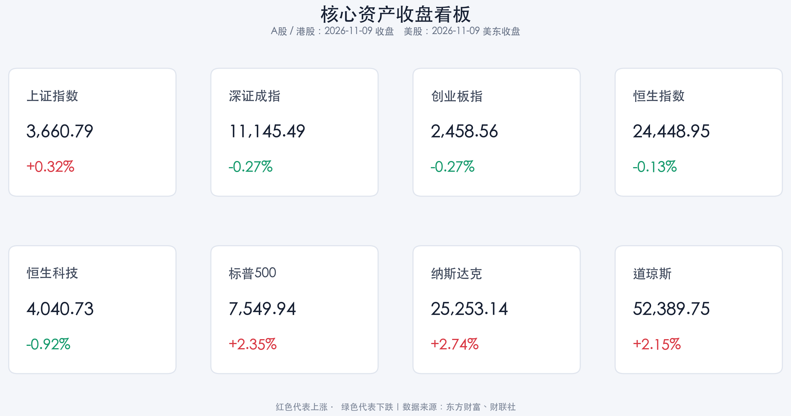

# 缩量分化蓄力，隔夜科技强反弹：政策利率换锚与美国 CPI 考验

**日期：2026年11月10日 (星期二)** &nbsp; **时段：早报 (常规交易日 · 模式A)**

> **核心摘要**：11月9日 A 股主要指数分化，上证指数小涨 **0.32%**，深证成指与创业板指均跌 **0.27%**；沪深两市成交额缩至 **1.483 万亿元**，但主力资金转为净流入 **117.95 亿元**。隔夜美股三大指数均涨逾 **2%**，AI 硬件链大面积修复，而英伟达逆势下跌、纳斯达克中国金龙指数回落；国内货币政策短端利率“换锚”继续落地，今晚美国 10 月 CPI 是下一轮全球资产定价的关键变量。

---

## 核心行情复盘

**数据口径**：2026年11月10日为周二，A 股与港股正常交易。本报告不使用11月10日盘中暂态数据；A 股、港股采用 **11月9日收盘终值**，美股采用 **美东11月9日收盘终值**。

* **A 股：指数分化、成交缩减，主力资金回流科技硬件**
    * **上证指数**收报 **3,660.79 点**，上涨 **0.32%**；**深证成指**收报 **11,145.49 点**，下跌 **0.27%**；**创业板指**收报 **2,458.56 点**，下跌 **0.27%**。
    * 沪市成交额 **6,825.33 亿元**，深市成交额 **8,000.81 亿元**，沪深合计 **14,826.13 亿元**，较11月6日的 **16,577.94 亿元**减少 **1,751.81 亿元**，降幅 **10.57%**。含北交所的全市场成交额约 **14,946 亿元**，较前一交易日减少约 **1,770 亿元**。
    * 沪深两市主力资金净流入 **117.95 亿元**；电子、通信、机械设备行业净流入居前，其中电子行业成交额达 **3,488.51 亿元**。电力设备、计算机、银行、非银金融分别净流出 **22.26 亿元、4.24 亿元、4.13 亿元、3.29 亿元**。
    * 个股资金集中于光模块、消费电子和半导体：新易盛、中际旭创分别获主力净流入 **9.29 亿元、6.68 亿元**，信维通信获净流入 **6.26 亿元**。
* **港股：恒指与科技指数小幅回落，南向资金逆势净买入**
    * **恒生指数**收报 **24,448.95 点**，下跌 **0.13%**；**恒生科技指数**收报 **4,040.73 点**，下跌 **0.92%**。科网股多数走弱，美团跌逾 **6%**，小米集团、京东集团跌近 **1%**。
    * 港股主板成交额 **1,737.07 亿港元**，较11月6日的 **2,474.28 亿港元**减少 **737.21 亿港元**，降幅 **29.80%**。
    * 南向资金全天净买入 **18.56 亿港元**；美团、中国移动、中国海洋石油分别获净买入 **5.91 亿、2.41 亿、1.99 亿港元**。
* **美股：科技板块强劲修复，但龙头与中概股内部明显分化**
    * **标普500指数**收报 **7,549.94 点**，上涨 **2.35%**；**纳斯达克综合指数**收报 **25,253.14 点**，上涨 **2.74%**；**道琼斯工业平均指数**收报 **52,389.75 点**，上涨 **2.15%**。
    * 纳指创7月30日以来最大单日涨幅，标普500创4月8日以来最大单日涨幅。AMD 涨 **13.26%**，应用材料涨 **11.37%**，博通涨 **8.78%**，Meta 涨 **5.12%**，特斯拉涨 **5.54%**。
    * 英伟达逆势下跌 **4.27%**，市值缩水逾 **1,900 亿美元**；公司治理议题成为其个股扰动因素。纳斯达克中国金龙指数下跌 **1.32%**，阿里巴巴、拼多多、京东分别下跌 **3.72%、3.05%、2.51%**。
* **跨资产线索**：布伦特原油周一下跌逾 **5%**，美伊达成协议可能性上升令地缘风险溢价回落，也改善了通胀与风险资产情绪。比特币跌破 **75,000 美元**，显示加密资产并未同步追随科技股反弹。

> **数学闭环校验**：上证指数 `(3,660.79−3,649.18)/3,649.18=0.3182%`，深证成指 `(11,145.49−11,175.78)/11,175.78=-0.2710%`，创业板指 `(2,458.56−2,465.23)/2,465.23=-0.2706%`；恒生指数 `(24,448.95−24,481.86)/24,481.86=-0.1344%`，恒生科技 `(4,040.73−4,078.23)/4,078.23=-0.9195%`；标普500 `(7,549.94−7,376.86)/7,376.86=2.3463%`，纳指 `(25,253.14−24,579.43)/24,579.43=2.7405%`，道指 `(52,389.75−51,285.73)/51,285.73=2.1529%`。计算结果与公布涨跌幅一致，误差均低于 **0.5%** 阈值。

## 核心解读与市场逻辑

> **A 股不是“无量普涨”，而是缩量中的结构性调仓。** 上证小幅上行、深市与创业板回落，说明指数层面仍偏谨慎；但主力资金由前一交易日的大幅流出转为净流入 **117.95 亿元**，并集中流向电子、通信和机械设备，表明资金正在选择订单与产业趋势更明确的硬件方向，而非全面抬升风险偏好。成交额缩减约 **10.6%** 则提示反弹持续性仍需增量资金确认。

> **隔夜美股修复可向 A 股科技链提供情绪映射，但不能简单外推。** AMD、应用材料、博通等 AI 硬件股大幅上涨，与 A 股主力资金回流光模块、半导体、消费电子形成共振；然而英伟达下跌、金龙中国指数回落说明全球科技与中国资产内部仍在分化。今日观察重点不是指数是否高开，而是科技硬件成交能否放大、资金流能否连续，以及高股息与成长是否形成稳定轮动。

> **油价下跌与 CPI 前夜共同塑造全球利率交易。** 布油跌逾 **5%** 有助于缓和未来通胀压力，并支持风险资产修复；但美国劳工统计局将于当地时间周二公布10月 CPI，由于去年同期政府关门导致可比数据缺失，本次将罕见地没有同比读数。市场因而会更关注环比与核心服务分项，数据结果仍可能快速改变美债收益率和成长股估值假设。

## 政策脉动

* **人民银行短端利率调控“换锚”正式运行**：自11月2日起，每个工作日开展隔夜逆回购操作招标，采用固定利率、数量招标，操作利率为 **1.25%**；7天期逆回购调整为固定数量、利率招标、多重价位中标，主要在税期、月末等时点开展。
* **资本市场支持工具持续加力**：11月3日人民银行开展 **1,000 亿元**证券、基金、保险公司互换便利操作，31家机构参与；11月4日又优化股票回购增持再贷款政策并新增 **2,000 亿元**支持额度。政策组合从流动性机制、机构融资与回购约束多端稳定市场预期。
* **政策传导含义**：隔夜利率成为主要政策利率，有利于提高短端利率传导效率；对权益市场而言，稳市工具改善风险下限，但指数上行动力仍需盈利、成交与宏观数据共同验证。

## 最新机构观点

> **摩根士丹利（Morgan Stanley）**：认为中期选举后 AI 相关股票的抛售过度，建议选择性逢低买入。该行预计约 **20%** 的美国数据中心项目可能由2028年推迟至2029年，但这不会中断 AI 投资周期，维持2027年、2028年超大规模云厂商资本开支分别为 **1.6 万亿、1.8 万亿美元**的预测。

> **中金公司（CICC）**：个人 Agent 与世界模型密集发布，交互入口迎来价值重估。核心关注点是模型能力与使用成本下降后，入口、应用和终端能否形成真实用户留存与商业闭环。

> **中信证券（CITIC Securities）**：科技股估值已至低位，建议把握技术破局与应用扩散的新机遇。与美股硬件反弹和 A 股资金回流相互印证，但仍需以业绩兑现筛选标的。

> **华泰证券（Huatai Securities）**：内需有望温和修复，全球化与经营效率提升将打开增长空间；这一视角更强调消费修复和企业出海的中期盈利线索，而非单纯依赖估值扩张。

## 今日市场情绪：硅翼回升，罗盘稳航

> Prompt: A luminous mechanical phoenix built from semiconductor wafers and fiber-optic feathers rises above a quiet harbor, carrying a small red sunrise in its beak while green paper boats drift below. In the background, a marble central-bank observatory steadies a giant silver compass, and a distant oil derrick folds into a dark cloud, symbolizing technology rebounding, policy support, and easing energy risk.

---

**主要数据来源**：[东方财富历史行情接口](https://push2his.eastmoney.com/api/qt/stock/kline/get?secid=1.000001&klt=101&beg=20261105&end=20261110)、[财联社美股收盘](https://m.cls.cn/detail/2529594)、[中国证券报资金复盘（同花顺转载）](https://m.10jqka.com.cn/20261109/c681627618.shtml)、[证券时报南向资金统计](https://m.sohu.com/a/1099294596_115433)、[中国人民银行公开市场业务公告](https://www.pbc.gov.cn/zhengcehuobisi/125207/125213/125431/125469/2026103016375865177/index.html)、[财联社券商晨会精华](https://www.cls.cn/subject/3146)。

> **免责声明**：内容仅供参考，不构成投资建议。
