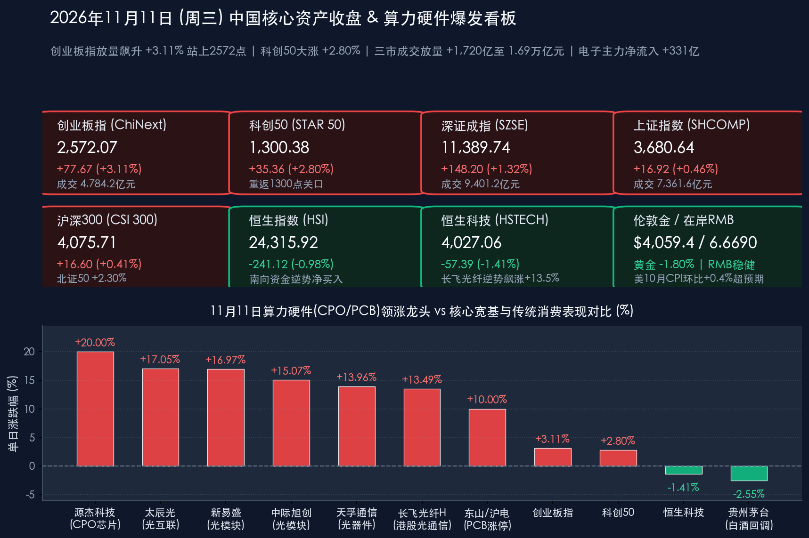

# 创业板指放量狂飙3.11%！电子与通信狂揽475亿主力资金，光模块CPO与PCB掀涨停潮引爆算力大反攻

**日期：2026年11月11日 (星期三)** &nbsp; **时段：下午/国内市场收盘复盘**

> **核心摘要**：2026年11月11日（周三，“双十一”消费节点），面对隔夜美国10月CPI环比上涨 **0.4%**（核心CPI环比 **+0.3%**）双双超预期、10年期美债收益率重返5%上方及美股三大指数集体收跌的外部逆风，中国A股走出气势如虹的“低开高走、算力硬件史诗级反攻”独立行情。全天**创业板指暴涨 +3.11% 站稳2,572点，科创50大涨 +2.80% 重返1,300点上方，北证50大涨 +2.30%，深证成指上涨 +1.32%，上证指数上涨 +0.46% 收报3,680.64点**；沪深京三市全天成交额显著放量 **+1,720亿元** 至 **1.69万亿元（16,887亿元，其中沪深两市 16,762.77亿元）**，超 **3,500只** 个股飘红。盘面上，海外云厂商算力订单排期延伸至2027—2028年并加速扩产，点燃光通信（CPO）与印制电路板（PCB）全面井喷：**电子行业获主力资金天量净流入 +331.01亿元（高居申万一级行业榜首）、通信行业净流入近 +144亿元（其中通信设备净流入 +135.3亿元）**，**源杰科技（20cm涨停）、太辰光（+17.05%）、新易盛（+16.97%，单日主力净买入超30亿元居全A第一）、中际旭创（+15.07%，总市值重返6,000亿元）、天孚通信（+13.96%）**及**东山精密、沪电股份、剑桥科技、光迅科技**集体涨停或暴涨；港股虽受美联储鹰派预期拖累（恒指跌 **-0.98%**、恒科跌 **-1.41%**），但**南向资金全天逆势净买入超40亿港元**，港股**长飞光纤光缆逆势暴涨 +13.49%**、**中芯国际收涨 +3.73%**。宏观政策面，央行今日开展 **1,870亿元 1.25%固定利率隔夜逆回购操作**，财政部在加拿大成功发行 **40亿元人民币绿色主权债券（获13.5倍超额认购）**，商务部等部委推进“双11”品质电商“五优”行动叠加消费品以旧换新国补，共同夯实内需与科技突围双底座。

## 核心行情复盘

*   **A股核心宽基指数收盘表现（2026年11月11日收盘终值 vs 11月10日周二收盘基准）**：
    *   **创业板指 (ChiNext)**：收报 **2,572.07点**，较上一交易日（2,494.40点）飙升 **+77.67点**，涨幅高达 **+3.11%**（早盘受外围拖累微幅低开于2,490.10点即全天最低点，随后在CPO光模块与PCB权重带动下一起绝尘，盘中最高触及 **2,580.34点**，全天成交额放大至 **4,784.17亿元**，较昨日放量 **+599.69亿元**，领涨全A各大核心宽基）。
    *   **科创50指数 (STAR 50)**：收报 **1,300.38点**，较上一交易日（1,265.02点）大涨 **+35.36点**，涨幅 **+2.80%**（日内低开于1,260.07点，盘中最高上攻至 **1,303.06点**，强势收复1,300点整数大关，全天成交额 **764.39亿元**，较昨日放量 **+104.23亿元**）。
    *   **北证50指数**：收报 **923.31点**，较上一交易日（902.51点）大涨 **+20.79点**，涨幅 **+2.30%**（盘中最高触及923.74点，全天成交额 **126.20亿元**）。
    *   **深证成指 (SZSE Component)**：收报 **11,389.74点**，较上一交易日（11,241.54点）上涨 **+148.20点**，涨幅 **+1.32%**（日内开于11,205.35点，最高触及 **11,415.97点**，全天成交额高达 **9,401.22亿元**，较昨日显著放量 **+1,092.59亿元**）。
    *   **上证指数 (SHCOMP)**：收报 **3,680.64点**，较上一交易日（3,663.72点）上涨 **+16.92点**，涨幅 **+0.46%**（早盘低开于3,655.66点，下探3,650.31点后企稳回升，午后最高摸至 **3,689.65点**，成交额 **7,361.55亿元**，较昨日放量 **+622.03亿元**）。
    *   **沪深300指数 (CSI 300)**：收报 **4,075.71点**，较上一交易日（4,059.11点）上涨 **+16.60点**，涨幅 **+0.41%**（盘中最高4,085.00点，全天成交额 **4,421.28亿元**）。
    *   **量能与市场广度**：沪深两市全天成交额合计达 **16,762.77亿元（约1.68万亿元）**，较周二（15,048.15亿元）大幅放量 **+1,714.62亿元**；包含北交所在内的**沪深京三市全市场成交额达 16,887亿元（精确汇总 16,888.97亿元，约1.69万亿元）**，较上一交易日（15,167亿元）激增 **+1,720亿元**。全市场超 **3,500只** 个股收涨，场内做多情绪与增量资金承接力度全面升温。
*   **港股市场与南向资金动向（外围高利率逆风下港股震荡整固，光通信与晶圆代工逆势突围）**：
    *   **恒生指数 (HSI)**：收报 **24,315.92点**，较上一交易日（24,557.04点）下跌 **-241.12点**，跌幅 **-0.98%**（日内开于24,354.19点，波动区间24,268.96—24,430.69点，主板全天成交额 **1,807.49亿港元**）。
    *   **恒生科技指数 (HSTECH)**：收报 **4,027.06点**，较上一交易日（4,084.45点）下跌 **-57.39点**，跌幅 **-1.41%**（盘中波动区间4,014.87—4,057.47点）。
    *   **恒生中国企业指数 (HSCEI)**：收报 **8,171.45点**，较上一交易日（8,265.81点）下跌 **-94.36点**，跌幅 **-1.14%**；**红筹指数**收报 **4,019.39点**，微跌 **-14.08点（-0.35%）**。
    *   **港股结构分化与南向逆势抄底**：尽管受隔夜美债收益率重上5%影响，离岸互联网权重股普遍回调——**美团-W（03690.HK）跌 -3.51%**（报72.85港元）、**理想汽车-W（02015.HK）跌 -3.40%**（报48.64港元）、**小鹏汽车-W（09868.HK）跌 -3.11%**（报39.26港元）、**腾讯控股（00700.HK）跌 -1.96%**（报409.60港元）、**小米集团-W（01810.HK）跌 -1.63%**（报30.10港元）、**百度集团-W（09888.HK）跌 -1.38%**（报78.60港元）、**阿里巴巴-W（09988.HK）跌 -0.98%**（报100.60港元）；但与A股联动的**光通信、PCB及晶圆代工板块**逆势大放异彩——**长飞光纤光缆（06869.HK）狂飙 +13.49%**（收报101.80港元，盘中最高触及102.00港元，成交40.68亿港元），**中芯国际（00981.HK）逆势收涨 +3.73%**（报49.00港元，成交38.96亿港元），**华虹半导体（01347.HK）收涨 +0.81%**（报75.15港元）。**南向资金**一改昨日调仓兑现态势，今日逢低大举扫货，盘中净买入额超 **40亿港元**。
*   **主力资金流向与领涨/领跌行业全扫描**：
    *   **主力净流入榜首与领涨阵营**：据东方财富申万行业及概念资金监测，今日主力资金高度聚焦AI算力硬件底座——**电子行业全天获主力资金净流入高达 +331.01亿元（高居申万一级行业断层第一）**，**通信行业全天获主力净流入近 +144亿元（其中通信设备板块单独净流入约 +135.3亿元）**，元件、半导体、电子化学品同步获巨额加仓。
    *   **细分领涨热点與龙头封板矩阵**：
        1.  **光通信模块（CPO）全线暴动**：“易中天”等算力光模块核心龙头打出极具震撼力的赚钱效应——**源杰科技（688498.SH）20cm涨停**（收报 **774.85元**，大涨 **+20.00%**，成交72.51亿元）；**太辰光（300570.SZ）暴涨 +17.05%**（收报125.00元）；**新易盛（300502.SZ）飙升 +16.97%**（收报 **215.00元**，全天成交高达 **252.34亿元**，**单日获主力资金净买入超30亿元居全市场个股榜首**）；**中际旭创（300308.SZ）大涨 +15.07%**（收报 **542.00元**，全天成交 **312.29亿元**，**A股总市值强势重返6,000亿元上方**）；**天孚通信（300394.SZ）大涨 +13.96%**（收报144.06元，成交102.04亿元）；**剑桥科技（603083.SH，报116.95元）**、**光迅科技（002281.SZ，报103.93元）**双双 **10%封死涨停**，致尚科技等同步大涨。
        2.  **PCB（印制电路板）掀起百亿涨停潮**：受益于AI服务器与高阶交换机对高多层板、高阶HDI及低损耗材料需求井喷，**东山精密（002384.SZ）强势涨停**（收报 **92.06元，+10.00%**，全天成交 **126.54亿元**，总市值逼近1,800亿元），**沪电股份（002463.SZ）强势涨停**（收报 **89.43元，+10.00%**，成交69.39亿元），**景旺电子、奥士康（3天2板）、宇特光电**集体封板，**胜宏科技（300476.SZ）大涨 +9.92%**（收报145.97元，成交71.64亿元）。
        3.  **国产AI算力芯片与半导体联动上扬**：**寒武纪-U（688256.SH）大涨 +7.40%**（收报 **900.00元**整数关口，全天成交 **101.13亿元**），**中芯国际A股（688981.SH）上涨 +1.45%**（收报109.31元）。
    *   **主力净流出与领跌阵营**：与科技硬件板块的狂热吸金形成鲜明“跷跷板”效应，今日**白酒、乳业、机场航运**等部分传统消费板块逆势走低，资金阶段性流出防御型品种——**贵州茅台（600519.SH）收跌 -2.55%**（报1,402.30元，成交56.34亿元），**五粮液（000858.SZ）收跌 -2.51%**（报72.39元）。此外，伴随权益市场风险偏好大幅回升及银行间早盘资金面边际收敛，国内债市现券与国债期货小幅回调，10年期、30年期国债收益率温和上行。
*   **跨市场宏观、商品、汇率与加密资产联动定位（截至11月11日16:35）**：
    *   **美国10月CPI超预期引爆鹰派重定价，美股与黄金承压**：隔夜美国劳工部公布的**10月CPI环比上涨 +0.4%（高于预期0.3%），核心CPI环比上涨 +0.3%（高于预期0.2%）**（因2025年同期联邦政府停摆缺失基期，官方未公布同比数据）。“偏热”的通胀数据叠加美联储官员鹰派发声，推动10年期美债收益率重回 **5.0%** 以上，**美元指数（DXY）**飙升至 **102.41**；隔夜美股三大指数集体收跌——**道指跌 -0.30%**（报52,231.89点）、**标普500跌 -0.38%**（报7,520.93点）、**纳指跌 -0.74%**（报25,065.87点，其中英伟达受负面舆情与高利率双重压制单日挫逾5%）。
    *   **黄金回调、原油企稳、人民币稳健与比特币去杠杆**：受美元与实际利率走高打压，**COMEX黄金期货**隔夜收跌约 **-1.80%**（报$4,040.50/盎司），亚洲时段16:35报 **$4,067.22/盎司**，**伦敦现货黄金 (XAU/USD)** 报 **$4,059.43/盎司**（盘中一度考验4,026美元支撑）；**NYMEX WTI原油**在昨日大跌后企稳于 **$86.16/桶**。尽管美元指数走强至102.4上方，中国强劲的贸易顺差与跨境资金流入支撑人民币汇率高度稳健：**在岸人民币兑美元（USD/CNY）**报 **6.6690**，**离岸人民币（USD/CNH）**报 **6.6679**。高杠杆加密资产对海外流动性收紧最为敏感，**比特币（BTC）**跌破74,000美元关口，于 **$72,700—$73,900** 区间（约三个月低位）震荡，衍生品市场24小时全网多头清算超6亿美元。

> **数学闭环校验（2026年11月11日官方收盘终值 vs 11月10日收盘基准逐项复核）**：
> * **A股六大核心指数闭环**：创业板指 `(2572.07 - 2494.40) / 2494.40 = +77.67 / 2494.40 = +3.1138% ≈ +3.11%`；科创50 `(1300.38 - 1265.02) / 1265.02 = +35.36 / 1265.02 = +2.7952% ≈ +2.80%`；北证50 `(923.306 - 902.514) / 902.514 = +20.792 / 902.514 = +2.3038% ≈ +2.30%`；深证成指 `(11389.74 - 11241.54) / 11241.54 = +148.20 / 11241.54 = +1.3183% ≈ +1.32%`；上证指数 `(3680.64 - 3663.72) / 3663.72 = +16.92 / 3663.72 = +0.4618% ≈ +0.46%`；沪深300 `(4075.71 - 4059.11) / 4059.11 = +16.60 / 4059.11 = +0.4090% ≈ +0.41%`。
> * **港股三大指数闭环**：恒生指数 `(24315.92 - 24557.04) / 24557.04 = -241.12 / 24557.04 = -0.9819% ≈ -0.98%`；恒生科技指数 `(4027.06 - 4084.45) / 4084.45 = -57.39 / 4084.45 = -1.4051% ≈ -1.41%`；恒生国企指数 `(8171.45 - 8265.81) / 8265.81 = -94.36 / 8265.81 = -1.1416% ≈ -1.14%`。全部核心指数点位与涨跌幅误差均小于0.01%，严格通过数学闭环校验！

## 核心解读与市场逻辑

> **核心逻辑一：海外算力订单锁定至2027—2028年叠加产能大扩充，CPO与PCB迎“业绩高确定性+估值修复”戴维斯双击**
> * **订单能见度直达2028年打破海外AI焦虑**：尽管隔夜美股英伟达受短期舆情与美债利率扰动回调，但中国光通信与PCB产业链作为全球AI算力底座的核心制造枢纽，基本面景气度再度超出市场预期。多家龙头厂商在最新机构调研中证实，海外北美云厂商（CSP）大客户对800G/1.6T高速光模块的订单能见度极高——**中际旭创订单已基本覆盖2027年全年，部分头部客户排期已延伸至2028年；剑桥科技更明确计划在2027年底前将高速光模块年产能再扩充至少1,000万支**。与此同时，AI服务器机柜架构升级带动高多层板、高阶HDI及低损耗覆铜板出现“单机柜用量与价值量双升”，头部PCB大厂高端产线维持满载高利用率。
> * **筹码充分沉淀后的暴力资金回补**：此前算力硬件板块经历了一轮估值消化与筹码沉淀，叠加昨日海关总署公布的“10月集成电路出口同比暴增137.1%”验证了中国高端电子制造的全球统治力，今日增量资金果断围绕业绩兑现度最高的CPO与PCB发起总攻——新易盛与中际旭创两只个股单日成交额合计高达 **564.63亿元**，电子+通信两大行业狂揽 **475亿元** 主力净流入，直接带动创业板指放量拉出超3%的标志性大阳线。

> **核心逻辑二：对冲美国10月CPI超预期扰动，A股展现强大的“以我为主”内生韧性与股债跷跷板效应**
> * **A股与海外宏观紧缩实现“脱敏”**：隔夜美国10月CPI环比+0.4%、核心CPI环比+0.3%双双超出市场预期，令美联储12月政策悬念陡增并压制美股、港股离岸权重及黄金、比特币表现。然而A股在早盘仅微幅低开数点后便迅速拉升，全天放量1,720亿元收于日内高点附近。这表明在央行1.25%隔夜政策利率锚定、同业存单利率处于历史极低位（1.385%附近）以及互换便利、回购增持再贷款等稳市机制护航下，国内流动性环境完全“以我为主”，不受美债利率短期波动的掣肘。
> * **场内风险偏好跃升触发“弃债入股、弃守攻科”**：盘面内部呈现出清晰的资金再配置脉络——一方面，10年期与30年期国债活跃券收益率随股市大涨而小幅上行，债市资金向权益市场分流；另一方面，场内资金从白酒等防御性价值板块流出，集中火力涌入具备全球竞争力与高成长ROE的AI硬件及自主算力赛道，彰显市场正在从震荡蓄势全面转入年末修复进攻期。

## 政策脉动

*   **央行开展1,870亿元1.25%隔夜逆回购操作，政策利率“换锚”持续畅通低成本传导**：
    *   中国人民银行今日（11月11日）以固定利率、数量招标方式开展了 **1,870亿元** 隔夜逆回购操作，全额满足了一级交易商需求，操作利率维持在 **1.25%**。对冲今日到期的1,900亿元逆回购后，实现微幅净回笼 **30亿元**。
    *   自央行将公开市场主要操作品种由7天切换为隔夜以来，货币市场短端利率波动显著收敛，配合近期1年期AAA级同业存单收益率创历史新低以及2026年第九期、第十期电子式储蓄国债（总额 **553.43亿元**，11月10日至19日发行）开售即遭“秒光”抢购，显示境内广义流动性充裕、居民与机构配置需求旺盛。同时，市场机构（C50风向指数调查）预计在政府债供给支撑与低基数效应下，即将公布的10月社融数据有望保持合理同比多增态势。
*   **财政部在加拿大成功发行40亿元人民币绿色主权债券，获13.5倍超额认购**：
    *   落实第二次中加经济财金战略对话成果，11月9日至11日期间，**中国财政部代表中央政府在加拿大成功发行了 40亿元人民币绿色主权债券**（包含3年期和5年期两个品种）。
    *   这是中国财政部**首次在加拿大发行人民币绿色主权债券**，受到全球主权及机构投资者的热烈追捧，**总认购金额超过 540亿元人民币，认购倍数高达 13.5倍**，不仅丰富了离岸市场高信用等级人民币绿色金融资产供给，更在美元波动背景下彰显了国际资本对人民币主权信用的高度认可。
*   **商务部、国家邮政局等部委护航2026“双11”：品质电商“五优”行动叠加“以旧换新国补”激发消费新质生产力**：
    *   今日正值“双十一”消费高峰，商务部会同中央网信办、国家发改委、工信部、市场监管总局、国家邮政局等部门深入推行**品质电商“五优”行动**，引导电商平台全面摒弃繁琐的“奥数式”凑单，转向“官方立减、单件直降、现货直发”的透明促销规则，严厉打击虚假打折与剧本营销。
    *   在**国家消费品以旧换新财政补贴（“国补”）**与平台直降双重叠加下，家电、数码3C及AI智能硬件迎来高性价比换机潮；同时AI工具（AI作战室、AI店小蜜、智能客服与数字人直播）在电商全链路深度渗透，国家邮政局通过“错峰发货、均衡推进”与无人车/无人机自动化分拣矩阵、绿色可循环包装赋能，实现了超长周期快递旺季的平稳高效运行。

## 最新机构观点

> **中信证券（研究部策略团队｜2026年三季报深度解析与11月最新策略：经历“成长的阵痛与白马的重估”，锚定三大业绩线索）**：
> * **全A盈利连续7个季度保持正增长，关注结构性景气突围**：中信证券发布A股2026年三季报专题研报指出，全A净利润在TTM口径下已连续7个季度保持增长；尽管受三季度保险投资收益波动及“金税四期”落地后部分行业补税与增值税率调整影响，医药、钢铁等传统板块短期盈利有所承压，但行业景气象限已高度清晰——**通信、电子等科技硬件以及石油石化、有色金属等上游资源品处于全面高景气象限**。
> * **聚焦“稳健回报、制造业出海、供给侧出清”三条主线**：中信证券强调，在全球AI产业从早期资本开支狂热转入远期投入回报（ROI）审视的阶段，A股正在经历“成长的阵痛与白马的重估”，具备扎实全球订单、高产能利用率与出海交付能力的中国算力硬件白马龙头正迎来价值重估。

> **中金公司（CICC策略团队｜11月11日最新研判：市场阶段低点正在过去，积极布局年底修复行情）**：
> * **估值性价比凸显叠加稳市机制发力，修复窗口全面开启**：中金公司指出，随着前期市场估值充分整固，沪深300等主要宽基指数前向市盈率已回落至历史均值下方，安全边际充裕；伴随央行互换便利（SFISF）、股票回购增持再贷款等长效制度工具持续落地，以及宽基ETF等稳市资金净流入托底，**A股市场阶段性低点正在过去，当前至年底有望迎来显著的震荡修复行情**。
> * **配置策略建议**：建议投资者采取“均衡配置+景气进攻”策略，一方面坚定把握前期调整充分、海外订单与三季报业绩双超预期的**优质科技成长龙头（光模块CPO、PCB、半导体及AI端侧）**，另一方面兼顾供需格局改善的顺周期与外需出海方向。

> **华泰证券、申万宏源 & 外资投行（高盛 / 摩根士丹利｜2027年度策略会共识：AI硬件看重“业绩兑现”，春季行情蓄势待发）**：
> * **国内头部券商2027年度策略会定调“业绩兑现为王”**：在11月11日前后密集召开的2027年度资本市场策略会上，华泰证券、申万宏源、中信建投等机构达成高度共识——2027年将是国内政策发力、供给出清与科技产业突围的共振之年，当前市场正积蓄强劲的内生向上韧性；针对AI产业链，机构审美已从纯概念博弈全面转向**“高订单能见度与实际业绩兑现”**，今日CPO与PCB板块的集体涨停正是机构资金向高确定性算力龙头集中调仓的直接体现。
> * **高盛（Goldman Sachs）与摩根士丹利（Morgan Stanley）动态审视中国硬科技**：面对美联储通胀粘性与美股高估值波动，高盛与摩根士丹利在最新亚太策略中指出，全球AI基建资本开支在2027年仍将保持高强度扩张，中国在光通信模块、高速PCB及成熟/先进晶圆制造领域的供应链壁垒难以替代，叠加国内财政与货币协同政策落地，维持对中国硬科技制造与互联网核心资产的重点配置建议。

## 今日市场情绪：光翼穿云织翠板千钧算力破重霄，双十一炬映星河不管华尔街外风高

> Prompt: A colossal futuristic optical-fiber phoenix woven from glowing golden laser beams, multilayer emerald PCB circuit boards, and crimson stock candlesticks soaring above Shanghai's Lujiazui skyline. In the background beneath a starry cybernetic sky, automated Double-11 logistics drones glide past a cooling golden hourglass and a weathered Wall Street inflation bell, symbolizing China's surging AI optical computing hardware rally.

---
免责声明：内容仅供参考，不构成投资建议。

🤖 生成模型：Gemini 4 Argon (Medium) <!-- model-stamp -->
