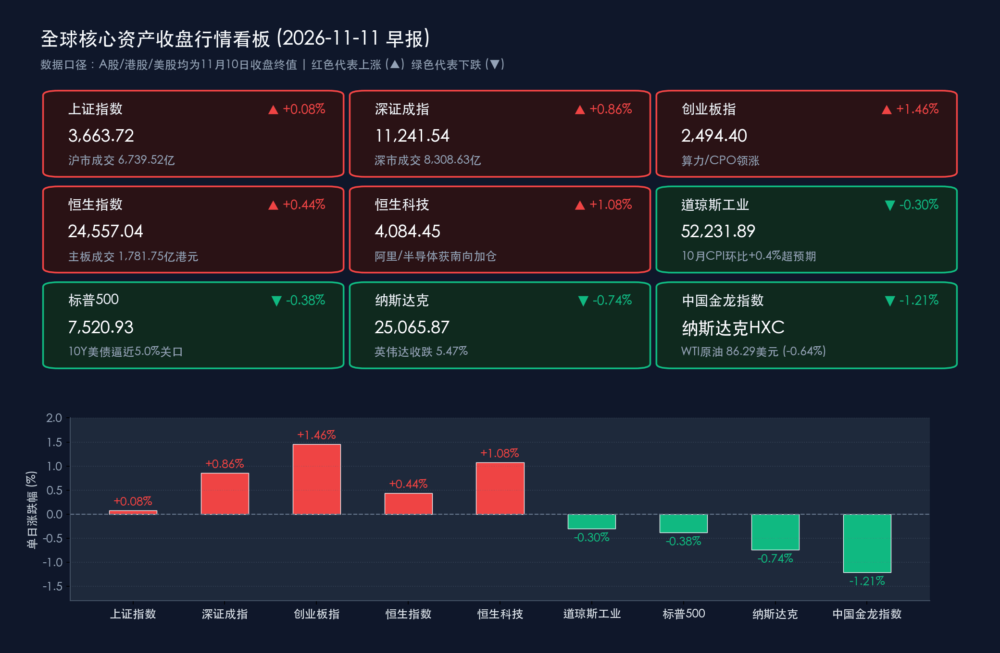

# 创业板与恒科齐弹，美10月CPI超预期掀加息逆风：内资科技定力与外盘利率重估

**日期：2026年11月11日 (星期三)** &nbsp; **时段：早报 (常规交易日 · 模式A)**

> **核心摘要**：11月10日 A 股与港股共振回暖，创业板指大涨 **1.46%**、恒生科技指数上涨 **1.08%**，沪深两市成交额温和放大至 **1.505 万亿元**，主力资金连续第二日净流入 **172.67 亿元** 并聚焦算力、半导体与光学光电子。隔夜美股受10月 CPI 环比上涨 **0.4%**（核心环比 **+0.3%**）超预期冲击集体收跌，10年期美债收益率盘中逼近 **5.0%** 关口、美联储12月加息预期升温；国内央行互换便利（SFISF）千亿级增量买盘实质落地与回购再贷款利率降至 **1%** 构筑底部韧性，今日重点观察海外利率逆风下国内科技成长的承接力。

---

## 核心行情复盘

**数据口径**：2026年11月11日为周三常规交易日（注：美东11月11日为美国退伍军人节，纽交所与纳斯达克正常交易，美国债券市场休市一天）。本报告不使用11月11日盘中暂态数据；A 股、港股采用 **11月10日收盘终值**，美股采用 **美东11月10日收盘终值**。

* **A 股：深强沪稳、量能温和回升，主力资金加码算力与半导体**
    * **上证指数**收报 **3,663.72 点**，上涨 **0.08%**（涨 **2.93 点**）；**深证成指**收报 **11,241.54 点**，上涨 **0.86%**（涨 **96.05 点**）；**创业板指**收报 **2,494.40 点**，上涨 **1.46%**（涨 **35.84 点**）。
    * 沪市成交额 **6,739.52 亿元**，深市成交额 **8,308.63 亿元**（其中创业板成交额 **4,184.48 亿元**），沪深两市合计成交 **15,048.15 亿元**，较11月9日的 **14,826.13 亿元**增加 **222.02 亿元**，增幅 **1.50%**，重回 **1.5 万亿元**上方。
    * 沪深两市主力资金全天净流入 **172.67 亿元**，较前一交易日的 **117.95 亿元**进一步放大。行业层面，**电子（半导体、光学光电子）、文化传媒、计算机、机械设备**板块获主力资金大幅加仓；**非银金融、石油石化、通信、煤炭**板块则出现不同程度主力净流出。
    * 个股层面上，资金高度聚焦算力与 CPO 产业链，**新易盛、中际旭创、东山精密**等核心硬件标的获主力资金显著净买入。
* **港股：恒生科技涨超 1%，南向资金结构性调仓科技龙头**
    * **恒生指数**收报 **24,557.04 点**，上涨 **0.44%**（涨 **108.09 点**）；**恒生科技指数**收报 **4,084.45 点**，上涨 **1.08%**（涨 **43.72 点**）。
    * 港股主板全日成交额 **1,781.75 亿港元**，较11月9日的 **1,737.07 亿港元**增加 **44.68 亿港元**，增幅 **2.57%**。
    * 南向资金全天合计成交额放大至 **734.64 亿港元**，全天净卖出 **27.39 亿港元**（其中沪市港股通净卖出 **11.44 亿港元**，深市港股通净卖出 **15.96 亿港元**）。但内部结构分化显著：南向资金逆势大幅加仓科技与晶圆代工龙头，**阿里巴巴-W**获净买入 **8.68 亿港元**，**中芯国际**获净买入 **2.16 亿港元**，**华虹宏力**获净买入 **2.06 亿港元**；而**盈富基金**（净卖出 **6.90 亿港元**）、**腾讯控股**（净卖出 **6.14 亿港元**）及长飞光纤光缆遭获利兑现。
* **美股：10月 CPI 超预期引爆“加息交易”，三大指数终结反弹集体收跌**
    * **道琼斯工业平均指数**收报 **52,231.89 点**，下跌 **0.30%**（跌 **157.86 点**）；**标普500指数**收报 **7,520.93 点**，下跌 **0.38%**（跌 **29.01 点**）；**纳斯达克综合指数**收报 **25,065.87 点**，下跌 **0.74%**（跌 **187.27 点**）。
    * **通胀数据催化剂**：美国劳工部公布的10月 CPI 环比上涨 **0.4%**（预期 **0.3%**），剔除食品和能源的核心 CPI 环比上涨 **0.3%**（预期 **0.2%**），连续第三个月超出市场预期。数据公布后，10年期美债收益率盘中逼近甚至触及 **5.0%** 关口；美联储理事沃勒（Waller）等官员发表鹰派言论，表示支持12月加息，甚至对必要时采取 **加息 50 个基点**持开放态度。
    * **科技巨头与芯片股分化**：“科技七巨头”涨跌互现，亚马逊涨超 **1%**，特斯拉小幅收涨，微软、苹果偏弱。**英伟达（NVDA）**大跌 **5.47%**，两日累计回撤逾 **9%**，因公司内部启动针对 CEO 黄仁勋相关事项的独立调查引发治理层担忧；但非英伟达芯片股展现出韧性，**博通**上涨约 **3.9%**，**台积电**涨超 **2%**。此外，AI 独角兽 **Anthropic** 拟于下周冲刺美股 IPO（估值预期高达 **1.4 万亿美元**级别），吸引 AMD、博通、微软、英伟达等作为基石投资者参与配售。
    * **中概股与欧股**：纳斯达克中国金龙指数收跌 **1.21%**；欧洲主要股指多数收高，德国 DAX30 指数涨 **0.31%**，法国 CAC40 指数涨 **0.55%**，英国富时100指数跌 **0.29%**。
* **大宗商品与加密货币：黄金与比特币承压，油价延续回落**
    * **原油**：美伊核谈判在铀浓缩丰度上限方面出现进展、中东地缘风险溢价持续消退，**WTI 原油期货**收报 **86.29 美元/桶**，下跌 **0.64%**；**布伦特原油**盘中一度逼近 **90 美元/桶**关口。
    * **黄金**：受美联储鹰派加息预期与美元走强压制，**COMEX 黄金期货**下挫 **1.84%**，收报 **4,038.8 美元/盎司**。
    * **加密货币**：高利率预期叠加行业安全事件余波引发抛售，**比特币（BTC）**盘中跌破多道关口，最低触及 **72,695 美元**附近，创近三个月新低，年内累计跌幅扩大至约 **17%**；以太坊等主流代币普遍跌超 **4%–5%**。

> **数学闭环校验**：上证指数 `(3,663.72−3,660.79)/3,660.79=+0.0800%`（公布 `+0.08%`），深证成指 `(11,241.54−11,145.49)/11,145.49=+0.8618%`（公布 `+0.86%`），创业板指 `(2,494.40−2,458.56)/2,458.56=+1.4578%`（公布 `+1.46%`）；恒生指数 `(24,557.04−24,448.95)/24,448.95=+0.4421%`（公布 `+0.44%`），恒生科技 `(4,084.45−4,040.73)/4,040.73=+1.0820%`（公布 `+1.08%`）；道指 `(52,231.89−52,389.75)/52,389.75=-0.3013%`（公布 `-0.30%`），标普500 `(7,520.93−7,549.94)/7,549.94=-0.3842%`（公布 `-0.38%`），纳指 `(25,065.87−25,253.14)/25,253.14=-0.7416%`（公布 `-0.74%`）。所有核心指数验算误差均远低于 **0.5%** 阈值。

## 核心解读与市场逻辑

> **美国通胀粘性触发“高利率更久甚至再加息”定价，全球无风险利率锚再度承压。** 10月美国 CPI 环比 **+0.4%**、核心 CPI 环比 **+0.3%** 连续第三个月超预期（数据），叠加美联储理事沃勒表态不排除12月加息乃至 **50bp** 选项（事件），直接推升10年期美债收益率逼近 **5.0%** 并打压黄金（**-1.84%**）与比特币（探底 **72,695 美元**）（逻辑）。但值得注意的是，尽管原油价格回落缓解了后续能源项压力，核心服务项的韧性仍令美联储难以轻易转鸽，短期对高估值长久期资产形成折现率压制。

> **AI 产业链从“单极崇拜”走向“多极扩散”，英伟达个股治理扰动不改算力主线。** 隔夜英伟达因内部独立调查传闻续跌 **5.47%**，但博通（**+3.9%**）、台积电（**>2%**）逆势走强，且 Anthropic 启动万亿美元级 IPO 路演并获四大科技巨头基石认购，说明全球算力资本开支与大模型商业化仍在加速。这与11月10日 A 股主力资金净流入 **172.67 亿元**主攻半导体、CPO，以及南向资金精准加仓阿里巴巴（**+8.68 亿港元**）与中芯国际、华虹宏力形成鲜明印证——资金正在围绕自主可控晶圆制造与高确定性算力硬件做结构性聚焦。

> **内外流动性周期错位下，国内政策性增量资金构成 A 股“独立景气度”护城河。** 面对海外美债收益率上行与金龙指数回落（**-1.21%**）的外部扰动，今日 A 股与港股早盘或面临一定情绪低开压力；但国内市场已进入政策工具实质性落地期，互换便利首批股票/ETF 买入落地与回购再贷款 **1%** 低息制度化，使得底部筹码结构显著优于海外市场，结构性主线重于指数点位波动。

## 政策脉动

* **互换便利（SFISF）千亿级增量资金实质进场**：中国人民银行常态化推进的证券、基金、保险公司互换便利第三次 **1,000 亿元**操作顺利落地。中信证券、中金公司、国泰海通、中国银河等多家头部券商已正式开展回购融资交易，并完成**首批股票及股票 ETF 买入操作**，标志着政策性稳市工具正式转化为二级市场真金白银的增量买盘。
* **股票回购增持再贷款利率降至 1% 并转为长期制度**：人民银行将股票回购增持再贷款利率下调至 **1%**，新增 **2,000 亿元**额度并由阶段性安排升级为长期制度性安排；大型商业银行同步向央企及优质上市公司提供千亿级专项贷款，大幅降低产业资本增持成本与市场估值底限。
* **公开市场精准调控与外汇准备金率五年首升**：人民银行开展 **3,000 亿元** 3个月期（91天）买断式逆回购操作（对冲11月 **5,000 亿元**到期，实现温和缩量续作以防短端利率过快下行）；同时宣布自 **2026年11月15日起** 将金融机构外汇存款准备金率由 **4% 上调至 6%**（近五年首次上调），在美联储鹰派预期升温与汇率双向波动背景下前瞻性锁定外汇流动性、稳定人民币汇率预期。

## 最新机构观点

> **摩根士丹利（Morgan Stanley） & 高盛（Goldman Sachs）**：大摩首席策略师迈克尔·威尔逊（Michael Wilson）在最新研报中指出，美股前期调整已接近尾声，标普500指数在 **7,100–7,300 点**区间具备坚实支撑，年底前有望依托优质周期股与市场广度改善开启修复。同时，作为 Anthropic 拟议 IPO 的牵头承销商，高盛与摩根士丹利均强调，尽管二级市场 AI 龙头短期波动加剧，但全球机构对顶级 AI 底层模型与亚太跨境股权发行的认购需求依然强劲。

> **中信证券（CITIC Securities）**：当前创业板及科创50等科技板块估值已回落至历轮美联储加息周期的低位水平。展望后市，**2027年一季度（27Q1）**将成为重要观察与布局窗口（催化包括新一代 AI 模型迭代、国产 HBM 量产爬坡等），科技板块走势预计呈“前低后高”，建议积极把握 AI 应用落地、国产算力与存储扩产的 $\alpha$ 机遇，并将持续运用互换便利工具增持优质权益资产。

> **中金公司（CICC）**：全球科技巨头密集发布个人 Agent 与世界模型，推动人机交互入口迎来价值重估。看好具备庞大终端存量与自研芯片优势的硬件生态厂商，以及通过智能眼镜等新型端侧硬件切入的大模型公司，端侧创新与算力下沉将成为下一阶段科技投资的核心抓手。

> **华泰证券（Huatai Securities）**：A 股经历前期震荡后底部支撑扎实，在互换便利与回购增持再贷款等长效工具呵护下，建议机构配置采取**“红利底仓 + 景气消费修复 + 确定性科技成长”**的三维均衡策略，兼顾防御性与产业升级弹性。

## 今日市场情绪：通胀沙漏倾斜，硅帆稳渡沧海

> Prompt: A towering bronze hourglass filled with glowing ember-like inflation numerals stands on a marble Wall Street trading floor, tilting a silver balance scale as 10-year bond yield lightning crackles in the background. Across a calm jade sea in the foreground, an Eastern treasure ship built from silicon wafers and glowing fiber-optic sails steers steadily beside a stone central-bank lighthouse, symbolizing resilient domestic tech capital amid global rate headwinds.

---

**主要数据来源**：东方财富历史行情接口（沪深港美核心指数11月9日—11月10日日线）、美国劳工统计局（BLS）10月 CPI 报告摘要、财联社美股与券商晨会精华、证券之星/同花顺沪深主力资金与港股通南向资金统计、中国人民银行公开市场业务公告及外汇存款准备金率调整通知。

> **免责声明**：内容仅供参考，不构成投资建议。

🤖 生成模型：Gemini 4 Argon (Medium) <!-- model-stamp -->
