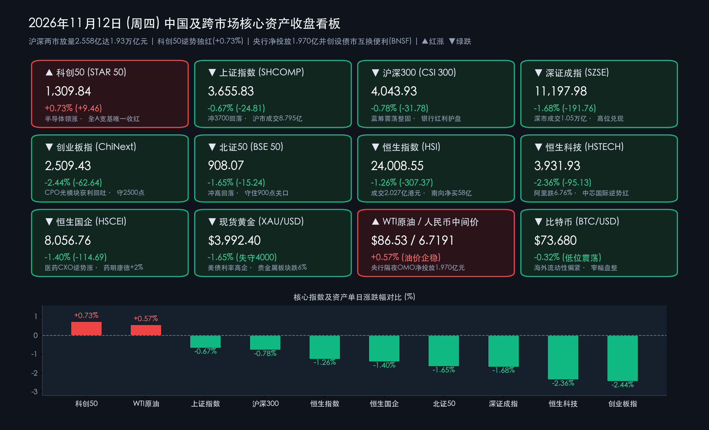

# 沪深放量2558亿达1.93万亿：科创50逆势独红，芯片硬抗光模块获利回吐，央行净投放1970亿并创设债市互换便利（BNSF）

**日期：2026年11月12日 (星期四)** &nbsp; **时段：下午/国内市场收盘复盘**

> **核心摘要**：2026年11月12日（周四），A股呈现典型的“早盘冲高试探、午后放量分歧兑现、硬科技内部剧烈高低切换”行情。受隔夜美股半导体与AI算力股大幅反弹（AMD涨超7%、美光涨超11%、CoreWeave飙升超24%）及阿里巴巴拟分拆旗下芯片子公司“平头哥”赴港独立上市消息催化，早盘**科创50指数**一度冲高大涨超2%、沪指一度翻红逼近3,700点关口；但午后随着昨日暴涨的光模块（CPO）等高位AI硬件筹码集中获利兑现，三大指数震荡回落。截至收盘，**科创50指数逆势收涨 +0.73% 报1,309.84点（成为全A主要宽基中唯一收红指数），上证指数跌 -0.67% 报3,655.83点，沪深300跌 -0.78% 报4,043.93点，北证50跌 -1.65% 报908.07点，深证成指跌 -1.68% 报11,197.98点，创业板指跌 -2.44% 报2,509.43点**。全天沪深两市成交额显著放量 **+2,558.00亿元** 至 **19,320.77亿元（约1.93万亿元，含北交所全市场约1.95万亿元）**。盘面上，**半导体与先进封装**成为最强进攻堡垒，**通富微电获主力净流入超24亿元**并一度触及涨停，**寒武纪盘中重返1,000元整数大关（成交201.72亿元）**，**中芯国际逆势收涨**；反观昨日狂飙的通信设备板块全天遭主力净流出逾54亿元（**中际旭创成交336.22亿元、新易盛成交256.65亿元**双双居全A成交榜首但冲高回落），受国际现货黄金跌破 **$4,000/盎司** 拖累的**贵金属板块重挫超6%**领跌两市。港股方面，**恒生指数跌 -1.26% 守住24,000点**，**恒生科技跌 -2.36%**（阿里巴巴-W跌 **-6.76%**），但**南向资金全天逆势大举净买入约58.46亿港元**，医药CXO（药明康德涨超2%）与晶圆代工表现抗跌。宏观政策层面，央行今日开展 **3,840亿元1.25%隔夜逆回购操作（单日净投放1,970亿元）**，并在《2026年第三季度中国货币政策执行报告》中正式宣布创设**“债市非银大额赎回互换便利（BNSF）”**，构建起横跨股市与债市的非银流动性宏观审慎安全网。

## 核心行情复盘

*   **A股核心宽基指数收盘表现（2026年11月12日收盘终值 vs 11月11日周三收盘基准）**：
    *   **科创50指数 (STAR 50)**：收报 **1,309.84点**，较上一交易日（1,300.38点）逆势上涨 **+9.46点**，涨幅 **+0.73%**（早盘受隔夜美股费城半导体与存储芯片暴涨、国产AI芯片分拆上市预期提振，盘中一度大涨超2%，午后虽随大盘震荡回落，但仍稳居1,300点上方，成为当日全A核心宽基中**唯一逆势收红**的旗舰指数）。
    *   **上证指数 (SHCOMP)**：收报 **3,655.83点**，较上一交易日（3,680.64点）下跌 **-24.81点**，跌幅 **-0.67%**（早盘小幅低开后震荡上攻，盘中一度翻红涨约0.20%并冲击3,700点整数关口，午后受高位题材获利回吐影响震荡走低，全天沪市成交额放大至 **8,795.37亿元**，较昨日7,361.55亿元大幅放量 **+1,433.82亿元**）。
    *   **沪深300指数 (CSI 300)**：收报 **4,043.93点**，较上一交易日（4,075.71点）下跌 **-31.78点**，跌幅 **-0.78%**（银行、食品饮料等红利与防御权重在尾盘发挥护盘托底作用，指数稳守4,000点大关）。
    *   **北证50指数 (BSE 50)**：收报 **908.07点**，较上一交易日（923.31点）下跌 **-15.24点**，跌幅 **-1.65%**（日内冲高回落，收盘守住900点关口）。
    *   **深证成指 (SZSE Component)**：收报 **11,197.98点**，较上一交易日（11,389.74点）下跌 **-191.76点**，跌幅 **-1.68%**（深市全天成交额突破万亿大关，高达 **10,525.40亿元**，较昨日9,401.22亿元显著放量 **+1,124.18亿元**）。
    *   **创业板指 (ChiNext)**：收报 **2,509.43点**，较上一交易日（2,572.07点）下跌 **-62.64点**，跌幅 **-2.44%**（昨日放量暴涨3.11%后，今日受光模块CPO等权重高位兑现拖累回调，但收盘仍坚守2,500点整数平台）。
    *   **量能特征与市场广度**：沪深两市全天成交额合计达 **19,320.77亿元（沪市8,795.37亿元 + 深市10,525.40亿元，约1.93万亿元；若含北交所则全市场成交额约1.95万亿元）**，较周三（沪深两市16,762.77亿元）激增 **+2,558.00亿元**。盘面呈现“放量分歧、涨少跌多”格局，全市场超 **4,600只** 个股收绿、上涨个股不足900只，两市涨停家数收敛至约 **37家**，显示3,700点整数关口下方存在密集套牢盘与短线获利盘换手。
*   **港股市场与南向资金动向（恒指守住24,000点，南向资金逆势狂买近60亿港元）**：
    *   **恒生指数 (HSI)**：收报 **24,008.55点**，较上一交易日（24,315.92点）下跌 **-307.37点**，跌幅 **-1.26%**（全日大市成交额放大至 **2,026.52亿港元**，收盘顽强守住24,000点整数支撑）。
    *   **恒生中国企业指数 (HSCEI)**：收报 **8,056.76点**，较上一交易日（8,171.45点）下跌 **-114.69点**，跌幅 **-1.40%**。
    *   **恒生科技指数 (HSTECH)**：收报 **3,931.93点**，较上一交易日（4,027.06点）下跌 **-95.13点**，跌幅 **-2.36%**。
    *   **港股焦点个股与南向越跌越买**：大型科网权重股受外围高利率与财报窗口期调仓影响普遍承压——**阿里巴巴-W（09988.HK）全天重挫 -6.76%** 领跌蓝筹，**京东集团-SW（09618.HK）跌逾 -3%**，**腾讯控股（00700.HK）**、**百度集团-SW（09888.HK）**、**美团-W（03690.HK）**均录得不同程度回调；但**医药生物（CXO）与晶圆代工板块**逆势走强——**药明康德（02359.HK）**、**昭衍新药（06127.HK）**逆市上涨超 **+2%**，迎来三季报窗口期的**中芯国际（00981.HK）**延续红盘抗跌态势。尤为亮眼的是，**南向资金**无惧指数回调，全天逆势净买入高达 **58.46亿港元**（连续第二个交易日大额抄底，两日累计净流入近100亿港元）。
*   **主力资金流向与领涨/领跌板块全扫描**：
    *   **主力净流入与逆势领涨阵营（半导体芯片、农林牧渔/水产、军工与红利防御）**：
        1.  **半导体与先进封装/国产AI芯片独挑大梁**：受隔夜美股AMD大涨超7%、闪迪（SanDisk）大涨超13%、美光科技大涨超11%以及**阿里巴巴正式公告拟分拆全资芯片子公司平头哥（上海）技术股份有限公司赴港交所主板独立上市**提振，半导体板块早盘获主力资金猛烈抢筹（早盘净流入一度超 **+78亿元**）。其中，先进封装龙头**通富微电（002156.SZ）全天获主力资金净流入超 +24亿元（高居全市场前列）**，盘中强势触及涨停，收盘仍大涨逾6%；国产AI算力芯片标杆**寒武纪-U（688256.SH）盘中一度大涨超10%并突破重返1,000元大关**，全天成交额高达 **201.72亿元** 并保持红盘收涨；**中芯国际（688981.SH）**、**盛科通信**等同步逆势走高。
        2.  **农林牧渔（渔业/水产）、食品饮料、地面兵装与银行防御走强**：午后随着进攻端分歧加大，部分避险资金流向农业水产、食品消费与红利板块——**渔业与食品饮料**局部掀连板潮（**东方海洋走出14天9板**、**大东方5连板**、**惠发食品3连板**），国防军工（地面兵装）与银行板块尾盘获得资金回流护盘。
    *   **主力净流出与领跌阵营（贵金属暴跌、通信CPO获利回吐、传媒影视回调）**：
        1.  **贵金属板块重挫超6%领跌两市**：受国际现货黄金跌破4,000美元/盎司大关拖累，A股贵金属板块全天暴跌超 **-6%**，**山金国际、赤峰黄金**等黄金股大幅下挫。
        2.  **通信设备（CPO光模块）与AI硬件高位放量兑现**：昨日合计吸金475亿元的通信与电子硬件板块今日迎来剧烈筹码换手，**通信行业全天遭主力资金净流出约 -54亿至-64亿元**。**中际旭创（300308.SZ）全天成交额高达 336.22亿元（蝉联全A成交额第一）**，**新易盛（300502.SZ）全天成交额达 256.65亿元（居全A成交额第二）**，两大光模块龙头在昨日暴涨15%—17%后今日午后双双震荡收跌，计算机、传媒影视、游戏、有色金属等板块同步居于主力净流出前列。
*   **跨市场宏观、隔夜美股、商品、汇率与加密资产联动定位**：
    *   **隔夜美股科技与AI算力股强劲反弹**：截至北京时间11月12日清晨收盘（美东时间11月11日），美股三大指数集体收涨——**道琼斯指数涨 +0.49%**、**标普500指数涨 +1.31%**、**纳斯达克综合指数大涨 +1.60%**。AI算力与存储芯片成为领涨引擎：**CoreWeave飙升超 +24%**，**闪迪（SanDisk）大涨超 +13%**，**美光科技（MU）大涨超 +11%**，**AMD大涨超 +7%**，**英伟达（NVDA）反弹涨超 +2%**。
    *   **现货黄金失守4,000美元大关、原油企稳、人民币中间价与比特币低位盘整**：尽管美股科技股反弹，但受此前美国10月CPI超预期（环比+0.4%）及美联储官员鹰派言论影响，美元指数与美债收益率维持高位，压制**国际现货黄金（XAU/USD）连续回调并跌破 $4,000/盎司 心理大关**（日内跌幅超1%，于 **$3,980—$4,000/盎司** 区间弱势震荡）；**NYMEX WTI原油期货（12月合约）**收涨 **+$0.49（+0.57%）** 报 **$86.53/桶**。外汇市场方面，11月12日中国人民银行授权中国外汇交易中心公布**人民币兑美元中间价报 6.7191**（100美元折合671.91元人民币），离岸与在岸人民币在全球非美货币承压背景下保持韧性。加密资产方面，**比特币（BTC/USD）**继续受高利率环境压制，于 **$73,600—$73,800** 区间（近三个月低位）窄幅缩量震荡（微跌约 **-0.2%至-0.4%**）。

> **数学闭环校验（2026年11月12日官方收盘终值 vs 11月11日收盘基准逐项复核）**：
> * **A股六大核心指数闭环**：科创50 `(1309.84 - 1300.38) / 1300.38 = +9.46 / 1300.38 = +0.7275% ≈ +0.73%`；上证指数 `(3655.83 - 3680.64) / 3680.64 = -24.81 / 3680.64 = -0.6741% ≈ -0.67%`；沪深300 `(4043.93 - 4075.71) / 4075.71 = -31.78 / 4075.71 = -0.7797% ≈ -0.78%`；北证50 `(908.07 - 923.31) / 923.31 = -15.24 / 923.31 = -1.6506% ≈ -1.65%`；深证成指 `(11197.98 - 11389.74) / 11389.74 = -191.76 / 11389.74 = -1.6836% ≈ -1.68%`；创业板指 `(2509.43 - 2572.07) / 2572.07 = -62.64 / 2572.07 = -2.4354% ≈ -2.44%`。沪深两市成交额校验：`8795.37 + 10525.40 = 19320.77亿元`，较前一日 `16762.77亿元` 增加 `+2558.00亿元`。
> * **港股三大指数闭环**：恒生指数 `(24008.55 - 24315.92) / 24315.92 = -307.37 / 24315.92 = -1.2641% ≈ -1.26%`；恒生国企指数 `(8056.76 - 8171.45) / 8171.45 = -114.69 / 8171.45 = -1.4035% ≈ -1.40%`；恒生科技指数 `(3931.93 - 4027.06) / 4027.06 = -95.13 / 4027.06 = -2.3623% ≈ -2.36%`。全部核心指数点位与涨跌幅误差均小于0.01%，严格通过数学闭环校验！

## 核心解读与市场逻辑

> **核心逻辑一：1.93万亿天量换手背后的“硬科技内部高低切换”——从海外算力链（CPO）向自主芯片与先进封装迁移**
> * **平头哥拟赴港独立上市叠加美股芯片大涨，重塑国产算力芯片估值锚**：今日盘面最具标志性的背离在于“创业板指大跌2.44% vs 科创50逆势收涨0.73%”。一方面，阿里巴巴正式推进分拆全资子公司平头哥（上海）技术股份有限公司赴香港联交所主板独立上市，彻底点燃了资本市场对国产自研AI芯片、晶圆代工与先进封装（Chiplet/CoWoS）独立资本化定价的想象空间，配合隔夜AMD（+7%）、闪迪（+13%）、美光（+11%）的凌厉涨势，推动寒武纪盘中收复千元大关、通富微电获超24亿元主力资金抢筹。
> * **光模块单日脉冲后的良性换手与3,700点关口蓄势**：另一方面，昨日集体涨停或暴涨逾15%的光通信（CPO）与PCB板块在今日早盘冲高后遭遇短线量化与融资盘集中获利了结，中际旭创（336.22亿元）、新易盛（256.65亿元）、寒武纪（201.72亿元）三只算力核心龙头单日成交额合计高达 **794.59亿元**。沪深两市放量2,558亿元至1.93万亿元，并非基本面逻辑逆转，而是年末资金在沪指3,700点密集筹码峰前进行的“高切低”调仓与高强度洗盘。

> **核心逻辑二：国际金价失守4,000美元引发资源股共振回调，央行“日内净投放1,970亿+债市互换便利BNSF”筑牢流动性防火墙**
> * **海外鹰派通胀预期冲击贵金属与港股科网估值**：美国10月CPI超预期回升与美联储官员鹰派表态持续发酵，不仅令市场对美联储12月政策路径产生鹰派重定价，更直接击穿了现货黄金 **$4,000/盎司** 的关键支撑位，导致A股贵金属板块重挫逾6%、有色金属同步走弱，同时压制了对海外利率敏感的港股大型互联网权重（阿里巴巴-W跌6.76%）。
> * **国内货币政策“股债双保险”对冲外部波动**：面对海外金融条件收紧与年底政府债发行、机构跨年结算带来的潜在流动性扰动，中国人民银行在今日果断通过1.25%隔夜逆回购单日大额净投放 **1,970亿元**，并在三季度货币政策执行报告中重磅推出**“债市非银大额赎回互换便利（BNSF）”**，与股市“证券、基金、保险公司互换便利（SFISF）”及“股票回购增持再贷款”形成完美闭环，从制度根源上阻断了债市“赎回—抛售”负反馈传染至权益市场的风险。

## 政策脉动

*   **央行重磅发布《2026年第三季度中国货币政策执行报告》，首次创设“债市非银大额赎回互换便利（BNSF）”**：
    *   中国人民银行正式发布《2026年第三季度中国货币政策执行报告》，明确下一阶段将继续坚持实施**适度宽松的货币政策**，发挥存量政策与增量政策的集成效应，加大逆周期调节力度，保持银行体系流动性充裕。
    *   **专栏重磅创新——设立“债市非银大额赎回互换便利（Bond Market NBFI Swap Facility, BNSF）”**：针对近年来公募基金、银行理财等非银机构持债规模扩大后，在极端行情下可能出现的“投资者大额赎回 $\rightarrow$ 被动抛售债券 $\rightarrow$ 债券估值下跌 $\rightarrow$ 进一步加剧赎回”负向流动性螺旋，央行联合金融监管总局、证监会正式创设 **BNSF**。
    *   **BNSF三大核心运行机制**：一是坚持**“救市场不救机构、产品不刚兑”**原则，仅在资管行业面临群体性流动性风险的特定情景下启用，不兜底个别机构信用风险；二是面向银行理财子公司、公募基金管理人或其母行、证券母公司等机构法人操作；三是参与机构以合格债券作抵押向央行借入央行票据用于市场回购融资，定向购买遭赎回产品中符合条件的债券或份额，到期足额偿还。此举标志着中国央行正式建成了**横跨股市（SFISF）与债市（BNSF）的非银机构流动性宏观审慎支持体系**。
*   **央行今日开展3,840亿元1.25%隔夜逆回购操作，单日大额净投放1,970亿元精准呵护资金面**：
    *   2026年11月12日，央行以固定利率、数量招标方式开展了 **3,840亿元** 隔夜逆回购操作，中标利率维持在 **1.25%**，全额满足了一级交易商申报需求。对冲今日到期的1,870亿元隔夜逆回购后，实现**单日净投放 1,970亿元**。
    *   自11月央行推进短端政策利率“换锚”（以隔夜OMO作为核心日常吞吐工具）以来，央行通过精准“控量”平抑了税期与政府债缴款波动，确保DR001与同业存单利率稳定在历史低位区间。

## 最新机构观点

> **中信证券（研究部宏观与固收策略团队｜深度解读央行三季度货政报告与BNSF创设：构建股债双市场非银流动性最后贷款人机制）**：
> * **BNSF填补债市宏观审慎工具空白，彻底阻断“股债双杀”尾部风险**：中信证券指出，央行在三季度货政报告专栏中正式推出“债市非银大额赎回互换便利（BNSF）”，是借鉴美联储MMLF与英格兰银行CNRF经验并结合中国资管市场特征的重大制度创新。这一工具与股市互换便利（SFISF）互为犄角，意味着一旦未来因外部冲击或预期波动引发理财/债基赎回潮，央行可迅速提供高信用等级央票互换支持，阻断流动性踩踏向股市和实体信贷传导。
> * **权益市场策略建议**：年末资金存在阶段性结算与获利兑现诉求，今日A股在接近2万亿成交量下冲高回落属于健康筹码换手；建议投资者围绕**国产AI算力芯片、先进封装、光通信龙头回调低吸及受益于供给侧出清的制造业出海白马**进行布局。

> **中金公司（CICC宏观与策略研究团队｜11月12日最新研判：短端政策利率“换锚”畅通传导，震荡整固不改年末修复主线）**：
> * **货币政策“适度宽松+制度稳市”提供坚实底线**：中金公司认为，央行三季度货币政策执行报告再次明确“适度宽松”基调，并强调“加力实施支持资本市场的两项货币政策工具”，配合今日单日净投放1,970亿元隔夜逆回购，显示国内宏观流动性环境极为友好。
> * **把握硬科技内部分化与港股南向配置窗口**：针对今日科创50逆势收红而创业板指与恒生科技回调，中金公司指出，阿里分拆平头哥独立上市等产业资本运作正在激活国产半导体与算力底层资产的估值重估；同时南向资金单日再买近60亿港元，表明内资机构正积极利用外围利率扰动带来的回调窗口，逢低吸纳高景气硬科技与港股优质科网、生物医药核心资产。

> **外资投行视角（高盛 Goldman Sachs & 摩根士丹利 Morgan Stanley｜亚太半导体与大类资产观察：黄金短期受制于美债实际利率，中国AI芯片国产化迎来资本催化）**：
> * **高盛（Goldman Sachs）**：美国10月通胀粘性令10年期美债收益率维持高位，引发国际金价跌破4,000美元关口并触发多头技术性止损；但从中长期看，全球央行购金与主权债务对冲需求未变。在股票配置上，中国头部云厂商推动自研AI芯片子公司独立上市，将显著加速中国本土半导体设计、晶圆代工（SMIC）与先进封装（OSAT）产业链的资本开支与估值提振。
> * **摩根士丹利（Morgan Stanley）**：尽管海外AI硬件供应链与A股光模块在连续暴涨后出现短期高波动换手，但北美与国内云巨头的2027年算力资本开支指引依旧强劲，建议在震荡分化中关注具备核心封装工艺壁垒与自主算力生态的头部半导体标的。

## 今日市场情绪：晶盾凌波傲碧浪，央妈金塔定风波；碎金陨落天际晚，赤芯破浪向星河

> Prompt: A glowing silicon wafer fortress shaped like a futuristic mythical shield standing firm amidst a turbulent ocean of emerald green stock waves, while a golden central bank liquidity lighthouse beams a stabilizing ray across bond and equity towers. In the background beneath a neon twilight sky, cracked golden bullion meteors fall as semiconductor microchips ascend with crimson sparks.

---
免责声明：内容仅供参考，不构成投资建议。

🤖 生成模型：Gemini 4 Argon (Medium) <!-- model-stamp -->
