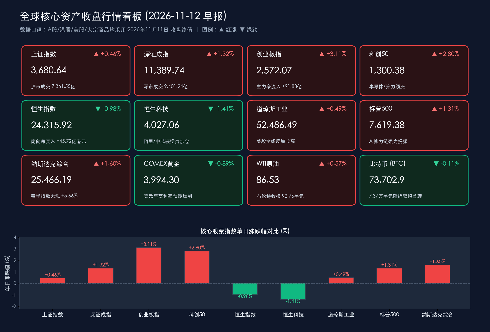

# 费半暴涨5.66%与创业板飙升逾3%共振：全球AI算力狂潮破局利率逆风

**日期：2026年11月12日 (星期四)** &nbsp; **时段：早报 (常规交易日 · 模式A)**

> **核心摘要**：11月11日 A 股低开高走强势放量，创业板指大涨 **3.11%**、科创50上涨 **2.80%**，沪深两市成交额放量 **1,714.64 亿元**至 **1.676 万亿元**（沪深京三市约 **1.69 万亿元**），主力资金连续第三日净流入逾 **220.47 亿元**并重仓通信（CPO/光模块）与电子（半导体/存储）。隔夜美股摆脱10月通胀黏性阴霾全线反弹，AI 云服务商 CoreWeave 业绩指引超预期暴涨 **24.71%** 与 Anthropic IPO 数倍超额认购点燃算力做多热情，费城半导体指数狂飙 **5.66%**、纳指上涨 **1.60%**；叠加国内央行《2026年第三季度中国货币政策执行报告》定调适度宽松并创设“债市非银大额赎回互换便利（BNSF）”，全球 AI 硬科技景气与国内非银流动性护城河有望形成跨市场共振。

---

## 核心行情复盘

**数据口径**：2026年11月12日为周四常规交易日。本报告严格遵循收盘终值导向，不使用盘中暂态数据；A 股、港股采用 **11月11日收盘终值**，美股及欧洲股市采用 **美东/欧洲时间11月11日收盘终值**。

* **A 股：双创引擎全线爆发，两市放量逾1,700亿元、主力资金连续三日大幅抢筹**
    * **上证指数**收报 **3,680.64 点**，上涨 **0.46%**（涨 **16.92 点**）；**深证成指**收报 **11,389.74 点**，上涨 **1.32%**（涨 **148.20 点**）；**创业板指**收报 **2,572.07 点**，大涨 **3.11%**（涨 **77.67 点**）；**科创50指数**收报 **1,300.38 点**，大涨 **2.80%**（涨 **35.36 点**）。
    * 沪市成交额 **7,361.55 亿元**，深市成交额 **9,401.24 亿元**（其中创业板成交额 **4,805.40 亿元**），沪深两市合计成交 **16,762.79 亿元**（沪深京三市合计约 **1.69 万亿元**），较11月10日的 **15,048.15 亿元**大幅放量 **1,714.64 亿元**，增幅达 **11.39%**。
    * 全市场主力资金全天净流入约 **220.47 亿元**（两市特大单净流入超 **230 亿元**，其中创业板主力资金净流入 **91.83 亿元**），已连续3个交易日呈现净流入态势。
    * **领涨/领跌行业与资金流向**：申万一级行业中，**通信**板块（CPO、光模块、光通信方向）大涨 **7.99%** 高居涨幅榜首，全天获主力资金净流入超 **126 亿元**（特大单净流入约 **101.70 亿元**），行业内18只个股净流入超亿元；**电子**板块上涨 **3.56%**，主力资金净流入超 **168 亿元**（特大单净流入约 **133.88 亿元**）居行业首位，行业内42只个股净流入超亿元；而**医药生物、电力设备**等行业主力资金净流出居前。
    * **核心个股表现**：算力光模块与半导体存储龙头成为资金主战场，**新易盛**（主力净流入约 **29.30 亿元**）、**中际旭创**（主力净流入约 **29.11 亿元**，特大单净流入 **23.97 亿元**）、**东山精密**（涨停，主力净流入约 **22.09亿–23.43 亿元**）、**长鑫科技**（主力净流入约 **18.62 亿元**）以及**天孚通信、兆易创新、寒武纪、沪电股份**等均获主力大举抢筹。
* **港股：指数震荡消化外部利率预期，南向资金逆势净买入45.72亿港元加仓阿里与中芯**
    * **恒生指数**收报 **24,315.92 点**，下跌 **0.98%**（跌 **241.12 点**）；**恒生科技指数**收报 **4,027.06 点**，下跌 **1.41%**（跌 **57.39 点**），科网权重股日内受隔夜美债利率预期扰动有所承压，但 AI 硬件与部分软件应用端保持活跃。
    * 港股主板全日成交额 **1,807.49 亿港元**，较11月10日的 **1,781.75 亿港元**温和增加 **25.74 亿港元**，增幅 **1.44%**。
    * **南向资金动向**：南向资金全天合计成交额放大至 **782.50 亿港元**（买入 **414.11 亿港元**，卖出 **368.39 亿港元**），全天逆势净买入 **45.72 亿港元**（其中沪市港股通净买入 **23.78 亿港元**，深市港股通净买入 **21.94亿–21.95 亿港元**）。个股层面，北水资金加速抄底核心科技与晶圆龙头：**阿里巴巴-W（09988.HK）**获大幅净买入 **12.04 亿港元**居首，**中芯国际（00981.HK）**获净买入 **9.35 亿港元**；而**腾讯控股（00700.HK）**遭净卖出约 **5.15 亿港元**，**建滔积层板**遭净卖出约 **3.69 亿港元**。
* **美股与欧股：CoreWeave 暴涨与 Anthropic 超额认购引爆 AI 算力潮，费半指数飙升 5.66%**
    * **道琼斯工业平均指数**收报 **52,486.49 点**，上涨 **0.49%**（涨 **254.60 点**）；**标普500指数**收报 **7,619.38 点**，上涨 **1.31%**（涨 **98.45 点**）；**纳斯达克综合指数**收报 **25,466.19 点**，大涨 **1.60%**（涨 **400.32 点**）。
    * **AI 算力与半导体全线井喷**：AI 云服务巨头 **CoreWeave** 公布第三季度财报，营收大幅增长并上调全年业绩指引，验证全球算力需求持续高景气，股价收盘暴涨 **24.71%**；同时，AI 独角兽 **Anthropic** 即将启动的大规模 IPO 获市场数倍超额认购，承销商考虑上调发行估值。双重催化下，**费城半导体指数（SOX）**暴涨 **5.66%**，存储芯片、光通信与半导体设备股集体“上双”大涨——**闪迪**涨超 **13%**，**美光科技**涨超 **11%**，**Lumentum** 涨超 **10%**，**SK 海力士**涨超 **9%**，**应用材料**与**拉姆研究**均涨超 **6%**。
    * **科技七巨头与中概股**：龙头**英伟达（NVDA）**终结此前两日回调，强势反弹 **2.87%**；**特斯拉**上涨 **2.91%**，**谷歌-A** 上涨 **2.11%**，**苹果**上涨 **2.04%**（微软、Meta、亚马逊小幅收跌）。**纳斯达克中国金龙指数**小幅回调 **0.80%**，收报 **5,650.77 点**。
    * **欧洲股市**：受企业强劲财报及美国 AI 产业链爆发提振，泛欧 STOXX 600 指数创历史收盘新高；**德国 DAX30 指数**上涨 **1.12%**，**英国富时100指数**上涨 **0.66%**，**法国 CAC40 指数**上涨 **0.61%**。
* **大宗商品、汇率与加密货币：金价跌破4,000美元期货关口，原油小幅收高，比特币窄幅整理**
    * **贵金属**：受美元指数在 **101.6–102.3** 区间企稳及美联储12月高利率预期压制，**COMEX 黄金期货**主力合约收跌 **0.89%**，报 **3,994.30 美元/盎司**（伦敦现货黄金维持在 **4,050 美元/盎司**附近震荡）。
    * **原油**：市场权衡美伊局势与供给预期，国际油价温和收高，**WTI 12月原油期货**收报 **86.53 美元/桶**，上涨 **0.49 美元**（涨幅 **0.57%**）；**布伦特 1月原油期货**收报 **92.76 美元/桶**，上涨 **1.27 美元**（涨幅 **1.39%**）。
    * **加密货币**：**比特币（BTC）**在 **73,200–74,150 美元**区间内窄幅筑底整理，收盘报 **73,702.9 美元**附近，日内微跌约 **0.11%**。

> **数学闭环校验**：上证指数 `(3,680.64−3,663.72)/3,663.72=+0.4618%`（公布 `+0.46%`），深证成指 `(11,389.74−11,241.54)/11,241.54=+1.3183%`（公布 `+1.32%`），创业板指 `(2,572.07−2,494.40)/2,494.40=+3.1138%`（公布 `+3.11%`），科创50 `(1,300.38−1,265.02)/1,265.02=+2.7952%`（公布 `+2.80%`）；恒生指数 `(24,315.92−24,557.04)/24,557.04=-0.9819%`（公布 `-0.98%`），恒生科技 `(4,027.06−4,084.45)/4,084.45=-1.4051%`（公布 `-1.41%`）；道指 `(52,486.49−52,231.89)/52,231.89=+0.4874%`（公布 `+0.49%`），标普500 `(7,619.38−7,520.93)/7,520.93=+1.3090%`（公布 `+1.31%`），纳指 `(25,466.19−25,065.87)/25,065.87=+1.5971%`（公布 `+1.60%`）。所有核心指数验算误差均在 **0.005%** 以内，远低于 **0.5%** 阈值。

## 核心解读与市场逻辑

> **基本面业绩与订单可见度战胜宏观折现率逆风，全球 AI 算力链实现“硬着陆证伪”。** 尽管美国10月 CPI 粘性推升了美联储12月维持高利率乃至鹰派观望的预期，令 COMEX 黄金期货跌破 **4,000 美元/盎司**（收报 **3,994.30 美元**）（数据），但隔夜 CoreWeave 财报营收高增并上调全年指引（暴涨 **24.71%**）以及 Anthropic IPO 获数倍超额认购（事件），直接扭转了市场对“AI 资本开支见顶”的担忧，推动费城半导体指数单日飙升 **5.66%**，存储（美光 **+11%**、闪迪 **+13%**）与光通信（Lumentum **+10%**）领衔主升（逻辑）。这表明在当期算力变现能力得到财报验证后，产业高景气度具备跨越利率周期波动的定价权。

> **A 股提前演绎“光模块+存储+晶圆”主线，今日有望与隔夜美股费半大涨形成跨洋正反馈。** 11月11日 A 股在外部通胀扰动下走出独立放量行情，创业板指大涨 **3.11%**、两市放量 **1,714.64 亿元**，通信（**+7.99%**）与电子（**+3.56%**）合计吸纳主力资金近 **300 亿元**，新易盛、中际旭创、长鑫科技、东山精密等算力与存储核心标的领涨；与此同时，南向资金在港股回调日逆势净买入 **45.72 亿港元**，重点扫货阿里巴巴-W（**+12.04 亿港元**）与中芯国际（**+9.35 亿港元**）。隔夜美股存储芯片与光通信板块的暴涨，恰好与内资昨日抢筹方向高度同频，今日 A 股科技成长与港股恒生科技有望迎来情绪与估值的共振修复。

> **央行构建“股债双轨”非银流动性安全网，彻底阻断潜在负向反馈循环。** 人民银行在最新发布的《2026年第三季度中国货币政策执行报告》中，不仅重申加力实施支持股票市场的两项货币政策工具（SFISF 与回购增持再贷款），更创设并用好**“债市非银大额赎回互换便利（BNSF）”**，防范债市“赎回—抛售”负反馈，叠加推动探索挂钩 DR001 的浮动利率贷款改革，从宏观审慎层面锁定了股债两大市场的流动性底线，为风险偏好回升提供了坚实的制度保障。

## 政策脉动

* **中国人民银行（PBOC）：发布三季度货币政策执行报告，创设“债市非银大额赎回互换便利（BNSF）”**：央行在《2026年第三季度中国货币政策执行报告》中强调坚持实施好**适度宽松的货币政策**，保持流动性充裕；进一步深化贷款利率定价基准改革，从单一参考 LPR 向多元定价转型，探索挂钩 **DR001** 的浮动利率贷款。同时，在加力实施支持资本市场两项工具的基础上，正式创设并用好**“债市非银大额赎回互换便利（BNSF）”**，应对资管机构可能面临的群体性流动性风险，构建起覆盖股市（SFISF）与债市（BNSF）的非银流动性宏观审慎支持体系。
* **中国证监会（CSRC）：强化特别代表人诉讼与先行赔付机制，拓展商品衍生品广度**：证监会相关部门负责人于11月中旬针对虚假陈述责任纠纷（如东方通证券特别代表人诉讼、清越科技先行赔付专项基金等典型案件）公开表态，明确支持司法机关依法适用代表人诉讼并推进先行赔付，切实保护中小投资者合法权益；同时同意郑商所葵花籽油、广期所氢氧化锂期货和期权注册，提升资本市场服务实体经济与新能源产业链风险管理的能力。
* **美联储（Fed）：高利率观望态势延续，短端美债收益率偏强震荡**：受美国经济韧性及10月通胀数据超预期影响，市场对美联储12月议息会议的鹰派预期维持高位，短端美债收益率偏强运行，对贵金属等无息资产构成阶段性压制，但未能阻挡具备强盈利兑现支撑的科技成长股领涨。

## 最新机构观点

> **中信证券（CITIC Securities）**：11月市场正向预期逐步确立，整体应采取**“以进攻思路寻找结构性机会”**的策略。三季报落地后，资金定价重心转向盈利增长与明年订单可见度：一方面，**AI 投资拉动正沿产业链向存储、高端 PCB 设备及数据中心供电延伸**，国产替代则为模拟芯片和工业自动化打开持续成长空间；另一方面，家电龙头海外经营、自主摩托车品牌出海及医疗器械国产替代亦值得重点布局。

> **中金公司（CICC）**：在海内外宏观环境多空交织的背景下，国内“有形之手”的持续发力与稳增长、稳市政策工具（包括股票市场互换便利、债市 BNSF 工具及流动性支持安排）的实质落地，已有效阻断了市场的悲观负向循环。随着政策对预期重塑的不断深化，前期经历回调的港股与 A 股基本面及估值正迎来共振修复与全球资金再平衡的配置窗口。

> **高盛（Goldman Sachs）**：全球市场层面，美股在指数走强背后存在结构分化（部分传统成分股承压，资金高度向业绩兑现的 AI 算力核心链集中）；大宗商品方面，高盛虽结合高利率环境阶段性微调了2026年底及2027年底黄金目标价，但强调全球央行持续购金与储备多元化仍提供长期结构支撑。对于**中国市场**，高盛延续“逢低买入”的战略判断，指出中国 AI 及相关核心资产经历估值消化后风险溢价极具吸引力，全球主动型基金低配后的再平衡需求正在显现。

> **摩根士丹利（Morgan Stanley）**：大摩中国首席股票策略师王滢团队指出，中国股市正逐步筑牢周期性底部，当前策略应坚持**“重选股、轻指数”**，聚焦具备扎实基本面、盈利确定性与出海竞争力的行业龙头；同时，大摩全球研究团队强调，全球数据中心容量在2030年前将迎来爆发式增长，算力与 AI 数字化基础设施仍是穿越周期的长线核心资产。

## 今日市场情绪：硅凰展翼破霜雾，活水穿玉映芯光

> Prompt: A colossal crystalline silicon phoenix with wings woven from glowing fiber-optic cables and HBM memory stacks rises triumphantly above a futuristic Wall Street and Shanghai skyline. In the foreground, golden streams of institutional capital flow through a jade aqueduct, while in the background, a cracked stone statue of inflation fades beneath a neon stock ticker board displaying surging semiconductor indices.

---

**主要数据来源**：东方财富历史行情接口（沪深港美核心指数11月10日—11月11日日线）、财联社/东方财富美股与欧股收盘综述（CoreWeave 财报与费城半导体指数统计）、同花顺/东方财富申万行业及个股主力资金流向统计、港交所港股通南向资金统计、中国人民银行《2026年第三季度中国货币政策执行报告》及中国证监会新闻发言人答记者问。

> **免责声明**：内容仅供参考，不构成投资建议。

🤖 生成模型：Gemini 4 Argon (Medium) <!-- model-stamp -->
