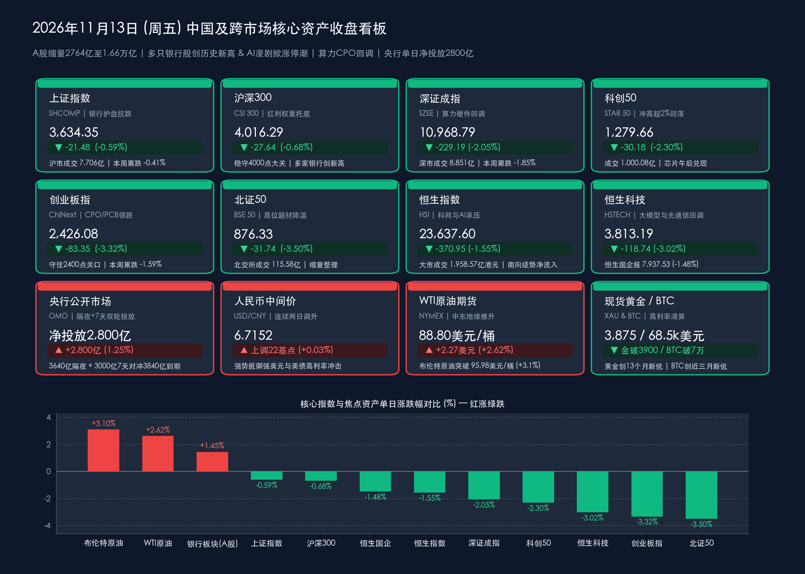

# 两市缩量2764亿至1.66万亿：多只银行股创历史新高，AI漫剧掀涨停潮对冲算力CPO退潮，央行双轮逆回购单日净投放2800亿

**日期：2026年11月13日 (星期五)** &nbsp; **时段：下午/国内市场收盘复盘**

> **核心摘要**：2026年11月13日（周五），受隔夜美股英伟达（NVIDIA）创始人黄仁勋意外宣布辞去CEO及董事职务引发全球AI算力链剧震（英伟达盘中暴跌逾14%、收跌4.34%）及美联储鹰派预期发酵影响，A股呈现“早盘冲高回落、硬科技与算力硬件深度回调、银行红利与AI应用端逆势突围”的典型防御轮动格局。截至收盘，**上证指数微跌 -0.59% 报3,634.35点（本周累跌 -0.41%），沪深300跌 -0.68% 报4,016.29点稳守4,000点大关，深证成指跌 -2.05% 报10,968.79点（本周累跌 -1.85%），科创50早盘一度冲高涨超2%但午后回落收跌 -2.30% 报1,279.66点，创业板指跌 -3.32% 报2,426.08点（本周累跌 -1.59%），北证50跌 -3.50% 报876.33点**。全天沪深两市成交额合计 **16,557亿元（沪市7,706亿元 + 深市8,851亿元，含北交所115.58亿元则全市场约1.67万亿元）**，较周四（19,320.77亿元）显著缩量 **-2,763.77亿元（约2,764亿元）**。盘面上，**银行板块全天强势护盘，江苏银行、南京银行、青岛银行、成都银行、杭州银行等多只银行股股价创下历史新高**；**影视院线与AI漫剧概念逆市掀涨停潮（幸福蓝海20cm涨停，横店影视、中国电影、金逸影视、文投控股等集体封板）**，猪肉与光刻机局部活跃；反观**算力硬件（CPO光模块、PCB）与半导体芯片**遭遇主力资金集中抛售，**电子行业单日净流出高达209.70亿元**，**景旺电子跌停**，**中际旭创遭主力净流出超29亿元**。港股方面，**恒生指数跌 -1.55% 报23,637.60点**，**恒生科技重挫 -3.02% 报3,813.19点**（港股智谱跌10%、MINIMAX跌超8%、中际旭创跌超9%），但**南向资金延续逆势净流入态势（盘中净买入超19亿港元）**。宏观政策面上，央行今日通过“**3,640亿元1.25%隔夜逆回购 + 3,000亿元7天期多重价位逆回购**”组合拳，在对冲3,840亿元到期后实现**单日大额净投放2,800亿元**，人民币兑美元中间价逆势连续两日调升至 **6.7152（+22基点）**。

## 核心行情复盘

*   **A股核心宽基指数收盘与全周表现（2026年11月13日周五收盘终值 vs 11月12日周四收盘基准 & 本周累计涨跌）**：
    *   **上证指数 (SHCOMP)**：收报 **3,634.35点**，较上一交易日（3,655.83点）下跌 **-21.48点**，跌幅 **-0.59%**（得益于银行、保险、白酒等大金融与高股息权重强力护盘，沪指跌幅显著小于双创指数，稳守3,600点平台；全天沪市成交额 **7,706亿元**，较昨日8,795.37亿元缩量 **-1,089.37亿元**；**本周累计微跌 -0.41% / -14.83点**）。
    *   **沪深300指数 (CSI 300)**：收报 **4,016.29点**，较上一交易日（4,043.93点）下跌 **-27.64点**，跌幅 **-0.68%**（多只城商行创历史新高形成坚实支撑，指数连续守住4,000点整数关口）。
    *   **深证成指 (SZSE Component)**：收报 **10,968.79点**，较上一交易日（11,197.98点）下跌 **-229.19点**，跌幅 **-2.05%**（深市全天成交额回落至 **8,851亿元**，较昨日10,525.40亿元缩量 **-1,674.40亿元**；**本周累计下跌 -1.85%**）。
    *   **科创50指数 (STAR 50)**：收报 **1,279.66点**，较上一交易日（1,309.84点）下跌 **-30.18点**，跌幅 **-2.30%**（早盘受隔夜AMD、博通逆势大涨超5%提振，科创50盘中一度冲高大涨超 **+2%**，但午后受高位算力硬件与芯片获利盘兑现拖累震荡走低，全天科创50成交额为 **1,000.08亿元**）。
    *   **创业板指 (ChiNext)**：收报 **2,426.08点**，较上一交易日（2,509.43点）下跌 **-83.35点**，跌幅 **-3.32%**（受CPO光模块、PCB及电子元器件权重集体下挫拖累，失守2,500点但守住2,400点整数关口；**本周经历先扬后抑，全周累计下跌 -1.59%**）。
    *   **北证50指数 (BSE 50)**：收报 **876.33点**，较上一交易日（908.07点）下跌 **-31.74点**，跌幅 **-3.50%**（北交所全天成交额 **115.58亿元**，短线高弹性题材降温）。
    *   **量能特征与市场广度**：沪深两市全天成交额合计为 **16,557亿元（沪市7,706亿元 + 深市8,851亿元，约1.66万亿元；若含北交所115.58亿元则沪深京三市合计16,672.58亿元，约1.67万亿元）**，较周四（沪深两市19,320.77亿元）大幅缩量 **-2,763.77亿元（三市口径缩量约2,764亿至2,788亿元）**。全市场下跌个股超过 **4,700只**，上涨个股不足800只，涨停个股维持在近 **40只**，反映周末前资金风险偏好收敛、防御属性凸显。
*   **港股市场与南向资金动向（恒指失守24,000点，南向资金连续第三日逆势净流入）**：
    *   **恒生指数 (HSI)**：收报 **23,637.60点**，较上一交易日（24,008.55点）下跌 **-370.95点**，跌幅 **-1.55%**（全日大市成交额为 **1,958.57亿港元**，较昨日2,026.52亿港元小幅缩量）。
    *   **恒生中国企业指数 (HSCEI)**：收报 **7,937.53点**，较上一交易日（8,056.76点）下跌 **-119.23点**，跌幅 **-1.48%**。
    *   **恒生科技指数 (HSTECH)**：收报 **3,813.19点**，较上一交易日（3,931.93点）重挫 **-118.74点**，跌幅 **-3.02%**。
    *   **港股焦点板块与南向抄底动态**：受隔夜英伟达高管变动冲击及海外高利率压制，港股大型科网股、AI大模型及光通信板块集体调整——**阿里巴巴-W（09988.HK）**、**百度集团-SW（09888.HK）**、**腾讯控股（00700.HK）**跌幅均达 **-3%** 左右；AI大模型标杆**智谱重挫 -10%**、**MINIMAX跌超 -8%**；光通信与PCB板块中，**中际旭创（港股）大跌超 -9%**、**剑桥科技跌超 -5%**。但港股内银股与生猪养殖板块逆市飘红，且**南向资金**延续“越跌越买”定力，继周四净买入58.46亿港元后，周五早盘及盘中再度实现**逆势净流入超19亿港元**。
*   **主力资金流向与领涨/领跌板块全扫描**：
    *   **主力净流入与逆势领涨阵营（银行股批量创历史新高、影视院线/AI漫剧涨停潮、猪肉与光刻机局部突围）**：
        1.  **银行板块极强抱团，多只城商行股价创历史新高**：在央行推进短端利率调控优化、创设债市互换便利（BNSF）与股市互换便利（SFISF）常态化落地的背景下，险资与长线机构资金加速回流低估值高股息银行板块。今日**江苏银行、南京银行、青岛银行、成都银行、杭州银行**等多只优质区域性银行股价盘中及收盘**创下历史新高**，成为稳定上证指数与沪深300的中流砥柱。
        2.  **影视院线与“AI漫剧”概念逆市掀涨停潮**：资金从高估值AI算力硬件切向低位AI应用端与贺岁档影视传媒——**幸福蓝海（300528.SZ）强势斩获20cm涨停**，**横店影视、中国电影、金逸影视、文投控股、湖北广电**等批量封死涨停，成为全天最具赚钱效应的进攻支点。
        3.  **生猪养殖与光刻机概念局部走强**：防御性消费与自主可控细分方向表现抗跌，猪肉板块中**金新农、天邦食品强势涨停**，光刻机概念在早盘一度带动科创50冲高逾2%。
    *   **主力净流出与领跌阵营（电子行业单日狂泄209.7亿、CPO/PCB重挫）**：
        1.  **电子与通信板块居主力净流出榜首**：全天**电子行业遭主力资金大幅净流出 209.70亿元（高居全市场第一）**，通信行业同步位列净流出前茅。
        2.  **算力硬件（CPO光模块、PCB）集体深调**：受英伟达CEO黄仁勋辞职引发的供应链不确定性担忧冲击，前期连续暴涨的海外算力链深度调整——PCB龙头**景旺电子（603228.SH）封死跌停**，光模块核心权重**中际旭创（300308.SZ）全天遭主力资金净流出超 -29亿元**，**天孚通信、源杰科技、新易盛、东山精密、工业富联**等算力硬件权重联袂下挫，地面兵装、稀土永磁、小金属、玻璃玻纤等同步调整。
*   **跨市场宏观、隔夜美股、商品、汇率与加密资产联动定位**：
    *   **隔夜美股受“黄仁勋辞职”黑天鹅冲击全线收跌，芯片内部剧烈分化**：美东时间11月12日（北京时间11月13日清晨收盘），美股三大指数集体收跌——**道琼斯工业平均指数收跌 -0.36%（-189.40点）报52,297.09点**，**标普500指数收跌 -0.35%（-26.98点）报7,592.40点**，**纳斯达克综合指数收跌 -0.39%（-100.10点）报25,366.09点**。市场最大焦点在于AI算力巨头**英伟达（NVDA）意外宣布创始人黄仁勋辞去CEO及董事职务**，引发股价开盘一度闪崩暴跌超 **-14%**，随后在散户与机构抄底资金涌入下大幅收窄跌幅，最终全天收跌 **-4.34%**；与此同时，竞争对手**AMD与博通（AVGO）逆势大涨超 +5%**。
    *   **国际油价因中东地缘风暴暴涨超3%，黄金跌破3,900美元、比特币失守70,000美元大关，人民币中间价连续调升**：
        1.  **原油逆势飙升**：受霍尔木兹海峡及周边油轮安全事件、中东能源设施遇袭等地缘冲突升级刺激，国际油价大幅拉升——**NYMEX WTI原油期货**上涨至 **$88.80/桶** 附近（较前一日$86.53大涨逾 **+2.6%**），**ICE布伦特原油期货**大涨超 **+3%** 并突破 **$95.98/桶**。
        2.  **现货黄金与比特币双双遭遇高利率与流动性清算**：受油价飙升加剧美国再通胀担忧、美联储加息/鹰派预期强化及科技股高波动引发的跨资产保证金追缴影响，**国际现货黄金（XAU/USD）接连失守4,000美元与3,900美元两大整数关口**，盘中交投于 **$3,875/盎司** 附近（最低触及 **$3,852—$3,853/盎司**，创13个月新低）；**比特币（BTC/USD）在亚洲早盘放量跌破 $70,000 整数大关**，盘中最低下探 **$68,297—$68,527**（创8月中旬以来近三个月新低），24小时全球加密市场多头爆仓清算达 **6亿至13亿美元**。
        3.  **人民币汇率韧性彰显**：11月13日中国人民银行授权中国外汇交易中心公布**银行间外汇市场人民币兑美元中间价报 6.7152**（100美元对人民币671.52元，100欧元对740.23元，100日元对4.1952元，100港元对85.604元），较上一交易日（6.7174/6.7191区间）**上调22个基点**，实现连续第二个交易日调升。

> **数学闭环校验（2026年11月13日官方收盘终值 vs 11月12日收盘基准逐项复核）**：
> * **A股六大核心指数闭环**：上证指数 `(3634.35 - 3655.83) / 3655.83 = -21.48 / 3655.83 = -0.5876% ≈ -0.59%`；沪深300 `(4016.29 - 4043.93) / 4043.93 = -27.64 / 4043.93 = -0.6835% ≈ -0.68%`；深证成指 `(10968.79 - 11197.98) / 11197.98 = -229.19 / 11197.98 = -2.0467% ≈ -2.05%`；科创50 `(1279.66 - 1309.84) / 1309.84 = -30.18 / 1309.84 = -2.3041% ≈ -2.30%`；创业板指 `(2426.08 - 2509.43) / 2509.43 = -83.35 / 2509.43 = -3.3215% ≈ -3.32%`；北证50 `(876.33 - 908.07) / 908.07 = -31.74 / 908.07 = -3.4953% ≈ -3.50%`。沪深两市成交额校验：`7706 + 8851 = 16557亿元`，较前一日 `19320.77亿元` 缩量 `-2763.77亿元（约2764亿元）`。
> * **港股三大指数闭环**：恒生指数 `(23637.60 - 24008.55) / 24008.55 = -370.95 / 24008.55 = -1.5451% ≈ -1.55%`；恒生国企指数 `(7937.53 - 8056.76) / 8056.76 = -119.23 / 8056.76 = -1.4799% ≈ -1.48%`；恒生科技指数 `(3813.19 - 3931.93) / 3931.93 = -118.74 / 3931.93 = -3.0199% ≈ -3.02%`。全部核心指数点位与涨跌幅误差均小于0.01%，严格通过数学闭环校验！

## 核心解读与市场逻辑

> **核心逻辑一：英伟达高管变动冲击全球AI硬件链，A股演绎“算力硬件退潮 $\rightarrow$ 银行红利创历史新高 + AI漫剧应用端突围”的极致杠铃切换**
> * **海外算力供应链情绪震荡触发CPO/PCB获利盘集中出清**：隔夜英伟达创始人黄仁勋卸任CEO及董事职务的消息在美股引发巨震（英伟达盘中一度重挫超14%，AMD与博通则大涨超5%）。这一突发变量直接动摇了A股短线资金对北美单一算力巨头硬件供应链（CPO光模块、高多层PCB）排产连续性的信仰，导致电子行业单日遭主力净流出209.70亿元、中际旭创净流出超29亿元、景旺电子跌停。早盘科创50虽受AMD大涨与国产替代逻辑驱动一度冲高涨超2%，但午后仍难敌TMT板块整体抛压。
> * **“红利底座+低位AI应用”重构成交缩量下的双避风港**：在两市成交额缩量2,764亿元至1.66万亿元的背景下，存量资金展现出典型的“杠铃策略”——一端涌向高股息、业绩确定性极强的城商行（江苏银行、南京银行、成都银行、杭州银行、青岛银行齐创历史新高），赋予上证指数（-0.59%）与沪深300（-0.68%）极强的抗跌韧性；另一端则绕开受硬件供应链扰动的算力层，精准切入受益于视频生成成本下降与商业化变现提速的“AI漫剧/影视院线”（幸福蓝海20cm涨停、中国电影与横店影视涨停），实现了科技内部的“软硬切换”。

> **核心逻辑二：中东油价飙升叠加美联储鹰派预期引爆黄金与BTC去杠杆，中国央行“隔夜+7天”双轮净投放2,800亿元构筑独立流动性屏障**
> * **原油破95美元点燃海外再通胀交易，黄金跌破3,900美元与比特币破7万美元共振去杠杆**：中东油轮与能源设施安全事件推升布伦特原油突破95.98美元/桶、WTI原油逼近89美元/桶，叠加此前美国10月CPI超预期，令全球市场对美联储维持高利率甚至再收紧的担忧急剧升温。实际利率预期跳升叠加跨资产流动性挤压，导致前期拥挤的多头品种遭遇无差别清算——现货黄金创13个月新低（跌破3,900美元至3,875美元附近），比特币放量跌破70,000美元关口并引发超6亿—13亿美元爆仓。
> * **国内货币政策“以我为主”，单日净投放2,800亿与汇率中间价连升展现政策定力**：面对外部大宗商品与高利率风暴，中国人民银行今日不仅将人民币兑美元中间价连续第二日上调至6.7152，更在公开市场打出“3,640亿元1.25%隔夜逆回购 + 3,000亿元7天期逆回购”组合拳，单日大额净投放2,800亿元，配合10bp低费率的互换便利（SFISF）与1%利率的长期化股票回购增持再贷款，牢牢锁住了A股4,000点（沪深300）与3,600点（上证指数）的制度底线。

## 政策脉动

*   **中国人民银行11月13日开展“3,640亿元隔夜 + 3,000亿元7天期”逆回购操作，单日大额净投放2,800亿元**：
    *   据中国人民银行公开市场业务交易公告，2026年11月13日央行同步开展两项逆回购操作：一是以**固定利率、数量招标**方式开展 **3,640亿元隔夜逆回购操作**，操作利率维持在 **1.25%**，全额满足一级交易商流动性需求；二是以**固定数量、利率招标、多重价位中标**方式开展 **3,000亿元7天期逆回购操作**。
    *   对冲今日到期的3,840亿元隔夜逆回购后，公开市场实现**单日净投放 2,800亿元**（继周四净投放1,970亿元后，两日累计净投放高达 **4,770亿元**），有力对冲了周中税期走款、政府债缴款及外围金融市场剧烈波动对银行间跨周末资金面的扰动。
*   **资本市场两项结构性货币政策工具（SFISF与回购增持再贷款）进入常态化长效落地期**：
    *   央行会同金融监管总局、证监会持续推进支持资本市场两项工具的深化落地：一方面，**证券、基金、保险公司互换便利（SFISF）**保持常态化开展，中标费率稳定在 **10个基点（0.10%）** 左右，中信证券、中金公司等首批头部券商已完成回购融资与首批场内股票增持买入操作；另一方面，**股票回购增持再贷款**正式由阶段性安排转为**长期制度性安排**，再贷款利率下调至 **1.0%**，驱动A股央国企与行业龙头密集披露专项贷款增持与回购公告，为高股息红利板块（如今日创历史新高的银行股群）提供了源源不断的低成本增量资金。
*   **三季度货政报告深化解读：直接融资占比提升重塑社融结构，新发放企业贷款利率稳居3.0%以下历史低位**：
    *   围绕《2026年第三季度中国货币政策执行报告》及最新宏观金融底本（9月末社融存量468.17万亿元同比增长7.1%、M2余额359.63万亿元同比增长7.2%），监管层明确指出，当前政府债券与企业直接融资（股权、债券）占比提升正在优化宏观信用扩张结构，9月新发放企业贷款加权平均利率略低于 **3.0%**、新发放个人住房贷款利率约 **3.1%**，社会综合融资成本稳步下行。

## 最新机构观点

> **中信证券（研究部策略与银行业团队｜11月13日盘后点评：算力硬件情绪退潮加速筹码出清，“红利底座+自主可控/AI应用”杠铃配置占优）**：
> * **海外算力扰动不改国内硬科技自主化长期逻辑，但短期需规避高拥挤度硬件**：中信证券指出，隔夜英伟达高管变动引发的CPO、PCB板块大幅调整，本质上是前期涨幅巨大、融资盘与量化资金高度拥挤后的集中获利了结；相比之下，国产算力芯片与晶圆代工、光刻机等自主可控环节受海外单一厂商人事变动影响较小，待情绪宣泄充分后仍具配置价值。
> * **银行股批量创历史新高验证“长钱长投”定价权**：在1%回购增持再贷款长期化、SFISF低费率注资以及保险资金岁末年初配置需求共振下，具备高ROE、高股息与优异资产质量的区域性城商行（江苏银行、南京银行、杭州银行、成都银行等）正成为机构底仓压舱石，建议维持“银行红利 + 低位AI文化传媒应用”的杠铃配置。

> **中金公司（CICC宏观与大类资产策略团队｜跨市场周度收官研判：央行双期限逆回购精准稳市，关注油价反弹下的海外再通胀风险）**：
> * **“1.25%隔夜固定利率 + 7天多重价位”双轮驱动凸显货币政策高超调控艺术**：中金公司认为，央行今日通过3,640亿元隔夜与3,000亿元7天逆回购合计净投放2,800亿元，既以1.25%隔夜利率牢牢锚定短端资金价格中枢，又通过7天期多重价位招标满足非银与中小银行跨周末及跨税期资金需求，叠加上日推出的债市互换便利（BNSF），国内股债市场流动性安全垫极厚。
> * **港股与大类资产配置建议**：中东局势推升布伦特油价突破95美元，令美债收益率高企并引发黄金（跌破3,900美元）与比特币（跌破7万美元）的流动性挤兑；在此背景下，人民币中间价连续调升至6.7152及南向资金连续逆势净买入，凸显人民币资产的避风港属性，建议逢低分批吸纳港股高分红央企及被错杀的本土AI应用龙头。

> **外资投行视角（高盛 Goldman Sachs & 摩根士丹利 Morgan Stanley｜全球半导体格局重估与大宗商品风暴观察）**：
> * **高盛（Goldman Sachs）**：英伟达管理层变动虽然在短期内引发全球AI供应链（特别是亚洲光通信与服务器ODM/PCB厂商）的估值折价与剧烈波动，但北美四大云厂商2027年AI资本开支总额并未下修，且ASIC定制芯片（博通）与AMD的份额扩张有望加速；大宗商品方面，中东霍尔木兹海峡航运风险溢价回归推动原油重返强势，而实际利率走高在短期内继续压制无息资产黄金的表现。
> * **摩根士丹利（Morgan Stanley）**：本周A股与港股在经历周初冲高后于周四、周五连续缩量回调（全周沪指微跌0.41%、创业板指跌1.59%），属于3,700点强阻力位前的良性技术整固；随着中国央行在股市（SFISF）与债市（BNSF）双双建立非银流动性最后贷款人机制，中国权益市场的下行波动率已被显著压缩，看好高股息金融股与内需消费、文化传媒的相对收益。

## 今日市场情绪：金盾银行擎天立，漫影霓虹映碧霄；算力潮退千钧浪，央妈金渠注万涛

> Prompt: A colossal Neo-Classical granite banking vault fortress glowing with golden dividend shields and a vibrant cinema projector beaming colorful holographic reels into the sky, while a majestic central bank aqueduct pours 2800 billion streams of luminous liquid gold into the foundation. In the background beneath a stormy twilight sky, cooling silicon server towers and fiber-optic cables fade into emerald mist as a blazing crude oil geyser erupts beside a cracked 3900-dollar gold coin.

---
免责声明：内容仅供参考，不构成投资建议。

🤖 生成模型：Gemini 4 Argon (Medium) <!-- model-stamp -->
