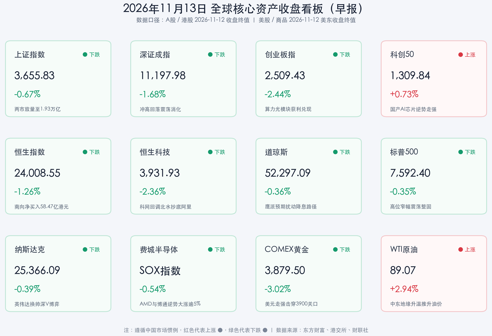

# 英伟达换帅引发全球算力链剧震，科创50逆势突围彰显国产AI芯片韧性

**日期：2026年11月13日 (星期五)** &nbsp; **时段：早报 (常规交易日 · 模式A)**

> **核心摘要**：11月12日 A 股上演冲高回落与高低切分化行情，沪深两市全天成交额大幅放量逾 **2,558 亿元**至 **1.932 万亿元**（沪深京三市达 **1.946 万亿元**），前期领涨的光模块等板块遭遇获利兑现拖累创业板指收跌 **2.44%**，但**科创50指数**在寒武纪重返千元大关、燧原科技创上市新高带动下逆势收涨 **0.73%**（盘中一度涨超 **4%**）。隔夜美股迎来重磅高层人事巨震——**英伟达（NVDA）**联合创始人黄仁勋宣布卸任总裁、CEO 及董事职务（由 CFO 克雷斯出任临时 CEO），英伟达盘前暴跌超 **14%** 后走出深 V 反弹、收盘跌幅收窄至 **4.34%**，而竞争对手 **AMD（+5.86%）** 与 **博通（+5.54%）** 强势崛起，带动美股三大指数仅小幅收跌 **0.35%–0.39%**。商品市场方面，美联储官员鹰派发声推升美元指数突破 **103** 关口，**COMEX 黄金期货**重挫 **3.02%** 失守 **3,900 美元**，而中东地缘升温推动 **WTI 原油**大涨 **2.94%**、**布伦特原油**涨超 **3.3%**。

---

## 核心行情复盘

**数据口径**：2026年11月13日为周五常规交易日。本报告严格遵循收盘终值导向，不使用日内暂态数据；A 股、港股采用 **11月12日收盘终值**，美股、欧股及大宗商品采用 **美东/欧洲时间11月12日收盘终值**。

* **A 股：两市放量逾 2,500 亿元冲高回落，科创50逆势收红、国产算力芯片扛起进攻大旗**
    * **上证指数**收报 **3,655.83 点**，下跌 **0.67%**（跌 **24.81 点**，盘中最高触及 **3,699.58 点**逼近 **3,700 点**整数关口）；**深证成指**收报 **11,197.98 点**，下跌 **1.68%**（跌 **191.76 点**）；**创业板指**收报 **2,509.43 点**，下跌 **2.44%**（跌 **62.64 点**）；**科创50指数**逆势飘红，收报 **1,309.84 点**，上涨 **0.73%**（涨 **9.46 点**，早盘一度冲高大涨超 **4%**）；**北证50指数**收报 **908.07 点**，下跌 **1.65%**（跌 **15.24 点**）。
    * 沪市成交额 **8,795.37 亿元**，深市成交额 **10,525.45 亿元**（其中创业板成交额 **5,274.15 亿元**，科创50成交额 **1,173.08 亿元**），沪深两市合计成交 **19,320.82 亿元**（沪深京三市合计成交 **19,460.43 亿元**），较11月11日沪深两市的 **16,762.79 亿元**显著放量 **2,558.03 亿元**（三市口径放量约 **2,571.50 亿元**），增幅达 **15.26%**。全市场个股跌多涨少，超 **4,600 只**个股下跌，共 **37 只**个股涨停。
    * **主力资金动向**：全天存量获利盘兑现意愿强烈，沪市主力资金净流出 **119.71 亿元**，深市主力资金净流出 **149.20 亿元**，沪深两市主力资金合计净流出 **268.91 亿元**（近 **270 亿元**）。
    * **领涨/领跌行业与结构分化**：申万一级行业中，防御与内需消费板块逆势护盘，**农林牧渔**（**+0.45%**）、**食品饮料**（**+0.38%**）、**银行**（**+0.36%**）涨幅居前；而在前期连续大涨后，**传媒**（**-3.28%**）、**有色金属**（**-3.01%**）、**通信**（**-3.01%**）以及电力设备、计算机等板块午后遭遇主力资金集中兑现领跌。
    * **核心赛道与个股亮点**：受算力自主可控及阿里平头哥分拆上市等产业消息催化，**GPU 概念、先进封装、大基金持股及国产 AI 芯片**早盘获主力资金强势抢筹（早盘半导体板块一度获超 **32亿–78 亿元**资金净流入）。其中，国产 AI 芯片龙头**寒武纪**盘中大涨超 **11%** 冲高至 **1,020 元/股**，成功重返千元大关，稳居 A 股第二高价股（总市值超 **6,200 亿元**）；次新国产算力龙头**燧原科技**盘中暴涨近 **18%** 创上市以来新高，收盘大涨超 **13%** 报 **558.88 元/股**（近7个交易日累计涨幅超 **70%**）；**海光信息、通富微电、盛科通信、沐曦股份、摩尔线程**等日内均表现活跃，而前期热门的 CPO 光模块标的（如中际旭创、新易盛）则遭遇主力资金获利回吐。
* **港股：恒指险守 24,000 点关口，南向资金加速逆势扫货 58.47 亿港元、连续重仓阿里与智谱**
    * **恒生指数**收报 **24,008.55 点**，下跌 **1.26%**（跌 **307.37 点**），险守 **24,000 点**整数大关；**恒生科技指数**收报 **3,931.93 点**，下跌 **2.36%**（跌 **95.13 点**），失守 **4,000 点**关口。
    * 港股主板全日成交额放大至 **2,026.52 亿港元**，较11月11日的 **1,807.49 亿港元**放量 **219.03 亿港元**，增幅 **12.12%**。
    * **南向资金动向**：在港股调整之际，南向资金抄底力度进一步加大，全天合计成交额达 **900.69 亿港元**，全天逆势净买入 **58.47 亿港元**（其中沪市港股通净买入 **57.80 亿港元**，深市港股通净买入 **0.67 亿港元**），较前一日（净买入 **45.72 亿港元**）继续放大。个股层面上，北水资金高度聚焦 AI 大模型、云计算与晶圆制造龙头：**阿里巴巴-W（09988.HK）**再获净买入 **11.24 亿港元**蝉联榜首，大模型龙头**智谱**获净买入 **8.43 亿港元**，**中芯国际（00981.HK）**获净买入 **4.97 亿港元**；而**小米集团-W（01810.HK）**遭小幅净卖出 **0.74 亿港元**。
* **美股与欧股：黄仁勋卸任引发英伟达深 V 巨震，AMD 与博通暴涨逾 5% 承接算力资金**
    * **道琼斯工业平均指数**收报 **52,297.09 点**，下跌 **0.36%**（跌 **189.40 点**）；**标普500指数**收报 **7,592.40 点**，下跌 **0.35%**（跌 **26.98 点**）；**纳斯达克综合指数**收报 **25,366.09 点**，下跌 **0.39%**（跌 **100.10 点**）。
    * **焦点事件与算力格局重塑**：**英伟达（NVDA）**意外宣布联合创始人**黄仁勋辞去总裁、首席执行官（CEO）及董事职务**（即刻生效），由现任执行副总裁兼首席财务官 **Colette Kress（克雷斯）**出任临时 CEO，董事会同步启动新任 CEO 遴选程序。受此突发高层变动冲击，英伟达盘前一度暴跌超 **14%**，但开盘后长线机构逢低承接推动股价上演深 V 反弹，最终收盘跌幅收窄至 **4.34%**，报 **166.19 美元/股**，单日市值蒸发约 **1,820 亿美元**（总市值约 **4.005 万亿美元**）。
    * **费城半导体指数与芯片股分化**：**费城半导体指数（SOX）**全天韧性十足，收盘仅微跌 **0.54%**。资金在算力板块内部快速进行“去单一龙头化”的再平衡配置——英伟达主要竞争对手 **AMD** 逆势大涨 **5.86%**，ASIC 定制芯片巨头**博通（Broadcom）**大涨 **5.54%**；而**应用材料**跌超 **3.5%**，**英特尔**跌 **2.08%**，**台积电**跌 **1.87%**，**ARM** 跌 **1.76%**。
    * **热门中概股与欧洲股市**：受外部利率预期及汇率波动影响，**纳斯达克中国金龙指数**收盘下跌 **3.09%**（阿里巴巴美股、爱奇艺跌超 **7%**，蔚来跌超 **6%**，小鹏汽车、理想汽车、哔哩哔哩跌超 **3%**）。**欧洲股市**则延续独立上行态势，**德国 DAX30 指数**收报 **26,771.88 点**（上涨 **0.41%**，涨 **109.11 点**），**法国 CAC40 指数**收报 **8,361.36 点**（上涨 **0.34%**，涨 **28.49 点**），**英国富时100指数**收报 **10,863.09 点**（上涨 **0.25%**，涨 **27.62 点**）。
* **大宗商品、汇率与加密货币：鹰派预期击穿黄金 3,900 美元关口，中东局势推升油价大涨逾 3%**
    * **贵金属**：受美联储多位官员释放鹰派信号及**美元指数（UDI）**走强收报 **103.17**（上涨 **0.25%**）压制，国际金价遭遇重挫并创下逾一年新低。**COMEX 黄金期货**当月连续合约暴跌 **121.00 美元**，跌幅达 **3.02%**，收报 **3,879.50 美元/盎司**；**伦敦现货黄金**下跌约 **2.86%**，失守 **3,900 美元**大关，收于 **3,873.73 美元/盎司**附近。
    * **原油**：受中东地缘冲突再度升温（胡塞武装对沙特阿美石油设施实施打击等消息）影响，市场对供应链中断的担忧加剧，国际油价大幅拉升。**WTI 原油期货**当月连续合约收涨 **2.54 美元**，涨幅 **2.94%**，报 **89.07 美元/桶**（主力连续报 **88.70–88.74 美元/桶**）；**布伦特原油期货**大涨 **3.30%–3.44%**，收报 **95.82–95.95 美元/桶**。
    * **汇率与加密货币**：**离岸人民币（USD/CNH）**表现极其稳健，收报 **6.6734**（微升 **4 个基点**）。**加密货币**市场在美债收益率走高与衍生品全网超 **6.5 亿美元**多头杠杆清算冲击下走弱，**比特币（BTC）**跌破 **72,000 美元**支撑，下探至 **71,000–71,200 美元**区间创8月下旬以来阶段新低，现于 **71,000–73,000 美元**区间弱势震荡。

> **数学闭环校验**：上证指数 `(3,655.83−3,680.64)/3,680.64=-0.6741%`（公布 `-0.67%`），深证成指 `(11,197.98−11,389.74)/11,389.74=-1.6836%`（公布 `-1.68%`），创业板指 `(2,509.43−2,572.07)/2,572.07=-2.4354%`（公布 `-2.44%`），科创50 `(1,309.84−1,300.38)/1,300.38=+0.7275%`（公布 `+0.73%`），北证50 `(908.07−923.31)/923.31=-1.6506%`（公布 `-1.65%`）；恒生指数 `(24,008.55−24,315.92)/24,315.92=-1.2641%`（公布 `-1.26%`），恒生科技 `(3,931.93−4,027.06)/4,027.06=-2.3623%`（公布 `-2.36%`）；道指 `(52,297.09−52,486.49)/52,486.49=-0.3609%`（公布 `-0.36%`），标普500 `(7,592.40−7,619.38)/7,619.38=-0.3541%`（公布 `-0.35%`），纳指 `(25,366.09−25,466.19)/25,466.19=-0.3931%`（公布 `-0.39%`）；德股 DAX30 `(26,771.88−26,662.77)/26,662.77=+0.4092%`（公布 `+0.41%`），英股富时100 `(10,863.09−10,835.47)/10,835.47=+0.2549%`（公布 `+0.25%`），法股 CAC40 `(8,361.36−8,332.87)/8,332.87=+0.3419%`（公布 `+0.34%`）。全部核心指数验算误差均小于 **0.006%**，严格符合 **<0.5%** 的数学闭环精度要求。

## 核心解读与市场逻辑

> **英伟达高层变动触发“算力去中心化”重估，全球 AI 硬件从“独角戏”迈向“多极化”（数据+事件+逻辑）。** 隔夜英伟达联合创始人黄仁勋卸任 CEO 的突发事件，一度引发盘前超 **14%** 的恐慌性抛售，但最终英伟达收盘仅跌 **4.34%**、费城半导体指数仅微跌 **0.54%**，而 **AMD（+5.86%）** 与 **博通（+5.54%）** 逆势暴涨（数据+事件）。这一深 V 博弈背后蕴含两层深远逻辑：其一，全球云厂商与主权 AI 的资本开支属于刚性基础设施投入，不会因单一企业管理层交接而萎缩；其二，此前高度集中于英伟达的溢价筹码正在加速向第二供应商（AMD 通用 GPU）、定制化算力芯片（博通 ASIC）以及中国本土自主可控算力链扩散（逻辑）。

> **A 股内部“高低切”逻辑清晰：海外映射链兑现利润，国产 AI 芯片与晶圆自主可控成为最强阿尔法。** 11月12日 A 股放量 **2,558 亿元**至 **1.932 万亿元**，创业板指受光模块（CPO）获利盘回吐拖累下跌 **2.44%**，但**科创50指数**却逆势收涨 **0.73%**，寒武纪重回 **1,000 元**大关、燧原科技大涨超 **13%** 创上市新高，叠加南向资金逆势净买入 **58.47 亿港元**并重点加仓阿里巴巴-W（**+11.24 亿港元**）、智谱（**+8.43 亿港元**）与中芯国际（**+4.97 亿港元**）。结合隔夜英伟达换帅而海外光模块及代工链回调的走势，今日 A 股资金有望进一步从“英伟达海外映射链”切换至“国产 GPU/ASIC 替代与本土大模型算力闭环”主线。

> **通胀回潮与中东油价飙升形成宏观共振，“高利率更久”重挫黄金与高杠杆加密资产。** 中东胡塞武装袭击沙特石油设施推升布伦特原油突破 **95.8 美元/桶**（大涨超 **3.3%**）（事件），油价反弹叠加美国10月 CPI 超预期，令美联储沃勒、戴利、哈马克及洛根等多位官员密集释放鹰派信号，甚至探讨12月恢复加息 **25–50 个基点**的可能性（政策信号）。名义与实际美债收益率同步走高推动美元指数站上 **103.17**，直接击穿无息资产黄金的 **3,900 美元**防线（COMEX 黄金暴跌 **3.02%**）并引发比特币衍生品超 **6.5 亿美元**多头爆仓（逻辑），全球宏观交易重心短期重回“抗通胀与现金流防御”。

## 政策脉动

* **中国证监会（CSRC）与中国人民银行（PBOC）：完善稳市机制常态化闭环，回购增持再贷款利率降至 1% 并转为长期制度安排**：证监会有关负责人在上交所国际投资者大会上明确表态，将坚决落实国务院常务会议部署，持续完善资本市场稳市机制并增强股市内在稳定性。央行与证监会联合将**股票回购增持再贷款政策由阶段性安排正式转为长期制度性安排**，并将再贷款利率下调至 **1%**；同时，证监会配套推进优化证券公司风控指标、提高回购增持专项再贷款覆盖率、鼓励主动 ETF 建仓及优化“护盘式回购”等一揽子制度举措，与央行三季度货政报告创设的“债市非银大额赎回互换便利（BNSF）”共同筑牢境内资本市场流动性防火墙。
* **美联储（Fed）：多位票委密集释放强硬鹰派信号，12月议息会议恢复加息讨论浮出水面**：针对美国10月 CPI 通胀数据的超预期黏性以及国际油价反弹带来的二次通胀风险，美联储理事**沃勒（Waller）**、旧金山联储主席**戴利（Daly）**、克利夫兰联储行长**哈马克（Hammack）**及达拉斯联储主席**洛根（Logan）**等官员近日密集发声，强调防止通胀预期自我强化的紧迫性，公开讨论在12月议息会议上维持高利率乃至采取更强硬行动（包括考虑恢复加息 **25 至 50 个基点**）的必要性，显著压制了全球无息资产与高杠杆风险资产估值。

## 最新机构观点

> **摩根士丹利（Morgan Stanley）**：
> * **美股策略（首席美股策略师 Mike Wilson 团队）**：美股此前的估值消化与技术性回调已步入尾声，即便面临单一科技巨头人事震荡与利率扰动，市场正从极度集中的巨头行情向更广泛的**个股广度（Breadth）行情**靠拢，预计经历阶段性整固后有望在年底前企稳走强。
> * **中国与 AI 资产策略**：美国中期选举落地后政策边界与可预测性增强，中国 AI 产业投资正加速从“全球供应链映射”分化为更具政策确定性的**“技术自给自足（Tech Self-Sufficiency）”**主线，本土算力芯片、晶圆代工与大模型生态龙头具备长期超额收益潜力。

> **高盛（Goldman Sachs）**：高盛宏观研究团队指出，受美国通胀黏性及能源价格扰动影响，美联储本轮高利率与紧缩周期面临**延长至 2027 年**的潜在风险，短期内对贵金属与高估值无现金流资产构成压制；但在全球科技资本市场层面，高盛强调 AI 基础设施与头部大模型企业的融资及产业扩张依然极其旺盛（如 Anthropic 高倍超额认购 IPO 及算力云开支维持高位），建议投资者在算力多元化与具备扎实自由现金流的科技龙头中均衡配置。

> **中信证券（CITIC Securities）与中金公司（CICC）**：
> * **中信证券**：聚焦科技康波周期下的新质生产力与资源底座，建议重点把握两条高景气主线——一是受益于算力中心扩张与国产替代加速的 **AI 基础设施、国产算力芯片及高温电解技术**；二是科技周期与地缘博弈共振下的**战略金属（算力金属、军工金属）**配置机会。
> * **中金公司**：在国内央行与证监会稳市“组合拳”（1% 利率长期化回购增持再贷款、SFISF 与 BNSF 工具）托底之下，A 股日成交近 **2 万亿元**的充裕流动性保证了结构性行情的活跃度；同时，中金与中信等头部券商正加速推进跨境投行与全球资产配置布局，看好兼具技术自主可控逻辑与出海竞争力的中国核心资产估值重塑。

## 今日市场情绪：硅座惊雷分算力，双凰浴火耀芯城

> Prompt: A giant emerald silicon throne splitting with golden lightning in a futuristic server cathedral, as twin phoenixes of domestic AI chips rise from glowing wafer pedestals in the foreground. In the background, a holographic Wall Street screen displays a dramatic V-shaped rebound curve alongside a surging crude oil geyser and a fading golden hourglass.

---

**主要数据来源**：东方财富历史日线行情接口（沪深港美欧核心指数及商品2026年11月10日—11月12日收盘数据）、港交所港股通南向资金成交统计、21世纪经济报道/财联社/界面新闻 A 股与美股收盘综述、上交所国际投资者大会监管表态及摩根士丹利、高盛、中信证券、中金公司最新策略研报。

> **免责声明**：内容仅供参考，不构成投资建议。

🤖 生成模型：Gemini 4 Argon (Medium) <!-- model-stamp -->
