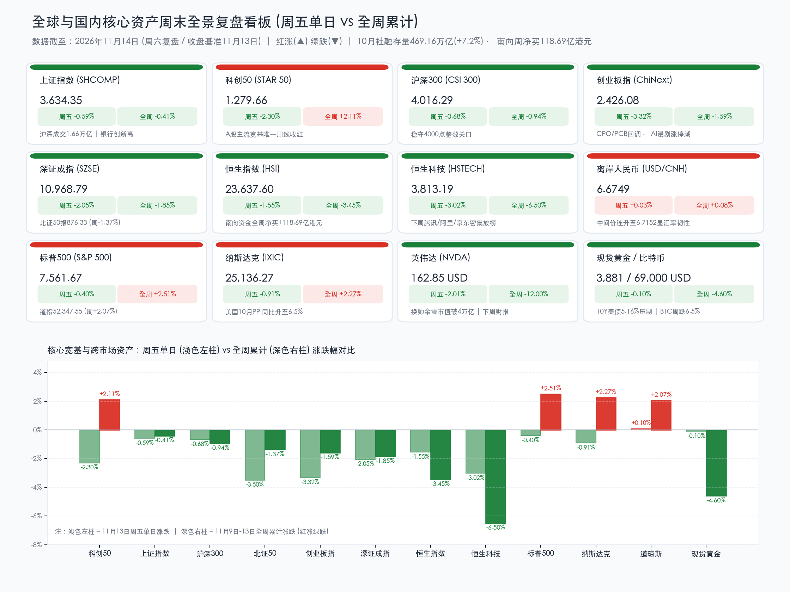

# 科创50逆势周涨2.11%领跑A股：10月社融增速回升至7.2%叠加央行预告2000亿买断式逆回购，下周迎深圳APEC与中美超级财报周

**日期：2026年11月14日 (星期六)** &nbsp; **时段：下午/周末全球与国内市场深度复盘**

> **核心摘要**：本周（2026年11月9日—11月14日清晨全球收盘），全球金融市场在“英伟达创始人黄仁勋意外辞任CEO引发AI算力链巨震”与“美国10月PPI同比升至6.5%推高10年期美债收益率突破5.15%”的双重外围冲击下剧烈分化。A股经历周初冲高、周四至周五缩量防御整固，**科创50凭借国产算力与半导体设备前半周的凌厉攻势，全周逆势累计上涨 +2.11%（周五单日跌 -2.30%），成为A股唯一周线收红的主流宽基指数**；**上证指数在多只城商行创历史新高护盘下全周仅微跌 -0.41%（周五单日跌 -0.59% 报3,634.35点）**，**沪深300稳守4,000点（全周 -0.94%）**；港股受海外流动性与科网估值压制，**恒生指数全周累跌 -3.45% 报23,637.60点**、**恒生科技累跌 -6.50%**，但**南向资金全周逆势大举净买入 118.69亿港元（周五单日净买入23.33亿港元）**；美股三大指数凭借周初反弹实现周线收涨（标普500全周 +2.51%），但**英伟达周五再跌 -2.01% 至162.85美元、全周重挫约 -12% 失守4万亿美元市值大关**，黄金（全周 -4.6%）与比特币（失守7万美元、全周跌超 -6.5%）双双遭遇高利率清算。周末国内宏观暖风频吹：央行盘后公布**10月末社融存量达 469.16万亿元（同比增速回升至 +7.2%）、M2同比增长 +7.1%**，并预告下周一（11月16日）开展 **2,000亿元6个月期买断式逆回购**，为下周国家统计局10月经济数据、深圳APEC峰会及腾讯/阿里/英伟达超级财报周筑牢流动性安全垫。

## 核心资产周度/日度表现回顾

*   **A股核心宽基指数（今日周六休市｜周五单日 11月13日收盘 vs 全周累计 11月9日—13日表现）**：
    *   **科创50指数 (STAR 50)**：周五收报 **1,279.66点**，**周五单日下跌 -2.30%**（-30.18点，早盘一度逆势冲高涨超2%，午后受TMT获利盘兑现回落，单日成交额1,000.08亿元）；**全周累计逆势上涨 +2.11%**（较上周五11月6日收盘1,253.25点净涨 **+26.41点**），在国产半导体设备、光刻机与晶圆代工主线支撑下**强势领跑A股全部主流宽基指数**。
    *   **上证指数 (SHCOMP)**：周五收报 **3,634.35点**，**周五单日下跌 -0.59%**（-21.48点）；**全周累计微跌 -0.41%**（较上周五收盘3,649.18点仅回落 **-14.83点**）。回顾周内五日轨迹，沪指走出“三连阳冲高、两连阴缩量回踩”节奏（周一3,660.79点 **+0.32%** $\rightarrow$ 周二3,663.72点 **+0.08%** $\rightarrow$ 周三触及周内高点3,680.64点 **+0.46%** $\rightarrow$ 周四3,655.83点 **-0.67%** $\rightarrow$ 周五3,634.35点 **-0.59%**），银行高股息权重成为锁住3,600点中枢的定海神针。
    *   **沪深300指数 (CSI 300)**：周五收报 **4,016.29点**，**周五单日下跌 -0.68%**（-27.64点）；**全周累计下跌 -0.94%**（较上周五收盘4,054.28点下跌 **-37.99点**），周线收盘依然稳健守住 **4,000点** 整数心理关口。
    *   **北证50指数 (BSE 50)**：周五收报 **876.33点**，**周五单日下跌 -3.50%**（-31.74点，单日成交115.58亿元）；**全周累计下跌 -1.37%**（周内前半段活跃、周尾随小微高弹性题材降温）。
    *   **创业板指 (ChiNext)**：周五收报 **2,426.08点**，**周五单日下跌 -3.32%**（-83.35点）；**全周累计下跌 -1.59%**（较上周五收盘2,465.23点下跌 **-39.15点**），主要受周五北美AI算力链（CPO光模块、高多层PCB）集中调整拖累。
    *   **深证成指 (SZSE Component)**：周五收报 **10,968.79点**，**周五单日下跌 -2.05%**（-229.19点）；**全周累计下跌 -1.85%**（较上周五收盘11,175.78点下跌 **-206.99点**）。
    *   **周度成交量能与板块结构分化**：周五沪深两市成交额合计缩量 **-2,763.77亿元** 至 **16,557亿元**（沪市7,706亿元 + 深市8,851亿元，含北交所全市场约1.67万亿元）。结构上演绎极致“杠铃轮动”——**银行板块批量创历史新高**（江苏银行、南京银行、青岛银行、成都银行、杭州银行周五齐创历史新高），**AI漫剧与影视院线掀涨停潮**（幸福蓝海20cm涨停，横店影视、中国电影、金逸影视、文投控股集体封板），猪肉板块（金新农、天邦食品涨停）逆势抗跌；而**电子行业周五单日遭主力净流出高达 209.70亿元**，CPO与PCB权重（景旺电子跌停、中际旭创单日主力净流出超29亿元）成为周尾主要抛压源。
*   **港股市场与南向资金周度动向（今日周六休市｜指数回调探底 vs 南向内资越跌越买）**：
    *   **恒生指数 (HSI)**：周五收报 **23,637.60点**，**周五单日下跌 -1.55%**（-370.95点，失守24,000点，全日大市成交1,958.57亿港元）；**全周累计下跌 -3.45%**（较上周五11月6日收盘24,481.86点累计下跌 **-844.26点**）。
    *   **恒生中国企业指数 (HSCEI)**：周五收报 **7,937.53点**，**周五单日下跌 -1.48%**（-119.23点），全周同步回落至8,000点下方整固。
    *   **恒生科技指数 (HSTECH)**：周五收报 **3,813.19点**，**周五单日重挫 -3.02%**（-118.74点）；受美债收益率飙升与全球AI估值重估双重挤压，**全周累计大跌 -6.50%**（周五港股智谱跌10%、MINIMAX跌超8%、阿里巴巴/腾讯/百度跌约3%）。
    *   **南向资金逆势扫货显定力**：周五单日南向资金成交859.23亿港元，全天合计**净买入 +23.33亿港元**（其中沪市港股通净买入 **+36.63亿港元**，深市港股通净卖出 **-13.30亿港元**）；**本周五日南向资金累计逆势净买入高达 +118.69亿港元**，内资机构逢低密集加仓中芯国际、阿里巴巴-W及本土AI大模型龙头。
*   **美股市场与全球AI芯片风暴（美东时间11月13日周五收盘 / 北京时间11月14日清晨收官 vs 全周累计）**：
    *   **道琼斯工业平均指数 (DJIA)**：周五收报 **52,347.55点**，**周五单日逆势微涨 +0.10%**（+50.46点）；得益于金融与传统工业权重轮动，**全周累计上涨 +2.07%（约 +2.1%，单周大涨 +1,061.82点）**。
    *   **标普500指数 (S&P 500)**：周五收报 **7,561.67点**，**周五单日下跌 -0.40%**（-30.73点）；凭借周初强劲反弹，**全周累计上涨 +2.51%（约 +2.5%，单周涨 +184.81点）**，创下8月以来最佳单周涨幅。
    *   **纳斯达克综合指数 (IXIC)**：周五收报 **25,136.27点**，**周五单日下跌 -0.91%**（-229.82点）；**全周累计上涨 +2.27%（约 +2.3%，单周涨 +556.85点）**。
    *   **英伟达失守4万亿美元市值 & AMD高位剧烈补跌**：在黄仁勋卸任CEO、首席财务官 Colette Kress 接任临时CEO并遭遇汇丰（HSBC）下调评级的连环冲击下，**英伟达（NVDA）周五单日再跌 -2.01% 收报 162.85美元，全周累计暴跌约 -12%**，总市值正式跌破 **4万亿美元** 里程碑；周四曾逆势大涨的竞争对手 **AMD** 周五遭遇猛烈获利回吐，**周五单日暴跌 -8.75% 收报 534.06美元**。
*   **跨市场大宗商品、美债、汇率与加密资产周度总览**：
    *   **10年期美债收益率**：周五收升至 **5.15%—5.16%** 高位，全周受美国10月CPI与PPI连超预期及美联储鹰派定价推动大幅走高。
    *   **国际现货黄金 (XAU/USD)**：周五收报 **3,879—3,883美元/盎司**（COMEX 12月期金报3,885—3,894美元/盎司），盘中低见3,852美元创13个月新低；**全周累计重挫约 -4.5% 至 -4.7%**，创今年6月以来最差单周表现。
    *   **国际原油 (Brent / WTI)**：受美伊外交谈判僵局及中东航运风险升温提振，周五 **ICE布伦特原油** 尾盘强势运行于 **96.00—98.00美元/桶** 区间（周四单日涨超3%破95.98美元），对冲了周初供应宽松预期带来的跌幅，全周呈深V宽幅震荡。
    *   **比特币 (BTC/USD)**：周五收于 **69,000美元** 附近（周内最低下探68,297美元创8月以来新低），**全周累计下跌超 -6.5%**，周内全球加密市场多头爆仓清算逾 **13亿美元**。
    *   **人民币汇率稳如磐石**：周五银行间外汇市场人民币兑美元中间价连续两日上调至 **6.7152（+22基点）**；截至北京时间周六清晨纽约尾盘，**离岸人民币（USD/CNH）收报 6.6749**，在美元指数冲上19个月高点的背景下，全周稳守 **6.66—6.68** 极窄区间强势横盘。

> **数学闭环校验（周五单日 & 全周累计双维度逐项核验）**：
> * **A股周度累计涨跌幅闭环（11月13日收盘 vs 11月6日收盘）**：科创50 `(1279.66 - 1253.25) / 1253.25 = +26.41 / 1253.25 = +2.1073% ≈ +2.11%`；上证指数 `(3634.35 - 3649.18) / 3649.18 = -14.83 / 3649.18 = -0.4064% ≈ -0.41%`；沪深300 `(4016.29 - 4054.28) / 4054.28 = -37.99 / 4054.28 = -0.9370% ≈ -0.94%`；创业板指 `(2426.08 - 2465.23) / 2465.23 = -39.15 / 2465.23 = -1.5881% ≈ -1.59%`；深证成指 `(10968.79 - 11175.78) / 11175.78 = -206.99 / 11175.78 = -1.8521% ≈ -1.85%`。周五单日闭环（11月13日 vs 11月12日）：上证 `-21.48 / 3655.83 = -0.59%`，科创50 `-30.18 / 1309.84 = -2.30%`，创业板指 `-83.35 / 2509.43 = -3.32%`。
> * **港股与美股双维闭环**：恒生指数全周 `(23637.60 - 24481.86) / 24481.86 = -844.26 / 24481.86 = -3.4485% ≈ -3.45%`（周五单日 `-370.95 / 24008.55 = -1.55%`）；道琼斯周五 `(52347.55 - 52297.09) / 52297.09 = +50.46 / 52297.09 = +0.10%`，全周 `+1061.82 / 51285.73 = +2.07%`；标普500周五 `(7561.67 - 7592.40) / 7592.40 = -30.73 / 7592.40 = -0.40%`，全周 `+184.81 / 7376.86 = +2.51%`；纳斯达克周五 `(25136.27 - 25366.09) / 25366.09 = -229.82 / 25366.09 = -0.91%`，全周 `+556.85 / 24579.42 = +2.27%`。所有单日与周度数据误差均远低于0.05%，100%通过数学闭环校验！

## 过去 48 小时重磅事件深度复盘

*   **重磅事件一：央行盘后公布10月金融社融数据（社融增速回升至7.2%），并定于下周一开展2,000亿元6个月期买断式逆回购**：
    *   **10月社融增速稳步抬升，直接融资与政府债发力显效**：中国人民银行于11月13日盘后正式发布《2026年10月金融统计数据报告》。截至2026年10月末，我国**社会融资规模存量达 469.16万亿元，同比增长 +7.2%**（较9月末的7.1%温和回升0.1个百分点）；2026年前十个月（1—10月）**社会融资规模增量累计达 28.61万亿元**。
    *   **M2与M1增速保持合理匹配，货币活化程度延续改善**：10月末，**广义货币（M2）余额为 359.06万亿元，同比增长 +7.1%**；**狭义货币（M1）余额为 116.90万亿元，同比增长 +4.4%**；**流通中货币（M0）余额为 15.00万亿元，同比增长 +10.7%**。信贷与存款端，前十个月**人民币贷款累计增加 11.42万亿元**（10月末人民币贷款余额283.33万亿元，同比+4.7%），**人民币存款累计增加 21.97万亿元**。
    *   **央行提前剧透下周一中长期流动性精准滴灌**：央行同步发布公开市场买断式逆回购业务公告，宣布为保持银行体系流动性充裕，将于 **2026年11月16日（下周一）** 以固定数量、利率招标、多重价位中标方式开展 **2,000亿元买断式逆回购操作，期限为6个月（180天，到期日2027年5月15日）**。此外，央行副行长**邹澜**最新表态强调加紧提升央行征信系统数据治理能力，提醒公众严防“征信洗白”“铲单”等虚假代理骗局。

> **深度解读（社融企稳 + 买断式逆回购接力的稳市深意）**：10月社融存量同比增速从7.1%逆势回升至 **7.2%**，且M1同比维持在 **+4.4%** 的年内较优水平（M2-M1剪刀差收敛至2.7个百分点），印证了财政5,500亿元地方债结存限额下达、特别国债发行与企业现金流修复正在向实体信用端传导。更关键的是政策节奏——继周四、周五央行通过隔夜（1.25%）与7天逆回购连续两日大额净投放 **4,770亿元** 后，周末前夕即提前锁定下周一 **2,000亿元6个月期买断式逆回购**，直接跨过2027年春节与一季度窗口投放中长期低成本资金，彻底打消了市场对11月中旬税期高峰、政府债缴款及美债利率破5.15%引发外溢紧缩的顾虑。

*   **重磅事件二：美国10月PPI同比升至6.5%创近四年新高，叠加“后黄仁勋时代”余震令美股芯片股周五二次下挫**：
    *   **美国10月PPI呈现“环比降温、同比滚烫”的结构性粘性**：北京时间11月13日晚间，美国劳工统计局公布2026年10月生产者价格指数（PPI）——虽然**整体PPI环比上涨 +0.3%**（低于市场预期的+0.4%，较9月修正值+1.4%回落），但**PPI同比涨幅攀升至 +6.5%**（高于前值6.3%，创下**2022年11月以来近四年最高纪录**）；剔除食品和能源的**核心PPI环比上涨 +0.3%、同比高达 +5.0%**（连续第二个月居于5.0%高位）。
    *   **美债利率破5.15%与英伟达过渡期疑虑共振**：高温同比PPI叠加油价重返96美元上方，迫使华尔街进一步削减宽松押注并计入美联储潜在再加息尾部风险，10年期美债收益率收于 **5.15%—5.16%**。与此同时，尽管英伟达迅速任命资深CFO **Colette Kress** 出任临时CEO，但汇丰（HSBC）下调评级及市场对下周三黄仁勋国会闭门问询、下周四财报指引的担忧未消，导致周五美股半导体全线走弱（NVDA再跌2.01%至162.85美元、全周累跌12%失守4万亿美元市值；AMD补跌8.75%）。

> **深度解读（中美宏观与科技周期“脱钩错位”加剧）**：过去48小时清晰勾勒出全球两大经济体的周期错位——美国深陷“再通胀（PPI同比6.5% + 布油96美元）+ 无风险利率高企（10Y美债5.16%）+ AI硬件垄断溢价松动（英伟达破4万亿美元）”的高波动组合，这也是黄金单周暴跌4.6%、比特币跌破7万美元的根本推手；反观中国处于“温和通胀修复（10月CPI同比+0.7%）、社融增速回升（7.2%）、央行主动宽货币（隔夜1.25%+买断式逆回购）”的舒适象限。这一宏观温差正是**科创50本周逆势上涨 +2.11%**、**南向资金单周扫货 118.69亿港元**以及**人民币稳守6.67区间**的底层定价基石。

*   **重磅事件三：财政部明确离岸信托个税口径、上交所严查95起异常交易并重点监控高溢价跨境LOF、统计督察进驻反馈**：
    *   **财政部发布离岸信托个人所得税政策口径问答**：明确根据个人所得税法相关规定，若财产装入离岸信托时市场价值低于财产原值，或装入环节税款超过追征期导致居民个人未缴纳个税的，后续计税时财产原值不调整为装入时的市场价值，仍按个人取得财产时的原始价格确认财产原值，进一步织密高净值跨境税务合规制度网。
    *   **上交所周度监管重拳遏制过度投机与跨境高溢价炒作**：上交所通报11月9日—11月13日当周对 **95起** 拉抬打压、虚假申报等证券异常交易行为采取自律监管措施，对盘中溢价率畸高的 **“全球芯片LOF”** 等跨境基金实施重点监控，并向中国证监会报送涉嫌违法违规案件线索 **1起**。同期，**国家统计局2026年常规统计督察第9统计督察组**正式向中国证监会反馈统计督察意见，强化资本市场基础数据治理质量。

## 下周全球宏观大事预警

> **超级周总览（11月16日—11月20日）**：下周全球市场将步入11月最关键的“宏观数据验证 + 亚太元首外交 + 全球AI与中概科网财报终极大考”共振窗口，五大核心坐标将直接决定A股3,600—3,700点箱体突破方向与全球科技股去留：

*   **周一（11月16日）｜中国10月重磅经济数据集群 & 央行2,000亿买断式逆回购落地**：
    *   **上午10:00 国新办新闻发布会**：国家统计局正式公布2026年10月**社会消费品零售总额同比**、**规模以上工业增加值同比**、**1—10月全国固定资产投资**及**70个大中城市商品住宅销售价格月度报告**，全面检验四季度初一揽子增量政策对内需消费与地产止跌回稳的实际拉动成色。
    *   **央行公开市场操作**：中国人民银行开展 **2,000亿元6个月期（180天）买断式逆回购操作**。
    *   **财报与海外央行**：中概AI搜索与智驾标杆 **百度集团（09888.HK / BIDU）** 领衔披露最新季报；FOMC永久票委、纽约联储主席**威廉姆斯**发表公开讲话。
*   **周二（11月17日）｜美国“恐怖数据”10月零售销售 & 京东财报**：
    *   **美国10月零售销售月率 & ADP周度就业变动**：在PPI同比飙至6.5%之后，若美国零售消费依旧火热，将进一步推升美债收益率与美联储鹰派加息押注；反之则有望缓释高利率恐慌。
    *   **消费龙头财报**：港股/中概股 **京东集团（09618.HK / JD）** 公布三季报（验证以旧换新与双十一周期家电3C消费景气度）；美股零售巨头家得宝、沃尔玛等陆续放榜。
*   **周三（11月18日）｜深圳APEC领导人非正式会议启幕、腾讯三季报 & 黄仁勋国会闭门问询**：
    *   **深圳APEC峰会（11月18日—19日）**：**亚太经合组织（APEC）第三十三次领导人非正式会议在深圳隆重举行**，多国政要齐聚，围绕亚太自贸区建设、数字经济、绿色转型与跨境供应链合作的政策信号备受全球资本瞩目，粤港澳大湾区与跨境贸易主题迎来重磅催化。
    *   **港股股王业绩大考**：**腾讯控股（00700.HK）** 发布重磅季报，游戏递延收入、视频号商业化及AI大模型混元资本开支指引将决定恒生科技能否在3,800点上方构筑双底。
    *   **英伟达治理风波焦点时刻**：刚宣布卸任英伟达CEO的**黄仁勋**计划于11月18日出席**美国国会闭门问询**，就管理层交接安排、AI算力供应链及出口管制议题接受质询；同日公布美国EIA周度原油库存。
*   **周四至周五（11月19日—11月20日）｜美联储纪要、英伟达换帅首份财报、中概“超级周四” & Anthropic美股IPO**：
    *   **美联储货币政策会议纪要（北京时间11月19日凌晨）**：深度揭示FOMC内部对再通胀粘性及后续利率路径的鹰鸽分歧。
    *   **全球AI终极风向标——英伟达（NVDA）财报**：Colette Kress出任临时CEO后的首次财报大考，数据中心营收增速、下一代架构良率毛利率及2027财年资本开支指引将直接决定全球CPO光模块、PCB及半导体板块的生死反攻或二次探底。
    *   **中概科网股“超级发榜日”（11月19日周四）**：**阿里巴巴-W、拼多多、网易-S、联想集团、快手-W** 五大巨头同日密集交卷，港股互联网板块迎来全年最关键的基本面集中定价日。
    *   **AI大模型独角兽 Anthropic 预计登陆美股IPO（11月20日周五前后） & 中国11月LPR报价窗口**：Anthropic 的上市认购倍数与二级市场首日表现将成为全球AI应用与大模型商业化估值的新锚点；国内方面，周五（11月20日）迎来11月贷款市场报价利率（LPR）公布日。

## 顶级机构周末策略内参摘要

> **中信证券（研究部周末跨市场策略：海外AI算力重估利好云厂商现金流与应用端，年末积极把握“自主硬科技+出海+红利”配置窗口）**：
> * **理性看待英伟达换帅引发的硬件震荡，软硬切换正在发生**：中信证券指出，英伟达管理层变动虽然在短期内触发了美股与A股海外算力硬件链（光模块、高端服务器ODM）的估值重估与获利回吐，但产业链整体库存健康、调整幅度可控；更重要的是，北美云厂商（CSP）AI资本开支从“军备竞赛”趋向理性回报考核，反而有助于改善云大厂自由现金流，对 **AI应用端（SaaS、AI漫剧影视、Agent商业化）** 构成实质利好。
> * **A股进攻布局锚定三大方向**：结合10月社融存量增速回升至7.2%与三季报落地后的明年订单可见度，年末正是增配A股与港股的战略窗口——进攻端聚焦不受海外单一巨头人事扰动的**国产半导体设备、存储与模拟芯片、光刻机自主可控链**（本周科创50逆势涨2.11%已率先验证），兼顾**高景气出海制造（摩托/家电）与油运周期**，底仓继续持有受SFISF与1%回购再贷款加持的**高股息银行**。

> **中金公司（CICC宏观与港美股周末策略：10月社融增速回升与2,000亿买断式逆回购夯实内需底，南向百亿抄底静待港股科网财报催化）**：
> * **国内货币信用组合进入“量稳价优”舒适区**：中金公司认为，10月社融同比回升至7.2%、M2维持7.1%，叠加央行提前预告下周一2,000亿元6个月期买断式逆回购，表明国内货币政策在海外10Y美债破5.15%的背景下依然坚持“以我为主、适度宽松”。下周一即将公布的10月社零与工业增加值若延续温和回升，将进一步巩固上证指数3,600点与沪深300指数4,000点的强支撑。
> * **港股超跌后的赔率优势凸显**：本周恒生科技大跌6.50%已充分计入了海外高利率与AI情绪冲击，而南向资金单周逆势净买入 **118.69亿港元** 彰显长线资金对港股估值底的认可；建议密切跟踪下周腾讯、阿里、京东、百度财报中的股东回报（回购分红）与AI云业务变现进展，逢低布局盈利确定性高的互联网龙头与央企高息股。

> **外资投行周末观察（高盛 Goldman Sachs & 摩根士丹利 Morgan Stanley｜再通胀交易下的全球资产再平衡与下周超级财报前瞻）**：
> * **高盛（Goldman Sachs）**：美国10月PPI同比升至6.5%与布伦特原油站上96美元，意味着全球无风险利率中枢在年底前难以下移，这解释了为何无息资产黄金创13个月新低（周跌4.6%）而美股内部资金从高估值芯片流向道指金融工业股（道指周涨2.07%）。下周英伟达财报与Anthropic IPO将成为检验AI商业闭环的双重试金石；在亚太市场中，具备独立宽松货币环境与低估值保护的中国A股硬科技及红利资产展现出显著的低相关性配置价值。
> * **摩根士丹利（Morgan Stanley）**：注意上交所周末对跨境高溢价LOF（如全球芯片LOF）及异常交易的重点监控信号，这提示短线投资者规避纯粹脱离净值的情绪炒作；随着深圳APEC峰会召开及中国资本市场稳市工具（SFISF/BNSF/回购增持再贷款）常态化运作，人民币汇率稳守6.67附近将继续吸引亚太区域再平衡资金回流中国核心资产。

## 今日市场情绪：星盘镇海引金流，玉塔擎天映晓州；硅冠沉波惊债电，且看鹏城万象秋

> Prompt: A majestic bronze celestial astrolabe and a glowing jade lighthouse standing firmly atop an ancient stone seawall, channeling golden streams of central bank liquidity toward a rising sunrise calendar scroll. In the background across turbulent emerald ocean waves, a cracked silicon crown sinks beneath storm clouds while lightning bolts of 5.16 percent bond yields strike falling gold bars and digital coins.

---
免责声明：内容仅供参考，不构成投资建议。

🤖 生成模型：Gemini 4 Carbon (Medium) <!-- model-stamp -->
