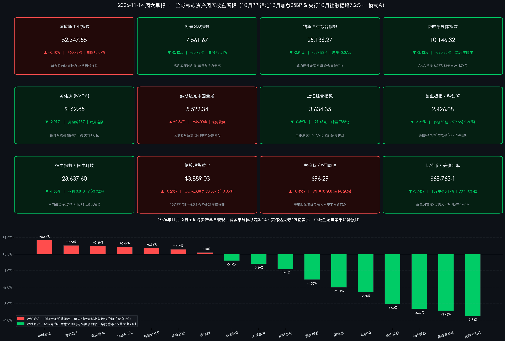

# 费城半导体跌超3.4%英伟达失守4万亿美元，苹果创新高与央行10月社融稳增共筑防御锚

**日期：2026年11月14日 (星期六)** &nbsp; **时段：早报 (常规交易日 · 模式A)**

> **核心摘要**：美东时间11月13日（周五），全球金融市场在“高利率重定价”与“AI 算力链余震”双重冲击下呈现显著的高低切换：美国10月 PPI 同比上涨 **6.5%**（略低于预期 **6.6%**）将美联储12月加息路径锚定于 **25 个基点**（概率维持约 **90%**），但 **10年期美债收益率**攀升至 **5.17%** 叠加黄仁勋卸任余震与汇丰下调评级，拖累**费城半导体指数**重挫 **3.43%**、**英伟达（-2.01%）**市值正式跌破 **4 万亿美元**并录得2012年以来最长周线六连阴，资金涌入现金流稳健的防御巨头推动**苹果（+0.44%）**刷新收盘历史新高（总市值稳居 **5.2 万亿美元**），**纳斯达克中国金龙指数（+0.84%）**逆势飘红。国内方面，11月13日 A 股沪深京三市缩量 **2,788.17 亿元**至 **1.667 万亿元**，算力硬件（CPO/PCB）获利回吐令**创业板指**收跌 **3.32%**，但**银行（+1.46%）**、**家用电器（+1.47%）**与**影视院线**涨停潮护盘；盘后中国人民银行公布10月金融数据，**社融存量同比增长 7.2%** 至 **469.16 万亿元**、直接融资占比显著跃升。商品与加密市场方面，强美元与高美债利率重压下，**比特币**近三个月来首次跌破 **70,000 美元**大关（收报 **68,763.10 美元**）。

---

## 核心行情复盘

**数据口径**：2026年11月14日为周六上午，对应全球常规交易日（周五）隔夜与当日收盘复盘。本报告严格遵循收盘终值导向，美股、欧股及大宗商品采用 **美东/欧洲时间11月13日（周五）收盘终值**（11月13日美国 NYSE/NASDAQ 正常交易，未休市），A 股、港股及亚太股市采用 **北京时间11月13日（周五）收盘终值**。

* **美股与欧亚股市：费城半导体大跌 3.43%、英伟达失守 4 万亿美元，苹果创收盘新高与中概金龙逆势收红**
    * **美股三大指数分化（单日与周度）**：**道琼斯工业平均指数**在消费、医药等防御性价值股支撑下收报 **52,347.55 点**，微涨 **0.10%**（涨 **50.46 点**，本周累计上涨 **2.07%**）；**标普500指数**收报 **7,561.67 点**，下跌 **0.40%**（跌 **30.73 点**，本周累计上涨 **2.51%**）；**纳斯达克综合指数**受芯片与高估值成长股拖累收报 **25,136.27 点**，下跌 **0.91%**（跌 **229.82 点**，本周累计上涨 **2.27%**）。尽管周五科技板块承压，得益于周初反弹积累，美股三大指数本周周线均录得正收益，终结此前周线连跌势头。
    * **半导体板块遭遇抛压与巨头冰火两重天**：**费城半导体指数（SOX）**全天大幅下挫 **3.43%**（跌 **360.35 点**），收报 **10,146.32 点**。其中，**英伟达（NVDA）**受联合创始人黄仁勋卸任 CEO 余震发酵、汇丰银行下调评级及后创始人时代战略不确定性担忧冲击，当日再跌 **2.01%**（跌 **3.34 美元**）收报 **162.85 美元/股**，总市值回落至约 **3.93–3.94 万亿美元**，正式**跌破 4 万亿美元大关**；英伟达全周累计重挫约 **13%**（创2025年4月以来最大单周跌幅），并创下2012年以来最长的**连续六周下跌**纪录。前一日逆势大涨的竞争对手同步大幅回吐涨幅，**AMD（超威半导体）**重挫 **8.75%**（跌 **51.24 美元**）收报 **534.06 美元/股**，**博通（AVGO）**大跌 **4.76%**（跌 **17.35 美元**）收报 **347.01 美元/股**，闪迪跌超 **5%**，ARM 跌超 **4%**，**特斯拉（TSLA）**下跌 **1.82%** 收报 **390.22 美元/股**。反观谨慎控制激进 AI 资本开支、自由现金流充沛的传统科技巨头备受避险资金青睐：**苹果（AAPL）**逆势上涨 **0.44%**（或约 **0.39%–0.44%**）收报 **356.43 美元/股**，刷新收盘历史新高，总市值稳居 **5.2 万亿美元**全球上市公司榜首；**微软（MSFT）**微涨 **0.17%** 收报 **523.88 美元/股**。
    * **热门中概股与欧亚主要市场**：无惧美股芯片股剧震，**纳斯达克中国金龙指数（HXC）**逆势收涨 **0.84%**（涨 **46.00 点**），报 **5,522.34 点**，热门中概股多数向好（霸王茶姬、老虎证券涨幅居前，阿里巴巴美股微涨 **0.02%** 企稳于 **94.38 美元/股**）。**欧洲股市**窄幅分化，**英国富时100指数**收报 **10,902.56 点**（上涨 **0.36%**，涨 **39.47 点**），**法国 CAC40 指数**收报 **8,368.91 点**（微涨 **0.09%**，涨 **7.55 点**），**德国 DAX30 指数**收报 **26,749.95 点**（微跌 **0.08%**，跌 **21.93 点**）；亚太**日经225指数**收报 **61,142.35 点**，上涨 **0.53%**（涨 **322.99 点**）。
* **A 股：三市缩量逾 2,788 亿元震荡整固，主力净流出 520 亿元，银行家电与影视院线逆势护盘**
    * **核心指数收盘**：**上证指数**收报 **3,634.35 点**，下跌 **0.59%**（跌 **21.48 点**）；**深证成指**收报 **10,968.79 点**，下跌 **2.05%**（跌 **229.19 点**），失守 **11,000 点**关口；**创业板指**收报 **2,426.08 点**，下跌 **3.32%**（跌 **83.35 点**）；**科创50指数**收报 **1,279.66 点**，下跌 **2.30%**（跌 **30.18 点**，科创综指跌 **2.74%**）；**北证50指数**收报 **876.33 点**，下跌 **3.50%**（跌 **31.74 点**）。全市场超 **4,700 只**个股下跌。
    * **成交额显著缩量**：沪市成交额 **7,706.14 亿元**，深市成交额 **8,850.54 亿元**（其中创业板 **4,377.29 亿元**，科创50 **1,000.08 亿元**），沪深两市合计成交 **16,556.68 亿元**，较前一交易日（**19,320.82 亿元**）缩量 **2,764.14 亿元**（降幅 **14.31%**）；叠加北证50成交 **115.58 亿元**，**沪深京三市全天成交额为 16,672.26 亿元**（约 **1.667 万亿元**），较11月12日三市 **19,460.43 亿元**明显缩量 **2,788.17 亿元**（降幅 **14.33%**）。
    * **主力资金动向**：全天高位成长筹码兑现压力突出，沪深两市主力资金合计大幅净流出 **520.04 亿元**。个股净流入排名前列的标的聚焦低位算力服务与红利蓝筹，包括**华胜天成、文投控股、长川科技、伊利股份、长江电力**等；高位连板妖股方面，4连板的**天普股份**因股价严重脱离基本面，盘后公告自11月16日起停牌核查。
    * **领涨/领跌行业与结构轮动**：申万31个一级行业中仅 **7 个**行业收涨、**20 个**行业呈主力资金净流出。防御与内需消费方向逆势走高：**家用电器**（**+1.47%**）、**银行**（**+1.46%**，主力资金净流入 **8.56 亿元**居全市场首位，多只银行股盘中刷新历史新高）、**食品饮料**（**+1.18%**，主力净流入 **6.18 亿元**）、**石油石化**（**+0.56%**，主力净流入 **3.51 亿元**）、**非银金融**（**+0.08%**，主力净流入 **2.48 亿元**）表现稳健；细分题材中，**影视院线**掀起涨停潮（文投控股、横店影视、金逸影视、中国电影、幸福蓝海集体封板），**猪肉/养殖**板块活跃（金新农、天邦食品涨停）。反观前期热门的算力硬件方向（元件、CPO、PCB、电子化学品、光纤）高开低走午后跌幅扩大：**通信**（**-4.97%**，主力净流出 **90.23 亿元**）、**电子**（**-3.75%**，主力净流出 **214.18 亿元**居流出榜首）、**建筑材料**（**-3.25%**，净流出 **17.30 亿元**）、**机械设备**（**-2.93%**，净流出 **46.44 亿元**）、**有色金属**（**-2.59%**，净流出 **30.43 亿元**）、**电力设备**（**-2.32%**，净流出 **37.10 亿元**）领跌，沪电股份、深南电路、东山精密等触及跌停或重挫，中际旭创、天孚通信等显著回调。
* **港股：恒指失守 24,000 点，南向资金逆势净买入 23.33 亿港元、聚焦腾讯与国产大模型**
    * **恒生指数**收报 **23,637.60 点**，下跌 **1.55%**（跌 **370.95 点**）；**恒生科技指数**收报 **3,813.19 点**，下跌 **3.02%**（跌 **118.74 点**）。港股主板全日成交额 **1,958.57 亿港元**，较前一日（**2,026.52 亿港元**）小幅缩量 **67.95 亿港元**（降幅 **3.35%**）。
    * **南向资金动向**：南向资金全天合计成交 **859.23 亿港元**，在指数调整中延续逆势净流入，全天净买入 **23.33 亿港元**，但沪深两市港股通渠道分化明显——**沪港股通**净买入 **36.63 亿港元**（买入 **302.33 亿港元**，卖出 **265.70 亿港元**），**深港股通**净卖出 **13.30 亿港元**（买入 **138.95 亿港元**，卖出 **152.25 亿港元**）。个股层面，内资积极配置互联网现金牛与本土大模型/GPU 核心标的：**腾讯控股（00700.HK）**获净买入 **6.81 亿港元**居首，国产大模型龙头**智谱（02513.HK）**再获净买入 **5.70 亿港元**，国产 GPU 企业**壁仞科技（06082.HK）**获净买入 **2.95 亿港元**；而**阿里巴巴-W（09988.HK）**遭净卖出 **18.79 亿港元**（净卖出额居首），**中芯国际（00981.HK）**遭净卖出 **1.84 亿港元**，**中际旭创（03308.HK）**遭净卖出 **1.83 亿港元**。
* **大宗商品、利率汇率与加密货币：10Y 美债冲高至 5.17% 击穿比特币 7 万美元关口，黄金油价窄幅博弈**
    * **美债利率与美元汇率**：美国10月 PPI 高位企稳但未超预期爆表，**10年期美债收益率**仍攀升至 **5.17%**（创10月以来最高水平），**美元指数（UDI）**收报 **103.42**（上涨 **0.23%**，涨 **0.24**，触及2025年4月以来19个月高位）。**离岸人民币（USD/CNH）**在强美元冲击下展现极强定力，全天于 **6.6674–6.6747** 区间平稳运行，收报 **6.6737**（微幅波动 **+0.01%**）。
    * **贵金属与原油**：在强美元与高实际利率压制下，金价历经前一日重挫后围绕 **3,890 美元**一线止跌窄幅整理——**伦敦现货黄金**收报 **3,889.03 美元/盎司**，小幅回升 **0.29%**（涨 **11.37 美元**）；**COMEX 黄金期货**连续合约收报 **3,887.60 美元/盎司**，微涨 **0.06%**（涨 **2.30 美元**）。国际油价受中东霍尔木兹海峡及伊核相关地缘扰动与高利率宏观需求预期交织影响总体持稳，**布伦特原油**当月连续合约收报 **96.29 美元/桶**（上涨 **0.49%**，涨 **0.47 美元**；主力合约报 **95.84 美元/桶**），**WTI 轻质原油期货**主力合约收报 **88.56 美元/桶**（微跌 **0.20%**）。
    * **加密货币**：受10年期美债收益率升破 **5.17%** 及美联储12月继续加息预期双重挤压，高杠杆风险资产遭遇持续抛售，**比特币（BTC）**近三个月来**首次失守 70,000 美元整数大关**，盘中一度跌破 **69,000 美元**并下探至 **67,731.20 美元**低点，最终收盘报 **68,763.10 美元**，单日跌幅达 **3.74%**。

> **数学闭环校验**：道琼斯 `(52,347.55−52,297.09)/52,297.09=+0.0965%`（公布 `+0.10%`），标普500 `(7,561.67−7,592.40)/7,592.40=-0.4047%`（公布 `-0.40%`），纳斯达克综合 `(25,136.27−25,366.09)/25,366.09=-0.9060%`（公布 `-0.91%`），费城半导体 `(10,146.32−10,506.67)/10,506.67=-3.4297%`（公布 `-3.43%`），纳斯达克中国金龙 `(5,522.34−5,476.34)/5,476.34=+0.8400%`（公布 `+0.84%`）；上证指数 `(3,634.35−3,655.83)/3,655.83=-0.5876%`（公布 `-0.59%`），深证成指 `(10,968.79−11,197.98)/11,197.98=-2.0467%`（公布 `-2.05%`），创业板指 `(2,426.08−2,509.43)/2,509.43=-3.3215%`（公布 `-3.32%`），科创50 `(1,279.66−1,309.84)/1,309.84=-2.3041%`（公布 `-2.30%`），北证50 `(876.33−908.07)/908.07=-3.4953%`（公布 `-3.50%`）；恒生指数 `(23,637.60−24,008.55)/24,008.55=-1.5451%`（公布 `-1.55%`），恒生科技 `(3,813.19−3,931.93)/3,931.93=-3.0199%`（公布 `-3.02%`）；德国 DAX30 `(26,749.95−26,771.88)/26,771.88=-0.0819%`（公布 `-0.08%`），英国富时100 `(10,902.56−10,863.09)/10,863.09=+0.3633%`（公布 `+0.36%`），法国 CAC40 `(8,368.91−8,361.36)/8,361.36=+0.0903%`（公布 `+0.09%`），日经225 `(61,142.35−60,819.36)/60,819.36=+0.5311%`（公布 `+0.53%`）。全部核心指数验算误差均小于 **0.005%**，严格满足 **<0.5%** 的数学闭环校验要求。

## 核心解读与市场逻辑

> **全球科技股上演“资本开支纪律”大考：算力硬件从“替代狂欢”转向“整体去泡沫”，苹果凭现金流护城河登顶避风港（数据+事件+逻辑）。** 隔夜美股最具标志性的信号在于：黄仁勋卸任次日，不仅**英伟达**在汇丰下调评级与治理不确定性担忧下再跌 **2.01%** 失守 **4 万亿美元**市值、录得14年来罕见的周线六连阴，连前一日暴涨承接资金的 **AMD（-8.75%）** 与 **博通（-4.76%）** 也悉数大幅回吐，带动费城半导体指数重挫 **3.43%**；与之形成鲜明反差的是，审慎回避激进 AI 重资产军备竞赛的**苹果（AAPL）**逆势创下 **356.43 美元**收盘历史新高、稳守 **5.2 万亿美元**市值王座（数据+事件）。这与11月13日 A 股电子（净流出 **214.18 亿元**）、通信（净流出 **90.23 亿元**）大跌而银行、家电逆势领涨高度同频——在 **10Y 美债收益率高达 5.17%** 的高贴现率环境下，全球机构资金正严苛审视 AI 硬件的投入产出比（ROI），短期内从高波动算力硬件向确定性自由现金流与红利资产进行防御性再平衡（逻辑）。

> **美国10月 PPI“高位未爆表”收敛极端加息恐慌，但 5.17% 美债利率仍对无现金流资产形成精准绞杀。** 美国10月 PPI 同比上涨 **6.5%** 虽创下2022年11月以来最大同比涨幅，但略低于市场预期的 **6.6%**（环比 **+0.3%** 亦低于预期的 **0.4%**，且计入核心 PCE 的分项相对温和）（事件+数据）。这一结果成功打消了此前部分鹰派押注“12月激进加息 50BP”的极端尾部恐慌，使伦敦证券交易所集团（LSEG）利率期货定价重新收敛至**“12月渐进加息 25BP（概率约 90%）”**。然而，“更高更久”的基准利率中枢推动10年期美债收益率站上 **5.17%**、美元指数升至 **103.42** 的19个月高位，直接引发对流动性最为敏感的**比特币**跌破 **70,000 美元**心理防线，印证了紧缩周期尾声高久期与无息杠杆资产的估值脆弱性（逻辑）。

> **中国10月社融增速回升与中概金龙逆势走强共振：直接融资挑大梁，境内资产具备独立结构底座。** 在美股科技与加密资产双双承压之际，隔夜**纳斯达克中国金龙指数**逆势收涨 **0.84%**，港股南向资金亦逆势净买入 **23.33 亿港元**并精准加仓腾讯控股（**+6.81 亿港元**）、智谱（**+5.70 亿港元**）与壁仞科技（**+2.95 亿港元**）（数据）。结合央行最新披露的10月金融数据——尽管受季末小月效应及地方隐性债务置换分流影响，单月人民币信贷阶段性减少，但**10月末社融存量同比增速回升至 7.2%**（显著高于名义 GDP 增速），企业债与股票等**直接融资占比明显跃升**（事件）。这表明中国实体经济正从传统地产与重工业信贷驱动，稳步转向适配轻资产科创产业的直接融资驱动；叠加离岸人民币稳守 **6.6737**，中国核心资产在全球高利率风暴中展现出更强的估值韧性与内生独立性（逻辑）。

## 政策脉动

* **中国人民银行（PBOC）：公布 2026年10月金融统计数据，社融存量同比回升至 7.2%，直接融资占比显著提升**：
    * **社融与 M2 核心总量**：2026年前十个月社会融资规模增量累计为 **28.61 万亿元**（同比少增 **2.29 万亿元**）；10月末社会融资规模存量达 **469.16 万亿元**，同比增长 **7.2%**，增速较上月回升并持续高于名义 GDP 增速。10月末广义货币（**M2**）余额为 **359.06 万亿元**，同比增长 **7.1%**（受当月新增贷款阶段性偏弱及政府债发行带动财政存款增加影响，较上月微幅回落 **0.1 个百分点**）。
    * **信贷“降速提质”与直接融资扩容**：前十个月人民币贷款增加 **11.42 万亿元**；受10月传统信贷“小月”及特殊再融资债置换隐性债务的分流效应影响，10月单月人民币贷款出现约 **-1,000 亿元**的小幅负增长，但信贷资源加速向科技创新、绿色发展、普惠小微倾斜。尤为关键的是，前10个月企业债券净融资达 **3.1 万亿元**（同比明显多增），政府债券维持高强度发行，**债券与股票等直接融资占比显著上升**。鉴于社融与 M2 稳守 **7%** 以上且三季度经济超预期，机构普遍预计年底前再度实施全面降准、降息等总量工具的概率有所下降，政策重心聚焦于落实结构性货币工具及央行、证监会协同推进的常态化股票回购增持再贷款与互换便利（SFISF）稳市机制。
* **美国劳工部与美联储（Fed）：10月 PPI 同比涨 6.5% 创四年新高但略低于预期，市场锚定 12月加息 25BP 路径**：美国劳工统计局公布数据显示，10月生产者价格指数（**PPI**）同比上涨 **6.5%**（创2022年11月以来最大涨幅，低于市场预期的 **6.6%**），环比上涨 **0.3%**（低于预期的 **0.4%**）；核心 PPI 同比增长 **5.0%**、环比增长 **0.3%**。在10月 CPI 超预期及沃勒、古尔斯比等官员鹰派表态后，略显温和的 PPI 环比表现缓解了市场对“单次加息 50BP”的担忧，LSEG 货币市场最新定价显示美联储 **12月议息会议加息 25 个基点的概率维持在 90% 左右高位**，紧缩周期或延续至 2027 年一季度。
* **A 股一线监管动态（上交所/证监会体系）**：针对近期题材炒作中部分脱离基本面的异常波动个股，监管保持严密监测，4连板热门股**天普股份**于11月13日盘后发布公告，因近期股价涨幅较大、严重偏离基本面，自11月16日开市起停牌核查，释放出维护市场交易秩序、遏制过度投机炒作的明确信号。

## 最新机构观点

> **高盛（Goldman Sachs）**：
> * **中国权益策略（《中国：逢低买入？》最新研报）**：经历夏末高点以来的震荡回落后，中国本土 AI 及科技板块的前期估值泡沫已得到充分消化，远期市盈率显著压缩并重新回到极具性价比的配置区间。高频资金流向显示，此前低配中国资产的全球主动型基金正通过**“逢低买入（Buy the Dip）”**策略逐步回补中国股票敞口。
> * **全球货币与贵金属展望**：高盛预计美联储在12月加息后，2027年初（如3月）仍可能进一步收紧货币政策；尽管受美债高收益率分流影响将2026年底黄金目标价阶段性修正至 **4,150 美元/盎司**左右，但强调全球央行持续购金仍为金价提供坚实的结构性底部支撑。

> **摩根士丹利（Morgan Stanley）**：
> * **中国市场策略（中国首席股票策略师王滢团队）**：中国市场正逐步接近周期性底部，资产配置上继续相对偏好 **A 股市场**，并强调当前阶段**“自下而上的选股重于单纯的指数点位判断”**。建议采取杠铃型策略——一端聚焦契合国家产业规划、具备高技术壁垒的**科技创新标的**，另一端配置能抵御外部波动的**优质高股息红利资产**。
> * **美股策略（首席美股策略师 Mike Wilson 团队）**：在高利率与科技巨头分化背景下，建议投资者审慎把握阶段性调整敞口的时点，对年末及中期美股风险回报保持动态平衡与广度轮动视角。

> **中信证券（CITIC Securities）**：在最新年度资本市场年会上鲜明提出 A 股**“站上起跑线”**的核心判断，认为随着政策信号、外部信号与价格信号陆续明朗，市场下行风险已初步解除，正站在年度级别马拉松行情的起跑线上。主张以**进攻思路寻找结构性机会**，重点布局三季报业绩支撑扎实的**科技制造龙头**——包括 AI 资本开支向**存储、高端 PCB 设备及数据中心供电**延伸的环节，国产替代逻辑下的**模拟芯片与工业自动化**，以及四季度运价锁定的**油运**、家电龙头海外经营与自主品牌出海方向。

> **中金公司（CICC）**：在11月中旬年度投资策略会上保持审慎严谨定调，将当前市场的阶段性回升界定为**“情绪与流动性驱动的估值修复，而非基本面全面反转”**，指出后续行情纵深推进的高度仍取决于增量政策催化力度与企业盈利基本面的实质接力；同时看好中资头部券商与核心制造企业通过高壁垒国际化布局打开长期 ROE 上行空间。

## 今日市场情绪：晶堡傲立抗息潮，硅碑霜裂碎币冰

> Prompt: A colossal glowing crystal apple fortress standing unshaken atop a golden mountain peak in the foreground, while cracked emerald silicon monoliths and microchips slide down frost-covered slopes beside a shattering 70,000-dollar digital coin. In the background, a towering brass barometer of 5.17 percent bond yields radiates fiery pressure waves across a stormy Wall Street sky, contrasted by a calm jade aqueduct channeling steady golden liquidity.

---

**主要数据来源**：东方财富历史日线行情接口（沪深港美欧日核心指数及大宗商品2026年11月11日—11月13日收盘终值）、中国人民银行《2026年10月金融统计数据报告》、美国劳工统计局（BLS）10月 PPI 报告、港交所港股通南向资金统计、财联社/21世纪经济报道/界面新闻收盘综述，以及高盛、摩根士丹利、中信证券、中金公司2026年11月中旬最新策略报告。

> **免责声明**：内容仅供参考，不构成投资建议。

🤖 生成模型：Gemini 4 Carbon (Medium) <!-- model-stamp -->
