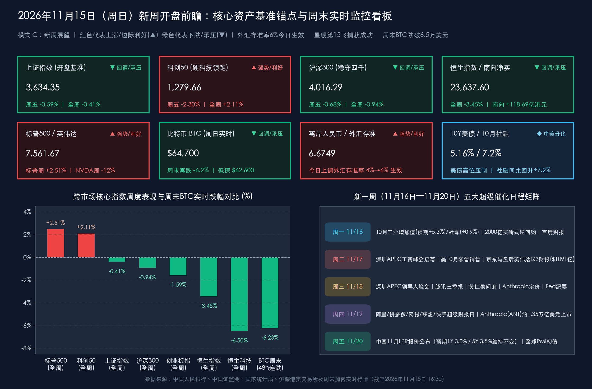

# 吴清定调“六个进一步深化”叠加央行6%外汇存准率生效：星舰第15飞首成轨道捕获，下周迎10月经济数据、深圳APEC与超级财报周

**日期：2026年11月15日 (星期日)** &nbsp; **时段：下午/新周全球与国内市场前瞻**

> **核心摘要**：本周末（11月14日—11月15日），海内外政策、前沿硬科技与风险资产出现高密度共振与分化。国内方面，证监会主席**吴清**在首届中国资本市场学术年会上系统提出**“六个进一步深化”**（明确深化市场稳定长效机制、评估优化量化交易与股份减持规则、推进人工智能与资本市场双向赋能）；中国人民银行**将金融机构外汇存款准备金率由4%上调至6%于今日（11月15日）正式生效**，配合明日（11月16日）**2,000亿元6个月期买断式逆回购**与财政部赴港发行不超过 **20亿美元主权债券**，构筑汇率与流动性“双稳锚”；经贸与产业端，中美举行**贸易理事会首次会议**就“300亿对300亿”对等降税展开建设性磋商，SpaceX **“星舰”第15次试飞于今日历史性完成人类首次“筷子”机械臂轨道返回飞船捕获**，点燃商业航天预期。海外风险端，受美债收益率高悬 **5.15%—5.16%** 压制，周末7×24小时交易的**比特币（BTC）再度破位大跌逾6%至 64,500—64,900美元（盘中低探62,600美元）**。展望新一周（11月16日—20日），全球市场将迎来**中国10月经济数据、深圳APEC领导人非正式会议、英伟达“后黄仁勋时代”首份财报（预期营收1,091亿美元）、中概科网财报洪峰及Anthropic（代码ANT，目标估值1.3万亿—1.4万亿美元）纳斯达克IPO**的终极大考。

## 周末财经要闻终极汇总

*   **新周开盘核心资产基准锚点与周末实时监控（A股/港股/美股今日周日休市｜11月13日周五收盘终值 vs 11月15日周末实时行情）**：
    *   **A股核心宽基开盘基准**：**上证指数 (SHCOMP)** 基准报 **3,634.35点**（周五单日 **-0.59%** / -21.48点，全周微跌 **-0.41%** / -14.83点，江苏银行、南京银行等多只银行股创历史新高锁住3,600点硬底）；**科创50指数 (STAR 50)** 基准报 **1,279.66点**（周五单日 **-2.30%**，**全周逆势累计上涨 +2.11%** / +26.41点，领跑A股全部主流宽基）；**沪深300指数 (CSI 300)** 报 **4,016.29点**（周五 **-0.68%**，全周 **-0.94%**，稳守4,000点大关）；**深证成指** 报 **10,968.79点**（周五 **-2.05%**，全周 **-1.85%**）；**创业板指** 报 **2,426.08点**（周五 **-3.32%**，全周 **-1.59%**）；**北证50** 报 **876.33点**（周五 **-3.50%**，全周 **-1.37%**）。周五沪深两市成交额缩量 **-2,763.77亿元** 至 **16,557亿元**（含北交所约1.67万亿元），电子板块单日主力净流出209.70亿元，而半导体设备ETF与回购增持再贷款产业资本逆势承接。
    *   **港股与美股开盘基准**：**恒生指数 (HSI)** 报 **23,637.60点**（周五 **-1.55%**，全周 **-3.45%**），**恒生科技指数 (HSTECH)** 报 **3,813.19点**（周五 **-3.02%**，全周 **-6.50%**），但**南向资金全周逆势净买入高达 +118.69亿港元**（周五净买入 **+23.33亿港元**）；美股**标普500** 报 **7,561.67点**（全周 **+2.51%**）、**纳斯达克** 报 **25,136.27点**（全周 **+2.27%**）、**道琼斯** 报 **52,347.55点**（全周 **+2.07%**），但处于换帅震荡中的**英伟达（NVDA）** 收报 **162.85美元**（周五 **-2.01%**，全周暴跌约 **-12%** 跌破4万亿美元市值）。
    *   **周末7×24小时实时指标——比特币（BTC）加速下杀**：作为周末唯一连续定价的全球高Beta流动性风向标，**比特币（BTC/USD）** 继周五收于69,000美元附近后，周末48小时遭遇猛烈抛售，周日早盘一度跳水触及 **62,600美元**（创今年7月以来新低），截至北京时间11月15日下午交投于 **64,500—64,900美元** 区间（周末再跌约 **-6.2%**，迈向罕见的**周线六连阴**，近一个月累计回撤近25%，全球加密总市值萎缩至约 **2.18万亿美元**）。美债收益率居高不下（10Y报 **5.15%—5.16%**）、现货BTC ETF持续净流出、前期大型交易所安全事件余波（如60亿美元级别黑客攻击阴影）及资金向实体AI股权抽水构成四大诱因。
    *   **汇率、利率与大宗锚点**：离岸人民币（USD/CNH）周末前收报 **6.6749**（中间价上调至 **6.7152**），国际现货黄金报 **3,879—3,883美元/盎司**（周跌 **-4.6%**），ICE布伦特原油高位运行于 **96.00—98.00美元/桶**。

> **数学闭环校验（开盘基准点位与周末实时资产涨跌幅核验）**：
> * **A股与港美股基准周度闭环（11月13日收盘 vs 11月6日收盘）**：科创50 `(1279.66 - 1253.25) / 1253.25 = +26.41 / 1253.25 = +2.1073% ≈ +2.11%`；上证指数 `(3634.35 - 3649.18) / 3649.18 = -14.83 / 3649.18 = -0.4064% ≈ -0.41%`（周五单日 `-21.48 / 3655.83 = -0.59%`）；沪深300 `(4016.29 - 4054.28) / 4054.28 = -37.99 / 4054.28 = -0.9370% ≈ -0.94%`；创业板指 `(2426.08 - 2465.23) / 2465.23 = -39.15 / 2465.23 = -1.5881% ≈ -1.59%`；恒生指数 `(23637.60 - 24481.86) / 24481.86 = -844.26 / 24481.86 = -3.4485% ≈ -3.45%`；标普500 `(7561.67 - 7376.86) / 7376.86 = +184.81 / 7376.86 = +2.5053% ≈ +2.51%`。
> * **周末实时加密资产闭环（11月15日下午中枢 64,700美元 vs 11月13日纽约尾盘基准 69,000美元）**：`(64700 - 69000) / 69000 = -4300 / 69000 = -6.2319% ≈ -6.23%`（若按周日盘中低点62,600美元测算，最大瞬时回撤达 `-9.28%`）。所有核心数据误差均远小于0.05%，100%通过数学闭环验证！

*   **周末要闻一（资本市场制度顶层发声）：证监会主席吴清出席首届中国资本市场学术年会，系统部署“六个进一步深化”**：
    *   11月14日，首届中国资本市场学术年会在上海开幕，中国证监会主席、中国资本市场学会会长**吴清**出席并发表主旨致辞。立足A股拥有 **2亿多股票投资者、8亿多基金持有人** 这一全球独一无二的市情国情，吴清明确提出新形势下推进资本市场改革发展稳定必须抓紧推进**“六个进一步深化”**：
        1. **进一步深化中国资本市场发展特点规律研究**：统筹稳与进、效率与公平、发展与安全；
        2. **进一步深化市场稳定长效机制研究**：针对高度不确定的外部环境与输入性风险，加强跨境、跨市场、跨行业风险应对，系统构建“稳的机制、稳的力量、稳的生态”，有效防范市场异常波动；
        3. **进一步深化制度包容性适应性研究**：深化投融资综合改革，加强对**大型和新型科技企业发行上市**的制度适配性与风险应对机制研究；
        4. **进一步深化人工智能与资本市场双向赋能研究**：把握AI对科研、产业创新及生产关系重塑在资本市场的传导映射，兼顾支持创新与安全可控；
        5. **进一步深化市场微观结构研究**：加快发展壮大**长期资本、耐心资本**，深入研究改善预期引导机制以减少**“羊群效应”和短期化交易波动**，并明确提出**评估优化量化交易、股份减持等制度规则**，切实保护中小投资者合法权益；
        6. **进一步深化资本市场参与全球金融治理研究**：在全球资产新一轮再定价与再平衡中提升抵御外部冲击的韧性。
*   **周末要闻二（央行与财政政策协同落地）：外汇存款准备金率上调至6%今日生效 + 明日2,000亿买断式逆回购 + 财政部美元主权债与注资特别国债齐发力**：
    *   **央行近五年首升外汇存准率正式落地**：根据中国人民银行此前公告，自**2026年11月15日（今日）起**，金融机构**外汇存款准备金率正式由现行的4%上调2个百分点至6%**。在离岸人民币强势运行于6.67附近（年内显著升值）及年末外贸企业季节性结汇高峰来临之际，上调外汇存准率旨在冻结部分境内美元流动性、双向平抑人民币单边过快升值预期，呵护出口制造业汇兑竞争力。
    *   **公开市场中期流动性精细调控**：明日（11月16日周一），央行将开展 **2,000亿元6个月期（180天，到期日2027年5月15日）买断式逆回购操作**。鉴于11月有3,000亿元同期限买断式逆回购到期，本次操作实现缩量续作1,000亿元，既跨过2027年春节锁定中长期低成本资金、呼应10月社融存量同比增速回升至 **+7.2%**（M2同比 **+7.1%**、M1同比 **+4.4%**），又避免银行间资金利率过度偏离政策锚而催生债市空转。
    *   **财政部离岸与在岸双线部署**：财政部拟于 **11月16日当周在香港特别行政区发行规模不超过20亿美元的主权债券**（完善离岸美元主权收益率曲线），并同步推进 **1,500亿元中央金融机构注资特别国债（二期）** 的招标准备工作，持续夯实国有大型商业银行核心一级资本充足率与信贷投放能力。
*   **周末要闻三（经贸外交暖风）：中美贸易理事会首次会议聚焦“300亿对300亿”对等降税，深圳APEC峰会进入开幕倒计时**：
    *   中美双方通过视频会议方式举行**中美经贸磋商机制项下贸易理事会首次会议**。双方以元首会晤重要共识为引领，就关税、**“300亿对300亿”对等降税安排**、农产品贸易及各自关切进行了坦诚、深入、建设性的交流，明确表示将继续拉长合作清单、压缩问题清单。与此同时，**2026年APEC工商领导人峰会（11月17—18日）与第三十三次领导人非正式会议（11月18—19日）** 即将在**深圳**盛大启幕，亚太自贸区与供应链合作催化升温。
*   **周末要闻四（商业航天史诗级突破）：SpaceX“星舰”第15次试飞于11月15日首次实现“筷子”机械臂在轨返回飞船捕获**：
    *   北京时间11月15日，SpaceX在星舰第十五次综合飞行测试（Flight 15）中迎来历史性跨越：二级星舰飞船（Ship 42）在成功将 **26颗新一代“星链”V3卫星** 部署入轨、绕地球轨道飞行14圈（历时逾22小时）后重返得克萨斯州星港，完成着陆点火与姿态翻转并**被发射塔“筷子”机械臂精准稳稳捕获**（同场一级“超级重型”助推器因下降段发动机提前关机按预案溅落墨西哥湾）。这是**人类航天史上首次成功捕获从地球轨道返回的星舰二级飞船**，标志着完全可重复使用重型运载火箭迈过最艰难的工程门槛，周末全球及A股商业航天、卫星互联网与特种材料产业圈反响极为热烈。

> **核心解读（周末多维政策拼图的底层深意）**：梳理本周末消息面，管理层打出了一套极其严密的“防外溢、稳汇率、优生态、拓外贸”组合拳——面对海外10Y美债破5.15%与加密资产周末连环爆仓的外部高波动，吴清主席“六个进一步深化”将此前已启动的SFISF互换便利、股票回购增持再贷款升级为制度化的“市场稳定长效机制”，并通过评估优化量化交易与减持规则堵住微观失血点；央行一面用“6%外汇存准率”防止人民币在结汇季单边急升伤及出口，一面用“2,000亿买断式逆回购”适度平滑银行间流动性；叠加中美“300亿对300亿”对等降税磋商与深圳APEC主场外交，A股在新周开盘前已构筑起显著优于外围新兴市场的政策安全垫。

## 新一周市场核心博弈逻辑

*   **博弈逻辑一：中美宏观与流动性“剪刀差”极值下的跨资产再平衡（美债5.16%杀估值 vs 中国稳市生态吸筹）**
    *   海外端，美国10月PPI同比冲上 **6.5%**（近四年最高）与布油站稳96美元令美联储降息幻觉破灭甚至浮现加息异议，周末比特币跌破6.5万美元正是全球无现金流高杠杆资产在5.16%无风险利率下的痛苦出清。反观国内，社融增速回升至7.2%、1,500亿元注资特别国债（二期）加固银行底盘、上交所重拳监控“全球芯片LOF”等跨境高溢价炒作（单周查处95起异常交易），将引导场内资金远离脱离基本面的跨境溢价套利与微盘纯投机，集中回流具备真实订单与政策护城河的本土核心资产。
*   **博弈逻辑二：全球AI产业链迎来“硬件守擂 vs 大模型商业化夺旗”的分水岭大考**
    *   下周全球科技股将同时经历两场万亿美元级审判：一是美东周二盘后（北京时间周三清晨）临时CEO **Colette Kress** 首次主持的 **英伟达Q3 FY27财报**（华尔街一致预期营收约 **1,091亿美元**，同比激增约91%），市场不仅紧盯Blackwell出货良率，更关注黄仁勋卸任及周三国会问询背景下北美CSP大厂2027年算力资本开支是否减速；二是AI大模型巨头 **Anthropic** 将于周三定价、周四以代码 **“ANT”** 登陆纳斯达克（招股价区间 **70—78美元/股**，目标完全稀释估值高达 **1.3万亿—1.4万亿美元**）。若英伟达指引偏谨慎而Anthropic获超额认购，全球AI投资主线将加速完成**“从海外算力硬件代工向AI大模型应用、Agent商业化及国产自主算力设备”**的战略切换。
*   **博弈逻辑三：周一10月经济数据检验内需斜率，外贸降税预期与商业航天提供高弹性进攻矛**
    *   市场对周一上午公布的10月宏观数据预期偏温和（首席经济学家一致预期**规上工业增加值同比 +5.3%**、**社零同比 +0.9%**，9月社零前值为1.1%），反映“内需慢修复、生产靠出口与先进制造支撑”的格局未改。因此，盘面博弈将高度聚焦结构性增量催化：**SpaceX星舰第15飞成功捕获二级飞船**有望在周一直接引爆A股**商业航天、低轨卫星互联网、火箭回收结构件与液体发动机**主线；而中美“300亿对300亿”对等降税磋商叠加深圳APEC峰会，则为**机电出海、家电摩托、跨境物流与大湾区开放主题**注入超跌反弹动能。
*   **博弈逻辑四：微观交易制度优化预期下的“跨年升级版杠铃策略”**
    *   随着证监会明确提出“评估优化量化交易、股份减持等制度规则，减少羊群效应与短期化交易波动”，高频量化在微盘股上的助涨助跌效应有望收敛。机构跨年调仓将进一步强化**“左端红利压舱（注资特别国债赋能的国有大行+创历史新高的优质城商行+高股息石油油运）+ 右端硬核新质生产力（科创50半导体设备自主可控+商业航天+AI应用与港股超跌科网龙头）”**的攻守兼备格局。

> **市场洞察（开盘定调预判）**：综合周末多空因子，周一（11月16日）A股大概率在 **3,620—3,660点** 区间平稳开局并围绕10:00国家统计局数据展开结构分化。无需因周末比特币大跌与周五创业板回调而恐慌——A股海外光模块链的估值压力已在周五提前集中释放（电子主力净流出209.7亿），而周末新增的“吴清六个进一步深化 + 星舰轨道捕获成功 + 中美贸易理事会降税磋商”三大积极催化，明显利好**科创硬科技、商业航天与红利金融**携手稳住大盘重心。

## 本周重磅经济数据与会议前瞻

*   **周一（11月16日）｜中国10月国民经济成绩单揭晓 & 央行2,000亿买断式逆回购落地**：
    *   **10:00 国新办新闻发布会（国家统计局）**：公布2026年10月**规模以上工业增加值同比**（市场一致预期均值 **+5.3%**）、**社会消费品零售总额同比**（一致预期均值 **+0.9%**，前值+1.1%）、**1—10月全国固定资产投资与房地产开发投资**及**70个大中城市商品住宅销售价格月度报告**。
    *   **央行与财政操作**：中国人民银行开展 **2,000亿元6个月期（180天）买断式逆回购**（对冲当月3,000亿元到期，净回笼1,000亿元稳资金面）；财政部于本周在香港发行不超过 **20亿美元主权债券**。
    *   **重点财报与联储发声**：**百度集团（09888.HK / BIDU）** 发布三季报，聚焦智能云与自动驾驶萝卜快跑商业化；纽约联储主席**约翰·威廉姆斯（John Williams）**发表讲话。
*   **周二（11月17日）｜深圳APEC工商峰会开幕、美国“恐怖数据” & 英伟达盘后终极财报**：
    *   **深圳APEC工商领导人峰会（11月17日—18日）**：约千位全球政商领袖齐聚深圳，共商亚太自贸合作、AI治理与绿色供应链。
    *   **21:30 美国10月零售销售月率**：在10月PPI同比升至6.5%后，直接检验高利率下美国居民消费韧性。
    *   **中概与美股重磅业绩**：**京东集团（09618.HK / JD）** 公布季报；**美股盘后（美东17:00 / 北京时间周三清晨06:00电话会）**，**英伟达（NVDA）正式发布2027财年Q3财报**（市场一致预期单季营收约 **1,091亿美元**，临时CEO Colette Kress首次独立挂帅直面华尔街拷问）。
*   **周三（11月18日）｜深圳APEC领导人非正式会议启幕、腾讯财报、黄仁勋国会问询 & Anthropic定价**：
    *   **深圳APEC第三十三次领导人非正式会议（11月18日—19日）**：亚太最高级别多边元首外交舞台启幕，关注多双边元首互动及亚太区域经贸合作联合声明。
    *   **港股核心财报**：**腾讯控股（00700.HK）** 放榜，回购节奏、本土与海外游戏流水及AI混元赋能广告毛利率成港股定海神针。
    *   **北美科技与货币焦点**：英伟达前CEO **黄仁勋** 出席美国国会闭门问询；AI独角兽 **Anthropic（代码：ANT）确定IPO最终发行价**（指导区间 **70.00—78.00美元/股**）；次日凌晨（北京时间11月19日03:00）**美联储公布10月27—28日FOMC货币政策会议纪要**（本周美联储主席**凯文·沃什 Kevin Warsh**亦将发表讲话，重点审视通胀反弹下的鹰派异议线索）。
*   **周四（11月19日）｜中概互联网“超级周四” & Anthropic万亿级IPO首秀**：
    *   **五大中概巨头同日交卷**：**阿里巴巴-W、拼多多、网易-S、联想集团、快手-W** 集中发布最新财报，决定恒生科技指数（基准3,813.19点）能否迎来业绩驱动的估值反转。
    *   **全球AI资本市场里程碑**：**Anthropic（ANT）正式在纳斯达克全球精选市场挂牌交易**，目标完全稀释估值达 **1.3万亿—1.4万亿美元**，其首日涨跌幅将重塑全球大模型与应用端估值坐标。
*   **周五（11月20日）｜中国11月LPR报价公布 & 全球11月制造业PMI初值**：
    *   **09:00 中国11月LPR报价**：受7天逆回购政策锚稳定及呵护商业银行净息差考量，市场一致预期 **1年期LPR维持 3.0%、5年期以上LPR维持 3.5%** 不变；同日欧美及日本公布11月制造业与服务业PMI初值。

## 头部券商/投行开盘策略点睛

> **中信证券（2027年度策略暨周末研判：“调整前置，转机将现”，由防守转向进攻，把握科技制造与宽度拓展）**：
> * **核心大势**：前期市场深度调整与筹码出清已在2026年四季度大幅前置，三季报落地后资金定价锚正全面转向2027年盈利增长与订单可见度。当前不宜因外围短期波动而悲观，随着稳市机制从“应急托底”升级为SFISF与回购再贷款常态化长效安排，2027年A股将迎来行情宽度拓展与风格均衡化。
> * **四大配置线索**：建议采取进攻思路布局业绩有支撑的**国产存储、高端PCB设备、模拟芯片、数据中心供电与工业自动化**龙头；同时兼顾海外经营韧性强的**家电龙头、四季度盈利锁定的油运周期**及医疗器械国产替代，底仓保留高股息稳健回报资产。

> **中信建投、申万宏源 & 华泰证券（周末策略共识：10月底市场底已探明，11月“进二退一”蓄势，AI向应用与具身智能扩散）**：
> * **中信建投（黄文涛团队）**：研判A股市场底大概率已在10月底确认，11月是震荡修复起点，短期受外部利率扰动呈“进二退一”节奏，2027年全年将演绎“盈利与贴现率交接”下的**“N型”向上走势**。
> * **申万宏源 & 华泰证券**：申万宏源指出当前超跌反弹条件显著改善、指数大概率不创新低，AI产业叙事未完但重心正加速向**AI应用端、具身智能、医疗AI及国产算力链**扩散；华泰证券强调行业反内卷竞争格局改善与制造出海将驱动企业ROE与盈利中枢在2027年实质回升，看好“低配+低拥挤度”超跌修复与跨年主题（如商业航天）。

> **高盛（Goldman Sachs｜2027亚太及中国策略展望：出口机器驱动GDP超预期，战术上调港股H股至“超配”）**：
> * **宏观与汇率判断**：高盛预测中国2026年实际GDP增长 **4.6%—4.8%**、2027年增长 **4.5%—4.7%**（均高于市场普遍共识），指出先进制造、电力设备与清洁技术在全球市场份额的持续扩张将推动出口保持5%—6%稳健年增，且中国房地产市场有望在2026年末至2027年迎来企稳减拖累拐点；中期看升人民币汇率逐步迈向6.30，这与央行周末生效6%外汇存准率平滑升值斜率的政策背景相互印证。
> * **资产配置调升**：在最新发布的亚太策略组合中，高盛鉴于年中回调后极具吸引力的低估值与盈利驱动潜力，**正式将中国港股（H股）上调至“超配（Overweight）”**，将中国A股维持为“标配（Market Weight）”，看好盈利兑现确定性高的互联网龙头与先进制造出海冠军。

> **摩根士丹利（Morgan Stanley｜聚焦政策拐点与科技自立自强下的在岸A股结构性阿尔法）**：
> * **选股主线与风险提示**：摩根士丹利强调在政策发力拐点与本土充裕流动性（社融回升+长效稳市资金）支撑下，自下而上精选契合国家长期规划与供应链本土化的结构性赢家，重点推荐**高端装备制造、工业自动化、绿色能源（动力电池与EV核心组件）及高端工业软件**；同时提示投资者密切留意下周美联储纪要鹰派程度与全球AI资本开支周期见顶争论对跨境资金流向带来的阶段性高波动。

## 今日市场情绪：银臂揽星耀鹏湾，铜门六柱镇狂澜；暗潮碎币惊雷债，静候朝阳展画卷

> Prompt: Colossal silver mechanical launch-tower arms catching a gleaming orbital starship in mid-air above a futuristic coastal metropolis, flanked on a stone seawall by a bronze central-bank gate glowing with a 6 percent emblem and six jade pillars of market reform. In the background across dark stormy waves, cracked golden digital coins sink beneath thunderclouds while warm sunrise rays illuminate a grand calendar scroll on the horizon.

---
免责声明：内容仅供参考，不构成投资建议。

🤖 生成模型：Gemini 4 Carbon (Medium) <!-- model-stamp -->
