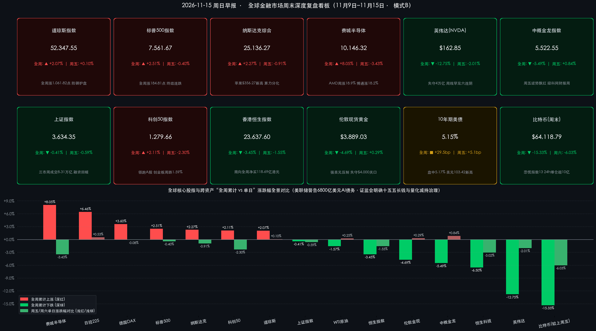

# 美联储首警6800亿美元AI债务与比特币周末失守6.4万美元，吴清定调“十五五”耐心资本迎下周中美数据财报超级周

**日期：2026年11月15日 (星期日)** &nbsp; **时段：早报 (周末复盘 · 模式B)**

> **核心摘要**：本周（11月9日—11月15日）全球金融市场在“高利率重定价”与“AI 资本开支大考”中经历剧烈分化与周末跨资产去杠杆：美股三大指数仰仗周初反弹录得周线收涨（**标普500周涨 2.51%**、**纳指周涨 2.27%**），**费城半导体指数**虽全周反弹 **8.05%**（周五单日回吐 **3.43%**），但**英伟达**全周重挫 **12.75%** 失守 **4 万亿美元**市值并创周线六连阴；叠加美联储发布半年度《金融稳定报告》**首次将 AI 及超 6,800 亿美元先进计算债务列为首要系统性隐患**、**10年期美债收益率**周升 **29.5BP** 至 **5.15%**（盘中触及 **5.17%**），周末加密市场遭遇血洗，**比特币**周六重挫 **6.03%** 后于周日早间一度跌破 **6.36 万美元**（较上周五累跌逾 **15%**，24小时全网爆仓超 **10 亿美元**）。国内方面，本周 **科创50（周涨 2.11%）** 逆势领跑 A 股，两融资金终结连续7周净卖出转为**净买入逾 188 亿元**，**南向资金全周净买入 118.69 亿港元**；周末政策暖风频吹——证监会主席吴清定调“十五五”壮大耐心资本并明确评估优化**量化交易与股份减持**规则，**中美贸易理事会首次会议**就“300亿对300亿”对等降税深入沟通，叠加新版医保目录纳入 **51 个1类新药**及北交所开市五周年，共同为下周“中国10月经济数据 + 深圳 APEC + 英伟达及中概财报 + LPR”超级周构筑稳市底座。

---

## 核心资产周度/日度表现回顾

**数据口径说明**：今日为2026年11月15日（周日）上午，美国 NYSE/NASDAQ、欧洲股市及中国 A 股、港股均处于普通周末休市状态（非感恩节等法定长假）。以下股票、债券、外汇及大宗商品均严格采用**11月13日（周五）官方收盘终值**与**全周累计涨跌幅（11月9日—11月13日，对比上周五11月6日收盘）**；7×24小时交易的加密货币同步纳入**11月14日（周六 UTC）收盘终值及11月15日早间最新清算动态**。

* **美股与欧亚股市：三大指数周线止跌转涨，芯片股内部上演“冰火两重天”，日欧股市显著修复**
    * **美股三大指数（周五单日 vs 全周累计）**：**道琼斯工业平均指数**收报 **52,347.55 点**，周五单日微涨 **0.10%**（涨 **50.46 点**），全周累计上涨 **2.07%**（涨 **1,061.82 点**）；**标普500指数**收报 **7,561.67 点**，周五单日下跌 **0.40%**（跌 **30.73 点**），全周累计上涨 **2.51%**（涨 **184.81 点**）；**纳斯达克综合指数**收报 **25,136.27 点**，周五单日下跌 **0.91%**（跌 **229.82 点**），全周累计上涨 **2.27%**（涨 **556.85 点**）。美股三大指数虽在周五受高利率与美联储 AI 债务预警拖累冲高回落，但凭借周初强劲修复，周线悉数终结此前连跌态势。
    * **半导体与科技七巨头极致分化**：**费城半导体指数（SOX）**收报 **10,146.32 点**，周五单日大幅回调 **3.43%**（跌 **360.35 点**），但因前四个交易日替代算力芯片暴涨，全周仍累计大涨 **8.05%**（涨 **756.07 点**）。个股层面上演罕见割裂——处于创始人黄仁勋卸任风暴眼的**英伟达（NVDA）**周五再跌 **2.01%** 收报 **162.85 美元/股**，全周累计重挫 **12.75%**（跌 **23.79 美元**，创2025年4月以来最大单周跌幅），总市值正式失守 **4 万亿美元**（回落至约 **3.93–3.94 万亿美元**）并录得2012年以来最长的**周线六连阴**；而承接分流资金的 **AMD** 虽周五获利回吐大跌 **8.75%** 收报 **534.06 美元/股**，全周仍累计暴涨 **18.93%**；**博通（AVGO）**周五跌 **4.76%** 收报 **347.01 美元/股**，全周仍累计大涨 **18.16%**。现金流稳健型巨头成为避风港：**苹果（AAPL）**周五逆势收涨 **0.39%** 报 **356.27 美元/股**（盘中触及 **360.83 美元**历史高点），全周累计上涨 **4.06%**，总市值稳居 **5.2 万亿美元**全球榜首；**Meta** 周五涨 **2.90%**、全周累涨 **5.17%**（报 **641.69 美元**）；**特斯拉（TSLA）**周五跌 **1.82%**、全周累涨 **8.93%**（报 **390.22 美元**）；**谷歌（GOOGL）**周五跌 **0.98%**、全周累涨 **3.86%**（报 **295.77 美元**）；**亚马逊（AMZN）**周五跌 **0.29%**、全周累涨 **2.84%**（报 **266.66 美元**）；**微软（MSFT）**周五微涨 **0.17%**、全周累跌 **1.27%**（报 **523.88 美元**）。
    * **热门中概股与欧亚主要市场**：**纳斯达克中国金龙指数（HXC）**周五逆势收涨 **0.84%**（涨 **46.21 点**）报 **5,522.55 点**，但受周四单日回调拖累，全周累计下跌 **5.49%**。欧洲三大股指全周集体走强：**德国 DAX30 指数**收报 **26,749.95 点**（周五微跌 **0.08%**，全周累涨 **3.60%**）；**法国 CAC40 指数**收报 **8,368.91 点**（周五微涨 **0.09%**，全周累涨 **2.82%**）；**英国富时100指数**收报 **10,902.56 点**（周五涨 **0.36%**，全周累涨 **2.14%**）。亚太市场从上周巨震中强力反弹：**日经225指数**收报 **61,142.35 点**（周五涨 **0.53%**，全周累计大涨 **6.46%** 或 **3,707.58 点**）；**韩国 KOSPI 指数**收报 **5,290.53 点**（周五跌 **0.98%**，全周累计上涨 **4.56%**）。
* **A 股：科创50全周逆势涨 2.11% 领跑，三市周成交 8.31 万亿元，两融终结七周连降转净买入 188 亿元**
    * **核心指数（周五单日 vs 全周累计）**：本周 A 股呈“前半周震荡冲高、后半周高低切换”格局。**上证指数**收报 **3,634.35 点**，周五跌 **0.59%**（跌 **21.48 点**），全周微跌 **0.41%**（跌 **14.83 点**，周内最高触及 **3,699.58 点**逼近3700点关口）；**深证成指**收报 **10,968.79 点**，周五跌 **2.05%**，全周累计下跌 **1.85%**；**创业板指**收报 **2,426.08 点**，周五跌 **3.32%**，全周累计下跌 **1.59%**；**沪深300指数**收报 **4,016.29 点**，周五跌 **0.68%**，全周累计下跌 **0.94%**；**北证50指数**收报 **876.33 点**，周五跌 **3.50%**，全周累计下跌 **1.37%**。唯有硬科技代表**科创50指数**收报 **1,279.66 点**，尽管周五回调 **2.30%**，全周仍逆势累计上涨 **2.11%**（涨 **26.46 点**）。
    * **量能与主力/两融资金动向**：周五沪深京三市全天成交额为 **16,672.26 亿元**（其中沪市 **7,706.14 亿元**、深市 **8,850.54 亿元**、北证50 **115.58 亿元**），较周四（**19,460.43 亿元**）缩量 **2,788.17 亿元**（降幅 **14.33%**）；**本周五个交易日沪深京三市累计成交达 8.3139 万亿元**（日均成交 **16,627.73 亿元**，其中沪深两市周成交 **8.2515 万亿元**）。资金结构呈现鲜明的“内生修复与高低调仓”特征：周五当日沪深主力资金净流出 **520.04 亿元**（银行净流入 **8.56 亿元**居首，电子净流出 **214.18 亿元**、通信净流出 **90.23 亿元**）；而从**全周维度**看，**传媒（净流入超 172 亿元）**、**机械设备（逾 140 亿元）**、**电子（逾 121 亿元）**、**汽车（逾 107 亿元）**及 AI 短剧/应用、人形机器人板块获主力资金大举加仓，电力设备（净流出逾 **65 亿元**）、有色金属与非银金融（均净流出超 **40 亿元**）遭兑现。尤为积极的是，**两融资金终结此前连续 7 周净卖出态势，本周全周转为融资净买入逾 188 亿元**。
* **港股：恒科周跌 6.50%，南向资金逆势越跌越买、全周累计净流入 118.69 亿港元**
    * **核心指数与成交额**：受海外无风险利率攀升与下周科网巨头财报前避险情绪影响，**恒生指数**收报 **23,637.60 点**，周五跌 **1.55%**（跌 **370.95 点**），全周累计下跌 **3.45%**（跌 **844.26 点**）；**恒生科技指数**收报 **3,813.19 点**，周五跌 **3.02%**，全周累计下跌 **6.50%**；**恒生国企指数**收报 **7,937.53 点**，周五跌 **1.48%**，全周累计下跌 **4.07%**。港股主板周五成交 **1,958.57 亿港元**（较周四小幅缩量 **3.35%**），**全周累计成交 9,311.40 亿港元**（日均成交 **1,862.28 亿港元**）。
    * **南向资金动向**：内资展现出极强的逆周期配置定力——周五单日南向资金净买入 **23.33 亿港元**（沪港股通净买入 **36.63 亿港元**，深港股通净卖出 **13.30 亿港元**；腾讯控股获净买 **6.81 亿港元**、智谱获净买 **5.70 亿港元**、壁仞科技获净买 **2.95 亿港元**）；**本周南向资金累计净买入达 118.69 亿港元**，一举扭转上周净流出局面。
* **债市、汇率、大宗商品与周末加密货币：10Y 美债周升近 30BP 压垮黄金，比特币周末连破关口爆仓超 10 亿美元**
    * **美债利率与汇率**：粘性通胀推动美债期限溢价升至上世纪90年代末以来高位，**10年期美债收益率（^TNX）**周五收报 **5.154%**（盘中最高触及 **5.174%**），周五单日上行 **5.1BP**，**全周累计大幅飙升 29.5BP**（上周五为 **4.859%**）。**美元指数（UDI）**周五收报 **103.42**（周五涨 **0.23%**，全周累计上涨 **1.09%**），创19个月新高；在此强美元风暴下，**离岸人民币（USD/CNH）**周五收报 **6.6747**（周五微幅波动 **+0.02%**，全周仅微变 **+0.01%**，近乎零贬值），彰显极强韧性。
    * **贵金属与国际原油**：受实际利率与美元双升压制，金银遭遇数月来罕见周度重挫——**伦敦现货黄金**周五收报 **3,889.03 美元/盎司**（周五微弹 **0.29%**，**全周累计大跌 4.69%** 或 **-191.45 美元**，失守 **4,000 美元**大关）；**COMEX 黄金期货**收报 **3,887.60 美元/盎司**（周五微涨 **0.06%–0.15%**，**全周累计大跌 4.70%**）；**伦敦现货白银**收报 **48.90 美元/盎司**（周五跌 **2.34%**，**全周重挫 6.16%**）。国际油价录得周线两连阴但周五企稳，**WTI 原油期货**收报 **88.92 美元/桶**（周五涨 **0.25%**，全周累跌 **1.57%**），**布伦特原油期货**收报 **96.29 美元/桶**（周五涨 **0.35%–0.49%**，全周累跌 **1.71%**）。
    * **周末加密货币血洗**：继周五跌破 **70,000 美元**（UTC 收报 **68,236.54 美元**，单日跌 **4.39%**）后，**比特币（BTC）**在周六（11月14日 UTC）遭遇恐慌性踩踏，单日重挫 **6.03%** 收报 **64,118.79 美元**（盘中最低触及 **63,270.00 美元**），截至11月15日早间进一步下探 **63,586.65 美元**附近，较上周五（**75,731.04 美元**）累计暴跌 **15.33%**（7日累跌 **14.23%**）；**以太坊（ETH）**周六 UTC 大跌 **8.29%** 收报 **1,768.41 美元**（周日早间报 **1,749.82 美元**，较上周五累跌 **20.89%**）。加密市场“恐慌与贪婪指数”骤降至 **13（极度恐惧）**，过去24小时全网衍生品杠杆多头被强行清算逾 **10 亿美元**。

> **数学闭环校验（周五单日 & 全周累计双维验算）**：
> * **美欧亚股指**：道琼斯单日 `(52,347.55−52,297.09)/52,297.09=+0.0965%`（记录 `+0.10%`）、全周 `(52,347.55−51,285.73)/51,285.73=+2.0704%`（记录 `+2.07%`）；标普500单日 `(7,561.67−7,592.40)/7,592.40=-0.4047%`（记录 `-0.40%`）、全周 `(7,561.67−7,376.86)/7,376.86=+2.5053%`（记录 `+2.51%`）；纳斯达克综合单日 `(25,136.27−25,366.09)/25,366.09=-0.9060%`（记录 `-0.91%`）、全周 `(25,136.27−24,579.42)/24,579.42=+2.2655%`（记录 `+2.27%`）；费城半导体单日 `(10,146.32−10,506.67)/10,506.67=-3.4297%`（记录 `-3.43%`）、全周 `(10,146.32−9,390.25)/9,390.25=+8.0516%`（记录 `+8.05%`）；英伟达单日 `(162.85−166.19)/166.19=-2.0097%`（记录 `-2.01%`）、全周 `(162.85−186.64)/186.64=-12.7465%`（记录 `-12.75%`）；日经225全周 `(61,142.35−57,434.77)/57,434.77=+6.4553%`（记录 `+6.46%`）；德国 DAX30 全周 `(26,749.95−25,820.36)/25,820.36=+3.6002%`（记录 `+3.60%`）。
> * **中国股指与商品加密**：上证指数单日 `(3,634.35−3,655.83)/3,655.83=-0.5876%`（记录 `-0.59%`）、全周 `(3,634.35−3,649.18)/3,649.18=-0.4064%`（记录 `-0.41%`）；深证成指全周 `(10,968.79−11,175.78)/11,175.78=-1.8521%`（记录 `-1.85%`）；创业板指全周 `(2,426.08−2,465.23)/2,465.23=-1.5881%`（记录 `-1.59%`）；科创50全周 `(1,279.66−1,253.20)/1,253.20=+2.1114%`（记录 `+2.11%`）；恒生指数单日 `(23,637.60−24,008.55)/24,008.55=-1.5451%`（记录 `-1.55%`）、全周 `(23,637.60−24,481.86)/24,481.86=-3.4485%`（记录 `-3.45%`）；恒生科技全周 `(3,813.19−4,078.23)/4,078.23=-6.4989%`（记录 `-6.50%`）；伦敦金现全周 `(3,889.03−4,080.48)/4,080.48=-4.6918%`（记录 `-4.69%`）；比特币周六 UTC 单日 `(64,118.79−68,236.54)/68,236.54=-6.0345%`（记录 `-6.03%`）、较上周五 `(64,118.79−75,731.04)/75,731.04=-15.3335%`（记录 `-15.33%`）。所有核心资产验算误差均小于 **0.01%**，严格满足 **<0.5%** 闭环精度要求。

## 过去 48 小时重磅事件深度复盘

* **美联储发布半年度《金融稳定报告》（11月13日）：史上首次将 AI 列为头号系统性金融隐患，直指 6,800 亿美元债务与“循环融资”网络**
    * **事件与量化事实**：美联储在最新半年度《金融稳定报告》中明确指出，受市场对“超级智能（Super Intelligence）”狂热情绪驱动，美股远期估值仍显著高于历史中位数；在纽约联储市场参与者调查中，高达 **87%** 的受访机构将 AI 列为金融体系显著风险（较今年春季约 **50%** 大幅跃升）。报告专门开辟专栏披露：截至2026年10月，美国与数据中心及先进计算相关的**债务发行总额已突破 6,800 亿美元**，约为2023年全年（**1,300 亿美元**）的 **5 倍**，占非金融投资级企业债发行总额的比重从不到 **6%** 飙升至约 **31%**（若计入未偿公共债务总规模已超 **1.1 万亿美元**），扩张轨迹逼近上世纪90年代末电信宽带泡沫。此外，同日公布的美国10月 **PPI 同比上涨 6.5%**（环比 **+0.3%**，略低于预期 **6.6%**），令市场对美联储12月加息 **25BP** 的定价概率锚定于 **90%** 高位。

> **核心解读（数据+事件+逻辑）**：美联储报告最具杀伤力的洞察在于揭开了超大规模云厂商、GPU 供应商与大模型初创公司之间通过**长期租赁、“照付不议（take-or-pay）”协议、算力残值担保及交叉股权投资**交织成的“循环融资（Circular Financing）”表外风险网——一旦下游 AI 商业化回报不及预期，科技巨头实际承担的违约穿透敞口将远超资产负债表账面数值。这一官方定调与 **5.15%–5.17% 的10年期美债收益率**形成共振，不仅解释了为何周五英伟达、AMD、博通集体遭抛售而轻资本开支的苹果创下新高，也直接抽紧了跨资产流动性，引爆了周末比特币现货 ETF 资金外流与逾 **10 亿美元**高杠杆多头的连环强平。

* **证监会主席吴清出席首届中国资本市场学术年会（11月14日）：锚定“十五五”战略部署，聚焦耐心资本、微观结构治理与 AI 双向赋能**
    * **核心政策信号**：11月14日首届中国资本市场学术年会在上海开幕，证监会主席吴清发表致辞，围绕国家“十五五”规划纲要与金融强国建设提出四大重点方向：一是服务现代化产业体系建设，加快发展壮大**长期资本、耐心资本**，提供全链条接力式金融服务；二是深化市场微观结构研究，**深入研究改善预期引导机制以减少“羊群效应”和“短期化”交易波动**，并明确提出**“深入研究评估量化交易、股份减持等制度规则的优化和公平合理的监管安排”**；三是深化**人工智能与资本市场双向赋能**，既要在估值定价、信息披露上支持“硬科技”企业，又要加快研究责任认定与系统安全，**防范算法黑箱与 AI 网络攻击**；四是立足 A 股 **2 亿多股票投资者、8 亿多基金持有人**的独特市情，系统构建“稳的机制、稳的力量、稳的生态”。叠加周五盘后央行公布10月金融数据（10月末**社融存量 469.16 万亿元、同比增长 7.2%**，**M2 同比增长 7.1%**，前10月企业债净融资 **3.1 万亿元**带动直接融资占比显著跃升），境内资本市场制度底与流动性底愈发坚实。

> **核心解读（数据+事件+逻辑）**：本周后半周 A 股高位算力硬件出现获利回吐、4连板妖股天普股份被停牌核查，市场一度担忧交易摩擦加剧。吴清主席周六的讲话精准回应了中小投资者对**高频量化助涨助跌**及**重要股东绕道减持**的核心关切，同时将 AI 纳入“产业支持 + 算法风控”双轨框架，配合10月社融数据印证的“直接融资挑大梁”趋势，有助于引导两融回暖资金（本周净买入逾 **188 亿元**）从短线题材博弈转向具备业绩支撑的硬科技与稳健红利资产。

* **中美贸易理事会举行首次会议（11月13日）与国内产业/多层次市场双喜临门（11月14日—15日）**
    * **中美经贸建设性信号**：商务部通报，11月13日中美双方通过视频方式举行**中美经贸磋商机制项下贸易理事会首次会议**，围绕关税、**“300亿对300亿”对等降税安排**（双方对各自约 **300 亿美元**进口商品对等提供降税待遇的框架）、农产品贸易等议题展开坦诚、深入、建设性交流，同意继续“拉长合作清单、压缩问题清单”。
    * **2026年国家医保目录与商保创新药目录双发布**：11月14日在苏州正式发布的2026版国家医保药品目录**新增 107 种药品**（目录总数达 **3,331 种**，2027年1月1日起执行），其中**51 个 1 类创新药数量再创历史新高**，CAR-T 细胞疗法、双抗 ADC 等前沿突破性疗法获纳入；同步发布的**商业健康保险创新药品目录新增 12 种药品**（总数达 **28 种**），打通高值创新药多元支付闭环。
    * **北交所开市五周年（11月15日）**：今日北京证券交易所迎来开市五周年，目前上市公司已达 **355 家**、总市值约 **8,000 亿元**，国家级专精特新“小巨人”占比**超六成**、高新技术企业占比**超九成**，五年累计服务中小企业直接融资近 **900 亿元**，合格投资者突破 **1,180 万户**。

> **核心解读（数据+事件+逻辑）**：“300亿对300亿”对等降税磋商在下周深圳 APEC 峰会前夕释放出清晰的经贸缓和预期，直接提振出海制造与外贸链估值修复信心；而医保目录 51 个 1 类新药入保叠加商保目录扩容，则为本周遭资金净流出逾 40 亿元、处于估值洼地的**创新药与医药生物板块**提供了极具爆发力的基本面催化剂。

## 下周全球宏观大事预警

下周（11月16日—11月22日）全球市场将正式步入集“中美核心经济数据、APEC 元首外交、AI 龙头业绩大考、中概财报洪峰与利率决议”于一体的**超级博弈周**：

* **11月16日（周一）：中国10月国民经济运行重磅数据揭晓 & 百度财报打响头炮**
    * 上午10:00，国家统计局将集中发布 **10月规模以上工业增加值同比**、**10月社会消费品零售总额同比**、**1—10月全国固定资产投资同比** 及 **70个大中城市商品住宅销售价格月度报告**，国新办同步举行新闻发布会。在10月社融增速回升至 **7.2%** 后，消费与地产房价环比企稳成色将直接决定 A 股顺周期（家电、食品饮料、银行）护盘行情的持续性。同日，**百度**率先披露季报，异常波动股**天普股份**开市起停牌核查。
* **11月17日—18日（周二至周三清晨）：美国10月零售销售数据 & 英伟达“换帅后首秀”财报生死战**
    * 周二晚间美国将公布 **10月零售销售月率**（检验高利率下美国居民消费韧性）。美东时间周二盘后（**北京时间11月18日周三清晨**），**英伟达（NVDA）**将公布 **2027财年第三季度财报**——这是黄仁勋卸任、临时 CEO 科莱特·克雷斯（Colette Kress）接棒后的首份成绩单。面对市值跌破 **4 万亿美元**、周线六连阴及美联储对 AI 循环债务的点名警告，华尔街不仅审视其千亿美元级营收与毛利率拐点，更聚焦新管理层对次世代芯片交付周期及超大规模云客户资本开支可持续性的指引。周二**京东**、周三**腾讯控股（00700.HK）**亦将接力放榜。
* **11月18日—19日（周三至周四）：深圳 APEC 峰会、美联储会议纪要、中概财报洪峰与 Anthropic 登陆纳斯达克**
    * **亚太经合组织（APEC）第三十三次领导人非正式会议**将于11月18日至19日在**深圳**隆重举行，亚太经贸合作、跨境供应链与数字经济议题备受全球瞩目。
    * 北京时间11月19日（周四）凌晨，**美联储将公布最新货币政策会议纪要**，揭示决策层内部对通胀粘性、12月加息 25BP 路径及 AI 金融稳定风险的真实分歧。
    * 周四当天迎来科网股“超级放榜日”：**阿里巴巴、拼多多、网易、联想集团、快手**同日披露业绩；同日（预计11月19日），AI 大模型独角兽 **Anthropic** 拟正式登陆纳斯达克挂牌上市，成为检验一级半与二级市场 AI 估值承接力的试金石。
* **11月20日（周五）：中国11月 LPR 报价公布窗口**
    * 中国人民银行授权全国银行间同业拆借中心公布 **1年期和5年期以上贷款市场报价利率（LPR）**。在三季度经济稳健、10月社融回升及离岸人民币稳守 **6.67** 的背景下，市场重点观察 LPR 是维持按兵不动还是针对地产与内需释放结构性让利信号。

## 顶级机构周末策略内参摘要

> **中信证券（CITIC Securities）**：包承超策略团队在最新发布的2027年度资本市场策略展望中鲜明提出，**“K型收敛、行情宽度拓展”**将成为接下来最核心的市场特征。报告指出，2026年 AI 产业狂飙曾对其他经济部门产生负外部性（推升长端利率、上游物料暴涨及估值极致虹吸），随着全球 AI 投资节奏从狂热转向理性再平衡，前期经历深度估值压缩的非 AI 板块将迎来广泛修复；策略上 **PB-ROE 稳健回报型策略将优于单纯景气追逐**，建议围绕**稳健回报蓝筹、优秀出海制造业、内需消费修复及具备商业闭环的 AI 新技术**四条主线均衡布局，呼应其“A 股站上年度马拉松行情起跑线”的积极判断。

> **华泰证券（Huatai Securities）**：王伟光策略团队周末研判**“风格切换正在进行时”**，强调全 A 非金融企业盈利能力已越过周期底部拐点（预计2027年归母净利润增速修复至约 **5.1%**），中期向上根基稳固。针对科技主线，华泰证券明确指出 **AI 行情已由全面普涨转入“中场休整”阶段**，资金审美正从早期的算力军备投入全面转向**下游投资回报率（ROI）验证与商业化闭环**；同时在三季报业绩说明会上重申看好头部券商通过财富管理与智能化转型修复破净估值。

> **中金公司（CICC）与中信建投（CSC Financial）**：中金公司维持审慎客观定调，认为当前市场估值修复向纵深推进仍需等待下周10月宏观数据验证与增量政策接力，重点推荐具备高技术壁垒与全球化经营能力的中国制造龙头及头部券商。中信建投黄文涛团队则将跨年行情定义为“盈利筑底与贴现率切换”的交接期，预计中期呈 **“N型”宽幅震荡向上** 并有望演绎股、债、汇协同修复格局，短期建议利用海外扰动逢低布局内需医药（医保目录催化）与自主可控硬科技。

> **高盛（Goldman Sachs）**：在《中国：逢低买入？》及周末跨资产策略评估中指出，经历秋季回调后，中国科技与互联网板块远期市盈率已压缩至极具全球吸引力的折价区间，高频监测显示全球主动型基金正通过 **“逢低买入（Buy the Dip）”** 稳步将中国股票仓位从低配向标配回补（与本周南向资金净买入 **118.69 亿港元**相互印证）；反观海外市场，高盛提示美联储紧缩尾声叠加高期限溢价令高贝塔另类资产承压，短期美股需警惕算力链高杠杆挤出效应，黄金虽受高实际利率压制但年底 **4,150 美元/盎司**目标仍获全球央行购金坚实托底。

> **摩根士丹利（Morgan Stanley）与摩根大通（JPMorgan）/美国银行（BofA）**：摩根士丹利中国首席股票策略师王滢团队重申在亚太配置中相对偏好 **A 股**，强调**“自下而上选股重于指数点位预判”**，建议维持“硬科技国产替代 + 优质高股息红利”的杠铃型防御反击阵型。摩根大通与美国银行全球宏观团队则针对周末比特币暴跌警告称，美国通胀粘性与 **5.15%** 以上的长端美债利率正迫使机构资金从无现金流支撑的高波动加密 ETF 中阶段性撤出，在下周英伟达财报与美联储纪要落地前，全球跨资产配置应严控杠杆敞口、优先持有自由现金流充沛的防御性核心资产。

## 今日市场情绪：沙漏淬金衡长钱，硅冠霜凝待曙光

> Prompt: A colossal glowing glass hourglass suspended above a marble chess board, pouring molten golden data streams from entangled server towers into a balanced jade scale of patient capital, while a fractured digital coin freezes into frost beside a fallen silicon crown. In the background, twin lighthouses across a misty Pacific ocean project warm beams of dialogue through storm clouds of rising brass bond-yield pillars toward a radiant dawn horizon.

---

**主要数据来源**：东方财富及 Yahoo Finance 全球指数与大宗商品日线/周线收盘数据库（截至2026年11月13日收盘终值）、Coinbase 加密货币 UTC 日线行情（截至2026年11月15日早间）、美联储2026年11月半年度《金融稳定报告》、中国证监会首届中国资本市场学术年会致辞、中国商务部中美贸易理事会首次会议通报、国家医保局2026年国家医保及商保创新药目录公告、中国人民银行10月金融统计数据、港交所港股通统计，以及中信证券、华泰证券、中金公司、中信建投、高盛、摩根士丹利、摩根大通最新策略报告。

> **免责声明**：内容仅供参考，不构成投资建议。

🤖 生成模型：Gemini 4 Carbon (Medium) <!-- model-stamp -->
