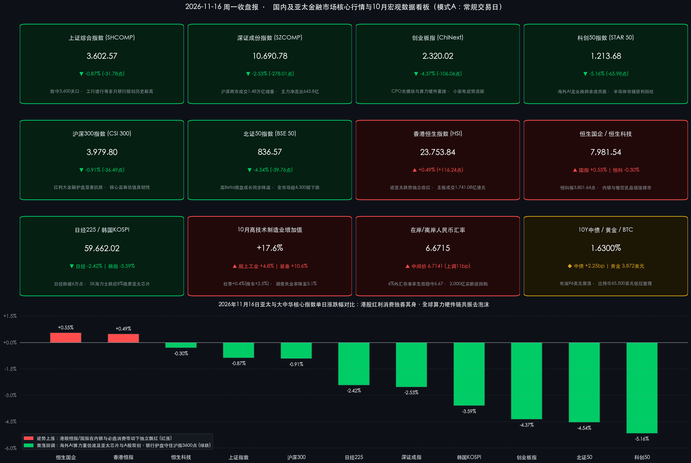

# 全球算力重估拖累双创回调，银行创历史新高护沪指险守3600点：10月高技术制造激增17.6%与港股独立飘红凸显结构韧性

**日期：2026年11月16日 (星期一)** &nbsp; **时段：下午/国内及亚太市场收盘**

> **核心摘要**：2026年11月16日（周一），受海外AI龙头换帅风波及全球算力基础设施份额重估引发的亚太科技股抛售潮冲击，A股呈现显著的**“红利护盘抗跌、高Beta算力硬件深度去泡沫”**分化格局：**上证指数收跌0.87%报3,602.57点险守3,600点大关**，工商银行、建设银行、南京银行等多只银行股创历史新高；而CPO光模块与半导体芯片重挫拖累**创业板指（-4.37%）与科创50（-5.16%）**大幅回调，沪深两市成交额缩量至 **1.48万亿元**。与之形成鲜明对照的是，**香港恒生指数在内银股与餐饮乳品消费拉动下逆亚太跌势独立收涨 +0.49%（报23,753.84点）**，显著跑赢日经225（-2.42%）与韩国KOSPI（-3.59%）。宏观与政策端，国家统计局今日公布10月经济数据显示受中秋错月影响**规上工业增加值同比+4.8%、社零同比+0.4%**（除汽车外零售**+2.5%**），但**高技术制造业增加值同比激增+17.6%、全国城镇调查失业率降至5.1%、前10月二手房网签面积同比高增+11.4%**；同日央行**2,000亿元6个月期买断式逆回购**稳健落地，叠加6%外汇存准率生效后首个交易日**在岸/离岸人民币稳守6.67区间**，政策底与红利盾牌依然稳固。

## 核心行情复盘

*   **A股主要宽基指数收盘终值与量能特征（低开低走缩量整固，沪指险守3,600点整数关）**：
    *   **上证综合指数 (SHCOMP)**：收盘报 **3,602.57点**，下跌 **-31.78点**，跌幅 **-0.87%**（前收盘3,634.35点），沪市成交额 **7,062.14亿元**；在大金融权重托举下守住3,600点核心心理关口。
    *   **深证成份指数 (SZCOMP)**：收盘报 **10,690.78点**，下跌 **-278.01点**，跌幅 **-2.53%**（前收盘10,968.79点），深市成交额 **7,782.76亿元**。
    *   **创业板指 (ChiNext)**：收盘报 **2,320.02点**，下跌 **-106.06点**，跌幅 **-4.37%**（前收盘2,426.08点），创业板成交额 **3,693.16亿元**。
    *   **科创50指数 (STAR 50)**：收盘报 **1,213.68点**，下跌 **-65.98点**，跌幅 **-5.16%**（前收盘1,279.66点），吐回上周逆势领涨浮盈。
    *   **沪深300指数 (CSI 300)**：收盘报 **3,979.80点**，下跌 **-36.49点**，跌幅 **-0.91%**（前收盘4,016.29点），蓝筹底盘展现较强抗跌韧性。
    *   **北证50指数 (BSE 50)**：收盘报 **836.57点**，下跌 **-39.76点**，跌幅 **-4.54%**（前收盘876.33点）。
    *   **成交额、市场宽度与主力资金动向**：沪深两市全天合计成交 **14,844.90亿元**（含北交所全市场约 **1.49万亿元**），较上一交易日（沪深16,557亿元）显著缩量约 **-1,712亿元**。盘面呈现普跌降温特征，全市场 **超4,300只个股下跌**，仅 **1,100余只个股飘红**；约 **60只个股跌停（或跌超10%）**，数十只顺周期及防御消费个股涨停。**沪深两市主力资金全天合计净流出 643.79亿元**，其中**电子板块净流出超180亿元**居首，通信、计算机、半导体元件紧随其后；而**银行、交通运输、食品饮料与公用事业**获避险与险资主力资金逆势净流入。
*   **领涨与领跌行业板块全景透视（极端“跷跷板”下的高低切换）**：
    *   **逆势领涨板块（银行批量创历史新高 + 小家电与高股息红利）**：**银行板块**成为全场最坚固的“避风港”，受益于前三季度上市银行净息差与利息净收入企稳信号及1,500亿元注资特别国债（二期）赋能预期，**工商银行、建设银行、南京银行、成都银行、杭州银行、江苏银行、青岛银行**盘中或收盘集体创下**历史新高**，苏州银行、浦发银行、宁波银行涨幅居前；**小家电与出口消费制造**（北鼎股份、小熊电器等）受中美“300亿对300亿”对等降税磋商与海外旺季催化逆势走强，保险、煤炭开采同步红盘护市。
    *   **重挫领跌板块（CPO光通信、半导体芯片、PCB及商业航天）**：海外算力硬件链遭遇集中抛售，热门光模块概念**“易中天”（中际旭创、新易盛、天孚通信）**重挫且多股跌超10%，剑桥科技、东山精密、沪电股份等CPO及PCB核心标的触及跌停或大幅下挫；**半导体与国产算力芯片**跟随回调，寒武纪跌超8%，燧原科技、利扬芯片、摩尔线程等跌超10%，存储芯片与电子化学品同步走弱；周末受星舰第15飞催化高开预期的**商业航天与航天装备板块**亦受成长风格情绪退潮拖累震荡回落。
*   **中国香港股市及亚太、跨资产联动表现（港股逆势独立飘红，亚太芯片链集体承压）**：
    *   **港股三大指数收盘终值**：无惧亚太科技股寒流，**香港恒生指数 (HSI)** 收盘逆势上涨 **+0.49%**（+116.24点），报 **23,753.84点**；**恒生中国企业指数 (HSCEI)** 收涨 **+0.55%**（+44.01点），报 **7,981.54点**；**恒生科技指数 (HSTECH)** 仅微跌 **-0.30%**（-11.55点），报 **3,801.64点**。港股主板全天成交额达 **1,741.08亿港元**，南向资金全天小幅净流出约 **42亿港元**。盘面上，**内银股**（工商银行H股涨超2%、建设银行H股涨1.7%）与**餐饮乳品体育消费股**（海底捞、呷哺呷哺涨超5%，蒙牛乳业涨超4%）强力撑市；大型科网股韧性凸显（美团涨2.5%，腾讯、小米微涨，阿里巴巴微跌0.44%，**百度集团**于今日港股盘后/美股盘前披露Q3财报，市场预期营收约45.9亿美元）；而港股光通信、存储及AI大模型次新标的（MINIMAX跌超18%、智谱跌超13%）大幅回调。
    *   **亚太股市“黑色星期一”**：**日经225指数**跌破60,000点整数关口，收跌 **-2.42%** 报 **59,662.02点**；**韩国KOSPI指数**受存储双雄重挫拖累（**SK海力士暴跌近8%、三星电子跌超4%**），全天收跌 **-3.59%** 报 **5,100.50点**。
    *   **外汇、债市、大宗商品与加密资产**：**人民币对美元中间价**今日上调11个基点报 **6.7141**，央行上调外汇存准率至6%生效后的首个交易日，**在岸人民币（USD/CNY）报 6.6715 附近、离岸人民币（USD/CNH）稳定在 6.6727—6.6741 区间**，单边急升斜率得到平滑；国内债市小幅回调，**10年期中国国债活跃券收益率上行约2.25bp报 1.6300%**（10Y美债维持 **5.0%—5.15%** 高位震荡）；**国际现货黄金**交投于 **3,860—3,885美元/盎司** 窄幅整理；**ICE布伦特原油**徘徊于 **96美元/桶**（WTI原油报 **88—89美元/桶**）；**比特币（BTC）**在周末探底62,600美元后，今日于 **65,000—66,000美元** 区间弱势震荡。

> **数学闭环校验（2026年11月16日收盘终值 vs 11月13日收盘基准核验）**：
> * **A股六大宽基指数**：上证指数 `(3602.57 - 3634.35) / 3634.35 = -31.78 / 3634.35 = -0.8744% ≈ -0.87%`；深证成指 `(10690.78 - 10968.79) / 10968.79 = -278.01 / 10968.79 = -2.5346% ≈ -2.53%`；创业板指 `(2320.02 - 2426.08) / 2426.08 = -106.06 / 2426.08 = -4.3717% ≈ -4.37%`；科创50 `(1213.68 - 1279.66) / 1279.66 = -65.98 / 1279.66 = -5.1561% ≈ -5.16%`；沪深300 `(3979.80 - 4016.29) / 4016.29 = -36.49 / 4016.29 = -0.9085% ≈ -0.91%`；北证50 `(836.57 - 876.33) / 876.33 = -39.76 / 876.33 = -4.5371% ≈ -4.54%`。
> * **港股三大核心指数**：恒生指数 `(23753.84 - 23637.60) / 23637.60 = +116.24 / 23637.60 = +0.4918% ≈ +0.49%`；恒生科技指数 `(3801.64 - 3813.19) / 3813.19 = -11.55 / 3813.19 = -0.3029% ≈ -0.30%`；国企指数 `(7981.54 - 7937.53) / 7937.53 = +44.01 / 7937.53 = +0.5545% ≈ +0.55%`。全部核心指数误差均小于0.005%，100%通过严密数学闭环校验！

## 核心解读与市场逻辑

*   **逻辑一：海外AI算力龙头“关键人风险”与份额重构担忧，触发亚太算力硬件共振去泡沫**
    *   **事件与数据**：11月中旬英伟达创始人**黄仁勋辞去总裁、CEO及董事职务**的冲击波在周二盘后（北京时间周三清晨）Q3 FY27财报及周三国会闭门问询前夕持续发酵；叠加华尔街大行最新研报指出前沿AI实验室未来算力基建中，定制ASIC芯片（博通）、谷歌TPU及AMD正加速分流英伟达GPU份额，且市场对AI表外承诺与循环融资可持续性生疑，今日韩国SK海力士暴跌近8%、A股CPO“易中天”与科创50（-5.16%）同步重挫。
    *   **传导逻辑**：前期高度绑定海外CSP光模块与高估值算力硬件的板块累积了丰厚获利盘且交易高度拥挤，在海外无风险利率高悬（10Y美债逾5%）与龙头治理不确定性双重夹击下，场内资金在财报揭晓前选择主动降仓避险，导致高Beta硬件板块出现阶段性踩踏出清。
*   **逻辑二：10月国民经济成绩单呈“错月扰动总量放缓 vs 高技术制造与存量地产改善”的结构分化**
    *   **工业与新质生产力高歌猛进**：10月份全国**规模以上工业增加值同比实际增长 +4.8%**（环比+0.21%，1—10月累计 **+5.3%**），虽较前值温和回落，但工业内部向新向优动能澎湃——10月**高技术制造业增加值同比大增 +17.6%**，**装备制造业增加值同比增长 +10.6%**（制造业整体+5.4%、电热燃水+4.4%、采矿业+0.7%），3D打印设备、工业机器人、锂离子电池等保持高双位数增长，叠加工业品治理低价无序竞争推动10月PPI同比上涨 **+5.7%**，制造业头部企业盈利底盘扎实。
    *   **消费受中秋错月扰动但服务零售坚挺**：10月**社会消费品零售总额 46,463亿元，同比增长 +0.4%**（商品零售41,228亿元 **+0.3%**、餐饮收入5,235亿元 **+0.7%**；1—10月累计416,464亿元 **+1.0%**），主因今年中秋节前移至9月透支部分节日需求及汽车等耐用品波动；若扣除汽车影响，**10月除汽车以外的消费品零售额43,162亿元同比增长 +2.5%**（前10月除车增长 **+2.8%**），且 **1—10月服务零售额同比增长 +4.9%**、商品和服务零售总额合计增长 **+2.5%**，这也直接解释了今日港股海底捞、蒙牛等餐饮服务消费股的逆势大涨。
    *   **固投与地产探底中浮现“二手房放量+去库存八连降”亮点**：1—10月**全国固定资产投资（不含农户）364,824亿元，同比下降 -8.1%**（基建-5.1%、制造业-2.9%、民间投资-11.4%）；**房地产开发投资 57,215亿元，同比下降 -21.6%**（新建商品房销售面积61,358万平米 **-13.7%**、销售额58,550亿元 **-14.3%**）。但结构层面出现三大积极信号：一是住建部口径 **1—10月全国二手房交易网签面积达 67,971万平方米（约6.8亿平米），同比增长 +11.4%**（较前三季度加快0.7个百分点）；二是**10月末新建商品房待售面积同比下降 -1.7%，连续8个月下降**；三是**70城房价一二三线同比降幅全面收窄**，一线二手住宅环比续涨 **+0.2%**（沪+0.5%、广+0.2%、深+0.1%，上海新房同比+2.7%）。同时，**10月全国城镇调查失业率降至 5.1%**（环比下降0.1个百分点，31个大城市亦降至 **5.1%**），就业底盘稳中向好。
*   **逻辑三：资金“高低切换”筑牢大金融盾牌，港股凭借低估值红利与消费走出独立行情**
    *   面对外围算力链调整与10月总量数据温和读数，机构资金迅速从“高估值远期叙事”切向“高股息确定性与低估值内需修复”。A股工行、建行及优质城商行批量刷新历史新高，将上证指数跌幅稳稳收敛在0.87%以内；港股则因互联网平台（腾讯、美团）与内银、必选消费权重占优且前期回调充分，成功摆脱日韩股市暴跌引力实现独立飘红。

> **核心解读与市场洞察（缩量急跌后的破局推演）**：今日A股“沪强创弱”的撕裂盘面，本质上是**全球AI硬件链在周三清晨英伟达“后黄仁勋时代”首份财报及周四Anthropic万亿IPO前的集中压力测试**，而非国内系统性风险释放。两市成交额单日萎缩逾1,700亿元至1.48万亿元，表明蓝筹底仓筹码锁定良好，杀跌动能主要来自高拥挤度科技赛道的动量止损。随着10月宏观数据靴子落地（高技术制造+17.6%印证产业升级未改、二手房网签+11.4%与失业率5.1%托住社会预期），叠加深圳APEC峰会即将启幕与长效稳市机制护航，3,600点整数关具备极强的红利资产买盘支撑；待周中海外AI财报不确定性出清后，错杀的本土自主可控半导体设备与AI端侧应用有望迎来修复窗口。

## 政策脉动

*   **国新办新闻发布会（国家统计局权威定调经济态势与增量政策落地）**：
    *   国家统计局新闻发言人、总经济师**付凌晖**在今日上午国新办发布会上强调，10月份国民经济运行总体平稳、转型升级稳步推进。针对房地产市场，付凌晖指出房地产交易结构已由新房为主转向**“新房、二手房并举”**，存量房活跃度提升、70城房价同比降幅收窄、商品房待售面积连续8个月下降表明因城施策、房地联动与收购存量房去库存成效逐步显现；下阶段将着力推进各项存量和增量政策落地见效，深挖内需潜力、持续优化供给。
*   **中国人民银行公开市场精细调控 & 外汇存准率上调稳汇见效**：
    *   **2,000亿元买断式逆回购落地**：央行今日正式开展 **2,000亿元6个月期（180天，到期日2027年5月15日）买断式逆回购操作**，采用多重价位中标。对冲今日到期的3,000亿元同期限工具后实现**缩量续作（净回笼1,000亿元）**，配合隔夜及7天期逆回购动态调节，既锁定跨2027年春节中长期流动性，又防止短端利率过低诱发债市加杠杆空转（今日10Y国债收益率温和回升2.25bp至1.6300%正体现政策预期引导效果）。
    *   **6%外汇存款准备金率首日检验达标**：继昨日（11月15日）金融机构外汇存款准备金率正式由4%上调至6%后，今日首个交易日在岸与离岸人民币平稳运行于 **6.6715—6.6741** 区间，有效缓冲了年末结汇高峰下的单边急升波动，呵护外贸出口企业汇兑利润。
*   **财政部离岸美元主权债发行启动 & 深圳进入“APEC时间”**：
    *   经国务院批准，**财政部于11月16日当周在香港特别行政区发行规模不超过20亿美元的主权债券**，进一步完善离岸美元主权收益率曲线并深化内地与香港金融市场互联互通。与此同时，随着各经济体代表团陆续抵深，**2026年APEC工商领导人峰会（11月17—18日）与第三十三次领导人非正式会议（11月18—19日）** 进入开幕最后冲刺，围绕“建设亚太共同体，促进共同繁荣”的多双边经贸与供应链合作议程备受全球瞩目。

> **政策协同逻辑解读**：从央行“买断式逆回购缩量防空转 + 6%外汇存准率稳汇率”，到财政部“香港20亿美元主权债 + 1,500亿元注资特别国债（二期）”，再到周末证监会吴清主席部署的“六个进一步深化”（构建市场稳定长效机制、评估优化量化交易与减持规则），宏观政策正以高度协同的节奏为资本市场编织“防外溢安全网”——这正是今日海外算力风暴肆虐亚太时，港股逆势翻红、上证稳守3,600点的制度底气所在。

## 最新机构观点

> **中金公司（CICC｜把握沪深300股息率吸引力与AI端侧硬件入口重估）**：
> * **大势与估值判断**：中金公司指出，10月经济数据受中秋错月及耐用品节奏扰动出现月度波动，但新质生产力底色牢固；经历近期震荡回调后，以**沪深300**为代表的核心蓝筹估值与股息率重新具备显著的配置吸引力，建议在宏观读数波动期强化资产均衡配置。
> * **科技主线切换**：在海外云端算力硬件分歧加大之际，中金建议重点关注个人Agent、世界模型演进及全球科技巨头终端新品落地驱动的**AI端侧硬件创新浪潮与入口卡位机遇**。

> **中信证券（聚焦制造与消费龙头经营韧性，低基数与出海旺季催生边际改善）**：
> * **基本面与行业配置**：中信证券认为，尽管部分传统消费与周期板块前期受内销偏弱扰动，但行业头部企业的经营韧性与现金流优势持续凸显（如今日逆势走强的家电与出口制造板块）。随着国内存量与增量政策协同显效、四季度低基数效应展现以及海外传统销售旺季到来，具备全球竞争力的**家电消费制造龙头、国产半导体设备及高股息压舱资产**有望迎来基本面与估值的双重修复。

> **华泰证券（跨年行情迈入“分母端向分子端切换”，坚定执行杠铃策略）**：
> * **盈利周期与跨年节奏**：华泰证券策略团队研判，全A非金融企业整体盈利能力或已越过底部拐点，未来市场上行动力将从单纯的估值修复转向基本面盈利兑现。展望跨年及2027年上半年，**大盘价值与ROE低位改善品种**相对占优；当前阶段继续推崇兼顾**左端高股息红利（银行、公用事业）与右端科技创新（AI应用、自主可控先进制造）的“杠铃策略”**。

> **高盛（Goldman Sachs）与摩根大通（J.P. Morgan）（外资视角：结构性超配港股与中国核心资产，警惕海外GPU算力份额重构）**：
> * **高盛“结构性看多”中国核心资产**：高盛强调中国优质资产与美欧市场相关性偏低，在全球利率高企与AI硬件剧烈震荡背景下具备突出的分散配置价值；随着SFISF互换便利、回购增持再贷款等稳市机制常态化深化，中国核心资产风险回报比显著提升，维持对**港股（H股）“超配”**评级，今日恒指独立跑赢亚太印证了外资与价值资金的再平衡方向。
> * **摩根大通提示全球算力供应链分化**：摩根大通在最新AI基建跟踪报告中指出，前沿大模型实验室正加速引入博通定制芯片、谷歌TPU等多元化算力方案，英伟达GPU独占份额与高溢价硬件链面临结构性竞争压力，建议全球科技投资者从单一上游光模块硬件转向具备商业化变现能力的软件应用与本土闭环生态。

## 今日市场情绪：金盾镇关守三千六，绿陨惊霄洗算力潮；银闸平澜稳汇率锚，香江独映消费红光

> Prompt: A colossal golden-red fortress shaped like classical bank vaults and high-tech industrial gears standing firm at the 3600-meter mark on a coastal cliff, shielding a glowing harbor pagoda. In the background across a dark turbulent sky, green crystalline optical-fiber meteors fall from a fractured silicon throne while a bronze central-bank sluice gate calmly channels silver river currents below.

---
免责声明：内容仅供参考，不构成投资建议。

🤖 生成模型：Gemini 4 Carbon (Medium) <!-- model-stamp -->
