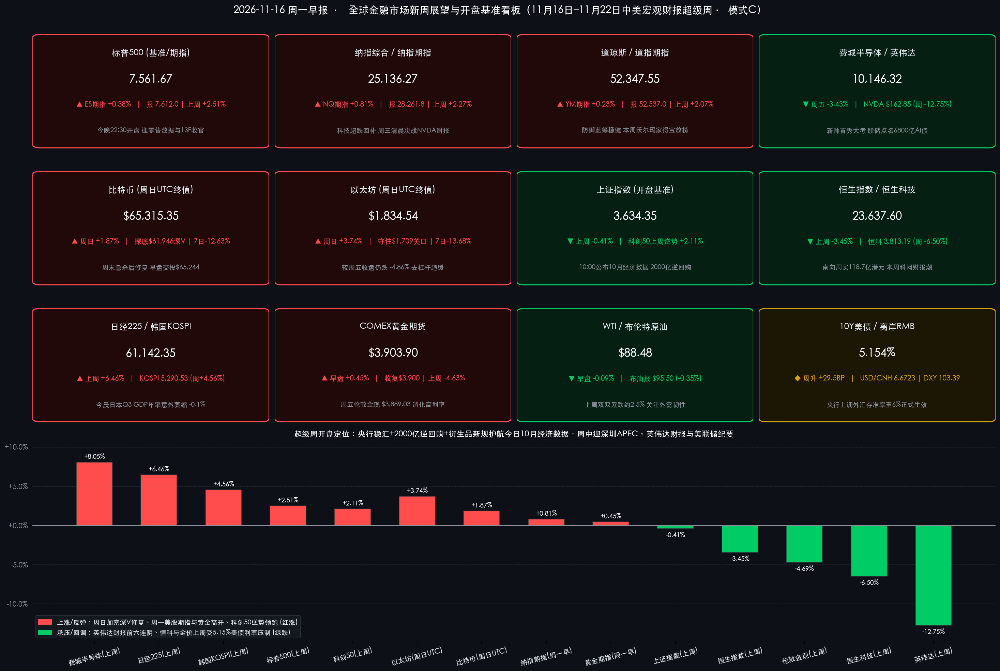

# 央行稳汇逆回购双剑落地与衍生品新规今起施行，比特币深V重返6.5万美元迎中美数据财报与APEC超级周

**日期：2026年11月16日 (星期一)** &nbsp; **时段：早报 (新周展望 · 模式C)**

> **核心摘要**：过去48小时全球宏观政策与跨资产定价密集交锋，正式拉开11月最关键“超级博弈周”序幕：国内方面，央行自11月15日起正式将**金融机构外汇存款准备金率由 4% 上调至 6%**（近五年来首次）并于今日（11月16日）开展 **2,000 亿元 6 个月期买断式逆回购操作**，证监会首部衍生品部门规章**《衍生品交易监督管理办法（试行）》今起正式施行**以封堵借道衍生品违规减持通道，配合周末证监会主席吴清定调优化量化与减持规则、发改委与能源局确立2030年**新型储能 3 亿千瓦**目标及**中美“300亿对300亿”对等降税磋商**，全方位夯实今日 10:00 中国 10 月经济数据揭晓前的制度底与汇率底。海外与跨资产方面，经历周六急挫后，**比特币**周日（11月15日 UTC）盘中探底 **61,946.17 美元**上演深 V 反击、收盘涨 **1.87%** 重返 **65,315.35 美元**，周一早盘**纳指100期指反弹 0.81%**、**COMEX 黄金期货重站 3,903.90 美元/盎司**，而今晨 07:50 公布的**日本 Q3 实际 GDP 按年率意外萎缩 0.1%** 凸显高生活成本对海外内需的侵蚀；新一周全球市场将直面**中国 10 月经济数据、深圳 APEC 峰会、英伟达换帅后首份财报、美联储会议纪要、中概与美股零售巨头财报洪峰、Anthropic 纳斯达克上市及 11 月 LPR** 的连环大考。

---

## 周末财经要闻终极汇总

**交易状态与数据口径说明**：今日为 2026 年 11 月 16 日（星期一）上午 08:00，昨日（11月15日周日）全球主要证券交易所处于普通周末休市状态；今日非中美法定节假日，**中国 A 股与港股将于 09:30 正常开市**，**美国 NYSE/NASDAQ 将于北京时间今晚 22:30（美东冬令时 09:30）正常开盘**。以下股票、债券及外汇基准均严格采用 **11 月 13 日（周五）官方收盘终值** 与上周全周累计涨跌幅，7×24 小时交易的加密货币采用 **11 月 15 日（周日 UTC，北京时间今日 08:00 收线）官方日线收盘终值**，并同步呈现周一早间美股期指、大宗商品电子盘及日本最新宏观快讯作为开盘前瞻参考。

* **国内央行与监管组合拳周末密集落地：稳汇率、控资金节奏与衍生品统一监管“三箭齐发”**
    * **央行上调外汇存款准备金率正式生效 + 今日开展 2,000 亿元买断式逆回购**：中国人民银行决定自 **2026 年 11 月 15 日起**，将金融机构外汇存款准备金率由 **4% 提高至 6%**（上调 **2 个百分点**，为近五年来首次上调），主动校准近期人民币过快单边升值的顺周期羊群效应，稳定外贸出口企业汇兑预期；与此同时，央行公告将于今日（**11 月 16 日**）以固定数量、利率招标、多重价位中标方式开展 **2,000 亿元** 买断式逆回购操作，期限 **6 个月（180 天）**。鉴于当月有 **3,000 亿元** 同期限品种到期，此次操作呈温和“缩量续作”特征，体现央行在银行间流动性充裕背景下精准平滑中期资金面、防止资金空转套利的审慎定力。
    * **《衍生品交易监督管理办法（试行）》今起正式施行，呼应吴清“稳的制度”定调**：中国衍生品行业首部部门规章（证监会令第 234 号）自今日（**11 月 16 日**）起全面施行，将场外互换、远期及非标期权纳入统一监管，要求经营机构最近 6 个月净资本持续不低于 **5 亿元**，并**严禁上市公司持股 5% 以上股东、实控人、董监高及限售股股东违规开展以本公司股票为标的物的衍生品交易**，从制度根源切断借道场外衍生品绕道减持与利益输送链条。这与周末（11月14日）证监会主席吴清在首届中国资本市场学术年会上提出的“加快壮大耐心资本、深入研究评估**量化交易与股份减持**规则优化、加强大型和新型科技企业上市制度适配性、防范 AI 算法黑箱风险”形成无缝政策闭环。
    * **产业与经贸重磅利好共振**：国家发改委、国家能源局联合印发的**《“十五五”新型储能实施方案》**明确，到 **2030 年**全国新型储能装机规模达到 **3 亿千瓦**、平均储能时长 **3 小时左右**，重点拓展“沙戈荒”大基地、构网型电网及**数据中心、零碳园区、车网互动**等市场化场景，同时严防电池盲目扩张；国家医保局周末揭晓 2026 版医保目录新增 **107 种**药品（含创纪录的 **51 个 1 类创新药**）及商保创新药目录新增 **12 种**；商务部通报**中美贸易理事会首次会议**就关税、**“300亿对300亿”对等降税安排**及农产品贸易深入坦诚交流，叠加截至 11 月 15 日 **2026 年度全国电影总票房突破 320 亿元**（全产业链产值逼近 **5,000 亿元**），内需消费与出海制造双双获催化。

> **核心解读（数据+事件+逻辑）**：在美元指数上周涨 **1.09%** 站上 **103.41**、10 年期美债收益率飙升 **29.5BP** 至 **5.154%** 的强美元环境下，离岸人民币（USD/CNH）依然稳守 **6.67** 一线强势区间，甚至引发央行主动上调外汇存准率至 **6%** 为升值预期“降温”——这一罕见的反向宏观审慎操作向全球投资者传递了极强的中国国际收支顺差韧性与汇率自主权信号，不仅消除了今日 A 股与港股开盘的外部汇率挚肘，更直接利好家电、机械、电子等优质出口链龙头的汇兑损益改善；而《衍生品交易监督管理办法》今日生效与吴清主席周末发声同频共振，标志着 A 股稳市重心已从短期护盘资金输入全面升级为微观交易公平性的长效制度重构。

* **国际宏观与周末跨资产表现终极盘点：比特币探底 6.19 万美元后深 V 收涨，美股期指早盘回暖，日本 Q3 GDP 今晨意外萎缩**
    * **周末加密货币上演惊魂深 V 修复（11月15日周日 UTC 官方收盘终值）**：受美联储半年度《金融稳定报告》**首次将 AI 及超 6,800 亿美元先进计算债务列为头号系统性金融隐患**（占非金融投资级企业债发行比重飙升至 **31%**）及现货 ETF 资金外流冲击，**比特币（BTC）**在周六（11月14日 UTC）重挫 **6.03%** 收报 **64,118.79 美元**后，周日（11月15日 UTC）盘中一度恐慌性砸穿 6.2 万美元关口、最低下探 **61,946.17 美元**；随后逢低买盘大举承接推动日内最高反攻至 **66,100.00 美元**，最终 **11 月 15 日（周日 UTC）官方日线收报 65,315.35 美元**，单日止跌回升 **+1.87%**（涨 **1,196.56 美元**），较周五 UTC 收盘（**68,236.54 美元**）周末两日跌幅收窄至 **-4.28%**（7 日周度较 11 月 8 日收盘 **74,754.08 美元**累计下跌 **-12.63%**），周一 08:04 早盘平稳交投于 **65,243.82 美元**。**以太坊（ETH）**周日盘中最低触及 **1,709.48 美元**守住 1,700 美元大关，周日 UTC 官方收报 **1,834.54 美元**，单日反弹 **+3.74%**（周末两日较周五 **1,928.28 美元**累跌 **-4.86%**，7 日累跌 **-13.68%**）。
    * **美股开盘基准与周一早盘期指前瞻**：上周五（11月13日）美股呈现高利率压制下的科技回吐与道指防御分化——**道琼斯工业平均指数**收报 **52,347.55 点**（周五 **+0.10%**，上周累涨 **+2.07%**）；**标普 500 指数**收报 **7,561.67 点**（周五 **-0.40%**，上周累涨 **+2.51%**）；**纳斯达克综合指数**收报 **25,136.27 点**（周五 **-0.91%**，上周累涨 **+2.27%**）；**费城半导体指数（SOX）**收报 **10,146.32 点**（周五回调 **-3.43%**，上周仍涨 **+8.05%**）。焦点股**英伟达（NVDA）**因联合创始人黄仁勋突然卸任、CFO 科莱特·克雷斯（Colette Kress）出任临时 CEO 的治理震荡，上周五跌 **2.01%** 收报 **162.85 美元**，全周重挫 **12.75%** 录得周线六连阴、市值回落至约 **3.93 万亿美元**；而**苹果（AAPL）**收报 **356.27 美元**（上周涨 **+4.06%**，市值稳居 **5.2 万亿美元**）。截至北京时间今日 08:00，美股三大期指集体高开回暖：**标普 500 E-mini 期指（ES）**报 **7,612.00 点**（较周五结算 **7,583.00 点**涨 **+0.38%**），**纳指 100 期指（NQ）**报 **28,261.75 点**（较周五结算 **28,034.75 点**反弹 **+0.81%**），**道指期指（YM）**报 **52,537.00 点**（涨 **+0.23%**）。
    * **今晨亚太突发快讯——日本 Q3 GDP 意外萎缩**：北京时间今日 **07:50（东京时间 08:50）**，日本内阁府公布 2026 年第三季度实际 GDP 初值**环比零增长（0.0%，不及预期 +0.1%，前值 +0.4%）**，**按年率计算萎缩 0.1%（远逊于市场预期的增长 +0.3%）**。其中私人消费受粘性通胀与高物价拖累环比下滑 **0.3%**，净出口环比拖累 **0.6 个百分点**，唯企业资本开支（受科技与 AI 基础设施投资拉动）环比增长 **1.6%** 超预期。上周大涨 **6.46%** 收于 **61,142.35 点**的**日经 225 指数**今日早盘将迎宏观成色检验，日本央行 12 月激进加息预期随之降温。
    * **A 股/港股开盘基准及债汇商品早盘动态**：A 股**上证指数**开盘基准 **3,634.35 点**（周五 **-0.59%**，上周微跌 **-0.41%**），**深证成指** **10,968.79 点**（上周 **-1.85%**），**创业板指** **2,426.08 点**（上周 **-1.59%**），硬科技**科创 50 指数** **1,279.66 点**（上周逆势涨 **+2.11%**）；周五沪深京三市成交 **16,672.26 亿元**（较周四 **19,460.43 亿元**缩量 **14.33%**，全周成交 **8.3139 万亿元**），周五主力资金净流出 **520.04 亿元**，但**上周两融资金终结连续 7 周净卖出、全周转净买入逾 188 亿元**。港股**恒生指数**基准 **23,637.60 点**（上周 **-3.45%**）、**恒生科技指数** **3,813.19 点**（上周 **-6.50%**），周五主板成交 **1,958.57 亿港元**（较周四缩量 **3.35%**），**南向资金周五净买入 23.33 亿港元、全周累计净买入 118.69 亿港元**。跨资产端，**10 年期美债收益率**基准报 **5.154%**（上周急升 **29.5BP**）；周一早盘**美元指数**报 **103.393**，**离岸人民币（USD/CNH）**平稳交投于 **6.6723**；**COMEX 黄金期货**早盘反弹 **+0.45%** 重返 **3,903.90 美元/盎司**（周五结算 **3,886.30 美元**，伦敦金现周五收报 **3,889.03 美元**、上周跌 **-4.69%**）；**WTI 原油**早盘微跌 **-0.09%** 报 **88.48 美元/桶**，**布伦特原油**跌 **-0.35%** 报 **95.50 美元/桶**。

> **数学闭环校验（官方收盘基准 & 周末/早盘期货双维验算）**：
> * **周末加密货币（Coinbase UTC 日线终值）**：比特币周日 UTC 单日 `(65,315.35 − 64,118.79) / 64,118.79 = +1.8662%`（记录 `+1.87%`），周末两日较周五 `(65,315.35 − 68,236.54) / 68,236.54 = -4.2810%`（记录 `-4.28%`），7 日周度较上周日 `(65,315.35 − 74,754.08) / 74,754.08 = -12.6264%`（记录 `-12.63%`）；以太坊周日 UTC 单日 `(1,834.54 − 1,768.41) / 1,768.41 = +3.7395%`（记录 `+3.74%`），周末两日较周五 `(1,834.54 − 1,928.28) / 1,928.28 = -4.8613%`（记录 `-4.86%`），7 日周度 `(1,834.54 − 2,125.32) / 2,125.32 = -13.6817%`（记录 `-13.68%`）。
> * **美亚中股指收盘基准与早盘期指**：标普 500 上周 `(7,561.67 − 7,376.86) / 7,376.86 = +2.5053%`（记录 `+2.51%`），标普期指早盘 `(7,612.00 − 7,583.00) / 7,583.00 = +0.3824%`（记录 `+0.38%`）；纳指综合上周 `(25,136.27 − 24,579.43) / 24,579.43 = +2.2655%`（记录 `+2.27%`），纳指100期指早盘 `(28,261.75 − 28,034.75) / 28,034.75 = +0.8097%`（记录 `+0.81%`）；道指上周 `(52,347.55 − 51,285.73) / 51,285.73 = +2.0704%`（记录 `+2.07%`），道指期指早盘 `(52,537.00 − 52,418.00) / 52,418.00 = +0.2270%`（记录 `+0.23%`）；费城半导体周五 `(10,146.32 − 10,506.67) / 10,506.67 = -3.4297%`（记录 `-3.43%`）、上周 `(10,146.32 − 9,390.25) / 9,390.25 = +8.0516%`（记录 `+8.05%`）；英伟达上周 `(162.85 − 186.64) / 186.64 = -12.7465%`（记录 `-12.75%`）；上证指数上周 `(3,634.35 − 3,649.18) / 3,649.18 = -0.4064%`（记录 `-0.41%`）；恒生指数上周 `(23,637.60 − 24,481.86) / 24,481.86 = -3.4485%`（记录 `-3.45%`）；COMEX 黄金早盘 `(3,903.90 − 3,886.30) / 3,886.30 = +0.4529%`（记录 `+0.45%`）。全量指标数学闭环误差均 **< 0.01%**，严格符合 **< 0.5%** 精度铁律。

---

## 新一周市场核心博弈逻辑

* **博弈主线一：海外“5.15% 长端美债高利率 + AI 循环债务大考” vs 对冲基金十年最大去杠杆后的空头回补**
    * 美国 10 月 PPI 同比升至 **6.5%** 令市场对美联储 12 月加息 **25BP** 的预期高悬，10 年期美债收益率站上 **5.154%** 高位，叠加美联储金融稳定报告直指云巨头与芯片商之间超 **6,800 亿美元**债务及“照付不议”表外循环融资风险，构成了全球高估值科技资产的估值紧箍咒。然而从仓位微观结构看，过去两周机构与对冲基金在美股科技/AI 板块实施了近十年最猛烈的集中去杠杆，英伟达周线六连阴已提前计入大量管理层过渡悲观预期；周日比特币探底 **6.19 万美元**后的深 V 拉升与周一早盘纳指期指反弹 **0.81%**，表明短线恐慌性强平浪潮暂告段落。

> **核心解读**：新一周全球科技股将迎来真正的“证伪或正名时刻”——北京时间周三清晨英伟达 Q3 财报（市场聚焦毛利率能否稳守 **74%** 附近、Blackwell 交付节奏及超大规模云客户 2027 年资本开支承诺）与周四 Anthropic 纳斯达克上市定价，将直接决定全球 AI 交易是从“杀估值去杠杆”转向“业绩驱动修复”，还是引发二次估值下修。在此之前，自由现金流充沛的防御型龙头与估值折价明显的中国硬科技资产具备更高的安全边际。

* **博弈主线二：国内“10月实体经济数据成色检验” vs “政策底+制度底+增量资金回流”的内生独立性**
    * 市场对今日上午 10:00 即将揭晓的中国 10 月宏观数据预期偏审慎（机构一致预期 10 月规上工业增加值同比 **5.3%–5.7%**，社零同比均值约 **0.9%**，前 10 月固投受地产寻底拖累仍处负增区间）。但前置公布的 10 月金融与物价数据已率先释放暖意——社融存量同比回升至 **7.2%**、M1-M2 剪刀差收窄、CPI 温和回升 **0.7%**，叠加 10 月初安排的 **5,500 亿元**地方债结存限额与 **8,000 亿元**新型政策性金融工具加速向四季度实物工作量转化，宏观基本面处于“弱现实向政策显效过渡”的拐点期。

> **核心解读**：与海外被动去杠杆截然不同，中国资产正展现出显著的资金回流与独立抗压特征——上周 A 股两融资金终结 7 周净卖出、单周回补逾 **188 亿元**，南向资金无视港股回调逆势净买入 **118.69 亿港元**；配合今日生效的场外衍生品新规、央行稳汇率组合拳以及本周深圳 APEC 峰会与中美降税磋商释放的外部缓和信号，若今日 10:00 公布的工业生产或消费数据出现边际超预期亮点，A 股与港股极易率先走出“以我为主”的震荡修复行情。

* **博弈主线三：产业催化从“单一海外算力映射”向“自主可控 + 新型储能 + 创新药 + 优质出海”宽度拓展**
    * 海外算力链高波动促使内外资重新审视中国本土具备独立景气度与政策增量催化的细分赛道：一方面，《“十五五”新型储能实施方案》锚定 **3 亿千瓦**装机目标并将**数据中心绿电直连与构网型储能**推向台前，打开了“AI 电力基础设施 + 储能市场化”的第二增长曲线；另一方面，2026 版医保目录 **51 个 1 类创新药**入保叠加商保创新药目录扩容，以及今日科创板**江苏神州半导体**首发上会（TCL 中环、中国稀土等重要公司同日复牌），为自主可控半导体、创新药与新能源装备提供了扎实的本土α抓手。

---

## 本周重磅经济数据与会议前瞻

本周（11月16日—11月22日）宏观事件密度与财报含金量均处于四季度峰值，核心日历如下：

* **11月16日（周一）：中国 10 月经济数据揭晓、央行 2,000 亿逆回购、衍生品新规施行 & 美股 Q3 13F 持仓收官**
    * **10:00（重中之重）**：国新办举行新闻发布会，国家统计局公布 **10 月规模以上工业增加值、社会消费品零售总额、1—10 月全国固定资产投资及 70 城房价报告**，验证增量财政金融工具向实体需求传导的实际斜率。
    * **国内政策与市场事件**：央行开展 **2,000 亿元 6 个月期买断式逆回购**；证监会**《衍生品交易监督管理办法（试行）》正式施行**；科创板**江苏神州半导体** IPO 上会，**TCL 中环、中国稀土**复牌，前期连板异动股**天普股份**停牌核查。
    * **财报与华尔街 13F 披露**：**百度**披露最新季报；美东时间周一盘后迎来美国证监会（SEC）**2026 年三季度机构 13F 持仓报告截止窗口**——其中格雷格·阿贝尔（Greg Abel）执掌下的**伯克希尔·哈撒韦**（Q3 股票组合约 **3,355 亿美元**、单季创纪录回购自家股票 **96 亿美元**且手握超 **3,500 亿美元**现金及美债）对苹果、谷歌（Alphabet）及银行股的调仓动向备受全球瞩目。
* **11月17日—18日清晨（周二至周三早间）：深圳 APEC 工商峰会开幕、美国 10 月零售销售 & 英伟达“换帅后首秀”财报**
    * **深圳 APEC 时间开启**：**2026 年 APEC 工商领导人峰会**于 11 月 17 日至 18 日在深圳开幕（12 位经济体领导人及逾百家世界 500 强代表参会，美国参会企业数居外方之首）。
    * **周二晚间美国消费大考**：美国公布 **10 月零售销售月率**，同日美股零售风向标**家得宝（Home Depot）**及中概电商龙头**京东**公布财报。
    * **周三清晨（美东周二盘后）全球胜负手**：**英伟达（NVDA）**发布 2027 财年第三季度财报，临时 CEO 科莱特·克雷斯首次主持业绩电话会，直接检验 **4 万亿美元**市值关口得失、Blackwell 放量进度与行业循环融资风险敞口。
* **11月18日—19日（周三至周四）：深圳 APEC 领导人非正式会议、美联储会议纪要、中概科网财报洪峰 & Anthropic 上市**
    * **元首外交与宏观纪要**：**APEC 第三十三次领导人非正式会议**于 11 月 18 日至 19 日在深圳隆重举行；北京时间周四（11月19日）凌晨，**美联储公布 10 月货币政策会议纪要**，揭示决策层对通胀反弹、12 月是否进一步加息及 AI 金融稳定风险的内部讨论细节。
    * **超级财报洪峰与重磅 IPO**：周三**腾讯控股（00700.HK）**、美国零售巨头**塔吉特（Target）**与**劳氏（Lowe's）**率先放榜；周四迎来中概与消费巨头集中检阅——**阿里巴巴、拼多多、网易、联想集团、快手**及美股**沃尔玛（Walmart）**同日披露业绩；同日 AI 大模型独角兽 **Anthropic** 预计正式登陆纳斯达克挂牌交易。
* **11月20日（周五）：中国 11 月 LPR 报价窗口 & 全球制造业 PMI 初值**
    * **09:00**：中国人民银行授权公布 **11 月 1 年期和 5 年期以上贷款市场报价利率（LPR）**。在人民币汇率稳健与社融企稳背景下，观察报价行息差保护与地产按揭端政策定调；晚间欧美公布 11 月标普全球制造业与服务业 PMI 初值。

---

## 头部券商/投行开盘策略点睛

> **中信证券（CITIC Securities）**：最新周末策略深度拆解本轮 A 股资金面出清特征，指出与历史顶部主动权益新发放量不同，本轮增量集中于存量申购、“固收+”及低风险偏好绝对收益资金，叠加量化产品规模基数庞大，风控止损更为迅速果断，使得**机构重仓大票的出清速度远快于过往、当前调整已较为充分**；反观极高估值且缺乏业绩支撑的小微盘股，在成交额阶段性缩量（周五三市成交回落至 **1.67 万亿元**）背景下可能面临慢性出清。中长期维持 **“K型收敛、行情宽度拓展”** 判断，建议围绕 **PB-ROE 稳健回报蓝筹、优质出海制造、内需消费修复及具备商业闭环的 AI 技术** 四大方向布局。

> **中金公司（CICC）**：研判海外政治博弈、美债利率冲高与海外 AI 巨头人事震荡等输入性风险已在近期回调中得到较大程度计价，伴随国内监管层系统构建稳市制度与衍生品规范落地，**A 股阶段性低点正在过去，即日起至 12 月有望呈现震荡修复格局**。经历前期调整后 A 股整体估值再度具备横纵向比价优势，配置上建议继续坚守 **“科技自主可控 + 稳健高股息红利”的哑铃型组合**，兼顾底仓防御与国产替代弹性。

> **华泰证券（Huatai Securities）与申万宏源（SWS Research）**：华泰证券强调全 A 非金融盈利已越过周期底部拐点，“风格切换正在进行时”，认为海外 AI 扰动属短期过度反应，伴随深圳 APEC 政策预期升温与年末机构排名窗口开启，**前期超跌的国产算力上中游硬件（光模块、PCB、存储、半导体设备）及具身智能、医疗 AI 具备较强反弹弹性**。申万宏源同样判断**“反弹窗口仍在延续”**，指出算力链部分环节估值已回归理性的周期成长假设，建议聚焦 **2027 年景气预期好于 2026 年的国产半导体、PCB、存储** 以及逻辑顺畅的 AI 应用（医疗 AI、AI 安全）与高质量内需标的。

> **中信建投（CSC Financial）**：明确判断 **10 月底低点大概率已确立市场底，11 月是修复起点，但整体节奏将呈“进二退一”**。随着汇金、宽基 ETF、股票回购增持再贷款及今日施行的衍生品监管新规共同构筑制度下沿，岁末年初跨年配置窗口正逐步打开，建议利用海外高波动扰动，逢低增配低拥挤度的**创新药（医保目录 51 个 1 类新药催化）、新型储能（“十五五”3 亿千瓦规划）与自主可控硬科技**。

> **高盛（Goldman Sachs）**：在重磅发布的 2027 全球展望报告 *《成长的烦恼（Growing Pains）》* 及周度策略中指出，机构与对冲基金对科技和 AI 板块的去杠杆程度已创近十年之最，短期技术性抛压趋于枯竭，预计全球 AI 资本开支仍将从 2026 年的 **1.1 万亿美元** 跃升至 2027 年的 **1.8 万亿美元**；但宏观团队同时警示，受上游进口与制造成本滞后传导影响，**2027 年一季度美国或面临“通胀账单”兑现，美联储在 12 月及明年 3 月仍存进一步加息风险**。跨区域配置上，高盛重申中国科技与互联网估值处于极具吸引力的深度折价区间，全球主动资金正持续“逢低回补（Buy the Dip）”。

> **摩根士丹利（Morgan Stanley）与摩根大通（JPMorgan）**：摩根士丹利首席美股策略师 Mike Wilson 指出近期美股调整已步入**筑底尾声阶段（late-stage bottoming process）**，若本周英伟达财报指引稳住算力信心，年底修复行情仍可期；大摩中国首席股票策略师王滢团队则继续在亚太市场中相对超配 **A 股**，主张“自下而上选股重于指数择时”。摩根大通跨资产团队提示，尽管比特币周日自 **6.19 万美元**深 V 反弹至 **6.53 万美元**缓解了连环爆仓恐慌，但在 **5.15%** 美债收益率与周四凌晨美联储纪要落地前，全球投资组合仍应严控高杠杆敞口，优先配置高自由现金流巨头与受政策护航的中国优质核心资产。

---

## 今日市场情绪：星盘校潮定东海，硅冠待考破微澜

> Prompt: A grand celestial brass astrolabe and jade compass floating above calm twin-harbor waters at dawn, calibrating tidal currents between two hemispheres as glowing modular energy-storage crystal towers light up an eastern bay. In the background, storm clouds around a towering 5.15% Treasury yield obelisk part before a golden sunrise, while a silver mechanical phoenix-fish rebounds from deep ocean waves alongside a fractured silicon crown awaiting judgment.

---

**主要数据来源**：中国人民银行公开市场业务公告及外汇存款准备金率调整通知、中国证监会《衍生品交易监督管理办法（试行）》及首届中国资本市场学术年会致辞、国家发改委与国家能源局《“十五五”新型储能实施方案》、国家医保局 2026 版医保目录公告、商务部中美贸易理事会通报、日本内阁府 2026 年第三季度 GDP 初值公报、美联储半年度《金融稳定报告》、Yahoo Finance 与东方财富全球指数/期货收盘数据库（截至 2026 年 11 月 16 日 08:00）、Coinbase 加密货币 UTC 日线数据库（截至 2026 年 11 月 15 日 UTC 收盘终值），以及中信证券、中金公司、华泰证券、申万宏源、中信建投、高盛、摩根士丹利、摩根大通最新策略研报。

> **免责声明**：内容仅供参考，不构成投资建议。

🤖 生成模型：Gemini 4 Carbon (Medium) <!-- model-stamp -->
