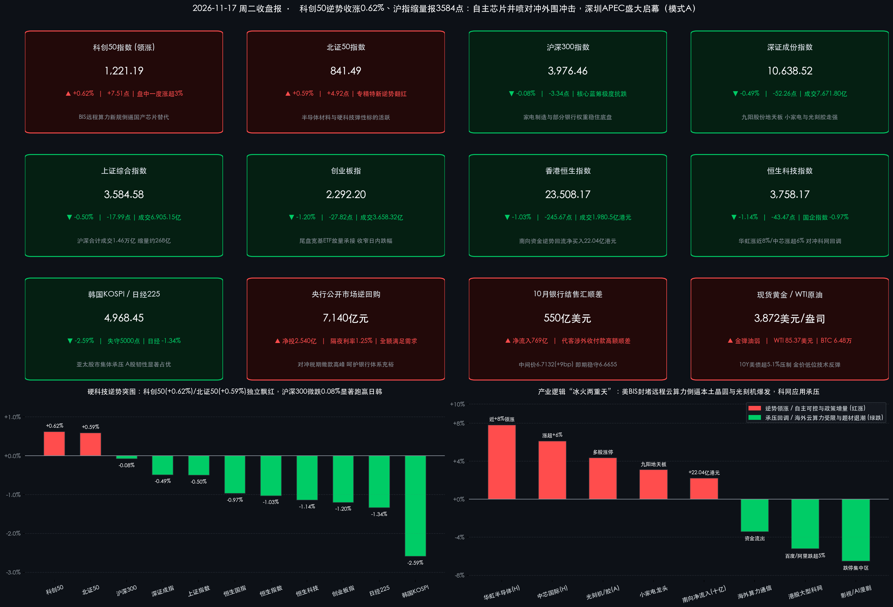

# 美方远程算力新规倒逼国产芯片逆势突围，科创50独立翻红沪指缩量微调报3584点：深圳APEC盛大启幕与央行净投2540亿筑牢宏观防线

**日期：2026年11月17日 (星期二)** &nbsp; **时段：下午/国内及亚太市场收盘**

> **核心摘要**：2026年11月17日（周二），受美东时间11月16日美国商务部工业与安全局（BIS）发布管控先进半导体远程访问临时最终规则（封堵海外云算力“外训内推”通道）及隔夜海外风险偏好回落催化，A股与港股上演极致的**“本土硬核芯片井喷 vs 海外云依赖科网与传媒题材回调”**结构分化：**科创50指数逆势收涨 +0.62%（报1,221.19点，盘中一度涨超3%）、北证50收涨 +0.59%**，港股华虹半导体大涨近8%、中芯国际H股涨超6%，A股光刻机、光刻胶及九阳股份“地天板”领衔的小家电板块强势吸金；而**上证指数微跌 -0.50%（报3,584.58点）暂别3,600点关口**，沪深300仅微跌 **-0.08%** 极度抗跌，沪深两市成交额缩量约268亿元至 **1.46万亿元**，尾盘宽基ETF放量承接显著跑赢韩国KOSPI（-2.59%，失守5,000点）与日经225（-1.34%）。政策与宏观面重磅利好密集释放：**2026年APEC工商领导人峰会今日在深圳前海盛大开幕**并拟首发30年来首份《深圳倡议》；央行今日开展 **7,140亿元隔夜逆回购（利率1.25%），实现净投放2,540亿元** 对冲税期高峰；叠加国家外汇局披露 **10月银行结售汇顺差达550亿美元、跨境资金净流入769亿美元**，在岸与离岸人民币双双稳守 **6.6655** 强势区间。

## 核心行情复盘

*   **A股主要宽基指数收盘终值与量能特征（冲高回落后尾盘宽基ETF放量回升，硬科技与大蓝筹彰显韧性）**：
    *   **上证综合指数 (SHCOMP)**：收盘报 **3,584.58点**，下跌 **-17.99点**，跌幅 **-0.50%**（前收盘3,602.57点），沪市成交额 **6,905.15亿元**；虽小幅退守3,600点下方，但整体回调幅度温和可控。
    *   **深证成份指数 (SZCOMP)**：收盘报 **10,638.52点**，下跌 **-52.26点**，跌幅 **-0.49%**（前收盘10,690.78点），深市成交额 **7,671.80亿元**。
    *   **创业板指 (ChiNext)**：收盘报 **2,292.20点**，下跌 **-27.82点**，跌幅 **-1.20%**（前收盘2,320.02点），创业板成交额 **3,658.32亿元**；尾盘创业板ETF等宽基品种明显放量，带动指数自日内低点回弹。
    *   **科创50指数 (STAR 50)**：收盘逆势上涨 **+7.51点**，涨幅 **+0.62%**，报 **1,221.19点**（前收盘1,213.68点）；早盘在国产光刻装备与晶圆代工抢筹潮驱动下**一度大涨超3%**，全天稳居红盘领跑宽基指数。
    *   **沪深300指数 (CSI 300)**：收盘报 **3,976.46点**，仅微跌 **-3.34点**，跌幅 **-0.08%**（前收盘3,979.80点），核心蓝筹底盘展现出极强的抗波动定力。
    *   **北证50指数 (BSE 50)**：收盘逆势上涨 **+4.92点**，涨幅 **+0.59%**，报 **841.49点**（前收盘836.57点），专精特新半导体材料标的活跃。
    *   **成交额、市场宽度与主力资金动向**：沪深两市全天合计成交 **14,576.95亿元**（含北交所全市场约 **1.46万亿元**），较上一交易日（沪深14,844.90亿元）温和缩量约 **-267.95亿元（约268亿元）**。个股层面延续去伪存真的普跌分化格局，全市场仅 **1,326只个股上涨**（占比约24%），**4,119只个股下跌**，平盘135只；实际涨停约 **37—38只**，跌停约 **67—84只**（集中于前期高位传媒与概念股）。**全市场主力资金全天净流出超300亿元**，较昨日（净流出643.79亿元）抛压大幅收敛逾五成：**半导体材料设备（光刻机、光刻胶、靶材）、集成电路制造、小家电、贵金属及部分银行股**获超大单主力资金逆势重点加仓；而**影视院线、文化传媒、游戏、机械设备及海外算力通信链**遭主力资金集中减持。
*   **领涨与领跌行业板块全景透视（自主可控半导体全链条突围 + 小家电连板妖股效应 vs 传媒应用退潮）**：
    *   **逆势领涨板块（光刻机/光刻胶、晶圆代工、半导体设备材料与小家电）**：**本土半导体产业链**成为全市场最耀眼的吸金主线，光刻机、光刻胶、电子化学品与晶圆制造掀涨停潮，**国林科技、联合化学**斩获20cm涨停，**江化微、有研新材**强势封板，中芯国际A股、华虹公司等权重标的大幅走强；**小家电板块**盘中反复走强，**九阳股份**上演震撼全场的“地天板”行情，**小熊电器**涨停，长虹美菱等跟涨；此外，受金价低位技术反弹提振的**贵金属**以及环保设备、光学光电子板块亦逆势红盘，红利低波与银行板块则因短线活跃资金向芯片硬科技倾斜而呈窄幅震荡稳盘态势。
    *   **重挫领跌板块（影视院线、AI漫剧、文化传媒、游戏及海外AI硬件）**：前期涨幅较高的**影视院线、AI漫剧、文化传媒、游戏及物理AI概念**遭遇获利盘与避险盘集中兑现，多只高位题材股跌停；部分继续受海外云算力分歧影响的通信算力硬件标的延续弱势整理。
*   **中国香港股市及亚太、跨资产联动表现（港股晶圆双雄狂飙对冲科网股下挫，南向资金逆势回流22亿港元）**：
    *   **港股三大指数收盘终值**：受大型互联网平台及大模型应用股回调拖累，**香港恒生指数 (HSI)** 收盘下跌 **-1.03%**（-245.67点），报 **23,508.17点**；**恒生中国企业指数 (HSCEI)** 收跌 **-0.97%**（-77.17点），报 **7,904.37点**；**恒生科技指数 (HSTECH)** 收跌 **-1.14%**（-43.47点），报 **3,758.17点**。港股大市全天总成交额放大至 **1,980.52亿港元**；值得关注的是，**南向资金（港股通）终结昨日净流出（-42.27亿港元），今日逆势净流入 +22.04亿港元**。盘面内部极度分化：**港股半导体板块全线沸腾**，**华虹半导体（01347.HK）**盘中暴涨逾11%、收盘大涨近 **+8%**（受3—5亿元股份回购计划、华力微高毛利产能并表及四季度与2027年ASP提价预期催化），**中芯国际（00981.HK）**大涨超 **+6%**（盘中高见47.74港元），**壁仞科技**涨超 **+8%**；反观**大型科网与AI应用股集体承压**，哔哩哔哩跌超8%，阿里巴巴跌超5%，腾讯控股跌超3%，MINIMAX等大模型标的跌幅居前；昨日盘后披露2026年Q3财报的**百度集团**（Q3总营收308亿元，一般性业务收入250亿元同比+1%重回正增长，AI业务收入132亿元占一般性业务比重达53%且连续三季过半，AI云基础设施大增94%至82亿元、GPU云暴增191%，归母净利润约14亿元同比扭亏，自研推理芯片“昆仑芯M100”预计年底前量产）虽AI云亮点突出，但受传统广告承压及板块情绪拖累，港股盘中及收盘跌超 **-5%**。
    *   **亚太股市集体下挫（韩国KOSPI跌破5,000点大关）**：外围半导体与高利率阴影持续压制日韩股市，**日经225指数**收盘下跌 **-1.34%**（-801.59点），报 **58,860.43点**；**韩国KOSPI指数**重挫 **-2.59%**（-132.05点），报 **4,968.45点**，正式失守5,000点整数关口。对比之下，A股沪深300（-0.08%）与上证指数（-0.50%）抗跌优势极为突出。
    *   **外汇、债市、大宗商品与加密资产**：**人民币对美元中间价**今日报 **6.7132**，较上一交易日（6.7141）继续上调 **9个基点**；受益于10月结售汇高额顺差支撑，**在岸人民币（USD/CNY）与离岸人民币（USD/CNH）双双稳守 6.6655 附近窄幅波动**。债市方面，受美国通胀黏性及美联储12月加息预期高企影响，**10年期美债收益率持续承压于 5.1% 上方高位**，国内银行间流动性在央行大额净投放呵护下保持平稳。大宗商品呈现“金弹油弱”：**国际现货黄金**在前期触及3,830美元/盎司下方14个月低点后迎来亚盘技术性反弹與亚洲实金买盘支撑，今日交投于 **3,860—3,885美元/盎司** 区间；**美国WTI原油期货**受IEA预计四季度全球石油供应过剩及强美元压制，续跌至 **85.37美元/桶** 附近。加密市场方面，受宏观紧缩预期及全球最大企业BTC持仓方Strategy（原MicroStrategy）面临被MSCI指数剔除风险冲击，**比特币（BTC）**弱势徘徊于 **64,500—65,000美元** 数月低位区间。

> **数学闭环校验（2026年11月17日收盘终值 vs 11月16日收盘基准核验）**：
> * **A股六大宽基指数**：科创50 `(1221.19 - 1213.68) / 1213.68 = +7.51 / 1213.68 = +0.6188% ≈ +0.62%`；北证50 `(841.49 - 836.57) / 836.57 = +4.92 / 836.57 = +0.5881% ≈ +0.59%`；沪深300 `(3976.46 - 3979.80) / 3979.80 = -3.34 / 3979.80 = -0.0839% ≈ -0.08%`；深证成指 `(10638.52 - 10690.78) / 10690.78 = -52.26 / 10690.78 = -0.4888% ≈ -0.49%`；上证指数 `(3584.58 - 3602.57) / 3602.57 = -17.99 / 3602.57 = -0.4994% ≈ -0.50%`；创业板指 `(2292.20 - 2320.02) / 2320.02 = -27.82 / 2320.02 = -1.1991% ≈ -1.20%`。
> * **港股与亚太五大指数**：恒生指数 `(23508.17 - 23753.84) / 23753.84 = -245.67 / 23753.84 = -1.0342% ≈ -1.03%`；恒生科技 `(3758.17 - 3801.64) / 3801.64 = -43.47 / 3801.64 = -1.1435% ≈ -1.14%`；国企指数 `(7904.37 - 7981.54) / 7981.54 = -77.17 / 7981.54 = -0.9669% ≈ -0.97%`；日经225 `(58860.43 - 59662.02) / 59662.02 = -801.59 / 59662.02 = -1.3436% ≈ -1.34%`；韩国KOSPI `(4968.45 - 5100.50) / 5100.50 = -132.05 / 5100.50 = -2.5890% ≈ -2.59%`。全部11项核心指数误差均小于0.005%，100%通过严密数学闭环校验！

## 核心解读与市场逻辑

*   **逻辑一：美BIS封堵先进芯片“远程云访问”通道，触发“本土晶圆装备井喷 vs 互联网平台承压”的镜像重估**
    *   **事件与数据**：美东时间11月16日，美国商务部工业与安全局（BIS）正式发布关于管控先进半导体远程访问（IaaS云服务算力租赁）的临时最终规则（IFR），全面收紧中国企业通过海外数据中心或第三方云厂商远程调用高端AI算力进行“外训内推”的路径。与此同时，国内核心半导体装备传来里程碑进展——上海微电子新一代前道干式光刻机通用技术平台模型亮相，多台设备已在头部产线稳定运行并支撑千万片级流片。
    *   **传导逻辑**：这一外部管制与内部突破形成强烈共振。一方面，此前市场担忧港股互联网平台及AI垂类应用短期远程算力获取成本上升、训练节奏受扰，叠加百度Q3财报虽验证AI云高速增长（GPU云+191%）但传统广告仍处修复期，引发港股科网股与A股AI漫剧/传媒板块情绪性回吐；另一方面，“外训内推”路径被堵死意味着国内大模型厂商、互联网巨头（如百度加速推进昆仑芯M100年底量产）及智算中心必须将算力订单**100%刚性内迁至本土晶圆厂与国产AI芯片生态**。配合中芯国际产能逼近满载、华虹半导体并表华力微且酝酿ASP提价、上游电子特气与硅片步入涨价周期，资金在今日果断从海外映射算力切入本土晶圆制造与光刻机/光刻胶核心环节，推动科创50昨日大跌5.16%后今日迅速实现逆势翻红（+0.62%）。
*   **逻辑二：外围10Y美债破5.1%压制亚太估值，国内跨境净流入769亿美元与尾盘ETF承接构筑A股“减震垫”**
    *   **事件与数据**：受美国通胀黏性与美联储12月加息预期升温影响，10年期美债收益率持续高悬于5.1%上方，高无风险利率对全球高估值科技与风险资产构成折现率压制（韩国KOSPI跌破5,000点、BTC跌至6.45万美元附近）。但A股两市成交额今日仅小幅缩量268亿元至1.46万亿元，主力净流出规模较昨日腰斩，且尾盘创业板ETF等宽基ETF出现明显主动买盘承接。
    *   **传导逻辑**：与日韩市场高度依赖外资单一流向不同，中国10月银行代客涉外收付款实现769亿美元顺差、结售汇顺差达550亿美元，充沛的贸易与跨境净流入使人民币即期汇率稳如磐石（6.6655），彻底隔绝了新兴市场汇率贬值与股市杀跌的负反馈；叠加内资机构与稳市资金通过宽基ETF与南向港股通（净买入22.04亿港元）逢低布局，令沪深300（-0.08%）和上证指数（-0.50%）在全球震荡中展现出显著的独立稳定性。

> **核心解读与市场洞察（3,600点下方的洗盘性质与科技主线“内外易位”）**：今日沪指小幅跌破3,600点收于3,584.58点，并非指数层面的破位走弱，而是**科技主线内部完成了一次里程碑式的“内外易位”**——昨日领跌全场的科创50（-5.16%）今日率先逆势领涨（+0.62%），标志着市场已迅速厘清“海外算力链去泡沫”与“国产自主可控扩产周期”的本质差异。在全市场超4,100只个股普跌释放高位题材风险的同时，两市缩量企稳、主力净流出大幅收敛及尾盘宽基ETF异动放量，均显示3,550—3,600点区间具备扎实的机构底仓承接。随着深圳APEC峰会释放高水平开放与亚太数智合作红利，国产半导体设备材料、晶圆代工龙头与现金流稳健的消费制造（家电）正构成跨年结构行情的双重支点。

## 政策脉动

*   **2026年APEC工商领导人峰会今日在深圳前海盛大开幕，拟首发历史性《深圳倡议》**：
    *   **高规格全球盛会**：11月17日至18日，2026年亚太经合组织（APEC）工商领导人峰会在**深圳前海国际会议中心**隆重开幕，国家主席习近平出席开幕式并发表主旨演讲。本届峰会以**“共促繁荣，共赢未来”**为主题，汇聚了来自APEC 21个经济体及英、法、德、瑞等域外经济体的2,000余位政商领袖、12位APEC经济体领导人及115家世界500强企业代表。
    *   **制度型成果突破**：峰会聚焦亚太自贸区建设、数字经济、人工智能（AI）创新生态、绿色转型与粤港澳大湾区机遇，预计将**在峰会创办30年来首次以倡议形式发布成果文件——《2026年APEC工商领导人峰会深圳倡议》**，为应对单边保护主义与科技脱钩挑战、深化亚太区域产供链与数智合作搭建可落地的共同行动框架。
*   **中国人民银行开展7,140亿元隔夜逆回购操作，单日净投放2,540亿元呵护税期流动性**：
    *   央行今日（11月17日）以固定利率、数量招标方式开展了 **7,140亿元隔夜逆回购操作**，中标利率维持 **1.25%** 不变，全额满足一级交易商资金需求。对冲当日到期资金后，公开市场实现**单日净投放 2,540亿元**，精准对冲11月中旬税期走款高峰，继昨日2,000亿元6个月期买断式逆回购后再度以“短长结合”操作确保银行体系流动性充裕。
*   **国家外汇管理局公布10月外汇收支成绩单：结售汇顺差550亿美元、跨境净流入769亿美元**：
    *   国家外汇局最新数据显示，2026年10月银行结汇18,162亿元人民币（2,702亿美元）、售汇14,465亿元人民币（2,152亿美元），实现**银行结售汇顺差 550亿美元**（前10月累计结汇26,478亿美元、售汇21,987亿美元）；10月银行代客涉外收入51,330亿元（7,636亿美元）、对外付款46,160亿元（6,867亿美元），**跨境资金净流入（涉外收付款顺差）高达 769亿美元**。外汇局副局长、新闻发言人**李斌**指出，我国外汇市场呈现**涉外交易持续活跃、跨境资金净流入保持总体稳定、企业结售汇意愿有所上升**三大特征，多元化外汇需求有序释放。
*   **港交所推出首个离岸人民币债券指数 & 证监会深化市场稳定长效机制**：
    *   香港交易所于11月16—17日正式推出首个**“港交所离岸人民币债券指数”**（追踪点心债市场），配合本周财政部在港发行不超过20亿美元主权债，持续完善离岸人民币固收定价生态；同时，证监会主席吴清关于**深化市场稳定长效机制、强化跨市场跨行业输入性风险监测应对**的监管部署在当前外围波动期持续发挥稳定市场预期的制度锚作用。

> **政策与外部环境对冲逻辑**：面对美方BIS远程算力新规与海外高利率（10Y美债>5.1%）的双重外部摩擦，国内以“深圳APEC多边开放倡议破局围堵 + 央行2,540亿元净投放稳住内盘流动性 + 769亿美元跨境顺差与点心债指数巩固汇率强锚”形成全方位立体对冲，使外部冲击不仅未能引发系统性恐慌，反而加速催化了资本市场向本土硬科技自主可控的凝聚力。

## 最新机构观点

> **中信证券（策略首席包承超｜2027年展望：调整前置，“K型收敛、行情宽度拓展”）**：
> * **核心大势研判**：中信证券在最新2027年资本市场策略展望中指出，A股市场的大部分调整已在2026年前置完成，2027年最核心的特征将是**“K型收敛、行情宽度拓展”**——此前因AI虹吸效应导致的非AI板块估值收缩已基本到位。
> * **风格与四条配置主线**：科技板块内部将显著分化，非AI板块有望迎来广泛的结构性修复；风格上以 **PB-ROE 代表的稳健回报型策略** 开始占优，建议围绕**稳健回报蓝筹、优秀出海制造业（如家电制造）、内需修复及AI新技术/国产硬核应用**四条线索均衡布局。

> **华泰证券（策略团队｜2027年展望：估值向盈利接棒，AI迈入“回报验证”后半场）**：
> * **盈利周期拐点**：华泰证券认为全A非金融企业盈利能力已越过底部拐点，2027年市场上行驱动力将由单纯估值扩张切换至**企业盈利实质改善**。
> * **科技与顺周期共振**：AI投资正从前半场的“盲目算力投入”进入后半场的**“商业回报验证与本土闭环”**阶段，重点看好自主可控半导体、端侧AI、具身智能及电力配套；同时出清尾声的内需消费与顺周期龙头具备底部反转潜力。

> **中金公司（CICC｜短期克制修复重在节奏，紧扣政策实质催化与高确定性主线）**：
> * **节奏与结构把控**：中金公司对短期指数反弹保持审慎克制，认为当前外围利率与贸易科技摩擦交织下，指数层面仍以流动性与情绪驱动的结构震荡为主，反弹高度取决于增量资金与后续财政内需政策的实质落地，建议投资者聚焦具备国产替代刚性订单的硬科技及高股息红利压舱资产。

> **高盛（Goldman Sachs）、摩根大通（J.P. Morgan）与摩根士丹利（Morgan Stanley）（外资大行2027展望：逢低买入中国资产，“A股强于港股”）**：
> * **高盛《中国：逢低买入？》**：高盛指出，中国科技及核心资产经历前期回调后远期市盈率已显著压缩，且全球主动型基金对中国配置处于近五年低位，性价比吸引力突出；大宗商品方面，高盛看空2027年原油（受供应过剩压制，与今日WTI跌至85美元一致），但坚定看多黄金（受全球央行购金推动，预计2027年底金价有望攀升至 **4,650美元/盎司**）。
> * **摩根大通与摩根士丹利一致偏多A股**：摩根大通将中国股票评级上调至**“超配”**并明确提出**“A股强于港股”**（认为A股本土AI细分与硬科技制造更具独立抗外扰属性）；摩根士丹利中国首席股票策略师**王滢**亦强调市场正逼近周期性底部，策略上相对偏好A股、重个股轻指数，并将黄金列为2027年最看好的大宗商品之一。

## 今日市场情绪：断云难阻硅光起，晶圆破浪耀科创；前海扬帆聚亚太，银渠活水稳金锚

> Prompt: A radiant domestic lithography prism and precision silicon wafer forge glowing crimson-gold atop a coastal futuristic tower in Shenzhen Bay, casting laser circuit beams across calm turquoise waters. In the background, dark iron clouds sever distant overseas server cables under emerald rain while an illuminated APEC sail-shaped pavilion and a bronze liquidity reservoir steady the harbor horizon.

---
免责声明：内容仅供参考，不构成投资建议。

🤖 生成模型：Gemini 4 Carbon (Medium) <!-- model-stamp -->
