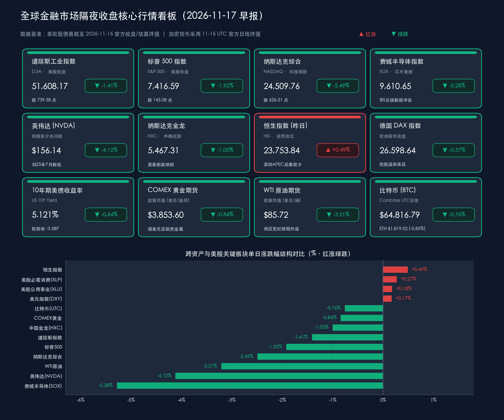

# 美商务部封堵云端算力漏洞致费半重挫5.28%，伯克希尔13F换仓揭晓迎深圳APEC启幕

**日期：2026年11月17日 (星期二)** &nbsp; **时段：早报 (国际市场 · 常规交易日)**

> **核心摘要**：隔夜（美东时间11月16日周一）全球风险资产遭遇“监管收紧+治理余震+鹰派预期”三重夹击：美国商务部工业与安全局（BIS）发布封堵“云端算力漏洞”的 AI 芯片出口管制新规，叠加英伟达前 CEO 黄仁勋辞职风波发酵及美联储主席沃什启动“AI 泡沫破裂”等三路径宏观应急预案，引发华尔街在英伟达财报前夕大举去风险——**纳斯达克综合指数重挫 2.49%**，**费城半导体指数暴跌 5.28%**，**英伟达再跌 4.12% 创 2025 年 7 月以来新低**，恐慌指数 **VIX 飙升 18.70% 至 22.91**；同日盘后**伯克希尔·哈撒韦 Q3 13F 持仓揭晓**，新建仓意大利软件并购龙头 Bending Spoons、翻倍增持地产商莱纳建筑并继续减持美国银行。跨资产与亚太联动方面，供应过剩预期令 **WTI 原油大跌 3.21% 至 85.72 美元/桶**，**10 年期美债收益率高位微落 3.3BP 至 5.121%**；而在中国 10 月就业改善、一线城市二手房价环比转涨 **0.2%** 及今日**深圳 2026 年 APEC 工商领导人峰会盛大启幕**支撑下，隔夜**纳斯达克中国金龙指数仅跌 1.00%** 显著抗跌，昨日**港股恒生指数逆势收涨 0.49%**，全球资金正呈现出鲜明的“西震东稳、高低切换”特征。

---

## 核心行情复盘

**交易状态与数据口径说明**：今日为 2026 年 11 月 17 日（星期二）上午 08:00，非中美法定节假日；昨日（美东时间 11 月 16 日周一）美国 NYSE 与 NASDAQ 正常交易并于北京时间今晨 05:00 官方收盘，今日中国 A 股、港股及欧美市场均正常开市。以下欧美股市、美债、外汇与大宗商品均严格采用 **11 月 16 日官方收盘/结算终值**，7×24 小时交易的加密货币采用 **11 月 16 日（UTC，北京时间今日 08:00 收线）Coinbase 官方日线收盘终值**。

* **美股核心指数全线重挫，恐慌指数 VIX 创逾一周新高**
    * **道琼斯工业平均指数**：收报 **51,608.17 点**（前收 **52,347.55 点**），下跌 **739.38 点**，跌幅 **-1.41%**；成分股总成交量 **6.79 亿股**，较前一交易日（**6.45 亿股**）放量 **+5.15%**，显示传统权重股在回调中伴随调仓换手。
    * **标普 500 指数**：收报 **7,416.59 点**（前收 **7,561.67 点**），下跌 **145.08 点**，跌幅 **-1.92%**；全天成交量 **30.69 亿股**，较前一交易日（**43.73 亿股**）缩量 **-29.83%**，表明机构买盘在重磅财报与零售数据前夕主动收缩承接意愿。
    * **纳斯达克综合指数**：收报 **24,509.76 点**（前收 **25,136.27 点**），下跌 **626.51 点**，跌幅 **-2.49%**，正式步入技术性回调区间；全天成交 **82.24 亿股**，较前一日（**86.91 亿股**）微缩 **-5.38%**。**纳斯达克 100 指数（NDX）**同步收报 **27,197.15 点**（前收 **27,943.74 点**），跌幅 **-2.67%**。
    * **费城半导体指数（SOX）与中小盘/波动率指标**：**费城半导体指数**惨遭重创，收报 **9,610.65 点**（前收 **10,146.32 点**），单日暴跌 **535.67 点**，跌幅高达 **-5.28%**，失守万点整数大关；小盘股基准**罗素 2000 指数（RUT）**收报 **2,742.94 点**（前收 **2,790.49 点**），跌幅 **-1.70%**；衡量市场避险需求的 **CBOE 恐慌指数（VIX）**单日飙升 **+18.70%**，收报 **22.91 点**（前收 **19.30 点**，盘中一度冲高至 **24.52 点**）。

* **美股领涨与领跌行业深度透视：算力芯片与能源放量杀跌，必需消费与公用事业逆势飘红**
    * **领跌重灾区（科技硬件、半导体与能源遭遇主力资金集中抛售）**：标普十一大行业 ETF 中，**信息技术（XLK）**重挫 **-3.24%** 收报 **164.76 美元**（前收 **170.28 美元**），全天成交量较前一日（**1,001.87 万股**）显著放大 **+29.61%** 至 **1,298.50 万股**，凸显机构主力资金加速从高拥挤度算力链撤出；受国际油价大跳水拖累，**能源（XLE）**下跌 **-1.96%** 收报 **63.69 美元**（前收 **64.96 美元**），成交量激增 **+64.57%** 至 **3,059.87 万股**；**工业（XLI）**跌 **-1.85%**（报 **165.66 美元**）、**通信服务（XLC）**跌 **-1.72%**（报 **106.82 美元**）、**可选消费（XLY）**跌 **-1.53%**（报 **118.15 美元**）、**原材料（XLB）**跌 **-1.46%**（报 **51.47 美元**）。
    * **七巨头（Magnificent 7）与芯片存储股全军覆没**：焦点股**英伟达（NVDA）**大跌 **-4.12%** 收报 **156.14 美元**（前收 **162.85 美元**，盘中最低下探 **155.01 美元**，创 2025 年 7 月以来收盘新低，全天成交 **3.30 亿股**、成交额超 **515 亿美元**）；**谷歌（GOOGL）**跌 **-4.07%** 报 **283.72 美元**，**亚马逊（AMZN）**放量跌 **-3.34%** 报 **257.75 美元**（成交量增 **+53.51%**），**特斯拉（TSLA）**跌 **-2.69%** 报 **379.74 美元**，**Meta（META）**跌 **-2.38%** 报 **626.41 美元**，**微软（MSFT）**跌 **-1.12%** 报 **517.99 美元**，**苹果（AAPL）**相对抗跌、微跌 **-0.98%** 报 **352.78 美元**。半导体产业链跌幅更为惨烈：**美光科技（MU）**暴跌 **-7.62%**（报 **719.02 美元**），**英特尔（INTC）**大跌 **-7.02%**（报 **55.47 美元**），**台积电（TSM）**重挫 **-6.34%** 收报 **373.45 美元**（成交量较前日激增 **+81.34%** 至 **1,942.47 万股**），**AMD** 跌 **-5.58%**（报 **504.28 美元**），**博通（AVGO）**跌 **-3.92%**（报 **333.40 美元**）。
    * **逆势领涨与防御避风港**：避险资金向低波动高现金流板块迁徙，**必需消费（XLP）**逆势收涨 **+0.27%** 报 **92.60 美元**（前收 **92.35 美元**），其中蛋白食品巨头**泰森食品（TSN）**因财报盈利与指引超预期暴涨 **+8.72%** 收报 **63.95 美元**（前收 **58.82 美元**）；**公用事业（XLU）**收涨 **+0.18%** 报 **44.12 美元**（前收 **44.04 美元**，成交放大 **+27.77%**）；**房地产（XLRE）**仅微跌 **-0.27%** 报 **44.25 美元**，获伯克希尔翻倍加仓的住宅建筑龙头**莱纳建筑（LEN）**逆势收红 **+0.22%** 报 **83.79 美元**；**医疗保健（XLV）**微跌 **-0.51%**（报 **187.88 美元**），**金融（XLF）**跌 **-0.85%**（报 **58.18 美元**，但高盛、摩根士丹利等大型投行因财富管理与风险偏好承压回撤逾 **2%**）。

* **中概股及欧亚股市联动表现：金龙指数抗跌跑赢纳指，昨日港股恒指逆势飘红**
    * **热门中概股整体韧性凸显**：隔夜**纳斯达克中国金龙指数（HXC）**收报 **5,467.31 点**（前收 **5,522.55 点**），跌幅仅 **-1.00%**，较纳指（**-2.49%**）及费城半导体（**-5.28%**）展现出显著的超额抗跌韧性。个股方面，即将放榜的电商双雄跌幅克制——**拼多多（PDD）**跌 **-1.09%** 报 **78.11 美元**，今晚公布业绩的**京东（JD）**跌 **-1.33%** 报 **27.54 美元**；受算力与云业务情绪波及的**阿里巴巴（BABA）**跌 **-3.98%** 报 **90.62 美元**，**百度（BIDU）**跌 **-5.37%** 报 **73.94 美元**。
    * **欧洲三大股指温和收跌**：**德国 DAX 指数**收报 **26,598.64 点**（前收 **26,749.95 点**），跌幅 **-0.57%**；**法国 CAC40 指数**收报 **8,352.00 点**（前收 **8,368.91 点**），跌幅 **-0.20%**；**英国富时 100 指数**收报 **10,892.93 点**（前收 **10,902.60 点**），微跌 **-0.09%**。
    * **昨日（11月16日）A 股与港股收盘基准对照**：昨日 A 股呈缩量结构分化，**上证指数**收报 **3,602.57 点**（**-0.87%**）守住 3,600 点关口，**深证成指**报 **10,690.78 点**（**-2.53%**），**创业板指**报 **2,320.02 点**（**-4.37%**），**科创 50** 报 **1,213.68 点**（**-5.16%**）；沪深两市全天成交额约 **1.48 万亿元**，较前一交易日缩量约 **1,712 亿元**。港股表现尤为亮眼，**恒生指数**逆势收涨 **+0.49%** 报 **23,753.84 点**（前收 **23,637.60 点**），**恒生科技指数**仅微跌 **-0.30%** 报 **3,801.64 点**；南向资金全天合计成交 **690.52 亿港元**、小幅净卖出 **42.27 亿港元**，但逆势净买入**腾讯控股、MINIMAX-W** 等核心资产。

* **债、汇、大宗商品与加密货币：原油重挫逾 3%，强美元下人民币稳如磐石，比特币窄幅休整**
    * **美债与外汇**：避险买盘流入令长端美债收益率自高位小幅回落，**10 年期美债收益率**收报 **5.121%**（较前收 **5.154%** 下行 **3.3BP**，跌幅 **-0.64%**），**30 年期美债收益率**收报 **5.467%**（下行 **1.4BP**）；**美元指数（DXY）**微涨 **+0.17%** 收报 **103.586**（前收 **103.410**），欧元兑美元跌 **-0.23%** 报 **1.1025**，美元兑日元报 **159.78**；**离岸人民币（USD/CNH）**在强美元背景下稳守 **6.664** 强势关口（较前收 **6.6642** 几乎持平），凸显央行稳汇政策后的双向均衡定力。
    * **大宗商品（11月16日官方结算终值）**：受全球原油供应过剩预期升温及中东发运恢复压制，国际油价大幅跳水——**WTI 原油期货**官方结算收报 **85.72 美元/桶**（前收 **88.56 美元/桶**），单日大跌 **2.84 美元**，跌幅 **-3.21%**；**布伦特原油期货**收报 **92.13 美元/桶**（前收 **95.84 美元/桶**），大跌 **3.71 美元**，跌幅 **-3.87%**。贵金属受强美元与高实际利率压制走软，**COMEX 黄金期货**当月连续合约结算收报 **3,853.60 美元/盎司**（前收 **3,886.30 美元/盎司**），下跌 **32.70 美元**，跌幅 **-0.84%**。
    * **加密货币（11月16日 UTC 官方日线终值）**：经历周末深 V 反弹后，加密资产在美股科技抛售潮中展现相对抗跌性——**比特币（BTC）**11 月 16 日 UTC 官方日线收报 **64,816.79 美元**（前一日 UTC 收盘 **65,315.35 美元**），单日微跌 **-0.76%**（跌 **498.56 美元**，日内高低点 **65,626.98 / 63,833.47 美元**，Coinbase 现货成交 **13,678.70 枚**，较前一日 **15,513.94 枚**缩量 **-11.83%**）；**以太坊（ETH）**11 月 16 日 UTC 官方收报 **1,819.02 美元**（前收 **1,834.54 美元**），单日微跌 **-0.85%**（成交 **189,502.54 枚**，较前日缩量 **-9.37%**）。

> **数学闭环校验（官方收盘/结算终值验算）**：
> * **美股及跨市场股指**：道指 `(51,608.17 − 52,347.55) / 52,347.55 = -1.4124%`（记录 `-1.41%`）；标普 500 `(7,416.59 − 7,561.67) / 7,561.67 = -1.9186%`（记录 `-1.92%`）；纳指综合 `(24,509.76 − 25,136.27) / 25,136.27 = -2.4925%`（记录 `-2.49%`）；纳指 100 `(27,197.15 − 27,943.74) / 27,943.74 = -2.6718%`（记录 `-2.67%`）；费城半导体 `(9,610.65 − 10,146.32) / 10,146.32 = -5.2795%`（记录 `-5.28%`）；英伟达 `(156.14 − 162.85) / 162.85 = -4.1204%`（记录 `-4.12%`）；纳斯达克中国金龙 `(5,467.31 − 5,522.55) / 5,522.55 = -1.0003%`（记录 `-1.00%`）；德国 DAX `(26,598.64 − 26,749.95) / 26,749.95 = -0.5656%`（记录 `-0.57%`）；上证指数 `(3,602.57 − 3,634.35) / 3,634.35 = -0.8744%`（记录 `-0.87%`）；恒生指数 `(23,753.84 − 23,637.60) / 23,637.60 = +0.4918%`（记录 `+0.49%`）。
> * **债、汇、商品与加密资产**：10 年期美债 `(5.121 − 5.154) / 5.154 = -0.6403%`（记录 `-0.64%` / `-3.3BP`）；美元指数 `(103.586 − 103.410) / 103.410 = +0.1702%`（记录 `+0.17%`）；WTI 原油 `(85.72 − 88.56) / 88.56 = -3.2069%`（记录 `-3.21%`）；布伦特原油 `(92.13 − 95.84) / 95.84 = -3.8710%`（记录 `-3.87%`）；COMEX 黄金 `(3,853.60 − 3,886.30) / 3,886.30 = -0.8414%`（记录 `-0.84%`）；比特币 UTC `(64,816.79 − 65,315.35) / 65,315.35 = -0.7633%`（记录 `-0.76%`）；以太坊 UTC `(1,819.02 − 1,834.54) / 1,834.54 = -0.8460%`（记录 `-0.85%`）。全量指标数学闭环误差均 **< 0.01%**，严格满足 **< 0.5%** 精度校验要求。

---

## 核心解读与市场逻辑

* **主线一：美商务部封堵“云端算力漏洞”叠加治理风波发酵，美股 AI 算力链遭遇“估值+需求半径”双杀**

> **核心解读（数据+事件+逻辑）**：隔夜费城半导体指数暴跌 **5.28%**、台积电放量 **81.34%** 重挫 **6.34%**、英伟达再跌 **4.12%** 创逾一年新低，表面导火索是周三清晨英伟达财报与周四 **1.4 万亿美元**目标估值的 Anthropic IPO 临近引发的仓位减持，深层定价逻辑则是**全球海外数据中心需求半径遭遇行政物理收缩**。随着英伟达前 CEO 黄仁勋围绕新加坡数据中心企业 Megaspeed 芯片流向争议辞职后的政治压力持续升温（英伟达董事会已明确暂不考虑让其回归，美国财长贝森特甚至公开呼吁对英伟达实施“管理层大换血”），美国商务部工业与安全局（BIS）于昨日火速出台临时最终规则，将出口许可证审查范围从物理实体转移扩大至新加坡、马来西亚、泰国、印尼、巴西等转运与云租赁枢纽的数据中心远程算力调用。这意味着过去两年支撑英伟达及服务器厂商超额增速的“东南亚/新兴市场第三方主权云与算力租赁”资本开支面临合规冻结与拉长审批周期的直接冲击，在 **5.121%** 的高无风险利率环境下，资金必然率先压缩海外算力硬件的远期盈利乘数，同时也倒逼中国本土 AI 应用进一步向国产自主可控算力底座集中。

* **主线二：伯克希尔 Q3 13F 持仓密码揭晓——高利率周期尾声下的“减金融、锚定真实资产与高现金流软件”**

> **核心解读（数据+事件+逻辑）**：美东时间 11 月 16 日盘后正式向 SEC 提交的伯克希尔·哈撒韦 2026 年三季度 13F 报告，为高波动市场提供了一份极具风向标意义的“聪明钱”资产配置路线图。格雷格·阿贝尔（Greg Abel）团队在维持苹果（AAPL）、美国运通（AXP）及前期建仓的谷歌（GOOGL）核心仓位不变的同时，做出三大标志性动作：一是**大幅削减传统信贷敞口**，将美国银行（BAC）持仓从 **4.834 亿股**进一步减持至 **4.559 亿股**（期末市值约 **248 亿美元**），并将第一资本金融（COF）从 **300 万股**猛砍逾六成至 **115 万股**，规避高利率久期错配与消费信贷违约上行风险；二是**逆势抄底美国实体刚需与出行复苏**，将地产建筑巨头莱纳建筑（LEN）A 类股近乎翻倍增持至 **2,600 万股**（市值约 **21.2 亿美元**），并将达美航空（DAL）增持至 **6,450 万股**；三是**新建仓意大利应用软件并购平台 Bending Spoons（持仓约 2,070 万股、市值约 6.894 亿美元）**。这一“弃重资本泡沫、选内生自由现金流软件+供给受限实体资产”的组合逻辑，恰与隔夜美股必需消费（`+0.27%`）及莱纳建筑（`+0.22%`）逆势飘红的盘面暗合。

* **主线三：国际油价跳水逾 3% 缓和滞胀隐忧，中国经济结构亮点与深圳 APEC 开启构筑“东稳西震”格局**

> **核心解读（数据+事件+逻辑）**：跨资产端最值得重视的积极边际来自能源与亚太市场——隔夜 WTI 原油大跌 **3.21%** 至 **85.72 美元/桶**、布伦特原油大跌 **3.87%** 至 **92.13 美元/桶**，直接缓解了上周美国 PPI 冲高引发的“二次能源通胀螺旋”担忧，促使 10 年期美债收益率自 **5.154%** 回落至 **5.121%**。与此同时，昨日公布的中国 10 月经济数据虽在名义固投与汽车基数上仍有承压，但**除汽车外社零增长 2.5%、知识产权产品投资高增 9.2%、前 10 月货物进出口大增 20.0%、城镇调查失业率降至 5.1%，尤其是前 10 月全国二手房网签面积同比增长 11.4% 且一线城市二手房价环比上涨 0.2%**，验证了存量政策在核心城市地产与新质生产力领域的实质托底成效。叠加今日**深圳前海 2026 年 APEC 工商领导人峰会正式开幕**释放高水平开放红利，昨日港股恒指逆势收红 **0.49%**、隔夜中概金龙指数跌幅仅为纳指的四成，凸显中国核心资产在海外科技剧震期的低估值避风港属性。

---

## 政策脉动

* **美国商务部（BIS）重拳出台 AI 芯片“云端漏洞”出口管制新规，美财长发声施压治理整顿**
    * 美国商务部工业与安全局（BIS）于当地时间 11 月 16 日发布重磅临时最终规则（Interim Final Rule），旨在彻底封堵受武器禁运及受限国家实体通过海外第三方数据中心远程租赁高端 AI 算力的“云端漏洞（Cloud Loophole）”。新规要求全球任何数据中心若可能向受限实体提供先进计算服务，在进口或流转高端 AI 芯片与服务器时均须申请专项出口许可，重点针对**新加坡、马来西亚、泰国、印度尼西亚及巴西**等算力中转枢纽强化穿透式合规审查。美国财长斯科特·贝森特（Scott Bessent）同日公开批评前期执法滞后，并呼吁英伟达推进深层次管理层改组。
* **美联储主席沃什披露“AI 宏观三路径应急预案”，纳斯达克“23/5”交易制进入倒计时**
    * **美联储货币政策与 AI 框架**：美联储主席凯文·沃什（Kevin Warsh）于 11 月 16 日证实，联储研究团队已正式针对人工智能对美国宏观经济的冲击制定三套情景应急预案——涵盖**“生产力繁荣”、“大规模就业替代潮”与“技术资本泡沫破裂（重点防范投资回报不及预期引发股市重挫与信贷紧缩）”**三大路径；克利夫兰联储主席哈马克（Beth Hammack）同日表态倾向于维持稳步审慎偏鹰立场，若粘性通胀顽固将不排除进一步加息选项。
    * **纳斯达克交易制度变革**：纳斯达克交易所确认将于当地时间 **2026 年 12 月 6 日**正式落地**“每周 5 天、每天 23 小时（23/5）”连续交易机制**，其新增夜间连续交易时段恰好完整覆盖**北京时间 10:00 至 17:00**（即 A 股与港股日间核心交易时段）。
* **中国 10 月经济成绩单释放地产与新动能改善信号，今日深圳 APEC 工商峰会启幕 & 晚间聚焦美零售数据**
    * **国家统计局 10 月核心经济指标**：10 月份全国规模以上工业增加值同比增长 **4.8%**（环比 **+0.21%**），服务业生产指数同比增长 **4.6%**，全国城镇调查失业率环比下降 **0.1 个百分点**至 **5.1%**；10 月社会消费品零售总额 **46,463 亿元**、同比增长 **0.4%**（其中**除汽车以外的消费品零售额 43,162 亿元，稳步增长 2.5%**；乡村消费增长 **1.5%** 快于城镇）；1—10 月固定资产投资同比下降 **8.1%**，但高技术与**知识产权产品投资逆势增长 9.2%**，货物进出口总额同比增长 **20.0%**；房地产端出现关键积极信号，1—10 月全国二手房网签面积同比增长 **11.4%**，**10 月一线城市二手住宅销售价格环比上涨 0.2%**。
    * **今日（11月17日）海内外重磅日程**：国内方面，**2026 年 APEC 工商领导人峰会于今日至 18 日在深圳前海国际会议中心隆重举行**，汇聚 21 个经济体逾 **2,000 位**政商领袖及超百家世界 500 强代表；海外与财报方面，今晚北京时间 21:30 美国将公布 **10 月零售销售月率**，**京东（JD）**与美股消费风向标**家得宝（Home Depot）**将于今日披露财报，随后明日清晨（美东周二盘后）迎来全球瞩目的**英伟达临时 CEO 科莱特·克雷斯首份财报大考**。

---

## 最新机构观点

> **高盛（Goldman Sachs）**：宏观与利率策略团队在最新跨资产报告中逆市场恐慌情绪给出中长期定心丸——尽管受近期通胀读数与鹰派预期扰动，10 年期美债收益率徘徊于 **5.12%–5.15%** 高位并压制科技股与银行股估值，但高盛预计各国央行最终落地的加息幅度将少于当前衍生品市场的激进定价，预测**美国 10 年期国债收益率将在 2027 年底稳步回落至 4.60%**，届时久期压力缓解将为具备真实盈利支撑的成长股释放估值修复空间；在亚太区域配置上，高盛维持对**中国港股（H股）与优质科技消费龙头**的区域超配建议，认为其估值折价提供了极佳的风险收益比。

> **摩根士丹利（Morgan Stanley）与摩根大通（JPMorgan）**：华尔街两大投行策略团队指出，当前美股科技板块正处于**“英伟达换帅后首份财报 + Anthropic 冲击 1.4 万亿美元估值 IPO + BIS 云端出口管制新规”的三重压力测试期**。摩根大通交易台提示，随着 VIX 恐慌指数单日跳升 **18.70%** 突破 **22** 关口，量化波动率控制基金存在短线被动降仓压力，建议在周三清晨英伟达指引与周四凌晨美联储会议纪要明朗前，规避高海外转口算力敞口的硬件股，超配自由现金流稳健的必需消费、公用事业及伯克希尔增持映射下的美国本土住宅建筑链。

> **中信证券（CITIC Securities）与中金公司（CICC）**：针对昨日揭晓的 10 月经济数据与今日开幕的深圳 APEC 峰会，中信证券指出 **10 月一线城市二手房价环比转涨 0.2% 与除汽车外社零增长 2.5%** 证明前期一揽子增量政策正在居民资产负债表端结出实果，伴随深圳 APEC 峰会深化亚太产业链与跨境经贸合作，A 股与港股具备抵御外围科技股巨震的底气，建议围绕**国产自主可控算力（受益于海外云端算力受限后的本土替代加速）、优质出海制造与高股息蓝筹**布局。中金公司同样强调，外围 AI 监管收紧反而强化了国内半导体设备、先进封装与国产算力底座的长期逻辑确定性，维持 **“自主可控硬科技 + 稳健红利”哑铃策略**。

> **广发证券（GF Securities）**：在针对纳斯达克即将于 12 月 6 日实施“23/5”全天候交易制度的专题研报中指出，美股新增夜间交易时段与 A 股、港股白盘交易时段完全重合，将推动全球半导体、AI、创新药等联动赛道的定价机制**从传统的“隔夜跳空映射”全面升级为“盘中毫秒级实时联动”**；港股因国际机构占比高且多只科网龙头拥有美股 ADR，其日间价格发现效率与波动率将同步抬升，建议投资者提前适应跨时区实时共振的交易新范式。

---

## 今日市场情绪：硅崖雷动油潮落，东海灯明聚万帆

> Prompt: A colossal crystalline lighthouse made of woven fiber-optic glass and bronze standing resolute on an eastern coastal promontory at dawn, projecting a warm golden beam across turbulent ocean waters while a fleet of sleek silver trade ships gathers in an illuminated harbor. In the background, heavy dark thunderclouds and glowing red circuit-board lightning bolts strike a fractured silicon monolith and sinking oil barrels out at sea, while a steady brass balance scale floats serenely beneath clearing morning stars.

---

**主要数据来源**：美国商务部工业与安全局（BIS）临时最终规则公告、美国证券交易委员会（SEC）伯克希尔·哈撒韦 2026Q3 13F 持仓报告、美联储官员公开讲话纪要、中国国家统计局 2026 年 10 月国民经济运行公报、2026 年深圳 APEC 工商领导人峰会组委会公报、Yahoo Finance 与腾讯财经全球证券收盘数据库（截至 2026 年 11 月 16 日美欧官方收盘终值）、Coinbase 加密货币 UTC 日线数据库（截至 2026 年 11 月 16 日 UTC 收盘终值），以及高盛、摩根士丹利、摩根大通、中信证券、中金公司、广发证券最新策略研报。

> **免责声明**：内容仅供参考，不构成投资建议。

🤖 生成模型：Gemini 4 Carbon (Medium) <!-- model-stamp -->
