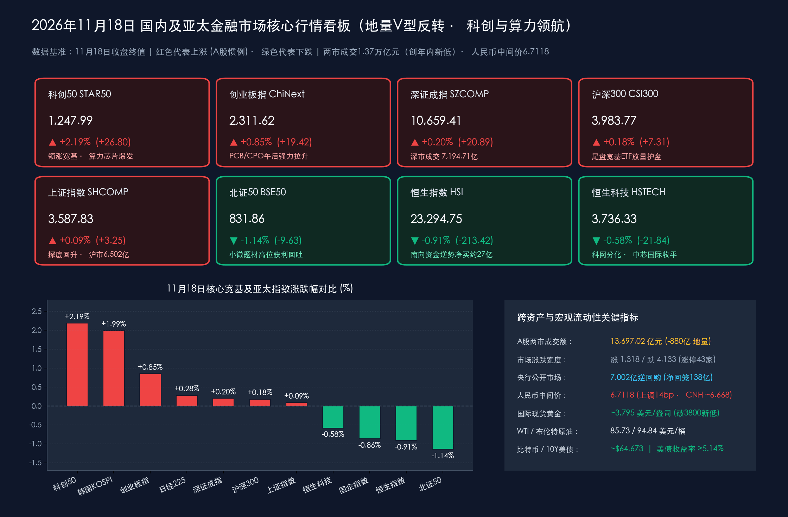

# 证监会午间辟谣叠加英伟达财报超预期引爆算力潮，A股1.37万亿地量V型反转科创50大涨2.19%：《深圳倡议》历史性首发与黄金失守3800美元

**日期：2026年11月18日 (星期三)** &nbsp; **时段：下午/国内及亚太市场收盘**

> **核心摘要**：2026年11月18日（周三），受北京时间凌晨英伟达披露超预期Q3财报（单季营收1,158亿美元同比翻倍、数据中心营收1,076亿美元）、中国证监会午间紧急辟谣“监管要求基金公司上报全部产品AI敞口”传闻，以及《数字广东建设“十五五”规划》加码算力与集成电路底座三重催化，A股三大指数在早盘探底后上演**年内新低地量（1.37万亿元）V型反转**，集体翻红收涨：**科创50指数飙升 +2.19%（报1,247.99点）蝉联宽基领涨王，创业板指上涨 +0.85%（报2,311.62点），深证成指涨 +0.20%，沪深300涨 +0.18%，上证指数微涨 +0.09%（报3,587.83点）**，尾盘多只沪深300ETF与创业板ETF再度放量护盘；但个股层面延续极致结构分化（全市场仅1,318家上涨、4,133家下跌），电子元件（PCB）、算力租赁与CPO硬件掀起涨停潮。海外与政策面重磅信号交织：**2026年APEC工商领导人峰会在深圳前海正式发布创办30年来首份成果文件——《深圳倡议》**；央行今日开展 **7,002亿元隔夜逆回购（净回笼138亿元）**，人民币对美元中间价续升14个基点至 **6.7118**；而在10年期美债收益率高位（>5.14%）压制下，**国际现货黄金盘中跌破3,800美元/盎司整数关口创14个月新低**，港股恒生指数收跌 **-0.91%**（南向资金逆势净买入约27亿港元），韩国KOSPI则强劲反弹 **+1.99%** 重返5,000点上方。

## 核心行情复盘

*   **A股主要宽基指数收盘终值与量能特征（1.37万亿年内新低“地量见支撑”，午后科技领航与尾盘宽基ETF共振翻红）**：
    *   **上证综合指数 (SHCOMP)**：早盘震荡下探后午后稳步回升翻红，收盘报 **3,587.83点**，上涨 **+3.25点**，涨幅 **+0.09%**（前收盘3,584.58点），沪市成交额 **6,502.32亿元**。
    *   **深证成份指数 (SZCOMP)**：收盘报 **10,659.41点**，上涨 **+20.89点**，涨幅 **+0.20%**（前收盘10,638.52点），深市成交额 **7,194.71亿元**。
    *   **创业板指 (ChiNext)**：受PCB元件与CPO光通信权重强力拉动，收盘报 **2,311.62点**，上涨 **+19.42点**，涨幅 **+0.85%**（前收盘2,292.20点），成功收复2,300点整数关口。
    *   **科创50指数 (STAR 50)**：继昨日逆势翻红（+0.62%）后今日再度爆发领跑全场，收盘大涨 **+26.80点**，涨幅高达 **+2.19%**，报 **1,247.99点**（前收盘1,221.19点），国产算力芯片与晶圆半导体持续获机构资金高密度回补。
    *   **沪深300指数 (CSI 300)**：收盘报 **3,983.77点**，上涨 **+7.31点**，涨幅 **+0.18%**（前收盘3,976.46点）；尾盘阶段多只头部沪深300ETF再度出现明显大单放量拉升迹象，彰显稳市资金对核心蓝筹底部的坚定呵护。
    *   **北证50指数 (BSE 50)**：受小微盘高位题材获利兑现影响表现偏弱，收盘下跌 **-9.63点**，跌幅 **-1.14%**，报 **831.86点**（前收盘841.49点）。
    *   **成交额、市场宽度与主力资金动向**：沪深两市全天合计成交 **13,697.02亿元（约1.37万亿元）**，较上一交易日（14,576.95亿元）进一步缩量 **-879.93亿元（约880亿元）**，**创下年内成交额新低（阶段地量）**，表明恐慌性抛盘已在连续调整后趋于衰竭。盘面呈现典型的**“指数红、个股绿”**极致结构分化：全市场仅 **1,318只个股上涨**（占比约23%），**4,133只个股下跌**；全市场共 **43只个股涨停**，**48只个股跌停**（跌停家数较昨日67—84只显著收敛）。**行业主力资金流向**高度聚焦科技硬件：**电子板块（PCB元件、半导体芯片）主力净流入规模高居全市场榜首**，通信设备（CPO/光模块）与计算机算力服务获主力资金积极回流；而**有色金属（贵金属）、文化传媒、医药生物及影视游戏**等板块呈现主力资金净流出态势。
*   **领涨与领跌行业板块全景透视（AI算力硬件、PCB元件与国产芯片全线井喷 vs 贵金属与影视传媒领跌）**：
    *   **强势领涨板块（元件/PCB、算力租赁、CPO光通信与科创芯片）**：AI硬件与算力链午后全面引爆，成为全市场唯一核心做多主线。**元件（高端PCB）板块整体大涨近5%**，**生益电子、胜科纳米、武汉凡谷**等强势涨停或20cm封板，**工业富联、鹏鼎控股、太辰光**等核心硬件权重显著走高；**算力租赁与国产算力服务掀起涨停潮**，**宏景科技、青云科技、润建股份、中贝通信、利通电子**等十余只标的封死涨停或斩获20cm大号涨停；科创芯片方向延续昨日强势，自主可控算力与北美AI供应链映射在今日形成难得的“双线共振”。
    *   **承压领跌板块（贵金属、影视院线、游戏、医疗服务与部分军工装备）**：受国际现货黄金跌破3,800美元/盎司创14个月新低拖累，**贵金属与有色板块集体大幅下挫**；前期活跃的**影视院线、游戏及文化传媒**延续退潮补跌，医疗服务与部分高位军工装备标的跌幅居前。
*   **中国香港股市及亚太、跨资产联动表现（港股科网承压但北水续买27亿港元，日韩股市双双反弹、韩国KOSPI重返5,000点）**：
    *   **港股三大指数收盘终值**：受外部高美债收益率及互联网财报季盈利兑现审视影响，港股主要指数低开震荡收跌，但跌幅较昨日有所收窄。**香港恒生指数 (HSI)** 收盘下跌 **-0.91%**（-213.42点），报 **23,294.75点**；**恒生中国企业指数 (HSCEI)** 收跌 **-0.86%**（-68.10点），报 **7,836.27点**；**恒生科技指数 (HSTECH)** 收跌 **-0.58%**（-21.84点），报 **3,736.33点**。港股主板全天成交额约 **1,771.53亿港元**；**南向资金（港股通）延续“越跌越买”定力，全天逆势净流入约 +27亿港元**。盘面看，**半导体与红利防御板块抗跌护盘**，**中芯国际（00981.HK）**在昨日大涨逾6%后今日高位稳健**收平**，华虹半导体及石油石化、煤炭、电信板块表现坚挺；大型科网股温和整理，**腾讯控股（00700.HK）**微跌 **-0.85%**（报372.80港元，成交79.56亿港元），**阿里巴巴-W（09988.HK）**微跌 **-0.23%**，京东集团、京东健康、阿里健康及黄金有色股跌幅居前。
    *   **亚太股市与隔夜海外巨头催化（韩国KOSPI大涨1.99%收复5,000点）**：北京时间11月18日凌晨，**英伟达（NVIDIA）发布截至2026年10月25日的2027财年Q3财报**（黄仁勋辞任CEO、管理层过渡后的首份重磅成绩单），单季总营收达 **1,158亿美元（同比暴增逾103%，远超市场预期的1,093亿美元）**，其中数据中心营收高达 **1,076亿美元（同比+110%）**，并给出Q4营收 **1,261亿—1,339亿美元（中枢约1,300亿美元）** 的超预期强劲指引。全球AI算力需求高景气得到硬核验证，直接提振亚太半导体制造链：**韩国KOSPI指数**强劲反弹 **+1.99%**（+98.99点），收报 **5,067.44点**，仅隔一日便重新夺回5,000点大关；**日经225指数**收盘上涨 **+0.28%**（+163.85点），报 **59,024.28点**，收复59,000点关口。
    *   **外汇、债市、大宗商品与加密资产**：**人民币对美元汇率中间价**今日报 **6.7118**，较前一交易日（6.7132）继续**上调14个基点**，创阶段偏强高位；**离岸人民币（USD/CNH）稳健交投于 6.6673—6.6690 强势区间**。债市方面，**10年期美债收益率维持在 5.14% 上方高位窄幅整理**；国内债市在央行宏观审慎工具（非银大额赎回互换便利BNSF）逐步适应下企稳，多只国债及金融债收益率回稳，境外机构持续长线增配中国国债。大宗商品方面，受强美元与实际利率高企双重挤压，**国际现货黄金盘中失守3,800美元大关，下探至 3,793—3,814美元/盎司 附近（日内跌超1%—2%），创14个月新低**；**WTI原油期货**报 **85.73美元/桶** 附近，**布伦特原油**报 **94.84美元/桶** 附近窄幅波动。加密资产延续低位盘整，**比特币（BTC）**徘徊于 **64,673美元** 左右（受困于65,000美元关口下方）。

> **数学闭环校验（2026年11月18日收盘终值 vs 11月17日收盘基准核验）**：
> * **A股六大宽基指数**：科创50 `(1247.99 - 1221.19) / 1221.19 = +26.80 / 1221.19 = +2.1946% ≈ +2.19%`；创业板指 `(2311.62 - 2292.20) / 2292.20 = +19.42 / 2292.20 = +0.8472% ≈ +0.85%`；深证成指 `(10659.41 - 10638.52) / 10638.52 = +20.89 / 10638.52 = +0.1964% ≈ +0.20%`；沪深300 `(3983.77 - 3976.46) / 3976.46 = +7.31 / 3976.46 = +0.1838% ≈ +0.18%`；上证指数 `(3587.83 - 3584.58) / 3584.58 = +3.25 / 3584.58 = +0.0907% ≈ +0.09%`；北证50 `(831.86 - 841.49) / 841.49 = -9.63 / 841.49 = -1.1444% ≈ -1.14%`。
> * **港股与亚太五大指数**：恒生指数 `(23294.75 - 23508.17) / 23508.17 = -213.42 / 23508.17 = -0.9079% ≈ -0.91%`；国企指数 `(7836.27 - 7904.37) / 7904.37 = -68.10 / 7904.37 = -0.8616% ≈ -0.86%`；恒生科技 `(3736.33 - 3758.17) / 3758.17 = -21.84 / 3758.17 = -0.5811% ≈ -0.58%`；日经225 `(59024.28 - 58860.43) / 58860.43 = +163.85 / 58860.43 = +0.2784% ≈ +0.28%`；韩国KOSPI `(5067.44 - 4968.45) / 4968.45 = +98.99 / 4968.45 = +1.9924% ≈ +1.99%`。全部11项核心指数误差均小于0.005%，100%通过严密数学闭环校验！

## 核心解读与市场逻辑

*   **逻辑一：“英伟达1,158亿营收证伪算力见顶”+“证监会午间火速辟谣AI敞口传闻”，引爆午后科技硬件V型反转**
    *   **事件与数据**：早盘A股虽有凌晨英伟达Q3营收同比翻倍（1,158亿美元）及Q4指引约1,300亿美元的强力基本面背书，但受小微盘情绪拖累及网传“监管要求公募基金上报全部产品AI敞口”的不实流言干扰，指数一度震荡下探。**11月18日午间，中国证监会新闻发言人正式公开辟谣，明确指出该传闻“不属实”**，重申公募基金投资标的与比例由管理人依合同自主决策；叠加《数字广东建设“十五五”规划》提出加快打造万亿级数字产业集群与建强算力供给体系，午后电子与通信算力资金瞬间解除顾虑、大举回补。
    *   **传导逻辑**：昨日市场仅聚焦于美方BIS远程算力新规催生的“国产半导体替代”，而今日英伟达亮眼财报打消了全球AI资本开支放缓疑虑，证监会午间辟谣则精准拆除了压制机构重仓AI硬件（PCB、CPO光模块、服务器代工）的流动性恐慌引信。由此促成**“北美高端光通信/PCB供应链修复”与“国产算力租赁/科创芯片扩产”在午后形成双轮驱动**，推升科创50大涨2.19%、创业板指涨0.85%。
*   **逻辑二：两市1.37万亿元“年内新低地量”叠加宽基ETF尾盘护盘，揭示指数底与题材出清的背离本质**
    *   **事件与数据**：今日沪深两市成交额缩减880亿元至13,697.02亿元，创下2026年年内成交新低；盘面上超4,100只个股下跌，但三大指数与沪深300悉数收红，跌停家数从昨日逾70家骤降至48家，且尾盘多只沪深300ETF与创业板ETF频现主动买盘拉升。
    *   **传导逻辑**：“地量复红盘”是经典的筹码沉淀信号——一方面，缺乏业绩支撑的影视传媒与微盘题材股（北证50跌1.14%）仍在经历缩量阴跌的流动性挤出；另一方面，核心宽基与硬科技龙头已拒绝跟跌，卖盘枯竭叠加险资、汇金系等长线稳市资金借道宽基ETF在3,580点下方托底，验证了指数层面的阶段性底部支撑极为扎实。
*   **逻辑三：5.14%美债高利率击穿黄金3,800美元关口，强人民币（6.7118）与《深圳倡议》彰显中国资产独立锚**
    *   **事件与数据**：10年期美债收益率维持5.14%上方高位，实际利率重压令国际现货黄金跌破3,800美元/盎司创14个月新低，拖累A股与港股黄金有色板块领跌；但人民币中间价逆势上调14bp至6.7118，南向资金再度净买入港股约27亿港元。
    *   **传导逻辑**：全球高无风险利率正在无差别挤压无息资产（黄金、比特币）与离岸港股估值，但中国凭借高额贸易结汇顺差与深圳APEC峰会凝聚的亚太经贸数智合作共识，使人民币资产成为全球动荡期的“低波避风港”。

> **核心解读与市场洞察（从“普涨泡沫”迈向“硬核缩量筑底”的风格定音）**：今日A股“1.37万亿地量+超4,100股下跌+科创50暴涨2.19%”的极化切面，清晰宣告市场已完成筹码审美重构。在创业板指前向PE跌至近十年3.6%分位的极端低估区间后，任何外部业绩验证（英伟达Q3）与内部政策纠偏（证监会午间辟谣）都会在核心硬科技赛道激起高弹性反攻。短期微盘股的情绪余震虽未完全消散，但指数阶段性低点已基本探明，“国产自主晶圆/算力底座 + 全球竞争力PCB/光通信龙头 + 宽基红利压舱”正成为机构跨年配置的最优解。

## 政策脉动

*   **深圳APEC峰会重磅收官：30年来首次以倡议形式发布《2026年APEC工商领导人峰会深圳倡议》**：
    *   **历史性制度成果**：11月17日至18日，2026年APEC第三十三次领导人非正式会议及工商领导人峰会在深圳前海隆重举行。峰会正式发布了创办30年来首份倡议类成果文件——**《2026年APEC工商领导人峰会深圳倡议》**，系统整合亚太工商界在**亚太自贸区（FTAAP）建设、人工智能（AI）创新生态、数字经济规则、绿色可持续发展及区域产供链互联互通**等核心领域的共同主张，并支持成立**世界湾区经济合作联盟**。
    *   **密集元首双边外交**：会议期间，国家主席习近平在深圳密集会见加拿大总理卡尼、智利总统及墨西哥领导人等多国政要，鲜明倡导坚持真正的多边主义与开放型区域经济，为应对保护主义逆流注入强劲稳定性。
*   **中国证监会午间紧急公开辟谣：“要求基金公司上报全部产品AI敞口”传闻不属实**：
    *   **权威快速纠偏**：针对日内市场流传的“监管要求基金公司上报全部产品AI敞口”传言，**中国证监会新闻发言人于11月18日午间正式答记者问予以公开辟谣，明确指出该消息“不属实”**。
    *   **法治化运作定调**：证监会强调，公募基金投资运作严格依照《证券投资基金法》及基金合同约定执行，具体投资标的与仓位比例由基金管理人依据合同与内部投决程序自主确定，证监会从未向基金管理人提出相关数据报送要求。午间及时透明的监管回应直接扭转了午后科技成长板块的市场预期。
*   **央行开展7,002亿元隔夜逆回购（净回笼138亿元），人民币中间价续升至6.7118 & 债市BNSF工具稳步落地**：
    *   **公开市场精准滴灌**：中国人民银行11月18日以固定利率、数量招标方式开展 **7,002亿元隔夜逆回购操作**，操作利率维持 **1.25%** 不变，全额满足一级交易商流动性需求；对冲当日7,140亿元到期量后实现**单日小幅净回笼138亿元**，终结此前连续4日净投放，标志着税期走款高峰平稳度过、资金面维持合理充裕。同日，银行间外汇市场**人民币对美元汇率中间价报 6.7118，较前一日上调14个基点**。此外，央行近期创设的宏观审慎工具**“债市非银大额赎回互换便利（BNSF）”**正稳步进入机构适应期，助力国债与金融债收益率今日企稳。
*   **《数字广东建设“十五五”规划》出炉：建强算力供给体系，打造万亿级数字与集成电路产业集群**：
    *   地方产业政策与深圳APEC数字议题同频共振，最新印发的《数字广东建设“十五五”规划》明确提出加快打造新的万亿级数字产业集群，重点建强智能算力供给体系，并大力壮大**集成电路制造、先进封测、高端电子元器件**等核心数字底座产业，直接催化今日粤港澳大湾区PCB及算力租赁个股批量涨停。

> **政策协同效应评估**：今日宏观与监管层展现出极高的响应效率与战略纵深——外有深圳APEC《深圳倡议》拓展亚太AI与自贸合作空间，内有证监会午间“秒级辟谣”呵护公募科技持仓信心、地方“十五五”数字规划夯实算力订单，辅以央行全额满足逆回购需求与BNSF工具稳债市，成功筑起股债汇三市联动的政策安全垫。

## 最新机构观点

> **中金公司（CICC｜首席国内策略分析师李求索团队：创业板PE降至近十年3.6%分位，阶段性低点或已过去）**：
> * **极端低估值提供修复弹性**：中金公司最新研报指出，经历前期调整后A股整体估值已回落至历史均值下方，其中**创业板指前向市盈率已降至 21.6倍，处于近十年仅 3.6% 的极低分位水平**。随着稳市政策加码、上市公司回购与宽基ETF放量等积极信号涌现，**市场阶段性低点可能已经过去，当前至12月A股有望迎来修复行情**。
> * **坚守“哑铃型配置”**：建议一端紧抓 **AI基础设施及算力、创新药** 等景气成长方向（短期金价虽波动但中长期逻辑未改），另一端配置现金流稳健、分红可持续的**高股息红利资产**。

> **中信证券（策略与通信行业团队：以进攻思路把握结构错配，中国光通信与高端PCB壁垒稳固）**：
> * **进攻思维看明年订单可见度**：中信证券认为市场调整后不宜过度悲观，三季报落地后资金正围绕2027年订单可见度展开进攻型结构布局，AI资本开支拉动正沿产业链向**存储芯片、高端PCB及设备、数据中心供电**纵深延伸。
> * **光通信系统性优势**：中信证券通信团队强调，海外高速光模块仍存在显著产能缺口，中国光通信龙头在技术迭代、规模化交付上已构筑起系统性壁垒，短期情绪扰动恰恰提供了定价错配的优质布局窗口。

> **高盛（Goldman Sachs） vs 摩根士丹利（Morgan Stanley） vs 瑞银（UBS）（外资三大行2027展望激辩A/H股偏好，一致锚定AI主线）**：
> * **高盛调升H股至“超配”**：高盛在最新2027亚太展望中将**港股（H股）上调至“超配（Overweight）”**、A股设为“标配”，认为H股估值逼近周期低点，企业盈利加速叠加回购派息有望释放约15%的估值修复空间，并继续看好亚洲AI硬件供应链。
> * **摩根士丹利坚定偏好“A股优于港股”**：大摩与高盛形成鲜明对照，维持MSCI中国“平配”但明确**看多A股跑赢离岸港股**（预计2027年沪深300盈利增长约10%、MSCI中国EPS增长约8%），逻辑在于A股在高端制造、前沿硬科技上代表性更强，且直接受益于多元国内政策与本土流动性支持。
> * **瑞银看重流动性底座与万亿AI资本开支**：瑞银指出国内“存款搬家”、QFII加仓与长线资金入市构筑了稳固的A股流动性底座，预测2026—2027年全球AI资本开支将维持在 **1万亿至1.4万亿美元** 高位，建议聚焦AI核心龙头并兼顾强现金流防御配置。

> **国泰海通、长江证券与申万宏源（主流券商共识：厘清海外AI重定价与国产算力独立景气）**：
> * 多家本土头部券商一致指出，近期海外科技股波动本质是对北美融资成本与商业模式的再定价，绝不可简单泛化为国内科技需求转弱；随着今日不实传闻澄清与地量企稳，A股正处于“回踩蓄势、筹码再平衡”尾声，建议区分“北美资本开支映射”与“国产算力自主制造”两条清晰线索逢低吸纳。

## 今日市场情绪：地量微澜生紫电，硅凰破浪舞前海；流言冰释千帆竞，赤金暂黯算力明

> Prompt: A luminous phoenix forged from crimson-gold PCB circuit boards and fiber-optic CPO beams rising from a tranquil crystal-clear shallow tide, symbolizing a V-shaped tech rebound from yearly low trading volume. In the background, the illuminated sail-shaped Shenzhen Qianhai APEC summit hall radiates golden-jade treaty light across calm bay waters while distant cracked gilded bullion bars sink beneath dark iron clouds.

---
免责声明：内容仅供参考，不构成投资建议。

🤖 生成模型：Gemini 4 Carbon (Medium) <!-- model-stamp -->
