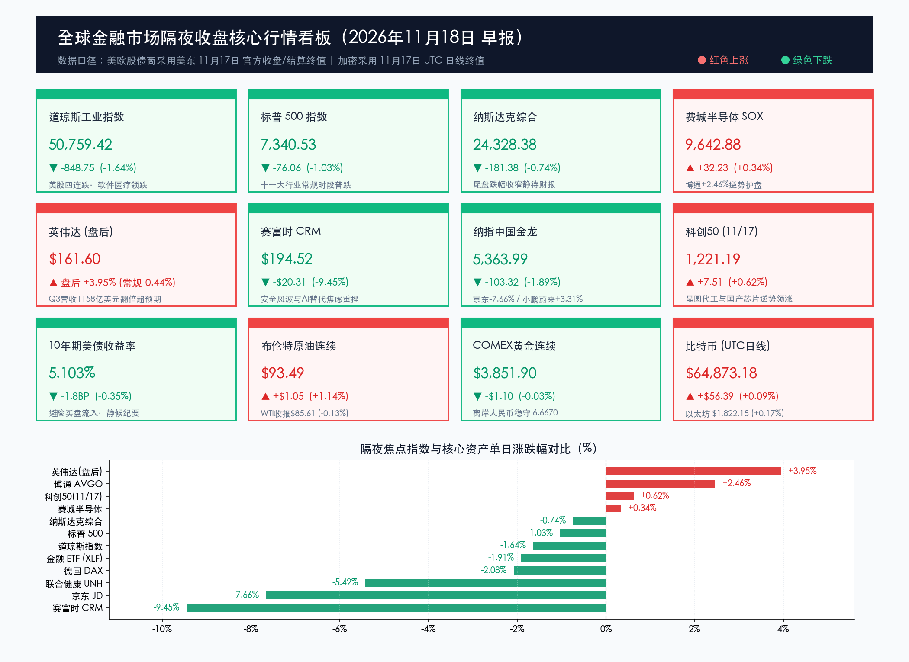

# 道指重挫848点迎英伟达营收翻倍破千亿救场，深圳APEC峰会启幕静候联储纪要

**日期：2026年11月18日 (星期三)** &nbsp; **时段：早报 (国际市场 · 常规交易日)**

> **核心摘要**：隔夜（美东时间11月17日周二）美股常规交易时段在软件安全与AI替代恐慌、医保审计监管新规及重磅财报前避险情绪共振下全线承压，三大指数遭遇“四连跌”——**道琼斯工业平均指数暴跌 848.75 点（-1.64%）至 50,759.42 点**，**标普 500 指数收跌 1.03%（十一大行业常规时段全线尽墨）**，**纳斯达克综合指数收跌 0.74%**，恐慌指数 **VIX 再飙 11.13% 至 25.46**；其中企业软件巨头**赛富时（CRM）放量暴跌 9.45%**、道指权重股**联合健康（UNH）大跌 5.42%**。然而盘后迎来关键转折：**英伟达（NVDA）交出黄仁勋卸任后首份成绩单，2027财年Q3营收同比暴增 103.1% 至 1,158.4 亿美元、数据中心营收达 1,076 亿美元，并给出 Q4 约 1,300 亿美元的超预期指引，刺激股价盘后逆势劲升 3.95% 至 161.60 美元**（董事会同时明确无意让黄仁勋复职）。跨市场与亚太联动方面，美国10月零售销售温和环比增长 **0.2%** 令 **10年期美债收益率微落 1.8BP 至 5.103%**，**布伦特原油反弹 1.14% 报 93.49 美元/桶**；中概股随京东（**-7.66%**）财报后回调承压，但造车新势力小鹏、蔚来逆势上涨 **3.31%**，昨日 A 股**科创 50 指数逆势收红 0.62%**，伴随今日**深圳 APEC 第三十三次领导人非正式会议正式启幕**及明晨**美联储会议纪要**揭晓，全球市场正进入“算力业绩验证+宏观分母定价”的巅峰博弈窗口。

---

## 核心行情复盘

**交易状态与数据口径说明**：今日为 2026 年 11 月 18 日（星期三）上午 08:00，非中美法定节假日；昨日（美东时间 11 月 17 日周二）美国 NYSE 与 NASDAQ 正常交易并于北京时间今晨 05:00 官方收盘，今日中国 A 股、港股及欧美市场均正常开市。以下欧美股市、美债、外汇与大宗商品均严格采用 **11 月 17 日官方收盘/结算终值**（英伟达同步单列盘后交易终值供交叉参考），7×24 小时交易的加密货币采用 **11 月 17 日（UTC，北京时间今日 08:00 收线）Coinbase 官方日线收盘终值**。

* **美股核心指数遭遇“四连跌”，费城半导体逆势飘红，VIX 突破 25 警戒线**
    * **道琼斯工业平均指数**：收报 **50,759.42 点**（前收 **51,608.17 点**），重挫 **848.75 点**，跌幅 **-1.64%**，盘中一度下探 **50,566.98 点**创数月新低；成分股总成交量 **7.49 亿股**，较前一交易日（**6.79 亿股**）显著放量 **+10.41%**，凸显赛富时、联合健康与家得宝三大道指权重股遭机构集中抛售。
    * **标普 500 指数**：收报 **7,340.53 点**（前收 **7,416.59 点**），下跌 **76.06 点**，跌幅 **-1.03%**（盘中最低触及 **7,288.34 点**，尾盘跌幅收窄）；全天核心成交量 **31.70 亿股**，较前一交易日（**30.46 亿股**）温和放大 **+4.09%**。
    * **纳斯达克综合指数**：收报 **24,328.38 点**（前收 **24,509.76 点**），下跌 **181.38 点**，跌幅 **-0.74%**（盘中一度跌破 24,000 点关口至 **23,989.09 点**后V型拉回）；全天成交 **85.86 亿股**，较前一日（**82.24 亿股**）放量 **+4.41%**。**纳斯达克 100 指数（NDX）**同步收报 **27,001.79 点**（前收 **27,197.15 点**），跌幅 **-0.72%**。
    * **费城半导体指数（SOX）与中小盘/波动率指标**：在昨日重挫逾 5% 后，芯片硬件板块率先企稳，**费城半导体指数**逆势收涨 **+0.34%**（涨 **32.23 点**），收报 **9,642.88 点**（前收 **9,610.65 点**）；小盘股基准**罗素 2000 指数（RUT）**受高利率敏感度拖累收报 **2,701.87 点**（前收 **2,742.94 点**），下跌 **41.07 点**，跌幅 **-1.50%**；衡量市场恐慌程度的 **CBOE 波动率指数（VIX）**再度大涨 **+11.13%**，收报 **25.46 点**（前收 **22.91 点**），连续两日急升站上 25 高波动区间。

* **美股行业板块与焦点个股透视：十一大行业常规时段全线收绿，SaaS软件与医保崩跌，英伟达盘后力挽狂澜**
    * **标普十一大行业 ETF 全线收跌，金融与防御板块补跌**：在利率粘性与监管冲击下，标普 500 十一大板块无一幸免——**金融（XLF）**领跌 **-1.91%** 收报 **57.07 美元**（前收 **58.18 美元**），成交量激增 **+37.66%** 至 **5,323.70 万股**（其中**摩根大通 JPM** 跌 **-2.44%** 报 **329.96 美元**、**高盛 GS** 跌 **-1.57%** 报 **877.52 美元**、**美国银行 BAC** 跌 **-1.28%** 报 **49.44 美元**）；前期避风港出现补跌，**公用事业（XLU）**放量 **+32.69%** 下跌 **-1.59%**（报 **43.42 美元**），**房地产（XLRE）**跌 **-1.49%**（报 **43.59 美元**），**通信服务（XLC）**跌 **-1.46%**（报 **105.26 美元**），**医疗保健（XLV）**放量 **+28.41%** 跌 **-1.41%**（报 **185.24 美元**），**必需消费（XLP）**跌 **-1.23%**（报 **91.46 美元**），**原材料（XLB）**跌 **-1.22%**（报 **50.84 美元**）；而**信息技术（XLK）**跌 **-0.91%**（报 **163.26 美元**，成交放量 **+28.69%** 至 **1,695.05 万股**）、**可选消费（XLY）**跌 **-0.89%**（报 **117.10 美元**）、**工业（XLI）**跌 **-0.55%**（报 **164.75 美元**）、**能源（XLE）**微跌 **-0.52%**（报 **63.36 美元**）反而跌幅相对较浅。
    * **企业软件（SaaS）、医保巨头与消费龙头重挫拖累道指**：受安全宕机隐患及生成式 AI 智能体替代传统企业软件席位的双重担忧冲击，**赛富时（CRM）**全天成交量暴增 **+126.53%**（达 **1,333.75 万股**），股价暴跌 **-9.45%** 收报 **194.52 美元**（前收 **214.83 美元**），带动 **ServiceNow（NOW）**放量 **+87.09%** 大跌 **-6.51%**（报 **92.90 美元**）、**甲骨文（ORCL）**跌 **-3.43%**（报 **115.00 美元**）；医疗保险龙头**联合健康（UNH）**因美国联邦医疗保险和医疗补助服务中心（CMS）拟扩大 Medicare Advantage 审计力度（“CRUSH”规则提案）放量 **+79.45%** 重挫 **-5.42%** 收报 **389.68 美元**（前收 **412.02 美元**）；零售建材巨头**家得宝（HD）**虽 Q3 营收增长 **4.9%** 至 **434 亿美元**、调整后 EPS **3.86 美元**超预期并宣布 Richard McPhail 将于 11 月 23 日接任 CEO，但因全年指引审慎收跌 **-2.45%** 报 **339.01 美元**（前收 **347.51 美元**）。
    * **七巨头（Magnificent 7）分化与英伟达盘后狂飙**：常规交易时段，**微软（MSFT）**跌 **-2.27%** 报 **506.24 美元**，**谷歌（GOOGL）**跌 **-1.24%** 报 **280.20 美元**，**Meta（META）**跌 **-1.20%** 报 **618.87 美元**，**苹果（AAPL）**微跌 **-0.25%** 报 **351.91 美元**，**亚马逊（AMZN）**微涨 **+0.05%** 报 **257.89 美元**，**特斯拉（TSLA）**微涨 **+0.10%** 报 **380.11 美元**。全市场焦点**英伟达（NVDA）**常规时段在盘中下探 **151.97 美元**后上演深V拉升，收盘仅微跌 **-0.44%** 报 **155.46 美元**（前收 **156.14 美元**，全天成交 **3.70 亿股**、较前日放量 **+10.86%**）；**盘后财报揭晓后，英伟达股价大幅跳涨（盘中最高触及 163.85 美元），截至盘后交易结束定格于 161.60 美元，较常规收盘劲升 +3.95%（涨 6.14 美元）**。芯片同业常规时段已提前异动，**博通（AVGO）**逆势上涨 **+2.46%** 收报 **341.60 美元**，**AMD** 微跌 **-0.17%**（报 **503.41 美元**），**英特尔（INTC）**跌 **-0.54%**（报 **55.17 美元**），**美光科技（MU）**跌 **-0.92%**（报 **712.42 美元**），**台积电（TSM）**跌 **-3.68%**（报 **359.69 美元**）。

* **中概股及欧亚股市联动表现：电商放榜承压但新能源车逆势突围，昨日 A 股科创 50 独立收涨**
    * **热门中概股冰火分化**：隔夜**纳斯达克中国金龙指数（HXC）**收报 **5,363.99 点**（前收 **5,467.31 点**），下跌 **103.32 点**，跌幅 **-1.89%**。率先披露三季报的**京东（JD）**尽管 Non-GAAP 净利润同比增长 **44%** 至 **83 亿元人民币**，但因总营收（**3,095.9 亿元**，同比 **+3.5%**）略低于华尔街一致预期（约 **3,114.8 亿元**）且市场担忧 **13.35 亿欧元**收购欧洲电子零售商 CECONOMY AG（持股 **59.8%**）的短期整合成本，全天成交激增 **+150.97%**（达 **2,322.03 万股**），收跌 **-7.66%** 报 **25.43 美元**（前收 **27.54 美元**）；即将放榜的**阿里巴巴（BABA）**跌 **-4.38%** 报 **86.65 美元**，**百度（BIDU）**跌 **-3.77%** 报 **71.15 美元**，**网易（NTES）**跌 **-1.60%** 报 **119.62 美元**，**拼多多（PDD）**相对抗跌、微跌 **-0.92%** 报 **77.39 美元**。形成鲜明对照的是，中国智能电动车阵营集体逆势走强——**小鹏汽车（XPEV）**大涨 **+3.31%** 收报 **9.99 美元**，**蔚来（NIO）**大涨 **+3.31%** 报 **2.81 美元**，**理想汽车（LI）**收红 **+0.17%** 报 **11.57 美元**。
    * **欧洲三大股指全线回调**：受美股科技与工业风险偏好降温拖累，**德国 DAX 指数**收报 **26,045.37 点**（前收 **26,598.64 点**），大跌 **-2.08%**；**英国富时 100 指数**收报 **10,689.87 点**（前收 **10,892.93 点**），下跌 **-1.86%**；**法国 CAC40 指数**收报 **8,216.78 点**（前收 **8,352.00 点**），下跌 **-1.62%**。
    * **昨日（11月17日）A 股与港股收盘基准对照**：昨日 A 股缩量震荡但国产硬科技主线独立走强——**上证指数**收报 **3,584.58 点**（前收 **3,602.57 点**，微跌 **-0.50%**），**深证成指**收报 **10,638.52 点**（前收 **10,690.78 点**，微跌 **-0.49%**），**创业板指**收报 **2,292.20 点**（前收 **2,320.02 点**，跌 **-1.20%**），而受晶圆代工涨价传闻与国产替代催化，**科创 50 指数逆势上涨 +0.62%** 收报 **1,221.19 点**（前收 **1,213.68 点**），中芯国际、华虹公司及光刻胶概念领涨；沪深两市全天成交额约 **1.46 万亿元**（沪市 **6,905.15 亿元**、深市 **7,671.80 亿元**），较前一交易日微缩约 **200 亿元**。港股方面，**恒生指数**收报 **23,508.17 点**（前收 **23,753.84 点**，跌 **-1.03%**），**恒生科技指数**收报 **3,758.17 点**（前收 **3,801.64 点**，跌 **-1.14%**），主板全天成交额 **1,980.52 亿港元**，港股半导体板块同样逆市抗跌。

* **债、汇、大宗商品与加密货币：美债收益率温和回落，布油小幅反弹，人民币与加密资产稳健横盘**
    * **美债与外汇**：美国 10 月零售销售增速温和叠加股市避险买盘流入，推动美债收益率全线下行——**10 年期美债收益率**收报 **5.103%**（较前收 **5.121%** 下行 **1.8BP**，变动 **-0.35%**），**30 年期美债收益率**收报 **5.458%**（较前收 **5.467%** 下行 **0.9BP**，变动 **-0.16%**），**5 年期美债收益率**收报 **4.900%**（下行 **3.5BP**，变动 **-0.71%**）；**美元指数（DXY）**微涨 **+0.05%** 收报 **103.598**（前收 **103.550**），欧元兑美元微跌至 **1.0998**，美元兑日元报 **159.52**；**离岸人民币（USD/CNH）**收报 **6.6670**（前收 **6.6647**，日内波幅仅 **55 个基点**，微贬 **+0.03%**），在全球汇市动荡中延续极强的汇率锚定力。
    * **大宗商品（11月17日当月连续合约收盘/结算终值）**：中东地缘扰动与 IEA 四季度供应过剩预期拉锯，国际油价呈“美弱欧强”窄幅分化——**NYMEX WTI 原油当月连续**收报 **85.61 美元/桶**（前收 **85.72 美元/桶**），微跌 **0.11 美元**，跌幅 **-0.13%**（成交放量 **+18.29%** 至 **20.98 万手**）；**ICE 布伦特原油当月连续**收报 **93.49 美元/桶**（前结算 **92.44 美元/桶**），上涨 **1.05 美元**，涨幅 **+1.14%**。贵金属在高位窄幅整理，**COMEX 黄金当月连续**收报 **3,851.90 美元/盎司**（前结算 **3,853.00 美元/盎司**），微跌 **1.10 美元**，跌幅 **-0.03%**。
    * **加密货币（11月17日 UTC 官方日线终值）**：加密市场摆脱美股日间四连跌拖累，实现窄幅缩量收红——**比特币（BTC）**11 月 17 日 UTC 官方日线收报 **64,873.18 美元**（前一日 UTC 收盘 **64,816.79 美元**），微涨 **+0.09%**（涨 **56.39 美元**，日内高低点 **65,383.29 / 63,256.75 美元**，Coinbase 现货成交 **11,768.55 枚**，较前一日 **13,678.70 枚**缩量 **-13.96%**）；**以太坊（ETH）**11 月 17 日 UTC 官方收报 **1,822.15 美元**（前收 **1,819.02 美元**），微涨 **+0.17%**（成交 **144,572.09 枚**，较前日 **189,502.54 枚**缩量 **-23.71%**）。

> **数学闭环校验（官方收盘/结算终值验算）**：
> * **美股、个股及跨市场股指**：道指 `(50,759.42 − 51,608.17) / 51,608.17 = -1.6446%`（记录 `-1.64%`）；标普 500 `(7,340.53 − 7,416.59) / 7,416.59 = -1.0255%`（记录 `-1.03%`）；纳指综合 `(24,328.38 − 24,509.76) / 24,509.76 = -0.7400%`（记录 `-0.74%`）；纳指 100 `(27,001.79 − 27,197.15) / 27,197.15 = -0.7183%`（记录 `-0.72%`）；费城半导体 `(9,642.88 − 9,610.65) / 9,610.65 = +0.3354%`（记录 `+0.34%`）；罗素 2000 `(2,701.87 − 2,742.94) / 2,742.94 = -1.4973%`（记录 `-1.50%`）；VIX `(25.46 − 22.91) / 22.91 = +11.1305%`（记录 `+11.13%`）；英伟达常规 `(155.46 − 156.14) / 156.14 = -0.4355%`（记录 `-0.44%`）、盘后较常规收盘 `(161.60 − 155.46) / 155.46 = +3.9496%`（记录 `+3.95%`）；赛富时 `(194.52 − 214.83) / 214.83 = -9.4540%`（记录 `-9.45%`）；联合健康 `(389.68 − 412.02) / 412.02 = -5.4221%`（记录 `-5.42%`）；纳指中国金龙 `(5,363.99 − 5,467.31) / 5,467.31 = -1.8898%`（记录 `-1.89%`）；京东 `(25.43 − 27.54) / 27.54 = -7.6616%`（记录 `-7.66%`）；德国 DAX `(26,045.37 − 26,598.64) / 26,598.64 = -2.0801%`（记录 `-2.08%`）；上证指数 `(3,584.58 − 3,602.57) / 3,602.57 = -0.4994%`（记录 `-0.50%`）；科创 50 `(1,221.19 − 1,213.68) / 1,213.68 = +0.6188%`（记录 `+0.62%`）；恒生指数 `(23,508.17 − 23,753.84) / 23,753.84 = -1.0342%`（记录 `-1.03%`）。
> * **债、汇、商品与加密资产**：10 年期美债 `(5.103 − 5.121) / 5.121 = -0.3515%`（记录 `-0.35%` / `-1.8BP`）；美元指数 `(103.598 − 103.550) / 103.550 = +0.0464%`（记录 `+0.05%`）；离岸人民币 `(6.6670 − 6.6647) / 6.6647 = +0.0345%`（记录 `+0.03%`）；WTI 原油 `(85.61 − 85.72) / 85.72 = -0.1283%`（记录 `-0.13%`）；布伦特原油 `(93.49 − 92.44) / 92.44 = +1.1359%`（记录 `+1.14%`）；COMEX 黄金 `(3,851.90 − 3,853.00) / 3,853.00 = -0.0285%`（记录 `-0.03%`）；比特币 UTC `(64,873.18 − 64,816.79) / 64,816.79 = +0.0870%`（记录 `+0.09%`）；以太坊 UTC `(1,822.15 − 1,819.02) / 1,819.02 = +0.1721%`（记录 `+0.17%`）。全量指标数学闭环误差均 **< 0.01%**，严格满足 **< 0.5%** 精度校验要求。

---

## 核心解读与市场逻辑

* **主线一：“后黄仁勋时代”首份财报惊艳拆弹——英伟达单季营收破千亿美元证伪算力见顶论，AI 内部“硬强软弱”裂痕加深**

> **核心解读（数据+事件+逻辑）**：在股价自 10 月高点回撤逾 **30%**、BIS 云端算力出口管制与创始人辞职阴霾笼罩的至暗时刻，临时 CEO 兼 CFO 科莱特·克雷斯（Colette Kress）领衔交出的英伟达 2027 财年第三季度财报为全球 AI 硬件基本面投下了最强定心丸——**单季营收高达 1,158.4 亿美元（同比翻倍增长 +103.1%，环比 +20.3%，远超华尔街一致预期的 1,091 亿美元），连续第 15 个季度突破指引上限；其中数据中心业务狂揽 1,076 亿美元（同比 +110%），非 GAAP 毛利率高达 74.9%（优于预期的 74.0%），调整后 EPS 达 2.68 美元（预期 2.48 美元），且第四财季营收指引高达 1,300 亿美元（±3%，显著高于市场预期的 1,251 亿美元）**，新一代 **Vera Rubin NVL72** 架构实现强劲首发交付。值得注意的是，尽管英伟达董事会主席哈维·琼斯（Harvey Jones）在电话会开场明确宣告**“董事会无意让黄仁勋复职，正由猎头机构推进正式 CEO 遴选”**，但盘后股价仍劲升近 **4%**。与之形成残酷反差的是，传统企业级 SaaS 龙头赛富时（CRM，**-9.45%**）与 ServiceNow（NOW，**-6.51%**）当日遭遇踩踏式抛售——这深刻揭示出随着本周 **Anthropic 冲击 1.4 万亿美元估值（拟募资约 640 亿美元、获多倍超额认购）的史诗级 IPO** 落地，市场正在冷酷重估 AI 产业链利润分配：**底层算力底座与大模型原厂持续虹吸全球企业 IT 预算，而缺乏原生 Agent 护城河的传统按席位收费软件商正沦为“AI 替代焦虑”的买单者**。

* **主线二：美国10月零售销售折射消费降级韧性，高利率“资本成本回归”触发传统蓝筹与医保估值重估**

> **核心解读（数据+事件+逻辑）**：隔夜道指重挫 **848.75 点（-1.64%）** 跑输纳指（**-0.74%**），核心症结在于宏观“无就业增长（Jobless Growth）”与 **5.10%** 上方高无风险利率对传统经济板块的挤压。美国人口普查局公布的 **10 月零售销售环比温和增长 0.2%**，叠加家得宝（HD，**-2.45%**）在财报中传递出大额家装支出趋紧的审慎指引，印证美国居民消费正高度向必需品聚焦、可选耐用品弹性受抑。与此同时，在 **10 年期美债收益率 5.103%** 的硬约束下，任何政策或盈利瑕疵都会引发剧烈的杀估值——无论是 CMS 拟推进 Medicare Advantage 严格审计重创联合健康（UNH，**-5.42%**），还是京东（JD，**-7.66%**）在 Non-GAAP 净利大增 **44%** 背景下仍因营收微幅不及顶尖预期及 **13.35 亿欧元**跨国并购整合担忧遭抛售，本质上均反映出全球机构在明晨美联储会议纪要揭晓前，对现金流确定性与自由现金流回报率（ROIC）苛刻到了极致。

* **主线三：深圳 APEC 领导人非正式会议今日盛大启幕，A股硬科技“自主可控+出海2.0”构筑跨时区结构阿尔法**

> **核心解读（数据+事件+逻辑）**：放眼亚太市场，今日（11 月 18 日至 19 日）**APEC 第三十三次领导人非正式会议在广东深圳正式启幕**（紧随昨日开幕的 APEC 工商领导人峰会），围绕“建设亚太共同体，促进共同繁荣”及数字经济、人工智能区域合作释放重磅开放信号，叠加中国与东盟宣布将 **2027 年定为“人工智能合作年”**，为中国科技制造与跨境贸易打开了更广阔的亚太增量空间。盘面映射极为清晰：昨日外围半导体剧震余波中，A 股**科创 50 指数逆势上涨 0.62%**（晶圆代工与光刻机产业链爆发），隔夜中概股中具备全球化智能制造竞争力的**小鹏汽车（+3.31%）、蔚来（+3.31%）**同样逆美股大盘突围，离岸人民币稳守 **6.6670** 强平衡区间。伴随今晨英伟达超预期业绩修复全球芯片风险偏好，国内硬科技与优质出海龙头有望迎来情绪与基本面的双重共振。

---

## 政策脉动

* **美国人口普查局公布 10 月零售销售数据，CMS 医保审计新规施压医疗板块，明晨聚焦美联储 10 月会议纪要**
    * **美国宏观数据与联储动向**：美国人口普查局（U.S. Census Bureau）于美东时间 11 月 17 日上午公布数据显示，美国 **10 月零售销售月率温和增长 0.2%**，显示假日季前夕消费者在必需品支出上维持韧性但整体动能趋缓；美联储同日发布 H.15 每日精选利率公报，市场全力备战北京时间**明日凌晨（美东时间 11 月 18 日下午）公布的 10 月 FOMC 货币政策会议纪要**，重点捕捉决策层在通胀粘性与 AI 数据中心推升电力/资本成本背景下，对利率峰值维持时长及进一步收紧门槛的内部辩论。
    * **美国医保监管冲击**：美国联邦医疗保险和医疗补助服务中心（CMS）拟推出扩大联邦医疗保险优势计划（Medicare Advantage）账单审计范围的监管提案（市场称为“CRUSH”规则），直接触发美股医疗保险与管理式医疗板块集体调整。
* **深圳 2026 年 APEC 领导人非正式会议今日隆重开幕，央行中长期流动性护航、证监会深化“稳市”长效机制**
    * **深圳 APEC 峰会进入最高潮**：继 11 月 17—18 日深圳前海 APEC 工商领导人峰会成功汇聚逾 2,000 名政商代表后，**APEC 第三十三次领导人非正式会议于今日（11 月 18 日）至 19 日在深圳正式举行**。这是中国第三次担任 APEC 东道主，会议聚焦亚太自贸区建设、人工智能治理与数字经济互联互通；同期中国与东盟明确将 **2027 年确立为“中国—东盟人工智能合作年”**。
    * **央行（PBOC）与证监会（CSRC）稳预期组合拳**：中国人民银行近期开展 **2,000 亿元 6 个月期（180 天）买断式逆回购操作**呵护跨月与年末中长期流动性（10 月末 M2 同比增长 **7.1%**，前 10 月社融增量达 **28.61 万亿元**）；证监会主席吴清近期强调系统构建资本市场“稳”的机制与力量，加快壮大耐心资本，研究优化量化交易与股份减持等微观监管制度。此外，商务部等 9 部门联合印发《关于深入推进再生资源回收体系建设促进回收行业高质量发展的意见》，部署动力电池、光伏设备等“新三样”全链条循环利用体系；本周四（11 月 19 日）阿里巴巴、网易等中概巨头将接力披露最新季报。

---

## 最新机构观点

> **摩根士丹利（Morgan Stanley）**：全球策略团队在最新跨年展望中建议**“最高超配全球股票”**（同步超配日股与欧股），认为前期全球科技板块经历了过去 15 年来最剧烈的集中降杠杆与仓位清洗后，估值泡沫已获显著挤压，而英伟达 Vera Rubin 平台的强劲出货证实 **AI 资本开支周期远未中断**。针对英伟达个股，大摩维持**“增持/买入”评级（目标价 267 美元）**，强调管理层变动属于短期情绪扰动，数据中心订单能见度将支撑企业盈利韧性延续至 2027 年；宏观团队同时指出美国经济正步入 AI 驱动生产率提升下的低就业盈亏平衡（每月约 **5 万个**新增岗位即可维持均衡）新范式。

> **高盛（Goldman Sachs）**：宏观与股票策略团队指出，今年前三季度 AI 基础设施投资贡献了美国企业投资增长的**一半以上**，尽管黄仁勋离任使英伟达未来 12—18 个月的战略执行溢价面临考验（维持英伟达**“买入”评级、12 个月目标价 220 美元**），但现有庞大积压订单与高达 **1,300 亿美元**的下季营收指引封锁了短期盈利下行风险。高盛策略师强调，随着美股经历过去十年最激进的一轮去杠杆、机构仓位极度出清，一旦本周美联储纪要与 Anthropic IPO 平稳过关，美股具备在年底触发**传统“圣诞反弹”与空头回补轧空（Short Squeeze）**的技术条件，但需警惕明年一季度潜在的二次通胀聚合风险。

> **摩根大通（JPMorgan）**：资产管理首席策略师团队（如 David Kelly）提示投资者清醒认识**“资本成本（Cost of Capital）永久性回归”**对跨资产定价的深刻约束——在 **10 年期美债收益率企稳于 5.1% 附近**且实际 GDP 增速温和放缓的环境下，市场分母端审视空前严苛。隔夜美股“硬件抗跌、SaaS 崩塌、高负债小盘股承压”的极端分化正是这一逻辑的缩影，建议机构在 FOMC 纪要落地前严控纯概念高估值软件敞口，聚焦具备真实自由现金流兑现能力的算力基础设施与低估值优质蓝筹。

> **中信证券（CITIC Securities）与中金公司（CICC）**：国内两大头部券商在 11 月策略研报中一致认为，A 股与港股在经历三季报业绩验证与外围扰动洗礼后，增量资金正呈现左侧稳健配置推动的**“急跌慢涨”**生态。中信证券建议以**进攻思路把握跨年结构性机会**，重点围绕业绩与明年订单可见度高的科技制造龙头（如受益于英伟达 Vera Rubin 放量与国产替代共振的**高端 PCB、数据中心供电、存储及模拟/晶圆代工芯片**）布局；中金公司建议采取**“稳健红利底仓 + 出海 2.0 与硬科技进攻”**的均衡哑铃策略，借力深圳 APEC 峰会催化，挖掘银行、公用事业等高股息底仓与智能电车、家电制造全球化经营的结构超额收益。

---

## 今日市场情绪：暗海沉碑钟声紧，金仪破雾映鹏湾

> Prompt: A luminous celestial astrolabe forged from golden silicon wafers and glowing ruby-red data conduits levitating above a storm-tossed obsidian sea at twilight, radiating a warm shockwave that parts dark clouds. In the background, crumbling blue enterprise software monoliths sink beneath crashing waves beside a ticking brass Federal Reserve clocktower, while on the eastern horizon a sunlit futuristic suspension bridge over Shenzhen Bay welcomes a fleet of silver trade vessels.

---

**主要数据来源**：美国人口普查局（U.S. Census Bureau）10 月零售销售公报、美联储 H.15 每日利率统计、美国联邦医疗保险和医疗补助服务中心（CMS）监管提案、英伟达（NVIDIA）2027 财年第三季度财报及电话会议纪要、家得宝（Home Depot）与京东集团（JD.com）2026 年第三季度财报公报、2026 年深圳 APEC 领导人会议周官方公报、中国人民银行与中国证监会公开政策动态、Yahoo Finance 与东方财富/腾讯财经全球证券及期货收盘数据库（截至 2026 年 11 月 17 日美欧官方收盘/结算终值）、Coinbase 加密货币 UTC 日线数据库（截至 2026 年 11 月 17 日 UTC 收盘终值），以及摩根士丹利、高盛、摩根大通、中信证券、中金公司最新策略研报。

> **免责声明**：内容仅供参考，不构成投资建议。

🤖 生成模型：Gemini 4 Carbon (Medium) <!-- model-stamp -->
