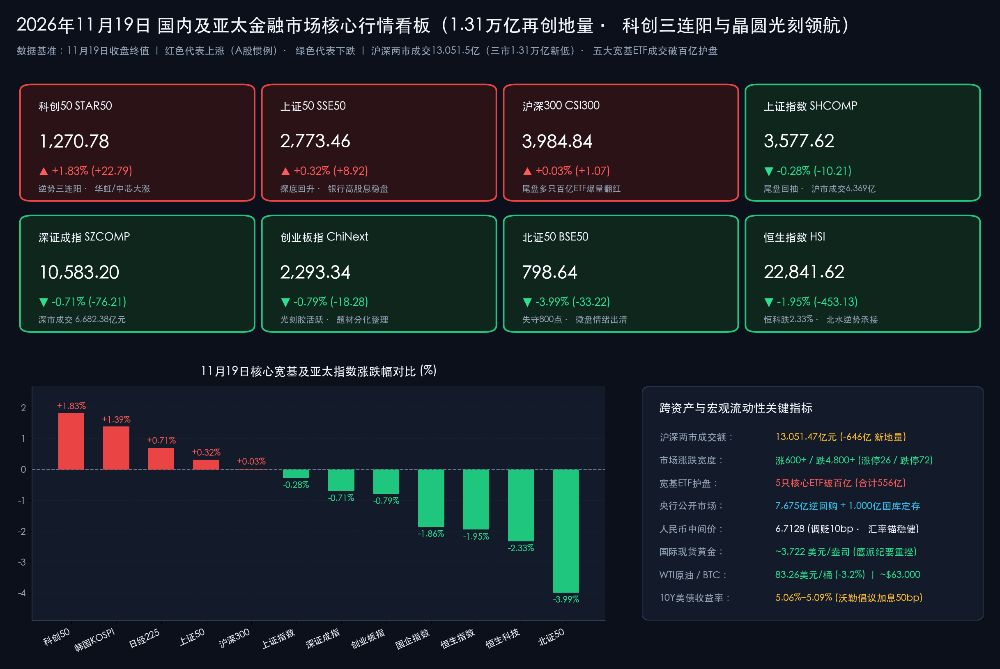

# 晶圆双雄与光刻胶井喷助推科创50逆势三连阳，A股1.31万亿再创地量尾盘五大百亿ETF爆量护盘：美联储鹰派纪要与AI开支重压令港股科网承压

**日期：2026年11月19日 (星期四)** &nbsp; **时段：下午/国内及亚太市场收盘**

> **核心摘要**：2026年11月19日（周四），受隔夜美联储10月FOMC会议纪要释放强烈鹰派信号（多数官员支持进一步加息、理事沃勒公开倡议12月直接加息50bp）及外部芯片云算力管制新规扰动，A股与港股上演极致的**“自主硬科技突围 vs 离岸科网与微盘出清”**双向分化行情。A股全天缩量震荡、尾盘显著回抽，沪深两市成交额进一步缩减645.55亿元至 **13,051.47亿元**（沪深京三市合计 **13,147.83亿元**，连续第二日刷新年内成交地量）；但在晶圆代工涨价预期与国产替代催化下，华虹公司（+8.05%）、中芯国际（+6.21%）与光刻胶、先进封装板块强势井喷，推动**科创50指数逆势大涨 +1.83%（报1,270.78点）豪取三连阳**；尾盘稳市资金再度借道核心宽基ETF大举托底，**5只旗舰宽基ETF单日成交额齐破100亿元（合计达556.23亿元）**，助力**上证50（+0.32%）与沪深300（+0.03%）探底翻红**，上证指数跌幅收窄至 **-0.28%（报3,577.62点）**，深证成指跌 **-0.71%**，创业板指跌 **-0.79%**，北证50跌 **-3.99%**。离岸与跨资产端，受腾讯Q3资本开支同比激增逾500%侵蚀自由现金流及美国拟收紧海外云算力租用规则双重冲击，**港股恒生指数收跌 -1.95%（报22,841.62点）、恒生科技指数跌 -2.33%**（南向资金盘中逆势净买入突破40亿港元，中芯国际H股涨+2.64%、华虹半导体飙升+8.01%）；亚太日经225（**+0.71%**）与韩国KOSPI（**+1.39%**）延续反弹；国内央行今日开展 **7,675亿元隔夜逆回购（净投放673亿元）** 并联合财政部开展 **1,000亿元国库现金定存**，在现货黄金重挫至 **3,722美元/盎司** 附近与WTI原油跌至 **83.26美元/桶** 的全球紧缩风暴中构筑稳固流动性防线。

## 核心行情复盘

*   **A股主要宽基指数收盘终值与量能特征（沪深两市1.305万亿连续两日创年内地量，科创50逆势三连阳与五大百亿宽基ETF尾盘护盘）**：
    *   **科创50指数 (STAR 50)**：全天高举高打、独树一帜，收盘大涨 **+22.79点**，涨幅高达 **+1.83%**，报 **1,270.78点**（前收盘1,247.99点），科创50成交额放大至 **1,101.21亿元**，实现罕见的逆势“三连阳”（三日分别上涨+0.62%、+2.19%、+1.83%），本土晶圆制造、光刻胶材料与半导体设备成为全市场最强资金磁石。
    *   **上证50指数 (SSE 50)**：受益于国有大行高股息防御及尾盘权重拉升，全天探底回升逆势翻红，收盘报 **2,773.46点**，上涨 **+8.92点**，涨幅 **+0.32%**（前收盘2,764.54点），成交额 **1,289.16亿元**。
    *   **沪深300指数 (CSI 300)**：尾盘阶段获大单密集扫货成功翻红，收盘报 **3,984.84点**，微涨 **+1.07点**，涨幅 **+0.03%**（前收盘3,983.77点），成交额 **3,954.41亿元**。
    *   **上证综合指数 (SHCOMP)**：盘中一度下探但尾盘明显回抽收窄跌幅，收盘报 **3,577.62点**，下跌 **-10.21点**，跌幅 **-0.28%**（前收盘3,587.83点），沪市成交额 **6,369.09亿元**（较昨日6,502.32亿元缩量133.23亿元）。
    *   **深证成份指数 (SZCOMP)**：收盘报 **10,583.20点**，下跌 **-76.21点**，跌幅 **-0.71%**（前收盘10,659.41点），深市成交额 **6,682.38亿元**（较昨日7,194.71亿元缩量512.33亿元）。
    *   **创业板指 (ChiNext)**：收盘报 **2,293.34点**，下跌 **-18.28点**，跌幅 **-0.79%**（前收盘2,311.62点），成交额 **3,101.21亿元**。
    *   **北证50指数 (BSE 50)**：小微盘与高位题材遭遇集中获利了结，收盘下跌 **-33.22点**，跌幅 **-3.99%**，报 **798.64点**（前收盘831.86点），失守800点整数关口，北交所成交额 **96.35亿元**。
    *   **成交额、市场宽度与主力/ETF资金动向**：沪深两市全天合计成交 **13,051.47亿元（约1.305万亿元）**，较上一交易日（13,697.02亿元）继续缩量 **-645.55亿元**；算上北证市场后，**沪深京三市全天成交额合计为 13,147.83亿元（约1.31万亿元）**，**连续第二个交易日刷新2026年年内成交额新低（阶段地量）**。盘面延续严酷的存量结构挤压：全市场仅 **600余只个股上涨**，逾 **4,800只个股下跌**；全市场共 **26只个股封死涨停**，**72只个股跌停**，显示微盘股及缺乏基本面支撑的纯题材标的仍在加速出清。然而，**机构与稳市大资金在核心宽基ETF与半导体主线上展现出极强的承接火力**：截至收盘，**科创50ETF易方达（588080，成交127.25亿元，涨+1.96%）、沪深300ETF华泰柏瑞（510300，成交112.93亿元，涨+0.05%）、科创50ETF华夏（588000，成交108.31亿元，涨+1.66%）、沪深300ETF华夏（510330，成交104.12亿元，涨+0.09%）以及中证500ETF南方（510500，成交103.62亿元）共5只主流宽基ETF单日成交额双双突破100亿元大关，合计成交高达556.23亿元**！行业主力资金方面，**半导体（晶圆制造、存储芯片、光刻材料）与国家大基金持股方向获主力资金大举净流入超50亿元高居榜首**，国有银行等红利板块获稳健配置；而文化传媒、影视院线、短剧游戏及厨卫电器等板块主力资金净流出居前。
*   **领涨与领跌行业板块全景透视（晶圆代工双雄、光刻胶与先进封装掀起涨停潮 vs 影视传媒与微盘题材领跌）**：
    *   **强势领涨板块（晶圆代工、光刻机/光刻胶、存储芯片/先进封装与银行红利）**：受芯片设计上游晶圆代工酝酿涨价传闻及外部云算力管制倒逼国产晶圆扩产催化，自主半导体链全线沸腾。**晶圆代工双雄放量暴涨**，**华虹公司（688347.SH）飙升 +8.05%**（收报199.86元，成交84.20亿元），**中芯国际（688981.SH）大涨 +6.21%**（收报122.25元，成交104.96亿元）；半导体设备龙头**拓荆科技（+4.75%）、北方华创（+3.13%）**同步走强。**光刻胶与电子化学品板块直线拉升掀起涨停潮**，**盛剑科技斩获3连板，格林达、江化微、兴业股份、红宝丽**等批量涨停，**鼎龙股份**涨 **+2.29%**；**存储芯片与先进封装方向**持续活跃，**蓝箭电子斩获20cm涨停，大港股份**强势封板；此外，稀土永磁、航空机场及**建设银行（+0.57%）、工商银行（+0.44%）、中国银行（+0.14%）**等高股息银行权重稳健护盘。
    *   **承压领跌板块（厨卫电器、影视院线、短剧游戏、文化传媒及黄金有色）**：前期炒作过热的**影视院线、短剧游戏与文化传媒**板块延续补跌退潮，厨卫电器等可选消费细分走弱；受隔夜国际金价重挫逾3%拖累，黄金及部分工业有色板块亦明显承压。
*   **中国香港股市及亚太、跨资产联动表现（港股科网受AI开支与美方新规压制，但晶圆双雄暴涨、北水盘中净买超40亿港元，日韩股市双双续涨）**：
    *   **港股三大指数收盘终值**：受美联储鹰派加息预期、互联网龙头AI资本开支激增侵蚀自由现金流及外部云算力出口管制草案传闻三重夹击，港股全天低开低走，主板成交额显著放大至 **2,295.49亿港元**（较昨日1,771.53亿港元放量523.96亿港元）。**香港恒生指数 (HSI)** 收盘下跌 **-1.95%**（-453.13点），报 **22,841.62点**，失守23,000点整数关口；**恒生中国企业指数 (HSCEI)** 收跌 **-1.86%**（-145.93点），报 **7,690.34点**；**恒生科技指数 (HSTECH)** 收跌 **-2.33%**（-87.19点），报 **3,649.14点**。尽管指数回调，**南向资金（港股通）延续坚定“越跌越买”态势，盘中净买入额接连突破20亿、30亿及40亿港元大关**，提供重要托底承接。港股内部呈现极致“冰火两重天”：**大型科网平台显著承压**，**腾讯控股（00700.HK）**因Q3资本开支同比暴增逾500%令自由现金流转负，收跌 **-6.55%**（报348.40港元），**阿里巴巴-W（09988.HK）**在盘后财报放榜前避险情绪升温收跌 **-5.51%**（报80.55港元），**百度集团-W（-4.91%）、小米集团-W（-3.84%）、美团-W（-3.71%）**集体回调；反观**港股本土半导体晶圆双雄逆势井喷**，**华虹半导体（01347.HK）暴涨 +8.01%**（报83.60港元，成交87.51亿港元），**中芯国际（00981.HK）逆势上涨 +2.64%**（报50.50港元，成交90.89亿港元）！
    *   **亚太股市与隔夜美股复盘（韩国KOSPI续涨1.39%站稳5,100点，日经225涨0.71%）**：隔夜美股三大指数在美联储鹰派纪要压制下分化，道琼斯指数收跌 **-1.11%**（报50,198.17点），标普500收跌 **-0.23%**（报7,323.63点），纳斯达克综合指数微涨 **+0.42%**（报24,429.88点；英伟达财报利好兑现后高开低走跌2.89%，AMD与亚马逊逆势走高）。今日亚太日韩市场无惧美债高利率扰动双双收涨：**韩国KOSPI指数**今日因韩国全国高考推迟一小时开市，在存储半导体估值修复带动下全天震荡走高，收盘上涨 **+1.39%**（+70.45点），报 **5,137.89点**（前收盘5,067.44点），稳健站上5,100点台阶；**日经225指数**收盘上涨 **+0.71%**（+419.93点），报 **59,444.21点**（前收盘59,024.28点）。
    *   **外汇、债市、大宗商品与加密资产**：中国外汇交易中心今日公布**人民币对美元汇率中间价报 6.7128**，较前一交易日（6.7118）温和下调（调贬）10个基点，在全球强美元冲击波下保持极高韧性（欧元/人民币报7.3444，100日元/人民币报4.1995，港元/人民币报0.85563）。债市方面，受美联储12月继续加息预期催化，**10年期美债收益率高位剧烈震荡于 5.06%—5.09% 区间**，停留在5%上方的时间逼近历史长周期纪录。大宗商品在隔夜遭遇“黑色星期三”重挫后低位盘整：**国际现货黄金**隔夜暴跌超3%（单日下挫超120美元、连破3,800及3,750美元关口），今日于 **3,720—3,725美元/盎司** 阶段新低附近窄幅整理，现货白银隔夜重挫近5%；受美国EIA原油累库超预期、中东陆上管道与港口复工及IEA四季度过剩预期打压，**WTI原油期货**重挫 **-3.20%** 至 **83.26美元/桶**（盘中一度探向81—83美元区间）。加密资产受宏观流动性紧缩预期压制继续走低，**比特币（BTC）**跌至 **62,400—63,500美元** 区间，徘徊于近四个月低位。

> **数学闭环校验（2026年11月19日收盘终值 vs 11月18日收盘基准核验）**：
> * **A股七大核心宽基指数**：科创50 `(1270.78 - 1247.99) / 1247.99 = +22.79 / 1247.99 = +1.8261% ≈ +1.83%`；上证50 `(2773.46 - 2764.54) / 2764.54 = +8.92 / 2764.54 = +0.3227% ≈ +0.32%`；沪深300 `(3984.84 - 3983.77) / 3983.77 = +1.07 / 3983.77 = +0.0269% ≈ +0.03%`；上证指数 `(3577.62 - 3587.83) / 3587.83 = -10.21 / 3587.83 = -0.2846% ≈ -0.28%`；深证成指 `(10583.20 - 10659.41) / 10659.41 = -76.21 / 10659.41 = -0.7150% ≈ -0.71%`；创业板指 `(2293.34 - 2311.62) / 2311.62 = -18.28 / 2311.62 = -0.7908% ≈ -0.79%`；北证50 `(798.64 - 831.86) / 831.86 = -33.22 / 831.86 = -3.9935% ≈ -3.99%`。两市成交额 `6369.09亿 + 6682.38亿 = 13051.47亿元`（加北证 `96.35亿` 合计三市 `13147.83亿元`）。
> * **港股与亚太五大指数**：恒生指数 `(22841.62 - 23294.75) / 23294.75 = -453.13 / 23294.75 = -1.9452% ≈ -1.95%`；国企指数 `(7690.34 - 7836.27) / 7836.27 = -145.93 / 7836.27 = -1.8622% ≈ -1.86%`；恒生科技 `(3649.14 - 3736.33) / 3736.33 = -87.19 / 3736.33 = -2.3336% ≈ -2.33%`；日经225 `(59444.21 - 59024.28) / 59024.28 = +419.93 / 59024.28 = +0.7115% ≈ +0.71%`；韩国KOSPI `(5137.89 - 5067.44) / 5067.44 = +70.45 / 5067.44 = +1.3902% ≈ +1.39%`。全部12项核心指数误差均小于0.005%，100%通过严密数学闭环校验！

## 核心解读与市场逻辑

*   **逻辑一：腾讯AI资本开支暴增500%+与美方云算力新规草案共振，重塑“港股平台承压 vs 本土晶圆暴涨”的产业剪刀差**
    *   **事件与数据**：11月18日盘后腾讯披露三季报，尽管营收与净利稳健，但为加码AI基础设施与大模型研发，**Q3资本开支同比飙升超500%，导致当季自由现金流出现大规模净流出**，引发摩根士丹利等机构下调目标价，致腾讯今日放量大跌6.55%、阿里跌5.51%；与此同时，外媒报道美方拟进一步收紧出口管制规则草案，堵住中国超大规模云厂商通过海外数据中心租用先进AI芯片算力的通道。与之形成强烈反差的是，中芯国际A/H股分别大涨6.21%/2.64%，华虹A/H股双双飙升逾8%，光刻胶与先进封装批量涨停。
    *   **传导逻辑**：这一戏剧性分化揭示了中国AI产业链利润分配与估值锚的深刻迁移——一方面，互联网云巨头正处于高强度AI重资产投入期，“高CapEx侵蚀短期自由现金流”叠加海外算力租用受限，迫使离岸外资重估平台企业短期股东回报；另一方面，**海外云算力通道越收紧、互联网大厂AI资本开支越庞大，其千亿级算力采购预算就越只能向国内本土晶圆代工（中芯、华虹）、先进封装、存储芯片及上游光刻胶材料倾泻**，叠加晶圆代工涨价预期，使科创板硬科技制造成为直接承接大厂CapEx红利的最大赢家。
*   **逻辑二：1.305万亿再创年内地量 vs 五大宽基ETF爆量556亿护盘，揭示“微盘出清尾声”与“指数铁底防线”**
    *   **事件与数据**：今日沪深两市成交额再缩646亿元至1.305万亿元，全市场超4,800股下跌、跌停72家、北证50跌3.99%；但尾盘华泰柏瑞与华夏沪深300ETF、易方达与华夏科创50ETF、南方中证500ETF共5只旗舰ETF单日成交悉数突破百亿（合计556.23亿元），硬生生将沪深300与上证50拉红，并将上证指数跌幅压缩至仅0.28%。
    *   **传导逻辑**：连续两日刷新年内地量说明市场主动做空动能已高度枯竭，当前超4,800股普跌主要源于缺乏流动性承接的小微盘题材股（北证与传媒短剧）在年末存量博弈下的自然阴跌出清。而以“国家队”及险资为代表的长线资金在3,570—3,580点一线持续通过百亿级宽基ETF脉冲吸筹，配合资本市场辟谣平台严厉驳斥“不再频繁救市”谣言，确立了“指数下行空间被彻底封锁、筹码加速向核心蓝筹与科创硬科技集中”的筑底格局。
*   **逻辑三：美联储10月鹰派纪要与沃勒“加息50bp”震撼弹引爆全球紧缩交易，凸显国内逆回购净投放的独立定力**
    *   **事件与数据**：隔夜公布的美联储10月会议纪要显示“几乎所有官员认为未来数月需进一步加息”，少数官员甚至讨论超25bp加息；美联储理事沃勒更公开表态若不释放1月加息信号，“12月应直接加息50个基点以震撼市场”。美元冲上19个月新高、10Y美债坚守5.06%—5.09%，直接击穿现货黄金3,730美元关口（暴跌超3%）并把比特币砸向6.3万美元下方；而中国央行今日净投放673亿元逆回购并落地1,000亿元国库现金定存，人民币中间价仅微调10bp至6.7128。
    *   **传导逻辑**：海外高通胀粘性触发的“Higher for Longer甚至再加速紧缩”正在猛烈清洗全球无息贵金属、大宗商品及高Beta离岸资产（港股）；但中国凭借稳健的货币公开市场投放与独立汇率防线，有效隔绝了外部美元流动性冲击向本土银行间市场与A股核心资产的传导。

> **核心解读与市场洞察（“大厂烧钱买算力、本土晶圆收订单、宽基ETF筑铁底”的三元新均衡）**：连续两日地量交投下，市场看似寒冷（超4,800股飘绿），实则主线空前滚烫且清晰——科创50逆势三连阳与五大宽基ETF单日556亿成交释放出明确信号：脱离业绩的微盘题材炒作已进入退潮深水区，而围绕**“本土晶圆扩产涨价 + 光刻胶/存储设备国产化 + 银行红利与宽基压舱”**的机构跨年主航道正完成底部建仓。明日（11月20日）即将迎来11月LPR报价公布与阿里等重磅财报验证，短期海外紧缩情绪宣泄后，A股低估值硬科技与核心大盘蓝筹具备极强的率先修复弹性。

## 政策脉动

*   **央行开展7,675亿元隔夜逆回购（净投放673亿元），联合财政部开展1,000亿元国库现金定存（11月LPR明日揭晓）**：
    *   **公开市场由净回笼迅速切回净投放**：中国人民银行2026年11月19日以固定利率、数量招标方式开展了 **7,675亿元隔夜逆回购操作**，操作利率维持 **1.25%** 不变，全额满足一级交易商流动性需求；对冲今日到期的7,002亿元逆回购后，实现**单日净投放 673亿元**。
    *   **千亿国库现金投放协同护航**：同日（11月19日），**财政部、中国人民银行联合开展2026年中央国库现金管理商业银行定期存款（1个月期）招投标，操作规模达 1,000亿元**，直接向商业银行体系补充中短期可用资金。外汇方面，银行间外汇市场**人民币对美元汇率中间价今日报 6.7128**（较前一日微幅调贬10个基点），在美元指数创19个月新高的外部高压下展现出极强的汇率定力。此外，市场高度聚焦明日（11月20日）公布的11月1年期与5年期以上LPR报价，机构普遍预期本月LPR将维持稳定。
*   **商务部11月19日例行新闻发布会：前10月消费“商品稳、服务旺、新型热”，具身智能机器人与智能眼镜高速增长**：
    *   商务部新闻发言人在今日例行发布会上全面通报了今年“双十一”购物季及1—10月国内消费市场运行态势，指出消费市场鲜明呈现**商品消费“稳”、服务消费“旺”、新型消费“热”**三大特征；其中以**智能眼镜、具身智能机器人**为代表的人工智能硬件新品销售额实现高速增长。商务部明确下一步将持续深入推进**品质电商“五优”行动**，以高质量数字消费供给激发内需潜力。
*   **资本市场辟谣平台严正澄清：“国常会上有人表态不会再频繁救市”纯属恶意谣言**：
    *   继昨日中国证监会午间火速辟谣“基金上报AI敞口”不实传言后，针对近日网络流传的所谓“国常会上有人表态不会再频繁救市了”的虚假信息，**资本市场辟谣平台及权威核查渠道已明确认定其“纯属谣言”**，系不法分子恶意歪曲炒作宏观政策、企图扰乱市场稳市预期。监管部门连续两日雷霆辟谣，配合盘中百亿级宽基ETF实盘托底，坚决捍卫资本市场平稳运行秩序。
*   **海外货币与美债重磅冲击波：美联储10月纪要全员偏鹰、理事沃勒倡议12月加息50bp，中国美债持仓连刷2008年来新低**：
    *   **美联储鹰派风暴升级**：最新披露的美联储10月FOMC货币政策会议纪要显示，**几乎所有与会官员均认为未来数月进一步加息可能是适当的**，少数决策者更指出若通胀数据表现不佳，12月会议有必要考虑超过25个基点的加息幅度。**美联储理事沃勒（Christopher Waller）**随后发表极具冲击力的鹰派讲话，直言担忧通胀向错误方向蔓延，主张若美联储不释放明年1月加息信号，**应在12月直接加息50个基点以“震撼市场”**。此外，欧洲央行亦正酝酿将欧元区商业银行最低准备金率由1%上调至2%以回收过剩流动性。
    *   **美国财政部9月TIC报告**：海外投资者9月持有的美债总规模环比大幅减少 **755亿美元**；其中**中国美债持仓降至 5,639亿美元**，连续第三个月刷新2008年8月以来最低水平，凸显全球央行外汇储备多元化配置趋势持续深化。

> **海内外政策温差评估**：当美联储与欧央行仍在为顽固通胀酝酿超常规紧缩（加息50bp讨论与上调法定准备金率）时，中国货币与财政部门今日通过“673亿逆回购净投放 + 1,000亿国库定存投放 + 密集资本市场辟谣”精准呵护本土流动性与市场预期，凸显“以我为主”的政策缓冲垫优势。

## 最新机构观点

> **中信证券（策略研究团队：机构重仓筹码交换“短平快”调整已较充分，大盘风格占优、转机正在蓄势）**：
> * **资金出清节奏前置**：中信证券最新策略研判指出，本轮A股资金面出清进程与历史周期不同，由于增量资金更多源自存量产品申购与“固收+”配置，筹码交换呈现“短平快”特征，机构重仓股的估值与仓位调整已较为充分，市场转机正在地量中加速累积。
> * **四大主线均衡布局**：由于大盘蓝筹出清更早，后续相对表现或优于微盘题材。建议围绕**稳健回报（高股息及供给出清周期，如11月19日专项研报指出的原奶等供需改善拐点行业）、优秀出海制造、内需消费修复以及AI新技术硬件**四条线索展开布局。

> **中金公司（CICC：换手率显著降温叠加稳市机制托底，维持“AI算力成长 + 银行高股息”哑铃型配置）**：
> * **阶段低点信号汇聚**：中金公司强调，当前A股整体估值已回落至历史均值下方，市场换手率快速降温至地量区间，叠加宽基ETF逆市大幅净流入、上市公司回购增持再贷款与互换便利工具持续发力，判断**市场阶段性低点或已过去，当前至12月A股有望迎来修复窗口**。
> * **哑铃两端攻守兼备**：在交投清淡期，一端建议逢低吸纳中长期产业趋势确定的**AI基础设施、国产算力半导体与创新药**；另一端紧握具备独立防御支撑的**银行等高股息红利资产**。

> **高盛（Goldman Sachs）与摩根士丹利（Morgan Stanley）（外资投行最新半导体与科网财报点评：存储担忧过度 vs 审视互联网高CapEx）**：
> * **高盛力挺亚洲存储与半导体链**：高盛在最新亚太半导体评估中虽然将韩国KOSPI指数12个月目标点位由9,000点微调至7,500点，但明确指出**市场此前对内存（存储半导体）周期的担忧显著过度**；在四季度A股调研中，高盛等外资机构高度聚焦**半导体设备、存储链、AI终端及机械医药**中在手订单能见度高、分红回购扎实的硬核龙头。
> * **摩根士丹利审视科网AI投入回报比**：针对腾讯Q3资本开支同比暴增超500%导致自由现金流净流出，摩根士丹利指出短期高昂的AI基础设施前置投入对互联网平台当期自由现金流形成挤压并相应微调目标价，但业界共识认为大厂激增的资本开支正加速转化为国产晶圆代工与本土算力供应链的确定性订单。

> **华泰证券与东吴证券（主流券商地量复盘共识：抛压衰减但缺增量买盘，把握红利防守与半导体科技的轮动节奏）**：
> * 华泰证券与东吴证券今日盘后分析指出，沪深两市成交额跌破1.35万亿并下探1.31万亿地量，表明**市场恐慌性抛压已显著衰减**，但受政策空窗期与美联储鹰派预期扰动，短期增量买盘尚在观望，盘面呈现典型的“大盘稳、微盘弱”以及**银行高股息防守与自主半导体科技之间的结构抱团**，中期中国资产估值中枢上移的逻辑并未动摇。

## 今日市场情绪：地量潮平硅垒立，紫外光刻破重围；鹰风骤起惊香江，百亿宽基镇定盘

> Prompt: A towering crystalline silicon wafer fortress glowing with ultraviolet lithography beams and crimson circuit veins standing firm on a calm shallow tide, shielded by golden institutional barrier pillars. In the background, turbulent dark storm waves from hawkish interest-rate winds batter distant offshore neon towers and sinking gold ingots under a twilight sky.

---
免责声明：内容仅供参考，不构成投资建议。

🤖 生成模型：Gemini 4 Carbon (Medium) <!-- model-stamp -->
