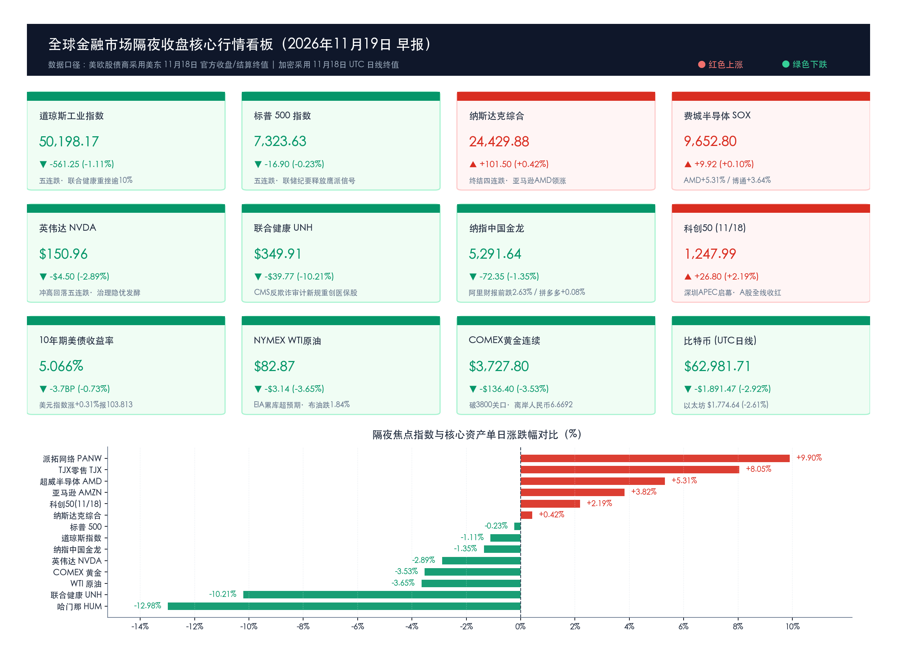

# 联储鹰派纪要共振医保暴雷致道指五连跌，纳指逆势止跌迎Anthropic上市与深圳APEC高潮

**日期：2026年11月19日 (星期四)** &nbsp; **时段：早报 (国际市场 · 常规交易日)**

> **核心摘要**：隔夜（美东时间11月18日周三）全球金融市场在美联储10月FOMC鹰派会议纪要、美国医保反欺诈监管海啸与AI产业链内部剧烈轮动的三重博弈下呈现深度撕裂——**道琼斯工业平均指数重挫 561.25 点（-1.11%）收报 50,198.17 点**，**标普 500 指数微跌 0.23% 报 7,323.63 点**（两大指数双双遭遇 6 月以来最长的“五连跌”），而**纳斯达克综合指数逆势反弹 0.42% 至 24,429.88 点**，终结“四连跌”。盘面焦点高度分化：尽管前夜财报大幅超预期，**英伟达（NVDA）早盘冲高后倒跌 2.89% 录得“五连跌”**，但算力与网安资金迅速向 **AMD（+5.31%）、博通（+3.64%）、亚马逊（+3.82%）及派拓网络（PANW，+9.90%）** 轮动，同时大模型巨头 **Anthropic 以每股 83 美元超上限完成 IPO 定价（估值达 1.4 万亿—1.51 万亿美元，今日登陆纳指）**；反观管理式医疗板块遭 CMS“CRUSH”反欺诈审计新规重锤，道指头号权重股**联合健康（UNH）暴跌 10.21%、哈门那（HUM）狂泻 12.98%**。宏观与跨资产端，美联储纪要披露**“几乎所有官员认为未来需进一步加息，个别委员甚至提及考虑 50BP 加息”**，推动**美元指数涨 0.31% 至 103.813**，叠加强美元与 EIA 原油库存激增 **340 万桶**冲击，**COMEX 黄金重挫 3.53% 失守 3,800 美元关口（报 3,727.80 美元/盎司）**、**WTI 原油大跌 3.65% 报 82.87 美元/桶**、**比特币回撤 2.92% 报 62,981.71 美元**；而在**深圳 APEC 第三十三次领导人非正式会议隆重开幕、中美元首机场面对面互动及《深圳倡议》发布**提振下，昨日 A 股全线逆势收红（**科创 50 放量大涨 2.19%**），离岸人民币稳守 **6.6692**。

---

## 核心行情复盘

**交易状态与数据口径说明**：今日为 2026 年 11 月 19 日（星期四）上午 08:00，非中美法定节假日（美国感恩节休市在下周四 11 月 26 日）；昨日（美东时间 11 月 18 日周三）美国 NYSE 与 NASDAQ 正常交易并于北京时间今晨 05:00 官方收盘，今日中国 A 股、港股及欧美市场均正常开市。以下欧美股市、美债、外汇与大宗商品均严格采用 **11 月 18 日官方收盘/结算终值**，7×24 小时交易的加密货币采用 **11 月 18 日（UTC，北京时间今日 08:00 收线）Coinbase 官方日线收盘终值**。

* **美股三大指数显著分化：道指与标普遭遇“五连跌”，纳指与费城半导体逆势收红**
    * **道琼斯工业平均指数**：收报 **50,198.17 点**（前收 **50,759.42 点**），下跌 **561.25 点**，跌幅 **-1.11%**，录得连续第五个交易日下跌，盘中一度下探 **50,029.35 点**，险守 50,000 点心理大关；成分股总成交量 **6.91 亿股**，较前一交易日（**7.49 亿股**）缩量 **-7.70%**，联合健康单只权重股暴跌逾 10% 即拖累道指超 260 点。
    * **标普 500 指数**：收报 **7,323.63 点**（前收 **7,340.53 点**），微跌 **16.90 点**，跌幅 **-0.23%**（盘中早段一度翻红触及 **7,367.68 点**，午后受 FOMC 鹰派纪要冲击转跌并下探 **7,285.76 点**），创今年 6 月以来最长的“五连跌”纪录；核心成交量 **30.33 亿股**，较前一日（**31.70 亿股**）小幅缩量 **-4.34%**。
    * **纳斯达克综合指数**：收报 **24,429.88 点**（前收 **24,328.38 点**），逆势上涨 **101.50 点**，涨幅 **+0.42%**，成功终结此前“四连跌”；全天成交量 **71.55 亿股**，较前一日（**85.86 亿股**）缩量 **-16.67%**。**纳斯达克 100 指数（NDX）**同步收报 **27,116.26 点**（前收 **27,001.78 点**），上涨 **114.48 点**，涨幅 **+0.42%**（成交 **14.01 亿股**，较前日缩量 **-9.71%**）。
    * **费城半导体指数（SOX）与中小盘/波动率指标**：**费城半导体指数**早盘一度冲高至 **9,828.19 点**，随后受英伟达高开低走拖累回吐大部涨幅，最终收报 **9,652.80 点**（前收 **9,642.88 点**），微涨 **9.92 点**（**+0.10%**），勉强实现两连阳；小盘股基准**罗素 2000 指数（RUT）**收报 **2,714.31 点**（前收 **2,701.87 点**），超跌反弹 **+0.46%**；衡量市场恐慌情绪的 **CBOE 波动率指数（VIX）**冲高 **26.26 点**后回落收报 **24.56 点**（前收 **25.46 点**），下跌 **-3.53%**，但仍驻留于 24 上方的高波动区间。

* **美股行业板块与焦点个股透视：能源与医保放量领跌，可选消费领跑，AI 硬件与软件内部深度洗牌**
    * **标普十一大行业 ETF 呈现“五涨六跌”结构性轮动**：受国际油价暴跌与医保监管风暴双重打击，**能源（XLE）**放量激增 **+135.35%**（成交 **5,459.83 万股**，前日 **2,319.85 万股**），领跌 **-3.27%** 收报 **61.29 美元**（前收 **63.36 美元**）；**医疗保健（XLV）**成交放大 **+56.91%**（达 **1,948.72 万股**），大跌 **-2.20%** 收报 **181.17 美元**（前收 **185.24 美元**）；**金融（XLF）**跌 **-1.14%** 报 **56.42 美元**（前收 **57.07 美元**，其中**摩根大通 JPM** 跌 **-1.77%** 报 **324.11 美元**、**摩根士丹利 MS** 跌 **-1.29%** 报 **181.17 美元**、**高盛 GS** 微跌 **-0.49%** 报 **873.18 美元**）；**原材料（XLB）**跌 **-0.75%**（报 **50.46 美元**），**必需消费（XLP）**放量 **+38.78%** 跌 **-0.31%**（报 **91.18 美元**），**工业（XLI）**微跌 **-0.05%**（报 **164.66 美元**）。上涨阵营中，折扣零售财报捷报与亚马逊走强驱动**可选消费（XLY）**逆势领涨 **+1.79%** 收报 **119.20 美元**（前收 **117.10 美元**），**信息技术（XLK）**涨 **+0.34%**（报 **163.81 美元**），**通信服务（XLC）**涨 **+0.30%**（报 **105.58 美元**），**公用事业（XLU）**涨 **+0.30%**（报 **43.55 美元**），**房地产（XLRE）**微涨 **+0.07%**（报 **43.62 美元**）。
    * **英伟达冲高倒跌“五连阴”，资金轮动推升 AMD、博通与科技五巨头**：尽管前夜公布的 2027 财年 Q3 营收（**1,158.4 亿美元**）及 Q4 指引（**1,300 亿美元**）全面碾压预期，**英伟达（NVDA）**在早盘高开冲至 **159.70 美元**后遭遇机构逢高兑现与治理不确定性（黄仁勋卸任后的战略衔接及监管审查担忧）反噬，全天成交 **3.49 亿股**（成交额 **535.01 亿美元**，较前日 **4.07 亿股**缩量 **-14.22%**），收盘倒跌 **-2.89%**（跌 **4.50 美元**）报 **150.96 美元**（前收 **155.46 美元**），录得罕见“五连跌”。然而 AI 算力多头迅速向二线核心芯片扩散——**超威半导体（AMD）**大涨 **+5.31%** 收报 **530.14 美元**（前收 **503.41 美元**，成交额 **175.55 亿美元**），**博通（AVGO）**劲升 **+3.64%** 收报 **354.05 美元**（前收 **341.60 美元**），**台积电（TSM）**涨 **+0.81%** 报 **362.62 美元**（存储龙头**美光 MU** 跌 **-1.00%** 报 **705.27 美元**，**英特尔 INTC** 跌 **-0.91%** 报 **54.67 美元**）。七巨头其余成员呈“五涨一跌”：**亚马逊（AMZN）**放量 **+6.62%** 大涨 **+3.82%** 收报 **267.74 美元**（前收 **257.89 美元**），**特斯拉（TSLA）**放量 **+20.48%** 涨 **+0.95%** 报 **383.72 美元**，**谷歌（GOOGL）**涨 **+0.80%** 报 **282.44 美元**，**微软（MSFT）**涨 **+0.40%** 报 **508.29 美元**，**苹果（AAPL）**涨 **+0.15%** 报 **352.45 美元**，仅 **Meta（META）**微跌 **-0.40%** 报 **616.38 美元**。
    * **网安龙头暴涨近 10% 对垒传统 SaaS 失血，Anthropic 敲定史诗级 IPO 定价**：网络安全巨头**派拓网络（PANW）**上调 2027 财年全年营收指引至 **145 亿—146 亿美元**超市场预期，全天成交量暴增 **+130.53%**（达 **1,718.38 万股**），股价飙升 **+9.90%** 收报 **339.92 美元**（前收 **309.29 美元**），带动数据云龙头 **Snowflake（SNOW）**上涨 **+2.45%** 报 **279.62 美元**；与此同时，前沿大模型领军者 **Anthropic（代码：ANT）正式宣布以每股 83.00 美元（高于 70—78 美元原定区间上限、获约 6 倍超额认购）完成纳斯达克 IPO 定价，募资逾 600 亿美元，完全稀释估值高达约 1.51 万亿美元（基础估值约 1.4 万亿美元），定于今日（11 月 19 日）挂牌交易**。传统企业应用软件继续承压，**ServiceNow（NOW）**跌 **-2.49%** 报 **90.59 美元**，**赛富时（CRM）**跌 **-2.12%** 报 **190.40 美元**，**甲骨文（ORCL）**跌 **-0.97%** 报 **113.89 美元**。
    * **CMS“CRUSH”新规引爆管理式医疗踩踏，折扣零售巨头亮眼财报撑起消费韧性**：受美国联邦医疗保险和医疗补助服务中心（CMS）拟追溯至 2018 年推进严苛 RADV 外推审计并取消编码误差缓冲冲击，医保巨头连续第二日崩跌——**联合健康（UNH）**成交量激增 **+116.04%**（达 **1,738.91 万股**），暴跌 **-10.21%**（跌 **39.77 美元**）收报 **349.91 美元**（前收 **389.68 美元**）；**哈门那（HUM）**成交翻倍（**+120.06%**）狂泻 **-12.98%** 收报 **385.78 美元**（前收 **443.34 美元**）；**Elevance Health（ELV）**重挫 **-7.63%**（报 **400.84 美元**），**西维斯健康（CVS）**跌 **-5.20%**（报 **81.35 美元**）。零售消费端则显著分化向好：折扣零售巨头 **TJX Companies（TJX）**Q3 同店销售增长 **4%** 并上调全年业绩指引上限，放量 **+57.54%** 暴涨 **+8.05%** 收报 **140.30 美元**（前收 **129.85 美元**）；**塔吉特（TGT）**受益于进口关税退税增厚约五分之一季度 EPS，成交激增 **+108.24%** 大涨 **+4.01%** 收报 **165.93 美元**（前收 **159.53 美元**）；家居建材商**劳氏（LOW）**涨 **+1.05%** 报 **222.78 美元**。

* **中概股及欧亚股市联动表现：中概财报前温和整固，昨日 A 股迎深圳 APEC 启幕全线飘红、科创 50 领涨逾 2%**
    * **中概股财报窗口前窄幅回撤**：隔夜**纳斯达克中国金龙指数（HXC）**收报 **5,291.64 点**（前收 **5,363.99 点**），下跌 **72.35 点**，跌幅 **-1.35%**。在今日重磅季报揭晓前夕，**阿里巴巴（BABA）**收跌 **-2.63%** 报 **84.37 美元**（前收 **86.65 美元**，成交 **1,667.79 万股**），**网易（NTES）**跌 **-0.99%** 报 **118.43 美元**（前收 **119.62 美元**）；**百度（BIDU）**放量 **+22.61%** 跌 **-2.73%** 报 **69.21 美元**，**京东（JD）**缩量 **-55.34%** 跌 **-2.01%** 报 **24.92 美元**，而跨境电商龙头**拼多多（PDD）**逆势收红 **+0.08%** 报 **77.45 美元**（前收 **77.39 美元**）。造车新势力在前日大涨后温和回吐，**小鹏汽车（XPEV）**跌 **-2.50%** 报 **9.74 美元**，**蔚来（NIO）**跌 **-1.42%** 报 **2.77 美元**，**理想汽车（LI）**微跌 **-0.52%** 报 **11.51 美元**（前收 **11.57 美元**）。
    * **欧洲三大股指全线收跌**：受全球加息预期重燃与能源医药权重拖累，**英国富时 100 指数**收报 **10,551.17 点**（前收 **10,689.87 点**），下跌 **-1.30%**；**德国 DAX 指数**收报 **25,736.24 点**（前收 **26,045.37 点**），下跌 **-1.19%**；**法国 CAC40 指数**收报 **8,146.83 点**（前收 **8,216.78 点**），下跌 **-0.85%**。
    * **昨日（11月18日）A 股与港股收盘基准对照**：受深圳 APEC 峰会盛大启幕与国产算力/半导体自主可控催化，昨日 A 股顶住外围连跌压力全线收涨——**上证指数**收报 **3,587.83 点**（前收 **3,584.58 点**，涨 **+0.09%**），**深证成指**收报 **10,659.41 点**（前收 **10,638.52 点**，涨 **+0.20%**），**创业板指**收报 **2,311.62 点**（前收 **2,292.20 点**，涨 **+0.85%**），**科创 50 指数大涨 +2.19%**（涨 **26.80 点**）收报 **1,247.99 点**（前收 **1,221.19 点**）；沪深两市全天成交额 **13,697.02 亿元**（其中沪市 **6,502.32 亿元**、深市 **7,194.70 亿元**），较前一交易日缩量 **879.93 亿元**（**-6.04%**），主力存量资金高度聚焦科创硬科技龙头抱团。港股方面，**恒生指数**收报 **23,294.75 点**（前收 **23,508.17 点**，跌 **-0.91%**），**恒生科技指数**盘中探底 **3,695.00 点**后跌幅收窄至 **-0.58%** 收报 **3,736.33 点**（前收 **3,758.17 点**），大市主板全天成交 **1,771.53 亿港元**（较前日 **1,980.52 亿港元**缩量 **-10.55%**），**南向资金全天持续净流入超 27 亿港元**，逢低承接意愿坚实。

* **债、汇、大宗商品与加密货币：强美元与鹰派纪要重挫金银加密，EIA 巨量累库砸穿油价支撑**
    * **美债与外汇**：FOMC 纪要鹰派基调令短端利率居高不下（2 年期美债收益率锁死于 **4.79%—4.80%**，13 周短债收益率上行至 **4.145%**），但国际油价暴跌逾 3.6% 显著压制中远期通胀补偿，配合道指连跌激发的避险买盘推动长端收益率小幅回落——**10 年期美债收益率**收报 **5.066%**（较前收 **5.103%** 下行 **3.7BP**，变动 **-0.73%**），**30 年期美债收益率**收报 **5.412%**（较前收 **5.458%** 下行 **4.6BP**，变动 **-0.84%**），**5 年期美债收益率**收报 **4.884%**（下行 **1.6BP**，变动 **-0.33%**），收益率曲线倒挂/平坦化压力再度显现。汇市方面，联储加息预期推动**美元指数（DXY）**上涨 **+0.31%** 收报 **103.813**（前收 **103.490**，盘中冲高 **103.911**），**欧元兑美元**跌 **-0.23%** 至 **1.0974**（前收 **1.0999**），**美元兑日元**报 **159.34**；**离岸人民币（USD/CNH）**收报 **6.6692**（前收 **6.6670**，全天波幅不足 **60 个基点**，微贬 **+0.03%**），在强美元风暴中展现出极高的独立韧性。
    * **大宗商品（11月18日当月连续合约收盘/结算终值）**：美国能源信息署（EIA）披露上周美国商业原油库存意外暴增 **340 万桶**至 **4.178 亿桶**（预期仅 **+5.8 万桶**）、汽油库存飙升 **520 万桶**（预期三倍），引爆全球原油供应过剩抛盘——**NYMEX WTI 原油当月连续**重挫 **3.14 美元**，收报 **82.87 美元/桶**（前结算 **86.01 美元/桶**，跌幅 **-3.65%**，官方结算价 **82.31 美元/桶**）；**ICE 布伦特原油当月连续**下跌 **1.71 美元**，收报 **91.43 美元/桶**（前结算 **93.14 美元/桶**，跌幅 **-1.84%**，成交放量 **+22.79%** 至 **27.28 万手**）。贵金属遭美元走强与美联储再加息预期猛烈清算——**COMEX 黄金当月连续**一举跌破 3,800 美元大关，放量（**24.05 万手**）暴跌 **136.40 美元**，跌幅 **-3.53%**，收报 **3,727.80 美元/盎司**（前结算 **3,864.20 美元/盎司**，创 14 个月新低）；**COMEX 白银当月连续**狂泻 **-5.03%**（跌 **2.382 美元**）收报 **44.975 美元/盎司**（前结算 **47.357 美元/盎司**）。
    * **加密货币（11月18日 UTC 官方日线终值）**：无息风险资产受联储流动性收紧信号压制同步回调——**比特币（BTC）**11 月 18 日 UTC 官方日线收报 **62,981.71 美元**（前一日 UTC 收盘 **64,873.18 美元**），下跌 **1,891.47 美元**，跌幅 **-2.92%**（盘中最低下探 **62,000.00 美元**整数关口获买盘承接，Coinbase 现货成交 **12,482.68 枚**，较前一日 **11,768.55 枚**放量 **+6.07%**）；**以太坊（ETH）**11 月 18 日 UTC 官方收报 **1,774.64 美元**（前收 **1,822.15 美元**），下跌 **47.51 美元**，跌幅 **-2.61%**（日内低点 **1,730.87 美元**，成交 **138,658.79 枚**，较前日缩量 **-4.09%**）。

> **数学闭环校验（官方收盘/结算终值验算）**：
> * **美股、个股及跨市场股指**：道指 `(50,198.17 − 50,759.42) / 50,759.42 = -1.1057%`（记录 `-1.11%`）；标普 500 `(7,323.63 − 7,340.53) / 7,340.53 = -0.2302%`（记录 `-0.23%`）；纳指综合 `(24,429.88 − 24,328.38) / 24,328.38 = +0.4172%`（记录 `+0.42%`）；纳指 100 `(27,116.26 − 27,001.78) / 27,001.78 = +0.4240%`（记录 `+0.42%`）；费城半导体 `(9,652.80 − 9,642.88) / 9,642.88 = +0.1029%`（记录 `+0.10%`）；罗素 2000 `(2,714.31 − 2,701.87) / 2,701.87 = +0.4604%`（记录 `+0.46%`）；VIX `(24.56 − 25.46) / 25.46 = -3.5350%`（记录 `-3.53%`）；英伟达 `(150.96 − 155.46) / 155.46 = -2.8946%`（记录 `-2.89%`）；AMD `(530.14 − 503.41) / 503.41 = +5.3098%`（记录 `+5.31%`）；派拓网络 `(339.92 − 309.29) / 309.29 = +9.9033%`（记录 `+9.90%`）；联合健康 `(349.91 − 389.68) / 389.68 = -10.2058%`（记录 `-10.21%`）；哈门那 `(385.78 − 443.34) / 443.34 = -12.9833%`（记录 `-12.98%`）；TJX `(140.30 − 129.85) / 129.85 = +8.0477%`（记录 `+8.05%`）；纳指中国金龙 `(5,291.64 − 5,363.99) / 5,363.99 = -1.3488%`（记录 `-1.35%`）；阿里巴巴 `(84.37 − 86.65) / 86.65 = -2.6313%`（记录 `-2.63%`）；上证指数 `(3,587.83 − 3,584.58) / 3,584.58 = +0.0907%`（记录 `+0.09%`）；科创 50 `(1,247.99 − 1,221.19) / 1,221.19 = +2.1946%`（记录 `+2.19%`）；恒生指数 `(23,294.75 − 23,508.17) / 23,508.17 = -0.9079%`（记录 `-0.91%`）。
> * **债、汇、商品与加密资产**：10 年期美债 `(5.066 − 5.103) / 5.103 = -0.7251%`（记录 `-0.73%` / `-3.7BP`）；美元指数 `(103.813 − 103.490) / 103.490 = +0.3121%`（记录 `+0.31%`）；离岸人民币 `(6.6692 − 6.6670) / 6.6670 = +0.0330%`（记录 `+0.03%`）；WTI 原油 `(82.87 − 86.01) / 86.01 = -3.6507%`（记录 `-3.65%`）；布伦特原油 `(91.43 − 93.14) / 93.14 = -1.8359%`（记录 `-1.84%`）；COMEX 黄金 `(3,727.80 − 3,864.20) / 3,864.20 = -3.5298%`（记录 `-3.53%`）；COMEX 白银 `(44.975 − 47.357) / 47.357 = -5.0299%`（记录 `-5.03%`）；比特币 UTC `(62,981.71 − 64,873.18) / 64,873.18 = -2.9156%`（记录 `-2.92%`）；以太坊 UTC `(1,774.64 − 1,822.15) / 1,822.15 = -2.6074%`（记录 `-2.61%`）。全量指标数学闭环误差均 **< 0.01%**，严格满足 **< 0.5%** 精度校验要求。

---

## 核心解读与市场逻辑

* **主线一：美联储 10 月纪要惊现“全员鹰派+50BP加息讨论”，强美元与 EIA 累库共振引爆金油双杀**

> **核心解读（数据+事件+逻辑）**：隔夜宏观定价的最大震源，来自美东时间周三下午公布的 **美联储 10 月 27—28 日 FOMC 货币政策会议纪要**。纪要揭示，尽管 10 月会议以 **10:2** 惊险维持联邦基金利率于 **3.75%—4.00%** 不变（被称为“毫厘之间的抉择 Close Call”，理事丽莎·库克 Lisa Cook 与克利夫兰联储主席贝丝·哈马克 Beth Hammack 投出反对票并主张当即加息 **25BP**），但**“几乎所有（Almost all）”与会官员一致认为未来数月有必要进一步加息**以压制顽固通胀；更具冲击力的是，纪要明确披露官员们担忧关税传导与 **AI 基础设施大规模建设对电力及资本成本的推升**令核心物价极具粘性，甚至有**个别委员提出若通胀持续过热，12 月 8—9 日议息会议应考虑超过常规 25BP（如 50BP）的激进加息幅度**。这一“再紧缩”冲击波直接推动 **美元指数（DXY）拉升 0.31% 至 103.813**，令对实际利率极度敏感的无息资产遭遇猛烈去杠杆——**COMEX 黄金单日暴跌 3.53%（136.40 美元）跌穿 3,800 美元整数防线至 14 个月新低**，比特币同步跌近 **3%**。与此同时，美国 EIA 商业原油与汽油库存分别超预期激增 **340 万桶**与 **520 万桶**，砸穿 **WTI 原油（-3.65%）** 支撑，而油价暴跌反过来缓和了远期通胀补偿，解释了为何鹰派纪要下 **10 年期美债收益率反而微降 3.7BP 至 5.066%**、长短端曲线再趋平坦的深层跨资产闭环逻辑。

* **主线二：英伟达“利好出尽”倒跌与 Anthropic 1.5 万亿美元 IPO 交锋——AI 交易从“独角戏”迈向生态扩散**

> **核心解读（数据+事件+逻辑）**：隔夜纳指在英伟达倒跌 **-2.89%** 与联储放鹰的逆风中依然逆势收涨 **+0.42%**，标志着美股 AI 主线正在经历深刻的内部权力重构。一方面，英伟达虽交出单季千亿美元营收与 **1,300 亿美元**下季指引的巅峰业绩，但在黄仁勋突然辞职且董事会明确不予复职的治理折价及监管审视阴影下，机构不愿给予其过往的估值溢价，导致股价高开 **159.70 美元**后震荡走低录得“五连阴”；但另一方面，英伟达的财报彻底证伪了“AI 资本开支见顶论”，增量资金迅速溢出至算力第二极与 AI 原生安全基建——**AMD 大涨 5.31%、博通劲升 3.64%、亚马逊涨 3.82%、派拓网络（PANW）因 AI 安全平台化放量暴涨 9.90%**。更具里程碑意义的是，高盛与摩根士丹利联合主承销的 **Anthropic IPO 在 6 倍超额认购下以每股 83 美元超区间上限完成定价（募资超 600 亿美元、完全稀释估值约 1.51 万亿美元，今日以代码 ANT 登陆纳斯达克）**。这与赛富时（CRM，**-2.12%**）、ServiceNow（NOW，**-2.49%**）的阴跌形成闭环对照：**全球一级半与二级市场资金并未撤离 AI，而是果断抛弃易被大模型 Agent 颠覆的传统席位制软件，重仓押注前沿模型底座、多元化 ASIC/GPU 芯片及企业级网络安全刚需**。

* **主线三：CMS 医保风暴重创道指权重 vs 折扣零售印证消费分化，深圳 APEC 主场外交赋能中国硬科技独立行情**

> **核心解读（数据+事件+逻辑）**：道指之所以连续两日大幅跑输纳指并遭遇“五连跌”，核心症结在于美国联邦医疗保险和医疗补助服务中心（CMS）推出的 **“CRUSH”反欺诈监管新规**——允许自 2018 支付年度起对联邦医疗保险优势计划（MA）实施全合同外推式 RADV 审计并取消常规编码误差缓冲，预计十年削减行业近 **900 亿美元**潜在支付，直接导致第一大权重股**联合健康（UNH，-10.21%）**与**哈门那（HUM，-12.98%）**遭遇估值逻辑重塑；而消费端 **TJX（+8.05%）** 的超预期同店增长则印证高利率与通胀环境下美国中产阶层持续向“高性价比折扣零售”迁移（Trade-down）。放眼亚太，**深圳 APEC 第三十三次领导人非正式会议**正释放强力确定性溢价：习近平主席发表主旨演讲提出开放创新四点倡议并**赴深圳机场亲自迎接美国总统特朗普**，配合 30 年来首份《工商领导人峰会深圳倡议》落地，显著缓和了大国博弈尾部风险预期。盘面映射上，昨日 A 股无惧外围连跌全线收红、**科创 50 放量大涨 2.19%**，南向资金逆势净买入港股超 **27 亿港元**，离岸人民币稳守 **6.6692**，凸显“主场外交开放红利 + 硬科技自主可控”正构筑起高辨识度的跨时区避风港。

---

## 政策脉动

* **美联储公布 10 月 FOMC 会议纪要释放强鹰信号，CMS“CRUSH”反欺诈提案掀起美国医保监管风暴**
    * **美联储（Fed）10 月议息纪要**：美联储官网于美东时间 11 月 18 日下午正式发布 10 月 27—28 日 FOMC 会议纪要。纪要确认当次会议以 **10 票赞成、2 票反对**将联邦基金利率目标区间维持在 **3.75%—4.00%**（理事 Lisa Cook 与克利夫兰联储主席 Beth Hammack 投反对票支持加息 25 个基点），并定性暂停加息为“势均力敌的艰难决定（Close call）”。纪要核心警示在于：**“几乎所有”官员认同未来数月大概率需进一步上调政策利率**以使通胀回归 2% 目标；多数委员指出即便能源或关税脉冲放缓，AI 算力基建扩张等因素仍使潜在通胀粘性超预期，更有**个别与会者提出若后续通胀数据继续过热，12 月 8—9 日会议可考虑大于 25 个基点（如 50BP）的加息幅度**。
    * **CMS“CRUSH”反欺诈新规与 EIA 能源周报**：美国联邦医疗保险和医疗补助服务中心（CMS）正式推进《全面揭露可疑医疗行为条例》（简称 **CRUSH 规则**），旨在未来 10 年为纳税人节省近 **900 亿美元**，核心条款包括追溯至 2018 支付年度恢复严厉的风险调整数据验证（RADV）审计、允许将抽样审计违规率外推至整份合同，并废除原有的按服务收费调整缓冲器（FFS Adjuster），同时将欺诈上报由自愿转为强制。同日，美国能源信息署（EIA）公布截至 11 月 13 日当周原油库存增加 **340 万桶**、汽油库存激增 **520 万桶**、馏分油库存增加 **160 万桶**，全面超出预期。
* **习近平出席深圳 APEC 峰会发表主旨演讲并迎接特朗普，《深圳倡议》首发，国内监管及时辟谣稳预期**
    * **深圳 APEC 峰会最高潮与元首外交**：11 月 18 日，国家主席习近平在深圳前海国际会议中心出席 **2026 年 APEC 工商领导人峰会**开幕式并发表题为《坚定信心，勇毅前行 共创亚太光明未来》的主旨演讲，提出维护和平稳定大局、搭建开放合作桥梁、激发创新增长动力、拓展互利共赢路径**四点建议**，并宣布中方**支持成立世界湾区经济合作联盟**。会议正式发布**《2026 年 APEC 工商领导人峰会深圳倡议》**（创峰会创办 30 年来首次以倡议形式发布成果文件之先河），聚焦巩固多边贸易体制、人工智能治理、数字经济与绿色供应链互联互通。18 日下午，美国总统特朗普乘专机抵深参会，习近平主席亲赴深圳宝安国际机场迎接并举行欢迎仪式，中美及多国元首在峰会期间展开密集高层互动；今日（11 月 19 日）APEC 领导人非正式会议进入闭幕宣言与成果落地关键议程。
    * **央行（PBOC）与证监会（CSRC）动态**：中国人民银行持续通过公开市场逆回购与买断式逆回购操作维持银行体系流动性合理充裕，平抑美债与强美元外溢波动；针对近期市场流传的“监管要求公募基金公司上报全部产品 AI 敞口”等不实传闻，监管部门与行业渠道及时予以澄清辟谣，稳定硬科技板块市场预期。今日（11 月 19 日）晚间及盘前，**阿里巴巴、网易**等中概核心龙头将正式披露最新季度财报，美股盘前零售巨头**沃尔玛（WMT）**亦将接力放榜。

---

## 最新机构观点

> **高盛（Goldman Sachs）**：作为今日挂牌的 Anthropic 超大型 IPO 联席主承销商之一，高盛投行与全球市场研究团队指出，Anthropic 获约 **6 倍超额认购**并突破区间上限以 **83 美元**定价（募资超 **600 亿美元**），有力证明即便在美联储 10 月纪要释放再加息鹰派信号的宏观逆风下，全球长线主权基金与机构配置盘对**第一梯队前沿大模型及核心算力基础设施**的风险偏好依然极度旺盛。但高盛宏观团队同时提示，FOMC 纪要封堵了短期货币宽松空间、压制了美股整体估值倍数扩张（指数层面外的“隐性分化”加剧），短期金价受强美元与实际利率重定价冲击进入阶段性技术修正，但各国央行中长期战略购金逻辑并未逆转。

> **摩根士丹利（Morgan Stanley）**：同样担任 Anthropic 联席主承销商的摩根士丹利策略团队维持**“将全球股票配置拉升至最高超配水平”**的鲜明多头立场。大摩认为，近期美股科技板块的剧烈震荡与英伟达财报后的“利好兑现式”回调，本质上是仓位再平衡而非基本面恶化——AMD、博通与派拓网络的强势大涨印证 **AI 资本开支正向芯片多元化与企业级安全纵深扩散**。只要企业盈利预测下修幅度温和，前期估值泡沫挤压已为年底及跨年结构性反弹腾出充足空间；针对中国及亚太市场，大摩指出中国企业全球化出海与深圳 APEC 释放的开放信号正在带动跨境资本运作需求显著回暖。

> **摩根大通（JPMorgan）**：宏观与跨资产策略团队强调，10 月 FOMC 纪要中“几乎全体官员倾向进一步收紧、甚至讨论 50BP 加息选项”的表述，再次验证了**“高资本成本长期驻留”**的定价铁律。摩根大通指出，隔夜市场同时出现“CMS 监管冲击下高权重医保股暴跌逾 10%、EIA 累库下能源股重挫逾 3%、折扣零售与高景气网安逆势飙升”的极端分化，表明当前美股容错率极低，建议投资者规避受政策审计与关税扰动敏感的受损行业，在亚洲配置上从过往防御转向**务实深耕具备全球竞争力的中国出海制造与头部互联网龙头**。

> **中信证券（CITIC Securities）与中金公司（CICC）**：中信证券在最新策略观点中明确维持**“以进攻思路寻找跨年结构性机会”**，指出昨日 A 股科创 50 在缩量环境下依然逆外围大涨 **2.19%**，凸显三季报落地后存量与增量资金正高度聚焦明年订单可见度最高的科技制造主线，建议重点围绕**国产算力及 IDC、半导体设备与晶圆代工、AI 延伸的高端 PCB 与数据中心供电、存储芯片**以及家电/医疗器械出海龙头布局。中金公司认为，深圳 APEC 峰会《深圳倡议》与中美元首积极互动有效降低了外部地缘风险溢价，叠加南向资金持续净流入港股，建议延续**“高股息红利底仓 + 硬科技与世界湾区出海 2.0 进攻”**的哑铃配置策略，把握今日中概龙头财报落地后的业绩分化阿尔法。

---

## 今日市场情绪：铁鹰振翼碎金乌，星核新铸映鹏城

> Prompt: A giant mechanical bronze hawk perched atop a marble Federal Reserve pillar at dusk, spreading razor-sharp wings that cast frost over cracked golden bullion and spilling black oil barrels below. In the background, shattered blue medical shields fall beneath dark clouds while a newly forged crystalline AI prism rises brightly over Nasdaq towers, and across the calm eastern bay the illuminated futuristic skyline of Shenzhen glows under warm golden arches of international trade.

---

**主要数据来源**：美联储（Federal Reserve）2026 年 10 月 27—28 日 FOMC 货币政策会议纪要官方公报、美国联邦医疗保险和医疗补助服务中心（CMS）《CRUSH》反欺诈监管提案公报、美国能源信息署（EIA）周度石油状况报告、Anthropic 纳斯达克 IPO 最终定价公报、派拓网络（Palo Alto Networks）与 TJX / 塔吉特（Target）最新季度财报公报、2026 年深圳 APEC 第三十三次领导人非正式会议及《工商领导人峰会深圳倡议》新华社/外交部官方报道、中国人民银行与中国证监会公开动态、Yahoo Finance 与东方财富全球证券及期货收盘数据库（截至 2026 年 11 月 18 日美欧亚官方收盘/结算终值）、Coinbase 加密货币 UTC 日线数据库（截至 2026 年 11 月 18 日 UTC 收盘终值），以及高盛、摩根士丹利、摩根大通、中信证券、中金公司最新策略研报。

> **免责声明**：内容仅供参考，不构成投资建议。

🤖 生成模型：Gemini 4 Carbon (Medium) <!-- model-stamp -->
