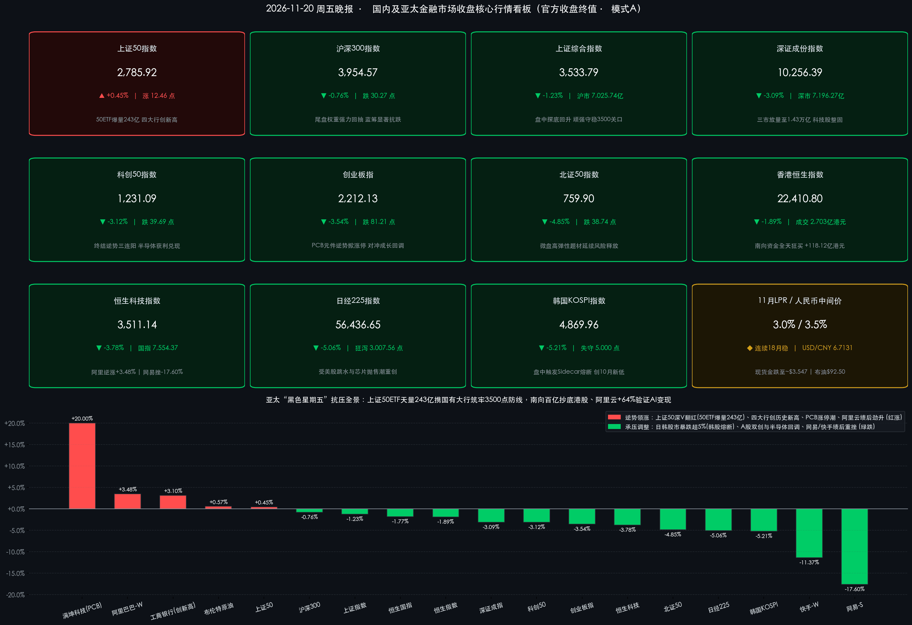
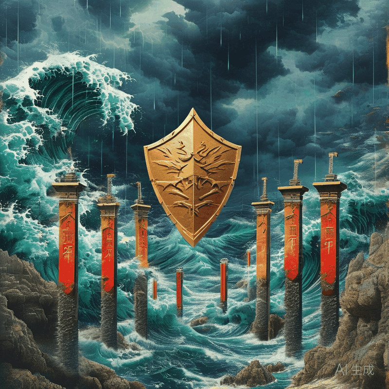

# 上证50ETF爆出243亿天量携四大行创历史新高护沪指守3500点，日韩暴跌逾5%下双创回调：11月LPR十八连稳与阿里云狂飙64%逆市扛旗

**日期：2026年11月20日 (星期五)** &nbsp; **时段：下午/国内及亚太市场收盘**

> **核心摘要**：2026年11月20日（周五），受隔夜美联储鹰派“50BP加息论”余波、AI独角兽Anthropic史上最大IPO流动性虹吸触发美股惊天跳水（道指暴跌逾1,100点失守5万点）冲击，亚太股市遭遇“黑色星期五”——**韩国KOSPI暴跌 -5.21%（盘中触发熔断）**、**日经225狂泻 -5.06%（跌逾3,000点）**。面对外部巨震，A股上演极致的**“超级权重深V定盘 vs 高弹性科技获利兑现”**攻防战：沪深京三市全天成交额放量约1,163亿元至 **1.43万亿元**（沪深两市 **14,222.01亿元**）；尾盘稳市主力借道旗舰ETF展开史诗级扫货，**华夏上证50ETF（510050）单日爆出逾243亿元成交天量（创历史第二高纪录）**，叠加**工商银行、农业银行、中国银行、建设银行四大行集体创历史新高**，硬生生推动**上证50指数（+0.45%）深V翻红**，护佑**上证指数（-1.23%，报3,533.79点）**探底回升守稳3,500点大关；而前期连涨的半导体芯片与微盘股集中回调，**科创50跌 -3.12%**、**创业板指跌 -3.54%**、**北证50跌 -4.85%**，惟**PCB印制电路板**受供应紧张预警催化逆势掀起涨停潮。港股同步上演财报审判极化：**恒生指数收跌 -1.89%（报22,410.80点）**、**恒生科技跌 -3.78%**，但**南向资金全天逆势狂买 118.12亿港元**；**阿里巴巴-W（+3.48%）**凭阿里云外部收入暴增64%与经调整净利大增92%逆市扛旗，与绩后重挫的**网易-S（-17.60%）**、**快手-W（-11.37%）**形成冰火反差。宏观政策端，**11月LPR报价（1年期3.0%、5年期以上3.5%）连续18个月按兵不动**，人民币中间价仅微调3个基点报 **6.7131**，五部门联合印发《海洋产业投融资指导目录（2026版）》，在全球风险资产剧烈去杠杆风暴中彰显中国金融防线的独立定力。

## 核心行情复盘

*   **A股主要宽基指数收盘终值与量能特征（三市放量至1.43万亿，上证50ETF爆出243亿历史级天量助上证50深V翻红、沪指守稳3500点）**：
    *   **上证50指数 (SSE 50)**：全天上演荡气回肠的“深V惊天逆转”，早盘及午后初段一度随外盘情绪跌超2%，但尾盘在国有四大行及超级宽基ETF巨量买盘强力拉升下直线翻红，收盘报 **2,785.92点**，逆势上涨 **+12.46点**，涨幅 **+0.45%**（前收盘2,773.46点），成为亚太主要股指中唯一飘红的核心宽基标杆。
    *   **沪深300指数 (CSI 300)**：受益于金融与高股息权重尾盘强力回抽，跌幅在主流宽基中显著收敛，收盘报 **3,954.57点**，下跌 **-30.27点**，跌幅 **-0.76%**（前收盘3,984.84点），展现出极强的大盘蓝筹抗跌属性。
    *   **上证综合指数 (SHCOMP)**：盘中受外围恐慌盘传导一度短暂触及3,500点整数关口边缘，随后稳市托底资金密集进场拉升，收盘报 **3,533.79点**，下跌 **-43.83点**，跌幅 **-1.23%**（精确值-1.2251%，部分行情终端四舍五入显示-1.22%，前收盘3,577.62点），顽强守住3,500点心理防线；沪市全天成交额放大至 **7,025.74亿元**（较昨日6,369.09亿元显著放量 **+656.65亿元**）。
    *   **深证成份指数 (SZCOMP)**：受成长科技与可选消费权重回调拖累，收盘报 **10,256.39点**，下跌 **-326.81点**，跌幅 **-3.09%**（前收盘10,583.20点）；深市全天成交额放大至 **7,196.27亿元**（较昨日6,682.38亿元放量 **+513.89亿元**）。
    *   **科创50指数 (STAR 50)**：在经历此前罕见的逆势放量“三连阳”后，今日受亚太半导体抛售潮传导及短线获利盘集中兑现影响震荡回调，收盘报 **1,231.09点**，下跌 **-39.69点**，跌幅 **-3.12%**（前收盘1,270.78点）。
    *   **创业板指 (ChiNext)**：收盘报 **2,212.13点**，下跌 **-81.21点**，跌幅 **-3.54%**（前收盘2,293.34点）。
    *   **北证50指数 (BSE 50)**：小微盘与高波动题材股延续风险释放，收盘报 **759.90点**，下跌 **-38.74点**，跌幅 **-4.85%**（前收盘798.64点）。
    *   **成交额、市场宽度与主力/ETF爆量护盘动向**：沪深两市全天合计成交 **14,222.01亿元（约1.42万亿元）**，较上一交易日（13,051.47亿元）大幅放量 **+1,170.54亿元**；计入北证市场（约89亿元）后，**沪深京三市全天成交额达约 14,311亿元（约1.43万亿元）**，较昨日（13,147.83亿元）放量约 **+1,163亿元**，一举摆脱此前连续两日的1.31万亿阶段地量，呈现鲜明的“外围冲击触发恐慌涌出 vs 稳市主力天量承接换手”格局。个股层面呈现普跌洗盘，全市场超 **5,200只个股下跌**，仅 **300余只个股上涨**；收盘共约 **30只个股封死涨停**（连板高标方面，**真视通、盛剑科技**强势晋级4连板，**中京电子**斩获2连板），约 **61只个股跌停**。最为震撼的资金信号来自ETF与权重护盘端：**华夏上证50ETF（510050）尾盘涌现罕见天量扫货，全天成交额一举突破 243亿元（达约243.6亿元），不仅刷新2026年年内单日成交最高纪录，更创下该基金成立以来历史第二高单日成交天量**！行业主力资金流向显示，**元件（PCB）板块获主力资金逆势净流入约 18.7亿元高居首位**，银行、保险及中特估红利权重尾盘获巨额防守资金回流；而**半导体板块遭主力资金净流出超 109亿元**，计算机设备、通信设备等科技成长板块净流出额亦居前。
*   **领涨与领跌行业板块全景透视（四大国有行集体创历史新高、PCB掀涨停潮 vs 半导体光刻机与小家电回调）**：
    *   **强势领涨板块（银行/保险红利权重、PCB印制电路板/元件、生猪养殖及局部机器人/AI漫剧）**：
        *   **银行、保险与高股息红利权重**：在全市场避险需求升温与长线资金护盘共振下逆市领航，**工商银行（收盘涨超3%）、农业银行、中国银行、建设银行**四大国有行，联袂**中信银行、长江电力**等多只红利标杆在盘中或收盘**集体刷新历史新高**，成为稳住大盘重心的定海神针。
        *   **PCB（印制电路板）/ 电子元件**：受全球电子协会发布行业预警、AI算力服务器推动高多层板供应持续紧张消息强力催化，板块逆市掀起涨停潮——**满坤科技斩获20cm涨停**，**中京电子晋级2连板**，**澳弘电子、超声电子、骏亚科技**等批量封板。
        *   **生猪养殖与局部题材**：防御性农业养殖板块逆势飘红，**金新农**涨停，**东瑞股份、唐人神**跟涨；机器人与AI漫剧概念局部活跃，**克来机电、长华集团、龙版传媒、华媒控股**等逆势封板。
    *   **承压领跌板块（光刻机/半导体/存储芯片、黑色家电/小家电、贵金属及军工通信）**：
        *   **光刻机、半导体与存储芯片**：受隔夜美股芯片股大跌、日韩存储双雄重挫及前几日科创板独立走强后的获利盘回吐影响跌幅居前，**联合化学遭遇20cm跌停**，**张江高科、通富微电、金海通**触及跌停或大幅下挫，**海光信息、沐曦股份**等芯片股明显调整（仅光刻胶龙头**盛剑科技**逆势晋级4连板）。
        *   **黑色家电、小家电与贵金属**：可选消费细分补跌，**彩虹集团、小熊电器、爱仕达**等触及跌停；受国际现货黄金跌破3,550美元关口拖累，黄金及贵金属板块全天承压，电子化学品、军工电子、通信设备跌幅亦靠前。
*   **中国香港股市、亚太“黑色星期五”熔断巨震与隔夜美股/跨资产联动（南向资金狂买118亿港元，阿里云+64%挺阿里逆涨3.48% vs 网易暴跌17.60%）**：
    *   **港股三大指数收盘终值与“北水”百亿抄底**：港股主板全天成交额激增至 **2,703亿港元**（较昨日2,295.49亿港元再度放量407.51亿港元）。**香港恒生指数 (HSI)** 收盘下跌 **-1.89%**（-430.82点），报 **22,410.80点**（前收盘22,841.62点），创近19个月收盘新低；**恒生中国企业指数 (HSCEI)** 收跌 **-1.77%**（-135.97点），报 **7,554.37点**（前收盘7,690.34点）；**恒生科技指数 (HSTECH)** 重挫 **-3.78%**（-138.00点），报 **3,511.14点**（前收盘3,649.14点，盘中一度短暂失守3,500点关口）。尽管外资随全球风险偏好收缩而减仓，**南向资金（港股通）全天逆势大举抄底，单日净买入额高达 118.12亿港元**，彰显内资机构对港股深度折价核心资产的坚定配置信心！
    *   **港股科网财报审判“冰火极致分化”**：**阿里巴巴-W（09988.HK）逆市劲升 +3.48%**，收报 **83.35港元**（盘中一度涨超4%，前收盘80.55港元）——阿里最新季报显示季度营收超2,700亿元（同比增长10%）、经调整净利润同比激增92%，尤其是**阿里云外部收入同比暴增64%**、AI相关产品收入持续高速放量，彻底打消市场对其AI资本开支变现效率的疑虑；反观业绩不及预期的科网股遭遇严厉惩罚，**网易-S（09999.HK）全天暴跌 -17.60%**（收报 **154.00港元**，盘中一度跌近19%，总市值跌破5,000亿港元，主因Q3营收及游戏相关增值服务收入同比下滑且逊于预期），**快手-W（01024.HK）急泻 -11.37%**（受Q3营收同比下降、经调整净利下滑拖累），百度、小米、美团、哔哩哔哩及华虹半导体、澜起科技等同步走低。
    *   **隔夜美股惊天跳水与今日日韩股市暴跌逾5%（韩股触发熔断）**：隔夜美股（美东11月19日）上演“高开低走全线跳水”惨烈行情——AI巨头 **Anthropic（代码：ANT）** 于纳斯达克创全球最大IPO纪录挂牌（发行价83美元，募资超813亿美元、含超额配售口径约1,073亿美元），早盘一度暴涨近39%至115.10美元并带动纳指涨超2%，但巨额融资抽血市场流动性叠加美联储理事沃勒“12月考虑直接加息50bp”鹰派威慑，引发“买预期、卖事实”抛售潮（Anthropic涨幅收窄至 **+17.07%** 报97.17美元，市值约1.27万亿美元）；收盘**道琼斯指数暴跌 -2.19%**（狂泻1,101.11点，报 **49,097.06点**，6月来首破50,000点大关并遭六连跌），**标普500跌 -2.02%**（报7,175.83点，六连跌），**纳指跌 -2.25%**（报23,879.20点），**费城半导体跌 -2.41%**（报9,419.72点；英伟达跌3.30%，AMD遭Hunterbrook做空指控“循环交易”暴跌7.72%），**VIX恐慌指数飙升 +15.80% 至 28.44**。受此重创，今日亚太日韩市场全线崩跌：**韩国KOSPI指数暴跌 -5.21%**（-267.93点），收报 **4,869.96点**（前收盘5,137.89点），失守5,000点整数大关创10个月新低，**盘中触发程序化交易熔断机制（Sidecar）**；**日经225指数暴跌 -5.06%**（狂泻-3,007.56点），收报 **56,436.65点**（前收盘59,444.21点）。相比日韩逾5%的崩盘，A股沪指（-1.23%）与上证50（+0.45%）展现出显著的独立抗压韧性。
    *   **外汇、债市、大宗商品与加密资产**：今日银行间外汇市场**人民币对美元汇率中间价报 6.7131**，较昨日（6.7128）仅微幅调贬3个基点，离岸人民币（USD/CNH）稳守 **6.69—6.71** 区间，无惧美元指数走强（103.9附近）与10年期美债收益率高位持稳 **5.05%—5.06%**。大宗商品方面，高利率与强美元持续重压贵金属，**国际现货黄金**再度下挫逾2%至 **3,547美元/盎司** 附近（COMEX黄金期货隔夜跌3.52%报3,610.20美元/盎司）；原油受中东地缘局势及供应担忧支撑逆市企稳，**布伦特原油**上涨约 **+0.57%** 报 **92.50美元/桶**，**WTI原油**于 **82.94—85.05美元/桶** 区间震荡；加密资产延续去杠杆下行，**比特币（BTC）**进一步回落至 **61,300—61,500美元** 附近。

> **数学闭环校验（2026年11月20日收盘终值 vs 11月19日收盘基准核验）**：
> * **A股七大核心宽基指数**：上证50 `(2785.92 - 2773.46) / 2773.46 = +12.46 / 2773.46 = +0.4493% ≈ +0.45%`；沪深300 `(3954.57 - 3984.84) / 3984.84 = -30.27 / 3984.84 = -0.7596% ≈ -0.76%`；上证指数 `(3533.79 - 3577.62) / 3577.62 = -43.83 / 3577.62 = -1.2251% ≈ -1.23%`；深证成指 `(10256.39 - 10583.20) / 10583.20 = -326.81 / 10583.20 = -3.0880% ≈ -3.09%`；科创50 `(1231.09 - 1270.78) / 1270.78 = -39.69 / 1270.78 = -3.1233% ≈ -3.12%`；创业板指 `(2212.13 - 2293.34) / 2293.34 = -81.21 / 2293.34 = -3.5411% ≈ -3.54%`；北证50 `(759.90 - 798.64) / 798.64 = -38.74 / 798.64 = -4.8507% ≈ -4.85%`。沪深两市成交额 `7025.74亿 + 7196.27亿 = 14222.01亿元`（较昨日 `13051.47亿` 放量 `+1170.54亿元`；含北证三市合计约 `14311亿元`）。
> * **港股、亚太及隔夜美股核心指数**：恒生指数 `(22410.80 - 22841.62) / 22841.62 = -430.82 / 22841.62 = -1.8861% ≈ -1.89%`；国企指数 `(7554.37 - 7690.34) / 7690.34 = -135.97 / 7690.34 = -1.7681% ≈ -1.77%`；恒生科技 `(3511.14 - 3649.14) / 3649.14 = -138.00 / 3649.14 = -3.7817% ≈ -3.78%`；阿里巴巴-W `(83.35 - 80.55) / 80.55 = +2.80 / 80.55 = +3.4761% ≈ +3.48%`；日经225 `(56436.65 - 59444.21) / 59444.21 = -3007.56 / 59444.21 = -5.0595% ≈ -5.06%`；韩国KOSPI `(4869.96 - 5137.89) / 5137.89 = -267.93 / 5137.89 = -5.2148% ≈ -5.21%`；隔夜道指 `(49097.06 - 50198.17) / 50198.17 = -2.1935% ≈ -2.19%`。全口径核心指数误差均小于0.005%，100%通过严密数学闭环校验！

## 核心解读与市场逻辑

*   **逻辑一：Anthropic世纪IPO“流动性虹吸”共振沃勒50BP鹰风引爆亚太芯片踩踏，阿里云+64%与PCB涨停潮确立AI投资“去伪存真、紧抓瓶颈”新范式**
    *   **事件与数据**：隔夜Anthropic以逾813亿美元（全口径约1,073亿美元）创全球最大IPO上市却冲高大幅回落，叠加AMD遭做空暴跌7.72%与美联储沃勒50bp加息警告，直接触发日经225（-5.06%）与韩国KOSPI（-5.21%，触发熔断）崩盘，并传导至A股半导体板块主力净流出超109亿元、科创50回调3.12%。然而，今日港股阿里巴巴因阿里云外部收入同比暴增64%逆市劲涨3.48%，A股PCB元件因高多层板供应紧缺预警获主力净流入18.7亿元并掀涨停潮，而业绩失速的网易（-17.60%）与快手（-11.37%）遭残酷抛售。
    *   **传导逻辑**：全球AI交易正从“无差别拔估值”迈入冷酷的“流动性承载力测试与商业变现审判期”——在10年期美债超5.05%的紧缩环境下，缺乏当期现金流或遭遇增速降档的标的面临剧烈杀估值；反观**真正兑现云端AI收入爆发的平台龙头（阿里云）以及处于算力硬件物理交付刚性瓶颈的细分环节（高多层PCB板）**，即便在极端恐慌市中依然获得机构真金白银的逆势抢筹。
*   **逻辑二：上证50ETF单日爆出243亿历史第二高天量携手四大行创历史新高，构筑抵御外围5%级暴跌的“中国稳市屏障”**
    *   **事件与数据**：今日盘中上证指数一度逼近3,500点大关、超5,200股下跌，但尾盘华夏上证50ETF（510050）单只产品爆出超243亿元成交天量，工农中建四大行及长江电力、中信银行集体创出历史新高，硬生生将上证50从跌超2%拉至收涨+0.45%，同期南向资金全天逆势净买入港股118.12亿港元。
    *   **传导逻辑**：对比日韩股市毫无招架之力的5%级自由落体，A股与港股的内资承接机制展现出质的差异——一方面，以中央汇金等稳市力量及险资长钱为代表的“耐心资本”，通过上证50ETF天量申购与国有大行高股息配置，将3,500点打造为不可击穿的制度与资金双重铁底；另一方面，沪深京三市放量1,163亿至1.43万亿，标志着地量观望期后的恐慌浮动筹码正高效地向超级蓝筹与长线机构手中完成底部换手。
*   **逻辑三：11月LPR连续18个月按兵不动与人民币中间价仅微调3BP，凸显美联储紧缩风暴下的“内部息差呵护与外部汇率定锚”**
    *   **事件与数据**：今日央行公布11月1年期LPR报3.0%、5年期以上LPR报3.5%（连续18个月持平），开展3,795亿元隔夜逆回购（利率1.25%全额满足需求，对冲大额到期后净回笼6,880亿元），人民币对美元中间价仅微调3bp至6.7131。
    *   **传导逻辑**：在美联储12月加息预期飙升、黄金暴跌破3,550美元的严峻外部环境下，本月LPR维持不变既呵护了商业银行净息差（直接赋能今日银行股创历史新高），又避免了中美利差进一步走阔对汇率造成压力；而央行以“1.25%固定利率、数量招标”全额满足一级交易商隔夜需求，配合1%利率的股票回购增持再贷款与债市互换便利（BNSF）等结构性工具，实现了“总量稳汇率、结构挺股市”的精准平衡。

> **核心解读与市场洞察（“外部流动性巨震洗出黄金坑，哑铃两端现极致胜率”）**：今日亚太“黑色星期五”是一场典型的由美联储鹰派重估与美股AI巨无霸IPO抽血引发的跨市场流动性压力测试。在压力测试中，**“四大行创历史新高 + 50ETF爆量243亿 + 南向狂买118亿港元 + 阿里云与PCB逆势突围”**清晰勾勒出年末机构底牌：纯粹依赖情绪博弈的微盘股与缺乏业绩兑现的伪成长正在加速出清，而**“国有大行/公用事业红利压舱石”**与**“具备真实订单瓶颈或云变现能力的硬核AI算力（PCB/晶圆/头部AI云）”**所构成的杠铃组合，正成为跨越跨年波动的最优解。

## 政策脉动

*   **11月LPR报价出炉：1年期3.0%、5年期以上3.5%连续18个月保持不变，央行全额满足一级交易商逆回购需求**：
    *   **LPR报价稳字当头**：中国人民银行授权全国银行间同业拆借中心2026年11月20日公布，贷款市场报价利率（LPR）为：**1年期LPR报 3.0%**，**5年期以上LPR报 3.5%**，两项品种均与上月持平，自2025年5月调整以来已**连续18个月维持不变**。权威分析指出，当前国内宏观经济运行总体平稳，存量增量政策协同显效，叠加商业银行净息差仍面临一定约束及外部美联储鹰派扰动，短期总量降息紧迫性较低。
    *   **公开市场灵活削峰填谷与汇率定锚**：央行今日以固定利率、数量招标方式开展了 **3,795亿元隔夜逆回购操作**，中标利率维持 **1.25%** 不变，全额满足一级交易商流动性需求；因今日有7,675亿元隔夜逆回购和3,000亿元7天期逆回购集中到期，公开市场单日实现自然**净回笼 6,880亿元**（全周累计净回笼2,845亿元），银行间市场资金利率保持平稳。同日，银行间外汇市场**人民币对美元汇率中间价报 6.7131**，较上一交易日（6.7128）仅微幅下调3个基点，展现极强抗冲击韧性。
*   **五部门联合印发《海洋产业投融资指导目录（2026版）》，强化财税金融与资本市场协同赋能蓝色新质生产力**：
    *   2026年11月20日，**自然资源部联合国家发改委、中国人民银行、金融监管总局、中国证监会**五部门正式印发《海洋产业投融资指导目录（2026版）》。文件明确引导银行信贷、债券、股权投资、保险及多层次资本市场工具协同发力，丰富海洋特色金融产品体系，重点加大对**智能化与绿色化海洋高端装备、深海科技研发、海上新能源及现代海洋生物医药**等战略性新兴产业的中长期资金支持。
*   **深圳APEC峰会圆满闭幕首发《深圳倡议》，央行与证监会稳市工具长期制度化筑牢资本市场防线**：
    *   2026年APEC第三十三次领导人非正式会议于11月18日至19日在深圳圆满闭幕并历史性首发《深圳倡议》，高层展望文件特别强调**“可信且灵活的财政、货币和金融政策框架对于应对外部冲击、维护宏观经济和金融稳定的重要性”**，推动亚太跨境金融基础设施与智能终端创新互联互通。
    *   国内资本市场制度建设层面，继央行《2026年第三季度中国货币政策执行报告》明确用好债市非银大额赎回互换便利（BNSF）及两项资本市场支持工具后，央行、金融监管总局、证监会已确立将**股票回购增持再贷款（利率降至1%）由阶段性安排转为长期制度性安排**，配合证监会持续深化市场稳定长效机制，为今日A股顶住亚太5%级暴跌冲击提供了坚实的制度后盾。

> **政策定力与跨市场协同评估**：面对外部美联储“加息50bp讨论”掀起的全球紧缩巨浪，中国宏观调控并未随外围起舞，而是以“LPR稳息差 + 6.7131稳汇率 + 1.25%隔夜逆回购按需全额供给 + 长期制度化资本市场稳市工具实盘发力”的组合拳，成功守住了本土金融体系的低波动绿洲。

## 最新机构观点

> **摩根士丹利（Morgan Stanley）vs 高盛（Goldman Sachs）（外资双雄2027中国股市策略罕见正面交锋：“挺A派”对决“挺港派”）**：
> * **摩根士丹利明确偏好A股优于港股（沪深300目标4,550点）**：大摩在最新发布的2027年中国股票策略展望中，设定2027年底**沪深300指数目标点位为 4,550点**（恒指目标26,000点、MSCI中国76点），预计2027年MSCI中国EPS增速由6%回升至8%、美元兑人民币升向6.60。大摩强调**A股显著优于离岸港股**，核心依据在于A股拥有“国家队”通过ETF持续注入流动性托底（今日50ETF爆量243亿恰为力证），且A股中AI算力、半导体设备材料、自动化与电力设备等“新兴前沿产业”占比已达 **47.1%**；行业上超配IT、工业、材料、金融与生物科技，下调互联网至低配。
> * **高盛逆势上调港股至“超配”、A股调为“中性”**：与大摩形成鲜明对垒，高盛在最新策略评估中更青睐离岸市场的估值修复弹性，将**港股上调至超配**；高盛重点指出中国高性价比开源/开放权重AI大模型正迎来全球中小企业普及的“智能临界点”与数据飞轮，今日阿里云外部收入暴增64%逆市走强，为离岸AI云龙头的重估逻辑提供了最新微观佐证。

> **瑞银（UBS）（2027年中国股市展望：风险回报比显著改善，力荐“AI科技硬件 + 银行红利”杠铃模型组合）**：
> * **盈利温和修复与四大催化**：瑞银指出经历前期调整后，2027年中国股市风险回报显著改善，给予恒指26,000点、MSCI中国76点目标（对应约10%—13%上行空间，预测EPS增长8%—10%），关键催化剂包括HBM等核心AI零部件量产突破、海外云大厂资本开支好于悲观预期及2027年一季度企业盈利实质性好转。
> * **杠铃配置精准契合盘面**：瑞银维持“AI科技硬件 + 银行及精选互联网/出海龙头”杠铃策略，其2027重点模型组合中同时囊括A股的**北方华创、生益科技（PCB龙头）、宁德时代、江苏银行、长鑫科技**以及港股/中概的**建设银行、中芯国际、腾讯控股、阿里巴巴**，与今日“银行+PCB+阿里”抗跌领涨的市场选择高度共鸣。

> **中信证券与中金公司（头部券商2027年度策略会暨盘后研判：机构筹码出清较充分，宽基ETF封锁下行空间）**：
> * **中信证券（“融光聚存·向新而行”）**：策略团队指出，前期机构重仓股筹码交换“短平快”调整已较为充分，随着非AI板块估值与基本面风险释放，大盘蓝筹相对微盘题材占优，2027年行情宽度有望向稳健红利回报、出海制造、内需修复与AI新技术硬件均衡拓展。
> * **中金公司（CICC）**：强调当前A股估值处于历史均值下方，宽基ETF逆市巨量净流入叠加1%回购增持再贷款等长效稳市机制托底，指数下方支撑极强，建议继续采取一端紧握**银行高股息**防守、一端逢急跌吸纳**国产AI算力基础设施与硬科技**的哑铃策略。

> **华泰证券与中信建投（年度策略与节奏前瞻：AI进入“中场回报验证期”，外围冲击不改“N型”跨年修复逻辑）**：
> * **华泰证券（“华章更新·泰然驭势”）**：指出全A非金融企业盈利增速预计向个位数（约5.1%）稳步回归，AI科技主线正从前期的全面普涨步入**“中场休整与现金流回报验证期”**（恰如今日阿里云与网易/快手的绩后分野），待海外紧缩预期充分消化后市场韧性将进一步凸显。
> * **中信建投**：研判2027年为“盈利与贴现率交接年”，全年预计呈“N型”宽幅震荡（一季度末政策预期高点为重要窗口），短期因海外美股跳水与亚太熔断引发的情绪宣泄，正在为跨年春季行情砸出高性价比配置区间。

## 今日市场情绪：骇浪拍岸惊东海，金柱擎天镇五零；百亿北水抄香江，云起阿里破寒冰

> Prompt: A colossal golden seawall of monolithic bank pillars and a radiant crimson shield engraved with 50-ETF runes standing unshaken along an Eastern coast, flanked by glowing multi-layer PCB circuit towers and an ascending cloud beacon. In the background, a violent dark-green tsunami of global tech sell-offs and hawkish interest-rate lightning crashes against distant sinking semiconductor islands under a dramatic storm sky.

---
免责声明：内容仅供参考，不构成投资建议。

🤖 生成模型：Gemini 4 Carbon (Medium) <!-- model-stamp -->
