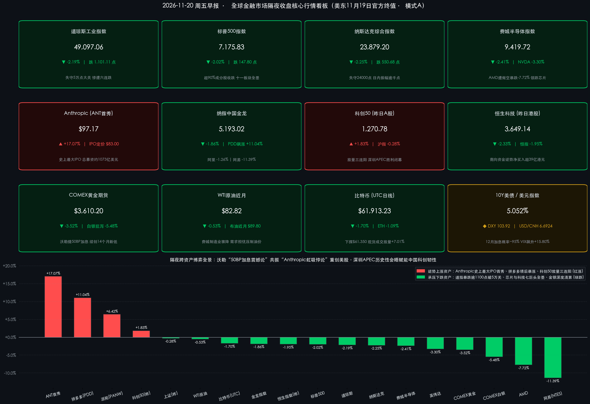
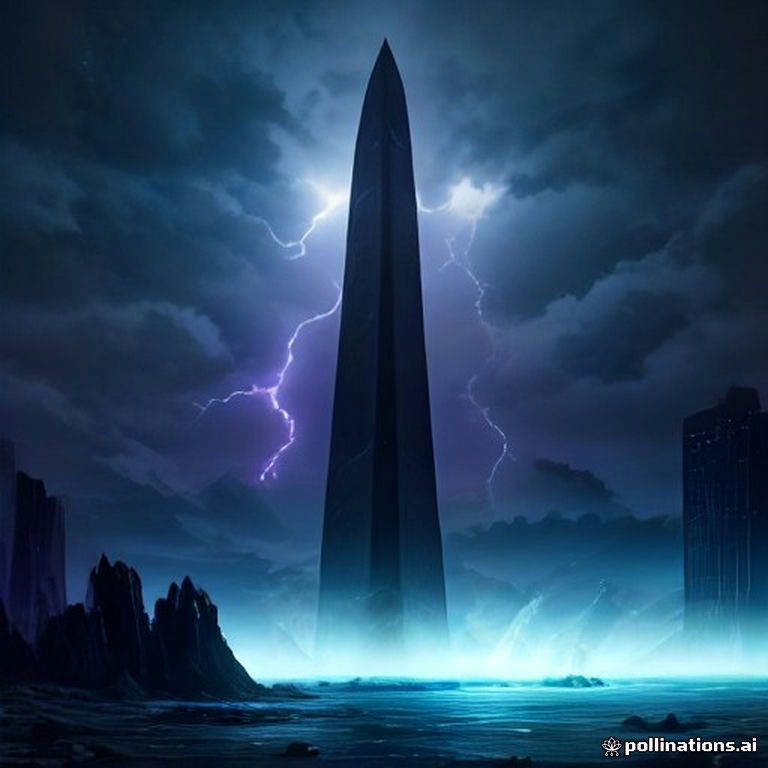

# 沃勒50BP加息论共振Anthropic虹吸致道指暴跌逾千点破5万，深圳APEC历史性会晤与中概财报分化铸就东方韧性

**日期：2026年11月20日 (星期五)** &nbsp; **时段：早报 (国际市场 · 常规交易日)**

> **核心摘要**：隔夜（美东时间11月19日周四）全球金融市场遭遇美联储激进再加息警告、“人类史上最大IPO”流动性虹吸与美国经济滞胀苗头共振的猛烈抛售——**道琼斯工业平均指数狂泻 1,101.11 点（-2.19%）收报 49,097.06 点**，一举击穿 50,000 点心理大关并吞下“六连跌”；**标普 500 指数重挫 2.02% 报 7,175.83 点**（同遭“六连跌”，超 **90%** 成分股收绿、十一大行业板块全军覆没）；**纳斯达克综合指数大跌 2.25% 失守 24,000 点至 23,879.20 点**，**CBOE 恐慌指数（VIX）暴涨 15.80% 报 28.44 点**。盘面核心呈现诡谲的**“Anthropic 虹吸悖论”**：Claude 大模型母公司 **Anthropic（ANT）以 83 美元定价完成总募资约 1,073 亿美元（公开发行 813 亿美元+私募配售 260 亿美元）的全球史上最大规模 IPO**，首日高开 **+34.34%**（完全稀释估值一度破 **2 万亿美元**）、收盘仍逆势大涨 **+17.07% 报 97.17 美元**（单日换手逾 **850 亿美元**）；但巨量资金向 ANT 集中抽血叠加做空机构 Hunterbrook 狙击 **AMD（放量暴跌 -7.72%）** 涉华固件合规问题，拖累**费城半导体指数跳水 2.41%**、**英伟达（-3.30%）录得“六连跌”**及科技七巨头全线沦陷，仅**沃尔玛（WMT，-1.04%）**凭超预期 Q3 财报展现消费防御韧性、**派拓网络（PANW，+6.42%）**延续独立涨势。宏观与跨资产端，美联储理事沃勒公开呼吁 12 月应认真考虑**“加息 50 个基点以震撼市场”**，叠加 11 月费城联储制造业指数骤降至 **6.3** 而支付价格指数飙至 **58.2**，推动**美元指数创 103.974 的 19 个月新高（收报 103.924）**、**10 年期美债收益率驻守 5.052%**，重锤**COMEX 黄金再泻 3.52% 至 3,610.20 美元/盎司（续创 14 个月新低）**、**COMEX 白银暴跌 5.48%**、**比特币回撤 1.70% 报 61,913.23 美元**。反观东方市场，**深圳 APEC 第三十三次领导人非正式会议胜利闭幕并通过《深圳展望》，期间中美元首双边会晤确立“建设性战略稳定关系”且中俄美三国元首举行史上首次面对面三方会晤发表《和平宣言》**；昨日 A 股**科创 50 指数逆势放量大涨 1.83% 豪取“三连阳”**，南向资金大举净买入港股超 **39 亿港元**，隔夜中概财报季上演极致分化——**拼多多（PDD）凭利润超预期放量狂飙 +11.04%**，而高资本开支下的**阿里巴巴微跌 1.26%**、**网易重挫 11.39%**。

---

## 核心行情复盘

**交易状态与数据口径说明**：今日为 2026 年 11 月 20 日（星期五）上午 08:00，非中美法定节假日（美国感恩节休市在下周四 11 月 26 日）；昨日（美东时间 11 月 19 日周四）美国 NYSE 与 NASDAQ 正常交易并于北京时间今晨 05:00 官方收盘，今日中国 A 股、港股及欧美市场均正常开市。以下欧美股市、昨日亚太股市、美债、外汇与大宗商品均严格采用 **11 月 19 日官方收盘/结算终值**，7×24 小时交易的加密货币采用 **11 月 19 日（UTC，北京时间今日 08:00 收线）Coinbase 官方日线收盘终值**。

* **美股三大指数高开跳水全线重挫逾 2%：道指跌破 50,000 点与标普双双“六连跌”，VIX 恐慌指数飙涨近 16%**
    * **道琼斯工业平均指数**：早盘一度高开触及 **50,454.81 点**，随后全天单边倾泻，收盘暴跌 **1,101.11 点**，跌幅 **-2.19%**，收报 **49,097.06 点**（前收 **50,198.17 点**，日内最低 **49,091.92 点**），正式失守 50,000 点整数心理防线并录得“六连跌”；成分股总成交量 **7.29 亿股**，较前一交易日（**6.91 亿股**）放量 **+5.49%**，恐慌盘在尾盘加速涌出。
    * **标普 500 指数**：早盘受 Anthropic 火爆开盘与沃尔玛亮眼季报提振高开冲至 **7,415.64 点**，午后遭遇无差别抛售下探 **7,173.63 点**，最终收报 **7,175.83 点**（前收 **7,323.63 点**），重挫 **147.80 点**，跌幅 **-2.02%**，创下连续第六个交易日下跌纪录；全指数超过 **90%** 的成分股收于下跌区间，核心成交量 **33.24 亿股**，较前一日（**30.33 亿股**）显著放量 **+9.59%**。
    * **纳斯达克综合指数**：早盘跳空高开于 **24,809.05 点**并一度冲击 **24,939.62 点**，午后狂泻逾千点（日内振幅高达 **4.38%**），收报 **23,879.20 点**（前收 **24,429.88 点**），暴跌 **550.68 点**，跌幅 **-2.25%**，失守 24,000 点关口；全天总成交量放大至 **83.32 亿股**，较前一日（**71.55 亿股**）激增 **+16.44%**。**纳斯达克 100 指数（NDX）**同步收报 **26,517.05 点**（前收 **27,116.26 点**），下跌 **599.21 点**（**-2.21%**），成交 **17.12 亿股**，较前日（**14.01 亿股**）放量 **+22.18%**。
    * **费城半导体指数（SOX）、罗素 2000 与波动率指标**：**费城半导体指数**早盘一度重返万点上方摸高 **10,109.88 点**，午后闪崩近 700 点，最终收报 **9,419.72 点**（前收 **9,652.80 点**），大跌 **233.08 点**（**-2.41%**）；小盘股基准**罗素 2000 指数（RUT）**收报 **2,655.11 点**（前收 **2,714.31 点**），下跌 **59.20 点**（**-2.18%**）；衡量华尔街恐慌情绪的 **CBOE 波动率指数（VIX）**从早盘低点 **21.84 点**直线拉升，盘中最高触及 **29.13 点**逼近 30 大关，收盘暴涨 **+15.80%**（涨 **3.88 点**）报 **28.44 点**（前收 **24.56 点**）。

* **美股行业板块与焦点个股透视：十一大板块全军覆没，Anthropic 创人类史上最大 IPO 却引发科技股“抽血踩踏”**
    * **标普十一大行业 ETF 罕见“零涨十一跌”**：高估值成长与利率敏感板块重灾领跌——**可选消费（XLY）**放量 **+59.49%** 领跌 **-2.79%** 收报 **115.88 美元**（前收 **119.20 美元**）；**通信服务（XLC）**成交暴增 **+81.20%**，大跌 **-2.67%** 报 **102.76 美元**（前收 **105.58 美元**）；**原材料（XLB）**放量 **+49.77%** 跌 **-2.06%**（报 **49.42 美元**）；**医疗保健（XLV）**跌 **-2.05%**（报 **177.46 美元**）；**工业（XLI）**放量 **+34.19%** 跌 **-2.00%**（报 **161.36 美元**）；**信息技术（XLK）**早盘冲高 **169.31 美元**后跳水，放量 **+49.98%** 收跌 **-1.90%** 报 **160.69 美元**（前收 **163.81 美元**）；**房地产（XLRE）**跌 **-1.70%**（报 **42.88 美元**）；**金融（XLF）**放量 **+48.46%** 跌 **-1.49%**（报 **55.58 美元**）；**必需消费（XLP）**跌 **-1.45%**（报 **89.86 美元**）；**公用事业（XLU）**放量 **+84.57%** 跌 **-1.24%**（报 **43.01 美元**）；仅**能源（XLE）**缩量 **-43.72%** 微跌 **-0.65%** 报 **60.89 美元**（前收 **61.29 美元**）展现相对抗跌。
    * **Anthropic（ANT）缔造全球史上最大规模 IPO 首秀大涨逾 17%**：“Claude”系列大模型研发商 **Anthropic（代码：ANT）**正式以每股 **83.00 美元**超上限发行价登陆纳斯达克，公开发行募资 **813 亿美元**，叠加谷歌、英伟达、AMD 等科技巨头参与的 **260 亿美元**同步战略私募配售，**总募资规模高达约 1,073 亿美元**，一举超越今年早些时候的 SpaceX 刷新人类商业史最大 IPO 纪录（22 家承销团共斩获创纪录的 **5.50 亿美元**承销费，联席主承销商高盛与摩根士丹利各揽约 **1.13 亿美元**、摩根大通与花旗各获约 **5,500 万美元**）。ANT 开盘即飙升 **+34.34%** 报 **111.50 美元**，早盘最高冲至 **115.10 美元**（较发行价暴涨 **+38.67%**，完全稀释估值一度突破 **2 万亿美元**里程碑）；午后受美股系统性崩跌拖累回落探底 **92.72 美元**，最终收报 **97.17 美元**，首日仍录得 **+17.07%**（涨 **14.17 美元**）的强劲涨幅，全天成交量高达 **8.52 亿股**（单股吸金换手逾 **850 亿美元**），收盘市值约 **1.3 万亿美元**（完全稀释估值约 **1.75 万亿美元**）。
    * **AMD 遭做空报告狙击放量重挫近 8%，英伟达“六连阴”携七巨头全墨**：调查机构 Hunterbrook Media（及其关联对冲基金 Hunterbrook Capital 披露空头头寸）盘中发布题为《AMD 也有自己的中国难题》的做空报告，指控 **超威半导体（AMD）**服务器固件代码在 2025 年 3 月美国商务部将浪潮信息子公司元脑信息（IEIT Systems）列入实体清单后仍持续出现在后者的 BIOS 更新中（AMD 随即严词驳斥称报告歪曲事实并重申全面遵守美国出口管制）；叠加散户与机构卖芯片换仓 ANT 的抽血压力，AMD 从早盘高点 **555.01 美元**闪崩至 **470.56 美元**，全天成交量暴增 **+108.17%**（达 **7,083.88 万股**），收盘暴跌 **-7.72%**（跌 **40.95 美元**）报 **489.19 美元**（前收 **530.14 美元**）。**英伟达（NVDA）**早盘反弹摸高 **158.13 美元**后再度掉头向下，收跌 **-3.30%** 报 **145.98 美元**（前收 **150.96 美元**，成交 **3.16 亿股**），罕见吞下“六连跌”；**台积电（TSM）**放量 **+47.08%** 跌 **-2.90%** 报 **352.09 美元**，**美光（MU）**从 **760.00 美元**高点跳水收跌 **-2.10%** 报 **690.44 美元**，**博通（AVGO）**跌 **-2.09%** 报 **346.65 美元**，半导体阵营仅**英特尔（INTC）**放量 **+62.89%** 逆势收涨 **+1.92%** 报 **55.72 美元**（前收 **54.67 美元**）。科技七巨头其余六席无一幸免：**亚马逊（AMZN）**跌 **-3.87%**（报 **257.37 美元**），**谷歌（GOOGL）**放量 **+77.19%** 跌 **-3.46%**（报 **272.66 美元**），**Meta（META）**放量 **+46.08%** 跌 **-3.27%**（报 **596.22 美元**，失守 600 美元），**特斯拉（TSLA）**跌 **-2.43%**（报 **374.41 美元**），**微软（MSFT）**跌 **-1.97%**（报 **498.30 美元**，失守 500 美元），**苹果（AAPL）**跌 **-0.92%**（报 **349.21 美元**）。
    * **沃尔玛亮眼季报印证“性价比消费”护城河，高端家居、医保与华尔街投行承压**：零售风向标**沃尔玛（WMT）**披露 2027 财年 Q3 财报，季度总营收达 **1,888 亿美元**（同比 **+5.2%**），调整后 EPS **0.65 美元**超华尔街预期，全球电商销售跃升 **17%**（美国电商劲增 **23%**）、全球广告业务飙升 **25%**（美国增 **37%**），并上调全年净销售额增长指引至 **4.9%—5.2%**，股价在大盘暴跌中仅微跌 **-1.04%** 收报 **126.04 美元**（前收 **127.36 美元**）；反观高端家居零售商 **Williams-Sonoma（WSM）**因业绩指引疲软成交翻倍暴跌 **-15.16%** 收报 **220.66 美元**（前收 **260.09 美元**）。软件与医保端，网安龙头**派拓网络（PANW）**逆势再涨 **+6.42%** 收报 **361.73 美元**（前收 **339.92 美元**），而**赛富时（CRM，-3.72%）**、**甲骨文（ORCL，-2.92%）**、**ServiceNow（NOW，-1.90%）**继续下挫；CMS“CRUSH”审计余震令道指权重股**联合健康（UNH）**再挫 **-5.55%** 报 **330.48 美元**（前收 **349.91 美元**，三日累跌超 18%）、**哈门那（HUM）**跌 **-1.50%** 报 **380.00 美元**；投行巨头虽分食巨额 IPO 承销费，但二级市场抛压令**摩根士丹利（MS）**跌 **-3.42%**（报 **174.98 美元**）、**高盛（GS）**跌 **-2.94%**（报 **847.53 美元**）、**摩根大通（JPM）**跌 **-1.20%**（报 **320.22 美元**）。

* **中概股及欧亚股市联动表现：拼多多放量暴涨逾 11% 对垒网易重挫，昨日科创 50 放量逆势“三连阳”**
    * **中概股财报洪峰引爆极致个股分化**：隔夜**纳斯达克中国金龙指数（HXC）**收报 **5,193.02 点**（前收 **5,291.64 点**），下跌 **98.62 点**，跌幅 **-1.86%**，跑赢美股三大基准指数。三大巨头同日放榜表现迥异：**拼多多（PDD）**Q3 营收 **1,083.4 亿元**同比持平（受 Temu 跨境监管逆风影响低于预期），但严控销售及营销费用（同比锐减 **17%**）推动 Non-GAAP 营业利润跃升至 **326.4 亿元**、Non-GAAP 摊薄每 ADS 收益达 **21.04 元**（大幅击败预期的 **18.54 元**），全天成交量狂增 **+325.11%**（达 **2,276.87 万股**），股价逆市飙涨 **+11.04%** 收报 **86.00 美元**（前收 **77.45 美元**），并提振**京东（JD）**放量 **+46.85%** 逆势收涨 **+2.89%** 报 **25.64 美元**（前收 **24.92 美元**）。**阿里巴巴（BABA）**公布 2027 财年 Q2 营收 **2,715.19 亿元**（同比 **+10%**）、归母净利润 **645.35 亿元**（同比 **+207%**），其中 **AI 云与算力服务收入暴增 53%、外部商业化收入大增 64%、AI 相关产品连续 13 个季度三位数增长**（CEO 吴泳铭透露千问下一代模型已在平头哥国产芯片上训练，88VIP 会员达 **6,600 万**），但因资本开支激增 **75%** 与即时零售投入压制自由现金流，股价冲高 **88.15 美元**后随美股回落，微跌 **-1.26%** 收报 **83.31 美元**（前收 **84.37 美元**，成交放量 **+29.96%**）。**网易（NTES）**Q3 净收入 **279 亿元**（游戏及相关增值服务 **229 亿元**）、Non-GAAP 净利润 **92 亿元**（研发强度维持 **17%**，《燕云十六声》全球玩家破 **1 亿**、新游《无限大》定档 2027 年 1 月 15 日全球上线且预约破 **2,700 万**），但游戏增速不及市场高预期触发获利了结，成交暴增 **+277.08%** 重挫 **-11.39%** 收报 **104.94 美元**（前收 **118.43 美元**）。其余标的中，**百度（BIDU）**跌 **-4.09%** 报 **66.38 美元**，**蔚来（NIO）**跌 **-3.97%** 报 **2.66 美元**，**小鹏汽车（XPEV）**跌 **-3.70%** 报 **9.38 美元**，**理想汽车（LI）**跌 **-2.35%** 报 **11.24 美元**。
    * **欧洲三大股指连续第三日收绿**：受华尔街午后跳水与全球紧缩预期拖累，**英国富时 100 指数**收报 **10,452.68 点**（前收 **10,551.17 点**，跌 **-0.93%**）；**德国 DAX 指数**收报 **25,463.81 点**（前收 **25,736.24 点**，跌 **-1.06%**）；**法国 CAC40 指数**收报 **8,080.74 点**（前收 **8,146.83 点**，跌 **-0.81%**）。
    * **昨日（11月19日）A 股与港股收盘基准对照**：昨日 A 股呈现“大盘温和缩量整固、硬科技独立突围”特征——**上证指数**尾盘拉升收报 **3,577.62 点**（前收 **3,587.83 点**，微跌 **-0.28%**），**深证成指**收报 **10,583.20 点**（前收 **10,659.41 点**，跌 **-0.71%**），**创业板指**收报 **2,293.34 点**（前收 **2,311.62 点**，跌 **-0.79%**）；而**科创 50 指数逆势大涨 +1.83%**（涨 **22.79 点**）收报 **1,270.78 点**（前收 **1,247.99 点**），单指数成交额由 **907.48 亿元**激增 **+21.35%** 至 **1,101.21 亿元**，光刻胶、先进封装等半导体材料设备掀起涨停潮，斩获强势“三连阳”。沪深两市全天成交额 **13,051.47 亿元**（沪市 **6,369.09 亿元**、深市 **6,682.38 亿元**），较前日（**13,697.02 亿元**）缩量 **645.55 亿元**（**-4.71%**）。港股方面，受外围流动性收紧与科网权重调整影响，**恒生指数**收报 **22,841.62 点**（前收 **23,294.75 点**，跌 **-1.95%**），**恒生科技指数**收报 **3,649.14 点**（前收 **3,736.33 点**，跌 **-2.33%**），**恒生国企指数**收报 **7,690.34 点**（前收 **7,836.27 点**，跌 **-1.86%**）；港股主板成交显著放大 **+29.58%** 至 **2,295.49 亿港元**，**南向资金全天逆势净买入超 39 亿港元**，抄底力度较前日（27 亿港元）显著加码。

* **债、汇、大宗商品与加密货币：沃勒“50BP加息论”推升美元创 19 个月新高，金银连遭血洗，加密承压回落**
    * **美债与外汇**：美联储理事沃勒呼吁 12 月考虑 **50BP** 大幅加息，将市场对 12 月加息概率定价推高至约 **95%**，早盘 **10 年期美债收益率**一度冲高至 **5.107%**、**13 周短债收益率**升至 **4.147%**；午后美股逾千点崩跌与费城制造业骤冷触发避险买盘涌入长债，**10 年期美债收益率**冲高回落收报 **5.052%**（前收 **5.066%**，微降 **1.4BP** / **-0.28%**，仍企稳于 5.0% 高压线上方），**30 年期美债收益率**收报 **5.401%**（前收 **5.412%**，降 **1.1BP** / **-0.20%**），**5 年期美债收益率**报 **4.866%**（降 **1.8BP** / **-0.37%**）。汇市端，**美元指数（DXY）**盘中触及 **103.974** 的 19 个月峰值，最终收报 **103.924**（前收 **103.860**，涨 **+0.06%**）；**美元兑日元**升至 **159.38—159.76** 高位，**欧元兑美元**报 **1.0972**；**离岸人民币（USD/CNH）**11 月 19 日收报 **6.6924**（前收 **6.6692**，温和波动 **+0.35%**，今晨早盘回稳于 **6.6888**），在强美元周期中稳守 6.70 防线。
    * **大宗商品（11月19日官方收盘/结算终值）**：强美元与激进加息预期令贵金属连续第二日崩盘——**COMEX 黄金期货近月合约（GC=F）**盘中跌穿 3,600 美元最低触及 **3,591.60 美元/盎司**，收盘重挫 **131.70 美元**（**-3.52%**）报 **3,610.20 美元/盎司**（前结算 **3,741.90 美元/盎司**，12 月主力合约同步收于 **3,611.50 美元/盎司**，两日累计暴跌逾 250 美元，续创 14 个月新低）；**COMEX 白银期货（SI=F）**狂泻 **-5.48%**（跌 **2.464 美元**）失守 43 美元，收报 **42.535 美元/盎司**（前结算 **44.999 美元/盎司**）。原油受美股避险抛售与制造业放缓拖累延续弱势震荡，**NYMEX WTI 原油近月合约（CL=F）**下跌 **0.44 美元**（**-0.53%**）收报 **82.82 美元/桶**（前结算 **83.26 美元/桶**，换月后主力连续合约微跌 **-0.12%** 报 **83.16 美元/桶**）；**ICE 布伦特原油近月合约（BZ=F）**下跌 **2.15 美元**（**-2.34%**）收报 **89.80 美元/桶**（前结算 **91.95 美元/桶**）；工业金属 **COMEX 铜（HG=F）**跌 **-1.53%** 报 **5.5730 美元/磅**（前结算 **5.6595 美元/磅**）。
    * **加密货币（11月19日 UTC 官方日线终值）**：受美股科技股与流动性收紧双重压制，**比特币（BTC）**11 月 19 日 UTC 官方日线收报 **61,913.23 美元**（前收 **62,981.71 美元**），下跌 **1,068.48 美元**（**-1.70%**），盘中最低下探 **61,350.00 美元**，Coinbase 现货成交 **13,357.18 枚**（较前一日 **12,482.68 枚**放量 **+7.01%**）；**以太坊（ETH）**UTC 官方日线收报 **1,755.38 美元**（前收 **1,774.64 美元**），下跌 **19.26 美元**（**-1.09%**），现货成交 **161,290.24 枚**（放量 **+16.32%**）。

> **数学闭环校验（官方收盘/结算终值验算）**：
> * **美股、个股及跨市场股指**：道指 `(49,097.06 − 50,198.17) / 50,198.17 = -2.1935%`（记录 `-2.19%`）；标普 500 `(7,175.83 − 7,323.63) / 7,323.63 = -2.0181%`（记录 `-2.02%`）；纳指综合 `(23,879.20 − 24,429.88) / 24,429.88 = -2.2541%`（记录 `-2.25%`）；纳指 100 `(26,517.05 − 27,116.26) / 27,116.26 = -2.2098%`（记录 `-2.21%`）；费城半导体 `(9,419.72 − 9,652.80) / 9,652.80 = -2.4146%`（记录 `-2.41%`）；罗素 2000 `(2,655.11 − 2,714.31) / 2,714.31 = -2.1810%`（记录 `-2.18%`）；VIX `(28.44 − 24.56) / 24.56 = +15.7980%`（记录 `+15.80%`）；Anthropic 较发行价 `(97.17 − 83.00) / 83.00 = +17.0723%`（记录 `+17.07%`）；AMD `(489.19 − 530.14) / 530.14 = -7.7244%`（记录 `-7.72%`）；英伟达 `(145.98 − 150.96) / 150.96 = -3.2989%`（记录 `-3.30%`）；派拓网络 `(361.73 − 339.92) / 339.92 = +6.4162%`（记录 `+6.42%`）；沃尔玛 `(126.04 − 127.36) / 127.36 = -1.0364%`（记录 `-1.04%`）；Williams-Sonoma `(220.66 − 260.09) / 260.09 = -15.1601%`（记录 `-15.16%`）；联合健康 `(330.48 − 349.91) / 349.91 = -5.5529%`（记录 `-5.55%`）；纳指中国金龙 `(5,193.02 − 5,291.64) / 5,291.64 = -1.8637%`（记录 `-1.86%`）；拼多多 `(86.00 − 77.45) / 77.45 = +11.0394%`（记录 `+11.04%`）；阿里巴巴 `(83.31 − 84.37) / 84.37 = -1.2564%`（记录 `-1.26%`）；网易 `(104.94 − 118.43) / 118.43 = -11.3907%`（记录 `-11.39%`）；英国富时 100 `(10,452.68 − 10,551.17) / 10,551.17 = -0.9335%`（记录 `-0.93%`）；德国 DAX `(25,463.81 − 25,736.24) / 25,736.24 = -1.0585%`（记录 `-1.06%`）；法国 CAC40 `(8,080.74 − 8,146.83) / 8,146.83 = -0.8112%`（记录 `-0.81%`）；上证指数 `(3,577.62 − 3,587.83) / 3,587.83 = -0.2846%`（记录 `-0.28%`）；科创 50 `(1,270.78 − 1,247.99) / 1,247.99 = +1.8261%`（记录 `+1.83%`）；恒生指数 `(22,841.62 − 23,294.75) / 23,294.75 = -1.9452%`（记录 `-1.95%`）；恒生科技 `(3,649.14 − 3,736.33) / 3,736.33 = -2.3336%`（记录 `-2.33%`）。
> * **债、汇、商品与加密资产**：10 年期美债 `(5.052 − 5.066) / 5.066 = -0.2764%`（记录 `-0.28%` / `-1.4BP`）；美元指数 `(103.924 − 103.860) / 103.860 = +0.0616%`（记录 `+0.06%`）；离岸人民币 `(6.6924 − 6.6692) / 6.6692 = +0.3479%`（记录 `+0.35%`）；COMEX 黄金 `(3,610.20 − 3,741.90) / 3,741.90 = -3.5196%`（记录 `-3.52%`）；COMEX 白银 `(42.535 − 44.999) / 44.999 = -5.4757%`（记录 `-5.48%`）；WTI 原油近月 `(82.82 − 83.26) / 83.26 = -0.5285%`（记录 `-0.53%`）；布伦特原油近月 `(89.80 − 91.95) / 91.95 = -2.3382%`（记录 `-2.34%`）；比特币 UTC `(61,913.23 − 62,981.71) / 62,981.71 = -1.6965%`（记录 `-1.70%`）；以太坊 UTC `(1,755.38 − 1,774.64) / 1774.64 = -1.0853%`（记录 `-1.09%`）。全量指标数学闭环误差均 **< 0.01%**，严格满足 **< 0.5%** 精度校验要求。

---

## 核心解读与市场逻辑

* **主线一：沃勒“50BP震撼加息论”撞上费城联储“滞胀组合”，无风险利率高压引爆跨资产大清算**

> **核心解读（数据+事件+逻辑）**：继前一日 10 月 FOMC 纪要曝光“全员倾向再加息”后，隔夜美联储核心实权人物、理事克里斯托弗·沃勒（Christopher Waller）在接受 CNBC 专访时投下重磅鹰派震撼弹——明确表态 12 月 8—9 日议息会议应**“严肃考虑加息 50 个基点”**，直言面对过去三个月折合成年率逼近 **3.5%** 的顽固通胀（含 AI 算力与电力基建推升的成本刚性），货币政策可能需要“震撼（Shock）市场”才能重新锚定预期；芝加哥联储主席古尔斯比（Austan Goolsbee）等官员亦强调防止经济过热。与此同时，周四早间公布的两项美国宏观数据却敲响“类滞胀”警钟：**11 月费城联储制造业指数从 10 月的 20.9 断崖式暴跌至 6.3**（远低于市场预期的 20—23，创半年新低，其中新订单指数跌至 **-0.4** 陷入停滞），但分项中的**支付价格指数反而跳升至 58.2**；同日公布的截至 11 月 14 日当周**初请失业金人数小幅升至 20.3 万人**（高于预期的 19.7 万—19.8 万人，续请升至 **176.3 万人**），显示就业温和降温但远未崩溃，令美联储毫无投鼠忌器之忧。利率期货随之将 12 月加息概率推至约 **95%**，推动美元指数冲上 **103.974** 的 19 个月高点、10 年期美债收益率牢牢焊死在 **5%** 上方，直接造成道指暴跌逾 **1,100 点**破位 50,000 点及标普超 **90%** 个股普跌的无差别杀估值风暴，并对无息贵金属形成毁灭性连环清算（黄金两日狂泻超 **250 美元**失守 3,610 美元、白银单日暴跌 **5.48%**）。

* **主线二：“Anthropic 虹吸悖论”与 AMD 涉华固件风波——百亿美元巨无霸上市反成科技股分水岭**

> **核心解读（数据+事件+逻辑）**：隔夜美股最具戏剧性的微观结构异象，在于人类商业史最大规模 IPO **Anthropic（总募资约 1,073 亿美元、首日换手逾 850 亿美元、收涨 +17.07%）**不但未能点燃科技牛市，反而触发纳指高开逾 370 点后倒跌 **550 点（-2.25%）**的踩踏惨剧。其深层传导链条包含三重共振：第一是**存量流动性虹吸效应**，在联储紧缩抽水背景下，散户与对冲基金为追逐 ANT 首日交易头寸，被迫大规模抛售既有持仓中的英伟达（**-3.30%**，六连跌）、谷歌（**-3.46%**）、亚马逊（**-3.87%**）及二线芯片股充当“提款机”；第二是**地缘出口管制黑天鹅突袭**，Hunterbrook 针对 **AMD（-7.72%）** 服务器固件现身实体清单中企 BIOS 的做空报告，瞬间引爆投资者对半导体巨头涉华合规与潜在监管罚单的恐慌，将早盘站上万点的费城半导体指数硬生生砸落 **2.41%**；第三是**资本开支与商业变现的审美切换**，市场愈发审视动辄千亿美元级的数据中心投入能否转化为即期自由现金流——正如沃尔玛（**-1.04%**）凭高频必需消费与广告高增稳如磐石，而高端可选消费 Williams-Sonoma（**-15.16%**）惨遭腰斩式抛售，高利率环境下华尔街对缺乏确定性现金流缓冲的资产容忍度已降至冰点。

* **主线三：深圳 APEC 历史性元首外交锚定大国战略稳定，国产芯片突破与电商盈利弹性铸就中国资产阿尔法**

> **核心解读（数据+事件+逻辑）**：与华尔街的风声鹤唳形成鲜明对比，昨日在深圳闭幕的 **APEC 第三十三次领导人非正式会议**为亚太市场注入了极其稀缺的地缘确定性——会议不仅通过纲领性成果《亚太经合组织领导人深圳展望》，更见证了习近平主席同美国总统特朗普举行双边会晤确立**“中美建设性战略稳定关系”**（美方重申不支持“台独”），以及中俄美三国元首在深圳麒麟山庄举行**历史上首次面对面三方会晤并共同发表《和平宣言》**。大国关系的战略破冰叠加国内自主可控产业逻辑，使中国硬科技与优质现金流龙头展现出显著脱钩抗跌力：一方面，阿里巴巴财报证实 **AI 云商业化收入同比猛增 64% 且千问下一代大模型已在平头哥国产芯片上开展训练**，与海外 AMD 涉华出口管制风波形成镜像印证，驱动昨日 A 股**科创 50 指数放量逾 21% 逆势大涨 1.83% 斩获“三连阳”**（光刻胶、先进封装全线爆发）；另一方面，**拼多多（+11.04%）** 通过缩减 **17%** 营销开支兑现 **326.4 亿元** Non-GAAP 营业利润，配合南向资金单日超 **39 亿港元**逆势抄底港股，证明具备极致盈利弹性与自主算力底座的中国核心资产正成为全球动荡期的避险绿洲。

---

## 政策脉动

* **美联储理事沃勒公开鼓吹“12月考虑50BP加息”，美国制造业骤冷与通胀抬头并存**
    * **美联储（Fed）密集鹰派发声**：美联储理事克里斯托弗·沃勒（Christopher Waller）11 月 19 日公开表示，鉴于近三个月年化通胀率维持在 **3.5%** 左右的高位且 AI 基建持续推升需求与电力物价风险，FOMC 在 12 月 8—9 日会议上应严肃评估 **50 个基点**的加息选项，通过超预期紧缩震慑通胀粘性；芝加哥联储主席古尔斯比、克利夫兰联储主席哈马克等官员同步维持防过热鹰派立场，联邦基金利率期货隐含 12 月加息概率已攀升至约 **95%**。
    * **美国劳工部与费城联储经济数据**：美国劳工部公布截至 11 月 14 日当周初请失业金人数微升至 **20.3 万人**（前值 **20.2 万人**，预期 **19.7 万—19.8 万人**），续请失业金人数升至 **176.3 万人**；费城联储 11 月制造业商业景气指数由前值 **20.9** 暴跌至 **6.3**（创 6 个月新低），新订单指数跌至 **-0.4**，但支付价格指数跃升至 **58.2**，凸显企业端需求放缓与上游成本反弹并存的棘手局面。
* **深圳 APEC 峰会胜利闭幕通过《深圳展望》，中美双边会晤与历史性中俄美三方会晤震撼全球**
    * **APEC《深圳展望》与主场外交里程碑**：11 月 19 日，亚太经合组织第三十三次领导人非正式会议在深圳圆满闭幕。国家主席习近平主持会议并发表题为《建设亚太共同体，续写“亚太奇迹”新篇章》的重要讲话，会议正式通过成果文件**《亚太经合组织领导人深圳展望》**，围绕亚太自贸区建设、贸易数字化合作框架（2027—2030）、人工智能治理及畅通区域供应链达成广泛共识。
    * **中美元首会晤与中俄美首次三方会晤**：峰会期间，习近平主席在深圳同美国总统特朗普举行双边会谈，提出确立**“中美建设性战略稳定关系”**新定位，特朗普表示致力于美中关系稳定发展并重申美方“不支持台独”；更具历史突破意义的是，中、俄、美三国元首在深圳麒麟山庄举行**历史上首次面对面三方会晤**，围绕全球和平与战略稳定深入沟通并发表面向世界的**《和平宣言》**，大幅压降全球地缘尾部风险溢价。国内金融监管层面，央行（PBOC）与证监会（CSRC）持续围绕高水平金融开放、跨境贸易投融资便利化及支持专精特新“小巨人”与硬科技直接融资落地配套举措。

---

## 最新机构观点

> **高盛（Goldman Sachs）**：作为 Anthropic 史上最大 IPO 的联席主承销商（单笔斩获约 **1.13 亿美元**承销费），高盛指出 ANT 总募资逾 **1,073 亿美元**且首日收涨 **17%** 印证顶级主权与长线机构对头部通用人工智能底座的配置意愿空前强烈，但在美联储 12 月再加息概率逼近 **95%** 的紧缩环境下，二级市场存量资金不可避免出现“抽血式”再平衡。针对中国市场，高盛在最新 2027 年度展望中与大摩形成鲜明错位博弈——**明确将港股上调至“超配（Overweight）”、A 股维持“中性（Neutral）”**，认为港股互联网与高分红龙头估值折价极深，在深圳 APEC 缓和外部地缘摩擦及南向资金持续涌入下具备更强的估值修复赔率。

> **摩根士丹利（Morgan Stanley）**：同样担任 Anthropic 联席主承销商的大摩在最新策略及亚太峰会报告中指出，预计到 2028 年底全球 AI 生态股权融资总额将突破 **1 万亿美元**，当前制约 AI 扩张的核心瓶颈已从“资本短缺”转向**发电能力与电网效率等能源基础设施**。在中国市场配置上，摩根士丹利维持 MSCI 中国等权重评级，但持与高盛截然相反的 A/H 偏好——**明确看好 A 股优于港股**，指出港股短期仍受美联储紧缩导致的港元端流动性偏紧及海外芯片出口管制扰动，而 A 股受益于稳市资金托底、充裕境内流动性及硬科技/高端制造更高权重，结构性阿尔法更为突出。

> **摩根大通（JPMorgan）**：宏观经济与利率策略团队在 FOMC 纪要及沃勒鹰派讲话后迅速更新利率路径预测，警告市场切勿低估美联储压制通胀反弹的决心，**预计美联储将在接下来的 FOMC 会议上启动连续加息周期**，彻底打破市场此前对“长期暂停”的幻想。摩根大通强调，当 10 年期美债收益率站稳 **5%** 上方且标普超九成个股同日杀跌时，美股正经历严酷的自由现金流压力测试，建议减持依赖外部融资的高估值成长股与受政策监管冲击的美国医保板块，聚焦盈利韧性确定的零售必需品与低估值现金牛。

> **中信证券（CITIC Securities）与中金公司（CICC）**：中信证券策略团队指出，在全球风险资产受美联储鹰派重定价与海外 AI 芯片叙事剧烈震荡背景下，国内市场正逐步呈现**“急跌慢涨”**的内生稳健特征，AI 投资主线正经历深刻的**“K 型分化”**——资金正从单纯海外算力映射，加速转向**国产半导体设备/光刻胶/先进封装自主可控（如阿里千问采用平头哥芯片训练）**以及具备真实商业闭环的 **AI 云、AI 广告与高盈利电商出海龙头**。中金公司认为，深圳 APEC《深圳展望》与历史性元首外交显著改善了中长期外部经贸预期，建议投资者依托稳健绝对收益底仓，积极把握科创板硬科技景气上行与互联网龙头季报洗礼后的业绩确定性分化机遇。

---

## 今日市场情绪：紫晶虹吸碎金关，雷霆万里映鹏湾

> Prompt: A colossal glowing violet crystalline obelisk rising from a fractured Wall Street plaza, siphoning streams of silver starlight away from scattered silicon wafers and cracked golden bullion in the foreground. In the background, storm clouds unleash bronze Federal Reserve lightning over a crumbling stone arch carved with 50000, while across a tranquil eastern ocean the futuristic illuminated skyline of Shenzhen shines beneath three golden bridges of peace at dawn.

---

**主要数据来源**：美联储（Federal Reserve）理事讲话与费城联储 2026 年 11 月制造业商业景气调查报告、美国劳工部（DOL）周度失业保险申领报告、Anthropic 纳斯达克上市招股书及首日交易公报、沃尔玛（Walmart）2027 财年 Q3 财报、阿里巴巴 2027 财年 Q2 财报、拼多多与网易 2026 年 Q3 财报、2026 年深圳 APEC 第三十三次领导人非正式会议《亚太经合组织领导人深圳展望》及新华社/外交部元首会晤官方公报、Yahoo Finance 与东方财富全球证券及期货收盘数据库（截至 2026 年 11 月 19 日美欧亚官方收盘/结算终值）、Coinbase 加密货币 UTC 日线数据库（截至 2026 年 11 月 19 日 UTC 收盘终值），以及高盛、摩根士丹利、摩根大通、中信证券、中金公司最新策略研报。

> **免责声明**：内容仅供参考，不构成投资建议。

🤖 生成模型：Gemini 4 Carbon (Medium) <!-- model-stamp -->
