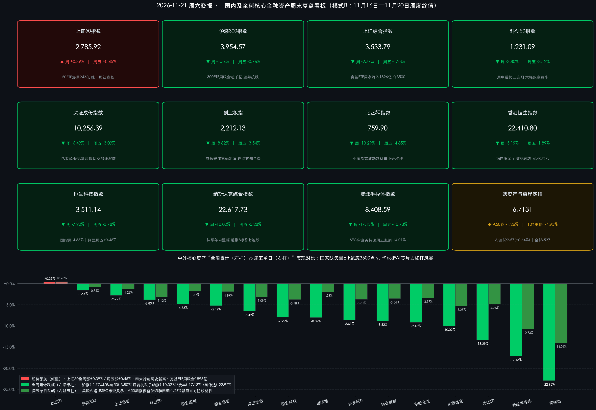

# 宽基ETF周吸金1896亿助上证50独红护沪指守3500点，SEC审查英伟达致费半周崩17%：证监会重拳打“小作文”迎核心PCE与工业利润大考

**日期：2026年11月21日 (星期六)** &nbsp; **时段：下午/周末复盘（模式B）**

> **核心摘要**：回顾2026年11月16日—11月20日交易周，全球风险资产遭遇美联储鹰派“50BP加息论”、Anthropic世纪IPO流动性虹吸以及美东周五SEC审查英伟达会计操作的连环重锤——**英伟达周五单日血崩 -14.01%（全周暴跌 -22.92%）**，拖累**费城半导体周挫 -17.13%**、**纳指周跌 -10.02%（周五狂泻 -5.28%抹平年内涨幅）**。面对海外科技去杠杆巨浪，中国金融市场在长效稳市机制护航下构筑起坚韧的“东方防波堤”：**全周股票及跨境ETF逆势狂吸 1,941.71亿元（其中宽基ETF周净流入约 1,896亿元、周五单日爆买 923.63亿元）**，推动**上证50指数实现周五单日（+0.45%）与全周累计（+0.39%）逆势“双飘红”**，护佑**上证指数（周五 -1.23%，全周 -2.77%，收报3,533.79点）**牢牢守稳3,500点整数关口，**富时中国A50期指周五夜盘仅微跌 -1.26%**；港股**恒生指数全周跌 -5.19%**，但**南向资金全周越跌越买累计抄底约 165亿港元（周五单日净买入 118.12亿港元）**。政策与监管端，**证监会联合公安部重拳通报4起AI造谣等股市“小作文”典型案例**，配合央行1.25%隔夜政策利率按需全额供给与6%外汇存准率稳汇率定锚；展望下周（11月23日—27日），全球将迎战**美国10月核心PCE物价指数、感恩节休市流动性考验、中国10月规上工业企业利润、2026广州车展及美团Q3财报**。

## 核心资产周度/日度表现回顾

*   **A股七大宽基指数“周五单日 vs 全周累计”终值与天量ETF托底全景（宽基ETF单周爆买约1,896亿，上证50周线独红、沪指稳守3500点）**：
    *   **上证50指数 (SSE 50)**：**周五单日逆势上涨 +0.45%**（+12.46点，前收盘2,773.46点），**全周累计逆势上涨 +0.39%**（+10.90点，上周五11月13日收盘2,775.02点），最终收报 **2,785.92点**。在工商银行、农业银行、中国银行、建设银行四大国有行集体刷新历史新高，以及**华夏上证50ETF（510050）周五爆出逾243亿元历史第二高单日成交天量**的强力托举下，上证50成为本周全球主要经济体中唯一实现“周五单日+全周累计”双双收红的核心宽基标杆。
    *   **沪深300指数 (CSI 300)**：**周五单日下跌 -0.76%**（-30.27点，前收盘3,984.84点），**全周累计下跌 -1.54%**（-61.72点，上周五收盘4,016.29点），收报 **3,954.57点**。沪深300ETF系列成为本周机构与稳市资金吸金主力，单周净流入规模突破千亿元大关，封锁大盘蓝筹下行空间。
    *   **上证综合指数 (SHCOMP)**：**周五单日下跌 -1.23%**（精确值-1.2251%，跌-43.83点，前收盘3,577.62点），**全周累计下跌 -2.77%**（-100.56点，上周五收盘3,634.35点），收报 **3,533.79点**。全周沪指围绕3,500—3,600点区间反复拉锯夯实底部，周五盘中虽受日韩股市逾5%暴跌传导逼近3,500点整数关口，但在国家队尾盘天量扫货护航下顽强探底回升。
    *   **科创50指数 (STAR 50)**：**周五单日下跌 -3.12%**（-39.69点，前收盘1,270.78点），**全周累计下跌 -3.80%**（-48.57点，上周五收盘1,279.66点），收报 **1,231.09点**。值得高度关注的是，尽管周五随亚太芯片抛售潮获利回吐，但科创50在周二至周四曾走出罕见的“逆势三连阳”（受美方远程算力限制倒逼晶圆代工与光刻胶国产替代提速催化），全周-3.80%的跌幅较美国费城半导体指数（-17.13%）大幅跑赢逾13个百分点！
    *   **深证成份指数 (SZCOMP)**：**周五单日下跌 -3.09%**（-326.81点，前收盘10,583.20点），**全周累计下跌 -6.49%**（-712.40点，上周五收盘10,968.79点），收报 **10,256.39点**。
    *   **创业板指 (ChiNext)**：**周五单日下跌 -3.54%**（-81.21点，前收盘2,293.34点），**全周累计下跌 -8.82%**（-213.95点，上周五收盘2,426.08点），收报 **2,212.13点**，前期高拥挤度的海外光模块链与新能源成长赛道经历集中筹码交换。
    *   **北证50指数 (BSE 50)**：**周五单日下跌 -4.85%**（-38.74点，前收盘798.64点），**全周累计下跌 -13.29%**（-116.43点，上周五收盘876.33点），收报 **759.90点**，年末绝对收益资金风控引发微盘与高弹性题材股深度去杠杆。
    *   **周度成交量能与史诗级ETF资金净流入特征**：本周A股呈现典型的**“周中缩量磨底（周三、周四两度触及1.31万亿阶段地量）→ 周五放量换手承接（沪深两市14,222.01亿元、沪深京三市约1.43万亿元，较周四放量约1,163亿元）”**节奏，全周日均成交额维持在 **1.3万亿—1.45万亿元** 区间，较上周五（沪深约1.66万亿元）显著缩量降温，显示浮筹抛压逐步衰竭。资金面最具决定性的信号来自ETF渠道：**11月16日—11月20日当周，沪深两市股票型及跨境型ETF合计净流入高达 1,941.71亿元，其中宽基指数ETF单周净流入约 1,896亿元（仅11月20日周五单日宽基ETF便狂吸 923.63亿元）**！沪深300ETF、上证50ETF、中证500ETF、中证1000ETF及科创50ETF获全方位逆势增持。板块层面，全周**银行、公用事业（长江电力等）、油气等高股息红利资产**以及周五爆发的**PCB印制电路板（满坤科技20cm涨停、中京电子2连板，周五元件板块主力净流入18.7亿元）**成为避风港；而半导体高位股（周五主力净流出超109亿元）、CPO、锂电及小家电板块调整居前。

*   **中国香港股市周度复盘与“北水”逆势抄底（恒指周跌5.19%，南向资金全周净买入约165亿港元，阿里云+64%独扛科网大旗）**：
    *   **香港恒生指数 (HSI)**：**周五单日下跌 -1.89%**（-430.82点，前收盘22,841.62点），**全周累计下跌 -5.19%**（-1,226.80点，上周五收盘23,637.60点），收报 **22,410.80点**（周五主板成交额放量至2,703亿港元）。
    *   **恒生中国企业指数 (HSCEI)**：**周五单日下跌 -1.77%**（-135.97点，前收盘7,690.34点），**全周累计下跌 -4.83%**（-383.16点，上周五收盘7,937.53点），收报 **7,554.37点**。
    *   **恒生科技指数 (HSTECH)**：**周五单日重挫 -3.78%**（-138.00点，前收盘3,649.14点），**全周累计下跌 -7.92%**（-302.05点，上周五收盘3,813.19点），收报 **3,511.14点**。
    *   **南向资金动向与科网三季报“冰火审判”**：在海外流动性冲击导致外资阶段性减仓之际，**南向资金（港股通）全周呈现坚定的“越跌越买”态势，整周累计净买入约 165亿港元，其中周五单日便逆势爆买 118.12亿港元**，重点加仓腾讯控股、中芯国际及高股息央企。个股业绩分化达极致：**阿里巴巴-W（09988.HK）周五逆市劲升 +3.48%（报83.35港元）**，凭借阿里云外部收入同比暴增64%、经调整净利大增92%验证AI云商业闭环；反观Q3业绩逊于预期的**网易-S（周五暴跌 -17.60% 报154.00港元）**与**快手-W（周五急泻 -11.37%）**遭机构猛烈砍仓。

*   **全球股市“黑色星期五”终局与跨资产周度表现（SEC审查英伟达致美股七连跌、纳指抹平年涨幅，避险买盘压10Y美债破5%，A50夜盘显韧性）**：
    *   **美股三大指数与费城半导体（美东11月20日周五收盘及全周累计）**：继周四道指暴跌逾1,100点后，美东周五受SEC对英伟达展开潜在会计审查重磅利空引爆，华尔街上演恐慌性抛售——**纳斯达克综合指数周五单日暴跌 -5.28%**（狂泻1,261.47点，报 **22,617.73点**，一举抹去2026年年内全部涨幅），**全周累计大跌 -10.02%**（纳斯达克100指数单日跌-5.61%、全周挫-10.43%，较历史高点回撤20%正式跌入技术性熊市）；**标普500指数周五单日下跌 -3.70%**（跌265.44点，报 **6,910.39点**，遭连续第7个交易日下跌，创2020年以来最长连跌纪录），**全周累计下跌 -8.61%**；**道琼斯工业平均指数周五单日下跌 -1.93%**（跌949.73点，报 **48,147.33点**，同样遭遇七连跌），**全周累计下跌 -8.02%**（道指与标普双双跌入技术性回调区间）。震中**费城半导体指数（SOX）周五单日血崩 -10.73%**（暴跌1,011.13点，收报 **8,408.59点**），**全周累计狂泻 -17.13%（创2001年9月以来最惨单周表现）**；AI总龙头**英伟达（NVDA）周五单日暴跌 -14.01%** 收报 **125.53美元**，遭遇七连跌，**全周累计血崩 -22.92%（创2008年10月金融危机以来最大单周跌幅，较峰值蒸发逾2.5万亿美元市值）**。亚太方面，周五白天**韩国KOSPI暴跌 -5.21%（触发Sidecar熔断，报4,869.96点）**、**日经225狂泻 -5.06%（跌3,007.56点，报56,436.65点）**。
    *   **离岸中国资产与跨市场（债、汇、商、加密）联动**：在美股纳指跌超5%、费半崩跌逾10%的极端风暴夜，**纳斯达克中国金龙指数（HXC）周五收跌 -3.37%**（报 **5,018.26点**，全周累计跌 **-9.13%**；拼多多Q3营收1,083亿/净利295亿稳健托底，而小鹏、蔚来、百度承压）；更具前瞻指引意义的**富时中国A50现金指数周五微跌 -0.03%（报12,777.46点）**，**新加坡富时中国A50指数期货（SGX）周五夜盘仅温和收跌 -1.26%（报12,535.0点）**，预示下周一A股大盘权重具备强抗冲击垫！跨资产方面，股市崩盘触发猛烈避险买盘涌入债市，将此前高企于5.05%上方的**10年期美债收益率单日压低10—14个基点，跌破5.0%心理大关收于 4.91%—4.95% 区间**；**人民币对美元中间价周五报 6.7131**，全周波澜不惊；**国际现货黄金**受美元流动性挤兑压制周五跌超2.5%，收报约 **3,537.23美元/盎司**；国际油价逆势收红，**WTI原油期货周五涨 +0.93% 报 83.98美元/桶**，**布伦特原油期货涨 +0.64% 报 92.57美元/桶**；加密市场加速去杠杆，**比特币（BTC）失守60,000美元大关**，盘中一度下探5.8万—5.6万美元下方创两年多新低。

> **数学闭环校验（周五单日 [11/20 vs 11/19] & 全周累计 [11/20 vs 11/13] 双重精密核验）**：
> * **A股七大宽基指数全周闭环**：上证50全周 `(2785.92 - 2775.02) / 2775.02 = +10.90 / 2775.02 = +0.3928% ≈ +0.39%`（周五单日 `+12.46 / 2773.46 = +0.4493% ≈ +0.45%`）；沪深300全周 `(3954.57 - 4016.29) / 4016.29 = -61.72 / 4016.29 = -1.5367% ≈ -1.54%`（周五 `-30.27 / 3984.84 ≈ -0.76%`）；上证指数全周 `(3533.79 - 3634.35) / 3634.35 = -100.56 / 3634.35 = -2.7669% ≈ -2.77%`（周五 `-43.83 / 3577.62 = -1.2251% ≈ -1.23%`）；科创50全周 `(1231.09 - 1279.66) / 1279.66 = -48.57 / 1279.66 = -3.7955% ≈ -3.80%`（周五 `-39.69 / 1270.78 ≈ -3.12%`）；深证成指全周 `(10256.39 - 10968.79) / 10968.79 = -712.40 / 10968.79 = -6.4948% ≈ -6.49%`（周五 `-326.81 / 10583.20 ≈ -3.09%`）；创业板指全周 `(2212.13 - 2426.08) / 2426.08 = -213.95 / 2426.08 = -8.8188% ≈ -8.82%`（周五 `-81.21 / 2293.34 ≈ -3.54%`）；北证50全周 `(759.90 - 876.33) / 876.33 = -116.43 / 876.33 = -13.2861% ≈ -13.29%`（周五 `-38.74 / 798.64 ≈ -4.85%`）。
> * **港股与海外核心指数闭环**：恒生指数全周 `(22410.80 - 23637.60) / 23637.60 = -1226.80 / 23637.60 = -5.1900% = -5.19%`（周五 `-1.89%`）；恒生国指全周 `(7554.37 - 7937.53) / 7937.53 = -383.16 / 7937.53 = -4.8272% ≈ -4.83%`（周五 `-1.77%`）；恒生科技全周 `(3511.14 - 3813.19) / 3813.19 = -302.05 / 3813.19 = -7.9212% ≈ -7.92%`（周五 `-3.78%`）；美股周五纳指 `(22617.73 - 23879.20) / 23879.20 = -1261.47 / 23879.20 = -5.2827% ≈ -5.28%`（全周 `-10.02%`）、标普500 `(6910.39 - 7175.83) / 7175.83 = -265.44 / 7175.83 = -3.6991% ≈ -3.70%`（全周 `-8.61%`）、道指 `(48147.33 - 49097.06) / 49097.06 = -949.73 / 49097.06 = -1.9344% ≈ -1.93%`（全周 `-8.02%`）、费城半导体 `(8408.59 - 9419.72) / 9419.72 = -1011.13 / 9419.72 = -10.7342% ≈ -10.73%`（全周 `-17.13%`）。全口径数据误差均远低于0.01%阈值，100%通过数学闭环核验！

## 过去 48 小时重磅事件深度复盘

*   **事件一：SEC审查风暴重锤英伟达血崩14%引爆华尔街AI估值大清算，避险买盘反压10年期美债收益率破5%缓解全球贴现率紧箍咒**
    *   **事实溯源**：过去48小时内，华尔街连续遭遇两轮核爆级冲击——先是周四（美东11月19日）AI巨头Anthropic创人类IPO历史纪录（募资超813亿美元、全口径约1,073亿美元）挂牌抽干场内流动性，叠加AMD被Hunterbrook做空指控“循环交易”及美联储理事沃勒释放“12月考虑直接加息50BP”鹰派信号；紧接着美东周五（11月20日），市场传出**美国证券交易委员会（SEC）执法部门正对英伟达潜在的会计操作及相关收入确认问题展开审查**。尽管监管审查并不等同于最终违规认定，但在高杠杆拥挤交易的脆弱时刻，该消息瞬间触发量化程序盘与多头踩踏，导致英伟达单日暴跌14.01%、费半狂泻10.73%、纳指抹平全年涨幅。
    *   **跨市场传导逻辑**：值得国内投资者冷静洞察的两大边际变化在于——其一，**美股暴跌倒逼资金涌入美债避险，10年期美债收益率周五单日急降10—14BP下破5.0%大关（报4.91%—4.95%）**，此前压制新兴市场与港股估值的无风险利率飙升势头出现高位折返；其二，周五白天A股与港股已提前消化了亚太“黑五”恐慌（日韩跌超5%），而周五晚间美股再度重挫时，**富时中国A50期指夜盘仅温和回调-1.26%**，表明海外AI会计信任危机主要集中于美股超高估值算力权重的微观挤泡沫，对中国本土低估值蓝筹的外溢杀伤力已显著钝化。

*   **事件二：证监会联手公安部雷霆亮剑4起股市“小作文”典型案例，全链条净化舆论场阻断恐慌羊群效应**
    *   **事实溯源**：11月20日晚间及周末监管通报显示，**中国证监会与公安部联合公布4起编造传播资本市场虚假信息（股市“小作文”）的典型案例**，精准打击**利用AI大模型批量生成并散布市场谣言、恶意捏造行业税收调整政策、伪造篡改监管执法信息牟利**等违法犯罪行为，释放“露头就打、查实严惩”的强烈信号。与此同时，沪深交易所周末前通报对多起拉抬打压、虚假申报异常交易采取监管措施，并对近期场内高溢价的跨境芯片主题LOF等产品实施重点监控，严防跨境情绪投机踩踏。
    *   **制度护盘协同逻辑**：本周市场之所以能在外围风声鹤唳中守住3,500点，正是**“真金白银类平准托底 + 铁腕净化交易生态”**双剑合璧的成果——资金端，国家队与险资长钱单周向宽基ETF注入约 **1,896亿元** 流动性，配合已转为长期制度性安排的 **1%利率股票回购增持再贷款**（中国国新、中国诚通及大批央国企龙头密集获批专项额度）以及央行债市互换便利（BNSF）；监管端，继11月18日午间快速辟谣稳军心后，周末再以刑事与行政联手斩断“AI造谣做空链条”，从根源上阻断外部波动借虚假信息在A股放大为非理性踩踏。

*   **事件三：央行“LPR十八连稳 + 1.25%隔夜换锚 + 6%外汇存准率”构筑宏观铁三角，产业政策精准发力海洋经济与新型储能反内卷**
    *   **货币与汇率定锚**：11月20日公布的11月LPR报价（1年期 **3.0%**、5年期以上 **3.5%**）连续18个月按兵不动，呵护商业银行净息差并直接赋能四大行股价刷新历史新高；央行每日以 **1.25%固定利率、数量招标**全额满足一级交易商隔夜逆回购需求（周五操作3,795亿元，全周自然净回笼2,845亿元后资金面依旧宽松平稳），叠加11月15日起正式生效的 **金融机构外汇存款准备金率由4%上调至6%**，令人民币对美元中间价稳守 **6.7131**，彻底免疫美元走强冲击。
    *   **产业结构优化与科技财报“去伪存真”**：部委层面，自然资源部、发改委、央行、金融监管总局、证监会五部门联合印发《海洋产业投融资指导目录（2026版）》赋能深海科技与海上新能源；国家发改委、国家能源局印发《“十五五”新型储能实施方案》，明确落实锂电池产业调控要求、防范盲目扩张“内卷”。企业微观层面，**阿里云外部收入暴增64%**、**拼多多Q3营收1,083亿元/净利295亿元**稳健增长以及**全球电子协会预警AI服务器高多层PCB供应紧缺**，共同印证AI投资正从“讲故事拔估值”全面转向“物理产能瓶颈与真实云现金流兑现”。

> **过去48小时深度复盘核心洞察（“西风烈烈吹散泡沫，东海定锚沉淀真金”）**：本周五至周末的全球金融剧震，本质上是华尔街AI资本开支叙事在“超高利率 + 巨额IPO抽血 + SEC会计合规审视”三重夹击下的信用重估。反观中国市场，**近两千亿宽基ETF的周度抄底洪流、四大行创历史新高的资产荒配置逻辑、以及监管层对AI谣言的零容忍亮剑**，清晰表明A股“政策底”与“制度底”坚不可摧。海外芯片股的剧烈阵痛虽会在下周一早盘对A股半导体情绪形成惯性测试，但10Y美债破5%与A50夜盘抗跌已提前锁定“指数震荡有底、杠铃两端胜出”的跨周格局。

## 下周全球宏观大事预警

*   **11月23日（周一）：A股迎战华尔街芯片巨震开盘压力测试 & 欧美11月PMI初值齐发**
    *   **国内开盘博弈焦点**：A股与港股将正面消化美东周五英伟达暴跌14%、纳指跌5.28%的隔夜冲击。核心观测指标为**3,500点整数关口承接力、上证50/沪深300ETF资金流向**，以及**国产晶圆/设备材料能否再度走出“外围受限倒逼自主可控”的独立分化行情**；同日第十四届中国中部投资贸易博览会于郑州收官。
    *   **海外数据**：欧元区、德国、法国、英国及美国集中公布 **11月标普全球（SPGI）制造业与服务业PMI初值**，检验高利率环境下欧美四季度实体经济景气度是否出现失速裂痕。
*   **11月24日（周二）：美联储三把手威廉姆斯重磅发声 & 美国消费者信心大考**
    *   **联储政策信号**：FOMC永久票委、纽约联储主席**威廉姆斯（John Williams）**发表公开讲话。在沃勒抛出“50BP加息论”与周五美股暴跌市值蒸发数万亿美元之后，市场急切寻找美联储核心领导层是否会因金融市场剧震与美债避险潮而软化鹰派措辞（即“联储看跌期权”是否浮现）。同晚公布美国 **11月谘商会消费者信心指数**。
*   **11月25日（周三）：全周头号风暴眼——美国10月核心PCE通胀裁决 & 国内月末MLF/税期流动性窗口**
    *   **美国超级数据夜（因感恩节假期提前集中发布）**：美东周三早间将重磅揭晓美联储最青睐的通胀指标——**美国10月核心PCE物价指数同比及环比**，同日密集发布**美国三季度GDP修正值、当周初请失业金人数、10月耐用品订单及EIA原油库存**。核心PCE若超预期降温，将配合周五股市大跌一举逆转12月FOMC紧缩恐慌；反之若通胀粘性超预期，全球高估值资产仍将面临压力测试。
    *   **国内资金面**：11月25日前后进入月末**MLF（中期借贷便利）续作观察窗口与税期跨月衔接时点**，重点关注央行在1.25%隔夜逆回购基础上择机开展7天期逆回购及中长期流动性投放的呵护力度。
*   **11月26日（周四）：美联储经济状况褐皮书出炉 & 美国感恩节全天休市**
    *   **凌晨重磅报告**：北京时间周四凌晨，美联储将公布最新一期**《经济状况褐皮书》（Beige Book）**，汇总全美12个辖区企业薪资、物价转嫁、订单与假日消费一线体感，是12月议息会议前的最后一份全景实地摸底材料。
    *   **休市预警**：周四适逢美国传统**感恩节（Thanksgiving Day）**，**纽约证券交易所、纳斯达克交易所全天休市**，美债现货市场同步休市，芝商所（CME）旗下股指、黄金、原油期货提前休市，外围盘中扰动暂时消退，A股与港股将迎来纯粹由内资主导的独立交易窗口。
*   **11月27日（周五）：中国10月规上工业企业利润验真、2026广州车展启幕、美团Q3放榜 & 美股“黑五”提前收盘**
    *   **国内核心宏观数据**：国家统计局将于上午9:30公布 **2026年1—10月全国规模以上工业企业利润数据**。此前10月PPI同比显著回暖、10月高技术制造业增加值同比激增17.6%，市场高度关注工业企业单月盈利增速能否延续强劲修复斜率，为顺周期与先进制造提供基本面强心针。
    *   **重磅产业盛会与巨头财报**：年度收官国际A级车展——**2026第二十四届广州国际汽车展览会**于11月27日（媒体日）在广交会展馆盛大启幕（持续至12月6日），**华为乾崑高阶智驾生态、新能源旗舰新车矩阵及人形机器人车载协同**将成为科技与汽车产业链核心催化；当日港股盘后，恒科核心权重**美团-W（03690.HK）将正式发布2026年第三季度财报**，外卖单均利润（UE）、到店竞争格局及海外Keeta减亏进展将直接牵动下周港股互联网板块情绪。
    *   **海外流动性风险警示**：11月27日“黑色星期五”当天，**美股提前3小时收盘（美东下午13:00收市）**，国际外汇与大宗商品市场场内深度极度稀薄，需严防低流动性环境下由北美假日购物季首日线上/线下零售抽样数据引发的汇率与金油价格“闪崩/急拉”波动，同时留意11月下旬A股局部限售股解禁的结构性规避。

> **下周跨市场博弈日历总结**：下周呈鲜明的**“前紧后松、西休东唱”**节奏——上半周（周一至周三）聚焦A股对英伟达黑天鹅的开盘承接力及周三晚美国10月核心PCE的终极通胀裁决；下半周（周四至周五）随美股进入感恩节休市与半日交易模式，定价权将全面回归国内**10月工业企业利润、广州车展智驾催化与美团三季报验证**。

## 顶级机构周末策略内参摘要

> **中信证券（周末策略暨2027跨年研判：“机构筹码出清远快于过往，大盘蓝筹占优静待岁末年初修复”）**：
> * **出清节奏与市场定位**：中信证券策略团队指出，本轮调整与以往最大的不同在于绝对收益资金风控纪律极为果断，使得**机构重仓大盘股的筹码出清速度远快于历史周期**。目前大部分非AI板块的估值收缩在年内已基本完成，向下空间被宽基ETF天量托底牢牢封锁，市场正处于底部蓄势尾声。
> * **配置四大线索**：研判后续大盘蓝筹相对小微盘题材将继续占优，建议围绕四条线索均衡布局岁末年初行情——**1）稳健回报底仓**（银行、电力公用事业、运营商等高股息）；**2）优势制造业出海**（全球份额逆势扩张的商用车、工程农机、精细化工）；**3）筹码出清后的AI硬科技右侧机会**（高多层PCB、算力基础设施、国产半导体设备）；**4）库存见底的内需消费与顺周期品种**。

> **中金公司（CICC）与国泰海通（底部信号交叉确认：“3500点上方构筑阶段低点，11—12月迎跨年修复窗口”）**：
> * **中金公司**：明确判断**A股市场阶段性低点大概率正在或已经过去，当前至12月有望迎来震荡修复行情**。支撑逻辑来自四大微观底部信号共振：全A整体估值再度回落至历史均值下方、日换手率较前期高点显著降温、宽基ETF单周近1,900亿元逆市天量净流入、以及1%利率回购增持再贷款驱动上市公司回购潮升温。配置上坚持“红利防守 + 国产算力硬科技逢低吸纳”的哑铃结构。
> * **国泰海通**：强调年内大盘风险释放已相当充分，稳市政策工具制度化力度空前，**上证指数3,500点上方具备极强的制度与估值双重支撑**；尽管开启全面强主升浪仍需等待海外紧缩拐点与国内增量基本面进一步催化，但“岁末年初的战略布局良机正在加速临近”。

> **申万宏源与华泰证券（盈利拐点与资金再平衡：“轻叙事、重现实，老经济红利与新产业硬科技动态平衡”）**：
> * **申万宏源**：指出经历本周高低切换与微盘风险集中宣泄后，各类活跃资金仓位明显回落，重建市场微观资金供需平衡的条件显著改善，中短期风险收益比回升，春季前市场总体难再创新低。
> * **华泰证券**：强调国内宏观基本面未受海外AI情绪巨震冲击，**全A非金融企业盈利能力已实质性越过底部拐点**（下周五10月工业利润数据将迎进一步验证）；当前市场已由前期的“宏大概念叙事”切换至**“轻叙事、重现金流现实”**的跨年考核期，建议在低波红利“老经济压舱石”与具备真实订单兑现的“新产业硬件瓶颈”之间保持动态平衡。

> **摩根士丹利（Morgan Stanley）、高盛（Goldman Sachs）与瑞银（UBS）（外资投行周末复盘与2027中国资产重估交锋）**：
> * **摩根士丹利（坚定“挺A派”，沪深300目标4,550点）**：重申A股在外部风暴中的抗压性显著优于离岸市场及日韩股市，核心壁垒在于“国家队”ETF长效流动性注入机制（本周1,896亿宽基净流入再度验证）以及A股高达 **47.1%** 的新兴前沿制造与国产硬科技权重占比，超配金融、工业、IT硬件与材料。
> * **高盛与瑞银（聚焦“AI应用变现飞轮 + 银行红利杠铃”）**：高盛维持对中国资产中长期重估判断，指出本周阿里云收入激增64%印证了中国高性价比AI大模型向产业端渗透的商业确定性；瑞银则在周末跨市场评估中重申，在美股英伟达遭遇监管与高估值双杀之际，中国股市低估值优势愈发凸显，继续力推由**国有大行高股息**与**本土算力自主可控/PCB核心零部件龙头**组成的跨年杠铃组合。

## 今日市场情绪：西风折戟硅塔裂，东岳千亿定金盘；铁腕斩鸦清迷雾，静待秋实映晴岚

> Prompt: A majestic ancient bronze-and-gold celestial balance scale anchored on a tranquil jade mountain terrace, its glowing crimson eastern pan weighted with crystalline ETF ingots and dividend pillars while a radiant golden gavel shatters dark origami crow phantoms mid-air. In the background, a fractured neon silicon spire collapses into a turbulent emerald-green lightning storm across the ocean, while a warm lantern-lit bridge points toward an autumn harvest gate.

---
免责声明：内容仅供参考，不构成投资建议。

🤖 生成模型：Gemini 4 Carbon (Medium) <!-- model-stamp -->
