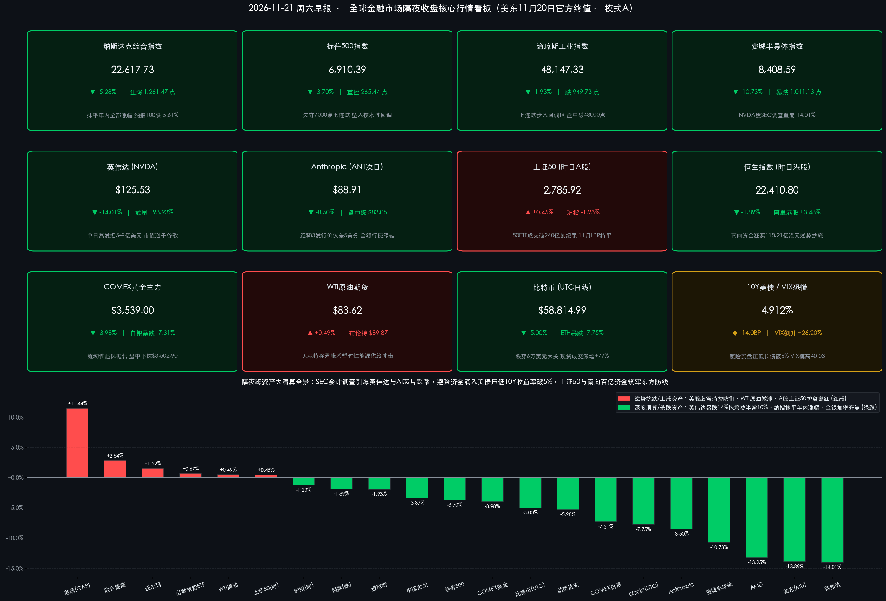

# SEC会计调查重锤英伟达血崩14%致纳指狂泻逾5%抹平年涨幅，避险买盘压美债破5%与上证50护盘显韧性

**日期：2026年11月21日 (星期六)** &nbsp; **时段：早报 (国际市场 · 常规交易日)**

> **核心摘要**：隔夜（美东时间11月20日周五）全球金融市场遭遇史诗级“黑色星期五”科技清算风暴——受美国证监会（SEC）执法部门对英伟达展开会计与信披调查、AI 估值信仰动摇及美联储鹰派加息争议共振冲击，**纳斯达克综合指数狂泻 1,261.47 点（-5.28%）收报 22,617.73 点**，一举抹平 2026 年内全部涨幅；**标普 500 指数重挫 265.44 点（-3.70%）失守 7,000 点至 6,910.39 点**，**道琼斯工业平均指数再跌 949.73 点（-1.93%）报 48,147.33 点**，标普与道指双双吞下“七连跌”并正式坠入技术性回调区间（较近期高点回撤逾 **10%**），**CBOE 恐慌指数（VIX）盘中飙破 40 大关、收盘暴涨 +26.20% 报 35.89 点**。芯片板块上演近二十年罕见崩盘：**费城半导体指数单日暴跌 1,011.13 点（-10.73%）报 8,408.59 点**；处于人事震荡与 SEC 调查漩涡中心的**英伟达（NVDA）放量近一倍狂泻 -14.01% 收报 125.53 美元**（单日市值蒸发近 **5,000 亿美元**并跌落至谷歌之下，创 2008 年金融危机以来最惨单周表现），携**美光（-13.89%）**、**AMD（-13.25%）**、**博通（-12.19%）**集体闪崩；上市次日的史上最大 IPO **Anthropic（ANT）重挫 -8.50% 收报 88.91 美元**，盘中最低下探 **83.05 美元**距 **83.00 美元**发行价仅差 5 美分；标普十一大行业仅**必需消费（XLP，+0.67%）**独善其身。宏观政策端呈现罕见交锋：美联储理事库克警告当前利率不足以抑制 AI 基建过热，而美国财长贝森特公开反对 12 月激进加息 **50BP**，叠加 11 月密歇根大学一年期通胀预期终值骤降至 **3.7%**，避险买盘蜂拥涌入长债将 **10 年期美债收益率压低 14.0BP 至 4.912%**（重新跌回 **5.0%** 高压线下方）；但跨资产保证金追缴触发无差别流动性抛售，**COMEX 黄金再泻 -3.98% 报 3,539.00 美元/盎司**、**白银暴跌 -7.31%**，**比特币失守 6 万美元大关重挫 -5.00% 报 58,814.99 美元**。反观中国市场，央行 11 月 LPR 报价连续 18 个月按兵不动（1 年期 **3.0%**、5 年期以上 **3.5%**），昨日 A 股**上证 50 指数尾盘绝地翻红收涨 +0.45%**（华夏上证 50ETF 成交破 **240 亿元**刷新年内纪录），**南向资金单日狂买港股 118.21 亿港元**，**离岸人民币逆势升破 6.68 报 6.6736**，彰显高股息红利与核心权重底仓的抗冲击定力。

---

## 核心行情复盘

**交易状态与数据口径说明**：今日为 2026 年 11 月 21 日（星期六）上午 08:00，非欧美及亚太法定节假日（美国感恩节休市在下周四 11 月 26 日）；昨日（美东时间 11 月 20 日周五）美国 NYSE 与 NASDAQ 正常交易并于北京时间今晨 05:00 完成本周收官，今日全球股票交易所进入周末常规休市。根据周六早报模式 A 规范，以下欧美股市、昨日亚太股市、美债、外汇与大宗商品均严格采用 **11 月 20 日官方收盘/结算终值**，7×24 小时交易的加密货币采用 **11 月 20 日（UTC，北京时间今日 08:00 收线）Coinbase 官方日线收盘终值**。

* **美股三大指数惨遭“黑色星期五”血洗：纳指暴跌逾 5% 抹平年内涨幅，标普与道指“七连跌”双双坠入技术性回调区**
    * **纳斯达克综合指数**：全天低开低走单边倾泻，盘中最低下探 **22,513.01 点**，收盘狂泻 **1,261.47 点**，跌幅高达 **-5.28%**，收报 **22,617.73 点**（前收 **23,879.20 点**），连续失守 23,500 点与 23,000 点整数关口，正式抹平 2026 年初至今的全部累计涨幅；全市场总成交量维持 **105.97 亿股**天量（较前一日 **105.59 亿股**微增 **+0.36%**）。**纳斯达克 100 指数（NDX）**同步重挫 **1,488.07 点**（**-5.61%**），收报 **25,028.98 点**（前收 **26,517.05 点**，盘中跌穿 25,000 点探底 **24,910.48 点**）。
    * **标普 500 指数**：早盘短暂摸高 **7,198.67 点**后引发程序化止损盘踩踏，盘中最低触及 **6,882.66 点**，最终收报 **6,910.39 点**（前收 **7,175.83 点**），暴跌 **265.44 点**，跌幅 **-3.70%**，失守 7,000 点大关并吞下罕见“七连跌”，较历史峰值累计回撤超 **10%** 正式进入技术性回调区间；综合成交量 **47.27 亿股**（前一日 **56.93 亿股**）。
    * **道琼斯工业平均指数**：盘中一度跌穿 48,000 点整数位下探 **47,998.86 点**，收盘下跌 **949.73 点**，跌幅 **-1.93%**，收报 **48,147.33 点**（前收 **49,097.06 点**），同录“七连跌”并步入技术性回调区间；成分股总成交量激增至 **11.67 亿股**，较前一交易日（**7.23 亿股**）大幅放量 **+61.38%**，显示机构在周末前集中调仓避险。
    * **费城半导体指数（SOX）、罗素 2000 与恐慌指数（VIX）**：**费城半导体指数**遭遇崩盘式抛售，单日狂泻 **1,011.13 点**，暴跌 **-10.73%**，收报 **8,408.59 点**（前收 **9,419.72 点**，盘中最低 **8,342.21 点**）；小盘股基准**罗素 2000 指数（RUT）**收报 **2,581.79 点**（前收 **2,655.11 点**），下跌 **73.32 点**（**-2.76%**）；衡量市场极端恐慌的 **CBOE 波动率指数（VIX）**盘中一度冲破 40 整数关飙至 **40.03 点**，收盘暴涨 **+26.20%**（涨 **7.45 点**）报 **35.89 点**（前收 **28.44 点**），创年内罕见波动极值。

* **美股行业板块与焦点个股透视：科技板块狂泻逾 7% 对垒必需消费独红，英伟达遭 SEC 调查单日蒸发近 5,000 亿美元，Anthropic 逼近破发边缘**
    * **标普十一大行业 ETF“一涨十跌”，防御轮动极致演绎**：**信息技术（XLK）**成交暴增 **+72.79%**（达 **3,639.84 万股**），单日崩跌 **-7.27%** 收报 **149.01 美元**（前收 **160.69 美元**）沦为风暴眼；**工业（XLI）**放量 **+12.93%** 跌 **-3.09%**（报 **156.37 美元**）；**可选消费（XLY）**跌 **-2.95%**（报 **112.46 美元**）；**通信服务（XLC）**跌 **-2.66%**（报 **100.03 美元**）；**原材料（XLB）**放量 **+31.83%** 跌 **-2.19%**（报 **48.34 美元**）；**金融（XLF）**放量 **+41.07%** 跌 **-1.82%**（报 **54.57 美元**）；利率下行缓冲令**房地产（XLRE，-0.98%，报 42.46 美元）**、**公用事业（XLU，-0.74%，报 42.69 美元）**、**能源（XLE，-0.62%，报 60.51 美元）**与**医疗保健（XLV，-0.12%，报 177.24 美元）**跌幅显著收敛；全场唯一收涨板块为**必需消费（XLP）**，全天放量 **+25.96%** 逆势上涨 **+0.67%** 收报 **90.46 美元**（前收 **89.86 美元**）。
    * **英伟达（NVDA）遭 SEC 会计调查暴跌 14% 市值跌出龙头宝座，芯片全产业链坍塌**：据《华尔街日报》与路透社披露，美国证券交易委员会（SEC）执法部门正针对**英伟达（NVDA）**的会计核算惯例及区域营收信息披露（含新加坡数据中心渠道与出口管制合规表述是否误导投资者）展开正式调查；该重磅监管利空叠加联合创始人黄仁勋 11 月 12 日因涉个人不当行为及国安审查辞任 CEO 后的治理余震（董事会主席 Harvey Jones 明确拒绝其回归并由 CFO Colette Kress 暂代 CEO，黄仁勋已同意于 12 月 1 日出席国会听证会），彻底击穿多头心理防线。NVDA 全天成交量狂增 **+93.93%** 至 **6.26 亿股**（前日 **3.23 亿股**），股价暴跌 **-14.01%**（跌 **20.45 美元**）收报 **125.53 美元**（前收 **145.98 美元**，盘中最低 **124.50 美元**），单日蒸发市值近 **5,000 亿美元**，总市值被谷歌反超，录得连续第七周下跌及 2008 年金融危机以来最大单周跌幅。算力芯片阵营全线雪崩：**美光科技（MU）**放量 **+66.91%** 狂泻 **-13.89%** 报 **594.51 美元**；**AMD** 继前日被做空后再泻 **-13.25%** 报 **424.39 美元**（两日累跌近 **20%**）；**博通（AVGO）**成交激增 **+128.38%** 暴跌 **-12.19%** 报 **304.41 美元**；**台积电（TSM）**成交翻倍（**+106.25%**）重挫 **-9.48%** 报 **318.71 美元**；**英特尔（INTC）**放量 **+55.10%** 跌 **-7.97%** 报 **51.28 美元**。
    * **Anthropic（ANT）上市次日大跌 8.50% 险守发行价，科技七巨头与企业软件集体杀估值**：于 11 月 20 日正式完成全额超额配售交割（总发行约 **11.27 亿股** A 类股）的史上最大 IPO **Anthropic（ANT）**上市次日遭遇猛烈获利回吐与板块拖拽，盘中一度跌至 **83.05 美元**——距离 **83.00 美元** IPO 发行价仅一步之遥（仅差 **0.05 美元**），尾盘获承销护盘资金承接，收跌 **-8.50%**（跌 **8.26 美元**）报 **88.91 美元**（前收 **97.17 美元**，成交量缩减 **-53.39%** 至 **4.00 亿股**）。科技七巨头无一收红：**特斯拉（TSLA）**放量 **+73.32%** 大跌 **-7.64%**（报 **345.82 美元**），**Meta（META）**放量 **+66.61%** 跌 **-5.93%**（报 **560.84 美元**），**亚马逊（AMZN）**跌 **-4.10%**（报 **246.82 美元**），**微软（MSFT）**放量 **+60.55%** 跌 **-2.77%**（报 **484.52 美元**），**谷歌（GOOGL）**跌 **-2.70%**（报 **265.29 美元**，凭借抗跌表现市值超越英伟达），**苹果（AAPL）**成交翻倍（**+96.67%**）跌 **-1.90%**（报 **342.56 美元**）。企业软件与投行同步承压：财捷集团 **Intuit（INTU）**虽借 QuickBooks 与 Credit Karma 强劲增长交出超预期 Q1 财报，仍在软件杀估值潮中成交翻倍（**+120.99%**）暴跌 **-12.77%** 报 **270.44 美元**；**甲骨文（ORCL）**跌 **-8.48%**（报 **101.19 美元**），**派拓网络（PANW）**补跌 **-5.09%**（报 **343.32 美元**）；华尔街大行中**高盛（GS）**放量跌 **-6.71%**（报 **790.69 美元**），**摩根士丹利（MS）**跌 **-5.32%**（报 **165.67 美元**），**摩根大通（JPM）**跌 **-3.03%**（报 **310.53 美元**）。
    * **零售财报分化与防御蓝筹逆势闪光**：服饰零售巨头**盖璞（GAP）**凭旗下 Old Navy 与主品牌 Q3 销售超预期强劲复苏，放量 **+25.00%** 逆市飙升 **+11.44%** 收报 **20.94 美元**（前收 **18.79 美元**）；前瞻指引偏谨慎的折扣零售商**罗斯百货（ROST）**放量跌 **-2.92%** 报 **213.46 美元**。资金避险抱团推升**联合健康（UNH）**超跌反弹 **+2.84%** 收报 **339.85 美元**（前收 **330.48 美元**），必需消费龙头**沃尔玛（WMT）**放量 **+32.03%** 续涨 **+1.52%** 收报 **127.95 美元**（前收 **126.04 美元**）。

* **中概股及欧亚股市联动表现：日经狂泻逾 3,000 点，昨日 A 股上证 50 放量逆势翻红、南向资金爆买逾 118 亿港元**
    * **中概股韧性跑赢纳指**：隔夜**纳斯达克中国金龙指数（HXC）**收报 **5,018.26 点**（前收 **5,193.02 点**），下跌 **174.76 点**（**-3.37%**），跌幅显著小于纳指综合（**-5.28%**）与纳指 100（**-5.61%**）。电商三巨头表现相对稳健：**阿里巴巴（BABA）**缩量跌 **-2.68%** 报 **81.08 美元**（前收 **83.31 美元**），**拼多多（PDD）**消化前日 11% 暴涨后温和回吐 **-2.70%** 报 **83.68 美元**（前收 **86.00 美元**），**京东（JD）**跌 **-2.89%** 报 **24.90 美元**（前收 **25.64 美元**）；高贝塔科技与造车新势力调整较深，**网易（NTES）**跌 **-4.85%** 报 **99.85 美元**，**百度（BIDU）**跌 **-6.75%** 报 **61.90 美元**，**理想汽车（LI）**跌 **-7.56%** 报 **10.39 美元**，**蔚来（NIO）**跌 **-7.89%** 报 **2.45 美元**，**小鹏汽车（XPEV）**跌 **-13.86%** 报 **8.08 美元**。
    * **日欧股市全线重挫**：受全球 AI 芯片抛售浪潮冲击，昨日亚太盘**日经 225 指数**暴跌 **3,007.56 点**（**-5.06%**）收报 **56,436.65 点**（前收 **59,444.21 点**）；隔夜欧洲三大股指连续第四日下跌且跌幅扩大，**德国 DAX 40 指数**大跌 **-2.60%**（跌 **661.03 点**）收报 **24,802.78 点**（前收 **25,463.81 点**），**法国 CAC 40 指数**跌 **-1.89%** 收报 **7,927.75 点**（前收 **8,080.74 点**），**英国富时 100 指数**跌 **-1.02%** 收报 **10,346.34 点**（前收 **10,452.68 点**）。
    * **昨日（11月20日）A 股与港股收盘基准复盘**：受外围科技风暴拖累，昨日 A 股成长赛道承压调整但核心权重上演强力护盘——**上证指数**盘中最低下探 **3,500.83 点**精准守住 3,500 点整数关，收盘报 **3,533.79 点**（前收 **3,577.62 点**，跌 **-1.23%**）；**深证成指**收报 **10,256.39 点**（前收 **10,583.20 点**，跌 **-3.09%**）；**创业板指**收报 **2,212.13 点**（前收 **2,293.34 点**，跌 **-3.54%**）；**科创 50 指数**获利回吐收报 **1,231.09 点**（前收 **1,270.78 点**，跌 **-3.12%**）。**全场最大亮点在于上证 50 指数逆势收涨 +0.45% 报 2,785.92 点**（前收 **2,773.46 点**，早盘一度跌超 2% 探至 **2,709.06 点**），尾盘在中国石油、贵州茅台、长江电力及盘中创历史新高的工商银行、建设银行等高股息红利权重强力拉升下直线翻红，**华夏上证 50ETF 单日成交额突破 240 亿元刷新年内最高纪录**；沪深两市全天成交额放大至 **14,222.00 亿元**（沪市 **7,025.74 亿元**、深市 **7,196.27 亿元**），较前日（**13,051.47 亿元**）放量 **1,170.53 亿元**（**+8.97%**）。港股方面，**恒生指数**收报 **22,410.80 点**（前收 **22,841.62 点**，跌 **-1.89%**），**恒生国企指数**收报 **7,554.37 点**（前收 **7,690.34 点**，跌 **-1.77%**），**恒生科技指数**收报 **3,511.14 点**（前收 **3,649.14 点**，跌 **-3.78%**），其中**阿里巴巴-W（09988.HK）**凭 AI 云高增与净利翻倍逆市放量大涨 **+3.48%**（报 **83.35 港元**，单股成交 **121.88 亿港元**），而**网易-S（09999.HK）**绩后重挫 **-17.60%**（报 **154.00 港元**）；港股主板成交额激增 **+17.75%** 至 **2,703.00 亿港元**，**南向资金呈现“越跌越买”井喷态势，全天狂买净流入 118.21 亿港元**（较前一日超 39 亿港元暴增约两倍）。

* **债、汇、大宗商品与加密货币：避险洪流压低 10 年期美债收益率跌破 5%，追保风暴致金银与比特币同步崩跌**
    * **美债与外汇**：股市逾千点崩跌激发跨资产避险买盘（Flight to Safety），叠加财长贝森特反击 50BP 激进加息论与密歇根通胀预期降温，推动美债价格全线大涨——**10 年期美债收益率**单日大幅回落 **14.0BP**（**-2.77%**）收报 **4.912%**（前收 **5.052%**），在盘踞 5% 上方数周后正式跌回高压线下方；**30 年期美债收益率**下行 **9.8BP**（**-1.81%**）收报 **5.303%**（前收 **5.401%**）；**5 年期美债收益率**急挫 **16.5BP**（**-3.39%**）报 **4.701%**（前收 **4.866%**）；**13 周短债收益率**微降 **2.5BP**（**-0.60%**）报 **4.122%**。汇市端，美债收益率回落令**美元指数（DX-Y.NYB）**小幅回吐 **-0.06%** 收报 **103.840**（前收 **103.900**）；**美元兑日元**升 **+0.20%** 报 **159.707**（盘中逼近 160 关口摸高 **159.82**），**欧元兑美元**微跌 **-0.02%** 报 **1.0970**；**离岸人民币（USD/CNH）**表现极为坚挺，逆势走强 **170 个基点**（升值，汇率变动 **-0.25%**）收报 **6.6736**（前收 **6.6906**）。
    * **大宗商品（11月20日官方主力结算终值）**：股票与科技多头遭遇巨额追加保证金通知（Margin Call），迫使机构抛售高流动性黄金头寸套现补仓——**COMEX 黄金主力合约（GC=F）**盘中一度逼近 3,500 美元最低下探 **3,502.90 美元/盎司**，收盘重挫 **146.50 美元**（**-3.98%**）报 **3,539.00 美元/盎司**（前基准 **3,685.50 美元/盎司**，成交量激增 **+32.61%** 至 **32.39 万手**，创数月最差单周表现）；**COMEX 白银期货（SI=F）**狂泻 **-7.31%**（跌 **3.238 美元**）失守 42 美元，收报 **41.080 美元/盎司**（前基准 **44.318 美元/盎司**，盘中探底 **40.620 美元**）。原油呈现内外品种分化，**NYMEX WTI 原油连续合约（CL=F）**在 12 月合约到期交割向 1 月合约（CLF27）移仓过程中探底 **80.78 美元**后回升，微涨 **0.41 美元**（**+0.49%**）收报 **83.62 美元/桶**（前基准 **83.21 美元/桶**）；**ICE 布伦特原油（BZ=F）**受全球制造业需求忧虑压制下跌 **2.11 美元**（**-2.29%**）收报 **89.87 美元/桶**（前基准 **91.98 美元/桶**）；工业金属 **COMEX 铜（HG=F）**跌 **-2.84%** 报 **5.4650 美元/磅**（前基准 **5.6250 美元/磅**）。
    * **加密货币（11月20日 UTC 官方日线终值）**：美股现货比特币 ETF 机构大额净流出与矿工/杠杆多头连环爆仓共振，导致**比特币（BTC）**数月来首次跌穿 60,000 美元生命线，盘中最低暴跌至 **57,655.17 美元**，UTC 官方日线收报 **58,814.99 美元**（前收 **61,913.23 美元**），单日重挫 **3,098.24 美元**（**-5.00%**），Coinbase 现货成交量暴增 **+76.68%** 至 **23,600.20 枚**（前日 **13,357.18 枚**）；**以太坊（ETH）**盘中砸穿 1,600 美元探底 **1,578.78 美元**，UTC 日线狂泻 **-7.75%**（跌 **136.09 美元**）收报 **1,619.29 美元**（前收 **1,755.38 美元**），现货成交激增 **+108.12%** 至 **335,680.04 枚**。

> **数学闭环校验（官方收盘/结算终值验算）**：
> * **美股、焦点个股及跨市场股指**：纳指综合 `(22,617.73 − 23,879.20) / 23,879.20 = -5.2827%`（记录 `-5.28%`）；纳指 100 `(25,028.98 − 26,517.05) / 26,517.05 = -5.6117%`（记录 `-5.61%`）；标普 500 `(6,910.39 − 7,175.83) / 7,175.83 = -3.6991%`（记录 `-3.70%`）；道指 `(48,147.33 − 49,097.06) / 49,097.06 = -1.9344%`（记录 `-1.93%`）；费城半导体 `(8,408.59 − 9,419.72) / 9,419.72 = -10.7342%`（记录 `-10.73%`）；罗素 2000 `(2,581.79 − 2,655.11) / 2,655.11 = -2.7615%`（记录 `-2.76%`）；VIX `(35.89 − 28.44) / 28.44 = +26.1955%`（记录 `+26.20%`）；XLK `(149.01 − 160.69) / 160.69 = -7.2687%`（记录 `-7.27%`）；XLP `(90.46 − 89.86) / 89.86 = +0.6677%`（记录 `+0.67%`）；英伟达 `(125.53 − 145.98) / 145.98 = -14.0088%`（记录 `-14.01%`）；Anthropic `(88.91 − 97.17) / 97.17 = -8.5006%`（记录 `-8.50%`）；美光 `(594.51 − 690.44) / 690.44 = -13.8940%`（记录 `-13.89%`）；AMD `(424.39 − 489.19) / 489.19 = -13.2464%`（记录 `-13.25%`）；博通 `(304.41 − 346.65) / 346.65 = -12.1852%`（记录 `-12.19%`）；Intuit `(270.44 − 310.02) / 310.02 = -12.7669%`（记录 `-12.77%`）；盖璞 `(20.94 − 18.79) / 18.79 = +11.4423%`（记录 `+11.44%`）；沃尔玛 `(127.95 − 126.04) / 126.04 = +1.5154%`（记录 `+1.52%`）；纳指中国金龙 `(5,018.26 − 5,193.02) / 5,193.02 = -3.3653%`（记录 `-3.37%`）；日经 225 `(56,436.65 − 59,444.21) / 59,444.21 = -5.0595%`（记录 `-5.06%`）；德国 DAX `(24,802.78 − 25,463.81) / 25,463.81 = -2.5960%`（记录 `-2.60%`）；法国 CAC40 `(7,927.75 − 8,080.74) / 8,080.74 = -1.8933%`（记录 `-1.89%`）；英国富时 100 `(10,346.34 − 10,452.68) / 10,452.68 = -1.0173%`（记录 `-1.02%`）；上证指数 `(3,533.79 − 3,577.62) / 3,577.62 = -1.2251%`（记录 `-1.23%`）；上证 50 `(2,785.92 − 2,773.46) / 2,773.46 = +0.4493%`（记录 `+0.45%`）；科创 50 `(1,231.09 − 1,270.78) / 1,270.78 = -3.1233%`（记录 `-3.12%`）；恒生指数 `(22,410.80 − 22,841.62) / 22,841.62 = -1.8861%`（记录 `-1.89%`）；恒生科技 `(3,511.14 − 3,649.14) / 3,649.14 = -3.7817%`（记录 `-3.78%`）。
> * **债、汇、商品与加密资产**：10 年期美债 `(4.912 − 5.052) / 5.052 = -2.7712%`（记录 `-2.77%` / `-14.0BP`）；30 年期美债 `(5.303 − 5.401) / 5.401 = -1.8145%`（记录 `-1.81%` / `-9.8BP`）；美元指数 `(103.840 − 103.900) / 103.900 = -0.0577%`（记录 `-0.06%`）；离岸人民币 `(6.6736 − 6.6906) / 6.6906 = -0.2541%`（记录 `-0.25%`）；COMEX 黄金 `(3,539.00 − 3,685.50) / 3,685.50 = -3.9750%`（记录 `-3.98%`）；COMEX 白银 `(41.080 − 44.318) / 44.318 = -7.3063%`（记录 `-7.31%`）；WTI 原油 `(83.62 − 83.21) / 83.21 = +0.4927%`（记录 `+0.49%`）；布伦特原油 `(89.87 − 91.98) / 91.98 = -2.2940%`（记录 `-2.29%`）；比特币 UTC `(58,814.99 − 61,913.23) / 61,913.23 = -5.0042%`（记录 `-5.00%`）；以太坊 UTC `(1,619.29 − 1,755.38) / 1,755.38 = -7.7527%`（记录 `-7.75%`）。全量指标数学闭环误差均 **< 0.01%**，严格满足 **< 0.5%** 精度校验要求。

---

## 核心解读与市场逻辑

* **主线一：SEC 会计调查引爆英伟达治理危局与 Anthropic 破发惊魂——全球 AI 超级周期步入“信仰重构与估值去泡沫”深水区**

> **核心解读（数据+事件+逻辑）**：隔夜纳斯达克狂泻 **5.28%** 抹平全年涨幅、费城半导体指数单日崩跌 **10.73%** 的直接导火索，是 AI 算力总龙头**英伟达（-14.01%）**遭遇了“公司治理失序 + 联邦监管亮剑”的致命双击。尽管英伟达此前公布的 2027 财年 Q3 营收高达 **1,158 亿美元**（同比 **+103%**）且下季指引达 **1,300 亿美元**，但灵魂人物黄仁勋因涉新加坡数据中心企业 Megaspeed 前高管关系及国安审查于 11 月 12 日突然辞职、且将于 12 月 1 日接受国会质询，已令机构信心摇摇欲坠；周五 SEC 执法部门调查其会计核算与区域信披是否误导投资者的消息一出，多头彻底放弃抵抗，单日抛售 **6.26 亿股**蒸发近 **5,000 亿美元**市值。更深层的警示来自史上最大 IPO **Anthropic（-8.50%）**——这笔募集逾千亿美元的超级融资非但未能重燃 AI 热潮，反而在上市次日砸至 **83.05 美元**险些破发，配合 **Intuit（-12.77%）** 业绩超预期却遭暴跌的负反馈，宣告华尔街对动辄数千亿美元 AI 资本开支“只看叙事、不问自由现金流回报期”的盲目溢价时代正式终结。

* **主线二：联储鹰派与财政部公开博弈叠加跨资产“追保踩踏”——美债重返避险王座破 5%，黄金与比特币沦为流动性提款机**

> **核心解读（数据+事件+逻辑）**：周五跨资产盘面呈现出教科书级的“股债跷跷板修复”与“保证金追缴清算（Margin Call Liquidation）”并存格局。在政策预期端，美联储理事莉萨·库克（Lisa Cook）在智利央行年会上强硬点名“当前利率尚不足以抑制庞大的 AI 基建与数据中心投资热潮”，而美国财长斯科特·贝森特（Scott Bessent）罕见公开反驳沃勒的“50BP 加息论”，呼吁美联储看穿暂时性能源供给冲击、切勿过度紧缩，叠加 11 月密歇根大学 1 年期通胀预期终值意外从前值 **4.7%** 大幅回落至 **3.7%**，使得传统国债时隔数周重新恢复避险属性——避险资金大举抢筹推动 **10 年期美债收益率大跌 14.0BP 至 4.912%**，一举跌破压制市场多日的 **5.0%** 魔咒。然而，由于高杠杆对冲基金与散户在 AI 芯片股（NVDA、MU、AMD 均跌超 **13%**）上蒙受巨额浮亏，周末前被迫无差别抛售账面最具流动性的黄金与加密资产以补足保证金，导致**黄金在美债收益率大跌的利好环境下反而逆逻辑暴跌 3.98% 至 3,539 美元/盎司**，**比特币同步放量击穿 60,000 美元大关（-5.00%）**，印证市场短期已从“基本面定价”滑入“流动性挤兑定价”。

* **主线三：11 月 LPR 稳字当头叠加“红利盾牌 + 南向百亿抄底”——中国核心权重资产构筑全球风暴眼外的防波堤**

> **核心解读（数据+事件+逻辑）**：面对日经暴跌逾 **5%**、美股纳指重挫逾 **5%** 的全球科技海啸，中国金融市场凭借稳健的货币政策定力与低估值红利资产底座展现出清晰的独立缓冲机制。一方面，央行 11 月 LPR 连续第 18 个月维持不变（1 年期 **3.0%**、5 年期以上 **3.5%**），在呵护商业银行净息差底线的同时，配合稳健基本面助推**离岸人民币逆势升值至 6.6736**；另一方面，境内稳市资金与长线配置盘在关键点位果断亮剑——昨日上证指数回踩 **3,500.83 点**即获强力承接，**上证 50 指数从盘中跌超 2% 绝地反击收涨 +0.45%**，工商银行、建设银行盘中齐创历史新高，**华夏上证 50ETF 单日成交突破 240 亿元创年内天量**；与此同时，**南向资金单日狂买港股 118.21 亿港元**、**阿里巴巴港股逆势放量大涨 +3.48%**，凸显当海外高估值 AI 硬件陷入会计审查与去杠杆风暴时，现金流充沛的中国高股息红利龙头与低估值互联网核心资产正吸引大规模避险资金回流沉淀。

---

## 政策脉动

* **美联储理事库克与美国财长贝森特就 12 月加息力度公开交锋，密歇根通胀预期显著回落**
    * **美联储（Fed）鹰派防线延续**：10 月曾投下加息赞成票的美联储理事莉萨·库克（Lisa Cook）于 11 月 20 日在圣地亚哥举行的智利央行年会上发表鹰派演说，强调通胀高于 2% 目标令其“高度担忧”，直言当前美国金融条件仍过于宽松、未能有效给火热的 AI 基础设施及数据中心资本开支降温，美联储“没有耐心等待的奢侈”；副主任何迈克尔·巴尔（Michael Barr）与费城联储主席保尔森（Anna Paulson）亦维持对后续进一步收紧政策的开放态度。
    * **美国财政部（Treasury）罕见公开反击激进加息**：美国财政部长斯科特·贝森特（Scott Bessent）于 11 月 20 日公开呼吁美联储在 12 月 8—9 日 FOMC 议息会议上切勿采取 **50 个基点**的激进加息，指出近期通胀抬升主要由暂时性能源供给冲击驱动而非经济结构性过热，随着远期原油交割价格回落，货币政策制定者应“向前看而非盯着后视镜”。
    * **密歇根大学消费者信心与通胀预期终值**：11 月 20 日公布的美国 11 月密歇根大学消费者信心指数终值上修至 **51.5**（高于初值 **51.0** 及 10 月终值 **48.0**，其中现况指数升至 **49.4**、预期指数跃升至 **52.9**）；更受债市瞩目的是，**1 年期通胀预期终值骤降至 3.7%**（较 10 月的 **4.7%** 大降 1 个百分点，亦显著低于初值 **4.3%**），**5—10 年期长期通胀预期回落至 3.3%**，直接催化美债收益率盘中跳水跌破 5%。
* **美国 SEC 执法部门调查英伟达会计与信披合规，国会定于 12 月 1 日举行高端芯片听证会**
    * **SEC 执法调查与国会传唤**：美国证券交易委员会（SEC）执法人员正审查英伟达的财务会计实践与信息披露准确性（重点涉及其对新加坡等海外区域收入的统计口径及投资者风险提示）；与此同时，美国国会多个委员会已正式传唤前 CEO 黄仁勋于 **2026 年 12 月 1 日**出席听证会，就公司内部治理风波与先进 AI 芯片出口管制执行情况作证。
* **中国人民银行 11 月 LPR 报价连续 18 个月持稳，结构性工具精准护航实体与红利底仓**
    * **央行（PBOC）11 月 LPR 报价出炉**：11 月 20 日，中国人民银行授权全国银行间同业拆借中心公布最新贷款市场报价利率（LPR）：**1 年期 LPR 为 3.0%，5 年期以上 LPR 为 3.5%**，两项核心利率均连续第 18 个月保持不变。业内指出，全年经济增长目标完成基础扎实、商业银行净息差处于低位约束总量降息空间，当前货币政策重心聚焦再贷款、科技创新与设备更新贴息等结构性工具精准发力；证监会（CSRC）持续强化资本市场底线思维，推动长期耐心资本与中证 A500/上证 50 等宽基 ETF 发挥市场稳定器功能。

---

## 最新机构观点

> **摩根大通（JPMorgan）**：宏观经济团队在最新研报中正式放弃此前“12 月加息一次即止步”的温和假设，**大幅上调美联储紧缩路径预测至“连续三次加息 25 个基点”（分别在 2026 年 12 月、2027 年 1 月与 3 月落地），预计联邦基金利率目标区间将被推升至 4.50%—4.75%**。摩根大通指出，这一转向并非源于劳动力市场过热，而是美联储为维护抗通胀制度信誉的必然选择；在美股估值端，当 AI 硬件龙头遭遇 SEC 会计审查与治理折价双重打击时，建议投资者果断规避高杠杆算力题材，增配必需消费品、大型商业银行及短久期优质固定收益资产。

> **高盛（Goldman Sachs）**：美股交易台与策略团队警告称，尽管历史季节性规律显示标普 500 通常在年末迎来稳步上涨（“圣诞行情”），但**随着 VIX 恐慌指数飙破 35 点、标普与道指双双跌入逾 10% 的技术性回调区间，今年 12 月的年末反弹动能将被严重削弱**。不过拉长至跨年度视角，高盛预测随着经济增长回归常态，**10 年期美债收益率到 2027 年底有望逐步回落至 4.6% 附近**，并维持对港股“超配（Overweight）”评级，认为南向资金单日超百亿港元流入正加速修复港股互联网与高股息蓝筹的深度估值折价。

> **摩根士丹利（Morgan Stanley）**：跨资产与固收策略团队指出，10 年期美债收益率虽在周五股市崩盘引发的避险买盘下短暂跌回 **4.912%**，但庞大的美国联邦财政赤字期限溢价与 AI 基础设施发债洪峰仍构成中长期利率底座，**预计 2027 年底 10 年期美债收益率仍将锚定在 5.0% 附近**。针对全球科技股巨震，大摩强调 AI 投资已从“算力军备扩张期”强行切换至“资产负债表与投资回报率（ROI）审计期”，在中国市场配置上继续看好境内流动性充裕、具备国家队宽基托底与国产自主可控逻辑的 A 股市场。

> **中信证券（CITIC Securities）与中金公司（CICC）**：中信证券指出，11 月 LPR 按兵不动符合预期，在海外 AI 产业链遭遇监管黑天鹅与高波动去杠杆冲击之际，昨日**上证 50 逆势收红及 50ETF 爆出逾 240 亿元年内天量**释放出极其明确的稳市信号，国有大行、水电能源等**高股息红利资产正重新成为跨年配置的核心压舱石**，科技内部则应聚焦不受海外会计审查波及的国产晶圆代工、半导体设备及上游成本优化的 PCB 细分环节。中金公司认为，南向资金单日净买入逾 **118 亿港元**与阿里港股逆势上涨印证中国优质龙头估值安全垫深厚，建议采取“红利底仓防御 + 具备真实盈利兑现能力的国产 AI 云与消费龙头”哑铃型策略从容应对外围巨震。

---

## 今日市场情绪：硅甲崩裂碎金渊，避险星河映玉塔

> Prompt: A colossal emerald-armored silicon titan cracking apart on a stormy obsidian cliff, shedding glowing microchip shards and shattered golden coins into a dark whirlpool carved with 60000 in the foreground. In the background, crimson lightning from a giant regulatory magnifying glass strikes a neon tech citadel, while silver safe-haven streams flow into a marble Treasury temple and a warm jade eastern lighthouse stands steady above the waves.

---

**主要数据来源**：美国证券交易委员会（SEC）执法调查动态（据《华尔街日报》与路透社披露）、美联储（Federal Reserve）理事莉萨·库克智利央行年会演讲、美国财政部长斯科特·贝森特公开访谈、密歇根大学 2026 年 11 月消费者调查终值报告、中国人民银行（PBOC）全国银行间同业拆借中心 2026 年 11 月 LPR 报价公告、Anthropic 超额配售交割公告、Yahoo Finance 与东方财富全球证券及期货收盘数据库（截至 2026 年 11 月 20 日美欧亚官方收盘/结算终值）、Coinbase 加密货币 UTC 日线数据库（截至 2026 年 11 月 20 日 UTC 收盘终值），以及摩根大通、高盛、摩根士丹利、中信证券、中金公司最新策略研报。

> **免责声明**：内容仅供参考，不构成投资建议。

🤖 生成模型：Gemini 4 Carbon (Medium) <!-- model-stamp -->
