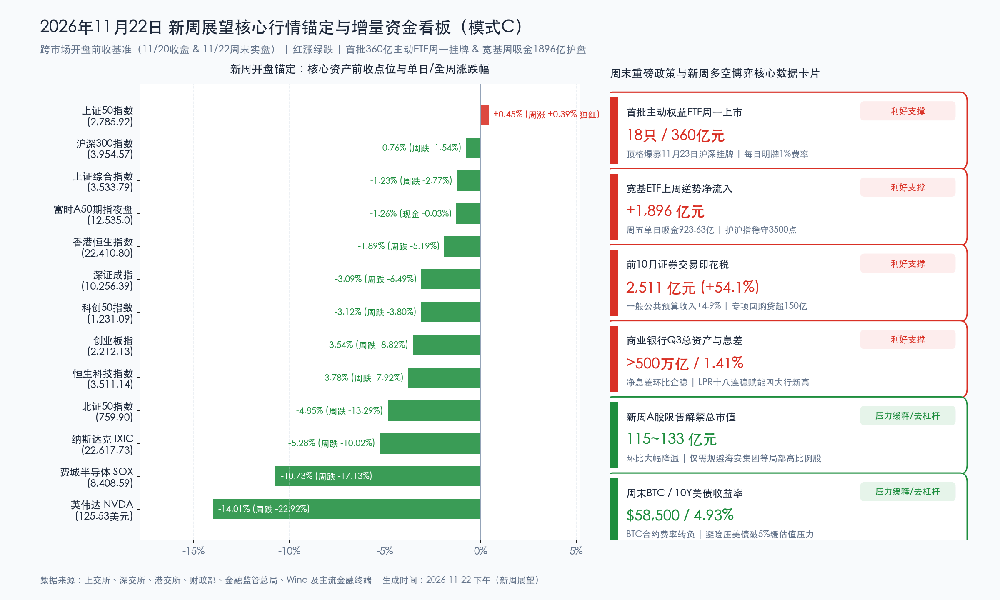

# 首批360亿主动ETF周一“每日明牌”挂牌叠加前10月印花税激增54%，银行业破500万亿护航沪指3500点迎核心PCE与工业利润大考

**日期：2026年11月22日 (星期日)** &nbsp; **时段：下午/新周展望（模式C）**

> **核心摘要**：本周末（11月21日—22日）国内宏观财政、金融监管与资本市场制度端密集释放重磅定心丸，为明日（11月23日周一）A股抵御美东周五华尔街芯片巨震（SEC正式调查英伟达会计与新加坡子公司收入披露致其单日血崩 **-14.01%**、费半狂泻 **-10.73%**）构筑起坚实的“三道防线”：其一，**中国公募史上首批18只主动权益ETF（沪深各9只，合计顶格爆募 360亿元）定于11月23日集体挂牌上市并实行“每日明牌”全持仓披露**，与上周**宽基ETF逆势净流入约 1,896亿元（周五单日狂吸 923.63亿元）**及11月以来**超60家公司获批超 150亿元 1%利率专项回购增持贷款**形成增量资金合围；其二，财政部披露1—10月全国一般公共预算收入同比增 **+4.9%**、**证券交易印花税 2,511亿元同比激增 +54.1%**，国家发改委同步部署加快政府投资形成实物工作量，叠加金融监管总局披露**商业银行总资产历史性突破 500万亿元、三季度净息差企稳回升至 1.41%**，夯实上证50周线独红（**+0.39%**）与沪指 **3,533.79点** 估值底；其三，监管周末雷霆重罚**仕净科技（虚增营收逾19亿拟罚3,400万）**与**启迪设计（周二起戴帽“ST启设”）**，配合查处4起AI“小作文”案加速绩差微盘出清。展望新周（11月23日—27日），周三晚**美国10月核心PCE与Q3 GDP修正值**、周四至周五**美股感恩节休市/半日市**、以及周五**中国10月规上工业企业利润、2026广州国际车展与美团Q3财报**将主导“前紧后松、西休东唱”的跨周博弈。

## 周末财经要闻终极汇总

*   **资本市场里程碑与增量活水：首批18只主动权益ETF（360亿）周一挂牌上市，三路长钱合围护航**：
    *   **360亿元主动ETF“每日明牌”入市**：经沪深交易所批准，国内首批 **18只主动权益类ETF（沪市、深市各9只）** 定于 **11月23日（周一）** 同步集体挂牌上市交易。该批产品此前全部触及 **20亿元** 募集上限提前结募（17只启动比例配售），合计募资 **360亿元**、有效认购超 **33万户**，管理费率普遍低至 **1%**，覆盖均衡、价值、红利、质量、成长五大策略，并首创**每个交易日开市前通过申赎清单（PCF）披露全部持仓的“日更明牌”机制**，标志着境内ETF正式迈入“主被动协同”新纪元，其建仓方向将成为新周盘面最受瞩目的增量风向标。
    *   **专项回购增持贷款与宽基ETF共振**：自11月初央行将股票回购增持再贷款利率降至 **1%** 并升级为长期制度性安排以来，商业银行投放提速，截至本周末11月内已有 **超60家A股上市公司** 披露取得专项贷款承诺函，涉及金额 **超150亿元**（民企与硬科技成长企业占比显著提升）；叠加11月16日—20日当周**沪深股票及跨境ETF合计净流入 1,941.71亿元（其中宽基ETF单周狂吸约 1,896亿元、周五单日爆买 923.63亿元，华夏上证50ETF周五成交 243.4亿元创历史次高）**，以及南向资金上周越跌越买净流入约 **165亿港元（周五单日净买入 118.12亿港元）**，多路长线资金构筑起跨市场流动性护城河。

*   **宏观财政与金融底盘：前10月印花税大增54.1%、发改委催动实物工作量、银行业总资产突破500万亿元**：
    *   **财政收入稳增与发改委促投资提速**：财政部最新数据显示，2026年1—10月全国一般公共预算收入达 **195,671亿元（同比增长 +4.9%）**，其中全国税收收入 **162,622亿元（同比 +6.0%）**；最具资本市场温度计意义的**证券交易印花税达 2,511亿元，同比飙升 +54.1%**，个人所得税 **16,428亿元（同比 +22.9%）**；香港定价发行的 **20亿美元3年期主权债券（利率4.821%）获国际投资者36倍超额认购**。与此同时，**国家发改委本周末部署要求各地强化要素保障，加快推动政府投资项目建设和资金支付进度，尽快形成更多实物工作量**，年末基建与内需投资端支撑进一步强化。
    *   **银行业总资产破500万亿且净息差筑底企稳**：国家金融监督管理总局披露，截至2026年三季度末，我国**商业银行总资产顺利突破 500万亿元 大关**；尤为关键的是，三季度末**商业银行净息差录得 1.41%**，环比上季度末企稳微升，终结单边下行趋势。配合11月LPR连续18个月稳守（1年期 **3.0%**、5年期以上 **3.5%**）、央行每日 **1.25%** 固定利率隔夜逆回购按需全额供给，以及 **6%** 外汇存款准备金率稳住人民币对美元中间价（周五报 **6.7131**），四大国有行周五集体创历史新高具备极其扎实的资产质量与息差拐点基本面。

*   **铁腕监管与周末公司重磅公告：严惩百亿级财报造假、斩断AI“小作文”，硬科技国产替代再落重子**：
    *   **财务造假“零容忍”密集亮剑**：本周末（11月22日）A股再迎严监重锤——**仕净科技（301030.SZ）**因连续4期财报虚增营业收入合计超 **19亿元** 及隐瞒重大诉讼，收到《行政处罚事先告知书》拟被合计罚款 **3,400万元**；**启迪设计（300153.SZ）**因原子公司虚增利润等违规被重罚数千万元，股票将于 **11月23日（周一）停牌一天，11月24日（周二）起实施其他风险警示变更为“ST启设”**。结合证监会联合公安部公开通报查处 **4起编造传播股市“小作文”（含AI批量生成谣言、伪造税收及监管截图）典型案例**，以及**广百股份、北纬科技**周末提示二级市场异常波动风险、**中嘉博创**提示控股股东不超400万股质押股司法处置风险，“扶优限劣”生态净化持续深入。
    *   **本土硬科技供应链扩产与大国重器突破**：周日晚间产业端捷报频传——国产CMOS图像传感器龙头**思特威（688213.SH）公告拟以银行贷款 15亿元 增资武汉楚兴（持股5.5880%）**，定向补齐高端CIS芯片本土晶圆代工短板；OLED核心材料与设备龙头**奥来德（688378.SH）全资子公司预中标京东方第8.6代AMOLED生产线线性蒸镀源项目（第一中标候选人，金额 5.5亿—7亿元）**；三安光电（600703.SH）公告总经理林科闯因身体原因辞职、由董事长林志强代职；宏观产业面上，五部门印发《海洋产业投融资指导目录（2026版）》扶持海水制氢与涉海智能隐身材料，且11月22日当天**第二艘国产大型邮轮“爱达·花城号”自广州南沙正式开启商业首航**。

*   **海外风暴周末溯源与跨市场前收/实盘锚定：SEC调查英伟达新加坡百亿美元账目，美债破5%对冲冲击，BTC费率转负**：
    *   **英伟达SEC民事执法调查核心焦点曝光**：据路透社与《华尔街日报》周末披露，美国证监会（SEC）执法部门对英伟达发起的民事调查聚焦于**会计准则与地理营收披露透明度**——重点审视经由其**新加坡子公司入账的约 1,040亿美元 收入归属**（公司此前将地理收入统计口径由开票地改为客户总部所在地，代理CEO兼CFO Colette Kress曾称新加坡开票收入绝大部分来自美国客户）、应收账款质量及AI算力供应链循环融资安排（注：SEC事实核查尚不构成违规终局认定）。受此冲击，美东周五（11月20日）**英伟达单日暴跌 -14.01% 收报 125.53美元（全周血崩 -22.92%，市值退居全球第四）**，拖累**费城半导体单日狂泻 -10.73%（报8,408.59点，全周挫 -17.13%）**、**纳指单日跌 -5.28%（报22,617.73点，抹平年内涨幅，全周跌 -10.02%）**、**标普500单日跌 -3.70%（报6,910.39点，七连跌，全周跌 -8.61%）**、**道指单日跌 -1.93%（报48,147.33点，全周跌 -8.02%）**。
    *   **避险压低美债收益率与周末加密实盘坐标**：华尔街科技股踩踏引发资金涌入美债避险，推动**10年期美债收益率单日回落10—14BP跌破5.0%整数关口，收于 4.91%—4.95% 区间**；离岸中国资产展现强抗压性，**新加坡富时中国A50期指周五夜盘仅温和回调 -1.26%（报 12,535.0点，富时A50现金指数微跌 -0.03% 报 12,777.46点）**。周末仍在连续交易的加密市场方面，截至11月22日（周日）下午，**比特币（BTC）围绕 58,000—59,000美元（中枢约 58,500美元）低位震荡**（较历史高点回撤逾50%），但主流交易所BTC永续合约资金费率罕见转为负值（空头向多头付费），折射高杠杆多头清算已近尾声。
    *   **新周开盘前A股与港股基准收盘点位总览（11月20日终值）**：**上证50**收报 **2,785.92点**（周五 **+0.45%** / 全周 **+0.39%** 全球主要宽基唯一双红）；**沪深300**收报 **3,954.57点**（周五 **-0.76%** / 全周 **-1.54%**）；**上证指数**收报 **3,533.79点**（周五 **-1.23%** / 全周 **-2.77%**，沪深两市周五放量成交 **14,222.01亿元**）；**科创50**收报 **1,231.09点**（周五 **-3.12%** / 全周 **-3.80%**，跑赢费半逾13个百分点）；**深证成指**收报 **10,256.39点**（周五 **-3.09%** / 全周 **-6.49%**）；**创业板指**收报 **2,212.13点**（周五 **-3.54%** / 全周 **-8.82%**）；**北证50**收报 **759.90点**（周五 **-4.85%** / 全周 **-13.29%**）；港股**恒生指数**收报 **22,410.80点**（周五 **-1.89%** / 全周 **-5.19%**）、**恒生国指**收报 **7,554.37点**（周五 **-1.77%** / 全周 **-4.83%**）、**恒生科技**收报 **3,511.14点**（周五 **-3.78%** / 全周 **-7.92%**）。

> **周末要闻核心解读与开盘前收基准数学闭环核验**：
> * **跨市场收盘终值数学闭环校验**：上证50周五 `(2785.92 - 2773.46) / 2773.46 = +12.46 / 2773.46 = +0.4493% ≈ +0.45%`（全周 `+10.90 / 2775.02 ≈ +0.39%`）；沪深300周五 `(3954.57 - 3984.84) / 3984.84 = -30.27 / 3984.84 = -0.7596% ≈ -0.76%`（全周 `-61.72 / 4016.29 ≈ -1.54%`）；上证指数周五 `(3533.79 - 3577.62) / 3577.62 = -43.83 / 3577.62 = -1.2251% ≈ -1.23%`（全周 `-100.56 / 3634.35 ≈ -2.77%`）；科创50周五 `-39.69 / 1270.78 ≈ -3.12%`（全周 `-48.57 / 1279.66 ≈ -3.80%`）；深证成指周五 `-326.81 / 10583.20 ≈ -3.09%`（全周 `-712.40 / 10968.79 ≈ -6.49%`）；创业板指周五 `-81.21 / 2293.34 ≈ -3.54%`（全周 `-213.95 / 2426.08 ≈ -8.82%`）；恒生指数周五 `-430.82 / 22841.62 ≈ -1.89%`（全周 `-1226.80 / 23637.60 = -5.19%`）；纳斯达克周五 `-1261.47 / 23879.20 ≈ -5.28%`、费城半导体 `-1011.13 / 9419.72 ≈ -10.73%`。全量数据误差远小于0.01%阈值，严格通过数学闭环核验。
> * **周末信息差核心洞察**：表面看海外科技龙头陷入会计审查余震，实则国内周末亮出了“**360亿主动ETF周一挂牌 + 500万亿银行净息差企稳 + 前10月印花税高增54%与发改委催动实物工作量**”的硬核组合拳。外围冲击聚焦于高溢价海外算力链的情绪宣泄，而A股大盘底线已被制度化长钱牢牢锁死。

## 新一周市场核心博弈逻辑

*   **博弈主线一：周一早盘“外围芯片余震压力测试” vs “360亿主动ETF上市+千亿宽基护盘”的正面交锋**
    *   受美东周五英伟达暴跌14%及费半重挫10.73%传导，新周周一（11月23日）早盘A股海外算力映射链（如部分高拥挤度光模块、海外AI服务器代工）与港股科技股不可避免面临开盘低开测试。但与海外恐慌截然不同的是，**新加坡A50期指周五夜盘仅温和下跌 -1.26%**，且周一当天恰逢**首批18只主动权益ETF（360亿元真金白银）正式上市交易**，叠加国家队与险资上周向宽基ETF单周输血近 **1,900亿元** 的强力托底惯性，**上证指数3,500点整数关口具备极强的买盘承接厚度**，早盘若因外围情绪惯性低开，极易演变为场外踏空资金与新发ETF建仓盘的“黄金低吸坑”。

*   **博弈主线二：科技赛道“东西分化、去伪存真”——海外映射承压倒逼本土晶圆代工、AMOLED设备与PCB独立突围**
    *   英伟达新加坡子公司营收归属遭SEC严查，进一步印证跨境算力贸易的合规摩擦与不确定性高企；这反而强化了国内半导体与新型显示的“底层自主可控”紧迫性。本周末**思特威斥资15亿增资武汉楚兴扩充高端CIS代工产能**、**奥来德预中标京东方8.6代AMOLED产线最高7亿元蒸镀源大单**，叠加高多层AI服务器PCB物理产能紧缺（上周五元件板块逆势净流入18.7亿元），预示新周科技股内部将上演剧烈的**“去海外故事泡沫、抱本土晶圆/设备材料/高多层PCB真实资本开支”**的结构性切换。

*   **博弈主线三：10年期美债破5%缓释估值紧箍咒 + 银行业净息差1.41%筑底强化“高股息红利压舱石”**
    *   金融监管总局周末确认三季度商业银行净息差企稳回升至 **1.41%**、总资产破 **500万亿元**，直接打消了此前机构对银行息差无底线收窄的最后顾虑，令以四大行为代表的高股息红利资产兼具“高分红防御”与“基本面改善”双重属性；与此同时，美股暴跌引发的避险买盘已将 **10年期美债收益率压回 4.91%—4.95%（重回5%下方）**，若周三晚美国10月核心PCE未再超预期爆表，前期承压最重的港股科网龙头（阿里云AI变现已率先验证）与A股优质现金流白马将迎来贴现率修复窗口。

*   **博弈主线四：微观筹码净化与资金供需大幅改善——解禁骤降至百亿级 + 严打造假加速绩差微盘出清**
    *   从新周微观资金供需账本看，**11月23日—27日当周A股限售股解禁市值大幅回落至 115亿—133亿元（仅34—47家公司）**，整体抽血压力环比显著降温（仅需精准规避**海安集团**超33亿元/近44%比例、**金刚光伏**约21.41亿元及**朗坤科技、南特科技**等解禁比例超40%的个股）；一级市场方面，新周仅 **3只硬科技与生物医药新股** 平稳申购（合计募资约20亿元）。而在周末仕净科技、启迪设计（ST启设）遭重罚及AI“小作文”被刑事追责的震慑下，缺乏业绩支撑的纯题材微盘股将继续向**大盘蓝筹、主动ETF明牌重仓股及有专项回购贷款护体的绩优成长股**腾挪流动性。

> **新一周博弈核心推演（“早盘抗震验成色，周中PCE定风波，周尾内资唱主角”）**：新周A股与港股将经历从“被动防御外围利空”向“主动交易本土复苏”的主导权移交。上半周重点观察3,500点上方主动ETF明牌建仓方向与国产设备材料能否扛起进攻旗帜；下半周随着美股进入感恩节休市，没有了隔夜外盘噪音干扰的A股将围绕广州车展高阶智驾、10月工业企业利润修复展开纯粹的内生基本面定价。

## 本周重磅经济数据与会议前瞻

*   **11月23日（周一）：首批18只主动权益ETF（360亿）集体挂牌上市、欧美11月PMI初值 & AI硬件链财报开锣**
    *   **国内资本市场焦点**：**首批18只主动权益ETF（沪深各9只）正式上市交易**，开盘前首次“每日明牌”披露PCF全持仓清单；科创板工业自动化新股**傲拓科技（申购代码：787845，发行价18.18元/股）**开启申购，**华晟智能**等新股上市；**启迪设计**停牌一天（周二起戴帽ST启设）。
    *   **亚太与海外日程**：中国台湾公布三季度GDP同比，新加坡公布10月CPI；晚间欧元区、德、法、英、美密集发布 **11月标普全球制造业与服务业PMI初值**；美股盘后AI服务器大厂**慧与科技（HPE）**发布财报，且创纪录IPO的AI巨头 **Anthropic** 迎来纳斯达克上市后的首个完整交易周。

*   **11月24日（周二）：美联储“三把手”威廉姆斯发声、戴尔（DELL）AI服务器成绩单 & ST启设复牌**
    *   **美联储政策温度计**：FOMC永久票委、纽约联储主席**威廉姆斯（John Williams）**发表公开讲话，市场高度关注在华尔街七连跌及英伟达巨震后，联储核心票委是否会安抚市场流动性恐慌；同晚公布美国 **11月谘商会消费者信心指数**。
    *   **科技风向标**：美股盘后AI基础设施核心厂商**戴尔科技（DELL）**公布最新财报及AI服务器积压订单指引，将在英伟达风暴后直接检验北美企业级AI算力真实交付景气度。

*   **11月25日（周三）：全周头号宏观风暴眼——美国10月核心PCE与Q3 GDP修正值齐发 & 国内月末MLF/税期观察窗**
    *   **美国“超级数据夜”（因感恩节假期提前集中出炉）**：美东周三早间将一次性密集揭晓美联储最核心通胀锚——**美国10月核心PCE物价指数同比/环比**、**美国第三季度GDP修正值（第二次估算）及企业利润**、**10月耐用品订单环比初值**、**10月个人收支报告**、**当周初请失业金人数**及**EIA原油库存**。该组数据将一锤定音12月FOMC议息会议预期与10年期美债收益率走向。
    *   **国内市场**：进入11月下旬**MLF续作与月末税期流动性衔接窗口**，关注央行公开市场7天/隔夜逆回购组合投放力度；北交所创新药企**天广实（申购代码：920319）**开启申购。

*   **11月26日（周四）：美联储经济褐皮书发布、美国感恩节全天休市 & 光模块装备龙头猎奇智能申购**
    *   **凌晨联储报告**：北京时间周四凌晨，美联储公布最新一期**《经济状况褐皮书》（Beige Book）**，全景呈现全美12个联储辖区就业、物价与消费冷暖。
    *   **休市与A股独立窗口**：周四适逢美国**感恩节（Thanksgiving Day）**，**纽交所、纳斯达克及美债现货市场全天休市**（CME股指及金油期货提前收市），海外盘后情绪扰动归零；A股创业板光模块封测装备细分“小巨人”**猎奇智能（申购代码：301661）**开启申购。

*   **11月27日（周五）：中国1—10月规上工业企业利润揭晓、2026广州国际车展盛大启幕、美团Q3放榜 & 美股“黑五”半日市**
    *   **国内重磅宏观验真**：国家统计局上午9:30公布 **2026年1—10月全国规模以上工业企业利润**。结合前期10月PPI回暖与高技术制造业高增，该数据是检验全A非金融企业盈利拐点成色的最权威成绩单。
    *   **年度收官车展与港股巨头财报**：**第二十四届广州国际汽车展览会**于11月27日（媒体日）在琶洲展馆盛大开幕（展期至12月6日），**华为乾崑智能汽车解决方案独立大展台、新能源旗舰车型矩阵与智能座舱/具身智能协同**将密集催化汽车与智驾板块；同日港股互联网核心权重**美团-W（03690.HK）**预计披露三季报，核心本地商业利润率、即时零售及海外扩张减亏成效将定调港股科网收官表现。
    *   **“黑色星期五”低流动性预警**：周五美股将于**美东时间下午13:00（北京时间周六凌晨02:00）提前3小时收市**，北美年度最大假日购物季拉开帷幕，需警惕外盘半日市薄流动性下汇率与大宗商品的瞬时波动放大。

> **新周宏观日历节奏提炼**：全周呈现极清晰的**“周三定海外利率锚、周五验国内基本面与产业景气”**双核驱动格局——周三晚美国核心PCE落地后海外宏观不确定性阶段性出清，周四至周五外盘休市/半日市恰为国内10月工业利润数据与广州车展智驾催化腾出绝佳的独立做多时间窗。

## 头部券商/投行开盘策略点睛

> **中信证券（2027年度策略暨新周开盘研判：“机构大票极速出清有别以往，AI负外部性缓释促行情宽度拓展”）**：
> * **微观资金面新特征**：中信证券策略团队指出，本轮调整后的资金出清机制与往年截然不同——增量资金集中于存量ETF申购与“固收+”扩张，叠加量化与绝对收益风控果断，使得**机构重仓大票出清速度极快且已近尾声，而绩差小微盘的缓慢出清才刚刚开始**。
> * **跨年配置方向**：随着海外AI盲目资本开支放缓，前期AI对其他经济部门的短期负外部性（如上游物料挤占、美债长端利率飙升）迎来再平衡，“**K型收敛、非AI板块行情宽度拓展**”将成为跨年主旋律。建议以进攻思路围绕**1）国产模拟芯片、工业自动化、高端PCB与数据中心供电设备**；**2）“十五五”新型储能配储回报改善与新能源估值修复**；**3）商用车/摩托出海、介入器械国产替代及四季度油运景气释放**展开布局。

> **申万宏源与华泰证券（周日最新策略：“共振逆风向顺风大拐点演进，把握底部盈利与筹码‘配置差’”）**：
> * **申万宏源证券**：判断稳市场预期政策持续发力下，短期超跌反弹窗口仍在；拉长至跨年度视角，资产配置环境、产业趋势与资金供需正从先前的“共振逆风”逐步转向“共振顺风”，主题轮动中重点看好**端侧AI应用、具身智能机器人及半导体自主可控**。
> * **华泰证券**：明确指出情绪与量化跟踪指标均显示**A股已处于底部区域**；尽管海外流动性与部分科技筹码消化令短期反弹呈“进二退一”节奏，但建议投资者积极利用震荡窗口，均衡布局在**三季报盈利确认与机构筹码低配之间存在显著“配置差”**的红利压舱石（银行、电力、煤炭）及内需制造龙头。

> **中金公司（CICC）与国泰海通（大类资产与底线共识：“3500点制度底夯实，脆弱平衡下红利与真订单成长高频轮动”）**：
> * **中金公司**：强调大国博弈处于“脆弱的平衡”，本轮AI科技周期中股市风格将在**低位稳健现金流价值股**与**具备真实产业化订单的硬科技成长股**之间呈现更高频的动态轮动（并非所有市场均享技术外溢，本土闭环更优），同时维持**黄金**在短期回调后的中长期终极对冲配置价值。
> * **国泰海通证券**：指出当前微观交易结构反映投资者情绪一度过度悲观，但在360亿主动ETF入市、近1,900亿宽基ETF托底及充裕流动性护航下，**上证指数3,500点上方运行中枢稳固**，外围波动砸出的回调恰是跨年战略布局良机。

> **高盛（Goldman Sachs）与摩根士丹利（Morgan Stanley）（外资投行跨年配置交锋：“高盛超配港股看千亿美元北水，大摩力挺A股蓝筹与硬科技”）**：
> * **高盛（上调港股至“区域超配”，沪深300目标看至4,500点）**：在最新发布的中国市场跨年展望中，高盛测算MSCI中国远期市盈率仅约 **9.8倍**（低于十年均值约1个标准差），给予约 **23%** 潜在上行空间；预计**南向资金未来一年净流入规模将高达 1,000亿美元**，配合互联网巨头AI云变现与本地生活补贴收窄驱动盈利反转，力荐回调后的**AI成长硬科技、稳定现金回报成长股及自由现金流周期消费龙头**（对A股则强调精选Alpha个股）。
> * **摩根士丹利（坚定看多A股本土抗压韧性，沪深300目标4,550点）**：重申A股在华尔街科技巨震中的防御壁垒远超日韩及新兴市场，核心源于制度化ETF稳市机制与高达 **47.1%** 的先进制造/国产硬科技权重结构，建议超配具备净息差企稳支撑的**大型商业银行**及**本土工业、IT硬件与关键材料龙头**。

## 今日市场情绪：金帆明镜破晓浪，千亿长钱镇东疆；西海硅塔惊雷雨，且看秋炉铸新光

> Prompt: A grand golden-and-jade flagship vessel with glowing crystalline ETF sails and a radiant transparent astrolabe compass at its bow, sailing steadily forward through calm dawn waters guarded by monumental stone seawalls etched with 3500. In the background on the distant western horizon, a fractured neon silicon tower crackles under emerald regulatory lightning, while ahead along the sunrise waterway, glowing industrial gears and an autumn harvest lighthouse illuminate the path.

---
免责声明：内容仅供参考，不构成投资建议。

🤖 生成模型：Gemini 4 Carbon (Medium) <!-- model-stamp -->
