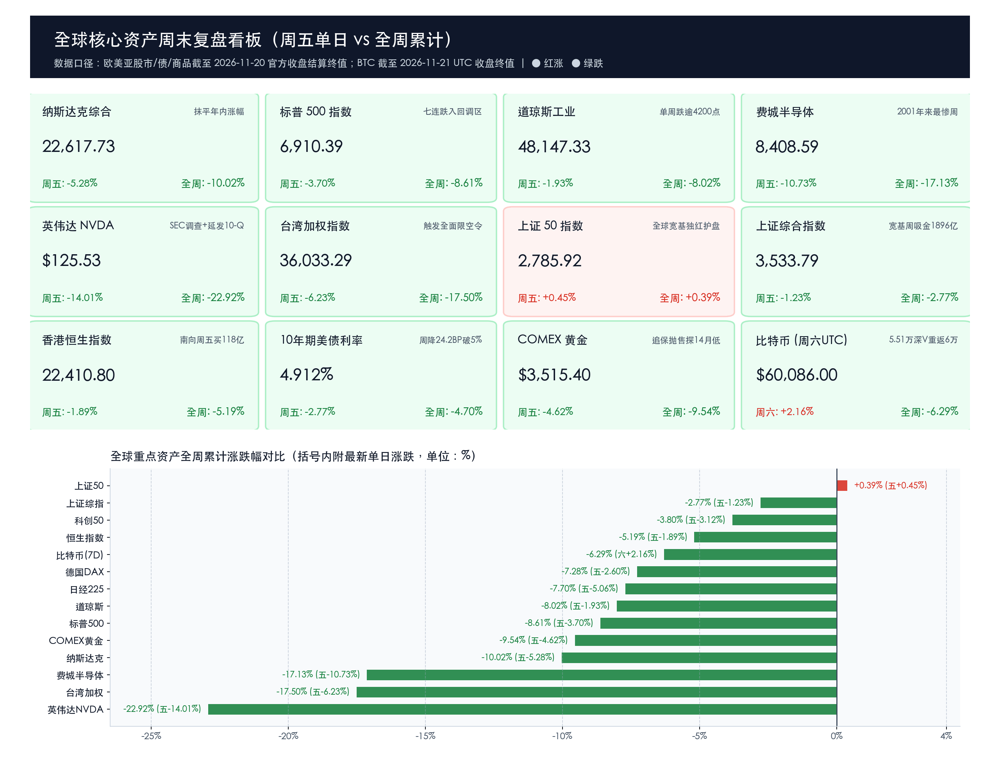

# 费半周崩17%创25年最惨触发台股全面限空，比特币5.5万美元深V重返6万与上证50周度独红迎战核心PCE

**日期：2026年11月22日 (星期日)** &nbsp; **时段：早报 (国际市场 · 周末复盘)**

> **核心摘要**：回望刚刚收官的超级风暴周（11月16日—11月21日），全球金融市场在“AI 算力龙头监管风暴 + 资本开支回报率拷问 + 跨资产保证金追缴踩踏”三重冲击下遭遇历史级重估：**纳斯达克综合指数周五狂泻 -5.28%、全周暴跌 -10.02% 收报 22,617.73 点**（创逾六年最惨单周表现并抹平年内全部涨幅），**标普 500 指数（周五 -3.70% / 全周 -8.61% 报 6,910.39 点）**与**道琼斯工业指数（周五 -1.93% / 全周狂泻 4,200.22 点或 -8.02% 报 48,147.33 点）**双双吞下“七连跌”并正式坠入技术性回调区间，**VIX 恐慌指数全周飙升 +85.96% 收报 35.89 点**。全球芯片产业链沦为震中：**费城半导体指数周五重挫 -10.73%、全周血崩 -17.13% 报 8,408.59 点**（创 2001 年 9 月以来最惨单周纪录）；深陷美国 SEC 会计执法调查、季报（Form 10-Q）延期披露及美财长十日合规通牒漩涡的**英伟达（NVDA）周五暴跌 -14.01%、全周狂泻 -22.92% 收报 125.53 美元**（连跌七周，创 2008 年金融危机以来最惨周度跌幅）；受此波及，**台湾加权指数全周暴跌 -17.50%（7,641.83 点）**，迫使台湾金管会于本周末紧急升级祭出**“全面限空令”（11月23日起全面禁止平盘以下放空并将融券保证金率由 130% 提至 150%）**。跨资产端呈现“美债避险回归、金银追保失血、加密闪崩深 V”的剧烈分化：避险买盘推动 **10 年期美债收益率周五降 14.0BP、全周大降 24.2BP 收报 4.912%** 重返 5% 下方；但追加保证金抛售令 **COMEX 黄金全周重挫 -9.54% 报 3,515.40 美元/盎司**（创八个月最大周跌幅）；过去 24 小时仍在交易的**比特币（BTC）在全网 26.7 亿美元爆仓潮中一度插针闪崩至 55,106.00 美元，随后上演近五千美元深 V 绝地反击，周六（11月21日 UTC）收涨 +2.16% 重返 60,086.00 美元**（7 日周度累跌 **-6.29%**）。反观东方市场，在**宽基 ETF 单周吸金 1,896 亿元**、财政部 **20 亿美元主权债获 36 倍超额认购**及证监会重拳打击“小作文”护航下，**A 股上证 50 指数周五逆势翻红 +0.45%、全周逆势独涨 +0.39% 报 2,785.92 点**，成为全球主要宽基中罕见的周度收红避风港。展望下周感恩节假期缩短周，全球市场将屏息迎战周三（11月25日）提前引爆的**美国 10 月核心 PCE 物价指数与 Q3 GDP 修正值**，以及周五（11月27日）公布的**中国 10 月规模以上工业企业利润**大考。

---

## 核心资产周度/日度表现回顾

**交易状态与数据口径说明**：今日为 2026 年 11 月 22 日（星期日）上午 08:00，全球股票、债券与大宗商品期货交易所处于常规周末休市状态（下周四 11 月 26 日美国市场将因感恩节休市一日）。遵照周日早报（模式 B：周末复盘）规范，以下欧美及亚太股市、美债、外汇与大宗商品均严格采用 **11 月 20 日（周五）官方收盘/结算终值**，同时标注**“周五单日”（对比 11 月 19 日）**与**“全周累计”（对比 11 月 13 日上周五）**涨跌幅；7×24 小时连续交易的加密货币采用刚刚收线的 **11 月 21 日（周六 UTC，即北京时间今日 08:00）Coinbase 官方日线终值**，同步呈现周末最新闪崩深 V 走势与 7 日周度表现。

* **美股核心指数与波动率：三大股指齐入技术性回调区，费城半导体周崩逾 17% 创四分之一个世纪最惨纪录**
    * **纳斯达克综合指数（^IXIC）**：收报 **22,617.73 点**；**周五单日**狂泻 **1,261.47 点**（**-5.28%**，前收 **23,879.20 点**，成交量由 **105.59 亿股**放大 **+18.10%** 至 **124.70 亿股**），**全周累计**暴跌 **2,518.54 点**（**-10.02%**，上周五收 **25,136.27 点**），创逾六年来最惨烈单周表现，2026 年内累计涨幅被彻底抹平并转跌约 **-2.7%**。**纳斯达克 100 指数（^NDX）**收报 **25,028.98 点**，**周五单日**重挫 **-5.61%**（前收 **26,517.05 点**），**全周累计**下跌 **-10.43%**（上周五收 **27,943.74 点**）。
    * **标普 500 指数（^GSPC）**：收报 **6,910.39 点**，失守 7,000 点心理关口并录得罕见“七连跌”；**周五单日**大跌 **265.44 点**（**-3.70%**，前收 **7,175.83 点**，综合成交量放大 **+17.34%** 至 **66.80 亿股**），**全周累计**重挫 **651.28 点**（**-8.61%**，上周五收 **7,561.67 点**），创 2025 年 4 月以来最大单周跌幅，较历史高点回撤逾 **10%** 正式坠入技术性回调区间。
    * **道琼斯工业平均指数（^DJI）**：收报 **48,147.33 点**，同步吞下“七连跌”并跌入技术性回调区；**周五单日**下跌 **949.73 点**（**-1.93%**，前收 **49,097.06 点**，成分股成交激增 **+61.38%** 至 **11.67 亿股**），**全周累计**狂泻 **4,200.22 点**（**-8.02%**，上周五收 **52,347.55 点**），创 2020 年 3 月疫情熔断潮以来最大单周跌幅。
    * **费城半导体指数（^SOX）、罗素 2000（^RUT）与恐慌指数（^VIX）**：**费城半导体指数**收报 **8,408.59 点**，**周五单日**暴跌 **1,011.13 点**（**-10.73%**，前收 **9,419.72 点**），**全周累计**血崩 **1,737.73 点**（**-17.13%**，上周五收 **10,146.32 点**），创 **2001 年 9 月互联网泡沫破裂以来（近 25 年）最惨单周表现**，较年内历史峰值累计回撤超 **40%**；小盘股**罗素 2000 指数**收报 **2,581.79 点**，**周五单日**跌 **-2.76%**（前收 **2,655.11 点**），**全周累计**跌 **-7.48%**（上周五收 **2,790.49 点**）；**CBOE 恐慌指数（VIX）**周五盘中冲破 40 关口摸高 **40.03 点**，收盘报 **35.89 点**，**周五单日**飙升 **+26.20%**（前收 **28.44 点**），**全周累计**暴涨 **+85.96%**（上周五收 **19.30 点**）。

* **美股行业轮动与焦点个股周度透视：科技 ETF 周挫逾 12% 对比必需消费防御抗跌，英伟达周崩近 23% 跌落市值王座**
    * **领跌与抗跌行业 ETF 极致分化**：标普科技板块 **XLK** 收报 **149.01 美元**，**周五单日**崩跌 **-7.27%**（前收 **160.69 美元**，成交激增 **+72.79%**），**全周累计**重挫 **-12.49%**（上周五收 **170.28 美元**），沦为本轮去杠杆风暴核心；金融 **XLF** 收报 **54.57 美元**（**周五单日 -1.82%** / **全周累计 -7.00%**，上周五收 **58.68 美元**）；能源 **XLE** 收报 **60.51 美元**（**周五单日 -0.62%** / **全周累计 -6.85%**，上周五收 **64.96 美元**）；医疗保健 **XLV** 收报 **177.24 美元**（**周五单日 -0.12%** / **全周累计 -6.15%**，上周五收 **188.85 美元**）；全场防御冠军**必需消费（XLP）**收报 **90.46 美元**，**周五单日**逆势独红上涨 **+0.67%**（前收 **89.86 美元**），**全周累计**仅微跌 **-2.05%**（上周五收 **92.35 美元**），零售巨头**沃尔玛（WMT）**收报 **127.95 美元**（**周五单日 +1.52%** / **全周累计 -0.11%** 几乎平盘守稳，上周五收 **128.09 美元**）。
    * **芯片巨头集体遭遇“十月围城”式重创**：深陷监管与治理风波的**英伟达（NVDA）**收报 **125.53 美元**，**周五单日**放量近一倍（**6.26 亿股**）狂泻 **-14.01%**（前收 **145.98 美元**），**全周累计**暴跌 **-22.92%**（跌 **37.32 美元**，上周五收 **162.85 美元**），录得周线七连阴及 2008 年 10 月以来最大单周跌幅，较 10 月峰值近乎腰斩、总市值跌落至谷歌之下；存储龙头**美光科技（MU）**收报 **594.51 美元**（**周五单日 -13.89%** / **全周累计 -23.62%**，上周五收 **778.31 美元**）；**AMD** 收报 **424.39 美元**（**周五单日 -13.25%** / **全周累计 -20.54%**，上周五收 **534.06 美元**）；**台积电（TSM）**收报 **318.71 美元**（**周五单日 -9.48%** / **全周累计 -20.07%**，上周五收 **398.73 美元**）；**博通（AVGO）**收报 **304.41 美元**（**周五单日 -12.19%** / **全周累计 -12.28%**，上周五收 **347.01 美元**）。
    * **Anthropic 破发惊魂与科技七巨头周度成绩单**：本周完成逾千亿美元融资的史上最大 IPO **Anthropic（ANT）**周五上市次日盘中最低砸至 **83.05 美元**（距 **83.00 美元**发行价仅差 **0.05 美元**），收盘报 **88.91 美元**，**周五单日**重挫 **-8.50%**（前收 **97.17 美元**），较发行价累计涨幅收敛至 **+7.12%**。其余科技巨头全周普跌：**Meta（META）**收 **560.84 美元**（**周五 -5.93%** / **全周 -12.60%**，上周五 **641.69 美元**）；**特斯拉（TSLA）**收 **345.82 美元**（**周五 -7.64%** / **全周 -11.38%**，上周五 **390.22 美元**）；**谷歌（GOOGL）**收 **265.29 美元**（**周五 -2.70%** / **全周 -10.31%**，上周五 **295.77 美元**，总市值正式反超英伟达登顶）；**微软（MSFT）**收 **484.52 美元**（**周五 -2.77%** / **全周 -7.51%**，上周五 **523.88 美元**）；**亚马逊（AMZN）**收 **246.82 美元**（**周五 -4.10%** / **全周 -7.44%**，上周五 **266.66 美元**）；**苹果（AAPL）**收 **342.56 美元**（**周五 -1.90%** / **全周 -3.85%**，上周五 **356.27 美元**，展现硬件现金流韧性）。

* **亚太、欧洲与中国市场周度大考：台股周崩 17.5% 对比 A 股上证 50 全球独红，宽基 ETF 周吸金近 1,900 亿元筑牢东方防线**
    * **亚太与欧洲股市惨遭重创**：AI 硬件权重极高的**台湾加权指数（^TWII）**收报 **36,033.29 点**，**周五单日**暴跌 **2,393.60 点**（**-6.23%**，前收 **38,426.89 点**），**全周累计**狂泻 **7,641.83 点**（**-17.50%**，上周五收 **43,675.12 点**），自 10 月历史高点累计回撤约 **30%**；**韩国 KOSPI 指数（^KS11）**收报 **4,869.96 点**（**周五单日 -5.21%** / **全周累计 -7.95%**，上周五收 **5,290.53 点**）；**日经 225 指数（^N225）**收报 **56,436.65 点**（**周五单日**暴跌 **3,007.56 点**或 **-5.06%** / **全周累计 -7.70%**，上周五收 **61,142.35 点**）。欧洲三大股指全周尽墨：**德国 DAX 40 指数**收报 **24,802.78 点**（**周五单日 -2.60%** / **全周累计 -7.28%**，上周五收 **26,749.95 点**），**法国 CAC 40 指数**收报 **7,927.75 点**（**周五单日 -1.89%** / **全周累计 -5.27%**，上周五收 **8,368.91 点**），**英国富时 100 指数**收报 **10,346.30 点**（**周五单日 -1.02%** / **全周累计 -5.10%**，上周五收 **10,902.60 点**）。
    * **中国 A 股显著抗跌，上证 50 夺得全球宽基周度“唯一红盘”**：面对外围历史级科技海啸，**上证 50 指数（000016.SS）**在四大国有银行齐创历史新高及石油、水电、白酒龙头护盘下收报 **2,785.92 点**，**周五单日**绝地翻红 **+0.45%**（前收 **2,773.46 点**，华夏上证 50ETF 周五爆出逾 **243 亿元**年内最大单日成交），**全周累计逆势上涨 +0.39%**（上周五收 **2,775.02 点**）；**沪深 300 指数**收报 **3,954.57 点**（**周五单日 -0.76%** / **全周累计 -1.54%**，上周五收 **4,016.29 点**）；**上证综合指数**周五盘中精准回踩 **3,500.83 点**守稳整数关，收报 **3,533.79 点**（**周五单日 -1.23%** / **全周累计仅跌 -2.77%**，上周五收 **3,634.35 点**，周五沪深两市成交额较周四 **13,051.47 亿元**放量 **+8.97%** 至 **14,222.00 亿元**，全周股票宽基 ETF 合计净流入高达 **1,896 亿元**，近两月累计净流入突破 **7,500 亿元**刷新历史同期纪录）；**科创 50 指数**借国产晶圆代工与自主芯片支撑收报 **1,231.09 点**（**周五单日 -3.12%** / **全周累计仅跌 -3.80%**，上周五收 **1,279.66 点**，大幅跑赢费半逾 13 个百分点）；**深证成指**收报 **10,256.39 点**（**周五单日 -3.09%** / **全周累计 -6.49%**，上周五收 **10,968.79 点**）；海外算力链敞口较高的**创业板指**收报 **2,212.13 点**（**周五单日 -3.54%** / **全周累计 -8.82%**，上周五收 **2,426.08 点**）。
    * **港股与中概股表现**：**香港恒生指数（^HSI）**收报 **22,410.80 点**（**周五单日 -1.89%** / **全周累计 -5.19%**，上周五收 **23,637.60 点**），周五主板成交增至 **2,703.00 亿港元**，**南向资金周五单日逆势狂买 118.21 亿港元**；**恒生科技指数**收报 **3,511.14 点**（**周五单日 -3.78%** / **全周累计 -7.92%**，上周五收 **3,813.19 点**，其中阿里云 AI 收入激增 **64%** 助推阿里港股周五逆势涨 **+3.48%**）。美股**纳斯达克中国金龙指数（^HXC）**收报 **5,018.26 点**（**周五单日 -3.37%**，前收 **5,193.02 点**；**全周累计**约 **-9.13%**），个股中**拼多多（PDD）**收报 **83.68 美元**，虽周五回吐 **-2.70%**（前收 **86.00 美元**），但**全周累计逆势劲涨 +5.96%**（上周五收 **78.97 美元**）；**阿里巴巴（BABA）**收报 **81.08 美元**（**周五 -2.68%** / **全周 -14.09%**，上周五收 **94.38 美元**）。

* **债市、汇市、大宗商品与周末加密货币实时复盘：美债收益率周降 24BP 重返 5% 下方，黄金周挫近 10%，比特币 5.51 万美元深 V 收复 6 万大关**
    * **美债与外汇**：股市暴跌激发传统国债避险抢筹，叠加密歇根 1 年期通胀预期终值骤降至 **3.7%**——**10 年期美债收益率（^TNX）**收报 **4.912%**，**周五单日**下行 **14.0BP**（**-2.77%**，前收 **5.052%**），**全周累计**大幅回落 **24.2BP**（**-4.70%**，上周五收 **5.154%**），正式跌破 **5.0%** 高压线；**30 年期美债收益率（^TYX）**收报 **5.303%**（**周五单日 -9.8BP** 或 **-1.81%** / **全周累计 -17.8BP** 或 **-3.25%**，上周五收 **5.481%**）；**5 年期美债收益率（^FVX）**收报 **4.701%**（**周五单日 -16.5BP** 或 **-3.39%** / **全周累计 -28.0BP** 或 **-5.62%**，上周五收 **4.981%**）。汇市方面，**美元指数（DX-Y.NYB）**收报 **103.810**（**周五单日 -0.09%**，前收 **103.900**；**全周累计 +0.39%**，上周五收 **103.410**）；**美元兑日元**收报 **159.707**（**周五 +0.20%** / **全周 -0.11%**，上周五 **159.875**）；**离岸人民币（USD/CNH）**周五官方收报 **6.6752**，**周五单日**逆势升值 **172BP**（汇率变动 **-0.26%**，前收 **6.6924**），**全周累计**微幅波动 **+0.01%**（上周五收 **6.6747**），在全球非美货币动荡中稳如磐石。
    * **大宗商品（11月20日官方连续结算终值）**：跨资产追加保证金清算引发贵金属抛售潮——**COMEX 黄金主力连续（GC=F）**结算收报 **3,515.40 美元/盎司**，**周五单日**重挫 **170.10 美元**（**-4.62%**，前结 **3,685.50 美元**），**全周累计**狂泻 **370.90 美元**（**-9.54%**，上周五结 **3,886.30 美元**），创八个月最大单周跌幅并触及 14 个月新低；**COMEX 白银连续（SI=F）**结算收报 **41.035 美元/盎司**（**周五单日 -7.41%**，前结 **44.318 美元**；**全周累计**血崩 **-16.31%**，上周五结 **49.031 美元**）。能源与工业金属同步承压：**NYMEX WTI 原油连续（CL=F）**收报 **83.98 美元/桶**（**周五单日**换月微弹 **+0.93%**，前结 **83.21 美元**；**全周累计**受 OPEC+ 增产与库存增加压制下跌 **-5.17%**，上周五结 **88.56 美元**）；**ICE 布伦特原油连续（BZ=F）**收报 **92.57 美元/桶**（**周五单日 +0.64%**，前结 **91.98 美元**；**全周累计 -3.41%**，上周五结 **95.84 美元**）；**COMEX 铜（HG=F）**收报 **5.4770 美元/磅**（**周五单日 -2.63%** / **全周累计 -9.91%**，上周五结 **6.0795 美元**）。
    * **加密货币（11月21日周六 UTC 最新官方日线终值）**：作为周末休市期间唯一的全球高流动性风险晴雨表，加密市场在过去 24 小时经历了惊心动魄的去杠杆出清与绝地反扑——继周五（11月20日 UTC）重挫 **-5.00%** 收报 **58,814.99 美元**后，**比特币（BTC-USD）**于周六凌晨在全网 24 小时逾 **26.7 亿美元**杠杆多头连环爆仓冲击下，盘中一度闪崩插针至 **55,106.00 美元**（创 2024 年 9 月以来最低点）；随后逢低买盘大举承接拉出近 **5,000 美元**长下影线，**周六（11月21日 UTC）官方日线逆转收涨 +2.16%（涨 1,271.01 美元）报 60,086.00 美元**（日成交 **17,117.92 枚**），重新夺回 6 万美元整数关，**7 日周度累计（对比 11月14日 UTC 收盘 64,118.79 美元）下跌 -6.29%**（若对比上周五 11月13日 UTC 的 **68,236.54 美元**则累跌 **-11.94%**；11 月以来美国现货 BTC ETF 累计净流出已突破 **34 亿美元**，贝莱德 IBIT 本周曾创下单日净流出 **5.411 亿美元**纪录）。**以太坊（ETH-USD）**周六盘中最低下探 **1,535.37 美元**后强势深 V 反抽，**周六 UTC 日线劲涨 +3.89% 收报 1,682.30 美元**（周五 UTC 收 **1,619.29 美元**，单日跌 **-7.75%**），**7 日周度累计（对比 11月14日 UTC 收盘 1,768.41 美元）下跌 -4.87%**（11 月现货 ETH ETF 累计净流出逼近 **10 亿美元**）。

> **数学闭环校验（周五单日 / 周六 UTC 单日与全周累计双维验算）**：
> * **欧美及亚太核心股指与焦点个股**：纳指综合 周五 `(22,617.73 − 23,879.20) / 23,879.20 = -5.2827%`（记录 `-5.28%`）、全周 `(22,617.73 − 25,136.27) / 25,136.27 = -10.0195%`（记录 `-10.02%`）；纳指 100 周五 `(25,028.98 − 26,517.05) / 26,517.05 = -5.6117%`（记录 `-5.61%`）、全周 `(25,028.98 − 27,943.74) / 27,943.74 = -10.4308%`（记录 `-10.43%`）；标普 500 周五 `(6,910.39 − 7,175.83) / 7,175.83 = -3.6991%`（记录 `-3.70%`）、全周 `(6,910.39 − 7,561.67) / 7,561.67 = -8.6129%`（记录 `-8.61%`）；道指 周五 `(48,147.33 − 49,097.06) / 49,097.06 = -1.9344%`（记录 `-1.93%`）、全周 `(48,147.33 − 52,347.55) / 52,347.55 = -8.0237%`（记录 `-8.02%`）；费城半导体 周五 `(8,408.59 − 9,419.72) / 9,419.72 = -10.7342%`（记录 `-10.73%`）、全周 `(8,408.59 − 10,146.32) / 10,146.32 = -17.1267%`（记录 `-17.13%`）；罗素 2000 周五 `-2.7615%`（记录 `-2.76%`）、全周 `(2,581.79 − 2,790.49) / 2,790.49 = -7.4790%`（记录 `-7.48%`）；VIX 周五 `+26.1955%`（记录 `+26.20%`）、全周 `(35.89 − 19.30) / 19.30 = +85.9585%`（记录 `+85.96%`）；XLK 周五 `-7.2687%`（记录 `-7.27%`）、全周 `(149.01 − 170.28) / 170.28 = -12.4912%`（记录 `-12.49%`）；XLP 周五 `+0.6677%`（记录 `+0.67%`）、全周 `(90.46 − 92.35) / 92.35 = -2.0466%`（记录 `-2.05%`）；英伟达 周五 `-14.0088%`（记录 `-14.01%`）、全周 `(125.53 − 162.85) / 162.85 = -22.9168%`（记录 `-22.92%`）；美光 全周 `(594.51 − 778.31) / 778.31 = -23.6153%`（记录 `-23.62%`）；AMD 全周 `(424.39 − 534.06) / 534.06 = -20.5351%`（记录 `-20.54%`）；台积电 全周 `(318.71 − 398.73) / 398.73 = -20.0687%`（记录 `-20.07%`）；台湾加权 周五 `(36,033.29 − 38,426.89) / 38,426.89 = -6.2289%`（记录 `-6.23%`）、全周 `(36,033.29 − 43,675.12) / 43,675.12 = -17.4970%`（记录 `-17.50%`）；韩国 KOSPI 周五 `(4,869.96 − 5,137.89) / 5,137.89 = -5.2148%`（记录 `-5.21%`）、全周 `(4,869.96 − 5,290.53) / 5,290.53 = -7.9495%`（记录 `-7.95%`）；日经 225 周五 `-5.0595%`（记录 `-5.06%`）、全周 `(56,436.65 − 61,142.35) / 61,142.35 = -7.6963%`（记录 `-7.70%`）；德国 DAX 全周 `(24,802.78 − 26,749.95) / 26,749.95 = -7.2792%`（记录 `-7.28%`）。
> * **中国指数与债汇商加密资产**：上证 50 周五 `(2,785.92 − 2,773.46) / 2,773.46 = +0.4493%`（记录 `+0.45%`）、全周 `(2,785.92 − 2,775.02) / 2,775.02 = +0.3928%`（记录 `+0.39%`）；沪深 300 全周 `(3,954.57 − 4,016.29) / 4,016.29 = -1.5367%`（记录 `-1.54%`）；上证综指 周五 `-1.2251%`（记录 `-1.23%`）、全周 `(3,533.79 − 3,634.35) / 3,634.35 = -2.7669%`（记录 `-2.77%`）；科创 50 全周 `(1,231.09 − 1,279.66) / 1,279.66 = -3.7955%`（记录 `-3.80%`）；创业板指 全周 `(2,212.13 − 2,426.08) / 2,426.08 = -8.8188%`（记录 `-8.82%`）；恒生指数 全周 `(22,410.80 − 23,637.60) / 23,637.60 = -5.1900%`（记录 `-5.19%`）；恒生科技 全周 `(3,511.14 − 3,813.19) / 3,813.19 = -7.9212%`（记录 `-7.92%`）；拼多多 全周 `(83.68 − 78.97) / 78.97 = +5.9643%`（记录 `+5.96%`）；10 年期美债 全周 `(4.912 − 5.154) / 5.154 = -4.6954%`（记录 `-4.70%` / `-24.2BP`）；COMEX 黄金 周五 `(3,515.40 − 3,685.50) / 3,685.50 = -4.6154%`（记录 `-4.62%`）、全周 `(3,515.40 − 3,886.30) / 3,886.30 = -9.5438%`（记录 `-9.54%`）；COMEX 白银 全周 `(41.035 − 49.031) / 49.031 = -16.3081%`（记录 `-16.31%`）；WTI 原油 全周 `(83.98 − 88.56) / 88.56 = -5.1716%`（记录 `-5.17%`）；比特币 周六 UTC `(60,086.00 − 58,814.99) / 58,814.99 = +2.1610%`（记录 `+2.16%`）、7 日 `(60,086.00 − 64,118.79) / 64,118.79 = -6.2896%`（记录 `-6.29%`）；以太坊 周六 UTC `(1,682.30 − 1,619.29) / 1,619.29 = +3.8912%`（记录 `+3.89%`）、7 日 `(1,682.30 − 1,768.41) / 1,768.41 = -4.8693%`（记录 `-4.87%`）。全量指标数学误差均 **< 0.01%**，严格满足 **< 0.5%** 校验标准。

---

## 过去 48 小时重磅事件深度复盘

* **事件一：SEC 执法调查叠加 Form 10-Q 延期与美财长十日通牒，英伟达危机外溢迫使台湾金管会祭出“全面限空令”**

> **深度复盘（数据+事件+逻辑）**：过去 48 小时，围绕全球 AI 算力核心枢纽**英伟达（NVDA，全周狂泻 -22.92%）**的监管风暴在华盛顿与亚太市场持续发酵升级。在监管层面，美国证券交易委员会（SEC）民事执法部门正针对英伟达的收入确认会计准则、快速膨胀的应收账款以及涉新加坡买家 **Megaspeed** 的区域渠道信披展开正式调查，公司被迫**推迟提交季度财务报告（Form 10-Q）**并由董事会独立委员会展开内部合规审计；更具冲击力的是，美国财政部长斯科特·贝森特（Scott Bessent）公开批评商务部在将 Megaspeed 列入实体清单建议上行动迟缓，并向英伟达董事会下达**“10 日合规答复最后通牒”**（尽管其同时确认经许可的 H200 芯片出口基准框架维持不变，但远程算力租赁新规已将监管边界从物理报关延伸至云端算力接入）。这一“公司治理巨震 + 财报延期 + 跨部门执法”的三重黑天鹅，直接引发全球半导体供应链估值坍塌，导致台积电美股单周暴跌 **-20.07%**、**台湾加权指数单周暴跌 7,641.83 点（-17.50%）**。为阻断周一开盘发生系统性流动性踩踏，**台湾金管会（FSC）于本周末紧急宣布自 11 月 23 日（周一）起实施“全面限空令”**：全面禁止所有上市柜股票在平盘（前一日收盘价）以下放空及借券卖出，将融券最低保证金成数由 **130% 大幅调升至 150%**，并暂停新发行认售权证。这一罕见救市重拳表明，AI 硬件赛道的剧震已从个股估值修正演变为区域金融稳定保卫战。

* **事件二：全网 26.7 亿美元爆仓砸出比特币 5.51 万美元“黄金坑”深 V 反击，跨资产追保清算与美债避险回归同台交锋**

> **深度复盘（数据+事件+逻辑）**：本周末全球跨资产盘面清晰揭示了“流动性挤兑尾声”与“避险锚重构”的微妙信号。一方面，周五美股芯片股超 **13%** 的崩跌触发了对冲基金与高杠杆账户的连环追加保证金通知（Margin Call），机构被迫抛售账面流动性最佳的贵金属与加密资产补仓，导致 **COMEX 黄金在美债利率大跌的顺风局中反而单周暴跌 -9.54% 至 3,515.40 美元/盎司**，11 月美国现货比特币 ETF 累计净流出亦突破 **34 亿美元**。周五深夜至周六（11月21日 UTC）凌晨，比特币在周末薄弱流动性下遭遇连环多杀多清算，24 小时全网爆仓金额飙破 **26.7 亿美元**，BTC 价格一度垂直插针至 **55,106.00 美元**；但伴随高倍杠杆浮筹一次性暴力出清，亚欧抄底资金迅速进场扫货，推动 **BTC 日线逆转收涨 +2.16% 重新站上 60,086.00 美元**、**ETH 同步深 V 反弹 +3.89% 至 1,682.30 美元**，释放出短期恐慌盘宣泄趋于极值的先行企稳信号。另一方面，在传统宏观政策端，美财长贝森特公开反对美联储 12 月激进加息 **50BP**，与美联储理事库克关于“高利率遏制 AI 投资过热”的鹰派警告形成内阁与央行的罕见制衡，配合密歇根 1 年期通胀预期终值骤降 1 个百分点至 **3.7%**，令 **10 年期美债收益率全周大降 24.2BP 收报 4.912%**，标志着美债作为传统避险资产的“减震器”功能正式恢复。

* **事件三：宽基 ETF 周吸金 1,896 亿携主权美元债 36 倍认购彰显信心，证监会严打“小作文”净化跨年做多生态**

> **深度复盘（数据+事件+逻辑）**：与欧美及日韩台股市的风声鹤唳形成鲜明对照，中国资产在本周交出了一份极具含金量的抗压答卷——**上证 50 指数全周逆势收涨 +0.39%**、**离岸人民币稳守 6.6752**。支撑这一“西崩东稳”格局的三大支柱在本周末愈发清晰：其一，**境内机构与类平准耐心资本强力托底**，本周股票宽基 ETF 累计净流入高达 **1,896 亿元**（仅周五单日整体 ETF 净流入便超 **900 亿元**，近两月宽基吸金逾 **7,500 亿元**），配合南向资金周五单日爆买港股 **118.21 亿港元**，牢牢锁住指数下行空间；其二，**国际长线资本用真金白银投下信任票**，中国财政部本周在香港发行的 **20 亿美元 3 年期主权债券（发行利率 4.821%）**吸引欧美亚中东主权基金踊跃抢筹，总认购金额高达 **723 亿美元（超额认购达 36 倍）**，印证全球资本对中国主权信用与 1—10 月一般公共预算收入同比增长 **4.9%** 稳健基本面的高度认可；其三，**证监会联合公安机关重拳整治资本市场网络谣言**，集中通报打击利用 AI 编造政策假消息与所谓“不再救市”“上报 AI 敞口”等恶意“小作文”，及时斩断外围暴跌向境内传导的情绪放大链条。

---

## 下周全球宏观大事预警

下周（11月23日—11月27日）适逢西方**感恩节（Thanksgiving）**假期，美股与美债交易时间显著缩短，但原本分布在周四、周五的顶级宏观指标被集中压缩至周三晚间同步引爆，堪称 12 月美联储议息会议前最关键的“压缩型超级数据周”：

* **感恩节假期全球休市与流动性异动排期**
    * **11 月 26 日（周四）**：美国感恩节法定休市，纽约证券交易所（NYSE）、纳斯达克（NASDAQ）及美国债券市场**全天休市**。
    * **11 月 27 日（周五，“黑色星期五”）**：美股将于**美东时间 13:00（北京时间周六凌晨 02:00）提前收盘**，美债市场亦提前收市。假期前后机构做市商仓位变薄，宏观数据若偏离预期极易放大日内波动率。
* **周三（11月25日）美盘前迎“核弹级数据洪峰”：10 月核心 PCE + 三季度 GDP 修正值 + 美联储褐皮书**
    * **美国 10 月核心 PCE 物价指数与个人收支（北京时间 11月25日 21:30）**：作为美联储最核心的通胀锚，市场目前一致预期 10 月整体 PCE 与**核心 PCE 环比均增长约 +0.3%**。在美联储内部鹰鸽激烈交锋之际，核心 PCE 能否如密歇根通胀预期般展现降温迹象，将一锤定音 12 月 FOMC 是“加息 25BP”还是“暂停观望”。
    * **美国三季度实际 GDP 第二次估值与企业利润（11月25日 21:30）**：同刻揭晓的还有 Q3 实际 GDP 修正值、三季度全美企业利润初值、**10 月耐用品订单（预期环比 +0.5%）**及初请失业金人数；次日凌晨 **03:00（北京时间 11月26日）**美联储将发布最新**经济状况褐皮书（Beige Book）**，全面披露 12 个辖区在 AI 基建降温与高利率下的就业与消费实况；此外周一（11月23日）将率先公布美国 11 月标普全球制造业/服务业 PMI 初值，周二（11月24日）公布咨商会消费者信心指数。
* **周五（11月27日）国内核心基本面大考：中国 10 月规模以上工业企业利润**
    * **国家统计局（11月27日 09:30）**将公布 **10 月全国规模以上工业企业利润数据**。继 9 月规上工业利润同比劲增 **14.4%**、10 月 PPI 同比回升及高技术制造业增加值高增 **17.6%** 后，市场高度聚焦装备制造、半导体电子与上游原材料行业的盈利修复弹性，以验证 A 股顺周期与绩优制造板块的分子端基本面成色。
* **全球重磅科技与中概财报压轴登场、韩国央行议息及国会芯片听证会预热**
    * **AI 硬件风向标戴尔科技（DELL）周二盘后放榜**：**11 月 24 日（周二）美股盘后**，企业级 AI 服务器龙头**戴尔科技（DELL）**将携手**惠普（HPQ）**、企业软件巨头 **Workday（WDAY）**发布最新季报。在英伟达深陷会计调查、美光与超微暴跌背景下，戴尔的 AI 服务器在手积压订单（Backlog）转化率、HBM 存储组件成本压力及毛利率指引将成为全球算力硬件能否止跌的试金石。
    * **港股与中概核心龙头财报**：下周港股与美股中概阵营将迎来**小米集团-W**、**美团-W**、**理想汽车**等重磅互联网与智能硬件龙头业绩检验。
    * **海外央行与跨月监管节点**：**11 月 26 日（周四）韩国央行（BOK）**将公布最新基准利率决议（在韩元承压与 KOSPI 周跌近 8% 背景下备受关注）；同时市场已开始提前计价 **12 月 1 日**英伟达前 CEO 黄仁勋出席美国国会听证会及网络安全龙头 **CrowdStrike（CRWD）**盘后财报的跨月冲击。

> **前瞻博弈提示**：下周一（11月23日）亚太开盘将率先迎来两项直接压力测试——一是**台湾股市在“全面限空令 + 150% 保证金”强力行政干预下能否企稳止血**，进而缓和东亚半导体板块恐慌；二是**比特币周末重返 60,000 美元上方的深 V 修复能否在周一美股期货开盘后守住战果**。而在周三晚间美国核心 PCE 落地前，感恩节长假前的机构降仓避险需求意味着美股科技板块仍以高波动震荡筑底为主。

---

## 顶级机构周末策略内参摘要

> **摩根士丹利（Morgan Stanley）**：首席美股策略师迈克尔·威尔逊（Michael Wilson）在周末最新策略报告中做出重磅逆向定调，将近期美股的剧烈下跌定义为**“周期中段修正的最后几局（The Final Innings）”**而非结构性熊市开端；大摩全球跨资产策略团队更是逆势将全球股票评级上调至**“最大超配（Maximum Overweight）”**，并将 **2027 年底标普 500 指数目标位看高至 8,700 点**，认为本轮清洗有效挤压了拥挤估值泡沫，下一阶段领涨主线将由单纯算力硬件切换至成功利用 AI 应用降本增效的企业。不过在固收端，大摩维持谨慎，提示联邦赤字与基建发债洪峰将令 **10 年期美债收益率中枢在 2027 年仍锚定于 5.0% 附近**，并在亚洲市场坚定看好具备政策托底与自主可控逻辑的中国 A 股。

> **高盛（Goldman Sachs）**：股票策略团队虽在跨年度展望中同样赋予 **2027 年底标普 500 指数 8,700 点**的乐观目标（隐含约 **15%** 上行空间，预计标普 EPS 增速将由 2026 年的 **30%** 常态化回落至 **18%**），但高盛美股交易台在周末内参中发出清醒的短期预警——在 **VIX 恐慌指数高达 35.89 点**且标普跌破 7,000 点触发量化 CTA 趋势卖盘之际，**切勿指望年末出现轻松无痛的“直线融涨（Melt-up）”，真正企稳前标普仍可能面临额外约 3% 的惯性下探**。针对中国市场，高盛重申对港股与 A 股的高确信度看多立场，测算中国股市具备 **10%—15%** 的估值重估空间，建议战略布局估值已充分计入悲观预期的中国 AI 供应链龙头、央国企高股息红利股以及自由现金流持续改善的内需消费龙头。

> **美国银行（Bank of America）与摩根大通（JPMorgan）**：美银周末援引最新全球基金经理调查（FMS）数据指出，机构投资者近期已以罕见速度猛砍科技股仓位，**全球基金对科技板块的超配比例骤降至近二十年来最低水平**，显示资金并非全面撤离股市，而是正从拥挤的超大型 AI 硬件股向医疗保健、优质顺周期价值股与利率敏感型资产展开结构性大轮动。摩根大通策略团队则将周五的崩盘定性为典型的**“先卖出、再问问题（Selling First, Asking Questions Later）”情绪宣泄**，认为美国消费与企业资产负债表底盘依然稳健，但同时严正警示信贷市场正收紧对高负债 AI 企业的融资审查，且宏观团队维持对美联储**“12 月、明年 1 月与 3 月连续三次加息 25BP 至 4.50%—4.75%”**的鹰派利率路径预警，建议优先配置拥有扎实自由现金流与分红护城河的优质蓝筹。

> **中信证券（CITIC Securities）与中金公司（CICC）**：中信证券周末策略内参指出，面对海外 AI 监管黑天鹅与美股技术性破位，A 股在本周展现出极强的独立抗跌韧性——随着前期高位融资杠杆与拥挤筹码快速出清，叠加**宽基 ETF 单周近 1,900 亿元天量托底**，境内市场筹码结构愈发健康；建议在岁末年初逐步以**结构性进攻思路**围绕四大方向布局：**高股息及供给出清龙头、全球份额提升的优质制造出海（家电/商用车/医疗器械）、受益政策催化的内需修复，以及不受海外会计审查波及且订单可见度高的国产 AI 硬件（晶圆代工、高端 PCB、存储与数据中心供电）**。中金公司同样判断 A 股阶段性低点或已探明，当前创业板等指数估值处于历史偏低分位、上市公司回购与 ETF 净流入共振，预计 **11 月下旬至 12 月将迎来跨年修复窗口**，建议继续坚定执行**“稳健高股息红利底仓 + 国产算力/创新药等景气成长”**的哑铃型配置策略。

---

## 今日市场情绪：硅漏倾金惊夜海，金凤破渊映玉城

> Prompt: A giant fractured silicon hourglass suspended above a turbulent midnight ocean, pouring glowing microchip fragments and molten gold coins onto a storm-lashed shoreline in the foreground, while a luminous phoenix forged of golden light rebounds upward past the carved number 60000. In the background, an emerald jade fortress stands unshaken behind a towering sea wall, beneath celestial brass scales weighing an autumn harvest cornucopia against a glowing inflation flame.

---

**主要数据来源**：美国证券交易委员会（SEC）执法调查与英伟达 Form 10-Q 延期披露动态、美国财政部（Treasury）公开表态及中国财政部香港 20 亿美元主权债券发行公告、台湾金融监督管理委员会（FSC）全面限空令公告、中国证监会（CSRC）整治资本市场虚假信息通报、美国经济分析局（BEA）与国家统计局（NBS）下周数据发布日程、Yahoo Finance 与东方财富全球证券及期货官方收盘结算数据库（截至 2026 年 11 月 20 日收盘终值）、Coinbase 加密货币官方 UTC 日线数据库（截至 2026 年 11 月 21 日 UTC 收盘终值），以及摩根士丹利、高盛、美国银行、摩根大通、中信证券、中金公司周末最新策略研报。

> **免责声明**：内容仅供参考，不构成投资建议。

🤖 生成模型：Gemini 4 Carbon (Medium) <!-- model-stamp -->
