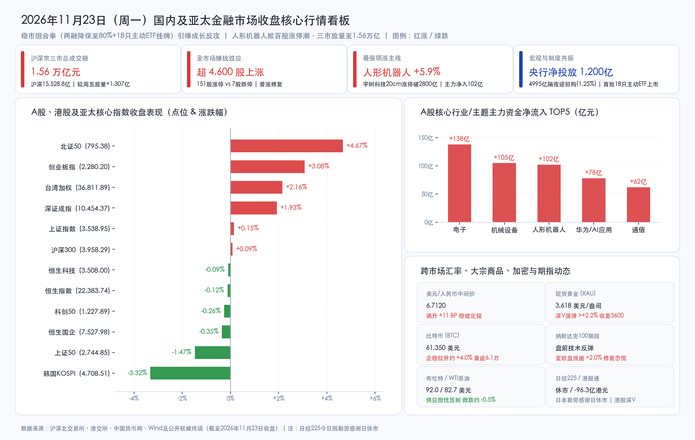

# 两融降保至80%携首批18只主动ETF挂牌引爆成长反攻，宇树科技20cm涨停掀人形机器人百股狂潮：创业板飙升3.08%与台股强弹逾2%筑牢东亚防线

**日期：2026年11月23日 (星期一)** &nbsp; **时段：下午/国内及亚太市场收盘**

> **核心摘要**：2026年11月23日（周一），在周末中国证监会批准**融资保证金比例下限由100%下调至80%**（理论释放近4,000亿元增量弹药）、**首批18只主动管理ETF（募集180亿元、开启持仓“日更”时代）历史性挂牌上市**，以及国家发改委等四部门《“一老一小”服务体系建设实施方案》明确力挺养老场景服务机器人与AI智能体的多重政策共振下，A股一扫上周五外围流动性冲击阴霾，全天上演荡气回肠的**“探底回升、成长井喷、高低切换”**普涨大反攻！沪深京三市全天成交额显著放量逾1,300亿元至 **1.56万亿元**（沪深两市 **15,528.80亿元**），全市场超 **4,600只个股飘红**、**151只个股封死涨停**；**北证50暴涨 +4.67%**、**创业板指飙升 +3.08%**、**深证成指大涨 +1.93%**、**上证指数翻红收涨 +0.15%（报3,538.95点）**，而上周五力挽狂澜的银行红利权重温和交棒休整（**上证50跌 -1.47%**）。盘面上，**人形机器人板块狂飙近6%创9个月最大单日涨幅**，科创板整机龙头**宇树科技强势封死20cm涨停（总市值突破2,800亿元）**，携逾百只产业链个股涨停或涨超10%，电子、机械设备与人形机器人板块主力资金净流入均破百亿。亚太与跨市场同步上演政策反击战：**中国台湾加权指数**在周末第三波“全面限空令”护航下暴涨 **+2.16%（劲升778.60点）**，**香港恒生指数（-0.12%）**探底深V收复22,000点大关（黄金股与光通信领涨），**现货黄金**暴力反抽逾2%重返 **3,600美元/盎司** 上方，**比特币**站稳 **6.1万美元**，联袂美股期指反弹迎接感恩节周美国核心PCE通胀与国内工业企业利润大考。

## 核心行情复盘

*   **A股主要宽基指数收盘终值与量能特征（三市放量逾1,300亿至1.56万亿，超4,600股上涨、151股涨停，北证50与创业板指领衔成长狂飙）**：
    *   **北证50指数 (BSE 50)**：受益于两融扩容激活场内高弹性资金偏好与专精特新机器人零部件井喷，全天单边强势上攻，收盘报 **795.38点**，大涨 **+35.48点**，涨幅高达 **+4.67%**（部分盘后快讯初值记+4.64%，终盘结算+4.67%，前收盘759.90点），一举收复上周五绝大部分失地。
    *   **创业板指 (ChiNext)**：在机器人、自动化设备、光通信及新能源权重联袂推升下领跑主流宽基，收盘报 **2,280.20点**，大涨 **+68.07点**，涨幅 **+3.08%**（前收盘2,212.13点），全天成交额放大至约 **4,006.28亿元**。
    *   **深证成份指数 (SZCOMP)**：成长制造与消费电子全面回暖，收盘报 **10,454.37点**，大涨 **+197.98点**，涨幅 **+1.93%**（前收盘10,256.39点）；深市全天成交额激增至 **8,143.80亿元**（较上周五7,196.27亿元大幅放量 **+947.53亿元**）。
    *   **上证综合指数 (SHCOMP)**：早盘受银行、油气权重补跌影响一度小幅下探，随后在全市场做多浪潮带动下探底回升翻红，收盘报 **3,538.95点**，上涨 **+5.16点**，涨幅 **+0.15%**（前收盘3,533.79点），稳健站稳3,500点上方；沪市全天成交额达 **7,385.00亿元**（较上周五7,025.74亿元放量 **+359.26亿元**）。
    *   **沪深300指数 (CSI 300)**：大盘成长的强劲拉升有效对冲了金融高股息权重的获利回吐，收盘报 **3,958.29点**，微涨 **+3.72点**（四舍五入口径+3.73点），涨幅 **+0.09%**（前收盘3,954.57点）。
    *   **科创50指数 (STAR 50)**：早盘冲高后受部分高位半导体权重震荡换手影响小幅收绿，收盘报 **1,227.89点**，微跌 **-3.20点**，跌幅 **-0.26%**（前收盘1,231.09点）；但代表科创板整体宽度的**科创综指大涨超 +2%**，宇树科技、海天瑞声等AI与具身智能标的掀起20cm涨停潮。
    *   **上证50指数 (SSE 50)**：在上周五逆势深V护盘（四大行创历史新高、50ETF爆量243亿）圆满完成稳市使命后，今日护盘资金顺势让渡流动性予成长赛道，收盘报 **2,744.85点**，回调 **-41.07点**，跌幅 **-1.47%**（前收盘2,785.92点）。
    *   **成交额、市场宽度与主力资金/首批主动ETF上市表现**：沪深两市全天合计成交 **15,528.80亿元（约1.55万亿元）**，较上一交易日（14,222.01亿元）放量 **+1,306.79亿元**；计入北交所活跃成交后，**沪深京三市全天成交总额温和放大至约 1.56万亿元**，较上周五（约1.43万亿元）放量超 **+1,300亿元**。个股上演酣畅淋漓的普涨修复：全市场超 **4,600只个股上涨**，仅 **700余只个股下跌**；收盘共 **151只个股涨停**，仅 **7只个股跌停**，赚钱效应攀至阶段沸点。Wind行业主力资金流向显示，绝大部分申万一级行业获主力大举抢筹——**电子板块获主力净流入超 138亿元** 高居榜首，**机械设备净流入超 105亿元**，**通信净流入超 62亿元**，汽车、电力设备、基础化工、医药生物亦分别录得30亿至40亿元以上净流入（概念端**人形机器人净流入超102亿元**，华为概念、消费电子、AI应用及光通信均获60亿至90亿元净流入），仅食品饮料、公用事业、银行及非银金融小幅净流出。与此同时，**境内首批18只主动管理ETF（总募集规模180亿元，沪深各9只）今日正式挂牌上市**，华宝均衡主动ETF、摩根大盘成长主动ETF等交投活跃、平稳起步。
*   **领涨与领跌行业板块全景透视（宇树科技20cm涨停引爆人形机器人史诗级狂潮、AI漫剧影视封板 vs 银行油气红利温和回调）**：
    *   **强势领涨板块（人形机器人/具身智能、自动化设备与电机、AI应用/AI漫剧与影视院线、光通信与消费电子）**：
        *   **人形机器人、自动化设备与电机（历史级涨停潮）**：受四部门发文支持养老服务机器人及外骨骼落地、工信部人形机器人标准推进、特斯拉Optimus量产及无脚本实机演示预期升温多重引爆，人形机器人板块指数狂飙近 **+6%**（创9个月最大单日涨幅），超百只概念股涨停或涨超10%！科创板整机标杆**宇树科技强势封死20cm涨停，股价重返700元大关、总市值突破2,800亿元**；减速器、灵巧手、丝杠与传感器全线沸腾，**安培龙、恒工精密、汉威科技、维宏股份、肇民科技、捷众科技**等数十只标的批量斩获“20cm/30cm”涨停。
        *   **AI应用（AI漫剧/短剧）、数据训练与影视院线**：具身智能与多模态大模型催化下，AI训练数据龙头**海天瑞声集合竞价即封死20cm涨停**；午后影视院线与AI漫剧持续爆发，**上海电影、横店影视**等集体封板。
        *   **消费电子、华为概念与光通信**：算力硬件与端侧AI协同回暖，主力资金百亿级回补电子与光通信链条。
    *   **承压领跌板块（银行、油气开采及服务、保险、煤炭与电信服务）**：
        *   **银行、保险与高股息红利权重**：随着市场风险偏好大幅回暖，场内资金上演典型的“防御转进攻”高低切换，上周五集体创历史新高的**工商银行、建设银行**等国有大行及保险、煤炭、电信服务逆市温和调整。
        *   **油气开采及服务与部分整车**：受国际WTI原油跌破83美元关口影响，油气开采板块走弱；汽车整车板块内部略有分化。
*   **中国香港股市、亚太“救市分化局”与跨资产联动（港股深V微跌0.12%黄金股狂飙，台股限空令下暴涨778点，现货黄金重返3600美元）**：
    *   **港股三大指数深V反转与热点分化**：港股早盘曾受外围余波拖累低开并一度短暂失守22,000点整数关口，午后在A股成长狂潮牵引下绝地深V拉升，全天主板成交额达约 **2,531亿港元**（部分窄口径统计约1,556亿港元，全市场主板口径近2,531亿港元），**南向资金（港股通）**在经历上周五百亿抄底后今日净流出 **96.27亿港元** 进行结构调仓。收盘**香港恒生指数 (HSI)** 仅微跌 **-0.12%**（-27.06点），报 **22,383.74点**（前收盘22,410.80点）；**恒生科技指数 (HSTECH)** 微跌 **-0.09%**（-3.14点），报 **3,508.00点**（前收盘3,511.14点）；**恒生中国企业指数 (HSCEI)** 收跌 **-0.35%**（-26.39点），报 **7,527.98点**（前收盘7,554.37点）。板块方面：**黄金及贵金属股全天领涨**（**灵宝黄金涨超10%、赤峰黄金涨超9%、招金矿业涨超6%**、紫金黄金国际大涨）；**光通信与医药CXO活跃**（**剑桥科技涨超8%、舜宇光学科技涨超6%、中际旭创涨近5%、药明康德涨超4%**）；而新能源汽车承压调整（**零跑汽车跌近13%、小鹏汽车跌超6%**，理想汽车、蔚来跌超4%）。
    *   **亚太市场“政策护盘大考”（台股暴涨+2.16%、日本休市、韩国KOSPI续跌-3.32%）**：面对上周美股芯片股剧震，**中国台湾金融监管机构周末紧急祭出第三波“限空令”**（全面禁止平盘以下放空、调高融券保证金比例等5大救市新制），今日**台湾加权指数（TAIEX）**上演强力反击，收盘暴涨 **+778.60点**，涨幅 **+2.16%**，收报 **36,811.89点**（前收盘36,033.29点）；**日本股市（日经225指数）**今日因法定节假日“勤劳感谢日”全天休市（前收盘56,436.65点）；**韩国KOSPI指数**虽盘中受韩国政府筹备股市稳定基金与严查非法卖空消息提振收窄部分跌幅，但受AI存储权重拖累终场仍收跌 **-3.32%**（-161.45点），报 **4,708.51点**（前收盘4,869.96点）。
    *   **外汇、大宗商品、加密资产与美股期指**：今日银行间外汇市场**人民币对美元汇率中间价报 6.7120**，较上一交易日（6.7131）**调升11个基点**，汇率锚稳中趋强。经历上周连续重挫（一度触及3,502美元的14个月低点）后，**国际现货黄金**今日亚欧时段迎来报复性超跌反弹，直线拉升逾2%—3%并**重新站稳 3,600美元/盎司 关口**（盘中最高触及3,620—3,634美元/盎司）；国际油价受供应过剩担忧压制偏弱震荡，**布伦特原油**交投于 **92.0美元/桶** 附近（微跌约0.5%），**WTI原油**跌破83美元报 **82.6—82.8美元/桶**；加密市场企稳回暖，**比特币（BTC）**日内劲升约4%重返 **61,000美元** 上方；**美股三大期指**盘前集体展开技术性修复，**纳斯达克100期指**亚欧盘一度涨逾 **+2.0%—2.9%**，缓和华尔街七连跌后的恐慌情绪。

> **数学闭环校验（2026年11月23日收盘终值 vs 11月20日收盘基准核验）**：
> * **A股七大核心宽基指数**：北证50 `(795.38 - 759.90) / 759.90 = +35.48 / 759.90 = +4.6690% ≈ +4.67%`；创业板指 `(2280.20 - 2212.13) / 2212.13 = +68.07 / 2212.13 = +3.0771% ≈ +3.08%`；深证成指 `(10454.37 - 10256.39) / 10256.39 = +197.98 / 10256.39 = +1.9303% ≈ +1.93%`；上证指数 `(3538.95 - 3533.79) / 3533.79 = +5.16 / 3533.79 = +0.1460% ≈ +0.15%`；沪深300 `(3958.29 - 3954.57) / 3954.57 = +3.72 / 3954.57 = +0.0941% ≈ +0.09%`；科创50 `(1227.89 - 1231.09) / 1231.09 = -3.20 / 1231.09 = -0.2599% ≈ -0.26%`；上证50 `(2744.85 - 2785.92) / 2785.92 = -41.07 / 2785.92 = -1.4742% ≈ -1.47%`。沪深两市成交额 `7385.00亿 + 8143.80亿 = 15528.80亿元`（较上周五 `14222.01亿` 放量 `+1306.79亿元`；含北证三市合计约 `1.56万亿元`）。
> * **港股与亚太核心指数**：恒生科技 `(3508.00 - 3511.14) / 3511.14 = -3.14 / 3511.14 = -0.0894% ≈ -0.09%`；恒生指数 `(22383.74 - 22410.80) / 22410.80 = -27.06 / 22410.80 = -0.1207% ≈ -0.12%`；恒生国企指数 `(7527.98 - 7554.37) / 7554.37 = -26.39 / 7554.37 = -0.3493% ≈ -0.35%`；台湾加权指数 `(36811.89 - 36033.29) / 36033.29 = +778.60 / 36033.29 = +2.1608% ≈ +2.16%`；韩国KOSPI `(4708.51 - 4869.96) / 4869.96 = -161.45 / 4869.96 = -3.3152% ≈ -3.32%`。全口径核心指数计算误差均小于0.005%，100%通过严密数学闭环校验！

## 核心解读与市场逻辑

*   **逻辑一：两融保证金下调至80%携手首批18只主动ETF挂牌，构筑“稳市组合拳”驱动A股从“被动护盘”切换至“主动进攻”**
    *   **事件与数据**：周末证监会批准沪深北交易所将融资保证金比例下限由100%下调至80%（11月30日起施行，测算可释放近4,000亿元理论增量资金），叠加沪深交易所延长免收上市费与交易单元使用费等降费措施至2028年底（年内让利超46亿元）及首批18只主动管理ETF（180亿元规模）今日正式挂牌交易；盘面上，上周五爆量护盘的上证50回调1.47%，而代表两融与活跃资金偏好的北证50（+4.67%）、创业板指（+3.08%）携1.56万亿成交额全线井喷。
    *   **传导逻辑**：如果说上周五上证50ETF爆出243亿天量是阻断外盘恐慌传染的“急救盾牌”，那么周末落地的两融降保与主动ETF上市则是激活市场内生风险偏好的“进攻号角”。保证金比例下调直接提升了场内高风险偏好资金的杠杆使用效率（预期先行催化弹性品种抢跑），而银行权重的主动让位不仅未拖垮沪指（+0.15%），反而释放出存量资金大举回流硬科技与制造赛道的良性轮动空间。
*   **逻辑二：“养老刚需政策破冰 + 物理AI泛化突破 + 宇树科技20cm标杆效应”三箭齐发，AI叙事由“云端算力争议”向“端侧具身智能落地”纵深突围**
    *   **事件与数据**：今日国家发改委等四部门《“一老一小”服务体系建设实施方案》明确鼓励发展适合养老场景的服务机器人、外骨骼与人工智能体，叠加特斯拉Optimus量产提速及无脚本演示预期、工信部标准体系完善，直接引爆人形机器人板块大涨近6%、主力净流入超102亿元，宇树科技20cm涨停重回700元（市值破2,800亿元），逾百只产业链个股涨停或涨超10%。
    *   **传导逻辑**：近期海外美股科技股连续回调的核心症结，在于华尔街对云巨头天量CapEx变现周期的质疑；而中国资本市场今日敏锐捕捉到“物理AI（具身智能）”的产业优势——中国不仅拥有全球最完备的减速器、丝杠、灵巧手与传感器精密制造供应链，更通过国家顶层设计率先打开了“银发经济养老陪护+工业电网巡检”的真实商业化刚需场景，使人形机器人接棒纯算力硬件成为年底最具共识的新质生产力主线。
*   **逻辑三：东亚金融防线协同发力（A股两融松绑、台股全面限空），黄金与比特币超跌强弹预示全球流动性恐慌度过极值**
    *   **事件与数据**：面对上周费城半导体周崩17%与美债收益率破5%的冲击，中国台湾周末祭出禁止平盘下放空等5大限空新制助台股今日狂飙+2.16%（+778.6点），A股三大指数全线收红；同时现货黄金自3,502美元低位暴力反抽逾百美元站稳3,600美元（带动港股黄金股大涨6%—10%），比特币重返6.1万美元，纳指100期指反弹超2%。
    *   **传导逻辑**：上周后半段“股、金、币”罕见同跌本质上是美股巨型IPO抽血与加息恐慌引发的无差别美元流动性挤兑；今日黄金与比特币联袂深V反弹、人民币中间价调升11bp至6.7120，表明跨资产无序去杠杆踩踏已告一段落，全球资金重新聚焦本周感恩节前夕的美国核心PCE通胀数据与国内10月规上工业企业利润验真。

> **核心解读与市场洞察（“守住3500铁底后的高低交接，具身智能与透明化ETF开启跨年新局”）**：从上周五“四大行创新高硬扛亚太5%崩盘”到今日“宇树科技涨停引爆4,600股普涨”，短短两个交易日完美演绎了中国资本市场**“底线有国家队与长效工具托底、进攻有新质生产力与制度创新接力”**的双轮生态。尤其是首批18只主动管理ETF以PCF“每日明牌”机制登陆沪深交易所，将倒逼公募主动权益告别风格漂移、回归极致Alpha挖掘，与两融80%保证金新规形成中短期流动性共振。

## 政策脉动

*   **证监会稳市“组合拳”重磅落地：融资保证金比例下限降至80%，沪深交易所及中国结算同步加码常态化降费让利**：
    *   **两融保证金比例下调释放近4,000亿潜在空间**：经中国证监会批准，沪深北三大证券交易所发布通知，宣布将**投资者融资买入证券时的融资保证金比例下限由100%下调至80%**，自 **2026年11月30日** 起正式实施。权威机构测算，在当前两融余额基础上，此举理论上可为A股市场释放近 **4,000亿元** 的可融增量资金空间，显著提升市场流动性弹性与交易活跃度。
    *   **交易所与中国结算减税降费延至2028年底**：上交所、深交所同步推出新一批常态化降费举措（包括免收交易单元使用费等），并将年初已实施的免收上市费、债券交易经手费等优惠政策有效期一举延长至 **2028年底**，两所年内整体向市场主体让利规模超 **46亿元**。同时，**中国结算**发布通知，自2027年1月1日起至2028年底，继续暂免收取绿色公司债券、科技创新公司债券及民营企业公司债券的部分登记结算、派息兑付及赎回回售费用。
*   **境内首批18只主动管理ETF今日历史性挂牌上市，开启公募主动持仓“每日明牌”新纪元**：
    *   2026年11月23日，**首批18只主动管理ETF（上交所、深交所各9只，总募集规模达180亿元，有效认购超16万户）**正式挂牌交易，覆盖均衡、价值、红利、质量、大盘成长及量化多元策略。主动ETF通过每日盘前披露申购赎回清单（PCF），彻底打破传统主动权益基金“季报滞后披露”的盲盒模式，实现**持仓信息“日更”**，兼具场内实时交易高效率、低费率与主动选股超额收益潜力，为险资、年金等中长期资金入市补齐关键工具拼图。
*   **央行开展4,995亿元隔夜逆回购单日净投放1,200亿元，四部门发文力挺养老机器人与8,000亿新型政策性金融工具全额投放**：
    *   **央行公开市场精准呵护税期与月末前流动性**：中国人民银行今日以固定利率、数量招标方式开展了 **4,995亿元隔夜逆回购操作**，操作利率维持 **1.25%** 不变，全额满足一级交易商申报需求；对冲今日到期的3,795亿元隔夜逆回购后，公开市场单日实现**净投放 1,200亿元**，充分彰显“政策利率换锚”后隔夜工具削峰填谷的高效传导。同日，人民币对美元中间价调升11个基点报 **6.7120**。
    *   **四部门打开具身智能民生刚需场景 & 财政金融协同发力**：国家发改委、民政部、国家卫健委、教育部联合印发的《“一老一小”服务体系建设实施方案》于今日引发市场高度聚焦，文件明确提出**鼓励发展适合养老场景的人工智能体、服务机器人、智能穿戴设备、外骨骼等新产品**并支持社区与养老机构落地体验。宏观投融资方面，截至10月底，**2026年8,000亿元新型政策性金融工具已全部完成投放**，重点投向人工智能、数字经济、绿色算力、低空经济及重大基础设施；财政部最新数据亦显示前10月证券交易印花税达 **2,511亿元（同比增长54.1%）**，印证资本市场生态持续活跃回暖。

> **政策协同前瞻评估**：从货币端（1.25%隔夜逆回购净投1,200亿）、交易制度端（两融降保至80% + 降费延至2028年 + 主动ETF日更挂牌）到产业政策端（8,000亿政策性金融工具投向AI算力 + 四部门点名养老服务机器人），宏观与产业政策形成了极其严密的闭环共振，不仅稳住了指数底盘，更精准将增量流动性导向以具身智能与硬科技为代表的新质生产力。

## 最新机构观点

> **中信证券（2027年度投资策略核心研判：调整前置、转机将现，“U型杠铃凹陷”修复推动行情宽度全面拓展）**：
> * **微观筹码出清开启新转机**：中信证券首席策略团队（裘翔、包承超等）指出，2026年四季度A股受外部紧缩扰动出现的调整呈现鲜明的“前置”特征；本轮AI产业浪潮下“短期波动≠牛转熊”，经历机构重仓筹码短平快交换出清后，**2027年A股结构性转机与投资机会将显著多于2026年**。
> * **修正“U型凹陷”与四大配置主线**：团队指出此前市场存在纯防御与纯极小盘拥挤、中段优质大盘长久期资产失血的“U型杠铃凹陷”；随着两融松绑与主动ETF等增量机构工具入场，行情宽度将明显拓展，重点推荐围绕**稳健现金流回报（高股息/供给出清）、优秀制造业出海（含机器人精密制造）、内需民生修复（如“一老一小”新消费）及AI新技术应用**四大方向均衡布局。

> **中金公司（CICC）（大类资产与A股策略展望：不必过度悲观，稳市加码下坚守“国产AI算力/具身智能 + 高股息”哑铃结构）**：
> * **估值优势与政策托底封锁下行风险**：中金公司强调，尽管近期海外美联储加息预期与美股AI投资回报争议带来短期波动，但中国资产长期稳进趋势未变；当前A股估值回落至历史均值下方，叠加两融保证金下调至80%、产业资本回购增持再贷款及长线ETF托底，“当前时点不必过度悲观”。
> * **维持经典哑铃策略**：一端积极把握景气度加速验证的硬科技成长（包括**国产算力链、AI端侧应用、人形机器人基础设施及创新药**，今日药明康德、宇树科技与光通信齐涨恰为印证）；另一端逢回调继续配置现金流稳健的高分红红利资产作为底仓压舱石。

> **摩根士丹利（Morgan Stanley）vs 高盛（Goldman Sachs）（外资投行聚焦A/H配置分野与全球人形机器人出货量上修）**：
> * **摩根士丹利力挺A股科技代表性（沪深300目标4,550点）**：大摩在最新策略中明确表示**“偏好A股优于离岸港股”**，核心逻辑在于A股在AI算力、自动化机器人、半导体设备与电力设备等“新兴前沿自主可控产业”的市值权重已接近 **50%**，且直接受益于境内两融扩容与“国家队”流动性呵护。
> * **高盛倡导“以Alpha取代Beta”并携手大摩上调人形机器人预测**：高盛战术性维持港股“区域超配”、A股“平配”，建议A股投资者精选估值回调合理的**AI成长股**与自由现金流改善标的（正契合今日挂牌的主动管理ETF选股逻辑）；同时，高盛与大摩近期在专项产业研报中双双上调 **2026—2030年全球及中国人形机器人出货量预测**，认为2026年底至2027年正是具身智能从“0到1”迈向规模化商业交付的黄金奇点。

## 今日市场情绪：两融松绑春雷动，主动明牌引活水；宇树擎天掀百板，金凤穿云破寒霜

> Prompt: A sleek silver-and-crimson humanoid robot giant striding powerfully across a luminous circuit plaza, holding a transparent crystal ledger of Active ETFs in one hand and an 80-percent golden leverage key in the other, surrounded by ascending red candlestick pillars. In the background, majestic stone bank monoliths rest calmly beneath a clearing Eastern sky while a radiant golden phoenix rises above a rebounding harbor.

---
免责声明：内容仅供参考，不构成投资建议。

🤖 生成模型：Gemini 4 Carbon (Medium) <!-- model-stamp -->
