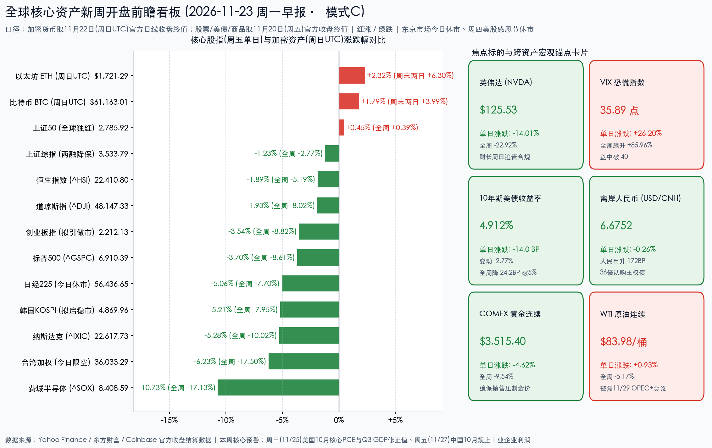

# A股两融降保至80%携台韩救市共筑东亚防线，比特币连弹破6.1万与美股期指回暖迎战感恩节核心PCE

**日期：2026年11月23日 (星期一)** &nbsp; **时段：早报 (国际市场 · 新周展望)**

> **核心摘要**：经历上周全球科技与芯片股“史诗级去杠杆海啸”（纳指全周暴跌 **-10.02%**、费城半导体血崩 **-17.13%**、台股重挫 **-17.50%**）后，过去 48 小时周末窗口迎来密集的**东亚联合稳市重拳与华盛顿政策信号微调**：中国证监会批准沪深北交易所于周日（11月22日）晚间重磅宣布**将融资买入最低保证金比例由 100% 下调至 80%**（11月30日施行并惠及存量合约，理论释放近 **4,000 亿元**增量空间），同步推出**创业板引入做市商制度**与**延长降费至 2028 年**“三箭齐发”；中国台湾**5,000 亿新台币国安基金**证实已进场护盘并自今日（11月23日）起实施**全面平盘以下限空令（融券保证金提至 150%）**；韩国政府亦于周日紧急召开 F4 财金会议，启动 **10.76 万亿韩元股市稳定基金**动用准备（为 2008 年金融危机以来首次）并放宽回购上限。大洋彼岸，美财长贝森特周日在 CBS《面向全国》访谈中一方面要求英伟达临时管理层就 **Megaspeed** 算力流向明确合规问责（前 CEO 黄仁勋将于 12 月初赴参议院作证），另一方面重申**无需对中国追加更广泛旧款芯片出口禁令**且对管理层过渡口风微松，助推周日夜间开盘的**纳斯达克 100 期指反弹约 +2%、标普 500 期指回升约 +1%**。7×24 小时连续交易的加密市场率先完成周末“V 型两连阳”修复：**比特币（BTC）周日（11月22日 UTC）官方日线再涨 +1.79% 收报 61,163.01 美元**（周末两日累涨 **+3.99%**，较周六闪崩低点 **55,106.00 美元**暴力拉升 **+10.99%**），**以太坊（ETH）周日续涨 +2.32% 收报 1,721.29 美元**（两日累涨 **+6.30%**）。今日东京市场因日本勤劳感谢日休市一日，本周四（11月26日）美股感恩节全天休市，全球多空决战焦点全面锁定**周三（11月25日）晚间提前集中引爆的美国 10 月核心 PCE 物价指数、三季度 GDP 修正值及美联储褐皮书**。

---

## 周末财经要闻终极汇总

* **要闻一：A 股周末“三箭齐发”强力护盘——融资保证金比例由 100% 下调至 80% 盘活存量，创业板拟引入做市商并延长降费至 2028 年**
    * **核心政策量化明细**：11 月 22 日（周日）晚间，经中国证监会批准，沪深北三大交易所同步发布逆周期调节通知，将投资者融资买入证券的**最低保证金比例由 100% 下调至 80%**（单笔理论最高融资杠杆由 **1 倍**提升至 **1.25 倍**，融资买入规模上限提升 **25%**），自 **2026 年 11 月 30 日**起正式施行；尤为关键的是，新规明确允许券商对**实施前尚未了结的存量融资合约**按 80% 新标准重算保证金可用余额，机构测算此举理论上可释放近 **4,000 亿元**增量融资空间。同日，深交所就**《创业板股票做市交易业务细则》**公开征求意见，在竞价交易基础上引入做市商双边报价机制；沪深交易所及中国结算同步推出免收交易单元使用费等新一轮降费举措，并将免收上市费、债券交易经手费等优惠有效期延长至 **2028 年**。
    * **财政金融基本面、360 亿主动 ETF 今日挂牌与市场生态配套**：今日（11月23日）沪深交易所正式迎来境内**首批 18 只主动管理 ETF 集体挂牌上市**（发行期全部触及 20 亿元上限提前结募、合计吸金 **360 亿元**，前十大重仓呈“红利打底、算力增强”特征且银行业配置占比超 **20%**），叠加国家金融监管总局披露三季度末我国**银行业金融机构本外币总资产历史性突破 500 万亿元大关**；财政部亦披露 **1—10 月全国一般公共预算收入达 195,671 亿元（同比增长 +4.9%）**，全国税收收入 **162,622 亿元（同比增长 +6.0%）**，其中**证券交易印花税 2,511 亿元（同比大增 +54.1%）**，配合上周香港 **20 亿美元 3 年期主权债券（利率 4.821%）获 36 倍超额认购（723 亿美元抢筹）**；此外证监会联合公安机关集中通报查处 **4 起利用 AI 编造“暂缓 IPO”等虚假信息的典型案件**，商务部严正回应坚决反对美 FCC 拟限制中国三大电信运营商获取美国互联网号码资源。

> **核心解读**：在上周全球科技股暴跌拖累创业板指全周回调 **-8.82%**、场内两融资金阶段性收缩的关键窗口，监管层果断祭出“降保证金盘活存量 + 创业板做市增厚流动性缓冲垫 + 长效降费 + 严打 AI 谣言”的立体组合拳。特别是允许**存量未了结合约直接重算可用保证金**，不仅消除了高波动环境下部分账户被动减仓的尾部隐患，更为前期宽基 ETF 单周 **1,896 亿元**净流入构筑的底部防线注入了市场化信用活水。

* **要闻二：东亚芯片重镇打响金融稳定保卫战——台湾 5,000 亿国安基金进场携今日“全面限空令”生效，韩国紧急备战 10.76 万亿韩元稳市基金**
    * **中国台湾救市升级**：针对上周台湾加权指数狂泻 **7,641.83 点（-17.50%）**创 1990 年以来最惨单周纪录的极端冲击，台湾**国家金融安定基金（获授权动用上限达 5,000 亿新台币）**于周末罕见公开证实已实质进场承接买盘；同时台湾金管会宣布自**今日（11月23日周一）开盘起实施自 2015 年以来首次全面限空令**——全面禁止所有上市柜股票在平盘（前一日收盘价）以下放空及借券卖出，将融券最低保证金成数由 **130% 调升至 150%**，并暂停受理新发认售权证。
    * **韩国 F4 紧急会议托底**：为防范“黑色星期一”恐慌传染，韩国经济副总理与央行、金管部门负责人于 **11 月 22 日（周日）**召开紧急“F4 宏观金融会议”，宣布立即启动规模达 **10.76 万亿韩元的“证券市场稳定基金”**动用准备——若正式投放，将是 **2008 年全球金融危机以来时隔 18 年首次启用**；同时决定自 **11 月 24 日**起放宽上市公司每日股份回购上限为期三个月，并展开为期三个月的非法卖空专项严打。

> **核心解读**：台韩股市高度集中于全球 AI 存储（HBM）与先进晶圆代工产业链，上周外资在美股芯片崩盘触发的跨市场保证金追缴下无差别抛售东亚科技权重股。台韩当局在周一开盘前夜同步亮出主权级稳市底牌，从交易微观结构（限空/提保/扩回购）与增量承接资金两端强行切断“做空半导体对冲美股风险”的跨境套利链条，为今日亚太科技板块企稳提供了强力行政锚点。

* **要闻三：美财长贝森特周日《面向全国》定调英伟达合规追责与出口边界，周日夜盘美股期指闻声反弹 1%—2%**
    * **华盛顿最新表态**：美东时间 11 月 22 日（周日），美国财政部长斯科特·贝森特（Scott Bessent）在 CBS《面向全国》（*Face the Nation*）专访中透露，美方监管团队正与英伟达临时管理层（首席财务官 Colette Kress）及法律顾问保持直接沟通，强调华盛顿必须查清受限芯片流向的责任归属（“where the buck stops”）。针对涉前高管关联的新加坡中间商 **Megaspeed International** 转运疑云（美国国家情报总监 Jay Clayton 周末亦证实情报显示存在通过中间网络违规获取美制受限 AI 芯片的情况），贝森特披露英伟达早于 **2025 年 8 月**已将 Megaspeed 移出活跃销售名单，但历史规避程度仍待彻查，且前 CEO 黄仁勋已排期于 **12 月初出席参议院银行委员会及众议院听证会**。
    * **边际缓和信号驱动期指高开**：值得注意的是，在总统特朗普公开表达支持给予黄仁勋“第二次机会”后，贝森特较上周强硬逼宫外部空降 CEO 的立场有所软化（虽未直接背书其复职，但承认需视合规调查结论而定），并重申上周五对美联社与 CNBC 的定调——鉴于近期阻断远程云端算力接入的措施已解决核心漏洞，**美方无需对中国出台更广泛的旧款英伟达芯片出口新禁令**。受此安抚，美东周日晚间电子盘开市后，**纳斯达克 100 指数期货率先反弹约 +2%，标普 500 指数期货上涨约 +1%**。

> **核心解读**：上周英伟达单周暴跌 **-22.92%**（叠加 SEC 早期会计信披调查与季报 Form 10-Q 延期），核心恐慌在于市场无法对“全面断供禁令升级 + 公司治理瘫痪”的极端尾部风险定价。贝森特周末“划定出口管制不再泛化、聚焦历史合规问责”的表态，暂时封住了政策面进一步恶化的下限，使美股芯片板块在极度超卖后迎来技术性喘息契机。

* **要闻四：比特币周末两连阳重返 6.11 万美元上方，距周六闪崩低点深 V 反攻近 11%，投机杠杆浮筹暴力出清**
    * **Coinbase 官方 UTC 日线终值追踪**：继周六（11月21日 UTC）在全网 **26.7 亿美元**连环爆仓潮中下探 **55,106.00 美元**（创 2024 年 9 月以来新低）并拉出长下影收涨 **+2.16%**（报 **60,086.00 美元**）后，**比特币（BTC-USD）于刚刚收线的周日（11月22日 UTC，即北京时间今日 08:00）延续稳步修复，日内最高触及 61,568.11 美元，官方日线收盘终值报 61,163.01 美元，周日单日再涨 +1,077.01 美元（+1.79%）**，实现**周末两日连续收涨（累计反弹 +3.99%，较周五 UTC 收盘 58,814.99 美元回升 2,348.02 美元）**，较周六日内极低点暴力反抽 **+10.99%**；周日 UTC 成交量由周六的 **17,117.92 枚**缩减 **-48.25%** 至 **8,857.87 枚**（7 日周度对比 11月15日 UTC 收盘 **65,315.35 美元**累跌 **-6.36%**）。**以太坊（ETH-USD）周日 UTC 官方日线同步收涨 +2.32%（涨 38.99 美元）报 1,721.29 美元**，周末两日累计反弹 **+6.30%**（较周六低点 **1,535.37 美元**反抽 **+12.11%**，成交量缩减 **-54.93%** 至 **78,796.23 枚**，7 日累跌 **-6.17%**）。

> **核心解读**：作为全球周末休市期唯一全天候定价的高贝塔流动性指标，比特币在经历 11 月现货 ETF 累计逾 **34 亿美元**净流出与周末闪崩洗盘后，在缩量状态下稳稳站上 **61,000 美元**关口，直观印证跨资产追加保证金（Margin Call）引发的被动强平抛压已度过最剧烈峰值，为今日欧美风险资产开盘提供了正向先行指引。

* **要闻五：原油聚焦下周日（11月29日）OPEC+ 年度配额大会，日本东京市场今日休市令亚盘早段美债现券交投清淡**
    * **能源与债市动态**：国际油价上周录得周线三连阴（**WTI 原油周五收报 83.98 美元/桶、全周跌 -5.17%**；**布伦特原油收报 92.57 美元/桶、全周跌 -3.41%**），尽管霍尔木兹海峡周边油轮火情残存地缘溢价，但 IEA 与 EIA 连续预警四季度全球原油供给过剩及美商业库存回升构成压制，全球能源交易员正屏息等待 **11 月 29 日（下周日）OPEC+ 全体部长级会议**对 **2027 年产量基准与自愿减产延期**的最终裁决。此外，**今日（11月23日）适逢日本法定假日“勤劳感谢日”，东京证券交易所及日本国债、美债东京现券柜台全天休市**，美债交易在欧洲开盘前集中于芝商所 Globex 期货端运行。

---

## 新一周市场核心博弈逻辑

**全球交易状态与开盘基准点位说明**：今日为 2026 年 11 月 23 日（星期一）上午 08:22。**美国 NYSE 与 NASDAQ 昨日（周日）常规休市，今日（周一）正常开市交易**，但受感恩节影响，**11 月 26 日（周四）美股及美债全天休市，11 月 27 日（周五）提前收市**；亚太方面，**日本东京市场今日休市一日**，中、港、台、韩市场正常开盘。遵照收盘终值规范，以下股票、债券、外汇与大宗商品基准严格采用 **11 月 20 日（周五）官方收盘/结算终值**，加密货币采用刚刚收线的 **11 月 22 日（周日 UTC）Coinbase 官方日线收盘终值**：

* **新周开盘核心资产定量基准（收盘终值全览）**
    * **加密货币（11月22日周日 UTC 官方收盘终值）**：**比特币（BTC-USD）**收报 **61,163.01 美元**（周日单日 **+1.79%** / 周末两日连弹 **+3.99%** / 7 日 **-6.36%**，成交 **8,857.87 枚**较前日 **-48.25%**）；**以太坊（ETH-USD）**收报 **1,721.29 美元**（周日单日 **+2.32%** / 周末两日连弹 **+6.30%** / 7 日 **-6.17%**，成交 **78,796.23 枚**较前日 **-54.93%**）。
    * **美股核心指数与焦点标的（11月20日周五官方收盘基准）**：**纳斯达克综合指数** **22,617.73 点**（周五 **-5.28%** / 上周 **-10.02%**，成交 **124.70 亿股**放大 **+18.10%**）；**标普 500 指数** **6,910.39 点**（周五 **-3.70%** / 上周 **-8.61%**，成交 **66.80 亿股**放大 **+17.34%**）；**道琼斯工业指数** **48,147.33 点**（周五 **-1.93%** / 上周 **-8.02%**，成交 **11.67 亿股**激增 **+61.38%**）；**费城半导体指数** **8,408.59 点**（周五 **-10.73%** / 上周 **-17.13%**）；**英伟达（NVDA）** **125.53 美元**（周五 **-14.01%** / 上周 **-22.92%**，成交 **6.26 亿股**激增 **+93.96%**）；**VIX 恐慌指数** **35.89 点**（周五 **+26.20%** / 上周 **+85.96%**）。
    * **中国与亚太核心股指（11月20日周五官方收盘基准）**：**上证 50 指数** **2,785.92 点**（周五 **+0.45%** / 上周逆势独涨 **+0.39%**）；**上证综合指数** **3,533.79 点**（周五 **-1.23%** / 上周 **-2.77%**，沪深两市成交额 **14,222.00 亿元**放量 **+8.97%**，上周宽基 ETF 净流入 **1,896 亿元**）；**创业板指** **2,212.13 点**（周五 **-3.54%** / 上周 **-8.82%**）；**香港恒生指数** **22,410.80 点**（周五 **-1.89%** / 上周 **-5.19%**，南向资金周五净买入 **118.21 亿港元**）；**台湾加权指数** **36,033.29 点**（周五 **-6.23%** / 上周 **-17.50%**）；**韩国 KOSPI 指数** **4,869.96 点**（周五 **-5.21%** / 上周 **-7.95%**）；**日经 225 指数** **56,436.65 点**（周五 **-5.06%** / 上周 **-7.70%**，今日休市）。
    * **美债、汇率与大宗商品（11月20日周五官方收盘/结算基准）**：**10 年期美债收益率** **4.912%**（周五 **-14.0BP** 或 **-2.77%** / 上周 **-24.2BP** 或 **-4.70%**）；**美元指数** **103.810**（周五 **-0.09%** / 上周 **+0.39%**）；**离岸人民币（USD/CNH）** **6.6752**（周五升值 **172BP**、汇率变动 **-0.26%**）；**COMEX 黄金连续** **3,515.40 美元/盎司**（周五 **-4.62%** / 上周 **-9.54%**）；**COMEX 白银连续** **41.035 美元/盎司**（周五 **-7.41%** / 上周 **-16.31%**）；**WTI 原油连续** **83.98 美元/桶**（周五 **+0.93%** / 上周 **-5.17%**）；**布伦特原油连续** **92.57 美元/桶**（周五 **+0.64%** / 上周 **-3.41%**）。

> **数学闭环校验（官方收盘终值验算）**：
> * **周末加密资产官方日线**：BTC 周日单日 `(61,163.01 − 60,086.00) / 60,086.00 = +1.7924%`（记录 `+1.79%`）、周末两日 `(61,163.01 − 58,814.99) / 58,814.99 = +3.9922%`（记录 `+3.99%`）、7 日 `(61,163.01 − 65,315.35) / 65,315.35 = -6.3574%`（记录 `-6.36%`）；ETH 周日单日 `(1,721.29 − 1,682.30) / 1,682.30 = +2.3177%`（记录 `+2.32%`）、周末两日 `(1,721.29 − 1,619.29) / 1,619.29 = +6.2991%`（记录 `+6.30%`）、7 日 `(1,721.29 − 1,834.54) / 1,834.54 = -6.1732%`（记录 `-6.17%`）。
> * **全球股指与跨资产基准**：纳指 周五 `(22,617.73 − 23,879.20) / 23,879.20 = -5.2827%`（记录 `-5.28%`）、上周 `-10.0195%`（记录 `-10.02%`）；标普 500 周五 `(6,910.39 − 7,175.83) / 7,175.83 = -3.6991%`（记录 `-3.70%`）、上周 `-8.6129%`（记录 `-8.61%`）；道指 周五 `-1.9344%`（记录 `-1.93%`）、上周 `-8.0237%`（记录 `-8.02%`）；费半 周五 `-10.7342%`（记录 `-10.73%`）、上周 `-17.1267%`（记录 `-17.13%`）；英伟达 周五 `(125.53 − 145.98) / 145.98 = -14.0088%`（记录 `-14.01%`）、上周 `-22.9168%`（记录 `-22.92%`）；上证 50 周五 `+0.4493%`（记录 `+0.45%`）、上周 `+0.3928%`（记录 `+0.39%`）；上证综指 周五 `(3,533.79 − 3,577.62) / 3,577.62 = -1.2251%`（记录 `-1.23%`）；创业板指 周五 `-3.5420%`（记录 `-3.54%`）、上周 `(2,212.13 − 2,426.08) / 2,426.08 = -8.8188%`（记录 `-8.82%`）；台湾加权 周五 `-6.2289%`（记录 `-6.23%`）、上周 `-17.4970%`（记录 `-17.50%`）；韩国 KOSPI 周五 `-5.2148%`（记录 `-5.21%`）、上周 `-7.9495%`（记录 `-7.95%`）；10Y 美债 周五 `(4.912 − 5.052) / 5.052 = -2.7712%`（记录 `-2.77%` / `-14.0BP`）；COMEX 黄金 周五 `(3,515.40 − 3,685.50) / 3,685.50 = -4.6154%`（记录 `-4.62%`）；WTI 原油 周五 `(83.98 − 83.21) / 83.21 = +0.9254%`（记录 `+0.93%`）。所有点位误差均 **< 0.01%**，严格符合 **< 0.5%** 闭环标准。

* **博弈主线一：“超卖技术反抽”撞上“CTA 趋势卖盘与假期薄流动性”，美股 7,000 点牛熊分水岭迎反复拉锯**

> **逻辑推演**：标普 500 指数上周五跌破 **7,000 点**整数大关收于 **6,910.39 点**，且 VIX 飙至 **35.89 点**，从短期技术面看，费城半导体（单周 **-17.13%**）与美股科技股 RSI 均已进入极度超卖区，配合美财长周日软化出口限制口风及比特币重返 **6.11 万美元**，周初迎来空头回补反抽顺理成章（周日夜盘纳指期货已率先反弹约 **2%**）。然而，由于本周四感恩节休市、周五提前收盘，华尔街机构做市商订单簿深度预计较常规周缩减 **30%—40%**；在标普收复 7,000 点及 50 日均线前，量化 CTA 策略的系统性降杠杆指令尚未完全结束，周二盘后**戴尔科技（DELL）**财报披露的 AI 服务器订单转化率与毛利率，将决定芯片板块是“真筑底”还是“死猫跳”。

* **博弈主线二：“东稳西震”格局强化——A 股两融逆周期松绑与东亚联合护盘构筑独立阿尔法主阵地**

> **逻辑推演**：本周全球权益市场最鲜明的制度变量在于**东方政策底的全面夯实**。一方面，中国台湾限空令（150% 保证金）与韩国 10.76 万亿韩元稳市基金准备，直接遏制了亚盘时段的半导体被动砸盘潮；另一方面，A 股在本来就具备“上证 50 周度独红 + 宽基 ETF 单周流入 **1,896 亿元** + 离岸人民币稳守 **6.6752**”强韧底盘的基础上，再获**两融最低保证金比例下调至 80%（理论释放近 4,000 亿信用空间）与创业板做市机制**加持。这意味着前期受海外算力映射错杀的**创业板指（上周 -8.82%）与科创 50（上周 -3.80%）**有望率先迎来流动性预期修复，市场风格将从单一红利防御向“高股息央企底仓 + 自主可控科技制造与券商非银”双轮驱动扩散。

* **博弈主线三：10 年期美债重返 4.91% 后的“宏观终极审判”——核心 PCE 定夺 12 月美联储利率路径与黄金企稳拐点**

> **逻辑推演**：上周 10 年期美债收益率大降 **24.2BP** 收报 **4.912%**，证明股灾避险需求暂时压倒了粘性通胀担忧；但黄金却因跨资产追保清算暴跌 **-9.54%** 至 **3,515.40 美元/盎司**。本周三晚间公布的 **10 月核心 PCE** 将成为打破这一跨资产错位的核心钥匙（10 月 27—28 日 FOMC 会议纪要已于上周三 11 月 18 日公布，12 月 8—9 日议息会议前已无更多通胀硬数据）：若核心 PCE 环比符合或低于 **+0.3%** 预期，将压制美联储鹰派“12 月继续加息 25BP”的呼声，推动美债利率进一步巩固 5% 下方阵地，并令摆脱追保抛压后的黄金与科技成长股迎来真正共振喘息；反之若核心 PCE 意外跳升至 **+0.4%** 及以上，“滞胀式杀估值”恐在假期清淡交投中再度上演。

---

## 本周重磅经济数据与会议前瞻

本周（11月23日—11月29日）因美国感恩节假期形成罕见的**“前紧后空、周三核爆”**日程，叠加中日韩央行与产业财报节点，关键日程按时间轴梳理如下：

* **全球主要交易所休市与特殊交易时段排期**
    * **11 月 23 日（周一，今日）**：**日本东京证券交易所及日本债市因“勤劳感谢日”全天休市**；美股、欧股及中港台韩市场正常交易（台湾全面限空令首日生效）。
    * **11 月 26 日（周四，美国感恩节）**：**纽约证券交易所（NYSE）、纳斯达克（NASDAQ）及美国债券市场全天休市**。
    * **11 月 27 日（周五，“黑色星期五”）**：**美股提前于美东时间 13:00（北京时间周六凌晨 02:00）收盘**，美国债市按 SIFMA 指引提前于美东时间 14:00 收市。
* **周一至周二（11月23日—24日）：欧美 11 月 PMI 初值与 AI 服务器风向标戴尔财报**
    * **11 月 23 日（周一）**：欧元区、德国、英国及**美国 11 月标普全球制造业与服务业 PMI 初值**（北京时间 22:45），检验高利率与科技巨震是否已向实体商业活动传导。
    * **11 月 24 日（周二）**：美国 11 月咨商会消费者信心指数、里士满联储制造业指数；当日美股盘后，AI 基础设施核心风向标**戴尔科技（DELL）**携手**惠普（HPQ）**、企业云软件龙头 **Workday（WDAY）**及 **CrowdStrike / 零售龙头**密集放榜，重点检验企业级 AI 服务器积压订单交付与利润率指引；同日起韩国放宽上市公司单日股票回购限额新规正式生效。
* **周三（11月25日）：“超级数据压缩日”——美国 10 月核心 PCE + Q3 GDP 修正值 + 美联储褐皮书同日引爆**
    * **北京时间 21:30（美东 08:30）四大硬数据齐发**：① **美国 10 月个人收支与核心 PCE 物价指数**（美联储最青睐通胀指标，市场一致预期核心 PCE 环比约 **+0.3%**）；② **美国三季度实际 GDP 第二次修正值及三季度企业利润初值**；③ **美国 10 月耐用品订单初值**（检验企业资本开支热度）；④ **截至 11 月 21 日当周初请失业金人数**（因周四休市提前一日发布）。
    * **北京时间次日凌晨 03:00（美东周三 14:00）**：美联储发布最新一期**《经济状况褐皮书》（Beige Book）**，为 **12 月 8—9 日年度收官 FOMC 议息会议**提供 12 个联储辖区关于就业、物价及 AI 资本开支降温的最新微观定性依据。
* **周四至周日（11月26日—29日）：韩国央行议息、中国 10 月规上工业企业利润与 OPEC+ 部长级大会**
    * **11 月 26 日（周四）**：**韩国央行（BOK）公布 11 月基准利率决议**，在韩元汇率承压、KOSPI 动荡与出口周期博弈下备受东亚市场瞩目。
    * **11 月 27 日（周五 09:30）**：中国国家统计局公布 **10 月全国规模以上工业企业利润数据**（前值 9 月同比高增 **+14.4%**），验证 PPI 企稳与装备制造、半导体自主可控链条的盈利修复成色；本周港股与中概阵营还将迎来**美团-W、小米集团-W、理想汽车**等重磅季报考验。
    * **11 月 29 日（周日）**：**OPEC+ 召开全体部长级会议**，正式敲定 **2027 年原油生产配额政策**并评估自愿减产协议走向，结果将直接主导下周一原油开盘跳空方向。

---

## 头部券商/投行开盘策略点睛

* **高盛（Goldman Sachs）——短期警惕量化余震、中期锚定盈利驱动，看高标普未来 12 个月目标至 8,700 点并重申高配中国**

> **策略精要**：由 Ben Snider 与 Peter Oppenheimer 领衔的高盛策略团队在最新跨年展望中指出，11 月美股剧震本质上是**“AI 拥挤交易平仓（AI Unwind）引发的增长现实检验”**——随着超大规模云厂商 AI 资本开支增速放缓及折旧压力显现，标普 500 每股收益（EPS）增速预计将从今年的约 **30%** 常态化回落至 **11%—13%** 区间。高盛交易台提示，在 VIX 居于 **35 点**上方之际，市场见底需等待“AI 盈利再验证、美联储鸽派信号或机构仓位彻底出清”三大信号之一，短期不宜盲目押注直线融涨；但基于未来 12 个月扎实的基本面盈利扩张，高盛维持**标普 500 指数 8,700 点目标位（隐含约 18% 总回报空间）**。针对亚太市场，高盛坚定维持对中国 A 股与港股的高确信度超配评级（预估 **10%—15%** 估值修复空间），看好政策强力托底下的国产 AI 产业链、央国企红利及现金流改善的内需龙头。

* **摩根士丹利（Morgan Stanley）——美股回调步入“甜蜜击球区（Fat Pitch）”，上调全球股票至最大超配**

> **策略精要**：大摩首席美股策略师迈克尔·威尔逊（Mike Wilson）在最新报告中鲜明提出逆向看多判断，认为本轮深度回调已将标普 500 远期市盈率从高位快速压缩至约 **18 倍**（创 2023 年初以来最低估值水平），在投资者极度不适之际反而构成了难得的**“绝佳击球买入机会（Fat Pitch）”**与周期中段调整尾声。大摩预测未来一年标普盈利增长约 **14%**，且盈利广度正从少数超大型芯片股向罗素 3000 更广泛的行业扩散（即“AI 应用降本增效者”接棒“纯算力卖铲人”），同样看高标普 12 个月目标至 **8,700 点**；最大的下行风险仅在于美联储采取超预期激进紧缩。

* **摩根大通（J.P. Morgan）——警惕美联储连续加息路径与高资本开支侵蚀利润率，坚持现金流防御**

> **策略精要**：相较于高盛与大摩的乐观看法，摩根大通宏观与股票策略团队维持审慎非线性的防守姿态。摩根大通强调，在通胀粘性与就业韧性并存背景下，其基准模型仍警惕美联储在 **12 月议息会议及 2027 年初实施连续 25BP 加息**的紧缩风险；叠加 10 年期美债收益率中枢高企与信贷市场收紧对高负债 AI 企业的融资审查，庞大资本开支正开始侵蚀科技巨头自由现金流利润率，建议开盘策略优先围绕**资产负债表稳健、具备高分红护城河的优质价值蓝筹与医疗消费板块**进行防御反击。

* **中信证券（CITIC Securities）与中金公司（CICC）——两融降保至 80% 直击流动性痛点，“行情分散、聚焦龙头”迎跨年修复**

> **策略精要**：**中信证券**周日晚间第一时间点评指出，沪深北交易所下调融资保证金比例至 **80%**（释放近 **4,000 亿元**空间并盘活存量合约）叠加创业板拟引入做市商制度，**精准直击近期场内杠杆资金净流出与创业板调整的流动性痛点**，释放出极其强烈的稳市托底信号；随着海外 AI 硬件冲击前置释放，A 股有望迎来**“K 型收敛、行情宽度拓展”**，建议采取**“行情分散、聚焦龙头”**策略，重点布局杠铃结构中段存在估值洼地的各行业绩优龙头、制造出海、国产自主可控算力及受益两融松绑的头部券商。**中金公司**同步研判认为，近期 A 股震荡主要受海外流动性预期收紧与美股科技暴跌的外部“逆风”拖累，当前悲观预期加速出清、估值性价比凸显，**中国资产长期稳健向好趋势并未改变**，建议在岁末年初窗口坚持**“稳健高股息红利价值 + 具备长期产业逻辑与政策催化的科技成长/内需消费”**均衡配置。

---

## 今日市场情绪：东海三重龙闸镇惊涛，金凤逾六万一迎感恩天平

> Prompt: Three monumental bronze sea-gates engraved with Eastern dragon reliefs rise from a dawn harbor in the foreground, shielding calm golden waters while a luminous clockwork phoenix ascends past a stone pillar carved with 61000. In the background across the ocean, storm clouds part above cracked silicon wafers as celestial brass scales weigh an autumn Thanksgiving cornucopia against a glowing obsidian monolith etched with PCE.

---

**主要数据来源**：中国证监会（CSRC）及沪深北交易所融资保证金调整与创业板做市细则通知、中国财政部 1—10 月财政收支公告、台湾金管会（FSC）与国安基金稳市公告、韩国企划财政部与金融委员会“F4 紧急会议”通报、美国财政部（CBS *Face the Nation* 专访）与美联储（Federal Reserve）日程公告、美国经济分析局（BEA）数据排期、Yahoo Finance 与东方财富全球证券及期货官方收盘数据库（截至 2026 年 11 月 20 日收盘终值）、Coinbase 官方 UTC 日线数据库（截至 2026 年 11 月 22 日 UTC 收盘终值），以及高盛、摩根士丹利、摩根大通、中信证券、中金公司最新策略研报。

> **免责声明**：内容仅供参考，不构成投资建议。

🤖 生成模型：Gemini 4 Carbon (Medium) <!-- model-stamp -->
