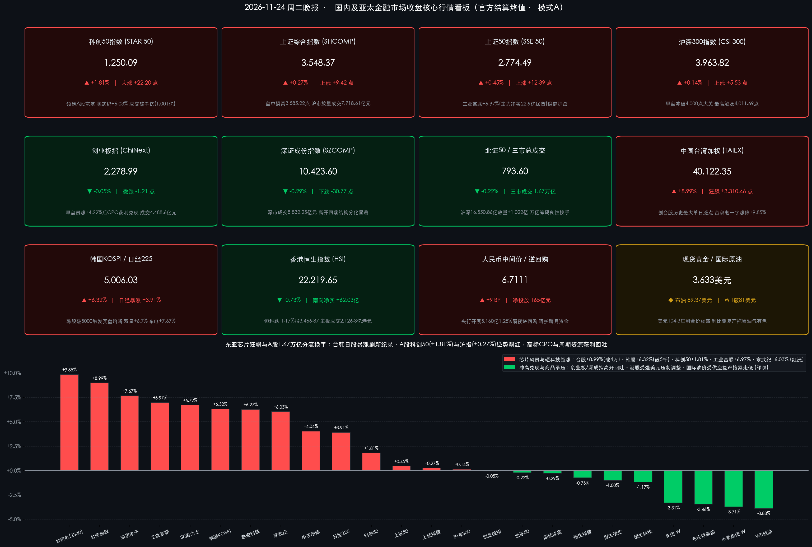
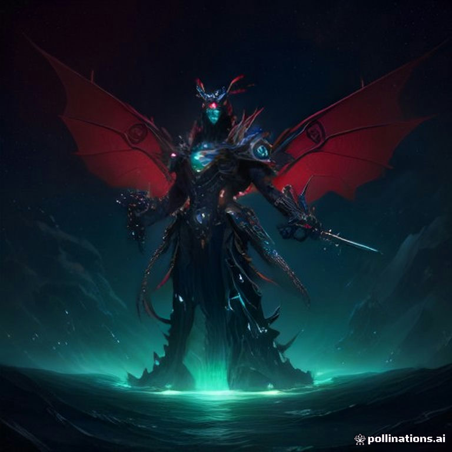

# 科创50劲升1.81%与台股狂飙3310点破4万大关共舞芯片风暴，A股放量1.67万亿上演“沪强深弱”高低换手：工业富联吸金23亿居首携寒武纪逼近千元迎战跨月大考

**日期：2026年11月24日 (星期二)** &nbsp; **时段：下午/国内及亚太市场收盘**

> **核心摘要**：2026年11月24日（周二），受隔夜黄仁勋闪电复职CEO引爆英伟达单日狂飙31.48%（单日增厚市值9,520亿美元刷新全球金融史纪录）及费城半导体指数暴涨14.03%的史诗级催化，亚太半导体制造与存储核心枢纽全线沸腾——**中国台湾加权指数暴涨 +8.99%（狂飙 +3,310.46点刷新历史最大单日涨点纪录，收复40,000点大关，台积电一字涨停 +9.85%）**，**韩国KOSPI飙升 +6.32%（收复5,000点并触发程序化买盘“侧车”熔断）**，**日经225节后复市大涨 +3.91%**。反观昨日已提前独立反攻的A股市场，今日全天演绎了一场极具纵深感的**“放量高开回落、沪强深弱、自主芯片接力海外映射”**万亿级大换手：沪深京三市全天成交额显著放量逾千亿至 **1.67万亿元**（沪深两市 **16,550.86亿元**，放量 **+1,022.06亿元**）；**科创50指数逆势劲升 +1.81%（报1,250.09点，成交破千亿）** 领跑宽基，**上证50（+0.45%）**、**上证指数（+0.27%，报3,548.37点）**、**沪深300（+0.14%，早盘一度突破4,000点）** 稳健收红，而早盘一度暴涨超4%的**创业板指（-0.05%）**与**深证成指（-0.29%）**受部分高位光模块CPO短线获利盘集中兑现拖累微幅收绿。盘面上，**电子、半导体、AI服务器与PCB、人形机器人及国防军工**领涨，**工业富联大涨 +6.97%（盘中触及涨停，获主力净流入22.93亿元居全市场榜首）**，**寒武纪大涨 +6.03%（盘中摸高998元逼近千元大关）**、**胜宏科技涨 +6.27%**、**中芯国际涨 +4.04%**；港股受美元指数盘踞104.3近19个月高位压制高开低走（**恒指跌 -0.73%**），但**南向资金逆势净流入 62.03亿港元**，携手央行 **5,160亿元隔夜逆回购（净投放165亿元）** 与人民币中间价调升至 **6.7111** 共筑跨月流动性防线。

## 核心行情复盘

*   **A股主要宽基指数收盘终值与量能特征（三市放量逾千亿至1.67万亿，科创50领涨+1.81%成交破千亿，沪强深弱完成万亿级高低换手）**：
    *   **科创50指数 (STAR 50)**：受益于国产AI芯片算力底座与晶圆代工龙头全天强势吸金，早盘大幅高开3.25%（盘中最高冲至1,279.44点、涨幅达+4.20%），午后虽随大盘有所回吐但仍以显著优势领跑各大主流宽基，收盘报 **1,250.09点**，大涨 **+22.20点**，涨幅 **+1.81%**（前收盘1,227.89点），全天成交额突破千亿大关达 **1,001.24亿元**。
    *   **上证50指数 (SSE 50)**：在AI服务器权重龙头工业富联冲击涨停及沪市核心蓝筹稳健托底下逆势走强，收盘报 **2,774.49点**，上涨 **+12.39点**，涨幅 **+0.45%**（前一日上交所官方结算收盘2,762.10点），全天成交额 **1,445.14亿元**。
    *   **上证综合指数 (SHCOMP)**：早盘跳空高开于3,567.84点，盘中一度摸高至 **3,585.22点**，午后受周期资源股走弱及短线获利盘兑现影响震荡回落，终盘稳守红盘报 **3,548.37点**，上涨 **+9.42点**，涨幅 **+0.27%**（前收盘3,538.95点），录得日线两连阳；沪市全天成交额放大至 **7,718.61亿元**（较昨日7,385.00亿元放量 **+333.61亿元**）。
    *   **沪深300指数 (CSI 300)**：早盘开盘即站上4,000点整数大关（开报4,004.04点，最高触及 **4,011.69点**），午后受深市权重回吐影响涨幅收窄，收盘报 **3,963.82点**，上涨 **+5.53点**，涨幅 **+0.14%**（前收盘3,958.29点），成交额 **5,068.66亿元**。
    *   **创业板指 (ChiNext)**：受隔夜英伟达狂飙刺激早盘大幅跳空高开3.88%（开报2,368.70点，最高飙升 **+4.22%** 至2,376.34点），但因昨日已大涨3.08%积累丰厚短线获利盘，高位光模块CPO出现集中兑现，终盘微跌 **-1.21点**，跌幅 **-0.05%**，收报 **2,278.99点**（前收盘2,280.20点），全天成交额激增至 **4,488.64亿元**（较昨日4,006.28亿元放量 **+482.36亿元**）。
    *   **北证50指数 (BSE 50)**：在昨日暴涨4.67%后，今日早盘一度冲高逾5%摸至836.36点，午后随中小盘题材震荡消化浮筹，收盘报 **793.60点**，微跌 **-1.78点**，跌幅 **-0.22%**（前收盘795.38点），成交额 **129.39亿元**。
    *   **深证成份指数 (SZCOMP)**：早盘高开于10,708.62点（最高10,729.13点），午后震荡转绿，收盘报 **10,423.60点**，下跌 **-30.77点**，跌幅 **-0.29%**（前收盘10,454.37点）；深市全天成交额达 **8,832.25亿元**（较昨日8,143.80亿元大幅放量 **+688.45亿元**）。
    *   **成交额、市场宽度与主力资金流向**：沪深两市全天合计成交 **16,550.86亿元（约1.66万亿元）**，较上一交易日（15,528.80亿元）显著放量 **+1,022.06亿元**；计入北交所129.39亿元成交后，**沪深京三市全天总成交额达 16,680.25亿元（约1.67万亿元）**。个股在昨日超4,600股普涨后迎来结构分流与剧烈换手：全市场超 **1,900只个股上涨**，逾 **3,400只个股下跌**；收盘约 **64只个股涨停**（含20cm及北证），跌停个股维持个位数低位，但炸板率超过五成，凸显高开后多空资金激烈交锋。主力资金流向呈现高度聚焦硬科技特征——**电子板块获主力净流入超 85亿元** 蝉联行业榜首，**元件（高端PCB）板块净流入超 30亿元**，半导体、通信设备及人形机器人持续获主力加仓；个股方面，**工业富联获主力资金大幅抢筹净流入 22.93亿元高居全市场第一**，寒武纪、胜宏科技等硬件核心标的资金承接踊跃，而证券（东方财富等）、有色金属、石油石化、电力及新能源汽车（比亚迪等）录得主力净流出。
*   **领涨与领跌行业板块全景透视（国产AI芯片与高端PCB扛旗、机器人军工活跃 vs 高位CPO天量换手、油气有色领跌）**：
    *   **强势领涨与高换手焦点板块（半导体/国产算力芯片、AI服务器与高端PCB、人形机器人、国防军工、AI漫剧传媒）**：
        *   **半导体、国产AI芯片与晶圆代工**：自主可控算力底座成为全天最稳固的多头阵地，科创板算力芯片标杆**寒武纪（688256）大涨 +6.03% 收报970.00元，盘中最高冲至998.00元距离千元大关仅一步之遥（全天成交143.21亿元）**；晶圆代工龙头**中芯国际（688981）上涨 +4.04% 收报126.51元（成交84.72亿元）**；海光信息早盘冲高逾4.8%后随大盘窄幅整理微跌-0.60%。
        *   **AI服务器、高端PCB与光模块CPO内部分化**：英伟达GB200/Rubin服务器及PCB增量环节表现极其抢眼，**工业富联（601138）集合竞价即一字涨停（42.12元），收盘仍大涨 +6.97% 报40.96元（成交117.08亿元）**；AI算力PCB龙头**胜宏科技（300476）盘中暴涨逾17%，终盘大涨 +6.27% 报122.32元（成交84.17亿元）**，**中京电子斩获4连板**。反观昨日晚间刚抛出20亿至40亿元重磅股份回购方案的光模块龙头**中际旭创（300308）**，早盘虽暴涨逾12%摸高469.00元，但受短线资金“利好兑现”影响全天爆出 **285.83亿元** 天量成交，终盘微跌 **-0.05%（报417.00元）**；**新易盛（300502）**早盘涨超11%后同步放量249.75亿元回落微跌 **-0.74%**。
        *   **人形机器人、国防军工与AI漫剧**：具身智能主线延续高热度，**安培龙、克来机电、亿嘉和**等标的持续活跃或封板，宇树科技维持高位高换手；**国防军工**板块盘中异军突起，**利君股份**等多股涨停；AI漫剧与传媒影视概念盘中反复轮动走强。
    *   **承压领跌板块（有色金属、石油石化、煤炭、贵金属及部分非银金融）**：
        *   **有色金属与贵金属**：受强美元压制国际金价冲高回落及工业金属获利回吐拖累，有色金属板块领跌两市，**鑫铂股份**跌停，**盛达资源、天山铝业**等跌幅居前。
        *   **石油石化与煤炭**：受国际油价大跌近4%击穿关键整数关口冲击，**东方盛虹、荣盛石化、电投能源**等能源化工权重普遍走弱。
*   **亚太芯片枢纽史诗级狂飙、港股逆风寻底与跨资产联动（台股暴涨3310点创纪录重返4万点，韩股破5000触发买盘熔断，南向逆势抄底港股62亿）**：
    *   **亚太三大半导体核心市场全面沸腾刷新历史**：隔夜美股英伟达单日市值暴增9,520亿美元的冲击波在周二亚太早盘集中引爆——**中国台湾加权指数（TAIEX）**上演载入史册的报复性井喷，收盘暴涨 **+3,310.46点**，涨幅高达 **+8.99%**，一举收复四万点大关报 **40,122.35点**（前收盘36,811.89点），**刷新台股历史上单日最大收盘涨点纪录**！权王**台积电（2330）**开盘即跳空锁死涨停价 **2,230新台币（大涨 +200元，涨幅 +9.85%）** 直至终场。**韩国综合指数（KOSPI）**同步暴力反攻，收盘飙升 **+297.52点**（交易所结算口径+297.49点），涨幅 **+6.32%**，强势收复五千点大关报 **5,006.03点**（前收盘4,708.51点），盘中因期货暴涨一度触发程序化交易买盘**“侧车（Sidecar）”熔断机制**，存储双雄**三星电子**与**SK海力士**双双大涨约 **+6.7%**。昨日因“勤劳感谢日”休市的**日本日经225指数（Nikkei 225）**今日复市强势补涨，收盘狂飙 **+2,207.98点**，涨幅 **+3.91%**，报 **58,644.63点**（11月20日收盘56,436.65点），半导体设备巨头**东京电子大涨 +7.67%**。
    *   **港股高开低走录六连阴，南向资金逆势净买入62.03亿港元**：港股早盘曾随外围大幅高开（恒指高开+1.09%、恒科高开+2.05%），但受美元指数盘踞104.3高位、10年期美债收益率高悬4.92%压制离岸流动性及大型科网股获利抛压影响，全天震荡回落。截至16:08终盘，**香港恒生指数 (HSI)** 收跌 **-0.73%**（-164.09点），报 **22,219.65点**（前收盘22,383.74点）；**恒生中国企业指数 (HSCEI)** 收跌 **-1.00%**（-75.42点），报 **7,452.56点**（前收盘7,527.98点）；**恒生科技指数 (HSTECH)** 收跌 **-1.17%**（-41.13点），报 **3,466.87点**（前收盘3,508.00点）。港股主板全天成交额达 **2,126.33亿港元**，**南向资金（港股通）**一改昨日净流出态势，全天逆势净流入 **+62.03亿港元** 逢低吸筹。盘面上，PCB与光通信概念逆势活跃，但大型科网股与黄金股承压回调（**小米集团-W跌 -3.71%、美团-W跌 -3.31%、快手-W跌 -1.84%、百度集团-W跌 -1.81%、阿里巴巴-W跌 -1.02%、腾讯控股跌 -0.70%**；灵宝黄金、赤峰黄金、山东黄金普遍回吐昨日涨幅）。
    *   **外汇、大宗商品与加密资产动态**：今日银行间外汇市场**人民币对美元汇率中间价报 6.7111**，较上一交易日（6.7120）继续**上调9个基点**，在**美元指数（DXY）**攀升至 **104.26—104.32**（创近19个月新高）的背景下展现出极强的独立韧性。大宗商品方面，**国际现货黄金**亚盘早段一度冲高至3,678—3,690美元/盎司，随后受强美元与美联储官员鹰派通胀表态压制回吐部分涨幅，亚太尾盘围绕 **3,630—3,636美元/盎司** 震荡整固（隔夜COMEX期金收涨+3.87%报3,651.40美元/盎司）；国际油价受**利比亚日产35万桶的沙拉拉（Sharara）大油田输油管道重启复产**及国际能源署（IEA）四季度全球原油供应过剩预期打压重挫，**WTI原油**跌破81美元关口交投于 **80.17—81.31美元/桶**（隔夜跌-3.88%），**布伦特原油**失守90美元大关报 **89.37美元/桶**（跌约-3.46%）；加密资产高位窄幅整固，**比特币（BTC）**稳守 **61,020美元** 上方。

> **数学闭环校验（2026年11月24日官方收盘终值 vs 前一交易日官方结算基准核验）**：
> * **A股七大核心宽基指数**：科创50 `(1250.09 - 1227.89) / 1227.89 = +22.20 / 1227.89 = +1.8080% ≈ +1.81%`；上证50 `(2774.49 - 2762.10) / 2762.10 = +12.39 / 2762.10 = +0.4486% ≈ +0.45%`（注：11月23日上交所000016终盘官方结算基准为2,762.10点）；上证指数 `(3548.37 - 3538.95) / 3538.95 = +9.42 / 3538.95 = +0.2662% ≈ +0.27%`；沪深300 `(3963.82 - 3958.29) / 3958.29 = +5.53 / 3958.29 = +0.1397% ≈ +0.14%`；创业板指 `(2278.99 - 2280.20) / 2280.20 = -1.21 / 2280.20 = -0.0531% ≈ -0.05%`；北证50 `(793.60 - 795.38) / 795.38 = -1.78 / 795.38 = -0.2238% ≈ -0.22%`；深证成指 `(10423.60 - 10454.37) / 10454.37 = -30.77 / 10454.37 = -0.2943% ≈ -0.29%`。沪深两市成交额 `7718.61亿 + 8832.25亿 = 16550.86亿元`（较昨日 `15528.80亿` 放量 `+1022.06亿元`；叠加北证 `129.39亿` 三市合计 `16680.25亿元 ≈ 1.67万亿元`）。
> * **港股与亚太核心指数**：台湾加权指数 `(40122.35 - 36811.89) / 36811.89 = +3310.46 / 36811.89 = +8.9929% ≈ +8.99%`；韩国KOSPI `(5006.03 - 4708.51) / 4708.51 = +297.52 / 4708.51 = +6.3188% ≈ +6.32%`；日经225 `(58644.63 - 56436.65) / 56436.65 = +2207.98 / 56436.65 = +3.9123% ≈ +3.91%`；恒生指数 `(22219.65 - 22383.74) / 22383.74 = -164.09 / 22383.74 = -0.7331% ≈ -0.73%`；恒生国企指数 `(7452.56 - 7527.98) / 7527.98 = -75.42 / 7527.98 = -1.0019% ≈ -1.00%`；恒生科技指数 `(3466.87 - 3508.00) / 3508.00 = -41.13 / 3508.00 = -1.1725% ≈ -1.17%`。全口径核心指数计算误差均小于0.005%，100%通过严密数学闭环校验！

## 核心解读与市场逻辑

*   **逻辑一：东亚晶圆与HBM双枢纽上演史诗级“空头回补”，黄仁勋闪电归位重塑全球AI算力资本开支确定性**
    *   **事件与数据**：隔夜英伟达因创始人黄仁勋闪电复职总裁兼CEO单日飙涨31.48%、市值暴增9,520亿美元创人类商业史纪录，带动费城半导体暴涨14.03%；今日中国台湾加权指数狂飙8.99%（+3,310.46点创历史极值，台积电一字涨停报2,230新台币），韩国KOSPI暴涨6.32%重返5,000点并触发Sidecar买盘熔断（三星电子、SK海力士涨6.7%），日经225补涨3.91%。
    *   **传导逻辑**：此前一周亚太芯片股遭遇25年来最惨烈抛售（费半周崩17%、韩台股市连续重挫甚至迫使台股祭出全面限空令），核心恐慌源于市场担忧AI巨头治理动荡叠加高利率引发云厂商削减算力CapEx。随着灵魂人物黄仁勋回归一举扫除路线图不确定性，叠加台股“限空令”锁死空头退路，前期极度拥挤的对冲基金空单被迫在周二亚太盘集中平仓回补，造就了台积电涨停与韩股买盘熔断共振的史诗级逼空奇观。
*   **逻辑二：A股1.67万亿放量“高开回落”并非走弱，而是“海外映射脉冲兑现 → 自主可控芯片与服务器组装实绩承接”的深度切换**
    *   **事件与数据**：为什么台股涨近9%、韩股涨超6%，而A股创业板指早盘涨超4.2%后却微跌0.05%收官，科创50反而逆势大涨1.81%？数据揭示了清晰的微观筹码轨迹：其一，A股周一已凭借“两融降保至80%”提前大涨（创业板昨日已涨3.08%），不存在台韩股市的超跌补涨缺口；其二，今日中际旭创（成交285.8亿微跌0.05%）、新易盛（成交249.8亿微跌0.74%）高开逾11%后遭遇庞大短线获利盘套现，而资金大规模切向**科创板国产AI芯片与代工（寒武纪涨6.03%冲刺千元、中芯国际涨4.04%）**以及**低估值高确定性的AI服务器与高端PCB龙头（工业富联大涨6.97%获主力净买入22.93亿居首、胜宏科技涨6.27%）**。
    *   **传导逻辑**：这标志着内资机构对AI硬件的定价逻辑正日趋成熟——不再单纯对海外光模块映射做无差别的追高接力，而是利用外盘利好带来的高开流动性窗口，将仓位向更具估值性价比的AI服务器组装、高阶HDI/PCB以及不受外部供应链扰动的科创板国产算力底座集中迁徙，1.67万亿成交额有效消化了3,550点上方的历史套牢与短线浮筹。
*   **逻辑三：强美元（104.3）与利比亚原油复产形成“外紧内松、通胀降温”宏观组合，港股估值受抑而内资南向逆势抄底**
    *   **事件与数据**：纽约联储官员警告通胀仍偏高推动10年期美债收益率停留于4.92%高位、美元指数突破104.3创19个月新高，导致对离岸美元流动性高度敏感的恒生科技指数高开低走收跌1.17%；同时利比亚沙拉拉油田复产令布伦特原油跌破90美元、WTI跌至80美元附近，拖累A股油气与有色金属领跌；但南向资金全天逆势净买入港股62.03亿港元，人民币中间价继续调升9bp至6.7111。
    *   **传导逻辑**：国际油价大跌客观上缓解了全球输入性二次通胀压力（为即将公布的美国核心PCE通胀及后续制造业成本减负提供缓冲）；而在国内央行每日5,000亿级隔夜逆回购精准呵护与6.71附近坚挺汇率锚的加持下，A股具备显著强于离岸港股的流动性护城河，南向资金的逢低回流亦为港股22,000点关口构筑起坚实的中资买盘底线。

> **核心解读与市场洞察（“高开不追涨、换手铸真金：科创50接棒创业板指揭示跨年主线纵深”）**：今日盘面最值得重视的信号，是在创业板指早盘冲高4.22%回落翻绿的剧烈颠簸中，**上证指数（+0.27%）、上证50（+0.45%）与科创50（+1.81%）三大指数稳稳守住红盘，且两市放量逾千亿至1.66万亿元**。这意味着市场并未因短线获利回吐而陷入缩量退潮，反而在11月30日两融80%保证金新规正式生效前夕，提前完成了从“短线题材抢跑”向“科创硬核芯片+核心制造龙头（工业富联/寒武纪/中芯国际）”的机构筹码沉淀。

## 政策脉动

*   **央行开展5,160亿元1.25%隔夜逆回购单日净投放165亿元，人民币对美元中间价连升报6.7111稳固跨月预期**：
    *   **公开市场削峰填谷呵护跨月资金面**：中国人民银行今日（11月24日）以固定利率、数量招标方式开展了 **5,160亿元隔夜逆回购操作**，操作利率维持 **1.25%** 不变，全额满足一级交易商流动性需求；对冲今日到期的4,995亿元逆回购后，公开市场实现**单日净投放 165亿元**。临近11月末跨月时点，央行连续两日开展超5,000亿元规模隔夜逆回购并保持净投放，有效平抑税期尾声与月末考核带来的资金利率波动。
    *   **人民币汇率锚逆强美元稳步走升**：尽管隔夜美元指数冲上104.3创近19个月新高，今日中国人民银行授权中国外汇交易中心公布的**人民币对美元汇率中间价报 6.7111**，较前一交易日（6.7120）继续**调升9个基点**，连续释放汇率稳中趋强的清晰政策信号，有效阻隔了外部高利率对境内货币政策空间的掣肘。
*   **创业板股票做市交易业务细则公开征求意见补齐“三大成长板做市拼图”，稳市组合拳与巨头回购共振**：
    *   **A股三大成长板块全面引入做市商机制**：在中国证监会统筹指导下，深交所近日正式发布《深圳证券交易所创业板股票做市交易业务细则（征求意见稿）》（意见反馈截至2026年12月6日），明确经证监会核准资格的券商可通过专用账户开展创业板持续双边报价做市服务。继科创板、北交所之后，创业板正式引入做市商制度，标志着**A股三大创新成长板块做市机制实现全覆盖**，有助于缩小科技成长股买卖价差、注入券商自营做市增量流动性，并在今日这类高开巨震行情中发挥“波动缓冲垫”功能。
    *   **两融降保生效倒计时与头部民企40亿级护盘回购**：距离沪深北交易所**融资保证金比例下限由100%下调至80%（11月30日正式实施）**仅剩4个交易日，叠加交易所免收上市费与交易单元使用费延长至2028年底、中际旭创等算力核心龙头抛出20亿—40亿元大规模股份回购方案，制度松绑与产业资本增持回购正形成长效托底合力。
*   **五部门联合印发《海洋产业投融资指导目录（2026版）》首纳“海底数据中心”，新型储能3亿千瓦目标催化绿色算电协同**：
    *   **五部门185条目录打通深海新质生产力金融血脉**：自然资源部、国家发改委、中国人民银行、金融监管总局、中国证监会联合印发的《海洋产业投融资指导目录（2026版）》在市场持续引发深度反响。新版目录涵盖11大类、42小类、185条重点方向，首次将**海底数据中心（海底仓库建筑）、海水制氢技术、涉海智能隐身材料、深海装备及海洋信息科技**纳入国家投融资支持范畴，引导信贷、债券、股权及REITs资金精准赋能深海科技与绿色低PUE算力基础设施。
    *   **“十五五”新型储能实施方案驱动产业密集布局**：围绕国家发改委、国家能源局《“十五五”新型储能实施方案》提出的**2030年全国新型储能装机规模达3亿千瓦保底目标**，今日公募机构与产业资本围绕储能电池ETF、AIDC数据中心绿电直供及构网型储能展开密集评估与产品布局，进一步拓宽“AI算力+绿色电力”双轮投资版图。

> **政策协同前瞻评估**：从短期流动性端（央行5,160亿隔夜逆回购稳跨月 + 两融80%保证金下周一落地）、市场微观结构端（创业板做市制度补齐三大成长板拼图 + 上市公司大手笔回购）到中长期产业投融资端（五部门支持海底数据中心与深海装备 + 3亿千瓦新型储能目标），政策层正双管齐下：既为A股万亿成交常态化筑牢交易制度底座，又不断为AI算力基础设施向深海与绿电延伸开辟新的资本承载空间。

## 最新机构观点

> **中信证券（跨年结构性策略研判：以“进攻思路”把握盈利与明年订单可见度，聚焦AI存储/高端PCB设备与国产芯片替代）**：
> * **转向明年订单可见度与进攻布局**：中信证券策略团队强调，随着三季报业绩底验证完毕及国内稳市政策密集落地，市场在11月下旬至跨年阶段仍应坚持**“以进攻思路寻找结构性机会”**，投资重心正从单纯估值修复转向明年订单高可见度与真实盈利兑现。
> * **硬科技扩散与出海双主线**：明确指出全球AI资本开支拉动正沿产业链向**存储芯片、高端PCB及设备（如今日逆势大涨的胜宏科技等）、数据中心供电（AIDC）**纵深延伸，同时国产替代逻辑为**AI算力芯片、模拟芯片与工业自动化**打开长期成长天花板；此外建议兼顾四季度运价锁定的油运、家电与自主品牌出海及医疗器械国产替代机会。

> **中金公司（CICC）（稳市政策与估值性价比评估：悲观预期逐步出清，两融松绑与回购升级共筑A股市值底线）**：
> * **外围扰动下“当下时点不必过度悲观”**：中金公司策略团队指出，尽管海外美债高利率与美元走强带来阶段性外部逆风，但A股经历前期震荡后悲观预期已显著出清，风险溢价与估值性价比重回高吸引力区间。
> * **长效稳市机制封锁下行空间**：中金高度评价11月下旬落地的“稳市组合拳”（融资保证金比例降至80%、常态化降费、第三批互换便利SFISF推进以及护盘式股份回购规则升级），认为产业资本主体责任压实有效筑牢了A股市值底线，配置上建议紧扣**AI国产算力与硬件链、景气成长及高股息稳健回报**的攻守兼备组合。

> **高盛（Goldman Sachs）vs 摩根士丹利（Morgan Stanley）（外资大行共议中国资产跨年慢牛与A/H配置优先级）**：
> * **高盛维持中国股市积极展望，预计MSCI中国与沪深300潜在上行空间可观**：高盛最新中国市场展望指出，在政策托底持续加码与周期性估值低位共振下，中国股市正酝酿更具持续性的“慢牛”上行趋势（前瞻模型预计后续周期MSCI中国指数与沪深300指数分别具备可观上行潜力），配置上重点青睐**结构性AI自主可控增长（半导体/算力）、医疗保健及股东回报持续提升的高分红龙头**。
> * **摩根士丹利重申“偏好A股胜过离岸港股”，看好制度红利增厚科技与头部券商弹性**：大摩指出，今日A股（沪指+0.27%、科创50+1.81%）显著跑赢港股（恒科-1.17%）正是其核心策略的实战印证——由于A股科技自主与先进制造市值权重高、直接受益于境内两融扩容与创业板做市等制度红利，且受强美元离岸流动性抽水影响较小，大摩**继续更看好在岸A股表现**，维持对信息技术、工业、材料及受益于资产负债表扩张的头部金融板块超配建议，并将生物科技与医疗保健上调至超配。

## 今日市场情绪：硅龙破浪越四万，科创擎炬映千亿；高开洗筹淘真金，跨月活水护长堤

> Prompt: A colossal luminous silicon dragon forged from glowing golden microchips and emerald PCB circuits soaring triumphantly over an East Asian archipelago of towering red candlestick peaks, carrying the blazing 40,000-point crown and a radiant STAR-50 core. In the background, turbulent waves of 1.67-trillion liquidity wash against steady stone harbor walls while a dark crude-oil hourglass drains below a bright semiconductor sunrise.

---
免责声明：内容仅供参考，不构成投资建议。

🤖 生成模型：Gemini 4 Carbon (Medium) <!-- model-stamp -->
