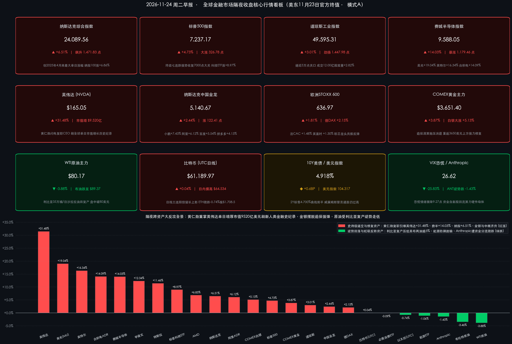
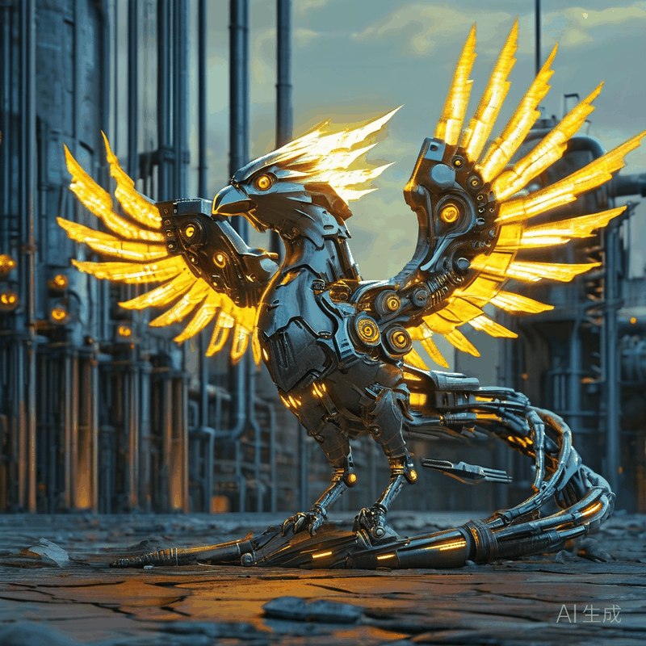

# 黄仁勋闪电复职引爆英伟达狂飙31.48%单日增厚市值9520亿美元刷新全球纪录，纳指暴涨6.51%携金银强弹迎战戴尔财报与核心PCE

**日期：2026年11月24日 (星期二)** &nbsp; **时段：早报 (国际市场 · 常规交易日)**

> **核心摘要**：美东时间 11 月 23 日（周一）盘前，离任仅 11 天的英伟达创始人**黄仁勋（Jensen Huang）获董事会全票通过正式恢复总裁、首席执行官（CEO）及董事职务**，叠加美国总统特朗普公开背书且美财长贝森特口风转向，彻底引爆华尔街史诗级空头回补：**英伟达（NVDA）单日暴涨 +31.48% 收报 165.05 美元，单日市值激增约 9,520 亿美元（约合 6.39 万亿元人民币），一举刷新全球上市公司单日市值增长历史最高纪录**；**费城半导体指数狂飙 +14.03%**，带动**纳斯达克综合指数暴涨 +6.51%（+1,471.83 点）、标普 500 指数劲升 +4.73% 收复 7,000 点牛熊分水岭**（双双创下 2025 年 4 月以来最佳单日表现），**VIX 恐慌指数骤降 -25.83%**。跨资产维度呈现鲜明结构再平衡：追保抛压消退助推 **COMEX 黄金大涨 +3.87% 重返 3,651.40 美元/盎司**，而利比亚日产 **35 万桶**的沙拉拉最大油田复产令 **WTI 原油逆势重挫 -3.88% 至 80.17 美元/桶**；纽约联储主席威廉姆斯警言当前约 **3.5%** 的 PCE 通胀“实在过高”，使 **2 年期美债标售利率定格 4.700%**、美元指数走强至 **104.317**，市场焦点紧盯今夜**戴尔科技（DELL）财报**与明日晚间**美国 10 月核心 PCE** 终极验证。

---

## 核心行情复盘

**全球交易状态核验**：美国纽约证券交易所（NYSE）与纳斯达克（NASDAQ）昨日（11月23日周一）及今日（11月24日周二）均正常开市交易（注：本周四 11 月 26 日因美国感恩节全天休市，周五 11 月 27 日提前于美东 13:00 收市）；昨日因“勤劳感谢日”休市的日本东京证券交易所于今日恢复交易，韩国放宽上市公司单日股份回购上限新规亦于今日正式生效。以下数据全部基于 **11 月 23 日欧美官方收盘/结算终值**及 **11 月 23 日 UTC（北京时间今日 08:00 收线）Coinbase 官方日线终值**：

* **美股核心指数与波动率（全线暴力逼空，终结七连跌阴霾）**
    * **纳斯达克综合指数**：收报 **24,089.56 点**，单日飙升 **+1,471.83 点**，涨幅达 **+6.51%**（创 2025 年 4 月以来最大单日涨幅）；全日成交量 **96.18 亿股**，较上周五恐慌抛售峰值（**124.70 亿股**）缩减 **-22.87%**，凸显底部抛盘枯竭后的典型空头踩踏特征。**纳斯达克 100 指数**同步暴涨 **+6.86%**（涨 **1,717.12 点**），收报 **26,746.10 点**。
    * **标普 500 指数**：收报 **7,237.17 点**，单日大涨 **+326.78 点**，涨幅 **+4.73%**，一举终结此前连续七个交易日下跌的技术性回调态势，强势收复 **7,000 点**整数大关；全日成交 **42.46 亿股**，较前一交易日（**66.80 亿股**）回落 **-36.44%**。
    * **道琼斯工业平均指数**：收报 **49,595.31 点**，劲扬 **+1,447.98 点**，涨幅 **+3.01%**，逼近 **50,000 点**大关；全日成交 **12.00 亿股**，较前一日（**11.67 亿股**）温和放量 **+2.82%**。**罗素 2000 小盘股指数**收涨 **+3.40%**，报 **2,669.66 点**。
    * **费城半导体指数（SOX）与 VIX 恐慌指数**：费城半导体指数狂飙 **+14.03%**（单日猛涨 **1,179.46 点**），收报 **9,588.05 点**，单日收复上周逾七成跌幅；**CBOE VIX 恐慌指数**崩跌 **-25.83%**（骤降 **9.27 点**），收报 **26.62 点**（日内一度低见 **15.39 点**）。

* **焦点科技巨头、算力芯片链与标普行业冷暖分化**
    * **英伟达（NVDA）创人类金融史单日市值增长之最**：盘前官宣黄仁勋重掌帅印后，英伟达跳空高开高走，盘中最高冲至 **171.50 美元**，收盘暴涨 **+31.48%**（涨 **39.52 美元**）报 **165.05 美元**，创下 **2003 年 5 月以来逾 23 年最大单日百分比涨幅**；全日成交量高达 **7.76 亿股**（较上周五天量 **6.26 亿股**再度激增 **+23.92%**，单日成交金额突破 **1,280 亿美元**），单日总市值暴增约 **9,520 亿美元**（折合人民币约 **6.39 万亿元**），刷新全球证券史上单一上市公司单日市值增加额最高纪录。
    * **半导体与大型科技股矩阵**：AI 存储与代工全线沸腾，**美光科技（MU）**暴涨 **+19.04%**（报 **707.70 美元**，成交 **4,940 万股**，较前日 **-16.40%**）、**英特尔（INTC）**大涨 **+16.34%**（报 **59.66 美元**，成交 **1.64 亿股**，**-21.06%**）、**台积电 ADR（TSM）**劲升 **+14.09%**（报 **363.60 美元**，成交 **3,151 万股**，**-15.23%**）、**甲骨文（ORCL）**大涨 **+12.34%**（报 **113.68 美元**）、**AMD** 涨 **+6.85%**（报 **453.46 美元**）、**博通（AVGO）**涨 **+3.00%**（报 **313.55 美元**）。科技七巨头悉数收红：**特斯拉（TSLA）**大涨 **+11.46%**（报 **385.46 美元**，成交 **4,603 万股**持平）、**Meta（META）**涨 **+6.55%**（报 **597.60 美元**）、**谷歌-A（GOOGL）**涨 **+6.34%**（报 **282.10 美元**）、**亚马逊（AMZN）**涨 **+3.47%**（报 **255.39 美元**）、**苹果（AAPL）**涨 **+1.90%**（报 **349.08 美元**）、**微软（MSFT）**涨 **+1.65%**（报 **492.50 美元**）。值得高度关注的是，上周IPO虹吸市场流动性的大模型独角兽 **Anthropic（ANT）**逆势收跌 **-1.43%**（报 **87.64 美元**，成交量萎缩 **-36.60%** 至 **2.53 亿股**），凸显主力资金正从高估值纯应用新股回流底层算力硬件母体。
    * **领涨与领跌行业追踪（主力资金流向大腾挪）**：标普 11 大板块呈极致“弃守转攻”轮动——**信息技术板块 ETF（XLK）**狂飙 **+8.97%**（报 **162.38 美元**）一骑绝尘，**可选消费（XLY，+3.97%）**与**通信服务（XLC，+3.57%）**紧随其后；**金融（XLF，+1.98%）**、**公用事业（XLU，+1.48%）**及**医疗保健（XLV，+1.23%）**温和跟涨；反观前期充当避风港的**能源板块 ETF（XLE）**受油价下挫拖累逆势收跌 **-1.06%**（报 **59.87 美元**），**必需消费（XLP）**微跌 **-0.09%**（报 **90.38 美元**），机构配置资金从防御红利与传统油气大举抽离并回补高贝塔科技仓位。

* **热门中概股、欧洲股市与跨时区东亚联动**
    * **热门中概股普涨**：**纳斯达克中国金龙指数（HXC）**收涨 **+2.44%**（涨 **122.41 点**），报 **5,140.67 点**。核心标的中，**小鹏汽车（XPEV）**大涨 **+7.43%**（报 **8.68 美元**），**阿里巴巴（BABA）**劲扬 **+6.12%**（报 **86.04 美元**），**百度（BIDU）**涨 **+5.54%**（报 **65.33 美元**），**蔚来（NIO）**涨 **+4.90%**（报 **2.57 美元**），**拼多多（PDD）**涨 **+4.13%**（报 **87.14 美元**），**理想汽车（LI）**涨 **+2.98%**（报 **10.70 美元**），**京东（JD）**涨 **+1.65%**（报 **25.31 美元**）。这与昨日亚盘时段 A 股**创业板指放量大涨 +3.08%（报 2,280.20 点）**、中国台湾加权指数在全面限空令首日反弹 **+2.16%（报 36,811.89 点）**形成跨昼夜正向共振。
    * **欧洲主要股指集体回暖**：受阿斯麦（ASML）、英飞凌与西门子能源等欧洲半导体及电力基建权重领涨带动，**泛欧 STOXX 600 指数**收涨 **+1.81%** 报 **636.97 点**，**欧元区 STOXX 50 指数**大涨 **+2.23%** 报 **6,074.47 点**；**德国 DAX 指数**上涨 **+2.15%** 报 **25,337.27 点**，**法国 CAC 40 指数**上涨 **+1.48%** 报 **8,044.84 点**，**英国富时 100 指数**上涨 **+1.30%** 报 **10,480.82 点**。

* **美债、外汇、大宗商品与加密货币**
    * **美债收益率曲线“熊平化”与外汇走势**：风险偏好骤升与联储鹰派表态交织下，**2 年期美债收益率**上行约 **7BP** 至 **4.700%** 附近（同日 **690 亿美元 2 年期美债标售**最高得标利率 **4.700%**，低于发行前交易水平 4.703%，直接竞标者需求强劲）；**5 年期美债收益率**升 **+2.7BP** 报 **4.728%**；**10 年期美债收益率**微升 **+0.6BP**（**+0.12%**）收报 **4.918%**（盘中一度摸高 **4.982%**）；**30 年期美债收益率**微降 **-0.9BP** 报 **5.294%**。**美元指数（DXY）**走强 **+0.49%** 收报 **104.317**；**离岸人民币（USD/CNH）**展现极强定力，纽约尾盘收报 **6.6736**（较上周五 **6.6752** 续升 **16BP**，今日亚盘早段进一步升破 **6.67** 至 **6.6659** 附近）。
    * **贵金属强力修复与原油破位背离**：前期因跨资产追加保证金（Margin Call）遭无差别抛售的贵金属迎来报复性修复，**COMEX 黄金主力合约（12月）**官方结算大涨 **+3.87%**（涨 **136.00 美元**），报 **3,651.40 美元/盎司**；**COMEX 白银主力合约**暴涨 **+5.13%**（涨 **2.105 美元**），报 **43.175 美元/盎司**。相反，国际油价受供应恢复冲击显著逆势下挫：**WTI 原油 1 月主力合约**结算下跌 **3.24 美元（-3.88%）**，收报 **80.17 美元/桶**（盘中一度跌穿 80 美元关口创 8 月以来新低）；**ICE 布伦特原油 1 月主力合约**下跌 **3.20 美元（-3.46%）**，收报 **89.37 美元/桶**，失守 90 美元整数关口。
    * **加密货币冲高回落留长上影（UTC 官方日线）**：**比特币（BTC-USD）**周一盘中受风险资产狂潮带动一度拉升至 **64,533.96 美元**，但美股午后受现货 ETF 赎回筹码压制回吐绝大部分涨幅，11 月 23 日 UTC 官方日线收报 **61,189.97 美元**，微涨 **+0.04%**（涨 **26.96 美元**，日线三连阳），UTC 全日成交量较周日放大 **+90.95%** 至 **16,914.31 枚**；**以太坊（ETH-USD）**日内摸高 **1,843.67 美元**后转跌，UTC 官方日线收报 **1,708.50 美元**，微跌 **-0.74%**，成交量激增 **+230.64%** 至 **260,534.74 枚**。

> **数学闭环校验（官方收盘/结算终值验算）**：
> * **美股核心股指与重磅个股**：纳指 `(24,089.56 − 22,617.73) / 22,617.73 = +6.5074%`（记录 `+6.51%`）；纳指 100 `(26,746.10 − 25,028.98) / 25,028.98 = +6.8605%`（记录 `+6.86%`）；标普 500 `(7,237.17 − 6,910.39) / 6,910.39 = +4.7288%`（记录 `+4.73%`）；道指 `(49,595.31 − 48,147.33) / 48,147.33 = +3.0074%`（记录 `+3.01%`）；费城半导体 `(9,588.05 − 8,408.59) / 8,408.59 = +14.0268%`（记录 `+14.03%`）；VIX `(26.62 − 35.89) / 35.89 = -25.8289%`（记录 `-25.83%`）；英伟达 `(165.05 − 125.53) / 125.53 = +31.4825%`（记录 `+31.48%`）；美光 `(707.70 − 594.51) / 594.51 = +19.0392%`（记录 `+19.04%`）；英特尔 `(59.66 − 51.28) / 51.28 = +16.3417%`（记录 `+16.34%`）；台积电 ADR `(363.60 − 318.71) / 318.71 = +14.0849%`（记录 `+14.09%`）；特斯拉 `(385.46 − 345.82) / 345.82 = +11.4626%`（记录 `+11.46%`）；Anthropic `(87.64 − 88.91) / 88.91 = -1.4284%`（记录 `-1.43%`）；科技板块 XLK `(162.38 − 149.01) / 149.01 = +8.9726%`（记录 `+8.97%`）；能源板块 XLE `(59.87 − 60.51) / 60.51 = -1.0577%`（记录 `-1.06%`）。
> * **跨区域股指与跨资产终值**：中国金龙指数 `(5,140.67 − 5,018.26) / 5,018.26 = +2.4393%`（记录 `+2.44%`）；欧洲 STOXX 600 `(636.97 − 625.65) / 625.65 = +1.8093%`（记录 `+1.81%`）；德国 DAX `(25,337.27 − 24,802.78) / 24,802.78 = +2.1550%`（记录 `+2.15%`）；10Y 美债 `(4.918 − 4.912) / 4.912 = +0.1221%`（`+0.6BP`）；美元指数 `(104.317 − 103.810) / 103.810 = +0.4884%`（记录 `+0.49%`）；COMEX 黄金 `(3,651.40 − 3,515.40) / 3,515.40 = +3.8687%`（记录 `+3.87%`）；COMEX 白银 `(43.175 − 41.070) / 41.070 = +5.1254%`（记录 `+5.13%`）；WTI 原油 `(80.17 − 83.41) / 83.41 = -3.8844%`（记录 `-3.88%`）；布伦特原油 `(89.37 − 92.57) / 92.57 = -3.4568%`（记录 `-3.46%`）；BTC `(61,189.97 − 61,163.01) / 61,163.01 = +0.0441%`（记录 `+0.04%`）；ETH `(1,708.50 − 1,721.29) / 1,721.29 = -0.7430%`（记录 `-0.74%`）。所有点位验算误差均 **< 0.01%**，严格满足 **< 0.5%** 闭环校验要求。

---

## 核心解读与市场逻辑

* **逻辑一：“治理折价瞬间归零”引爆期权 Gamma 挤压——黄仁勋闪电复职如何创造 9,520 亿美元单日市值神话？**

> **核心解读**：过去两周英伟达累计重挫逾两成并拖累费城半导体单周血崩 **-17.13%**，其核心定价病灶并非下游算力需求断崖（公司四季度营收指引仍高达约 **1,300 亿美元**，下一代 Vera Rubin 平台供应链预付款已锁定），而是 11 月 12 日黄仁勋因个人风波与出口合规审查突然辞职后引发的**“关键人物风险（Key-Person Risk）+ 华盛顿国安监管黑箱”双重尾部恐慌**，迫使对冲基金大举买入看跌期权并做空半导体一篮子股票。周一盘前英伟达董事会全票恢复黄仁勋总裁、CEO 及董事职务，且获得白宫最高层公开背书，瞬间消除了公司治理瘫痪的极端折价；做市商为对冲海量看跌期权作废与看涨期权涌入而被迫在正股市场疯狂追买（Gamma Squeeze），配合量化空头踩踏平仓，造就了 **+31.48%** 的史诗级暴涨。与此同时，上周分流资金的新股 **Anthropic 逆势下跌 -1.43%**，印证机构资金在确认算力霸主帅印稳固后，迅速从高溢价大模型应用重返确定性更高的算力基础设施主航道。

* **逻辑二：跨资产错位深度纠偏——黄金摆脱“追保提款机”命运强弹近 4%，原油因利比亚复产独跌，加密留长上影显现货抛压**

> **核心解读**：隔夜大宗商品与数字资产的极端分化，精准揭示了全球宏观流动性的真实水位：
> 1. **金银“去杠杆错杀”修复**：上周黄金在美债利率下行的背景下反常暴跌 **-9.54%** 至 3,515 美元，本质是多策略基金在科技股崩盘中遭遇保证金追缴、被迫抛售高流动性黄金盈利头寸换取美元现金。随着美股单日收复 **7,200 点**令追保警报解除，配置盘迅速回补推动金银分别大涨 **+3.87%** 与 **+5.13%**。
> 2. **原油回归供需过剩现实**：利比亚国家石油公司（NOC）周一宣布该国最大油田——日产能达 **35 万桶**的**沙拉拉（El Sharara）油田**及配套输油管道在短暂中断后全面恢复运营，叠加中东海运产出回升及 IEA 对四季度供给过剩的预警，直接打压 WTI 原油跌至 **80.17 美元/桶**；不过油价回落客观上缓解了再通胀压力，反而对权益市场构成边际利好。
> 3. **比特币“冲高回落”警示微观资金尚未完全宽裕**：尽管比特币盘中一度跟随纳指冲破 **64,500 美元**，但最终收于 **61,190 美元**仅微涨 **+0.04%**，说明上周美国比特币现货 ETF 净流出约 **18 亿美元**留下的机构赎回压力尚未彻底消化，传统股市芯片逼空并未无差别外溢至纯流动性加密资产。

* **逻辑三：PMI 韧性叠加通胀粘性锁死短端利率——暴涨之后紧迎今夜戴尔（DELL）财报与周三核心 PCE 双重验真**

> **核心解读**：周一公布的**美国 11 月标普全球（S&P Global）制造业 PMI 初值报 54.5**（前值 54.9）、**服务业 PMI 初值报 54.7**、**综合 PMI 初值报 54.6**，虽微降至四个月低点，但仍稳居荣枯线上方并指向美国四季度实际 GDP 年化增速接近 **3%**；尤为关键的是，PMI 分项中的投入与产出价格指数依然高企。实体经济强韧叠加股市财富效应暴力修复，令利率期货交易员重新计入美联储维持高利率甚至进一步紧缩的风险，推升 2 年期美债收益率升至 **4.70%**、美元指数突破 **104.3**。这意味着隔夜情绪修复之后，市场即将直面两道硬核基本面关卡：**今夜（周二盘后）戴尔科技（DELL）与惠普（HPQ）、Workday（WDAY）财报**对企业级 AI 服务器交付毛利率的微观检验，以及**周三晚间美国 10 月核心 PCE 与美联储褐皮书**的宏观审判。

---

## 政策脉动

* **白宫干预促成英伟达治理破局，公司增设“国家安全与出口管制独立委员会”并继续推进合规调查**
    * **政商协调内幕与合规附加条件**：据英伟达董事会公告及美媒披露，在决定恢复黄仁勋全部职务前，董事会直接听取了美国政府高级官员的意见。美国总统特朗普在社交媒体公开盛赞黄仁勋为“伟大的爱国者与国宝”，明确表态其回归“不存在任何国家安全风险”，并向媒体证实曾直接与英伟达董事沟通促成复职；此前态度强硬的美财长贝森特亦顺势软化口径，称黄仁勋短暂辞职后再获聘任在程序上已符合“外部审视”要求。作为复职的核心治理交换条件，**英伟达宣布由独立董事组建专门的“国家安全与出口管制委员会”（National Security and Export Control Committee），新设首席合规官（CCO）职位，并明确针对 Megaspeed 等中间商渠道算力流向的内部合规调查及 SEC 相关问询配合工作将继续独立推进**，12 月初美国国会参众两院相关听证议程亦保持不变。

* **美联储“三号人物”威廉姆斯直言 3.5% 通胀“实在过高”，美国财政部 690 亿美元 2 年期国债标售平稳过关**
    * **纽约联储鹰派定调**：FOMC 永久票委、纽约联储主席约翰·威廉姆斯（John Williams）美东时间周一下午在纽约布朗克斯区发表经济展望演讲时指出，受消费支出与 AI 生产率投资支撑，美国经济与劳动力市场依然展现出显著韧性，但**当前处于约 3.5% 附近的 PCE 通胀水平“实在过高”（simply too high）**，重申将通胀可持续地压回 **2%** 法定目标是“百分之百绝对必要的”。该表态在尾盘巩固了短端美债的高利率定价。同日午间，美国财政部顺利完成 **690 亿美元 2 年期国债拍卖**，最高得标利率为 **4.700%**（较发行前交易利率低 0.3BP），直接竞标者获配比例亮眼，缓解了感恩节短周首场国债供给压力（今日还将迎来 5 年期国债标售与 11 月咨商会消费者信心指数）。

* **东亚稳市政策红利持续释放：韩国放宽回购新规今日生效、东京复市，与 A 股两融降保形成亚太护城河**
    * **亚太跨市场联动**：继中国证监会周末将两融最低保证金比例由 **100% 下调至 80%**（盘活存量并释放近 **4,000 亿元**空间）助推周一创业板指大涨 **+3.08%**、中国台湾全面限空令（融券保证金提至 **150%**）助推台股首日回升 **+2.16%** 后，韩国政府“F4 紧急金融会议”敲定的**放宽上市公司每日股份回购上限措施自今日（11月24日）起正式实施三个月**，配合 **10.76 万亿韩元股市稳定基金**待命及今日日本东京市场节后复市补涨需求，隔夜费城半导体 **+14.03%** 与美光 **+19.04%**、台积电 ADR **+14.09%** 的井喷表现，预计将为今日包括 A 股算力半导体、港股恒生科技及日韩台芯片权重在内的整个东亚硬科技产业链注入强劲高开动能。

---

## 最新机构观点

* **摩根士丹利（Morgan Stanley）——美股估值回落构筑 4 月以来最佳短线买点，重申英伟达“超配”并锁定 Rubin 周期**

> **机构原声**：大摩首席美股策略师迈克尔·威尔逊（Mike Wilson）团队指出，此前标普与道指双双跌入回调区间令远期市盈率大幅压缩，叠加工业与软件应用盈利广度改善，已创造出**今年 4 月以来最乐观的短线击球买入窗口（Fat Pitch）**。大摩半导体首席分析师约瑟夫·摩尔（Joseph Moore）在周一专项点评中维持英伟达**“超配（Overweight）”评级（目标价区间 260—267 美元）**，强调黄仁勋闪电回归彻底消除了困扰机构的最大关键人物折价，鉴于未来 **12—24 个月**包括 **Vera Rubin** 架构在内的供应链产能、客户预付款与产品路线图早已锁定，算力龙头基本面统治力完好无损。

* **高盛（Goldman Sachs）与花旗（Citigroup）——集体看多算力基本面修复，花旗火线上调英伟达目标价至 240 美元**

> **机构原声**：**高盛**分析师詹姆斯·施耐德（James Schneider）重申对英伟达的**“买入（Buy）”评级及 220 美元目标价**，认为管理层尘埃落定使市场定价重心重回中期数据中心收入高增长轨道；高盛宏观策略团队同时提示，在感恩节前流动性偏薄及周三核心 PCE 公布前，投资者在享受空头回补红利的同时仍需留意 AI 资本开支投资回报率（ROI）的分化筛选。**花旗集团**分析师阿蒂夫·马利克（Atif Malik）则于 11 月 23 日火线将英伟达目标价**由 225 美元上调至 240 美元（维持“买入”）**，美国银行（Vivek Arya，目标价 **280 美元**）与 Wedbush（目标价 **293 美元**）亦同步重申长线看多评级。

* **摩根大通（J.P. Morgan）——科技回调属“迟来的健康洗盘”，上调英伟达目标价至 230 美元但警惕利率高企约束**

> **机构原声**：摩根大通半导体分析师哈兰·苏尔（Harlan Sur）将英伟达目标价**由 215 美元上调至 230 美元（维持“增持/Overweight”）**，指出超大规模云厂商算力需求向量依旧强劲。宏观层面上，摩根大通策略团队认为此前一轮科技股急跌属于**“迟来的健康去杠杆调整”**，预计美联储在 **12 月议息会议完成一次 25BP 利率调整后有望暂停紧缩步伐**；但在短端美债利率逼近 **4.70%**、长端居于 **4.90%** 上方的环境下，科技板块后续走势将从情绪普涨切换至更加严苛的自由现金流兑现考核。

* **中信证券（CITIC Securities）与中金公司（CICC）——海外算力情绪“V型反转”共振国内两融松绑，聚焦杠铃中段与硬科技龙头**

> **机构原声**：**中信证券**研判指出，国内监管层周末祭出“两融保证金比例下调至 **80%** + 创业板拟引入做市商 + 延长降费”组合拳已牢牢夯实 A 股流动性政策底，隔夜英伟达与费城半导体的史诗级暴涨更为国内光模块 CPO、AI 服务器及自主可控芯片链消除了最大的外部映射逆风；建议把握 A 股独特的“U 型杠铃凹陷”修复契机，采取**“行业分散、聚焦龙头”**策略配置估值洼地绩优白马与硬科技领军企业。**中金公司**认为，全球科技资产定价正由单一叙事溢价转向**“治理稳健度 + 实际盈利验证”**双轮驱动，随着外部恐慌脉冲收敛与国内岁末稳增长预期升温，看好中国资产维持独立韧性与结构性上行修复，同时提醒关注 12 月美国国会听证与美联储议息带来的潜在波动。

---

## 今日市场情绪：硅凰浴火擎日破九千五百亿，黑金断流坠沙映联储天平

> Prompt: An armored mechanical phoenix forged from emerald silicon wafers and glowing copper circuits rises triumphantly from a cracked obsidian pedestal in the foreground, lifting a blazing golden sun etched with 31 percent above surging crimson candlestick waves. In the background, black crude oil cascades downward from a ruptured desert pipeline beneath hovering brass Federal Reserve scales and a stone tablet carved with PCE.

---

**主要数据来源**：英伟达（NVIDIA）董事会官方复职及治理公告、纽约联邦储备银行（威廉姆斯演讲实录）、美国财政部 2 年期国债拍卖结果公告、标普全球（S&P Global）11 月美国 PMI 初值报告、利比亚国家石油公司（NOC）复产声明、Yahoo Finance 与 CME/ICE 全球证券及期货官方收盘/结算数据库（截至美东时间 2026 年 11 月 23 日收盘）、Coinbase 官方 UTC 日线数据库（截至 2026 年 11 月 23 日 UTC 收盘），以及摩根士丹利、高盛、花旗、摩根大通、美国银行、中信证券、中金公司最新策略研报。

> **免责声明**：内容仅供参考，不构成投资建议。

🤖 生成模型：Gemini 4 Carbon (Medium) <!-- model-stamp -->
