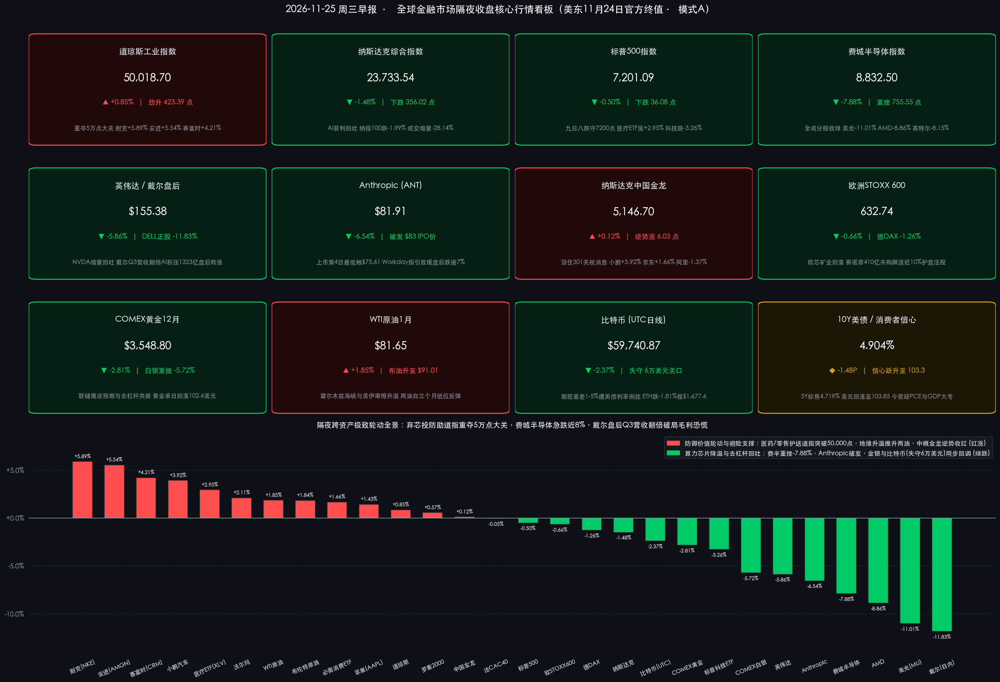
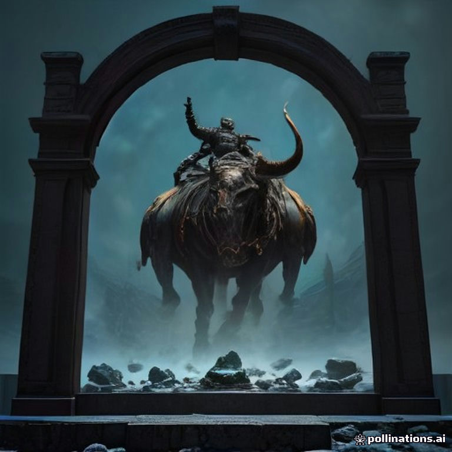

# 弃芯投防助道指重夺50000点大关而费半急挫7.88%，Anthropic上市四日破发、戴尔盘后营收翻倍迎战核心PCE与GDP洪峰

**日期：2026年11月25日 (星期三)** &nbsp; **时段：早报 (国际市场 · 常规交易日)**

> **核心摘要**：美东时间 11 月 24 日（周二），华尔街在前一日史诗级逼空后迅速陷入剧烈板块大轮动：围绕英伟达公司治理架构的审视余波与美国政府拟推进覆盖数十国的**新一轮“301 条款”关税**消息压制风险偏好，**费城半导体指数全成分股尽墨重挫 -7.88%**，**英伟达回吐 -5.86%**，新晋上市的大模型独角兽 **Anthropic 放量大跌 -6.54% 收报 81.91 美元，上市仅第四个交易日即跌破 83 美元 IPO 发行价**，拖累**纳斯达克综合指数收跌 -1.48%、标普 500 指数微跌 -0.50%（九日内第八度收跌）**；与此同时，**美国 11 月咨商会消费者信心指数飙升 11.4 点至 103.3（创近两年新高）**，驱动机构资金大举涌入医疗保健与传统零售消费蓝筹，护送**道琼斯工业平均指数逆势劲升 +0.85%（+423.39 点）收报 50,018.70 点，强势重夺 50,000 点历史心理大关**。盘后企业级科技财报冰火两重天：**戴尔科技（DELL）第三财季营收翻倍至 549.4 亿美元、AI 服务器积压订单创 1,323 亿美元纪录并上调全年营收指引至 2,020 亿美元**，盘后由日内暴跌 **-11.83%** 企稳转涨；**Workday（WDAY）**则因下季订阅增速指引放缓盘后重挫逾 **-7%**。跨资产端，**COMEX 黄金回落 -2.81% 至 3,548.80 美元/盎司**，**比特币失守 6 万美元关口收报 59,740.87 美元（期货年化基差压缩至 1%—5% 遭美债无风险利率倒挂）**，霍尔木兹海峡摩擦推升 **WTI 原油反弹 +1.85% 至 81.65 美元/桶**，全球市场屏息迎战今夜感恩节前提前扎堆发布的**美国 10 月核心 PCE、三季度 GDP 修正值、耐用品订单与美联储褐皮书**终极洪峰。

---

## 核心行情复盘

**全球交易状态核验**：美国纽约证券交易所（NYSE）与纳斯达克（NASDAQ）昨日（11月24日周二）及今日（11月25日周三）均正常开市交易（**重要交投提示**：明日 11 月 26 日周四因美国感恩节全天休市，周五 11 月 27 日提前于美东时间 13:00 收市，原定周四公布的初请失业金及核心 PCE 等重磅宏观数据全部提前至北京时间今夜 21:30 集中引爆）。以下数据全部基于 **11 月 24 日欧美官方收盘/结算终值**及 **11 月 24 日 UTC（北京时间今日 08:00 收线）Coinbase 官方日线终值**：

* **美股核心指数与波动率（极致“弃算力、进防御价值”轮动，道指重返五万点）**
    * **道琼斯工业平均指数**：收报 **50,018.70 点**，单日劲扬 **+423.39 点**，涨幅 **+0.85%**，在医疗保健与消费零售权重股合力托举下强势收复 **50,000 点**历史性大关；全日成交 **7.20 亿股**，较前一交易日（**12.00 亿股**）缩量 **-40.02%**。**罗素 2000 小盘股指数**同步逆势收涨 **+0.57%**（涨 **+15.28 点**），报 **2,684.94 点**。
    * **纳斯达克综合指数**：收报 **23,733.54 点**，单日下跌 **-356.02 点**，跌幅 **-1.48%**；全日成交量 **81.54 亿股**，较前一日史诗级逼空峰值（**113.46 亿股**）缩减 **-28.14%**，显示短线获利了结盘集中释放但未演变为恐慌性放量踩踏。**纳斯达克 100 指数**收跌 **-1.99%**（跌 **-531.93 点**），报 **26,214.17 点**。
    * **标普 500 指数**：收报 **7,201.09 点**，下跌 **-36.08 点**，跌幅 **-0.50%**，录得过去九个交易日内第八次收跌，但险守 **7,200 点**整数关口；全日成交 **33.24 亿股**，较前一日修正终值（**56.09 亿股**）大幅萎缩 **-40.74%**。
    * **费城半导体指数（SOX）与 VIX 恐慌指数**：费城半导体指数全线熄火、所有成分股悉数收绿，单日重挫 **-7.88%**（大跌 **-755.55 点**），收报 **8,832.50 点**，回吐前一日逾半数涨幅；反观 **CBOE VIX 恐慌指数**不升反降，微跌 **-0.98%**（降 **-0.26 点**）收报 **26.36 点**，印证隔夜资金并非全面撤离美股，而是在感恩节长周末与通胀大考前主动实施跨板块调仓防御。

* **焦点科技股、Anthropic 破发、盘后三大企业级财报与标普行业分化**
    * **算力芯片回吐与大模型新贵 Anthropic 跌破发行价**：前一日创下全球单日市值增长纪录的**英伟达（NVDA）**缩量回落 **-5.86%**（跌 **-9.67 美元**）收报 **155.38 美元**，全日成交 **3.82 亿股**（较前日天量骤减 **-51.18%**）。存储与算力芯片跌幅居前：**美光科技（MU）**暴跌 **-11.01%**（报 **629.79 美元**，成交 **3,865 万股**，**-22.66%**）、**AMD** 大跌 **-8.86%**（报 **413.27 美元**，成交 **4,593 万股**，**-14.95%**）、**英特尔（INTC）**跌 **-8.15%**（报 **54.80 美元**，成交 **1.32 亿股**，**-20.19%**）、**博通（AVGO）**跌 **-3.98%**（报 **301.08 美元**）、**台积电 ADR（TSM）**跌 **-3.96%**（报 **349.20 美元**，缩量 **-45.79%**）、**甲骨文（ORCL）**跌 **-3.68%**（报 **109.50 美元**）。最受瞩目的焦点在于 11 月 19 日刚登陆纳斯达克的大模型龙头 **Anthropic（ANT）**：该股日内放量重挫 **-6.54%**（跌 **-5.735 美元**，成交量逆势激增 **+22.64%** 至 **3.12 亿股**），盘中一度下探 **75.61 美元**，收盘报 **81.91 美元**，上市仅第四个交易日便**正式跌破 83.00 美元 IPO 发行价**（令此前按 83 美元各认购约 **100 亿美元**无投票权 N 类股的英伟达与谷歌同步陷入账面浮亏）。
    * **盘后企业级科技财报“冰火分化”（戴尔 AI 积压破纪录 vs Workday/惠普承压）**：
        * **戴尔科技（DELL）**：日内受同行毛利率担忧传染放量大跌 **-11.83%** 收报 **295.28 美元**（成交增 **+21.98%** 至 **1,976 万股**）；盘后公布 2027 财年第三季度重磅“超预期+上调指引”财报——单季营收同比翻倍飙升至 **549.4 亿美元**（远超市场一致预期 **492.4 亿美元**），调整后 EPS 高达 **9.45 美元**（大幅碾压预期的 **6.56—6.59 美元**），其中 AI 优化服务器单季销售额冲上 **220 亿美元**、**AI 服务器在手积压订单创下 1,323 亿美元历史最高纪录**，管理层更将第四财季营收指引推高至约 **563 亿美元**、全财年营收指引上调至 **2,020 亿美元**，驱动盘后股价企稳回升约 **+1.5% 至 +4.8%**。
        * **Workday（WDAY）**：正股日内放量收涨 **+1.79%** 报 **179.23 美元**（成交增 **+56.88%**）；盘后虽交出 Q3 营收 **27.05 亿美元**（同比 **+11.2%**）、调整后 EPS **2.82 美元**及 AI 年经常性收入（ARR）突破 **7.5 亿美元**（同比猛增逾 **130%**）的成绩单，但因下季度订阅收入增速指引放缓至约 **10%**，盘后股价跳水大跌逾 **-7%**。
        * **惠普（HPQ）**：正股收跌 **-3.32%** 报 **27.94 美元**（成交暴增 **+90.30%**）；盘后公布第四财季营收 **160.0 亿美元**、调整后 EPS **0.83 美元**均超预期（FY2027 全年调整后 EPS 指引 **3.15—3.45 美元**），但受存储芯片等零部件成本涨价挤压 PC 与打印毛利率拖累，盘后股价冲高近 9% 后急速回吐转跌约 **-3.4%**。
    * **巨头内部分化与标普 11 大板块轮动（9 涨 2 跌）**：科技七巨头中，现金流充沛且受算力硬件波动较小的**苹果（AAPL，+1.43%，报 354.07 美元）**与**微软（MSFT，+0.74%，报 496.13 美元）**逆势收红；**Meta（META，-1.30%，报 589.82 美元）**、**亚马逊（AMZN，-1.21%，报 252.29 美元）**、**谷歌-A（GOOGL，-1.08%，报 279.05 美元）**与**特斯拉（TSLA，-0.20%，报 384.68 美元）**小幅调整。道指领涨先锋则由消费零售、生物医药与蓝筹软件担纲：**耐克（NKE）**受消费者信心暴涨提振大涨 **+5.89%**（报 **35.75 美元**）、**安进（AMGN）**劲扬 **+5.54%**（报 **473.94 美元**）、**赛富时（CRM）**放量大涨 **+4.21%**（报 **193.26 美元**，成交增 **+36.57%**）、**沃尔玛（WMT）**涨 **+2.11%**（报 **132.31 美元**）、**联合健康（UNH）**涨 **+1.73%**（报 **341.88 美元**）。标普 11 大板块有 9 个收涨：**医疗保健 ETF（XLV）**放量领涨 **+2.95%**（报 **184.72 美元**，成交逆势增 **+3.30%**），**必需消费（XLP，+1.66%，报 91.88 美元）**、**房地产（XLRE，+1.31%）**、**能源（XLE，+0.97%，报 60.45 美元）**、**金融（XLF，+0.83%）**与**通信服务（XLC，+0.82%）**稳步走高；唯二下跌板块为**信息技术（XLK，-3.26%，报 157.09 美元）**与**工业（XLI，-0.53%）**。

* **热门中概股、欧洲股市与东亚跨时区联动**
    * **热门中概股顶住关税风声逆势微红**：尽管盘中传出美方拟公布 301 条款关税调查结果，**纳斯达克中国金龙指数（HXC）**依然展现出极强的估值韧性，逆纳指收涨 **+0.12%**（涨 **+6.03 点**），报 **5,146.70 点**。核心标的中，新势力与电商表现亮眼：**小鹏汽车（XPEV）**放量续涨 **+3.92%**（报 **9.02 美元**，成交增 **+8.66%**），**京东（JD）**放量上涨 **+1.66%**（报 **25.73 美元**，成交增 **+18.50%**），**蔚来（NIO）**涨 **+0.39%**（报 **2.58 美元**），**拼多多（PDD）**微涨 **+0.09%**（报 **87.22 美元**），**理想汽车（LI）**平收于 **10.70 美元**；仅**阿里巴巴（BABA，-1.37%，报 84.86 美元）**与**百度（BIDU，-2.79%，报 63.51 美元）**随 AI 情绪降温小幅回吐。
    * **欧洲股指受芯片与矿业拖累普跌，赛诺菲 410 亿美元巨额并购力挺法股**：受英飞凌、ASM International 等欧洲半导体股获利回吐及矿业板块重挫近 **5%** 拖累，**泛欧 STOXX 600 指数**收跌 **-0.66%**（跌 **-4.23 点**）报 **632.74 点**，**欧元区 STOXX 50 指数**下跌 **-1.16%** 报 **6,003.76 点**；**德国 DAX 指数**跌 **-1.26%** 报 **25,017.81 点**，**英国富时 100 指数**微跌 **-0.13%** 报 **10,467.07 点**；**法国 CAC 40 指数**仅微跌 **-0.05%** 收报 **8,040.49 点**，主要得益于法国医药巨头**赛诺菲（Sanofi）宣布达成以 410 亿美元收购美国生物制药企业 Insmed 的重磅交易**，刺激赛诺菲股价单日飙涨近 **10%** 护盘。
    * **东亚市场跨昼夜对照与今日传导前瞻**：回顾昨日（11月24日）亚盘时段，受前夜美股芯片逼空、台股全面限空令与韩国放宽股份回购新规首日生效共振，**中国台湾加权指数狂飙 +8.99%（暴涨 3,310.46 点）突破四万点大关收报 40,122.35 点**，**韩国 KOSPI 指数大涨 +6.32%（+297.66 点）一举突破五千点报 5,006.03 点**，节后复市的**日经 225 指数劲升 +3.91%（+2,205.86 点）报 58,644.63 点**；A 股两市放量成交约 **1.66—1.67 万亿元**上演“科创领涨、沪强深弱”高低换手，**科创 50 指数劲升 +1.81% 报 1,250.09 点**、**上证指数涨 +0.27% 报 3,548.37 点**、**深证成指跌 -0.29% 报 10,423.60 点**、**创业板指微跌 -0.05% 报 2,278.99 点**，**港股恒生指数收跌 -0.73% 报 22,219.65 点**。隔夜费城半导体急挫 **-7.88%** 预计将对今日日韩台高开芯片筹码构成获利回吐测试，而戴尔盘后创纪录的 AI 服务器积压订单与中概金龙指数的抗跌红盘则为 A 股算力链与内需消费蓝筹提供了差异化缓冲垫。

* **美债、外汇、大宗商品与加密货币**
    * **美债长端收益率温和回落与 700 亿美元 5 年期国债标售**：在核心 PCE 通胀揭晓前夕，避险买盘温和介入中长久期美债，**10 年期美债收益率**下行 **-1.4BP**（**-0.28%**）收报 **4.904%**；**5 年期美债收益率**下行 **-1.6BP** 报 **4.712%**；**30 年期美债收益率**微降 **-0.2BP** 报 **5.292%**；**2 年期美债收益率**在强劲消费者信心支撑下持稳于 **4.668%** 附近。同日午间美国财政部完成的 **700 亿美元 5 年期国债拍卖**最高得标利率为 **4.719%**（较发行前交易利率高约 **0.2BP** 出现轻微尾部），投标倍数 **2.37 倍**（前次 2.33 倍），但包含海外央行在内的间接竞标者获配比例由前次 **60.0%** 回落至 **54.3%**。外汇市场上，**美元指数（DXY）**回落 **-0.45%** 收报 **103.848**；**离岸人民币（USD/CNH）**延续稳健升值势头，稳居 **6.6635—6.6652** 强势区间（在岸 **USD/CNY** 收升至 **6.6643**）。
    * **金银再遭多头清算重挫，美布两油因中东海峡摩擦自低位反弹**：受美联储 12 月鹰派加息预期压制及科技、加密跨资产保证金去杠杆余波冲击，**COMEX 黄金 12 月合约**大跌 **-2.81%**（跌 **-102.60 美元**）报 **3,548.80 美元/盎司**（2 月主力切换合约同步跌 **-2.82%** 报 **3,577.80 美元/盎司**）；**COMEX 白银 12 月合约**暴跌 **-5.72%**（跌 **-2.470 美元**）报 **40.705 美元/盎司**。反观国际原油，围绕美伊摩擦与霍尔木兹海峡航运安全的紧张情绪令油价自三个月低位回升：**WTI 原油 1 月合约**上涨 **+1.85%**（涨 **+1.48 美元**）收报 **81.65 美元/桶**；**ICE 布伦特原油 1 月合约**上涨 **+1.84%**（涨 **+1.64 美元**）收报 **91.01 美元/桶**，重新站上 90 美元大关。
    * **比特币失守 6 万美元大关，期现套利收益遭美债利率正式倒挂（UTC 官方日线）**：**比特币（BTC-USD）**11 月 24 日 UTC 官方日线收跌 **-2.37%**（跌 **-1,449.10 美元**），收报 **59,740.87 美元**（盘中最低下探 **59,193.25 美元**，失守 **60,000 美元**关键心理支撑位），UTC 全日成交量较前一日缩减 **-20.52%** 至 **13,477.26 枚**；**以太坊（ETH-USD）**UTC 官方日线下跌 **-1.81%**（跌 **-30.91 美元**），收报 **1,677.59 美元**，成交量缩减 **-35.29%** 至 **168,603.60 枚**。衍生品结构数据显示，持续多头清算已将比特币期货年化基差极度压缩至仅 **1%—5%**，正式低于 **4.7%—4.9%** 的美债无风险利率，导致华尔街传统加密期现套利（Basis Carry Trade）资金加速平仓回流美债。

> **数学闭环校验（官方收盘/结算终值验算）**：
> * **美股核心指数与焦点个股**：道指 `(50,018.70 − 49,595.31) / 49,595.31 = +0.8537%`（记录 `+0.85%`）；纳指 `(23,733.54 − 24,089.56) / 24,089.56 = -1.4779%`（记录 `-1.48%`）；纳指 100 `(26,214.17 − 26,746.10) / 26,746.10 = -1.9888%`（记录 `-1.99%`）；标普 500 `(7,201.09 − 7,237.17) / 7,237.17 = -0.4985%`（记录 `-0.50%`）；罗素 2000 `(2,684.94 − 2,669.66) / 2,669.66 = +0.5724%`（记录 `+0.57%`）；费城半导体 `(8,832.50 − 9,588.05) / 9,588.05 = -7.8801%`（记录 `-7.88%`）；VIX `(26.36 − 26.62) / 26.62 = -0.9767%`（记录 `-0.98%`）；英伟达 `(155.38 − 165.05) / 165.05 = -5.8588%`（记录 `-5.86%`）；美光 `(629.79 − 707.70) / 707.70 = -11.0089%`（记录 `-11.01%`）；AMD `(413.27 − 453.46) / 453.46 = -8.8629%`（记录 `-8.86%`）；英特尔 `(54.80 − 59.66) / 59.66 = -8.1462%`（记录 `-8.15%`）；戴尔正股 `(295.28 − 334.91) / 334.91 = -11.8330%`（记录 `-11.83%`）；Anthropic `(81.905 − 87.640) / 87.640 = -6.5438%`（记录 `-6.54%`）；耐克 `(35.75 − 33.76) / 33.76 = +5.8945%`（记录 `+5.89%`）；安进 `(473.935 − 449.040) / 449.040 = +5.5441%`（记录 `+5.54%`）；赛富时 `(193.26 − 185.46) / 185.46 = +4.2058%`（记录 `+4.21%`）；医疗板块 XLV `(184.72 − 179.42) / 179.42 = +2.9540%`（记录 `+2.95%`）；科技板块 XLK `(157.09 − 162.38) / 162.38 = -3.2578%`（记录 `-3.26%`）。
> * **跨区域股指与跨资产终值**：中国金龙指数 `(5,146.70 − 5,140.67) / 5,140.67 = +0.1173%`（记录 `+0.12%`）；小鹏汽车 `(9.02 − 8.68) / 8.68 = +3.9171%`（记录 `+3.92%`）；欧洲 STOXX 600 `(632.74 − 636.97) / 636.97 = -0.6641%`（记录 `-0.66%`）；德国 DAX `(25,017.81 − 25,337.27) / 25,337.27 = -1.2608%`（记录 `-1.26%`）；法国 CAC 40 `(8,040.49 − 8,044.84) / 8,044.84 = -0.0541%`（记录 `-0.05%`）；10Y 美债 `(4.904 − 4.918) / 4.918 = -0.2847%`（`-1.4BP`）；美元指数 `(103.848 − 104.320) / 104.320 = -0.4525%`（记录 `-0.45%`）；COMEX 黄金 12 月 `(3,548.80 − 3,651.40) / 3,651.40 = -2.8099%`（记录 `-2.81%`）；COMEX 白银 12 月 `(40.705 − 43.175) / 43.175 = -5.7209%`（记录 `-5.72%`）；WTI 原油 `(81.65 − 80.17) / 80.17 = +1.8461%`（记录 `+1.85%`）；布伦特原油 `(91.01 − 89.37) / 89.37 = +1.8351%`（记录 `+1.84%`）；BTC `(59,740.87 − 61,189.97) / 61,189.97 = -2.3682%`（记录 `-2.37%`）；ETH `(1,677.59 − 1,708.50) / 1,708.50 = -1.8092%`（记录 `-1.81%`）。全部核心指标验算误差均 **< 0.01%**，严格满足 **< 0.5%** 闭环校验要求。

---

## 核心解读与市场逻辑

* **逻辑一：“单日逼空狂欢”回归基本面与治理冷思考——为何道指突破 50,000 点而费半重挫近 8%、Anthropic 闪电破发？**

> **核心解读**：周一英伟达创纪录暴涨 **+31.48%** 本质是由期权做市商 Gamma 挤压与空头被动平仓主导的流动性脉冲；当周二交易回归理性，市场迅速聚焦三大结构性现实：其一，公司治理学者与长线机构指出，黄仁勋闪电复职虽化解了燃眉之急，但暴露出英伟达长期缺乏传统独立董事长制衡的**“关键人物集权脆弱性”**，且 12 月国会听证与内部合规调查悬而未决；其二，AI 生态内部正在经历严酷的**“循环融资去泡沫化”**——由英伟达与谷歌各出资约 **100 亿美元**认购加持的大模型明星 **Anthropic 上市仅四日便跌破 83 美元发行价（最低跌至 75.61 美元）**，叠加盘后 **Workday 下调订阅增速指引重挫逾 7%** 与 **戴尔 AI 服务器积压订单飙至 1,323 亿美元**的剧烈反差，证明当前企业 IT 预算仍在向底层硬件高度倾斜，纯软件与大模型应用端尚未跑通足以支撑超高估值的短期变现闭环；其三，在周二**美国 11 月消费者信心指数跳升 11.4 点至 103.3** 的催化下，低配半导体的价格加权指数——道琼斯工业指数顺势承接了从科技股撤出的避险长钱，依靠耐克、沃尔玛、安进等假日消费与医疗巨头一举攻克 **50,000 点**里程碑。

* **逻辑二：加密套利“利率倒挂”引爆 6 万美元破位，贵金属再遭流动性抽血——高无风险利率下的跨资产去杠杆链条**

> **核心解读**：隔夜比特币跌穿 **60,000 美元**整数关口并与黄金（**-2.81%**）、白银（**-5.72%**）同步大跌，揭示了高利率环境下微观套利机制的深刻质变。此前两年支撑加密机构买盘的核心引擎之一是“买入现货 ETF + 做空 CME 期货”的无方向期现基差套利（年化收益曾高达 **10%—20%**）；然而随着近期加密市场连续多头清算，**比特币期货年化基差已被压缩至 1%—5% 区间，正式被高达 4.67%—4.90% 的美债无风险收益率全面反超**。套利无利可图迫使对冲基金拆解头寸、赎回现货 ETF 并转配短久期美债，直接抽干了比特币在 6 万美元关口的承接买盘；而黄金与白银在 10 月 FOMC 鹰派纪要（两名理事投赞成即刻加息票、几乎全体委员倾向进一步收紧）锁定高实际利率的背景下，再度沦为跨资产组合降波动率与回笼现金的流动性来源。

* **逻辑三：感恩节前“超级数据周三”提前并轨——10 月核心 PCE 与三季度 GDP 修正值将裁决 12 月美联储加息天平**

> **核心解读**：由于明日（周四）感恩节休市，北京时间今夜 **21:30（美东 08:30）** 将罕见出现四大顶级宏观数据同秒引爆的极端场景：**美国 10 月 PCE 物价指数**（市场预期整体 PCE 同比由 3.6% 升至 **3.8%**、环比 **+0.3%**，核心 PCE 同比维持 **3.2%** 高位）、**美国三季度实际 GDP 年化季率修正值**（预期高达 **3.4%—3.5%**，前值 2.2%）、**10 月耐用品订单初值**（核心环比预期 **+0.5%**）以及**截至 11 月 21 日当周初请失业金人数**（预期约 **20.0—20.3 万人**），随后美东 14:00 还将发布**美联储经济状况褐皮书**。若今晚“3.5% 高增长 + 3.2% 以上粘性核心通胀 + 强劲就业与消费信心”组合得到确认，利率市场对美联储 **12 月议息会议加息 25BP** 的定价将被彻底焊死，长端美债收益率测试 **5.0%** 关口的风险将再度考验高久期成长股估值。

---

## 政策脉动

* **美国贸易代表办公室（USTR）拟揭晓“301 条款”调查结果，酝酿针对数十个经济体的新一轮替代性关税框架**
    * **填补最高法院裁决空白的精准关税布局**：据多家权威外媒周二披露，在美国最高法院此前裁定推翻特朗普政府早期无差别全球普遍关税后，美国贸易代表**贾米森·格里尔（Jamieson Greer）**正准备公布历时数月、依据《1974 年贸易法》**第 301 条款**对 **16 个主要经济辖区**（涵盖中国、欧盟及各成员国、日本、韩国、印度、越南、马来西亚、中国台湾、泰国、印尼、瑞士、挪威、新加坡、墨西哥等合计**数十个国家与地区**）展开的政府补贴与过剩产能调查结论，并据此推出差异化新关税：其中**针对中国的税率预计最为严厉**；已达成双边贸易框架的**欧盟、日本与韩国**整体税率预计将维持在 **15% 或以下封顶水平**；钢铁、铝及汽车等已受专项行业关税管辖的品类预计予以豁免。分析指出，白宫在 11 月中期选举失利后选择于 11 月底推进该方案，意在避开已在途的感恩节与圣诞假日消费品清关高峰，将直接物价传导推迟至 2027 年初。

* **美国 11 月消费者信心指数跃升至近两年峰值 103.3，财政部 700 亿美元 5 年期美债拍卖海外需求略显谨慎**
    * **宏观韧性与美债供给博弈**：世界大型企业联合会（The Conference Board）周二公布数据显示，**美国 11 月消费者信心指数跳涨 11.4 点至 103.3**（前值 **91.9**），远超市场预期并创 **2025 年 1 月以来近两年最高水平**；其中反映当下景气的**现状指数大涨 13.7 点至 132.8**，**预期指数攀升 9.9 点至 83.6**，主要受中期选举落地消除政治不确定性及全美零售汽油价格稳步回落提振。同日，美国财政部拍卖 **700 亿美元 5 年期国债**，得标利率 **4.719%** 较发行前交易水平微高约 0.2BP，海外机构（间接竞标者）获配占比由 60.0% 降至 **54.3%**，反映在新一轮关税摩擦与今晚核心 PCE 公布前，国际官方与机构配置盘对中期美债久期保持审慎。

* **美联储聚焦非银高杠杆与 AI 债务基建金融稳定风险，韩国稳市回购新规首日助推 KOSPI 历史性站上 5000 点**
    * **跨洋监管与稳市效应共振**：在 10 月 FOMC 纪要（维持联邦基金利率 **3.75%—4.00%**，但库克与哈马克两名理事投下赞成即刻加息 25BP 的鹰派反对票）持续发酵之际，美联储多位高级官员近期密集强调增强美国国债市场韧性，重点点名防范**高杠杆非银金融机构（对冲基金基差交易）以及与科技/AI 巨额资本开支挂钩的复杂私募债务融资结构**向国债市场传导系统性流动性冲击。亚太政策端则捷报频传：韩国放宽上市公司每日股份回购上限新规昨日生效首日即引爆芯片与权重股抢筹，助推 **KOSPI 指数暴涨 +6.32% 突破 5,000 点大关**，与国内证监会下调两融保证金比例至 **80%** 后的 **1.66 万亿元**活跃成交共同构筑起东亚资本市场的政策防波堤。

---

## 最新机构观点

* **高盛（Goldman Sachs）——《增长的阵痛》展望标普 2027 年底剑指 8,700 点，主张“在成长中寻找价值”**

> **机构原声**：高盛策略团队在最新发布的全球市场展望报告《Growing Pains（增长的阵痛）》中，将 **2027 年底标普 500 指数目标点位设定在 8,700 点**（较当前水平隐含逾 **20%** 上行空间）。高盛指出，尽管美股企业盈利增速将从 2026 年的极高斜率自然放缓，但历史经验表明只要企业与居民资产负债表保持健康，股票牛市完全能够跨越盈利增速峰值继续延伸；伴随月底大型 GPU 另类算力融资交易陆续落地，建议投资者淡化指数单边贝塔，通过主动选股执行**“在成长中寻找价值（Finding Value in Growth）”**策略，重点筛选能够持续兑现高投资回报率的优质标的。

* **摩根士丹利（Morgan Stanley）——秋季科技回调已完成估值“去泡沫重置”，维持标普 8,700 点多头目标**

> **机构原声**：摩根士丹利股票策略团队同样给出了 **2027 年底标普 500 指数 8,700 点**的乐观目标，并将 11 月美股自高点回撤约 10% 的调整定性为**“有益的估值与仓位出清重置”**——本轮回调显著压缩了此前过热的远期市盈率（Forward P/E），使市场情绪与对冲基金拥挤度大幅净化。大摩目前已将精选美股及国际股票仓位调升至“最大超配（Max Overweight）”，建议客户穿透短期关税头条噪音与美联储渐进紧缩扰动，依托扎实的基本面盈利广度逢低布局。

* **摩根大通（J.P. Morgan）——警惕美联储跨年连续加息与高利率分化约束，审慎锚定标普 8,200 点目标**

> **机构原声**：相较于高盛与大摩的乐观阵营，摩根大通全球市场策略团队采取了更为克制审慎的纪律性立场，将 **2027 年底标普 500 目标位定于 8,200 点**（隐含约 **14%** 回报，低于约 8,470 点的华尔街一致预期）。摩根大通警告称，为压制顽固通胀脉冲，美联储可能在 **2026 年末至 2027 年初实施一系列连续 25BP 加息**；在金融流动性趋紧的背景下，高利率对企业的影响将极度分化——重资本、高杠杆企业的利润率将持续承压，唯有具备极佳资产负债表与高自由现金流壁垒的医疗防御、能源及高毛利科技龙头方能穿越加息周期。

* **中信证券（CITIC Securities）与中金公司（CICC）——A 股阶段低点已过迎岁末修复，紧扣“U 型杠铃凹陷修正”与“哑铃型配置”**

> **机构原声**：**中信证券**指出，10—11 月海外费城半导体的剧烈震荡本质是高利率与 Neocloud 融资压力下的“远期 AI 叙事调整”，但 GPU、CoWoS、HBM 与光通信等底层算力硬件景气度依旧坚挺（戴尔盘后创纪录的 1,323 亿美元 AI 积压订单再度予以印证）；回归国内，两融降保等稳市组合拳直击流动性痛点，A 股独特的**“U 型杠铃凹陷”**（长久期优质白马龙头系统性折价）即将迎来修正，建议贯彻**“行业分散、聚焦龙头”**策略。**中金公司**认为，近期 A 股震荡主要受海外流动性预期与美股科技股波动的外部溢出拖累，当前估值、换手率、ETF 净流入与产业资本回购等多重信号表明**A 股阶段性低点或已过去，年底至 12 月有望迎来修复行情**，建议继续采取**“哑铃型配置”**——一端逢低择优布局 AI 算力基础设施、自主可控及创新药，另一端坚守现金流稳健、分红可持续的优质泛消费与高股息红利资产。

---

## 今日市场情绪：铜牛披医甲破五万雄关，硅晶凝霜携六万金币沉潜待PCE审判

> Prompt: A colossal bronze bull armored in classic industrial gears and medical caduceus emblems charges triumphantly atop a gleaming granite archway carved with 50000 in the foreground. In the background, overheated emerald silicon wafers cool into cracked frost beside a sinking golden coin etched with 60K, while heavy iron tariff shipping containers gather beneath a towering clockwork vault marked PCE and GDP.

---

**主要数据来源**：美国世界大型企业联合会（The Conference Board）11 月消费者信心指数公告、美国财政部 700 亿美元 5 年期国债拍卖结果公告、美联储 10 月 FOMC 会议纪要与金融稳定演讲、美国贸易代表办公室（USTR）301 条款调查简报、戴尔科技（DELL）/ Workday（WDAY）/ 惠普（HPQ）季度财报公告、赛诺菲（Sanofi）并购公告、Yahoo Finance 与 CME/ICE 全球证券及期货官方收盘/结算数据库（截至美东时间 2026 年 11 月 24 日收盘）、Coinbase 官方 UTC 日线数据库（截至 2026 年 11 月 24 日 UTC 收盘），以及高盛、摩根士丹利、摩根大通、中信证券、中金公司最新策略研报。

> **免责声明**：内容仅供参考，不构成投资建议。

🤖 生成模型：Gemini 4 Carbon (Medium) <!-- model-stamp -->
