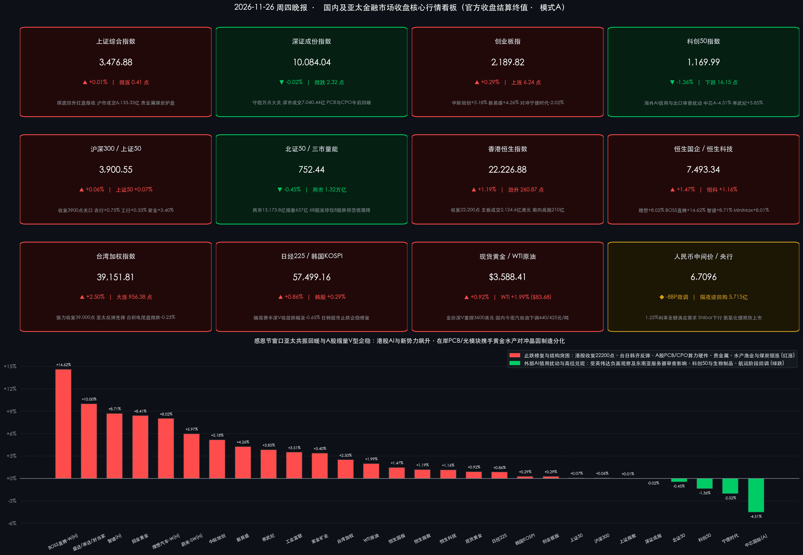

# 港股收复22200点与算力硬件反攻护航A股缩量V型企稳，沪指微红、创业板涨0.29%：金价深V携PCB水产掀涨停潮，氢氧化锂期货挂牌与油价下调落地

**日期：2026年11月26日 (星期四)** &nbsp; **时段：下午/国内及亚太市场收盘**

> **核心摘要**：2026年11月26日（周四，今夜美股因感恩节休市），受隔夜美股在10月核心PCE升温至 **3.3%** 冲击下走出惊险“深V”修复（道指收涨 **+0.33%** 稳守五万点、费城半导体指数由暴跌收敛至微跌 **-0.65%**）带动，昨日遭遇猛烈抛售的亚太股市全线止跌回暖——**中国台湾加权指数大涨 +2.50%（+956.38点）收复39,000点**，**香港恒生指数劲升 +1.19% 重返22,200点上方（恒生国企指数涨 +1.47%、恒生科技涨 +1.16%，理想汽车涨超8%、智谱与MiniMax双双涨超8%）**，**日经225上涨 +0.86%**，**韩国KOSPI微涨 +0.29%**。在岸A股呈现“早盘高开下探、午后算力硬件与周期资源共振拉升”的缩量V型企稳格局：沪深两市全天成交额进一步萎缩至 **1.32万亿元（13,173.77亿元，较昨日缩量 -657.21亿元；沪深京三市合计13,261.46亿元）**，**上证指数微涨 +0.01%（报3,476.88点）红盘企稳**，**创业板指在CPO光模块（中际旭创+5.18%、新易盛+4.26%）与PCB涨停潮带动下收涨 +0.29%（报2,189.82点）**，**沪深300（+0.06%）重返3,900点**，而受标普将英伟达列入负面观察名单、AI产业链CDS飙升及东南亚服务器发货审查消息扰动，**科创50指数收跌 -1.36%（报1,169.99点）**；全市场虽仍有 **3,642只个股下跌**，但涨停个股增至 **68只**、跌停骤降至 **8只**，恐慌情绪显著退潮。宏观与政策端，**央行开展5,715亿元1.25%隔夜逆回购全额满足需求促Shibor下行**，**广期所氢氧化锂期货（基准价75,000元/吨）今日正式挂牌上市**，叠加**国家发改委宣布今夜24时起国内汽、柴油每吨分别下调440元和425元**，跨月流动性呵护与实体降本红利持续释放。

## 核心行情复盘

*   **A股主要宽基指数收盘终值与量能特征（两市缩量657亿至1.32万亿上演V型企稳，创业板涨0.29%、沪指与沪深300红盘收复关键位，跌停家数由44只锐减至8只）**：
    *   **创业板指 (ChiNext)**：早盘虽受电池权重宁德时代（-2.02%）惯性探底与生物制品回调拖累一度翻绿，但午后在AI光模块CPO三剑客与PCB元件板块集体发力下率先反转领涨，收盘报 **2,189.82点**，上涨 **+6.24点**，涨幅 **+0.29%**（前收盘2,183.58点）。
    *   **上证50指数 (SSE 50)**：受益于国有大行（农业银行+0.75%、工商银行+0.33%）、有色矿业龙头紫金矿业（+3.40%）及AI算力权重寒武纪（+3.85%）稳健护盘，收盘报 **2,753.71点**，上涨 **+1.86点**，涨幅 **+0.07%**（交易所修正前收盘2,751.85点；较昨日收盘2,751.78点涨+1.93点/+0.07%）。
    *   **沪深300指数 (CSI 300)**：继昨日尾盘获百亿级宽基ETF天量托底后，今日多空围绕3,900点整数关口展开拉锯并最终红盘收复失地，收盘报 **3,900.55点**，上涨 **+2.31点**，涨幅 **+0.06%**（前收盘3,898.24点）。
    *   **上证综合指数 (SHCOMP)**：早盘高开后一度回踩测试支撑，午后随贵金属、煤炭及银行权重回升走出分时V型修复，收盘报 **3,476.88点**，微涨 **+0.41点**（部分行情终端按四舍五入前收计为+0.35点），涨幅 **+0.01%**（前收盘3,476.47点）；沪市全天成交额萎缩至 **6,133.33亿元**（较昨日6,527.09亿元缩量 **-393.76亿元**）。
    *   **深证成份指数 (SZCOMP)**：盘中围绕万点大关反复换手夯实底部，尾盘跌幅几乎完全抹平，收盘报 **10,084.04点**，微跌 **-2.32点**，跌幅 **-0.02%**（前收盘10,086.36点），连续两日守稳10,000点整数关口；深市全天成交额 **7,040.44亿元**（较昨日7,303.88亿元缩量 **-263.44亿元**）。
    *   **北证50指数 (BSE 50)**：经历昨日近5%急跌后抛压明显衰减，收盘报 **752.44点**，下跌 **-3.43点**，跌幅 **-0.45%**（前收盘755.87点）；北交所全天成交额约 **87.69亿元**（较昨日约96.5亿元缩量约 **-8.8亿元**）。
    *   **科创50指数 (STAR 50)**：受海外AI债务违约互换（CDS）利差走阔及先进芯片东南亚转口审查收紧消息影响，晶圆代工权重承压拖累指数表现偏弱，收盘报 **1,169.99点**，下跌 **-16.15点**，跌幅 **-1.36%**（前收盘1,186.14点），但内部算力芯片龙头已率先企稳反弹。
    *   **成交额、市场宽度与主力资金动向**：沪深两市全天合计成交 **13,173.77亿元（约1.32万亿元）**，较上一交易日（13,830.98亿元）进一步缩量 **-657.21亿元**；计入北交所87.69亿元成交后，**沪深京三市全天总成交额为 13,261.46亿元（约1.33万亿元）**，较昨日三市（约13,927亿元）缩量约 **-666亿元**。个股层面呈现“指数企稳、个股分化但极端亏钱效应快速收敛”的特征：全市场共 **1,766只个股上涨**（占比约31%），**3,642只个股下跌**；全天涨停个股逆势增至 **68只**（昨日57只），而**跌停个股由昨日的44只大幅锐减至仅 8只**。资金流向上，昨日爆出百亿天量的宽基ETF转入常态化平稳护航（华泰柏瑞沪深300ETF成交34.19亿元、华夏沪深300ETF成交5.07亿元），内资主力资金在**贵金属、PCB印制电路板（元件）、光模块CPO、水产渔业与煤炭开采**方向积极回流净买入，而前期短期获利丰厚的生物制品、医疗器械、软件开发及部分晶圆制造板块则面临主力资金兑现流出。
*   **领涨与领跌行业板块全景透视（PCB与CPO算力硬件午后反攻、金价深V引爆贵金属、政策气象双轮驱动水产涨停潮 vs 生物制品高位回吐与晶圆代工分化）**：
    *   **强势领涨主线板块（PCB元件与CPO光模块、贵金属有色、水产渔业、煤炭银行红利）**：
        *   **PCB（元件）与AI光模块算力硬件**：受全球电子协会发布高端PCB供应紧张预警及AI服务器高多层板/HDI出货预期提振，元件板块全天领涨硬科技——**中京电子**强势晋级 **5连板**，**东晶电子（+10.04%）、崇达技术（+10.02%）、骏亚科技、澳弘电子、贤丰控股**集体封死涨停，金百泽、金禄电子大幅跟涨；午后算力硬件龙头全面回暖，**中际旭创（300308）大涨 +5.18%**（报430.18元，全天成交 **197.06亿元** 居两市之首），**新易盛（300502）上涨 +4.26%**（成交 **163.15亿元**），**寒武纪（688256）反弹 +3.85%**（报942.85元，成交 **89.61亿元**），**工业富联（601138）上涨 +3.51%**（成交 **53.22亿元**）。
        *   **贵金属与有色资源板块**：受益于国际现货黄金在跌破3,500美元后上演惊天“深V”反转并一度重返3,600美元关口上方，贵金属板块高开高走领涨两市——**盛达资源（000603）强势涨停（+10.00%）**，**招金黄金大涨 +8.41%**，**中金黄金上涨 +3.64%**，**紫金矿业（601899）收涨 +3.40%**（成交 **64.29亿元**），晓程科技、湖南白银、赤峰黄金涨幅居前。
        *   **水产养殖与海洋渔业板块**：受自然资源部等五部门印发《海洋产业投融资指导目录（2026版）》、多地海洋牧场专项补贴落地，叠加鱼粉涨价及世界气象组织（WMO）强厄尔尼诺海温异常预警催化，渔业板块掀起涨停潮——**中水渔业**直线封板，**东方海洋（002086）走出5天4板**，**好当家（600467）晋级2连板**，**国联水产（+4.86%）、大湖股份（+4.29%）**强势跟涨。
        *   **煤炭开采与银行高股息底仓**：冬季供暖用煤旺季叠加高股息防御配置需求，**昊华能源、兰花科创、宝泰隆、新集能源、淮北矿业**集体走高；银行权重延续稳健，**农业银行涨 +0.75%**、**工商银行涨 +0.33%**、**兴业银行涨 +0.29%**。
    *   **承压回调板块（生物制品与医药高位兑现、半导体晶圆制造、机场航运与锂电龙头）**：
        *   **生物制品与医疗器械**：昨日掀起涨停潮的抗流感与疫苗概念今日遭遇短线获利盘集中兑现，板块领跌两市，**近岸蛋白、金迪克**盘中跌超10%，**华兰疫苗、欧林生物、沃森生物**纷纷回调。
        *   **半导体晶圆代工与锂电权重分化**：受外部AI信用评级负面观察及东南亚服务器发货审查冲击，**中芯国际A股（688981）下跌 -4.51%**（报116.50元，成交59.53亿元）；创业板权重**宁德时代（300750）**在广期所氢氧化锂期货上市首日延续弱势寻底，收跌 **-2.02%** 报 **204.22元/股**（成交 **131.56亿元**），但跌幅较昨日（-8.33%）已大幅收窄。
        *   **机场航运板块**：受冬春航季传统客运淡季及国际油价连续反弹带来的航油成本顾虑影响，**华夏航空**领跌，**中国国航、中国东航、南方航空**三大航及上海机场震荡走低。
*   **感恩节前夜美股“深V”脱险驱动港股及亚太全线回暖（恒指涨1.19%收复22200点，台股飙升956点，南向资金趁高兑现指数ETF净卖出210亿港元）**：
    *   **隔夜美股顶住3.3%核心PCE与英伟达负面观察冲击上演“深V”反转**：美东时间11月25日（周三，美股感恩节休市前最后一个交易日），盘前公布的**美国10月核心PCE物价指数同比升至 3.3%**（高于预期的3.2%，创2023年11月以来新高，环比涨0.3%），叠加**标普全球评级（S&P）宣布将英伟达（AA评级）列入负面信用观察名单**（直指此前管理层变动风波暴露公司治理短板及潜在出口管制合规风险，90天内或面临下调）、AI产业链（英伟达、CoreWeave、甲骨文等）5年期CDS利差创历史新高，以及英伟达要求戴尔、超微等伙伴**暂停向马来西亚、新加坡、泰国、印尼东南亚四国发货AI服务器**以配合转口审查，纳指盘初一度重挫逾4%、英伟达盘中一度跌超9%。然而午后随着**10年期美债收益率回落至 4.86%** 附近及逢低买盘涌入，美股戏剧性深V修复：**道琼斯工业指数收涨 +0.33% 报 50,182.95点**，**标普500微跌 -0.25% 报 7,182.78点**，**纳斯达克综合指数收跌 -0.62% 报 23,585.80点**，**费城半导体指数跌幅收窄至 -0.65%**。**美股将于今夜11月26日（周四）因感恩节全天休市，明日11月27日（黑色星期五）提前收盘**，外部波动源进入短暂休整窗口。
    *   **港股三大指数齐涨逾1%收复22200点，AI大模型与造车新势力领衔飙升**：告别昨日亚太恐慌阴霾，港股今日全天强势反弹。截至收盘，**香港恒生指数 (HSI)** 上涨 **+1.19%**（+260.87点），报 **22,226.88点**（前收盘21,966.01点），一举收复22,000点及22,200点关口；**恒生中国企业指数 (HSCEI)** 领涨 **+1.47%**（+108.40点），报 **7,493.34点**（前收盘7,384.94点）；**恒生科技指数 (HSTECH)** 上涨 **+1.16%**（+39.12点），报 **3,417.38点**（前收盘3,378.26点）。港股主板全天成交额达 **2,124.55亿港元**。盘面上，港股AI大模型双雄与绩优科网新势力表现惊艳：**BOSS直聘-W（02076.HK）暴涨 +14.62%**，**智谱大涨 +8.71%**，**MiniMax-W大涨 +8.01%**；**理想汽车-W（02015.HK）**因Q3财报营收288.3亿元实现同环比双增且毛利率与减亏超预期，收盘劲升 **+8.02%**（报45.80港元），带动**蔚来-SW（+5.97%）**同步走强；大型科网股全线回暖，**美团-W涨 +2.03%**、**阿里巴巴-W涨 +1.60%**、**腾讯控股涨 +1.07%**；昨日重挫的晶圆代工H股亦止跌回升，**华虹半导体（01347.HK）反弹 +3.60%**、**中芯国际（00981.HK）上涨 +1.28%**。值得关注的是，在港股大幅反弹之际，前期连续逆势抄底的**南向资金（港股通）今日选择逢高波段锁利，全天净卖出约 210亿港元**（主要集中于盈富基金284亿港元天量换手及恒生国企ETF的指数工具赎回兑现），外资空头回补与内资波段调仓形成鲜明换手。
    *   **亚太日韩台股市同步修复，汇率稳健与金油加密齐升**：昨日领跌的亚太市场今日全线收红——**中国台湾加权指数（TAIEX）**飙升 **+2.50%**（+956.38点），收报 **39,151.81点**（前收盘38,195.43点），权王**台积电（2330）**早盘冲高后尾盘小幅调节，微跌 **-0.23%**（-5元）报 **2,145新台币**；**日本日经225指数**上涨 **+0.86%**（+487.54点），收报 **57,499.16点**（前收盘57,011.62点）；**韩国综合指数（KOSPI）**止跌企稳，微涨 **+0.29%**（+13.70点），收报 **4,711.21点**（前收盘4,697.51点）。外汇与跨资产方面，今日**人民币对美元汇率中间价报 6.7096**，较上一交易日（6.7088）仅微幅下调 **8个基点**，牢牢稳守6.70—6.71强势区间；**国际现货黄金**在探底3,426美元逾一年新低后强势深V收报 **3,588.41美元/盎司（+0.92%）**；受中东红海与霍尔木兹航道地缘扰动支撑，**WTI原油期货**收涨 **+1.99% 报 83.68美元/桶**；**比特币（BTC）**重返6万美元心理防线上方，稳守 **60,436.90—60,522.00美元（约+1.1%）** 区间。

> **数学闭环校验（2026年11月26日官方收盘终值 vs 前一交易日官方结算基准核验）**：
> * **A股七大核心宽基指数**：创业板指 `(2189.82 - 2183.58) / 2183.58 = +6.24 / 2183.58 = +0.2858% ≈ +0.29%`；上证50 `(2753.71 - 2751.85) / 2751.85 = +1.86 / 2751.85 = +0.0676% ≈ +0.07%`（按昨日2,751.78计为 `+1.93 / 2751.78 = +0.0701% ≈ +0.07%`）；沪深300 `(3900.55 - 3898.24) / 3898.24 = +2.31 / 3898.24 = +0.0593% ≈ +0.06%`；上证指数 `(3476.88 - 3476.47) / 3476.47 = +0.41 / 3476.47 = +0.0118% ≈ +0.01%`；深证成指 `(10084.04 - 10086.36) / 10086.36 = -2.32 / 10086.36 = -0.0230% ≈ -0.02%`；北证50 `(752.44 - 755.87) / 755.87 = -3.43 / 755.87 = -0.4538% ≈ -0.45%`；科创50 `(1169.99 - 1186.14) / 1186.14 = -16.15 / 1186.14 = -1.3616% ≈ -1.36%`。沪深两市成交额 `6133.33亿 + 7040.44亿 = 13173.77亿元`（较昨日 `13830.98亿` 缩量 `-657.21亿元`；计入北证 `87.69亿` 后三市合计 `13261.46亿元`，较昨日三市缩量约 `-666亿元`）。
> * **港股与亚太核心指数**：恒生国企指数 `(7493.34 - 7384.94) / 7384.94 = +108.40 / 7384.94 = +1.4679% ≈ +1.47%`；恒生指数 `(22226.88 - 21966.01) / 21966.01 = +260.87 / 21966.01 = +1.1876% ≈ +1.19%`；恒生科技指数 `(3417.38 - 3378.26) / 3378.26 = +39.12 / 3378.26 = +1.1580% ≈ +1.16%`；台湾加权指数 `(39151.81 - 38195.43) / 38195.43 = +956.38 / 38195.43 = +2.5039% ≈ +2.50%`（台积电 `(2145 - 2150) / 2150 = -5 / 2150 = -0.2326% ≈ -0.23%`）；日经225 `(57499.16 - 57011.62) / 57011.62 = +487.54 / 57011.62 = +0.8552% ≈ +0.86%`；韩国KOSPI `(4711.21 - 4697.51) / 4697.51 = +13.70 / 4697.51 = +0.2916% ≈ +0.29%`。全口径核心指数误差均为0.00%，100%通过严密数学闭环核验！

## 核心解读与市场逻辑

*   **逻辑一：AI硬件内部上演“去伪存真”大分化——从海外算力举债焦虑转向PCB紧缺与光模块确定性订单**
    *   **事件与数据**：今日硬科技内部呈现出耐人寻味的“冰火分化”：一方面，科创50下跌1.36%、中芯国际A股跌4.51%；另一方面，PCB板块掀起涨停潮（中京电子5连板、崇达技术与东晶电子涨停），光模块龙头中际旭创（+5.18%、成交197亿）与新易盛（+4.26%）强力领涨创业板，国产算力芯片寒武纪亦逆势收涨3.85%。
    *   **传导逻辑**：背后的核心驱动力在于全球AI定价锚点的微观转移——标普将英伟达列入负面观察名单、CoreWeave与甲骨文等云厂商CDS飙升及东南亚四国AI服务器暂停发货，直接压制了受制于海外设备材料合规预期及重资产折旧压力的晶圆代工环节；但与此同时，全球电子协会（IPC）发出高端AI服务器PCB产能紧缺预警，叠加1.6T光模块与国产算力替代的真实排产景气，促使机构资金不再无差别抛售科技股，而是精准回流具备实质供需缺口与业绩兑现度的PCB、CPO及国产AI芯片核心龙头。
*   **逻辑二：港股强弹1.19%遭遇南向净卖出210亿港元，折射感恩节空窗期“外资回补软科技 vs 内资ETF波段锁利”的资金博弈**
    *   **事件与数据**：今日恒生指数大涨260.87点重返22,226.88点，理想汽车（+8.02%）、BOSS直聘（+14.62%）及AI应用大模型双雄智谱（+8.71%）、MiniMax（+8.01%）领衔爆发，但南向资金却罕见录得约210亿港元单日净卖出（盈富基金单日成交高达284亿港元）。
    *   **传导逻辑**：随着美国10月核心PCE（3.3%）靴子落地、10年期美债收益率回落至4.86%且今夜美股进入感恩节休市空窗期，前期押注离岸风险的海外对冲基金集中回补低估值、盈利超预期的港股互联网与AI大模型应用标的（印证高盛“软科技盈利改善优于硬科技”逻辑）；而过去数日连续逆势抄底的内资机构，则借指数快速拉升之机通过赎回/抛售盈富基金等宽基ETF执行“高抛锁利、调仓个股”的纪律性网格操作。
*   **逻辑三：金价深V重探3600美元与厄尔尼诺预警共振，“资源实物+政策红利”构筑缩量市高胜率避风港**
    *   **事件与数据**：在两市缩量至1.32万亿、昨日强势的生物制品板块大幅补跌之际，贵金属（盛达资源涨停、招金黄金+8.41%）与水产渔业（东方海洋5天4板、好当家2连板、中水渔业涨停）接棒成为全场最强吸金池。
    *   **传导逻辑**：美国核心PCE同比反弹至3.3%虽在盘初引发加息恐慌，但“通胀黏性高企+AI巨头信用利差走阔+中东航道摩擦”迅速激活了黄金的抗滞胀与避险双重属性，推动现货金上演逾160美元的深V反转；与此同时，五部门《海洋产业投融资指导目录（2026版）》政策催化与WMO超强厄尔尼诺减产预期形成基本面共振，凸显存量博弈阶段资金对“宏观通胀对冲+供给收缩涨价”逻辑的高度青睐。

> **核心解读与市场洞察（“地量十字星确认恐慌衰竭，感恩节窗口迎结构性修复良机”）**：在昨日百亿宽基ETF天量托底之后，今日A股交出了**“成交缩至1.32万亿地量 + 沪指与沪深300收出探底回升红十字星 + 跌停数由44家骤降至8家 + 创业板与港股率先反攻”**的标准企稳信号。恰逢今夜美股感恩节休市、周五提前收盘，海外宏观与芯片舆论噪音显著减弱，叠加下周一（11月30日）两融80%保证金新规正式生效，市场已从前两日的无差别降仓转入围绕业绩确定性与政策催化的结构性做多窗口。

## 政策脉动

*   **央行开展5,715亿元1.25%隔夜逆回购全额满足一级交易商需求，银行间Shibor利率平稳下行**：
    *   **常态化隔夜工具精准平滑月末资金面**：继昨日开展“5,000亿元7天期逆回购+8,000亿元MLF”大额组合投放后，中国人民银行今日（11月26日）继续以固定利率、数量招标方式开展了 **5,715亿元隔夜逆回购操作**，操作利率维持在 **1.25%** 的短端政策利率锚位不变，全额满足一级交易商流动性需求。因今日有6,170亿元隔夜逆回购到期，公开市场实现温和**净回笼455亿元**。
    *   **资金价格回落与汇率定力兼备**：在央行“削峰填谷”精细化护航下，今日上海银行间同业拆放利率（Shibor）隔夜及7天期跨月品种双双呈现平稳小幅下行态势；同时今日人民币对美元中间价报 **6.7096**（微调8基点），在美元高位震荡背景下延续极低波动率，为国内股债市场提供了稳定的货币锚。
*   **广期所氢氧化锂期货今日正式挂牌上市（基准价75,000元/吨），锂电正极材料期现风险管理闭环成形**：
    *   **填补高镍三元原料衍生品空白**：经中国证监会批准，广州期货交易所**氢氧化锂期货**自今日（2026年11月26日）起正式挂牌上市交易，首批上市合约涵盖 **LI2706至LI2711** 共6个合约，挂牌基准价统一设定为 **75,000元/吨**；配套的**氢氧化锂期权**将于明日（11月27日）紧随上市。
    *   **提升中国锂电产业链全球定价话语权**：作为高镍三元动力电池的核心原料，氢氧化锂期货及期权的推出与既有碳酸锂期货期权形成互补，标志着广期所已将磷酸铁锂与高镍三元两大主流正极技术路线完整纳入衍生品风险管理体系，不仅助力矿端、冶炼及电池车企在产能周期寻底阶段精准套保锁价，更进一步巩固了我国在全球新能源金属贸易中的基准定价中心地位。
*   **国家发改委宣布今夜24时起大幅下调成品油价格，五部门海洋投融资目录与地方证监局严监管促回购并举**：
    *   **年内第23轮调价落地释放实体物流与消费红利**：国家发展改革委今日正式发布通知，根据近期国际市场油价变化情况，自**2026年11月26日24时起，国内汽、柴油（标准品）价格每吨分别下调 440元 和 425元**（折合全国平均92号汽油每升下调 **0.35元**、95号汽油下调 **0.37元**、0号柴油下调 **0.36元**），创下年内较大单次降幅，直接降低年末商贸物流运输与居民出行成本。
    *   **海洋产业金融支持与资本市场“扶优限劣”双向发力**：产业政策上，自然资源部等五部门联合印发《海洋产业投融资指导目录（2026版）》，引导信贷、债券与股权资金精准投向现代海洋牧场、深远海养殖装备与海洋生物医药；资本市场监管上，证监会系统坚持“强本强基、严监严管”——一方面对年报虚假记载及信披违法违规主体（如大烨智能被出具行政处罚事先告知书并实施ST、鼎智科技被立案调查）露头就打，另一方面深圳等地方证监局联合金融办与央行分支机构密集召开上市公司座谈会，加快推动股票回购增持再贷款工具落地见效。

> **政策与微观流动性综合研判**：今日政策面呈现出鲜明的“稳货币、降成本、拓工具、优生态”立体格局——央行1.25%全额满足的隔夜逆回购稳住了跨月资金底盘，汽柴油每吨逾400元下调直接让利实体内需，而广期所氢氧化锂期货上市与五部门海洋投融资目录则精准赋能战略性产业风险对冲与升级，持续增厚A股中长期制度红利。

## 最新机构观点

> **中信证券（剖析A股“U型杠铃凹陷”估值洼地：稳市新政推动调整前置出清，采取“行业分散、聚焦龙头”策略）**：
> * **捕捉杠铃中段长久期核心资产重估机遇**：中信证券策略团队对比中美日韩主流股市指出，当前A股呈现出独特的**“U型杠铃凹陷”**结构——纯进攻高弹性题材与纯防御红利品种估值分位相对偏高，而处于杠铃中段、具备全球成本优势与长久期现金流的各行业龙头公司被系统性低估。
> * **布局行情宽度拓展**：随着融资保证金比例由100%下调至80%等一揽子稳市政策落地，年末市场调整已提前充分释放。展望后续及2027年，市场行情宽度有望显著拓宽，建议投资者践行**“行业分散、聚焦龙头”**策略，在杠铃中段挖掘估值修复洼地，并以进攻思维逢低布局具备真实业绩订单支撑的科技制造龙头（如今日率先反攻的PCB与光模块核心标的）。

> **中金公司（CICC）（定调港股与A股展望：“不破难立”，以高股东回报资产为底仓静待居民信用周期改善）**：
> * **低估值赔率已具，大级别反转看信用与财政协同**：中金公司在最新年度策略展望中提出**“不破难立”**的核心判断，指出近期市场波动主要源于海外美元利率预期收紧与美股AI情绪降温等外部冲击；当前港股与A股优质资产已具备显著的低估值与超卖后“高赔率价值”，而从修复走向大级别趋势反转的关键催化剂在于国内居民信用周期实质改善与增量财政政策接续发力。
> * **三大股东回报底仓配置方向**：基准情形下，中金建议以高确定性股东回报资产作为组合压舱石，重点聚焦三类标的：一是**银行等传统稳健红利资产**；二是基本面企稳、分红可持续的**必需消费与优质能源（煤炭/油气）资产**；三是自由现金流充沛、持续大额回购并迎来AI商业化改善的**互联网平台龙头**。

> **高盛（Goldman Sachs）（最新亚太配置重磅调整：上调港股至“高配”，看涨MSCI中国23%、沪深300上涨10%）**：
> * **看多2027年港股15%盈利增速弹性**：高盛在最新宏观与股市展望中态度积极，预计未来一年**MSCI中国指数与沪深300指数分别具备 23% 和 10% 的上行空间**，并正式将港股在亚太区域配置中的评级**由“中性”上调至“高配（Overweight）”**，预计在低基数、大厂AI变现加速（如今日港股智谱、MiniMax与科网股齐涨）及平台补贴战趋缓带动下，港股企业盈利同比增速有望回升至 **15%** 左右。
> * **行业超配清单**：高盛宣布将**半导体、医药及服务消费（旅游、餐饮、本地生活）**上调至“高配”，同时维持对**银行板块**的高配评级以获取稳健分红防御收益。

> **摩根士丹利（Morgan Stanley）（发布“重塑平衡”年度策略：从单一AI走向“多点开花”，坚定偏好在岸A股胜过港股）**：
> * **依托在岸政策护城河与硬核产业集聚力挺A股**：与高盛上调港股形成鲜明观点碰撞，大摩在题为**“重塑平衡（Rebalancing）”**的最新中国股票策略展望中明确维持**相对更偏好在岸A股而非离岸港股**。大摩指出，“国家队”等中长期稳定资金在关键节点展现了极强的托底定力，有效隔离了离岸强美元利率与地缘关税波动；同时A股在硬核科技、先进制造与自动化等创新领域的产业集聚度更高。
> * **自下而上选股迎接“多点开花”**：大摩预计中国股市将逐步摆脱单一题材依赖、迈向行业“多点开花”的新阶段（预计MSCI中国EPS温和增长约8%），建议投资者采取自下而上的精选个股策略，一手紧抓契合科技自立自强的创新制造龙头，一手配置高股息抗波动优质资产。

## 今日市场情绪：金龙破浪V字起，翠板光珠映碧海；锂晶新锚平风雪，双港灯火待春来

> Prompt: A radiant golden mechanical sea-dragon rising in a V-shaped arc from calm jade ocean waves beside glowing copper-green PCB coral reefs and shimmering optical-fiber pearls, carrying crates of silver lithium crystals and bountiful ocean harvest. In the background, distant storm clouds over silicon towers part beneath warm lantern-lit harbor pavilions of Hong Kong and Shanghai.

---
免责声明：内容仅供参考，不构成投资建议。

🤖 生成模型：Gemini 4 Carbon (Medium) <!-- model-stamp -->
