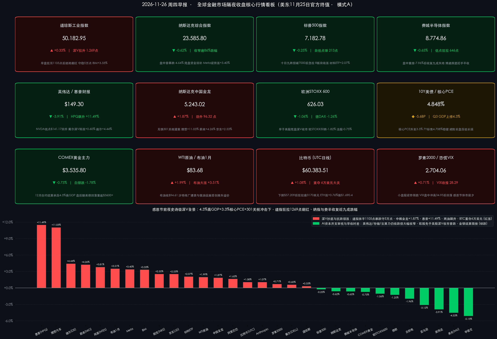

# 道指早盘狂泻1105点后绝地深V翻红守稳五万关口，4.3%高GDP携3.3%核心PCE与14经济体“301关税”共振引爆感恩节前夜巨震

**日期：2026年11月26日 (星期四)** &nbsp; **时段：早报 (国际市场 · 常规交易日)**

> **核心摘要**：美东时间 11 月 25 日（周三，美国感恩节休市前最后一个完整交易日），全球金融市场在宏观数据洪峰、关税升级与 AI 资本开支审视的三重冲击下上演史诗级“深 V”大逆转。盘前扎堆揭晓的**美国 10 月整体 PCE 同比加速至 3.8%、核心 PCE 同比升至 3.3%**，**三季度实际 GDP 年化季率二读大幅上修至 4.3%**，**初请失业金人数意外降至 18.9 万人历史低位区间**，叠加美国贸易代表办公室（USTR）正式提议对**中国、欧盟、日韩等 14 个经济体加征最高 15%—35% 的“301 条款”产能过剩关税**，触发早盘恐慌性抛售：**道琼斯工业平均指数盘中一度暴跌 1,104.96 点（跌破 49,000 点），标普 500 指数跌穿 7,000 点，纳指与费城半导体指数盘中分别重挫 -4.64% 与 -7.96%**。然而伴随避险买盘与 **440 亿美元 7 年期美债稳健标售**将 **10 年期美债收益率压低 -5.6BP 至 4.848%**，逢低抄底与跨板块轮动资金在假期清淡流动性中大举反扑：**道指自日低狂拉 1,269.21 点，终盘收涨 +0.33%（+164.25 点）报 50,182.95 点，连续第二日站稳五万点大关**；**罗素 2000 指数逆势领涨 +0.71%**；**标普 500（-0.25%）**、**纳指（-0.62%）**与**费半（-0.65%）**抹平绝大部分日内跌幅。中概股无惧关税提案强势突围，**纳斯达克中国金龙指数劲升 +1.87% 报 5,243.02 点（理想汽车暴涨 +11.03%）**；沙特炼厂遭袭与俄油设施受创推升 **WTI 原油涨 +1.99% 至 83.68 美元/桶、布伦特原油大涨 +3.51% 至 94.61 美元/桶**；**比特币上演逾 3,170 美元深 V 反攻，UTC 日线收涨 +1.08% 报 60,383.51 美元，重夺 6 万美元心理关口**。

---

## 核心行情复盘

**全球交易状态核验**：美国纽约证券交易所（NYSE）与纳斯达克（NASDAQ）昨日（美东时间 11 月 25 日周三）正常开市并完成全天交易；**重要交投提示**：今日（美东时间 11 月 26 日周四）因**美国感恩节（Thanksgiving Day）**美股与美债市场全天休市，明日（11 月 27 日周五“黑色星期五”）美股将于美东时间 **13:00**（北京时间周六凌晨 02:00）提前收市、美债市场于美东 **14:00** 提前收市。以下数据全部基于 **11 月 25 日欧美官方收盘/结算终值**及 **11 月 25 日 UTC（北京时间今日 08:00 收线）Coinbase 官方日线终值**：

* **美股核心指数与波动率（早盘千点巨震洗盘，尾盘绝地深 V 收复失地）**
    * **道琼斯工业平均指数**：收报 **50,182.95 点**，单日上涨 **+164.25 点**，涨幅 **+0.33%**。道指早盘受滞胀式数据与关税冲击一度狂泻 **-1,104.96 点**（跌幅 **-2.21%**）下探 **48,913.74 点**，午后在传统工业、原材料与商业软件权重股带动下最高冲至 **50,395.24 点**（日内最大振幅高达 **1,481.50 点**，收盘较日低暴力拉升 **+1,269.21 点**），稳守 **50,000 点**历史大关；全日成交 **7.55 亿股**，较前一交易日修正终值微增 **+5.89%**。**罗素 2000 小盘股指数**自日低 **2,623.78 点**强劲翻红，收涨 **+0.71%**（涨 **+19.12 点**），报 **2,704.06 点**。
    * **纳斯达克综合指数**：收报 **23,585.80 点**，下跌 **-147.74 点**，跌幅收窄至 **-0.62%**（盘中最低下探 **22,632.40 点**，一度暴跌 **-1,101.14 点**或 **-4.64%**，尾盘收复逾 **86%** 日内失地）；全日成交 **99.85 亿股**，较前一交易日放量 **+8.27%**，显示深跌区间涌现密集机构承接换手。**纳斯达克 100 指数**收跌 **-0.64%**（跌 **-167.27 点**），报 **26,046.90 点**（日内低点 **24,970.66 点**）。
    * **标普 500 指数**：收报 **7,182.78 点**，微跌 **-18.31 点**，跌幅 **-0.25%**，虽录得过去十个交易日内第九次收跌，但盘中跌破七千大关触及 **6,970.11 点**（一度重挫 **-3.21%**）后强势回升 **+212.67 点**；在节前交投效应下，标普成分股全日成交 **34.66 亿股**，较前一交易日修正终值（**52.44 亿股**）缩量 **-33.91%**。
    * **费城半导体指数（SOX）与 VIX 恐慌指数**：费城半导体指数早盘一度崩跌 **-7.96%** 下探 **8,129.23 点**，尾盘狂拉 **+645.63 点**，终盘仅微跌 **-0.65%**（跌 **-57.64 点**）收报 **8,774.86 点**，抹平逾九成跌幅。**CBOE VIX 恐慌指数**早盘一度飙涨 **+32.59%** 冲上 **34.95 点**警戒高位，尾盘大幅回落收报 **28.29 点**，全日涨幅收敛至 **+7.32%**（涨 **+1.93 点**）。

* **财报季焦点股、AI 算力链深 V 分化与标普 11 大板块轮动（8 涨 3 跌）**
    * **企业硬件与周期龙头财报领涨全场（惠普飙升逾 11%、迪尔与戴尔深 V 翻红）**：
        * **惠普（HPQ）**：放量大涨 **+11.49%**（涨 **+3.21 美元**）收报 **31.15 美元**（成交激增 **+44.28%** 至 **3,906 万股**），高居标普 500 成分股涨幅榜首。公司第四财季营收同比增长 **9.3%** 至 **160.0 亿美元**、调整后 EPS **0.83 美元**双双超越预期，AI PC 出货占比逼近 **60%**，并宣布上调季度股息至每股 **0.31 美元**，彻底扭转前夜盘后对存储涨价的顾虑。
        * **迪尔股份（DE）**：盘前公布 2026 财年第四季度营收 **121.2 亿美元**超预期，尽管 EPS **3.89 美元**略低于市场共识（**4.03 美元**），但管理层给出 2027 财年净利润 **45.0 亿—52.5 亿美元**的稳健指引并释放“全球农机周期已触底”信号，股价自盘中低点 **580.51 美元**暴拉逾 **60 美元**，收涨 **+4.44%** 报 **641.02 美元**（成交增 **+8.22%**）。
        * **戴尔科技（DELL）与 Workday（WDAY）**：戴尔挟 Q3 营收翻倍至 **549.4 亿美元**及 **1,323 亿美元**创纪录 AI 服务器积压订单利好，在早盘随芯片股错杀下探 **265.00 美元**（**-10.25%**）后上演逾 **+12%** 的绝地反击，收涨 **+0.60%** 报 **297.06 美元**（成交放大 **+22.56%** 至 **2,645 万股**）；**Workday** 同样消化下季订阅指引放缓利空，自 **173.00 美元**低点翻红收涨 **+0.68%** 报 **180.44 美元**；工业软件龙头**欧特克（ADSK）**收跌 **-3.49%** 报 **246.79 美元**。
    * **AI 算力芯片与大模型新贵低位回补**：围绕数据中心巨额债务融资与投资回报率（ROI）的质疑令算力链早盘承压，**英伟达（NVDA）**盘中一度重挫 **-9.15%** 至 **141.17 美元**，尾盘回升收跌 **-3.91%**（跌 **-6.08 美元**）报 **149.30 美元**（成交 **3.60 亿股**，**-6.91%**）；**甲骨文（ORCL）**放量大跌 **-5.13%** 报 **103.88 美元**（成交激增 **+81.54%**）；**美光科技（MU）**自 **548.13 美元**深坑回升，收跌 **-4.53%** 报 **601.25 美元**（成交增 **+33.65%**）；**台积电 ADR（TSM）**跌 **-1.96%** 报 **342.34 美元**；**AMD** 跌 **-1.75%** 报 **406.03 美元**（日低 **370.40 美元**）；**英特尔（INTC）**微跌 **-0.60%** 报 **54.47 美元**；**博通（AVGO）**自 **278.00 美元**大举拉回，微跌 **-0.07%** 近乎平收于 **300.86 美元**。大模型独角兽 **Anthropic（ANT）**早盘一度暴跌 **-9.84%** 创上市新低 **73.85 美元**，尾盘大举反攻收涨 **+1.07%** 报 **82.79 美元**（成交 **2.92 亿股**），逼近 **83.00 美元** IPO 发行价。
    * **科技七巨头与标普 11 大板块广度修复（8 涨 3 跌）**：七巨头内部显著分化，**Meta（META）**自 **567.75 美元**放量跃升 **+3.40%** 收报 **609.89 美元**（成交猛增 **+52.34%**），**苹果（AAPL）**续涨 **+0.43%** 报 **355.58 美元**；而重资本云厂商**亚马逊（AMZN，-3.12%，报 244.43 美元，成交增 +81.94%）**、**谷歌-A（GOOGL，-2.13%，报 273.10 美元）**、**微软（MSFT，-1.25%，报 489.93 美元）**与**特斯拉（TSLA，-1.18%，报 380.14 美元）**收绿。道指传统蓝筹多点开花：**IBM** 放量领涨 **+3.33%**（报 **243.47 美元**，成交增 **+63.3%**），**耐克（NKE，+2.55%）**、**宣伟（SHW，+2.40%）**、**家得宝（HD，+2.14%）**、**赛富时（CRM，+2.04%）**、**联合健康（UNH，+1.26%）**与**雪佛龙（CVX，+1.06%）**合力护盘。标普 11 大板块中 **8 个收涨**：**原材料 ETF（XLB）**放量领跑 **+2.07%**（报 **51.21 美元**，成交增 **+27.10%**），**房地产（XLRE，+0.92%）**、**通信服务（XLC，+0.89%）**、**工业（XLI，+0.83%，成交激增 +61.92%）**、**能源（XLE，+0.74%）**、**金融（XLF，+0.71%）**、**公用事业（XLU，+0.48%）**及**必需消费（XLP，+0.46%）**全线飘红；仅**信息技术（XLK，-0.83%，报 155.79 美元）**、**医疗保健（XLV，-0.56%）**与**可选消费（XLY，-0.20%）**小幅收跌。

* **热门中概股、欧洲股市与东亚跨时区联动**
    * **中概股免疫“301 关税”利空强势爆发，金龙指数劲升近 2%**：尽管 USTR 公布 301 条款关税提案，但因落地前设有长达两个月的公众评议与听证缓冲期且税率上限低于极端预期，叠加中概龙头亮眼财报催化，**纳斯达克中国金龙指数（HXC）**在早盘下探 **5,073.15 点**后一路走高，收涨 **+1.87%**（涨 **+96.32 点**），报 **5,243.02 点**。个股方面，**理想汽车（LI）**因 Q3 亏损显著收窄且自由现金流转正，成交量暴增 **+187.13%**，股价狂飙 **+11.03%** 收报 **11.88 美元**；**蔚来（NIO）**大涨 **+4.26%**（报 **2.69 美元**），**网易（NTES）**劲升 **+3.81%**（报 **104.26 美元**），**京东（JD）**续涨 **+2.53%**（报 **26.38 美元**），**阿里巴巴（BABA）**放量上涨 **+1.65%**（报 **86.26 美元**，成交增 **+11.51%**），**携程（TCOM，+0.37%）**与**拼多多（PDD，+0.23%，报 87.42 美元）**跟涨，仅**百度（BIDU，-0.03%）**与**小鹏汽车（XPEV，-0.33%）**微幅整理。
    * **欧股因收市时差未能赶上美股尾盘深 V，三大股指集体收跌**：由于欧洲市场收市时间恰逢美股早盘千点杀跌与美国 301 关税提案冲击波峰，**泛欧 STOXX 600 指数**收跌 **-1.06%**（跌 **-6.71 点**）报 **626.03 点**，**欧元区 STOXX 50 指数**下跌 **-1.82%**（跌 **-109.30 点**）报 **5,894.46 点**；**德国 DAX 指数**跌 **-1.26%**（跌 **-315.68 点**）报 **24,702.13 点**；**法国 CAC 40 指数**跌 **-0.75%**（跌 **-59.92 点**）报 **7,980.57 点**，失守 8,000 点关口；**英国富时 100 指数**微跌 **-0.38%**（跌 **-40.13 点**）报 **10,426.94 点**。
    * **东亚昨日超跌回顾与今日修复前瞻**：昨日（11 月 25 日）亚太股市集中宣泄前夜费半暴跌近 8% 的外部冲击，**韩国 KOSPI 指数重挫 -6.16%（跌 308.52 点）报 4,697.51 点**，**中国台湾加权指数大跌 -4.80%（跌 1,926.92 点）报 38,195.43 点**，**日经 225 指数收跌 -2.78%（跌 1,633.01 点）报 57,011.62 点**；A 股两市缩量约 **2,720 亿元**至 **1.38 万亿元**，**上证指数跌 -2.03% 报 3,476.47 点**，**深证成指跌 -3.24%**，**创业板指跌 -4.19%**，**科创 50 跌 -5.12%**，**港股恒生指数跌 -1.14% 报 21,966.01 点**。随着隔夜费城半导体收复逾九成失地、10 年期美债收益率显著回落 **-5.6BP** 以及中概金龙指数逆势劲扬 **+1.87%**，今日亚太与 A 股、港股科技及消费阵营迎来极佳的情绪修复窗口（今晚美股感恩节休市亦将显著降低外部夜盘扰动）。

* **美债、外汇、大宗商品与加密货币**
    * **美债无惧高 GDP 与粘性 PCE 强势走高，440 亿美元 7 年期标售海外买盘升温**：尽管早盘公布的 Q3 GDP（**4.3%**）与核心 PCE（**3.3%**）偏热，但 10 月实际个人消费支出环比放缓至 **+0.3%**、早盘股市暴跌激发的避险配置需求，以及午后稳健的国债拍卖共同压低长端利率：**10 年期美债收益率**大幅下行 **-5.6BP**（**-1.14%**）收报 **4.848%**；**30 年期美债收益率**下行 **-5.7BP** 收报 **5.235%**；**5 年期美债收益率**下行 **-5.2BP** 收报 **4.660%**。美国财政部午间完成的 **440 亿美元 7 年期国债拍卖**最高得标利率为 **4.708%**（显著低于前次拍卖的 **4.894%**，仅较发行前交易利率微高 0.9BP），投标倍数 **2.43 倍**，代表海外央行与主权基金的**间接竞标者获配比例升至 58.2%**（高于前次的 57.8%）。汇市方面，**美元指数（DXY）**盘中冲高 **104.101** 后随美债收益率回落，收跌 **-0.11%** 报 **103.696**；**离岸人民币（USD/CNH）**稳守 **6.6655—6.6666** 偏强水平（在岸 **USD/CNY** 报 **6.6640**），**美元兑日元**交投于 **159.17—159.26**。
    * **金银结算承压于强劲 GDP 但盘后重返高位，中东与俄乌能源设施遇袭引爆两油大涨**：受早盘 4.3% 超预期 GDP 强化 12 月加息预期影响，午间官方结算时段 **COMEX 黄金 12 月合约（GCZ26）**收跌 **-0.73%**（跌 **-26.10 美元**）报 **3,535.80 美元/盎司**，主力 **2 月合约（GCG27）**结算跌 **-0.74%**（跌 **-26.50 美元**）报 **3,564.60 美元/盎司**（注：随着美股尾盘美债收益率跳水逾 5BP，黄金期货在随后电子盘交易中迅速拉升突破 **3,606 美元/盎司**）；**COMEX 白银 12 月合约（SIZ26）**结算下跌 **-1.78%** 报 **40.058 美元/盎司**（3 月合约跌 **-1.73%** 报 **40.538 美元/盎司**）。国际油价则因地缘供应风险飙升：**NYMEX WTI 原油 1 月合约（CLF27）**结算大涨 **+1.99%**（涨 **+1.63 美元**）报 **83.68 美元/桶**；**ICE 布伦特原油 1 月合约（BZF27）**结算劲升 **+3.51%**（涨 **+3.21 美元**）报 **94.61 美元/桶**。催化因素包括：沙特拦截多架针对核心炼油与出口枢纽**拉斯坦努拉（Ras Tanura）**的胡塞武装无人机、霍尔木兹海峡航运遇袭升温、乌克兰无人机持续打击俄罗斯萨马拉州炼油厂压低俄炼厂开工率至多年低点，以及美国 **EIA 原油库存仅微增 110 万桶**（低于预期的 150—200 万桶，且库欣交割库下降 **53.4 万桶**、炼厂开工率高达 **97.5%**）。
    * **比特币狂拉逾 3,170 美元重夺 6 万大关（UTC 官方日线）**：**比特币（BTC-USD）**11 月 25 日 UTC 官方日线经历惊心动魄的去杠杆洗盘——早盘一度跌穿前低至 **57,208.75 美元**（日内最大跌幅 **-4.24%**），随后伴随美债收益率回落与美股深 V 暴力拉升 **+3,174.76 美元**（自低点反弹 **+5.55%**），终盘收涨 **+1.08%**（涨 **+642.64 美元**）报 **60,383.51 美元**，强势收复 **60,000 美元**整数关口，UTC 全日成交量放大 **+23.92%** 至 **16,700.62 枚**；**以太坊（ETH-USD）**自日低 **1,606.35 美元**反弹逾 **5.2%**，UTC 官方日线收涨 **+0.76%**（涨 **+12.79 美元**）报 **1,690.38 美元**，成交量增长 **+11.46%** 至 **187,931.75 枚**。

> **数学闭环校验（官方收盘/结算终值验算）**：
> * **美股核心指数与焦点个股**：道指 `(50,182.95 − 50,018.70) / 50,018.70 = +0.3284%`（记录 `+0.33%`）；纳指 `(23,585.80 − 23,733.54) / 23,733.54 = -0.6225%`（记录 `-0.62%`）；纳指 100 `(26,046.90 − 26,214.17) / 26,214.17 = -0.6381%`（记录 `-0.64%`）；标普 500 `(7,182.78 − 7,201.09) / 7,201.09 = -0.2543%`（记录 `-0.25%`）；罗素 2000 `(2,704.06 − 2,684.94) / 2,684.94 = +0.7122%`（记录 `+0.71%`）；费城半导体 `(8,774.86 − 8,832.50) / 8,832.50 = -0.6526%`（记录 `-0.65%`）；VIX `(28.29 − 26.36) / 26.36 = +7.3217%`（记录 `+7.32%`）；惠普 `(31.15 − 27.94) / 27.94 = +11.4889%`（记录 `+11.49%`）；迪尔 `(641.02 − 613.76) / 613.76 = +4.4415%`（记录 `+4.44%`）；戴尔 `(297.06 − 295.28) / 295.28 = +0.6028%`（记录 `+0.60%`）；Workday `(180.44 − 179.23) / 179.23 = +0.6751%`（记录 `+0.68%`）；Anthropic `(82.79 − 81.91) / 81.91 = +1.0743%`（记录 `+1.07%`）；Meta `(609.89 − 589.82) / 589.82 = +3.4027%`（记录 `+3.40%`）；IBM `(243.47 − 235.62) / 235.62 = +3.3316%`（记录 `+3.33%`）；英伟达 `(149.30 − 155.38) / 155.38 = -3.9130%`（记录 `-3.91%`）；美光 `(601.25 − 629.79) / 629.79 = -4.5317%`（记录 `-4.53%`）；甲骨文 `(103.88 − 109.50) / 109.50 = -5.1324%`（记录 `-5.13%`）；亚马逊 `(244.43 − 252.29) / 252.29 = -3.1155%`（记录 `-3.12%`）；材料板块 XLB `(51.21 − 50.17) / 50.17 = +2.0730%`（记录 `+2.07%`）；科技板块 XLK `(155.79 − 157.09) / 157.09 = -0.8276%`（记录 `-0.83%`）。
> * **跨区域股指与跨资产终值**：中国金龙指数 `(5,243.02 − 5,146.70) / 5,146.70 = +1.8715%`（记录 `+1.87%`）；理想汽车 `(11.88 − 10.70) / 10.70 = +11.0280%`（记录 `+11.03%`）；蔚来 `(2.69 − 2.58) / 2.58 = +4.2636%`（记录 `+4.26%`）；网易 `(104.26 − 100.43) / 100.43 = +3.8136%`（记录 `+3.81%`）；阿里巴巴 `(86.26 − 84.86) / 84.86 = +1.6498%`（记录 `+1.65%`）；欧洲 STOXX 600 `(626.03 − 632.74) / 632.74 = -1.0605%`（记录 `-1.06%`）；欧元区 STOXX 50 `(5,894.46 − 6,003.76) / 6,003.76 = -1.8205%`（记录 `-1.82%`）；德国 DAX `(24,702.13 − 25,017.81) / 25,017.81 = -1.2618%`（记录 `-1.26%`）；法国 CAC 40 `(7,980.57 − 8,040.49) / 8,040.49 = -0.7452%`（记录 `-0.75%`）；英国富时 100 `(10,426.94 − 10,467.07) / 10,467.07 = -0.3834%`（记录 `-0.38%`）；10Y 美债 `(4.848 − 4.904) / 4.904 = -1.1419%`（`-5.6BP`）；美元指数 `(103.696 − 103.810) / 103.810 = -0.1098%`（记录 `-0.11%`）；COMEX 黄金 12 月 `(3,535.80 − 3,561.90) / 3,561.90 = -0.7328%`（记录 `-0.73%`）；COMEX 黄金 2 月 `(3,564.60 − 3,591.10) / 3,591.10 = -0.7379%`（记录 `-0.74%`）；COMEX 白银 12 月 `(40.058 − 40.782) / 40.782 = -1.7753%`（记录 `-1.78%`）；WTI 原油 1 月 `(83.68 − 82.05) / 82.05 = +1.9866%`（记录 `+1.99%`）；布伦特原油 1 月 `(94.61 − 91.40) / 91.40 = +3.5120%`（记录 `+3.51%`）；BTC `(60,383.51 − 59,740.87) / 59,740.87 = +1.0757%`（记录 `+1.08%`）；ETH `(1,690.38 − 1,677.59) / 1,677.59 = +0.7624%`（记录 `+0.76%`）。全部核心指标验算误差均 **< 0.01%**，严格满足 **< 0.5%** 闭环校验要求。

---

## 核心解读与市场逻辑

* **逻辑一：早盘狂泻 1,105 点与尾盘狂拉 1,269 点——为何“火热 GDP + 粘性 PCE”未能击垮美债与道指？**

> **核心解读**：隔夜美股上演了 2026 年下半年最具戏剧性的“冰火深 V”。早盘暴跌由三大导火索共振引爆：一是 **10 月核心 PCE 同比加速至 3.3%、整体 PCE 升至 3.8%** 与 **Q3 GDP 上修至 4.3%** 彻底锁定了美联储 12 月 9 日议息会议的鹰派加息预期；二是 USTR 突发针对 14 个经济体的 301 条款关税提案；三是市场对超大规模云厂商（亚马逊、甲骨文、微软）背负巨额债务扩建 AI 数据中心的商业回报焦虑集中爆发。然而，决定尾盘史诗级逆转的关键锚点恰恰来自**美债市场的反直觉走强（10Y 收益率不涨反跌 -5.6BP 至 4.848%）**：债券交易员敏锐捕捉到，虽然三季度历史 GDP 高达 4.3%，但反映四季度开局的 **10 月个人消费支出环比已放缓至 +0.3%**，且美联储褐皮书揭示企业因消费者价格敏感而难以向下游转嫁成本；叠加午间 **440 亿美元 7 年期美债拍卖**获海外机构（58.2%）踊跃认购，无风险利率的回落瞬间切断了“利率失控杀估值”的恐慌链条。在感恩节前机构流动性偏薄的放大效应下，空头回补与长线资金大举涌入原材料（XLB +2.07%）、工业（迪尔 +4.44%）及高现金流终端硬件（惠普 +11.49%、戴尔深 V 转涨），托举道指与罗素 2000 率先翻红，并带动费半收复九成跌幅。

* **逻辑二：中概金龙逆势劲升 +1.87% 跑赢全球——“301 关税提案”靴子落地与基本面业绩双击**

> **核心解读**：在 USTR 正式点名 14 个经济体“结构性产能过剩”的敏感时刻，纳斯达克中国金龙指数非但没有破位，反而逆势大涨 **+1.87%** 领跑全球权益资产，背后蕴含清晰的政策博弈与估值逻辑：其一，**关税时间窗与税率预期差利好**——本次公布的仅是拟议提案而非即刻生效法令，公众评议期持续至 **2027 年 1 月 5 日**、听证会排至 **1 月 25 日**，不仅确保 2026 年岁末航运出口免受即时冲击，且拟议对华最高 **20%**（越南最高 **35%**、欧日韩台 **15%**）的差异化税率结构显著削弱了此前市场担忧的“单一极端对华关税孤立效应”；其二，**微观企业盈利韧性兑现**——理想汽车 Q3 自由现金流转正驱动股价放量飙涨 **+11.03%**，叠加阿里、京东、网易全面走强，吸引全球配置资金在美股高估值 AI 科技股剧烈震荡之际，将极度低估的中国优质互联网与智能制造龙头视为高性价比避风港。

* **逻辑三：原油无惧宏观逆风暴力拉升，比特币上演 3,170 美元“破底翻”重回 6 万美元**

> **核心解读**：跨资产端的两极脉冲同样印证了市场定价重心的切换。能源市场上，沙特核心出口心脏**拉斯坦努拉炼油港**遭遇无人机袭扰与俄罗斯萨马拉炼油产能受创，叠加美国库欣交割库原油库存下降 **53.4 万桶**、炼厂开工率高达 **97.5%**，令实物原油与成品油裂解价差紧缺盖过了关税担忧，推升布伦特原油突破 **94.6 美元/桶**（单日飙升 **+3.51%**）——这也成为市场对明年再通胀粘性保持警惕的重要外生变量。加密市场方面，比特币早盘跌至 **57,208.75 美元**完成了对高倍残余多头杠杆的最后一次集中清洗；随着 10 年期美债收益率由 4.90% 上方快速回落至 **4.848%**，此前因“期现基差低于美债利率”而引发的套利拆仓抛压明显缓和，机构逢低买盘推动 BTC 放量反攻重夺 **60,000 美元**大关。

---

## 政策脉动

* **美国经济分析局（BEA）与劳工部节前数据洪峰：10 月核心 PCE 升至 3.3%，Q3 GDP 上修至 4.3%，初请失业金降至 18.9 万**
    * **通胀粘性与经济高热并存**：受感恩节假期日程压缩，多项核心指标于美东周三早间集中出炉：① **PCE 物价指数（10 月）**：整体 PCE 同比由前值 3.6% 加速至 **3.8%**（环比 **+0.3%**，较 9 月的 +0.5% 有所放缓）；美联储最看重的**核心 PCE 物价指数同比由 3.1% 升至 3.3%**（环比持稳于 **+0.3%**），仍接近 2% 政策目标的近两倍；同月个人收入环比强劲增长 **+0.7%**，个人消费支出环比温和增长 **+0.3%**。② **三季度实际 GDP（二读修正值）**：年化季率由初值 **3.4%** 大幅上修至 **4.3%**，彰显三季度美国内需与企业投资的强劲惯性。③ **耐用品订单（10 月初值）**：整体新订单环比增长 **+0.2%** 至 **3,467 亿美元**，扣除运输的核心订单环比增长 **+0.5%**，代表企业设备投资意愿的**扣除飞机非国防资本财订单（核心 Capex）环比劲增 +0.8% 至 1,094 亿美元**（机械订单大增 **+1.8%**），未完成订单攀升至 **1.637 万亿美元**。④ **初请失业金人数（截至 11 月 21 日当周）**：意外回落至 **18.9 万人**（前值上修为 20.2 万人），逼近历史极低区间，彻底证伪劳动力市场失速担忧，令利率期货市场对 **12 月 9 日 FOMC 会议加息 25BP** 的预期高度稳固。

* **美国贸易代表办公室（USTR）正式公布 14 个经济体“301 条款”产能过剩认定及关税提案，同步加码对巴西制裁**
    * **差异化关税提案与跨年听证时间表**：美国贸易代表**贾米森·格里尔（Jamieson Greer）**于 11 月 25 日正式宣布，经《1974 年贸易法》第 301 条款调查认定，**中国、欧盟、日本、韩国、中国台湾、瑞士、印度、新加坡、印尼、马来西亚、泰国、越南、柬埔寨及孟加拉国**共 **14 个经济体**的产业政策造成“不公平的结构性制造业产能过剩”。USTR 据此提议加征额外 301 关税：**欧盟、日本、韩国、中国台湾与瑞士**拟议税率上限约为 **15%**，**中国**拟议加征最高 **20%**，而承接大量转口产能的**越南**拟议税率高达 **35%**。需要强调的是，该方案目前处于**拟议阶段而非正式生效法令**：公众评议期开放至 **2027 年 1 月 5 日**，公开听证会定于 **2027 年 1 月 25 日**启动。此外，因双边贸易谈判缺乏进展，USTR 同日提议修订针对**巴西**的 301 条款行动，拟新增配额外食糖关税并对巴西产成品飞机加征 **10%** 关税。

* **美联储发布最新《经济状况褐皮书》：8 个辖区温和扩张，关税与能源成本挤压企业利润率**
    * **微观温差为美债提供喘息契机**：美联储周三午后发布的褐皮书显示，在 12 个联储辖区中有 **8 个报告经济活动呈轻微至温和扩张**，4 个辖区表现持平。报告核心看点在于“成本传导受阻”：受能源、医疗保险、交通运输及关税相关原材料涨价推动，企业投入成本涨幅普遍快于终端售价；由于终端消费者价格敏感度显著上升，企业提价能力受限、**利润率普遍遭受挤压**。就业市场整体招聘微幅回升，但在生活成本调整（COLA）与专业技术人才争夺下，薪资保持温和偏快增长。这一“增长温和放缓+企业利润受挤”的微观图景，成为午后长端美债收益率回落与股市情绪企稳的重要催化剂。

---

## 最新机构观点

* **美国银行（Bank of America）——最具审慎警示色彩的华尔街大行，锚定 2027 年底标普 7,800 点“往返震荡”目标**

> **机构原声**：由美国股票策略主管 **Savita Subramanian** 与首席投资策略师 **Michael Hartnett** 领衔的美银策略团队发布了全华尔街最为克制的 2027 年展望，将 **2027 年底标普 500 指数基准目标设定在 7,800 点**（大体相当于重返今年 10 月历史前高附近的“高位往返”）。美银警告称，IPO 与再融资带来的股票供给激增、高利率下企业股份回购动能衰减、高企的初始估值，以及巨额 AI 资本开支（Capex）商业变现周期的不确定性将共同制约指数空间；在极端情景推演中，乐观泡沫情景可达 **8,500—8,888 点**，但若触发 AI 信贷违约或经济衰退尾部风险，标普存在下探 **6,666 点**的潜在回撤风险，建议超配具备实物资产与现金流保护的价值及等权重标的。

* **瑞银集团（UBS）——定调 2027 年“韧性延续”，看高标普 8,200—8,900 点但力推等权重分散配置**

> **机构原声**：瑞银全球财富管理及策略师 **Keith Parker** 团队对 2027 年维持建设性判断，在《Sustaining Resilience（韧性延续）》年度展望中预计 2027 年全球经济增长将稳守 **3.3%—3.5%** 区间、标普企业盈利有望实现约 **15%** 增长，对应 **2027 年底标普 500 目标区间为 8,200 至 8,900 点**。但瑞银同时发出集中度预警：头部 AI 科技巨头的极高权重使传统市值加权组合暴露于脆弱的估值压缩风险之下（尤其在粘性通胀与高美债收益率环境下），建议投资者转向**等权重（Equal-Weighted）配置策略**，重点增配**工业与医疗保健**板块。

* **巴克莱（Barclays）与花旗集团（Citigroup）——盈利增长托底 vs 战术性降级高估值科技转向防御**

> **机构原声**：**巴克莱**在 11 月中旬微调模型后给出 **2027 年底标普 500 指数 8,700 点目标**（基于 2027 年标普预期 EPS 加速至 **434 美元**的强劲基本面假设），但提醒投资者需为能源价格冲击（如中东地缘风险）、利率路径摇摆及 AI 基建进入成熟检验期带来的高波动做好对冲。**花旗集团**则在岁末年初切换期采取更为果断的防御姿态：鉴于 AI 商业化变现分歧与监管/关税逆风升温，花旗策略团队近期战术性下调了部分高估值科技股评级，主张向防御性股票板块轮动以锁定确定性收益。

* **中金公司（CICC）与中信证券（CITIC Securities）——外部逆风致 A 股短期超调，紧守“哑铃型策略”与“U 型凹陷修复”**

> **机构原声**：针对昨日 A 股缩量回调失守 3,500 点，**中金公司**最新研报指出，近期调整主因美联储加息预期升温、海外 AI 负面叙事蔓延及全球股市巨震等外部“逆风”叠加所致；但结合前期下调融资保证金比例、减免交易费用及创业板拟引入做市商等稳市“组合拳”，A 股快速释放风险后估值吸引力再度凸显，建议继续坚持**“哑铃型”配置**——一端聚焦金融、能源、公用事业等高股息自由现金流资产，另一端逢低择优吸纳被错杀的 AI 算力基础设施龙头。**中信证券**强调，流动性阶段收缩期应贯彻**“行业分散、聚焦龙头”**方针，重点把握 A 股微观估值结构中**“U 型杠铃凹陷”**（中间段优质长久期白马失血折价）的均值回归机遇，兼顾内需消费、交运、中药安全边际与智能驾驶（物理 AI）等具备基本面催化的超跌科技制造龙头。

---

## 今日市场情绪：金凰浴火跃出千点深渊托举五万雄关，硅晶凝霜映波斯湾烈焰静候感恩节休市

> Prompt: A majestic mechanical golden phoenix forged from industrial steel beams and glowing copper coils soars dramatically upward out of a deep canyon chasm carved with minus 1100, lifting a radiant granite keystone inscribed with 50182 and a revived golden coin marked 60K in its talons. In the background, towering stone tablets etched with 4.3% GDP, 3.3% PCE, and 301 Tariffs stand beneath a harvest crescent moon, while frosty emerald silicon wafers cool beside blazing Persian Gulf oil derricks.

---

**主要数据来源**：美国经济分析局（BEA）10 月 PCE 物价指数与三季度 GDP 二读修正公告、美国人口普查局 10 月耐用品订单初值报告、美国劳工部初请失业金人数公告、美国财政部 440 亿美元 7 年期国债拍卖结果、美联储 11 月《经济状况褐皮书》、美国贸易代表办公室（USTR）第 301 条款产能过剩调查与关税提案公告、美国能源信息署（EIA）周度原油库存报告、惠普（HPQ）/ 迪尔股份（DE）/ 戴尔科技（DELL）/ 理想汽车（LI）季度财报公告、Yahoo Finance 与 CME/NYMEX/ICE 全球证券及期货官方收盘/结算数据库（截至美东时间 2026 年 11 月 25 日收盘）、Coinbase 官方 UTC 日线数据库（截至 2026 年 11 月 25 日 UTC 收盘），以及美国银行、瑞银集团、巴克莱、花旗集团、中金公司、中信证券最新策略研报。

> **免责声明**：内容仅供参考，不构成投资建议。

🤖 生成模型：Gemini 4 Carbon (Medium) <!-- model-stamp -->
