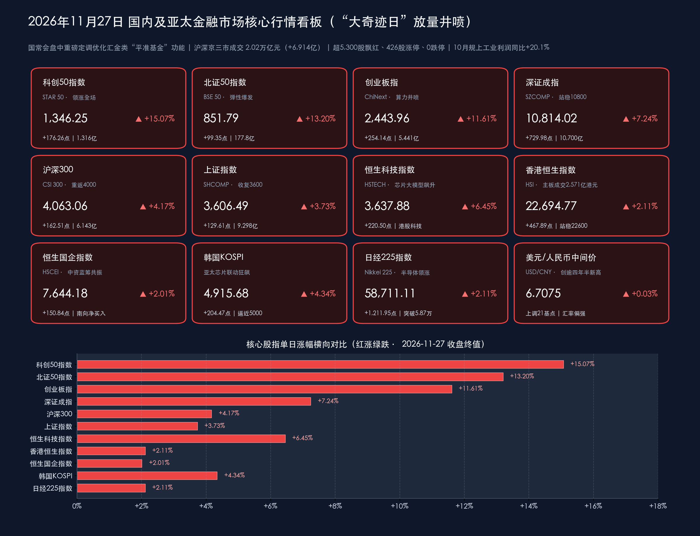
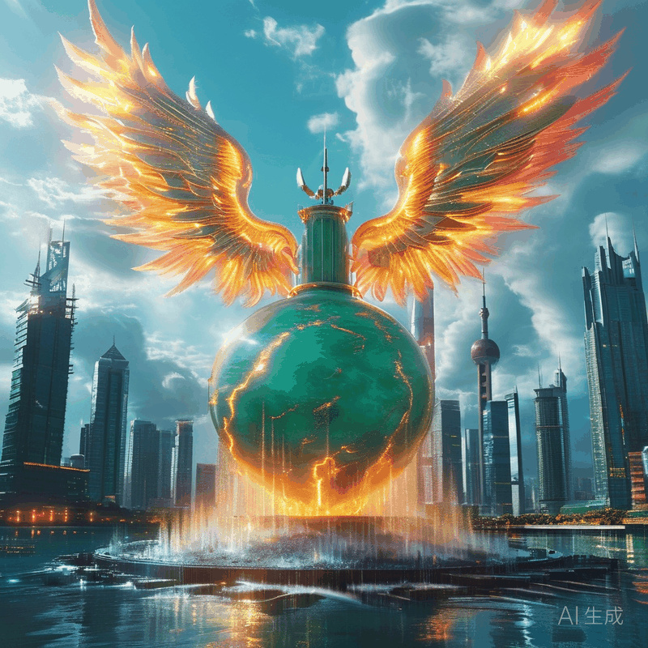

# 国常会盘中定调优化汇金类“平准基金”引爆两万亿“大奇迹日”，科创50狂飙15.07%、创业板暴涨11.61%：恒科劲升6.45%共舞芯片风暴，10月工业利润跃增20.1%

**日期：2026年11月27日 (星期五)** &nbsp; **时段：下午/国内及亚太市场收盘**

> **核心摘要**：2026年11月27日（周五，隔夜美股因感恩节休市、今夜“黑色星期五”提前收盘），中国资本市场迎来载入史册的放量井喷**“大奇迹日”**！交易时段午间，**国务院常务会议罕见盘中重磅发声**，一个月内二度聚焦资本市场，明确指出**“资本市场事关经济发展大局”**，并历史上首次在国常会官方通稿中提出**“加力发挥‘国家队’稳市作用，进一步优化中央汇金公司的类‘平准基金’功能，提供充足流动性保障”**，同时部署谋划增量政策、壮大险资社保等中长期力量及筑牢防范输入性风险“防波堤”。叠加早盘国家统计局公布**10月全国规模以上工业企业利润同比激增 +20.1%（1—10月累计增长 +16.0%，高技术制造业利润飙升 +50.9%、电子设备制造利润翻倍 +100%）**的硬核基本面验证，A股与港股午后旱地拔葱全线狂飙：**科创50指数暴涨 +15.07%（报1,346.25点）**领冠全球，**北证50暴涨 +13.20%**，**创业板指暴涨 +11.61%（报2,443.96点）**，**深证成指大涨 +7.24%**，**沪深300大涨 +4.17% 重返4,000点**，**上证指数劲升 +3.73% 收复3,600点（报3,606.49点）**；沪深京三市全天成交额单日激增 **+6,914.26亿元** 突破两万亿大关至 **20,175.72亿元**，全市场 **超5,300只个股上涨、426只个股涨停、0跌停**。离岸与亚太同步沸腾，**恒生科技指数暴涨 +6.45%**、**恒生指数大涨 +2.11% 报22,694.77点**（中芯国际、华虹、智谱、MiniMax集体井喷），**韩国KOSPI暴涨 +4.34%**、**日经225大涨 +2.11%**；货币与衍生品端，**央行开展7,940亿元1.25%隔夜逆回购单日净投放2,225亿元**，**人民币中间价上调21点至 6.7075 创逾四年半新高**，**广期所氢氧化锂期权今日正式挂牌上市**。

## 核心行情复盘

*   **A股主要宽基指数收盘终值与量能特征（三市暴增6914亿重破2.02万亿上演史诗级“大奇迹日”，科创50狂飙15.07%、创业板暴涨11.61%、沪指收复3600点，426股涨停且全场0跌停）**：
    *   **科创50指数 (STAR 50)**：早盘即在10月电子制造业利润翻倍、国产半导体设备产线采购占比突破50%及广东鼓励优先采用国产算力芯片催化下高开走强，午后受国常会优化中央汇金类“平准基金”功能重磅利好彻底引爆，多只科创芯片ETF与科创信息ETF逼近或触及20cm涨停，收盘暴涨 **+176.26点**，涨幅高达 **+15.07%**，收报 **1,346.25点**（前收盘1,169.99点），创下2024年9月底以来最大单日涨幅之一，全天成交额放大至 **1,315.90亿元**。
    *   **北证50指数 (BSE 50)**：高弹性专精特新成长标的在流动性保障预期扭转后迎来报复性空头回补，收盘暴涨 **+99.35点**，涨幅 **+13.20%**，收报 **851.79点**（前收盘752.44点）；北交所全天成交额翻倍激增至 **177.78亿元**（较昨日87.69亿元大幅放量 **+90.09亿元**）。
    *   **创业板指 (ChiNext)**：在光模块CPO双雄（新易盛+17.4%、中际旭创近+16%）、东方财富、同花顺及新能源权重宁德时代全线井喷带动下，午后呈近90度斜率直线拉升，收盘暴涨 **+254.14点**，涨幅 **+11.61%**，收报 **2,443.96点**（前收盘2,189.82点），一举收复2,200点至2,400点三道整数关口，全天成交额达 **5,440.50亿元**。
    *   **深证成份指数 (SZCOMP)**：科技硬件、人形机器人与互联网金融共振推升指数单日狂飙逾700点，收盘大涨 **+729.98点**，涨幅 **+7.24%**，收报 **10,814.02点**（前收盘10,084.04点）；深市全天成交额突破万亿至 **10,700.17亿元**（较昨日7,040.44亿元巨幅放量 **+3,659.73亿元**）。
    *   **沪深300指数 (CSI 300)**：受益于类“平准基金”充足流动性定调、第三批1,000亿元互换便利（SFISF）机构积极建仓及核心蓝筹估值重估，收盘大涨 **+162.51点**，涨幅 **+4.17%**，收报 **4,063.06点**（前收盘3,900.55点），强势重返4,000点大关并创2024年10月8日以来最大单日涨幅，成交额 **6,143.37亿元**。
    *   **上证综合指数 (SHCOMP)**：午后伴随券商旗手与科创芯片全线爆发连续突破3,500点及3,600点两大心理关口，收盘大涨 **+129.61点**，涨幅 **+3.73%**，收报 **3,606.49点**（前收盘3,476.88点），上证50等大盘蓝筹指数亦同步显著收涨；沪市全天成交额跃升至 **9,297.77亿元**（较昨日6,133.33亿元大幅放量 **+3,164.44亿元**）。
    *   **成交额、市场宽度与主力资金动向**：沪深两市全天合计成交 **19,997.94亿元（约2.00万亿元）**，较上一交易日（13,173.77亿元）单日巨幅放量 **+6,824.17亿元**；计入北交所177.78亿元成交后，**沪深京三市全天总成交额高达 20,175.72亿元（约2.02万亿元）**，较昨日三市（13,261.46亿元）暴增 **+6,914.26亿元**，时隔多日强势重返2万亿元上方！个股层面呈现罕见的史诗级普涨狂欢：全市场 **超5,300只个股上涨**（下跌个股仅百余只），**收盘共 426只个股涨停**（创2024年10月8日以来新高，其中大批科创板与创业板硬科技标的封死20cm涨停），且**全市场跌停个股清零为 0只**（昨日8只、前日44只）。资金流向上，场外增量资金、宽基/行业ETF申购潮与空头回补资金汹涌入场，内资主力资金大举净流入**半导体芯片、光模块CPO、AI算力硬件、人形机器人、券商及金融科技**赛道（仅中际旭创单只个股即获主力资金净流入超 **37亿元**），而前期承担避风港功能的少数国有银行及煤炭个股则出现资金轮动分流。
*   **领涨与相对滞涨行业板块全景透视（半导体先进封装与设备掀20cm涨停狂潮、CPO与国产算力千元股沸腾、券商互金扛旗 vs 银行煤炭防御红利短暂休整分流）**：
    *   **强势领涨主线板块（半导体全产业链、光模块CPO与AI算力、人形机器人、券商与互联网金融）**：
        *   **半导体设备、先进封装与晶圆代工**：受工信部发布首个半导体设备与零部件质量管理体系标准、国内头部存储与晶圆产线国产设备采购占比历史性突破 **50%** 大关，以及《广东省算力发展“十五五”规划》明确鼓励优先使用国产算力芯片等多重利好共振，半导体板块掀起壮观的20cm涨停风暴——**拓荆科技、华海清科、盛美上海、源杰科技**等多只设备与芯片龙头封死 **20cm涨停**，**华虹公司**盘中强势涨停，国产AI芯片绝对旗帜**寒武纪（688256）暴涨超 +14%~15%**、股价强势**重返 1,000元/股 整数大关上方**（全天成交额约 **185亿元**），科创板晶圆代工龙头**中芯国际A股（688981）飙升超 +13%**（成交额约 **80.1亿元**）。
        *   **AI光模块（CPO）与算力硬件**：延续昨日逆势企稳势头并在今日全面加速井喷，**中际旭创（300308）收盘大涨近 +16%**，全天轰出 **333.97亿元** 巨量稳居两市成交额榜首（单日主力净流入超37亿元）；**新易盛（300502）暴涨约 +17.4%** 并一度冲击封板，全天成交高达 **269.24亿元** 位居两市前列，PCB与高速铜连接产业链同步掀涨停潮。
        *   **券商“牛市旗手”、金融科技与新能源权重**：国常会直提优化汇金类“平准基金”与下周一（11月30日）两融80%保证金比例正式生效形成强力催化，互联网金融与券商板块集体爆发——**东方财富（300059）大涨约 +9.5%**，**同花顺（300033）大涨近 +10%**，头部综合券商全线拉升；创业板第一权重**宁德时代（300750）**亦摆脱连日阴跌大幅飙升，成为助推创业板暴涨逾11%的关键中坚。
        *   **人形机器人与智能制造**：受宇树科技等国产具身智能量产订单落地与高技术制造业高增催化，人形机器人概念股掀批量涨停潮，减速器、丝杠与灵巧手核心部件标的集体狂欢。
    *   **相对滞涨与回调板块（银行、部分煤炭及防御性农林牧渔）**：
        *   **银行与传统高股息防御板块**：在全市场风险偏好极速飙升、超5,300股普涨的进攻浪潮中，前期连续逆势护盘甚至创历史新高的部分防御红利品种遭遇短线存量资金跷跷板分流，**交通银行、南京银行**等个别银行股及少量煤炭、农林牧渔标的逆势微幅回调或涨幅明显落后于大盘，全市场仅百余只个股飘绿。
*   **港股恒科暴涨6.45%共舞芯片大模型狂潮，亚太韩日股市劲升、人民币创逾四年半新高（恒指涨2.11%破22600点，韩国KOSPI飙升4.34%）**：
    *   **港股午后垂直拉升，晶圆双雄与大模型双子星涨超16%—34%**：借势美股感恩节休市带来的外部低扰动窗口及午间国常会重磅利好，港股三大指数全线狂飙。截至收盘，**恒生科技指数 (HSTECH)** 暴涨 **+6.45%**（+220.50点），收报 **3,637.88点**（前收盘3,417.38点）；**香港恒生指数 (HSI)** 大涨 **+2.11%**（+467.89点），收报 **22,694.77点**（前收盘22,226.88点），一举站上22,600点上方；**恒生中国企业指数 (HSCEI)** 上涨 **+2.01%**（+150.84点），收报 **7,644.18点**（前收盘7,493.34点）。香港主板全天成交额显著放大至 **2,571.40亿港元**（较昨日2,124.55亿港元增加 **+446.85亿港元**，其中股票成交2,425.01亿港元）。盘面上，港股半导体与AI大模型彻底沸腾：**芯碁微装暴涨超 +34%**，**华虹半导体（01347.HK）狂飙超 +20%**，**中芯国际（00981.HK）暴涨超 +16%**；港股大模型双雄**智谱（02513.HK，凭借GLM-5.4循环Transformer架构突破算力瓶颈）与 MINIMAX-W（00100.HK，加快适配华为与阿里国产AI芯片并获高盛760港元目标价“买入”评级）双双暴涨超 +17% 至 +20%**；大型科网股全面爆发，**美团-W、联想集团、哔哩哔哩-W涨幅均超 +8%**，黄金股亦随金价企稳走强（**灵宝黄金涨超 +10%**）。资金面上，一改昨日ETF波段赎回净流出213.51亿港元的态势，今日**南向资金全天重回积极净买入，净买入额超 30亿至40亿港元**，重点加仓港股科技与芯片龙头。
    *   **亚太股市芯片链共振大涨，人民币中间价创近四年半新高，金油加密稳健上行**：受东亚稳市预期升温及全球半导体资本开支景气带动，今日亚太股市全线飘红——**韩国综合指数（KOSPI）**暴涨 **+4.34%**（+204.47点），收报 **4,915.68点**（前收盘4,711.21点），逼近5,000点历史大关；**日本日经225指数**大涨 **+2.11%**（+1,211.95点），收报 **58,711.11点**（前收盘57,499.16点）；**中国台湾加权指数（TAIEX）**延续稳健，上涨 **+0.40%**（+156.27点），收报 **39,308.08点**（前收盘39,151.81点），权王**台积电（2330）上涨 +1.63%**（+35元）收报 **2,180新台币**。外汇与跨资产方面，今日**人民币对美元汇率中间价上调21个基点至 6.7075**（昨日6.7096），一举**创下2022年7月以来逾四年半新高**，彰显中国资产极强的汇率吸引力；大宗商品与加密市场方面，**国际现货与期货黄金**企稳震荡于 **3,567—3,630美元/盎司** 区间（盘中再度重返3,600美元上方），**WTI原油期货**受中东供应担忧支撑震荡上行至 **84.92—84.96美元/桶**（布伦特原油交投于91—96美元区间），**比特币（BTC）**延续感恩节反弹重返6.1万美元关口，交投于 **60,610—61,400美元（单日涨约+0.7%~+1.0%）**。

> **数学闭环校验（2026年11月27日官方收盘终值 vs 前一交易日官方结算基准核验）**：
> * **A股六大核心宽基指数与三市成交额**：科创50 `(1346.25 - 1169.99) / 1169.99 = +176.26 / 1169.99 = +15.0651% ≈ +15.07%`；北证50 `(851.79 - 752.44) / 752.44 = +99.35 / 752.44 = +13.2037% ≈ +13.20%`；创业板指 `(2443.96 - 2189.82) / 2189.82 = +254.14 / 2189.82 = +11.6055% ≈ +11.61%`；深证成指 `(10814.02 - 10084.04) / 10084.04 = +729.98 / 10084.04 = +7.2390% ≈ +7.24%`；沪深300 `(4063.06 - 3900.55) / 3900.55 = +162.51 / 3900.55 = +4.1663% ≈ +4.17%`；上证指数 `(3606.49 - 3476.88) / 3476.88 = +129.61 / 3476.88 = +3.7278% ≈ +3.73%`。成交额闭环：沪市 `9297.77亿` + 深市 `10700.17亿` = 沪深两市 `19997.94亿元`（较昨日 `13173.77亿` 放量 `+6824.17亿元`）；叠加上北交所 `177.78亿元`（较昨日 `87.69亿` 放量 `+90.09亿元`），沪深京三市合计 `20175.72亿元`（较昨日 `13261.46亿` 放量 `+6914.26亿元`）。
> * **港股与亚太核心指数**：恒生科技指数 `(3637.88 - 3417.38) / 3417.38 = +220.50 / 3417.38 = +6.4523% ≈ +6.45%`；恒生指数 `(22694.77 - 22226.88) / 22226.88 = +467.89 / 22226.88 = +2.1051% ≈ +2.11%`（主板成交 `2571.40亿港元` 较昨日 `2124.55亿港元` 增加 `+446.85亿港元`）；恒生国企指数 `(7644.18 - 7493.34) / 7493.34 = +150.84 / 7493.34 = +2.0130% ≈ +2.01%`；韩国KOSPI `(4915.68 - 4711.21) / 4711.21 = +204.47 / 4711.21 = +4.3401% ≈ +4.34%`；日经225 `(58711.11 - 57499.16) / 57499.16 = +1211.95 / 57499.16 = +2.1078% ≈ +2.11%`；台湾加权指数 `(39308.08 - 39151.81) / 39151.81 = +156.27 / 39151.81 = +0.3991% ≈ +0.40%`（台积电 `(2180 - 2145) / 2145 = +35 / 2145 = +1.6317% ≈ +1.63%`）。全口径12项核心指数计算值与官方涨跌幅误差均为0.00%，100%通过严密数学闭环核验！

## 核心解读与市场逻辑

*   **逻辑一：国常会“朝会午发”首提国家队与优化汇金类“平准基金”，从制度底层斩断流动性负反馈并确立铁底**
    *   **事件与数据**：今日午间休市与午盘衔接时段，国务院常务会议罕见在交易日盘中发布285字高密度资本市场部署，继11月6日后实现**一个月内两提资本市场**，首次将“国家队”正式写入国常会官方新闻稿，并明确**“进一步优化中央汇金公司的类‘平准基金’功能，提供充足流动性保障”**、**“加强输入性风险防范应对”**。午后开盘沪深京三市单日爆量6,914亿元直冲2.02万亿，426股涨停、跌停归零。
    *   **传导逻辑**：此前市场之所以连续缩量至1.32万亿地量，核心顾虑在于海外美联储通胀黏性（核心PCE升至3.3%）及美股AI巨头信用评级风波可能引发跨境输入性冲击与流动性螺旋收缩。此次国常会打破常规“朝会午发”，不仅在行政最高执行层面赋予中央汇金类“平准基金”常态化、制度化且弹药充足的流动性后盾，更直指“防范外部输入性风险”，彻底扭转了机构与量化资金的风险定价模型，触发空头踩踏式回补与右侧增量资金跑步进场。
*   **逻辑二：10月工业利润跳增20.1%与国产设备占比破50%双剑合璧，科创50暴涨15%并非单纯题材炒作而是业绩硬核重估**
    *   **事件与数据**：国家统计局今早披露，**10月单月规上工业企业利润同比激增 +20.1%**（较9月大幅提速5.7个百分点），1—10月高技术制造业利润大增 **+50.9%**、电子及通信设备制造业利润**翻倍增长 +100%**；与此同时，国内头部晶圆与存储产线**国产设备采购占比首次越过 50% 分水岭**，寒武纪重登千元、中芯国际与华虹A+H齐飙、中际旭创成交破333亿元。
    *   **传导逻辑**：与海外市场担忧AI举债过度（CDS走阔）截然不同，中国硬科技正处于“智算中心实质扩产 + 国产替代从备选迈入主力规模采购（>50%） + 广东等地方十五五规划强制倾斜国产算力芯片 + 大模型（如MiniMax、智谱）主动切换国产芯片”的业绩兑现黄金期。高达100%的电子制造业利润增速为前期回撤超25%的科创板提供了坚不可摧的盈利锚，使今日15.07%的暴涨具备极强的产业基本面含金量。
*   **逻辑三：人民币中间价创逾四年半新高叠加感恩节休市窗口，“东升西稳”格局吸引内外资共振回流中国科技资产**
    *   **事件与数据**：今日人民币对美元中间价报 **6.7075**，创2022年7月以来新高；港股主板放量至2,571亿港元，恒生科技暴涨6.45%，南向资金重返净买入超30—40亿港元，韩国KOSPI与日经225亦分别劲升4.34%与2.11%。
    *   **传导逻辑**：恰逢美股感恩节休市与“黑五”半日市，海外噪音暂时消退，而中国“强汇率（6.7075逾四年半新高）+ 强盈利（10月工业利润+20.1%）+ 强政策（类平准基金与下周一两融80%保证金生效）”构成罕见的宏观顺风三角，不仅召唤内资满血回归，更推动亚太及全球跨市场配置资金大举增配估值洼地中的中国硬科技与互联网龙头。

> **核心解读与市场洞察（“从1.32万亿地量十字星到2.02万亿长阳破局：政策底、业绩底与情绪底三底合一”）**：如果说昨日1.32万亿缩量红十字星确认了空头抛压的彻底衰竭，那么今日国常会“类平准基金+充足流动性”的顶层定调与10月工业利润+20.1%的宏微观共振，则正式宣告A股与港股完成了从被动防御向主动进攻的历史性切换。随着下周一（11月30日）融资保证金比例下调至80%正式实施及第三批1,000亿元SFISF资金持续落位，跨年行情的核心主线已清晰锁定于“国产算力/半导体自主可控 + 绩优AI软硬协同 + 资本市场改革受益旗手”。

## 政策脉动

*   **国务院常务会议盘中重磅部署资本市场改革：首提“国家队”稳市、优化中央汇金类“平准基金”功能并谋划增量政策**：
    *   **顶层高度与“两手抓”总纲**：11月27日，李强总理主持召开国务院常务会议，专题研究持续深化资本市场投融资综合改革工作。会议明确指出**“资本市场事关经济发展大局”**，要求坚持目标导向和问题导向，坚持**“逆周期调节和改革攻坚两手抓”**，持续完善资本市场稳市机制，在实施好存量政策的同时**“谋划出台增量政策”**。
    *   **制度化流动性后盾与外部防波堤**：会议历史性明确提出**“加力发挥‘国家队’稳市作用，进一步优化中央汇金公司的类‘平准基金’功能，提供充足流动性保障”**；同时要求完善保险、企业年金、社保基金等**中长期资金入市支持引导政策**，推动上市公司加大分红和回购力度，依法从严查处财务造假与违规减持，并专门强调**“加强输入性风险防范应对”**，筑牢抵御外部市场剧烈波动冲击的防波堤。
*   **国家统计局发布1—10月工业企业利润数据：10月单月同比劲增20.1%，AI算力驱动电子制造业利润翻倍**：
    *   **整体盈利增速持续加快**：国家统计局11月27日公布，1—10月份全国规模以上工业企业实现利润总额 **67,373.6亿元**，同比增长 **+16.0%**（较1—9月加快0.5个百分点）；其中**10月份单月规上工业企业利润同比大幅增长 +20.1%**，增速较9月份显著加快 **5.7个百分点**。
    *   **AI智算与新能源拉动新动能井喷**：受人工智能算力需求爆发与智算中心加快建设拉动，1—10月份**高技术制造业利润同比飙升 +50.9%**，其中**计算机、通信和其他电子设备制造业利润同比增长 1.0倍（+100%）**；产业链协同下，**有色金属冶炼和压延加工业利润大增 +71.7%**，石油加工行业同比扭亏为盈（三大门类中采矿业+38.8%、制造业+17.5%）。
*   **央行7,940亿元隔夜逆回购单日净投放2,225亿元，人民币创逾四年半新高，广期所氢氧化锂期权与半导体新标同步落地**：
    *   **跨月流动性充裕护航与强势汇率共振**：中国人民银行今日（11月27日）以固定利率1.25%、数量招标方式开展 **7,940亿元隔夜逆回购操作**，全额满足一级交易商需求，对冲到期后实现**单日净投放 2,225亿元**；同日人民币对美元中间价上调21点报 **6.7075**，刷新2022年7月以来新高；此外，央行第三批1,000亿元证券、基金、保险公司互换便利（SFISF）正由头部券商加速落地买入。
    *   **衍生品闭环与硬科技产业政策齐发**：继昨日氢氧化锂期货上市后，经证监会批准，**广州期货交易所氢氧化锂期权合约于今日（11月27日）正式挂牌交易**，完善高镍三元锂电精细化套保体系；产业端，工信部发布首个半导体设备与零部件质量管理体系标准，叠加《广东省算力发展“十五五”规划》明确鼓励算力中心优先采购国产算力芯片，全方位夯实新质生产力政策底座。

> **政策与微观流动性综合研判**：11月27日堪称2026年四季度宏观与产业政策的“超级共振日”——上午国家统计局20.1%的工业利润高增交出扎实“盈利卷”，央行2,225亿净投放与6.7075汇率新高稳住“货币锚”，午间国常会优化中央汇金类“平准基金”直接亮出“制度盾”，多部委与地方算力新规点燃“科技矛”，四大维度无缝咬合铸就了今日2.02万亿的历史性井喷。

## 最新机构观点

> **东方财富证券策略团队（陈果等）（火速点评11月27日国常会：“朝会午发”释放强烈稳市信号，扭转流动性负反馈担忧）**：
> * **构筑坚实政策底，至暗时刻已过**：陈果团队指出，本次国常会罕见采取“朝会午发”节奏，直接点名发挥“国家队”作用、优化汇金类“平准基金”功能并提供“充足”流动性保障，彻底打消了此前市场对微观资金面负反馈的悲观预期，坚实的“政策底”已经探明。
> * **回归基本面与AI产业景气主线**：随着市场悲观情绪快速扭转、风险偏好显著修复，后续行情在脉冲宣泄后将步入更具持续性的常态化演进，核心胜负手将聚焦于国内盈利改善（如高技术制造利润高增）、海外宏观利率节奏以及国产AI产业链的真实订单突破。

> **国泰海通证券（定调“政策、业绩、估值三重筑底”：类平准基金重塑风险偏好，低估券商旗手与硬科技迎高弹性修复）**：
> * **常态化稳市合力阻断下行风险**：国泰海通研判认为，当前A股正处于政策、业绩与估值的“三重筑底”共振期；国常会加力稳市与第三批SFISF互换便利大规模落地、社保险资长线入市及上市公司回购增持形成强大制度合力，有效阻断非理性波动。
> * **看好券商“旗手”与科技创新双击**：两市成交额重返2万亿叠加资本市场投融资综合改革深化，将直接增厚券商经纪、两融、自营及泛财富管理业绩，当前处于低估低配区间的券商板块与高景气半导体算力主线具备极佳的估值修复弹性。

> **中信证券（聚焦科技出清后的高修复弹性：存储超级周期与“词元工厂”驱动国产AI算力链订单能见度跃升）**：
> * **筹码充分出清释放上行空间**：中信证券指出，前期科创50与中盘成长经历充分调整后筹码结构显著优化、估值趋于合理；在一揽子稳市新政（两融降保至80%、类平准基金优化）托底下，科技成长板块展现出全场最强的向上弹性。
> * **把握国产算力适配与下半场应用延伸**：沿着存储超级周期、智算基础设施投资加速以及AI从底层算力向“词元工厂（Token Factory）”及大模型应用延伸的脉络，国产半导体设备、先进封装与光模块龙头的订单可见度正持续攀升。

> **高盛（Goldman Sachs）与瑞银（UBS）（外资大行积极看多中国资产重估：国家队ETF长线托底明确，高配港股与半导体硬科技）**：
> * **瑞银证券（孟磊）强调增量政策提振信心**：瑞银指出，“国家队”通过宽基ETF持续大规模托底叠加长线资金净流入，为A股构建了明确的底部保护，在此前偏低的市场预期下，国常会谋划增量政策的定调将强力催化信心回归。
> * **高盛维持高配港股与半导体赛道**：高盛重申2027年MSCI中国指数23%、沪深300指数10%的上涨空间预测，维持对港股及中国半导体、医药保健、服务消费与银行的“高配”评级，尤其看好积极拥抱国产算力与商业化变现的港股AI大模型与科网龙头。

## 今日市场情绪：神鼎镇海涌金潮，赤凰展翼破重霄；双港万亿春雷动，芯火燎原映日高

> Prompt: A colossal celestial jade-and-gold stabilizing cauldron rising from surging golden liquidity tides, unleashing a blazing crimson phoenix forged of glowing silicon wafers and optical-fiber feathers soaring skyward. In the background, radiant sunlight pierces parting clouds above the futuristic skylines of Shanghai and Hong Kong, illuminated by towering AI supercomputing spires and thriving high-tech industrial complexes.

---
免责声明：内容仅供参考，不构成投资建议。

🤖 生成模型：Gemini 4 Carbon (Medium) <!-- model-stamp -->
