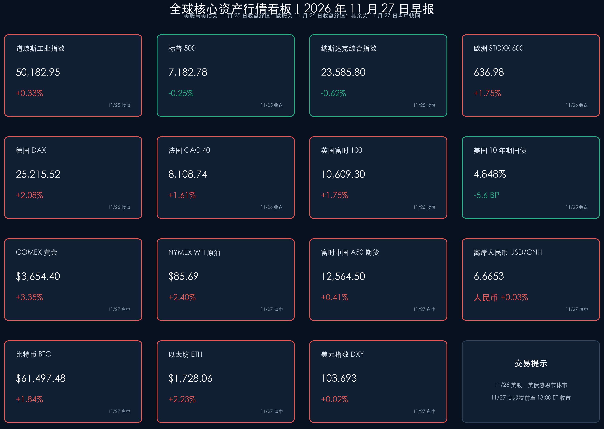

# 欧股劲升1.75%接力道指深V守五万，黄金原油与比特币盘中走强聚焦黑五消费

**日期：2026年11月27日 (星期五)** &nbsp; **时段：早报 (国际市场 · 感恩节假期)**

> **核心摘要**：美股与美债 11 月 26 日因感恩节休市，最新完整终值仍停留在 25 日：道指收涨 **0.33%** 守住 **50,182.95 点**，标普 500 与纳指在深 V 后分别收跌 **0.25%**、**0.62%**；欧股 26 日接力修复，STOXX 600 收涨 **1.75%**。假期仍交易资产整体偏强，A50 期货、黄金、WTI、比特币盘中分别上涨 **0.41%**、**3.35%**、**2.40%**、**1.84%**，但比特币 ETF 连续大额净流出说明衍生品反弹尚未转化为稳固的现货需求；今日焦点转向“黑色星期五”消费兑现与美股提前收市前后的流动性风险。

---

## 核心行情复盘

**全球交易状态核验**：纽约证券交易所与纳斯达克 11 月 26 日因感恩节全天休市，11 月 27 日恢复交易但将于美东时间 **13:00** 提前收市（北京时间 11 月 28 日 02:00）；美债现货市场 26 日同样休市。以下美股、美债为 **11 月 25 日收盘终值**，欧股为 **11 月 26 日收盘终值**，其余为 **11 月 27 日盘中快照**，不将盘中价格误写为收盘终值。[NYSE 交易日历](https://www.nyse.com/markets/hours-calendars)与 [Nasdaq 假期安排](https://www.nasdaq.com/market-activity/stock-market-holiday-schedule)均已交叉确认。

* **美股核心指数：价值与小盘占优，科技深跌后收复大部分失地**
    * **道琼斯工业平均指数**：收报 **50,182.95 点**，上涨 **164.25 点 / +0.33%**；盘中最低 **48,913.74 点**、最高 **50,395.24 点**，自低位反弹 **1,269.21 点**。成交量 **7.5471 亿股**，较前一交易日 **7.1270 亿股**增加 **5.89%**。
    * **标普 500 指数**：收报 **7,182.78 点**，下跌 **18.31 点 / -0.25%**；盘中最大跌幅约 **3.2%**，最低 **6,970.11 点**。成交量 **55.2015 亿股**，较前日 **52.4406 亿股**增加 **5.26%**。
    * **纳斯达克综合指数**：收报 **23,585.80 点**，下跌 **147.73 点 / -0.62%**，盘中最低 **22,632.40 点**；成交量 **113.6266 亿股**，较前日 **92.2216 亿股**显著增加 **23.21%**，体现低位换手加剧，但成交量本身不等同于主力净流入。
    * **罗素 2000、费城半导体与 VIX**：罗素 2000 收报 **2,704.06 点 / +0.71%**，跑赢大盘；费城半导体指数收报 **8,774.86 点 / -0.65%**，从 **8,129.24 点**低位明显修复；VIX 收报 **28.29 点 / +7.32%**，说明尾部风险定价仍未完全消退。
    * **周度与年内位置**：截至 25 日，本周标普 500、道指、纳指、罗素 2000 分别累计上涨 **3.9%**、**4.2%**、**4.3%**、**4.7%**；年内分别上涨 **4.9%**、**4.4%**、**1.5%**、**9.0%**。[美联社收盘核验](https://abcnews.com/Business/wireStory/major-us-stock-indexes-fared-wednesday-11252026-138453529)

* **板块与焦点股：硬件、材料、工业领涨，AI 算力与高资本开支权重承压**
    * **领涨端**：惠普（HPQ）大涨 **11.49%** 至 **31.15 美元**，成交量增加 **44.45%**；迪尔（DE）上涨 **4.44%** 至 **641.02 美元**，成交量增加 **8.23%**；Meta 上涨 **3.40%** 至 **609.89 美元**，成交量增加 **53.25%**。行业 ETF 中，材料 XLB 上涨 **2.07%**、工业 XLI 上涨 **0.83%**、能源 XLE 上涨 **0.74%**。
    * **领跌端**：英伟达下跌 **3.91%** 至 **149.30 美元**，亚马逊下跌 **3.12%** 至 **244.43 美元**且成交量增加 **84.19%**；科技 XLK 下跌 **0.83%**。市场从单纯追逐 AI 估值扩张，转向同时审视资本开支、盈利兑现与自由现金流。

* **欧洲股市 26 日收盘：关税担忧缓和与科技股反弹触发普涨**
    * **STOXX 600**：收报 **636.98 点 / +1.75%**，成交量 **1.4509 亿股**，较前日缩量 **16.06%**；**欧元区 STOXX 50** 收报 **6,014.74 点 / +2.04%**，成交量缩减 **35.73%**。
    * **德国 DAX**：收报 **25,215.52 点 / +2.08%**，成交量缩减 **31.34%**；**法国 CAC 40** 收报 **8,108.74 点 / +1.61%**，成交量缩减 **28.93%**；**英国富时 100** 收报 **10,609.30 点 / +1.75%**，成交量增加 **3.29%**。欧股上涨是对前一日超跌的修复，且多数市场缩量，不能单独据此判断新增长线资金已全面回流。[欧洲收盘交叉核验](https://eurasiabusinessnews.com/2026/11/27/stock-markets-today-november-26-2026-european-and-asian-stocks-rally-as-tariff-fears-ease/)

* **假期仍在交易的替代指标与跨资产快照**
    * **富时中国 A50 期货**：北京时间 **11:39** 报 **12,564.50 点**，较上一结算价 **12,513.00 点**上涨 **0.41%**；开盘 **12,523.00 点**，盘中区间 **12,477.00—12,609.00 点**，成交量 **238,703 手**、持仓量 **938,749 手**。A50 与欧股同向修复，为中国资产开盘情绪提供正向外部参照，但仍是盘中指标。
    * **离岸人民币**：USD/CNH 报 **6.6653**，较 25 日 UTC 尾盘 **6.66723** 下降约 **0.03%**，即人民币小幅升值；盘中区间约 **6.6582—6.6668**。美元指数报 **103.693**，较 25 日参考收盘 **103.670** 微升 **0.02%**，美元整体并未出现趋势性走弱。
    * **美债与贵金属**：10 年期美债收益率 25 日收报 **4.848%**，下行 **5.6BP**，缓解了高估值资产的折现率压力。COMEX 黄金连续合约 27 日盘中报 **3,654.40 美元/盎司**，较 25 日日线参考值 **3,535.80 美元**上涨 **3.35%**；该比较为连续合约盘中口径，并非 27 日官方结算。
    * **能源**：NYMEX WTI 原油盘中报 **85.69 美元/桶 / +2.40%**，布伦特原油连续合约报 **92.19 美元/桶 / -2.56%**。两者方向分化提示合约、时点与流动性差异，假期 thin liquidity 下不宜把短时价差直接解释为单一基本面变化。
    * **加密货币**：比特币报 **61,497.48 美元 / +1.84%**，以太坊报 **1,728.06 美元 / +2.23%**。比特币已站上 6 万美元，但仍需观察 **61,500—62,000 美元**附近的空头清算密集区。

> **数学闭环校验（收盘终值）**：道指 `(50,182.95 − 50,018.70) / 50,018.70 = +0.3284%`；标普 500 `(7,182.78 − 7,201.09) / 7,201.09 = -0.2543%`；纳指 `(23,585.80 − 23,733.54) / 23,733.54 = -0.6225%`；罗素 2000 `+0.7121%`；费城半导体 `-0.6526%`；VIX `+7.3217%`。欧股方面，STOXX 600 `+1.7491%`、STOXX 50 `+2.0406%`、DAX `+2.0783%`、CAC 40 `+1.6060%`、富时 100 `+1.7493%`。均与文内四舍五入涨跌幅一致，误差远低于 **0.5%**。
>
> **盘中快照验算**：A50 `(12,564.50 − 12,513.00) / 12,513.00 = +0.4116%`；黄金 `+3.3543%`；WTI `+2.4020%`；布伦特 `-2.5579%`；BTC `+1.8438%`；ETH `+2.2291%`。这些计算只用于核对盘中报价与前值的一致性，不代表当日已经收盘。

---

## 核心解读与市场逻辑

* **逻辑一：道指为何能深 V 翻红，而纳指与费半仍然收跌？**

> **核心解读**：25 日早盘，**3.8% PCE 同比、3.3% 核心 PCE 同比、4.3% 三季度 GDP**共同强化“增长强、通胀粘性高”的组合，叠加新一轮 301 关税提案，首先冲击对利率与贸易摩擦最敏感的 AI 权重股。午后 10 年期美债收益率回落 **5.6BP 至 4.848%**，切断“收益率上行—成长股估值压缩”的螺旋，低位买盘与空头回补推动道指自低点反弹逾 **1,269 点**。但纳指成交量放大 **23.21%**、VIX 仍涨 **7.32%**，说明这是高波动下的修复而非风险完全解除；材料、工业、惠普和迪尔跑赢，正反映资金偏向盈利可见度与现金流，而非无差别回流科技。

* **逻辑二：欧股 26 日为何补涨，缩量又透露什么信息？**

> **核心解读**：欧洲 25 日收市时未能完整计入美股随后的深 V 修复，26 日在科技反弹与关税担忧边际缓和下出现补涨，STOXX 50 与 DAX 涨幅均超过 **2%**。不过 STOXX 600、STOXX 50、DAX、CAC 40 成交量分别下降 **16.06%**、**35.73%**、**31.34%**、**28.93%**，表明假期交投清淡放大价格弹性。对今日亚洲市场而言，欧股上涨提供情绪支撑，但真正决定持续性的仍是美债收益率、关税听证进程与企业盈利，而不是单日低成交量反弹。

* **逻辑三：黑五消费预期强劲，为何不能直接等同于实际消费走强？**

> **核心解读**：Adobe 预计黑五线上消费同比增长 **9.2%**，NRF 预计年末零售额增长 **4.2%**，表面上有助于零售、物流与支付链条。然而 BEA 数据显示 10 月名义 PCE 环比增长 **0.3%**，实际 PCE 基本持平，PCE 价格同比却达 **3.8%**；因此销售总额增长可能同时包含销量、价格与促销提前释放三种效应。黑五应重点观察折扣深度、实际客单价、退货率与消费信贷，而不能只凭名义 GMV 判断居民实际购买力。

* **逻辑四：比特币站回 6 万美元，为何仍称“衍生品驱动反弹”？**

> **核心解读**：11 月 26 日加密衍生品约 **6.92 亿美元**仓位被清算、涉及近 **14.4 万名交易者**；其中比特币清算约 **2.64 亿美元**，包括约 **1.43 亿美元空头**与 **1.20 亿美元多头**。空头被迫回补放大了上涨，但美国现货比特币 ETF 在 24 日、25 日分别净流出约 **2.314 亿美元**、**4.531 亿美元**，两日合计 **6.845 亿美元**，11 月累计赎回此前已接近 **50 亿美元**。“价格反弹”与“机构现货回流”尚未形成闭环，若 ETF 流出不止，清算推动的涨势仍可能快速逆转。[加密资金与清算数据](https://financefeeds.com/bitcoin-rebounds-above-60000-as-short-liquidations-fuel-recovery-despite-heavy-etf-outflows/)

---

## 政策脉动

* **美国 BEA：收入改善、名义消费增长，但实际消费持平且通胀仍高**
    * 10 月个人收入环比增长 **0.7%**、可支配收入增长 **0.8%**；名义 PCE 增长 **0.3%**，实际 PCE 环比不足 **0.1%**、表格口径为 **0.0%**，储蓄率为 **4.1%**。
    * PCE 价格环比 **+0.3%**、同比 **+3.8%**；核心 PCE 环比 **+0.3%**、同比 **+3.3%**。服务消费增加 **521 亿美元**，商品消费增加 **118 亿美元**。收入端韧性与实际消费停滞并存，使美联储既要评估通胀，也不能忽略实际需求的边际降温。[BEA 10 月个人收入与支出公告](https://www.bea.gov/news/2026/personal-income-and-outlays-october-2026)
    * 美国三季度实际 GDP 年化季率二读为 **+4.3%**，与 10 月实际消费趋平形成“历史增长强、当期需求降温”的时间差。[BEA GDP 数据页](https://www.bea.gov/data/gdp/gross-domestic-product)

* **USTR：14 个经济体结构性产能过剩调查进入拟议关税阶段**
    * USTR 认定中国、欧盟、日本、韩国、印度、越南等 **14 个经济体**的相关产业实践可依据 301 条款采取行动，但目前发布的是**拟议措施并征求公众意见**，不是全部立即生效的最终税率。
    * 拟议税率存在显著差异：中国一般商品最高 **20%**、附件 A 商品最高 **10%**；欧盟、日本、韩国等多数方案为 **15%**；印度最高 **25%**；越南最高 **35%**，部分经济体还附带谈判后调整税率的选项。
    * 书面意见与出庭申请截止 **2027 年 1 月 5 日**，听证会自 **1 月 25 日**开始。短期影响主要体现在风险溢价与供应链预期，中期才取决于最终清单、豁免和谈判结果。[USTR 官方公告](https://ustr.gov/about/policy-offices/press-office/press-releases/2026/november/ustr-makes-determinations-and-proposes-actions-14-section-301-investigations-relating-structural)

* **美联储褐皮书：温和增长、就业稳定，价格继续温和上升**
    * 11 月 25 日公布的褐皮书概括为：经济活动温和增长，就业水平保持稳定，工资、成本与价格温和上涨，消费支出总体稳定。该组合与 BEA 的“实际消费持平”共同说明，美国经济并未失速，但高通胀仍在限制实际购买力和政策宽松空间。[美联储褐皮书摘要](https://www.federalreserve.gov/monetarypolicy/beigebook202611-summary.htm)

---

## 假期消费与黑色星期五观察

* **Adobe 线上消费预测**：感恩节当天 **69 亿美元 / +8.5%**，黑色星期五 **129 亿美元 / +9.2%**，网络星期一 **151 亿美元 / +6.2%**；感恩节至网络星期一的 Cyber Week 合计 **475 亿美元 / +7.4%**，整个年末线上消费季预计 **2,751 亿美元 / +6.7%**。[Adobe 预测汇总](https://ppc.land/adobe-puts-us-online-holiday-spend-at-275-1-billion-up-6-7/)
* **NRF 整体零售预测**：11—12 月美国零售额预计达到 **1.013 万亿美元 / +4.2%**，高于 2025 年的 **9,720 亿美元**。线上增速快于整体零售，意味着电商、支付、广告与物流履约仍是结构性受益方向。[黑五消费预测及口径](https://mlq.ai/news/black-friday-2026-is-nov-27-what-forecasters-expect-shoppers-to-spend-and-where-the-discounts-are/)
* **今日验证重点**：一是黑五实际线上销售能否接近 **129 亿美元**预测；二是电子产品、玩具等高折扣品类是否以利润率换销量；三是美股仅交易至美东 **13:00**，零售股与 ETF 的价格发现可能在清淡成交中被放大。

---

## 最新机构观点

* **美国银行（Bank of America）——上调近端目标，但对 2027 年硬着陆风险保持警惕**

> **机构观点**：美银将 2026 年底标普 500 目标由 **7,100 点**上调至 **7,400 点**，12 个月目标为 **7,800 点**。这一水平相对当前仍有空间，却仅大致回到前期高位区域；其核心约束是估值、通胀与盈利兑现之间的不匹配，因此不宜把年末反弹线性外推为 2027 年单边牛市。[美银最新展望](https://au.finance.yahoo.com/news/bank-america-issues-blunt-2027-170300642.html)

* **瑞银（UBS）——盈利与韧性经济支撑 2027 年底 8,200 点**

> **机构观点**：瑞银预计标普 500 企业盈利在 2026 年增长约 **29%** 后，2027 年再增长约 **15%**，并据此给出 2027 年底 **8,200 点**目标。其逻辑不是单纯扩张估值，而是盈利增长与经济韧性共同消化高利率；风险在于若实际消费继续停滞，盈利预测下修会削弱这一支撑。[瑞银 2027 年展望](https://money.usnews.com/investing/news/articles/2026-11-18/ubs-sees-s-p-500-at-8-200-by-end-2027-on-earnings-strength-resilient-economy)

* **摩根士丹利（Morgan Stanley）——全球股票上调至超配，标普看 8,700 点**

> **机构观点**：大摩将全球股票评级上调至超配，预计标普 500 在 2027 年底达到 **8,700 点**，2027 年 EPS 约 **420 美元**；同时将日本与欧洲股票上调至超配。其前提是 AI 投资和应用继续支撑盈利、利率与油价趋于稳定，并预计美联储在 2026 年 12 月和 2027 年 3 月各加息一次，因此更看好盈利增长而非估值扩张。[大摩策略摘要](https://finance.jrj.com.cn/2026/11/17124159168900.shtml)

* **巴克莱（Barclays）——目标下调至 8,700 点，但上调盈利预测**

> **机构观点**：巴克莱将标普 500 的 2027 年底目标由 **8,800 点**下调至 **8,700 点**，同时将 2027 年 EPS 预测由 **414 美元**上调至 **434 美元**。这一“降指数目标、升盈利预测”的组合意味着其担心金融条件收紧压低估值，同时仍相信半导体和硬件企业贡献主要盈利增量；与今日材料、工业走强而高估值科技承压的结构相呼应。[巴克莱目标调整](https://k.sina.com.cn/article_5953466437_162dab0450670bi1nq.html?from=finance)

---

## 今日市场情绪：丰饶角盛放跨市场修复，金油与数字资产在假期钟摆中等待消费验证

> Prompt: A colossal golden cornucopia shaped like a stock-market bell floats above a moonlit Manhattan skyline, releasing glowing red ribbons marked 50182, 636.98 and 61497 instead of coins. In the background, a quiet Thanksgiving dinner table holds a transparent hourglass filled with golden oil and a cooling blue silicon wafer, while a red-crowned mechanical magpie carrying a jade RMB coin flies toward a sunrise over Shanghai. No text except the numbers on the ribbons, no people, cinematic surreal composition.

---

**主要数据来源**：[NYSE](https://www.nyse.com/markets/hours-calendars)、[Nasdaq](https://www.nasdaq.com/market-activity/stock-market-holiday-schedule)、[美联社/AP 收盘数据](https://abcnews.com/Business/wireStory/major-us-stock-indexes-fared-wednesday-11252026-138453529)、Yahoo Finance 全球指数与期货日线/小时线、Sina 全球期货与离岸人民币快照、[BEA](https://www.bea.gov/news/2026/personal-income-and-outlays-october-2026)、[USTR](https://ustr.gov/about/policy-offices/press-office/press-releases/2026/november/ustr-makes-determinations-and-proposes-actions-14-section-301-investigations-relating-structural)、[Federal Reserve](https://www.federalreserve.gov/monetarypolicy/beigebook202611-summary.htm)、Adobe/NRF 假期消费预测，以及美国银行、瑞银、摩根士丹利和巴克莱公开策略观点。

> **免责声明**：内容仅供参考，不构成投资建议。
