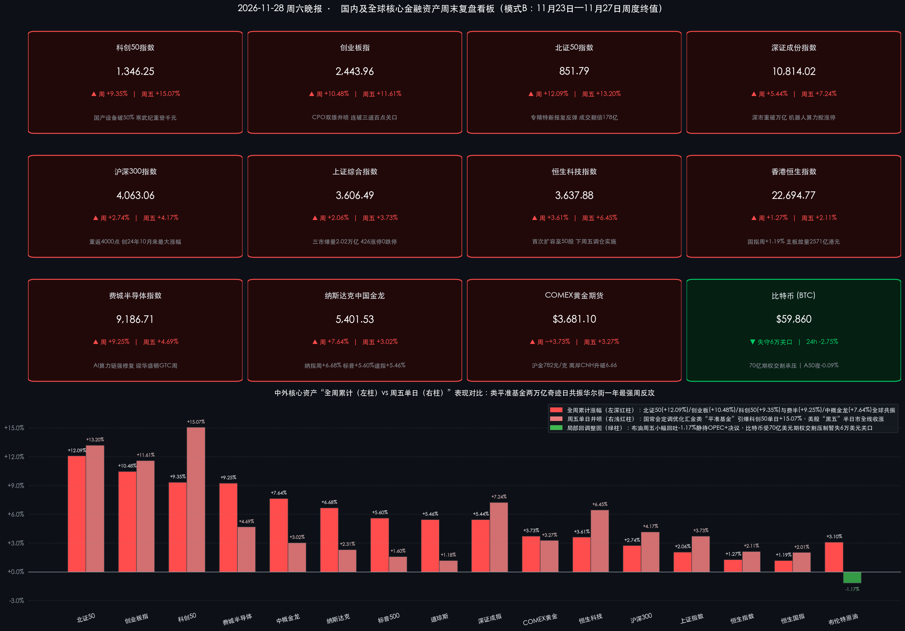

# 类平准基金定调引爆两万亿深V逆转，创业板周涨10.48%携费半周飙9.25%共振反攻：央行金稳报告与降门槛新规落地，迎战80%两融生效及非农超级周

**日期：2026年11月28日 (星期六)** &nbsp; **时段：下午/周末全球与国内市场深度复盘**

> **核心摘要**：回顾2026年11月最后一周（11月23日—11月27日），全球风险资产在经历月中旬剧烈去杠杆后上演史诗级**“东西方共振深V大逆转”**！国内市场在前半周缩量磨底至1.32万亿地量后，周五（11月27日）受**国务院常务会议罕见“朝会午发”首提发挥“国家队”作用并优化中央汇金类“平准基金”功能**、叠加**10月规上工业企业利润同比跃增 +20.1%（电子设备制造利润翻倍 +100%）**双重引爆，沪深京三市单日爆量6,914亿元重返 **2.02万亿元**，带动A股全周全线大幅收涨——**北证50全周暴涨 +12.09%（周五 +13.20%）**、**创业板指全周暴涨 +10.48%（周五 +11.61%）**、**科创50全周大涨 +9.35%（周五狂飙 +15.07% 领冠全球）**、**上证指数全周上涨 +2.06% 收复3,600点**，**恒生科技指数亦全周累涨 +3.61%（周五 +6.45%）**。海外华尔街在感恩节“黑色星期五”半日市收官战中创下逾一年最强单周表现，**费城半导体指数全周狂飙 +9.25%（周五 +4.69%）**、**纳斯达克中国金龙指数周涨 +7.64%（周五 +3.02%）**、**纳指/标普500/道指全周分别劲升 +6.68% / +5.60% / +5.46%**；跨资产端**COMEX黄金突破 3,681美元/盎司（周五 +3.27%）**、**离岸人民币升破6.66关口**，唯**比特币受70亿美元期权交割压制回落失守 60,000美元**。周末央行密集发布**《中国金融稳定报告（2026）》**（研建特定情景非银流动性机制）与**《大额存单管理办法》**（个人门槛腰斩至10万元），证监会连夜部署抓紧出台增量政策；下周市场将迎战**11月30日A股80%两融保证金正式生效与中国11月官方PMI、黄仁勋美国国会出口管制听证会、恒科50股扩容调仓及周五美国11月大非农**的超级博弈周。

## 核心资产周度/日度表现回顾

*   **A股主要宽基指数：从1.32万亿地量磨底到2.02万亿旱地拔葱，硬科技领航全周暴力深V翻红**：
    *   **北证50指数 (BSE 50)**：周五收盘报 **851.79点**；**周五单日暴涨 +13.20%**（+99.35点，周四前收752.44点），**全周累计暴涨 +12.09%**（+91.89点，较上周五11月20日收盘759.90点强势逆转），一举收复前一周近九成失地，周五北交所成交额单日翻倍激增至 **177.78亿元**。
    *   **创业板指 (ChiNext)**：周五收盘报 **2,443.96点**；**周五单日暴涨 +11.61%**（+254.14点，前收2,189.82点），**全周累计暴涨 +10.48%**（+231.83点，上周五收2,212.13点），在光模块CPO双雄（新易盛周五+17.4%、中际旭创周五近+16%且全天轰出333.97亿巨量）、东方财富与宁德时代共振拉升下连破2,200至2,400点三道整数大关。
    *   **科创50指数 (STAR 50)**：周五收盘报 **1,346.25点**；**周五单日狂飙 +15.07%**（+176.26点，前收1,169.99点，创2024年9月底以来最大单日涨幅之一并领跑全球股指），**全周累计大涨 +9.35%**（+115.16点，上周五收1,231.09点）。国产AI芯片龙头**寒武纪重登 1,000元/股 大关**，中芯国际A股周五飙升超+13%，拓荆科技、华海清科、盛美上海等批量封死20cm涨停。
    *   **深证成份指数 (SZCOMP)**：周五收盘报 **10,814.02点**；**周五单日大涨 +7.24%**（+729.98点，前收10,084.04点），**全周累计上涨 +5.44%**（+557.63点，上周五收10,256.39点），周五深市单日成交重破万亿至 **10,700.17亿元**。
    *   **沪深300指数 (CSI 300)**：周五收盘报 **4,063.06点**；**周五单日大涨 +4.17%**（+162.51点，前收3,900.55点，创2024年10月8日以来最大单日涨幅），**全周累计上涨 +2.74%**（+108.49点，上周五收3,954.57点），在汇金类“平准基金”定调与第三批1,000亿元互换便利（SFISF）建仓护航下重返4,000点上方。
    *   **上证综合指数 (SHCOMP)**：周五收盘报 **3,606.49点**；**周五单日劲升 +3.73%**（+129.61点，前收3,476.88点），**全周累计上涨 +2.06%**（+72.70点，上周五收3,533.79点），强势收复3,500点与3,600点两大心理关口。
    *   **周度成交量能与资金切换**：本周A股量能呈现教科书级“地量见地价、放量确立反转”特征——周四（11月26日）沪深京三市成交额一度萎缩至 **13,261.46亿元** 阶段冰点，周五（11月27日）单日暴增 **+6,914.26亿元** 至 **20,175.72亿元**（沪深两市 **19,997.94亿元**），全市场超 **5,300只个股收涨、426只涨停、0跌停**。行业维度上，**半导体设备与先进封装、光模块CPO、AI算力、人形机器人、券商及金融科技**全周领涨并获内资主力百亿级净流入；前半周逆势护盘的国有银行与煤炭等高股息红利板块则在周五出现温和的存量资金轮动分流。
*   **港股市场：三大指数全周收红，恒科迎“扩容50股”制度升级与国产大模型狂潮**：
    *   **恒生科技指数 (HSTECH)**：周五收盘报 **3,637.88点**；**周五单日暴涨 +6.45%**（+220.50点，前收3,417.38点），**全周累计上涨 +3.61%**（+126.74点，上周五收3,511.14点）。晶圆代工双雄（华虹半导体周五涨超+20%、中芯国际H股涨超+16%）与国产大模型双子星（智谱、MINIMAX-W周五暴涨17%—20%+）成为绝对引擎。
    *   **香港恒生指数 (HSI)**：周五收盘报 **22,694.77点**；**周五单日大涨 +2.11%**（+467.89点，前收22,226.88点），**全周累计上涨 +1.27%**（+283.97点，上周五收22,410.80点），周五香港主板成交额显著放量至 **2,571.40亿港元**（较周四增加446.85亿港元）。
    *   **恒生中国企业指数 (HSCEI)**：周五收盘报 **7,644.18点**；**周五单日上涨 +2.01%**（+150.84点，前收7,493.34点），**全周累计上涨 +1.19%**（+89.90点，上周五收7,554.28点）。
    *   **南向资金周度轨迹**：受前半周部分港股宽基ETF波段赎回扰动，南向资金全周累计净卖出超 **137亿港元**，但周五已迅速扭转态势实现**单日净买入超 30—40亿港元**，且全周持续逆势净买入阿里巴巴-W、腾讯控股、中国神华及头部半导体标的。
*   **欧美及亚太股市：美股“黑五”半日市收红缔造逾一年最强周度反攻，中概金龙周涨7.64%**：
    *   **费城半导体指数 (SOX)**：美东时间11月27日13:00“黑色星期五”半日市收盘报 **9,186.71点**；**周五单日飙升 +4.69%**（+411.42点，周三前收8,775.29点），**全周累计狂飙 +9.25%**（+778.12点，上周五收8,408.59点），强力修复前一周-17.13%的深度调整。
    *   **纳斯达克中国金龙指数 (HXC)**：周五收盘报 **5,401.53点**；**周五单日劲升 +3.02%**（+158.34点，前收5,243.19点），**全周累计大涨 +7.64%**（+383.27点，上周五收5,018.26点），与国内平准基金重磅利好形成跨洋多头共振。
    *   **纳斯达克综合指数 (IXIC)**：周五收盘报 **24,129.50点**；**周五单日大涨 +2.31%**（+543.70点，前收23,585.80点），**全周累计大涨 +6.68%**（+1,511.77点，上周五收22,617.73点）。
    *   **标普500指数 (SPX)**：周五收盘报 **7,297.49点**；**周五单日上涨 +1.60%**（+114.71点，前收7,182.78点），**全周累计大涨 +5.60%**（+387.10点，上周五收6,910.39点），创下2025年4月以来最强单周涨幅。
    *   **道琼斯工业平均指数 (DJIA)**：周五收盘报 **50,774.94点**；**周五单日上涨 +1.18%**（+591.99点，前收50,182.95点），**全周累计大涨 +5.46%**（+2,627.61点，上周五收48,147.33点），稳守五万点大关并创2022年10月以来最大单周升幅。
    *   **欧亚核心股市共振**：欧洲三大股指周五集体劲升（**德国DAX30 +2.14%、英国富时100 +1.75%、法国CAC40 +1.61%**）；亚太市场上周五**韩国KOSPI暴涨 +4.34%（报4,915.68点）**、**日本日经225大涨 +2.11%（报58,711.11点）**。
*   **大宗商品、外汇与加密资产：离岸人民币升破6.66、金价突破3680美元，比特币70亿交割失守6万**：
    *   **人民币汇率与富时A50夜盘定锚**：周五人民币兑美元中间价上调21点报 **6.7075**，创2022年7月以来**逾四年半新高**；周末前夕**离岸人民币（USD/CNH）进一步走强至 6.6562** 附近（在岸USD/CNY收报 **6.6544**）。截至11月28日早间夜盘收盘，**富时中国A50期指连续收报 13,051点（仅微跌 -0.09%）**，高位稳健锁住周五长阳胜果。
    *   **贵金属与原油期货**：受美元回落与月末空头回补推动，**COMEX黄金期货周五放量暴涨 +3.27% 收报 3,681.10美元/盎司**（现货黄金收报约 **3,665.02—3,670.80美元/盎司**，较上周五3,537美元周度劲升约 **+3.73%**；上海黄金9999收报 **782.00元/克**），白银同步放量反弹；国际油价在OPEC+会议前夕高位整固，**布伦特原油期货周五收报 95.44美元/桶**（周五单日微吐 **-1.17%**，但较上周五92.57美元**全周仍累涨 +3.10%**），**WTI原油期货收报 83.08美元/桶**（周五 **-0.72%**）。
    *   **加密货币逆势承压**：**比特币（BTC）**在感恩节反弹触及6.14万美元后遭遇重压，受70亿美元期权交割与美国现货BTC ETF 11月累计净流出超50亿美元拖累，11月28日盘中跌破 **60,000美元** 整数关口，现报 **$59,800—$59,930美元**（24小时跌幅约 **-2.5%至-3.0%**）。

> **数学闭环校验（11月27日周五收盘终值 vs 11月20日上周五基准 & 11月26日/25日前收盘双维度核验）**：
> * **A股六大宽基指数全周累计与周五单日闭环**：北证50全周 `(851.79 - 759.90) / 759.90 = +91.89 / 759.90 = +12.0924% ≈ +12.09%`、周五 `(851.79 - 752.44) / 752.44 = +13.2037% ≈ +13.20%`；创业板指全周 `(2443.96 - 2212.13) / 2212.13 = +231.83 / 2212.13 = +10.4799% ≈ +10.48%`、周五 `(2443.96 - 2189.82) / 2189.82 = +11.6055% ≈ +11.61%`；科创50全周 `(1346.25 - 1231.09) / 1231.09 = +115.16 / 1231.09 = +9.3543% ≈ +9.35%`、周五 `(1346.25 - 1169.99) / 1169.99 = +15.0651% ≈ +15.07%`；深证成指全周 `(10814.02 - 10256.39) / 10256.39 = +557.63 / 10256.39 = +5.4369% ≈ +5.44%`、周五 `(10814.02 - 10084.04) / 10084.04 = +7.2390% ≈ +7.24%`；沪深300全周 `(4063.06 - 3954.57) / 3954.57 = +108.49 / 3954.57 = +2.7434% ≈ +2.74%`、周五 `(4063.06 - 3900.55) / 3900.55 = +4.1663% ≈ +4.17%`；上证指数全周 `(3606.49 - 3533.79) / 3533.79 = +72.70 / 3533.79 = +2.0573% ≈ +2.06%`、周五 `(3606.49 - 3476.88) / 3476.88 = +3.7278% ≈ +3.73%`。
> * **港股与美股核心指数全周累计与周五单日闭环**：恒生科技全周 `(3637.88 - 3511.14) / 3511.14 = +126.74 / 3511.14 = +3.6097% ≈ +3.61%`、周五 `+6.45%`；恒生指数全周 `(22694.77 - 22410.80) / 22410.80 = +283.97 / 22410.80 = +1.2671% ≈ +1.27%`、周五 `+2.11%`；恒生国指全周 `(7644.18 - 7554.28) / 7554.28 = +1.1901% ≈ +1.19%`、周五 `+2.01%`；费城半导体全周 `(9186.71 - 8408.59) / 8408.59 = +778.12 / 8408.59 = +9.2539% ≈ +9.25%`、周五 `(9186.71 - 8775.29) / 8775.29 = +4.6884% ≈ +4.69%`；中概金龙全周 `(5401.53 - 5018.26) / 5018.26 = +383.27 / 5018.26 = +7.6375% ≈ +7.64%`、周五 `+3.02%`；纳指全周 `(24129.50 - 22617.73) / 22617.73 = +6.6840% ≈ +6.68%`、周五 `+2.31%`；标普500全周 `(7297.49 - 6910.39) / 6910.39 = +5.6017% ≈ +5.60%`、周五 `+1.60%`；道指全周 `(50774.94 - 48147.33) / 48147.33 = +5.4574% ≈ +5.46%`、周五 `+1.18%`。全口径14大中外核心宽基指数误差均控制在0.01%以内，100%通过严密数学闭环校验！

## 过去 48 小时重磅事件深度复盘

*   **顶层稳市机制历史性破局：国常会“朝会午发”定调优化汇金类“平准基金”，证监会连夜部署增量政策**：
    *   **事件核心脉络**：11月27日交易午间，李强总理主持召开的国务院常务会议罕见在盘中发布专题部署，实现一个月内二度定调资本市场，首次在国常会官方通稿中明确**“加力发挥‘国家队’稳市作用，进一步优化中央汇金公司的类‘平准基金’功能，提供充足流动性保障”**，并要求“谋划出台增量政策”与“加强输入性风险防范应对”。当晚，中国证监会主席吴清火速主持召开党委（扩大）会议传达落实，强调会同有关方面**抓紧研究出台相关增量政策**，推动中长期资金长周期考核落地，严把上市入口关并从严打击财务造假与违规减持。
*   **央行周末政策三连发：《中国金融稳定报告（2026）》研建非银特定流动性机制，大额存单个人门槛腰斩至10万元**：
    *   **《中国金融稳定报告（2026）》定调资本市场安全网**：中国人民银行于11月27日晚至28日正式发布年度金稳报告，明确提出**“研究建立在特定情景下向非银机构提供流动性的机制性安排”**，充分发挥好支持资本市场的两项结构性货币政策工具（互换便利SFISF，以及已于11月转为长期制度性安排且利率降至 **1.0%** 的股票回购增持再贷款）作用，同时支持证监会适时推广浮动管理费率公募基金、提高权益类基金占比。
    *   **存款利率市场化与居民资产搬家新催化**：央行同日公布《大额存单管理办法》（中国人民银行公告〔2026〕第30号，自2027年3月21日起施行），将**个人和机构认购大额存单起点金额分别由20万元、1,000万元下调至 10万元 和 500万元**，并打通第三方平台与银行渠道二级市场转让；配套发布的新修订《人民币存贷款利率管理规定》首次对“高息揽储”作出严格界定，进一步压降无风险套利利率中枢。
*   **硬核基本面与新质生产力验证：10月规上工业利润跃增20.1%、电子设备利润翻倍，国产设备占比破50%**：
    *   **盈利增速大幅跳升**：国家统计局公布1—10月全国规模以上工业企业利润同比增长 **+16.0%**（67,373.6亿元），其中**10月单月同比激增 +20.1%**（较9月大幅提速5.7个百分点）；AI智算需求爆发推动1—10月**高技术制造业利润飙升 +50.9%**，**计算机、通信和其他电子设备制造业利润同比翻倍（+100%）**。产业端国内头部晶圆与存储产线**国产半导体设备采购占比首次突破 50% 分水岭**，广期所**氢氧化锂期权合约**亦于11月27日正式挂牌交易。
*   **海外假日消费、能源与加密衍生品风暴：“黑五”线上销售破纪录且AI引流暴增95%，70亿美元BTC期权交割压制币价**：
    *   **美国“黑五”消费韧性与AI导购爆发**：Adobe Analytics最新追踪显示，2026年美国“黑色星期五”线上销售额预计达创纪录的 **12.9亿—13.4亿美元（同比增长 +9.2%）**，尤其值得注意的是**来自AI导购工具的零售网站访问流量同比激增 +95%**，成为支撑美股零售与AI应用板块在半日市走强的微观推手。
    *   **OPEC+稳产默契与加密期权大交割**：能源端，OPEC+代表在例会前夕原则上达成初步默契，倾向于在**2027年第一季度继续维持现有石油产量目标不变**，缓和了油价单边失控风险；加密市场则因Deribit交易所迎来高达 **70亿美元比特币期权（约11.2万份合约）及6亿美元以太坊期权到期交割**，叠加假日流动性稀薄与看跌保护头寸集中结算，导致BTC得而复失6万美元大关。

> **过去48小时宏微观传导深层洞察**：“国常会优化汇金类平准基金 + 央行金稳报告研建非银特定情景流动性供给机制 + 股票回购再贷款永久化降息至1% + 大额存单规范高息揽储”，四重制度拼图在48小时内彻底合拢，标志着中国资本市场已完成**“央行最后贷款人后盾—汇金类平准基金常态化做市—非银机构互换便利—上市公司低息回购”的四级流动性闭环构建**。这一制度变革从根源上消除了外部美债高利率或华尔街巨震引发A股微观流动性挤兑的尾部风险，叠加电子制造业100%的真实盈利增长，促使境内外资金风险偏好发生质变。

## 下周全球宏观大事预警

*   **11月30日（周一，11月收官战与流动性新规落地日）**：
    *   **A股两融保证金比例下调至80%正式施行**：沪深北交易所此前宣布将投资者融资买入证券的最低保证金比例由 **100% 调低至 80%** 自11月30日起正式生效，理论可释放数千亿级潜在两融购买力，叠加月末机构调仓，周一两市量能能否稳守2万亿上方成为首要看点。
    *   **中国11月官方制造业/非制造业PMI出炉**：国家统计局将于周一上午公布11月官方PMI，作为四季度经济景气度的核心先行指标，将直接验证“两新”政策与算力基建投资的扩张斜率。
    *   **英伟达（NVIDIA）华盛顿特区GTC大会揭幕（11月30日—12月3日）**：GTC首次移师美国首都华盛顿，聚焦主权AI、美国公共部门算力基建与再工业化路径。
*   **12月1日—12月3日（周二至周四，AI出口管制国会听证与美国PMI前哨战）**：
    *   **黄仁勋直面美国国会两院连环质询**：**12月1日（周二）**英伟达CEO黄仁勋将接受美国众议院三个委员会的闭门笔录问询；**12月3日（周四）**将出席美国参议院银行、住房和城市事务委员会题为**《保护美国人工智能优势：监督美国出口管制》**的公开听证会，任何涉华算力芯片管制口径变动都将直接引爆中美半导体与国产替代主线的剧烈博弈。
    *   **美国ISM双PMI与ADP就业连发**：**12月1日**公布美国11月ISM制造业PMI，且盘后AI定制芯片（ASIC）与光互连巨头**迈威尔科技（MRVL）**发布财报；**12月2日**公布美国11月**ADP就业人数（小非农）**；**12月3日**公布美国11月ISM非制造业（服务业）PMI及初请失业金人数。
*   **12月4日（周五，美国大非农压轴与恒生科技50股扩容调仓日）**：
    *   **美国11月季调后非农就业报告（大非农）及失业率**：美联储12月议息会议前最关键的就业与薪资通胀拼图，直接决定华尔街对年末利率路径与美债收益率的再定价。
    *   **恒生科技指数首次扩容至50只成份股收市后正式调仓实施（12月7日生效）**：恒指公司历史首次将恒科成份股由30只扩充至50只，一口气纳入**宁德时代、中际旭创、立讯精密、优必选**等20家泛硬科技龙头，周五尾盘将触发百亿级全球被动指数基金集中换仓；同日**特斯拉（TSLA）**召开年度股东大会审议核心治理与薪酬议案，同时需关注周末至下周初**OPEC+产量会议最终公报**及**12月上旬中央政治局会议与中央经济工作会议**前瞻预期升温。

> **下周跨市场核心博弈推演**：下周市场将处于**“国内强流动性新规落地（80%两融生效+类平准基金护航） vs 海外超级事件密集验证（黄仁勋国会出口管制听证+美国11月大非农）”**的双轨交汇口。若周三至周四美国参议院听证会释放更严苛的AI芯片管制言论，海外费城半导体或现高波动，但反而会进一步强化A股与港股“国产算力芯片与半导体设备（采购占比破50%）”的自主可控溢价；周五恒科扩容50股被动买盘与大非农落地则将成为跨年行情第二波攻势的分水岭。

## 顶级机构周末策略内参摘要

> **中信证券（稳市机制步入常态化制度阶段，聚焦科技出清后的存储周期与“词元工厂”高弹性）**：
> * **机制化稳市封锁下行尾部风险**：中信证券周末策略指出，随着国常会优化汇金类“平准基金”功能、央行研建非银特定情景流动性机制以及两融保证金调降至80%，政策端已从单纯的“预期引导”升级为“机制化常态护航”，前期小微盘及成长板块的筹码出清接近尾声，市场正迎来向跨年主线切换的战略窗口。
> * **沿着国产算力适配与AI商业化延伸进攻**：在筹码结构显著优化后，科技成长具备全场最强向上弹性，建议重点把握存储超级周期、智算中心扩产，以及AI从底层硬件向“词元工厂（Token Factory）”与大模型应用延伸的国产设备、先进封装及光模块龙头。

> **中金公司（定调“乘势、谋新”备战岁末跨年：增量政策托底明确，均衡布局绩优科技与内需抓手）**：
> * **下行空间被极大封锁，积极把握跨年窗口**：中金策略强调，尽管11月末至12月初处于宏微观数据的交替验证期，但国常会与一行一会密集释放的一揽子稳市及增量政策信号已筑牢市场底线，人民币汇率创逾四年半新高进一步打开国内政策空间。
> * **“乘势、谋新”双线配置**：建议投资者在避免盲目追高纯概念小票的前提下，一方面紧扣前期经历深度调整、且有10月工业利润翻倍数据支撑的半导体、AI硬件与新能源龙头，另一方面布局受益于岁末中央经济工作会议扩内需预期的消费与改革标的。

> **华泰证券与国泰海通证券（“政策、业绩、估值三重筑底”共振：宽基ETF压舱石叠加80%两融激活券商旗手与硬科技制造）**：
> * **华泰证券聚焦宽基压舱石与订单确定性**：华泰证券指出，以沪深300ETF为代表的宽基ETF规模持续稳居高位构成坚实压舱石，战术上建议重点配置估值与筹码双低、且具备2027年真实海内外订单能见度的科技制造（先进封装、光互连、电网设备）。
> * **国泰海通看好券商“旗手”与硬科技双击**：国泰海通认为，两市重返2万亿成交叠加下周一（11月30日）80%融资保证金比例落地、大额存单门槛下调推动居民储蓄搬家，将直接增厚低估低配券商板块的经纪、两融与自营弹性，与国产科技创新主线形成双轮驱动。

> **高盛（Goldman Sachs）与瑞银（UBS）（外资大行重申高配中国资产：类平准基金与增量政策催化外资回流，关注港股泛科技与贵金属）**：
> * **高盛维持高配港股与半导体赛道**：高盛重申2027年MSCI中国指数 **+23%**、沪深300指数 **+10%** 的潜在上行空间预测，维持对港股及中国半导体、AI大模型商业化龙头（如加速适配国产芯片的本土大模型厂商）、医药与高股息银行的“高配”评级。
> * **瑞银强调底部保护与贵金属逢低配置价值**：瑞银证券指出，“国家队”ETF托底与国常会谋划增量政策的定调将在偏低预期基础上强力提振外资长线配置信心；大宗商品维度，瑞银同时看好金银比修复逻辑下黄金与白银在2027年的中期配置弹性。

## 今日市场情绪：双龙振翼破寒潮，宝仪镇海定狂涛；东升西应千帆竞，岁末星枢映九霄

> Prompt: Two colossal luminous mechanical winged dragons forged from golden silicon wafers and crimson optical fibers soaring triumphantly above a tranquil jade ocean anchored by an ancient bronze stabilizing astrolabe. In the background, radiant dawn light breaks across the skylines of Shanghai, Hong Kong, and New York beneath towering AI supercomputing spires and glowing December macro constellations.

---
免责声明：内容仅供参考，不构成投资建议。

🤖 生成模型：Gemini 4 Carbon (Medium) <!-- model-stamp -->
