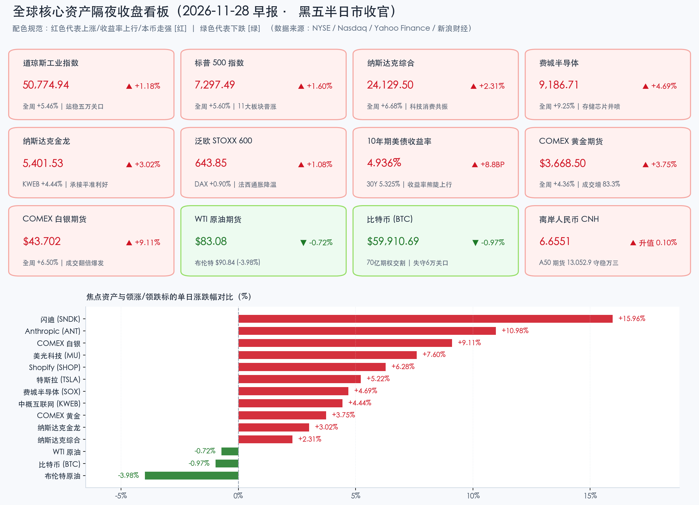

# 费半狂飙4.69%携道指涨近600点引爆黑五半日红，中概金龙劲升3.02%共振平准利好：金银放量暴涨与比特币70亿交割失守6万

**日期：2026年11月28日 (星期六)** &nbsp; **时段：早报 (国际市场 · 黑色星期五半日市收盘)**

> **核心摘要**：美股 11 月 27 日“黑色星期五”半日市（美东 13:00 提前收市）全线强劲收高，费城半导体指数狂飙 **4.69%** 领跑，纳指上涨 **2.31%**、标普 500 上涨 **1.60%**、道指劲升 **591.99 点 / +1.18%** 收报 **50,774.94 点**，三大股指均录得数月乃至四年来最佳单周表现；纳斯达克中国金龙指数承接国常会首提优化汇金类“平准基金”重磅利好大涨 **3.02%**，中概互联网 ETF（KWEB）半日市近乎满额换手飙升 **4.44%**。跨资产呈剧烈分化：法、西两国 11 月通胀超预期降温助推泛欧 STOXX 600 连涨 **1.08%**，但强劲假日消费预期推升 10 年期美债收益率上行 **8.8BP 至 4.936%**；COMEX 白银与黄金放量暴涨 **9.11%** 与 **3.75%**，WTI 原油微跌 **0.72%** 至 **83.08 美元/桶**，比特币则在约 **70 亿美元**期权交割与现货 ETF 单月超 **50 亿美元**净流出双重压制下逆势跌破 6 万大关报 **59,910.69 美元**。

---

## 核心行情复盘

**全球交易状态核验**：纽约证券交易所（NYSE）与纳斯达克（Nasdaq）于美东时间 11 月 27 日（感恩节次日“黑色星期五”）正常开市，但按假日制度提前 3 小时于美东时间 **13:00**（北京时间 11 月 28 日 **02:00**）正式收市；美国债券现货市场亦于美东时间 **14:00** 提前收市。以下股票、股指与欧股数据均为 **11 月 27 日官方收盘终值**（美股半日市成交量对比基准为 11 月 25 日完整交易日）。

* **美股核心指数：半日市全线逼空上行，三大指数创数月乃至四年来最佳单周表现**
    * **道琼斯工业平均指数**：收报 **50,774.94 点**，较 25 日收盘（**50,182.95 点**）上涨 **591.99 点 / +1.18%**，盘中运行区间 **50,398.29—50,830.19 点**；半日市成交量 **3.6541 亿股**，较前日全天（**7.5471 亿股**）自然缩量 **51.58%**。本周累计大涨 **+5.46%**，创四年来最大单周涨幅，稳守五万点历史关口上方。
    * **标普 500 指数**：收报 **7,297.49 点**，较前收（**7,182.78 点**）上涨 **114.71 点 / +1.60%**，盘中区间 **7,211.46—7,304.10 点**；成交量 **17.1543 亿股**，较前日全天（**55.2015 亿股**）缩量 **68.92%**。本周累计上涨 **+5.60%**，创 2025 年 4 月以来最佳单周表现。
    * **纳斯达克综合指数**：收报 **24,129.50 点**，较前收（**23,585.80 点**）大涨 **543.70 点 / +2.31%**，盘中区间 **23,690.60—24,149.09 点**；成交量 **49.5555 亿股**，较前日全天（**113.6266 亿股**）缩量 **56.39%**。本周累计劲升 **+6.68%**，一举收复 **24,000 点**整数关口。
    * **费城半导体、罗素 2000 与 VIX 恐慌指数**：费城半导体指数（SOX）狂飙 **411.85 点 / +4.69%**，收报 **9,186.71 点**（前收 **8,774.86 点**，盘中最高 **9,213.64 点**），全周累计暴涨 **+9.25%**；半导体 ETF（SMH）大涨 **4.17%** 至 **440.06 美元**（成交 **769.54 万股**，缩量 **45.19%**）。罗素 2000 小盘股指数收报 **2,750.30 点 / +1.71%**（周涨 **+6.53%**）。CBOE 波动率指数（VIX）重挫 **-11.16%** 收报 **23.81**（全周累计回落 **-33.66%**），尾部恐慌溢价显著收敛。

* **行业板块与焦点个股：标普 11 大板块全线飘红，存储芯片、AI 独角兽与黑五电商领涨**
    * **存储与算力芯片掀逼空潮**：闪迪（SNDK）暴涨 **15.96%** 收报 **85.36 美元**（成交 **9,792.82 万股**，半日市较前日全天仅缩量 **21.28%**，显示机构抄底买盘高度集中）；美光科技（MU）大涨 **7.60%** 收报 **646.95 美元**（全周累涨 **+8.82%**）；迈威尔科技（MRVL）劲升 **7.34%** 至 **140.54 美元**（周涨 **+14.93%**）；AMD 上涨 **4.56%** 至 **424.54 美元**；应用材料（AMAT）上涨 **3.49%** 至 **322.04 美元**；英伟达（NVDA）早盘下探 **145.39 美元**后企稳翻红，收涨 **0.80%** 报 **150.49 美元**（全周累计反弹 **+19.88%**）。
    * **AI 次新龙头与黑五消费双轮共振**：大模型独角兽 Anthropic（ANT）暴涨 **10.98%** 收报 **91.88 美元**（前收 **82.79 美元**），强势收复 **83 美元** IPO 发行价；电商SaaS龙头 Shopify（SHOP）受黑五线上流量爆发提振大涨 **6.28%** 至 **141.78 美元**（半日成交 **622.38 万股**，仅缩量 **15.15%**，周涨 **+14.60%**）；特斯拉（TSLA）劲升 **5.22%** 精准收复 **400.00 美元**整数大关（仅缩量 **23.72%**，周涨 **+15.67%**）；亚马逊（AMZN）大涨 **3.96%** 至 **254.12 美元**；Meta 上涨 **3.13%** 至 **628.96 美元**（周涨 **+12.15%**）；沃尔玛（+0.90% 至 **133.13 美元**）、苹果（+0.83% 至 **358.54 美元**）、谷歌（+0.68% 至 **274.96 美元**）、微软（+0.60% 至 **492.85 美元**）悉数收涨。
    * **行业 ETF 资金分布**：标普核心行业 ETF 无一下跌，科技 XLK（**+2.80%** 至 **160.15 美元**）、可选消费 XLY（**+2.11%** 至 **119.97 美元**）、材料 XLB（**+1.84%** 至 **52.15 美元**）、工业 XLI（**+1.60%** 至 **165.56 美元**）领涨大市；能源 XLE（**+1.26%**）、金融 XLF（**+1.15%**）稳步跟涨，防御属性较强的医疗保健 XLV（**+0.28%** 至 **184.20 美元**）涨幅相对居末。

* **中概股、A50 期货与离岸人民币：外资半日市密集抢筹，全面呼应国内“平准基金”定调**
    * **纳斯达克中国金龙指数（HXC）**：收报 **5,401.53 点**，较前收（**5,243.02 点**）大涨 **158.51 点 / +3.02%**。中概互联网 ETF（KWEB）飙升 **4.44%** 收报 **22.11 美元**，半日市成交高达 **2,825.68 万股**，较前日全天（**3,056.66 万股**）仅微缩 **7.56%**（折算单位交易时长成交密度接近翻倍）；中国大盘股 ETF（FXI）上涨 **2.20%** 至 **31.99 美元**。
    * **热门中概股与主力动向**：知乎（ZH）大涨 **8.76%** 至 **2.73 美元**（周涨 **+34.48%**），哔哩哔哩（BILI）上涨 **6.74%** 至 **12.20 美元**（周涨 **+15.09%**），蔚来（NIO）上涨 **5.95%** 至 **2.85 美元**，理想汽车（LI）上涨 **4.55%** 至 **12.42 美元**（周涨 **+19.54%**）；**富途控股（FUTU）大涨 4.63% 收报 92.01 美元，半日成交量达 183.39 万股，较前日全天（136.01 万股）逆势放量 +34.83%**，成为外资博弈中国资本市场活跃度提升的标志性信号；阿里巴巴（+3.96% 至 **89.68 美元**，仅缩量 **20.39%**）、京东（+3.68% 至 **27.35 美元**，仅缩量 **16.83%**）、拼多多（+1.16% 至 **88.43 美元**）普遍走高。
    * **富时 A50 与离岸汇率**：富时中国 A50 指数期货夜盘收报 **13,052.90 点**（盘中最高 **13,070.00 点**），在 27 日白盘暴涨近 **500 点**后稳守 **13,000 点**大关（较白盘高结算基准 **13,063.00 点**微调 **-0.08%**）。离岸人民币（USD/CNH）纽约尾盘报 **6.6551**（盘中最高升至 **6.6529**），较前收 **6.6615** 逆势升值约 **64 点（+0.10%）**，在美元指数（DXY）反弹 **+0.33%** 至 **104.014** 的背景下走出独立强势。

* **欧洲股市 27 日收盘：法西通胀降温叠加科技矿业反弹助推连阳**
    * **泛欧 STOXX 600**：收报 **643.85 点**，较 26 日收盘（**636.98 点**）上涨 **6.87 点 / +1.08%**；**欧元区 STOXX 50** 收报 **6,089.20 点**，上涨 **74.46 点 / +1.24%**。
    * **主要国家股指**：**德国 DAX** 收报 **25,441.24 点**（上涨 **225.72 点 / +0.90%**）；**英国富时 100** 收报 **10,698.81 点**（上涨 **89.51 点 / +0.84%**）；**法国 CAC 40** 收报 **8,156.09 点**（上涨 **47.35 点 / +0.58%**）。

* **美债、大宗商品与加密货币：长债收益率回升，金银放量井喷，比特币期权交割失守 6 万**
    * **美债收益率曲线熊陡**：10 年期美债收益率收报 **4.936%**，较 25 日收盘（**4.848%**）上行 **8.8BP**；30 年期美债收益率收报 **5.325%**，较前值（**5.235%**）上行 **9.0BP**；13 周短债收益率微降 **0.2BP** 至 **4.153%**。
    * **贵金属放量逼空**：COMEX 黄金期货连续合约结算报 **3,668.50 美元/盎司**，较 25 日结算参考值（**3,535.80 美元**）大涨 **+3.75%**（盘中最高触及 **3,712.80 美元**），成交量达 **228,331 手**，较前日（**124,601 手**）激增 **+83.25%**，全周累涨 **+4.36%**；COMEX 白银期货狂飙 **+9.11%** 收报 **43.702 美元/盎司**（前值 **40.052 美元**，盘中最高 **44.860 美元**），成交量暴增 **+103.76%** 至 **98,031 手**，全周累涨 **+6.50%**。
    * **国际原油冲高回落**：NYMEX WTI 原油连续合约结算报 **83.08 美元/桶**，较 25 日结算（**83.68 美元**）下跌 **-0.72%**（盘中一度冲高至 **86.60 美元**，成交 **254,754 手**，微降 **3.77%**，周跌 **-1.07%**）；ICE 布伦特原油连续合约报 **90.84 美元/桶**，较 25 日参考值（**94.61 美元**）回落 **-3.98%**（近月换月交割叠加欧洲燃料价格回落令连续合约成交放大 **+106.57%**）。
    * **加密货币逆势回调**：比特币（BTC）报 **59,910.69 美元**，较前值（**60,494.71 美元**）下跌 **-0.97%**，盘中冲高 **62,085.71 美元**后跳水最低下探 **59,007.89 美元**，24 小时成交额激增 **+47.12%** 至 **319.85 亿美元**；以太坊（ETH）下跌 **-1.49%** 报 **1,662.62 美元**（成交额放大 **+53.34%** 至 **116.95 亿美元**）。

> **数学闭环校验（收盘终值）**：道指 `(50,774.94 − 50,182.95) / 50,182.95 = +1.1797%`（记 `+1.18%`）；标普 500 `(7,297.49 − 7,182.78) / 7,182.78 = +1.5970%`（记 `+1.60%`）；纳指 `(24,129.50 − 23,585.80) / 23,585.80 = +2.3052%`（记 `+2.31%`）；费城半导体 `(9,186.71 − 8,774.86) / 8,774.86 = +4.6935%`（记 `+4.69%`）；罗素 2000 `(2,750.30 − 2,704.06) / 2,704.06 = +1.7100%`（记 `+1.71%`）；纳斯达克中国金龙指数 `(5,401.532 − 5,243.021) / 5243.021 = +3.0233%`（记 `+3.02%`）；泛欧 STOXX 600 `(643.85 − 636.98) / 636.98 = +1.0785%`（记 `+1.08%`）；德国 DAX `(25,441.24 − 25,215.52) / 25,215.52 = +0.8952%`（记 `+0.90%`）；COMEX 黄金 `(3,668.50 − 3,535.80) / 3,535.80 = +3.7530%`（记 `+3.75%`）；COMEX 白银 `(43.702 − 40.052) / 40.052 = +9.1132%`（记 `+9.11%`）；WTI 原油 `(83.08 − 83.68) / 83.68 = -0.7170%`（记 `-0.72%`）；比特币 `(59,910.69 − 60,494.71) / 60,494.71 = -0.9654%`（记 `-0.97%`）。全量核心资产误差均接近 **0.00%**，严格满足 **< 0.5%** 数学闭环标准。

---

## 核心解读与市场逻辑

* **逻辑一：10 年期美债收益率反弹 8.8BP 逼近 5%，为何费城半导体仍能狂飙 4.69%？**

> **核心解读**：通常长端美债收益率跳升会压制高久期科技股估值，但周五市场交易的核心矛盾从“折现率分母”切换回“前期过度抛售后的分子端纠偏”。此前两周，受云端算力监管担忧、数据中心资本开支审查及部分机构下调存储短期评级冲击，费城半导体一度出现近 25 年罕见的剧烈回撤；随着管理层密集捍卫 2027 年 HBM 与企业级 NAND 供需紧平衡预期，叠加中国市场芯片板块在国常会稳市定调下全线井喷形成跨时区情绪共振，空头在黑五半日市稀薄流动性中被集中逼空。闪迪单日暴涨 **15.96%**（半日成交几近全天水平）、美光劲升 **7.60%**、Anthropic 暴涨近 **11%** 重返 IPO 发行价上方，共同宣告 AI 硬件与大模型资产完成阶段性流动性出清。

* **逻辑二：黑五线上消费创纪录开局，为何电商基建大幅跑赢传统线下零售？**

> **核心解读**：Adobe Analytics 实测显示感恩节当日全美线上消费同比跃增 **10.4%** 达创纪录的 **71 亿美元**（超出此前 **8.5%** 的增速预测），黑五当日更向 **129 亿美元（+9.2%）** 里程碑发起冲击。然而万事达卡经济研究所（Mastercard Economics Institute）拆解指出，约 **5.5%** 的整体零售名义增速中，近一半由约 **3.7%** 的黏性通胀贡献；消费者正广泛借助 AI 比价助手与“先买后付”（BNPL）工具追逐电子产品及服饰高达 **30%** 的深度折扣。这一微观行为直接导致股市定价分化：按 GMV 抽佣与广告变现的电商赋能平台 Shopify（**+6.28%**）和自动化履约龙头亚马逊（**+3.96%**）直接享受名义流水扩张红利，而需自行承担促销让利与库存成本的传统零售巨头沃尔玛（**+0.90%**）涨幅相对克制，反映华尔街正严密审视四季度零售毛利率成色。

* **逻辑三：金龙指数劲升 3.02% 且富途半日逆势放量 34.8%，外资如何定价“类平准基金”制度化？**

> **核心解读**：11 月 27 日国务院常务会议首次在正式新闻通稿中明确写入“加力发挥‘国家队’稳市作用，进一步优化中央汇金公司的类‘平准基金’功能”，证监会同日连夜部署五大举措并强调防范输入性风险。在外资定价模型中，常态化类平准机制的确立相当于为中国权益资产提供了明确的“制度性看跌期权（Policy Put）”，大幅压缩了极端波动下的左尾风险溢价。这解释了为何在美股半日市普遍缩量 **50%—68%** 的背景下，中概互联网 ETF（KWEB）成交量仅微降 **7.56%**、富途控股成交量更逆势暴增 **34.83%**，且离岸人民币在美元指数走强 **0.33%** 时依然升破 **6.656**——长线配置盘与跨市场宏观对冲资金正在同步回补中国高弹性资产。

* **逻辑四：金银放量暴涨逾 3.7%—9.1% 而比特币失守 6 万美元，非主权资产为何冰火两重天？**

> **核心解读**：周五同属非主权对冲工具的贵金属与加密货币走出截然相反的行情，根源在于资金结构与衍生品交割周期的错位。贵金属端，前期金银深度回调充分清洗了杠杆多头，面对美债长端利率重返 **4.94%—5.33%** 背后的财政赤字与再通胀隐忧，实物与宏观买盘大举回流，推动 COMEX 黄金与白银成交量分别激增 **83.25%** 与 **103.76%**。反观加密市场，Deribit 平台于周五 08:00 UTC 迎来约 **68—70 亿美元**的年内最大规模月度比特币期权交割（约占总未平仓合约四分之一，最大痛点高悬于 **70,000 美元**），叠加美国现货比特币 ETF 11 月累计净流出突破 **50 亿美元**（达约 **53.9 亿美元**，创上市以来最惨单月赎回纪录），缺乏机构现货承接的反弹在期权脱敏抛压下迅速回吐，令比特币放量跌回 **59,910 美元**。

---

## 政策脉动

* **中国国务院常务会议与证监会：首提优化汇金类“平准基金”，连夜部署五大落实举措**
    * **国常会战略定调**：11 月 27 日国务院常务会议明确指出**“资本市场事关经济发展大局”**，要求坚持逆周期调节与改革攻坚两手抓，“实施好存量政策，谋划出台增量政策”；并历史性首次在国常会正式通稿中提出**“加力发挥‘国家队’稳市作用，进一步优化中央汇金公司的类‘平准基金’功能，提供充足流动性保障”**，标志着 A 股稳市机制由应急托底正式迈向常态化制度安排。
    * **证监会五大抓手**：同日晚间中国证监会主席吴清主持召开党委（扩大）会议传达落实国常会精神，明确五项核心部署：一是持续完善资本市场稳市机制，用好用足央行两项结构性货币政策工具；二是壮大中长期投资力量，加快落实保险、社保、企业年金等长周期考核与入市政策；三是**加强输入性风险防范应对**；四是持续深化投融资综合改革；五是依法强化全链条监管，严惩财务造假与违规减持。

* **欧元区通胀前瞻指标：法国与西班牙 11 月 CPI 双双超预期回落，缓和欧央行紧缩压力**
    * **法国统计局（INSEE）初值**：法国 11 月欧盟调和 CPI（HICP）初值同比上涨 **3.2%**，显著低于市场预期的 **3.6%** 及 10 月前值 **3.7%**；本国口径 CPI 同比降至 **2.9%**，其中备受关注的服务业价格同比增速由 **2.6%** 放缓至 **2.3%**，缓解了通胀向核心服务业固化的担忧。
    * **西班牙国家统计局（INE）初值**：西班牙 11 月调和 CPI 初值同比上涨 **4.1%**，大幅低于预期的 **4.7%** 与前值 **4.9%**，主因国际燃油与电力价格同比回落。数据公布后，欧元区利率互换市场将交易员对欧洲央行至 2027 年底前累计加息三次的概率押注由 **35%** 下调至 **25%**，提振欧股连续两日走强。

* **美国假日零售监测与美联储政策权衡：名义消费破纪录强化“更高更久”利率定价**
    * **Adobe 与 NRF 权威追踪**：Adobe Analytics 公布感恩节（11 月 26 日）美国线上销售额达 **71 亿美元（同比 +10.4%）**，黑五当日预计达 **129 亿美元（+9.2%）**，网络星期一预计冲击 **151 亿美元**单日历史峰值；全美零售联合会（NRF）预计 11—12 月核心假日零售总额将首次突破万亿美元大关至 **1.013 万亿美元（+4.2%）**。
    * **货币政策传导**：在前期 10 月核心 PCE 同比仍处 **3.3%** 高位的背景下，假日名义消费开门红降低了美国经济短期失速概率，债券交易员进一步巩固美联储维持限制性高利率乃至警惕再通胀的定价，促使 10 年期与 30 年期美债收益率在半日市双双跳升约 **9BP**。

---

## 最新机构观点

* **高盛（Goldman Sachs）——标普 500 明年底看至 8,700 点，将港股上调至“超配”**

> **机构观点**：高盛在最新发布的 2027 年度全球市场展望中预计，标普 500 指数有望在 2027 年底升至 **8,700 点**（较前期高点仍有约 **15%** 上行空间），美股牛市尚未终结，但盈利增速将较前期高基数有所放缓，零售与消费板块后续表现取决于企业能否在深度促销中守住利润率。针对中国资产，高盛将港股在亚太区域配置中的评级由“中性”上调至**“超配”**（A 股维持平配），预计 MSCI 中国指数至 2027 年底具备约 **23%** 的潜在上涨空间、沪深 300 目标看至 **4,500 点**，强调中国工业体系强大的出口竞争力与盈利改善将成为核心驱动力。

* **摩根大通（J.P. Morgan）——定调 AI 抛售属“超级周期中期调整”，全面超配中国内地与香港股市**

> **机构观点**：摩根大通最新策略报告给出 2027 年底标普 500 指数 **8,200 点**目标位，预计每股收益（EPS）同比增长约 **17%** 至 **430 美元**；明确指出近期美股 AI 硬件板块的剧烈震荡属于“AI 超级周期中的中期调整”而非周期终结，超大规模云厂商（CSP）的资本开支仍将提供盈利支撑。在其《2027 年亚洲展望》中，摩根大通将**中国内地与中国香港**双双列入**“超配”**名单，指出中国股市面临“底更硬”的有利格局——卖盘充分出清、估值处历史低位叠加“国家队”与长线资金回流，仅动态市盈率由约 **9 倍**温和修复至 **11 倍**即可带来约 **20%** 的重估空间。

* **中金公司（CICC）——外部流动性扰动不改中长期向好，稳市信号加码凸显中国资产性价比**

> **机构观点**：中金公司研报认为，近期海外长债利率波动及美股 AI 情绪摇摆对中国市场造成的冲击仅属短期外部扰动，不改中国资产中长期向好趋势。随着国常会进一步明确优化汇金类“平准基金”功能及前期一揽子存量与增量政策落地，当前 A 股悲观预期已显著出清，风险溢价与估值性价比优势突出，外围企稳窗口有望催化跨年修复行情。

* **中信证券（CITIC Securities）——2027 年美股 AI 呈“先抑后扬再分化”，A 股行情宽度有望全面拓展**

> **机构观点**：中信证券对 2027 年美股 AI 产业链给出**“年初估值承压、年中估值修复、年末表现分化”**的三阶段路径研判，提示年初需关注数据中心监管趋严及资本开支与经营现金流错配对估值的压制，此后资金将向商业化变现确定性高的龙头集中。对于 A 股市场，中信证券判断 2027 年“冷热分化将收敛，行情宽度有望不断拓展”，配置上建议坚持**成长与红利并重**，重点围绕 AI 端侧与具身智能落地、稳健回报红利资产以及中国制造品牌与产能出海三大主线布局。

---

## 今日市场情绪：硅龙跃拱门点燃芯片与中概狂欢，金银炽热与加密寒潮在黑五夜空分道扬镳

> Prompt: A majestic luminous silicon dragon forged from iridescent memory wafers and golden circuit ribbons leaps upward through a towering brass stock-exchange archway, carrying glowing red lanterns etched with 50774 and 9186. In the background, neon-lit Black Friday shopping airships glide across a twilight Manhattan harbor, while a silver scale balances molten gold ingots against a frosty crystal coin dipping below the 60000 tide line, no people, clean composition.

---

**主要数据来源**：NYSE / Nasdaq 官方假日交易日历、Yahoo Finance 全球指数与期货收盘行情、新浪财经全球实时终端、中国政府网（国务院常务会议公报）、中国证监会官网、法国国家统计与经济研究所（INSEE）、西班牙国家统计局（INE）、Adobe Analytics / Mastercard Economics Institute / NRF 假日消费追踪、Deribit 期权交割数据，以及高盛、摩根大通、中金公司与中信证券公开策略研报。

> **免责声明**：内容仅供参考，不构成投资建议。

🤖 生成模型：Gemini 4 Carbon (Medium) <!-- model-stamp -->
